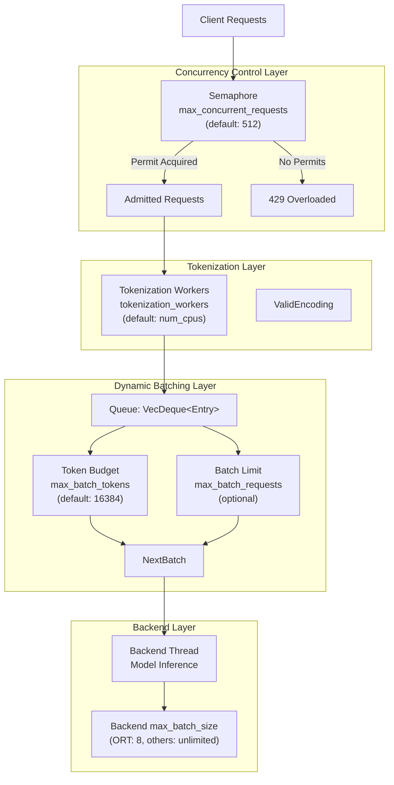
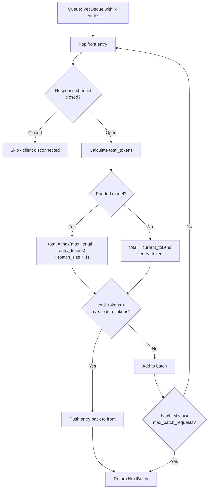

<!-- source: DeepWiki mcp.deepwiki.com · repo huggingface/text-embeddings-inference · page 7.3 Performance Tuning · fetched 2026-10-26 -->

# Performance Tuning

<details>
<summary>Relevant source files</summary>

The following files were used as context for generating this wiki page:

- [README.md](README.md)
- [docs/source/en/cli_arguments.md](docs/source/en/cli_arguments.md)
- [docs/source/en/custom_container.md](docs/source/en/custom_container.md)
- [docs/source/en/private_models.md](docs/source/en/private_models.md)
- [docs/source/en/quick_tour.md](docs/source/en/quick_tour.md)
- [docs/source/en/supported_models.md](docs/source/en/supported_models.md)
- [load_tests/load.js](load_tests/load.js)
- [load_tests/load_grpc.js](load_tests/load_grpc.js)
- [load_tests/load_grpc_stream.js](load_tests/load_grpc_stream.js)
- [router/src/lib.rs](router/src/lib.rs)
- [router/src/main.rs](router/src/main.rs)
- [router/src/prometheus.rs](router/src/prometheus.rs)

</details>


## Purpose and Scope

This document covers the performance optimization of Text Embeddings Inference (TEI) through configuration of concurrency, batching, and resource allocation parameters. These settings directly control throughput, latency, and hardware utilization.

For hardware-specific optimizations (Flash Attention, compute capabilities), see **5. Hardware Optimization**. For deployment configuration, see **7.1 Multi-Platform Docker Images**. For understanding the batching mechanism internals, see **3.4 Dynamic Batching Queue**.

## Performance Architecture



**Sources:** [router/src/lib.rs:44-70](), [router/src/main.rs:51-82](), [router/src/lib.rs:296-333]()

## Concurrency Control

### max_concurrent_requests

The `max_concurrent_requests` parameter controls the maximum number of requests being processed simultaneously via a semaphore-based admission control system.

**Configuration:**
```bash
--max-concurrent-requests 512  # Default value
```

**Mechanism:**

The system uses `Arc<Semaphore>` within the `Infer` struct to limit concurrent requests [router/src/lib.rs:31-32](). When a request arrives at the HTTP or gRPC layer:

1. `try_acquire_permit()` attempts to acquire a semaphore permit [router/src/lib.rs:51-52]().
2. If successful, the request proceeds to the `Tokenization` layer.
3. If no permits are available, the server returns an HTTP 429 (Overloaded) error or gRPC equivalent to handle backpressure [router/src/main.rs:56-58]().
4. The permit is held until the response is sent back to the client.

**Tuning Guidelines:**

| Workload Pattern | Recommended Value | Rationale |
|-----------------|-------------------|-----------|
| High throughput batch | 256-512 | Allows deep queue for batching efficiency. |
| Low latency single | 128-256 | Limits queue depth for faster response. |
| Memory constrained | 64-128 | Reduces peak memory usage. |
| High token variance | 512-1024 | Accommodates batching challenges. |

**Sources:** [router/src/main.rs:56-60](), [router/src/lib.rs:51-52]()

## Token Budget Management

### max_batch_tokens: The Critical Parameter

The `max_batch_tokens` parameter is **the most important tuning control** for hardware utilization [router/src/main.rs:62-63](). It represents the maximum total tokens that can be processed in a single batch.

**Configuration:**
```bash
--max-batch-tokens 16384  # Default, should be tuned for your hardware
```

**Why It's Critical:**

From [router/src/main.rs:65-72]():
> This represents the total amount of potential tokens within a batch. For `max_batch_tokens=1000`, you could fit `10` queries of `total_tokens=100` or a single query of `1000` tokens. Overall this number should be the largest possible until the model is compute bound.

### Dynamic Batching Algorithm



**Implementation:** The `Queue` struct in `text_embeddings_core::queue` handles this logic, determining how many entries from the `VecDeque` can fit into the `NextBatch` based on `max_batch_tokens` and whether the backend uses a `padded_model` [router/src/lib.rs:32]().

### Padded vs Non-Padded Models

**Non-Padded Models** (Candle backends with Flash Attention):
- Token count is the sum of all sequence lengths.
- Example: 10 sequences of [100, 150, 200, ...] tokens = 1,500 total.

**Padded Models** (ORT backend):
- All sequences in a batch are padded to the length of the longest sequence.
- Token count = `max_length` × `batch_size`.
- Example: 10 sequences with max length 200 = 2,000 total tokens.

**Sources:** [router/src/main.rs:62-74](), [router/src/lib.rs:52-53]()

## Batch Size Limits

### max_batch_requests

Optional parameter to limit the number of individual requests in a batch, independent of the token budget [router/src/main.rs:76-78]().

**Configuration:**
```bash
--max-batch-requests 64  # Optional, no default
```

**Interaction with Token Budget:**
The batching process stops when **either** the token budget (`max_batch_tokens`) or the request limit (`max_batch_requests`) is reached. This is useful for backends like ONNX Runtime (ORT) which may have internal batch size limitations.

### max_client_batch_size

Limits the number of inputs a single HTTP/gRPC request can contain [router/src/main.rs:80-82]().

**Configuration:**
```bash
--max-client-batch-size 32  # Default value
```

**Purpose:**
- Prevents a single client from monopolizing the batching queue.
- Validates input size before tokenization to save CPU cycles.

**Sources:** [router/src/main.rs:76-82](), [router/src/lib.rs:53-54]()

## Tokenization Workers

### tokenization_workers

Number of OS threads dedicated to tokenization, validation, and truncation [router/src/main.rs:32-36]().

**Configuration:**
```bash
--tokenization-workers 8  # Default: number of CPU cores
```

**Architecture:**
The `Tokenization` struct manages a pool of workers. Because tokenization is CPU-intensive and synchronous, TEI offloads this work from the main async runtime to dedicated threads to avoid blocking the event loop [router/src/lib.rs:33]().

**Sources:** [router/src/main.rs:32-36](), [router/src/lib.rs:47]()

## Model Warmup Phase

Before the server starts accepting traffic, it performs a warmup phase to initialize the backend and allocate necessary buffers [router/src/lib.rs:282-286]().

**Standard Warmup:**
TEI sends a synthetic batch through the model that matches the configured `max_batch_tokens` and `max_batch_requests`. This ensures that all CUDA kernels are compiled and memory is pre-allocated.

**Intel HPU Warmup:**
For Intel Gaudi (HPU), the warmup is more extensive because the Gaudi graph compiler needs to see specific batch sizes and sequence lengths to optimize execution. The following environment variables control this:
- `MAX_WARMUP_BATCH_SIZE`: Defaults to 8.
- `MAX_WARMUP_SEQUENCE_LENGTH`: Defaults to 1024.

**Sources:** [router/src/lib.rs:282-286](), [README.md:144-151]()

## Load Testing with k6

TEI includes `k6` scripts for benchmarking and performance validation in the `load_tests/` directory.

### HTTP Load Testing

The `load_tests/load.js` script tests the `/embed` endpoint using a constant arrival rate.

**Key Metrics Tracked:**
- `total_time`: End-to-end latency.
- `tokenization_time`: Time spent in `Tokenization` workers.
- `queue_time`: Time spent waiting in the `Queue`.
- `inference_time`: Time spent in the `Backend`.

**Usage:**
```bash
k6 run -e HOST=localhost:3000 load_tests/load.js
```

### gRPC and Streaming

For high-performance scenarios, TEI supports gRPC unary and streaming requests.
- `load_tests/load_grpc.js`: Tests unary gRPC calls [load_tests/load_grpc.js:1-69]().
- `load_tests/load_grpc_stream.js`: Tests bi-directional gRPC streaming [load_tests/load_grpc_stream.js:1-64]().

**Sources:** [load_tests/load.js:1-62](), [load_tests/load_grpc.js:1-69](), [load_tests/load_grpc_stream.js:1-64]()

## Monitoring with Prometheus

TEI exposes a Prometheus endpoint for real-time performance monitoring [router/src/prometheus.rs:5-47]().

**Key Buckets Configured:**
- **Inference Duration:** Geometric sequence starting at 0.00001s [router/src/prometheus.rs:14-23]().
- **Input Length:** Power-of-two buckets up to `max_input_length` [router/src/prometheus.rs:26-30]().
- **Batch Size:** Power-of-two buckets for `te_batch_next_size` [router/src/prometheus.rs:33-34]().
- **Batch Tokens:** Power-of-two buckets for `te_batch_next_tokens` [router/src/prometheus.rs:37-38]().

**Sources:** [router/src/prometheus.rs:5-47](), [router/src/lib.rs:68]()

---

