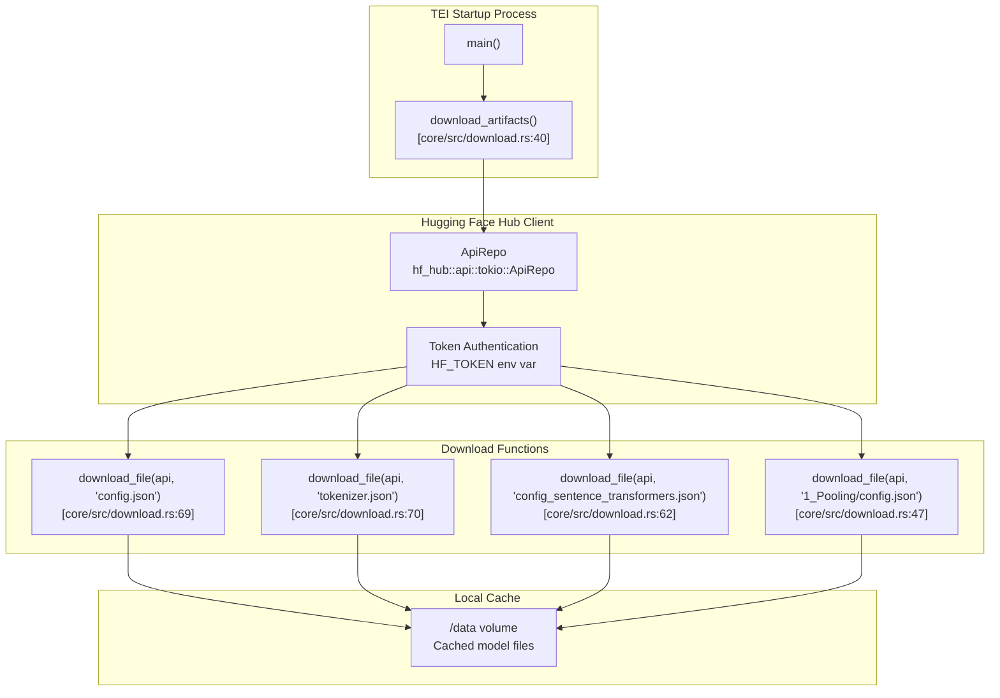
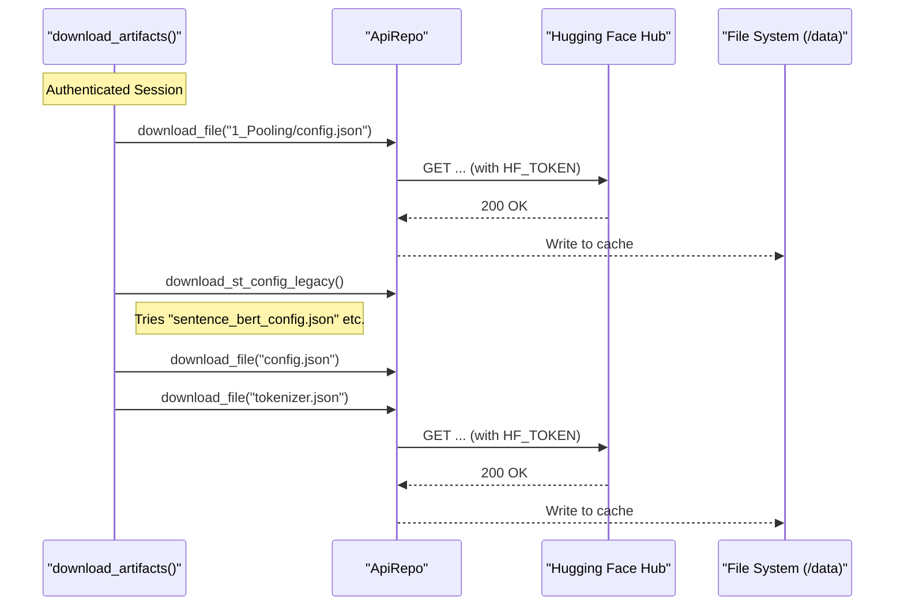

<!-- source: DeepWiki mcp.deepwiki.com · repo huggingface/text-embeddings-inference · page 7.4 Private Models and Authentication · fetched 2026-10-26 -->

# Private Models and Authentication

<details>
<summary>Relevant source files</summary>

The following files were used as context for generating this wiki page:

- [core/src/download.rs](core/src/download.rs)
- [docs/source/en/custom_container.md](docs/source/en/custom_container.md)
- [docs/source/en/private_models.md](docs/source/en/private_models.md)
- [docs/source/en/quick_tour.md](docs/source/en/quick_tour.md)
- [docs/source/en/supported_models.md](docs/source/en/supported_models.md)

</details>


This document describes how Text Embeddings Inference (TEI) handles authentication for private and gated models on Hugging Face Hub. It covers the authentication mechanism, model download flow, token configuration, and deployment patterns for restricted-access models.

For information about general deployment options, see [Docker Deployment](#2.1). For air-gapped deployments that bypass authentication entirely, see the Air Gapped Deployment section in [Basic Usage](#2.3).

## Overview

TEI uses the Hugging Face Hub API to download model artifacts (weights, configuration files, tokenizers) at startup. When a model is private or behind gated access, authentication is required. TEI leverages the `hf_hub` Rust crate's token-based authentication system, accepting credentials via the `HF_TOKEN` environment variable.

The authentication system integrates into the backend initialization process, where model files are downloaded once at startup and cached locally for subsequent runs.

## Authentication Mechanism

### Token-Based Access Control

TEI authentication uses Hugging Face Hub access tokens with read permissions. The system supports:

- **Private Models**: Models stored in private repositories requiring explicit user access.
- **Gated Models**: Public models with access restrictions requiring acceptance of terms or manual approval (e.g., `google/embeddinggemma-300m`). [docs/source/en/supported_models.md:35-35]()

The authentication flow is handled by the `hf_hub::api::tokio::ApiRepo` client, which automatically includes token credentials in HTTP requests to the Hub.

**Sources:** [docs/source/en/private_models.md:17-26](), [core/src/download.rs:1-3]()

### Token Configuration

| Method | Environment Variable | Example |
|--------|---------------------|---------|
| CLI Export | `HF_TOKEN` | `export HF_TOKEN=hf_xxxxx` |
| Docker `-e` flag | `HF_TOKEN` | `docker run -e HF_TOKEN=$token ...` |
| Docker Compose | `environment: HF_TOKEN` | In compose.yml |

**Sources:** [docs/source/en/private_models.md:27-41]()

## Model Download and Authentication Flow

### Component Architecture



**Diagram: Authentication and Model Download Flow**

The diagram shows how authentication credentials flow from the environment through the Hub client to the core download functions.

**Sources:** [core/src/download.rs:40-75](), [docs/source/en/private_models.md:35-41]()

### Download Process Details

#### 1. Artifact Download Sequence

The `download_artifacts` function in `core/src/download.rs` orchestrates the retrieval of essential files:



**Diagram: Authenticated Download Sequence**

Each `download_file` call uses the `ApiRepo` which includes the `HF_TOKEN` automatically. If a gated model is accessed without a valid token, the Hub returns a 401/403 error.

**Sources:** [core/src/download.rs:40-75](), [core/src/download.rs:17-20]()

#### 2. Legacy Configuration Support

TEI maintains backward compatibility for Sentence Transformers models by attempting to download legacy configuration files defined in `ST_CONFIG_NAMES`. This includes `sentence_bert_config.json`, `sentence_roberta_config.json`, and others. These files are used to determine `max_seq_length` if not present in the main `config.json`.

**Sources:** [core/src/download.rs:7-15](), [core/src/download.rs:22-37]()

### Cache Behavior

Downloaded files are stored in the path managed by `hf_hub`, which typically points to the mounted volume in Docker (`-v $volume:/data`). This persistence avoids redundant downloads and allows the service to start even if the Hub is temporarily unreachable, provided the files were previously cached.

**Sources:** [docs/source/en/quick_tour.md:35-44](), [core/src/download.rs:72-74]()

## Configuration Methods

### Method 1: Environment Variable Export

For local installations or CLI usage:

```bash
export HF_TOKEN=hf_xxxxxxxxxxxxxxxxxxxxx
text-embeddings-router --model-id org/private-model
```

**Sources:** [docs/source/en/private_models.md:27-31]()

### Method 2: Docker Environment Variable

Pass the token when starting the container:

```bash
docker run --gpus all \
  -e HF_TOKEN=hf_xxxxxxxxxxxxxxxxxxxxx \
  -p 8080:80 \
  -v $PWD/data:/data \
  --pull always \
  ghcr.io/huggingface/text-embeddings-inference:cuda-1.9 \
  --model-id org/private-model
```

**Sources:** [docs/source/en/private_models.md:35-41]()

## Air-Gapped Deployment

For environments without internet access, you can pre-download the model weights and mount them directly into the container. When the `--model-id` refers to a local path inside the container, TEI skips the Hub authentication and download logic.

```bash
# Pre-download on a machine with internet
git lfs install
git clone https://huggingface.co/Alibaba-NLP/gte-base-en-v1.5

# Run in air-gapped environment
docker run --gpus all -p 8080:80 -v $PWD:/data \
  ghcr.io/huggingface/text-embeddings-inference:cuda-1.9 \
  --model-id /data/gte-base-en-v1.5
```

**Sources:** [docs/source/en/quick_tour.md:175-196]()

## Error Handling

The `download_artifacts` function handles optional files (like pooling configs) gracefully by logging warnings instead of failing the entire process. However, critical files like `config.json` and `tokenizer.json` are mandatory; if their download fails due to authentication errors, the process will return an `ApiError`.

**Sources:** [core/src/download.rs:49-52](), [core/src/download.rs:64-67](), [core/src/download.rs:69-70]()

## Best Practices Summary

| Recommendation | Rationale |
|---------------|-----------|
| Use volume mounts (`-v $PWD/data:/data`) | Persist cache and avoid re-downloading gated models. |
| Use read-only tokens | Follow the principle of least privilege for security. |
| Set `HF_TOKEN` via Docker `-e` | Avoid persisting secrets in the host's environment history. |
| Verify gated access | Ensure you have accepted the model's terms on the Hub website. |

**Sources:** [docs/source/en/quick_tour.md:35-44](), [docs/source/en/private_models.md:19-26]()

---

