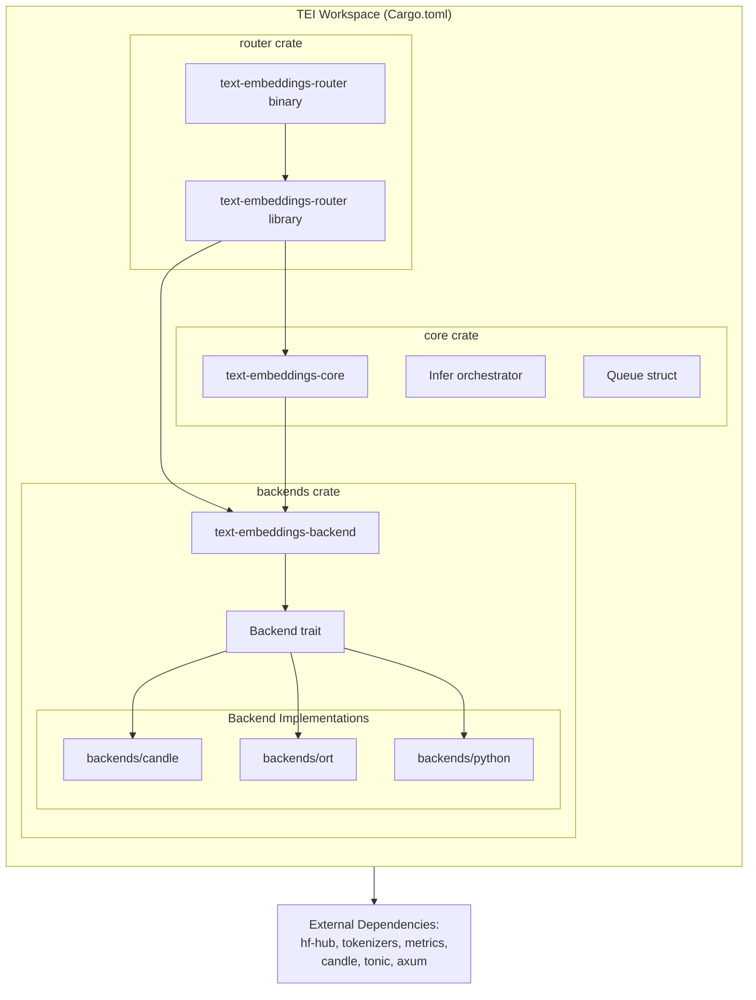
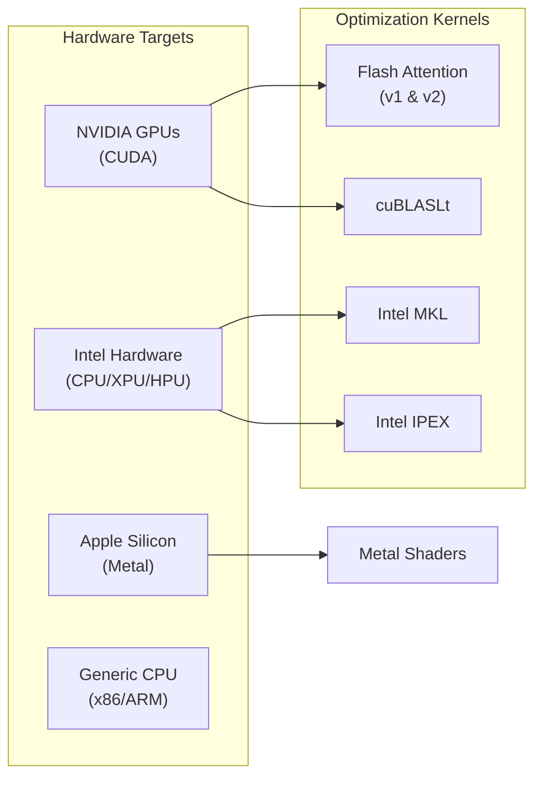

<!-- source: DeepWiki mcp.deepwiki.com · repo huggingface/text-embeddings-inference · page 8 Development Guide · fetched 2026-10-26 -->

# Development Guide

<details>
<summary>Relevant source files</summary>

The following files were used as context for generating this wiki page:

- [Cargo.lock](Cargo.lock)
- [Cargo.toml](Cargo.toml)
- [README.md](README.md)
- [docs/openapi.json](docs/openapi.json)
- [docs/source/en/cli_arguments.md](docs/source/en/cli_arguments.md)
- [router/src/lib.rs](router/src/lib.rs)
- [router/src/main.rs](router/src/main.rs)

</details>


This guide provides information for developers who want to contribute to or modify Text Embeddings Inference (TEI). It covers the project's architecture, building from source, development environment setup, and testing procedures. For information about deploying TEI in production environments, see [Deployment and Operations](#7).

## Project Structure

Text Embeddings Inference is organized as a Rust workspace with multiple crates that work together. The workspace follows a modular design where the router coordinates request handling while backends provide model execution capabilities.

### Workspace Layout



Sources: [Cargo.toml:1-22](), [router/src/lib.rs:31-33](), [router/src/main.rs:1-11]()

### Crate Responsibilities

| Crate | Path | Primary Exports | Dependencies |
|-------|------|-----------------|--------------|
| `text-embeddings-router` | `router/` | Binary executable, HTTP/gRPC servers | `text-embeddings-core`, `text-embeddings-backend`, `axum`, `tonic` |
| `text-embeddings-core` | `core/` | `Infer` orchestrator, `Queue` struct, `Tokenization` | `text-embeddings-backend`, `tokenizers`, `async-channel` |
| `text-embeddings-backend` | `backends/` | `Backend` trait, initialization logic | Backend implementation crates |
| `text-embeddings-backend-candle` | `backends/candle/` | Candle-based model implementations | `candle`, `candle-nn`, `candle-transformers` |
| `text-embeddings-backend-ort` | `backends/ort/` | ONNX Runtime backend | `ort` (ONNX Runtime bindings) |
| `text-embeddings-backend-python` | `backends/python/` | Python subprocess backend via gRPC | Python runtime, gRPC |

For more details, see [Project Structure](#8.1).

Sources: [Cargo.toml:1-22](), [router/src/lib.rs:29-34]()

## Setting Up the Development Environment

### Prerequisites

To develop TEI, you'll need:

- Rust toolchain (1.85.0 or newer)
- Protobuf compiler (for gRPC support)
- For GPU development: CUDA toolkit (NVIDIA) or ROCm (AMD)
- For Intel-specific builds: Intel MKL or IPEX

### Hardware and Optimization Matrix

TEI supports a wide variety of hardware platforms, each with specific feature flags and build requirements.



Sources: [README.md:49-63](), [Cargo.toml:45-55]()

## Building from Source

TEI uses Cargo features extensively to select hardware backends and optimizations at compile time.

### Common Build Commands

**CPU-only build (default):**
```bash
cargo build --release
```

**NVIDIA GPU build (with Flash Attention):**
```bash
CUDA_COMPUTE_CAP=80 cargo build --release --features candle-cuda
```

**Apple Silicon with Metal:**
```bash
cargo build --release --features candle,metal
```

For detailed build instructions, see [Building from Source](#8.2).

Sources: [router/src/main.rs:13-152](), [docs/source/en/cli_arguments.md:17-145]()

## Adding New Model Architectures

Adding a model involves implementing the architecture in the `candle` backend or providing support via `ort` or `python` backends.

### Model Integration Path

```mermaid
graph TD
    [New_Model_Request] --> [Identify_Architecture]
    [Identify_Architecture] --> [Check_Candle_Support]
    
    subgraph Candle_Implementation["backends/candle/src/models/"]
        [Check_Candle_Support] -- Yes --> [Model_Trait_Impl]
        [Model_Trait_Impl] --> [Add_to_Dispatch]
    end
    
    subgraph Configuration["router/src/lib.rs"]
        [Add_to_Dispatch] --> [get_backend_model_type]
        [get_backend_model_type] --> [Inference_Engine]
    end
```

For a step-by-step guide, see [Adding New Model Architectures](#8.3).

Sources: [router/src/lib.rs:115-141](), [README.md:66-115]()

## Testing Strategy

TEI uses a combination of unit tests, integration tests, and snapshot testing to ensure correctness and performance.

- **Unit Tests**: Found within individual crates for logic verification.
- **Integration Tests**: Test the full request lifecycle from HTTP/gRPC to backend.
- **Snapshot Testing**: Uses `insta` to verify that embedding outputs match expected vectors.

For more information, see [Testing Strategy](#8.4).

Sources: [Cargo.toml:44](), [router/src/lib.rs:2-17]()

## CI/CD Pipeline

The project uses GitHub Actions to automate linting, testing, and Docker image generation across a matrix of hardware configurations.

- **Linting**: Enforces `clippy` and `rustfmt` standards.
- **Matrix Builds**: Generates images for `turing`, `ampere`, `hopper`, `cpu`, and `hpu`.
- **Automated Testing**: Runs the test suite on various hardware emulators or runners.

For details on the automation workflows, see [CI/CD Pipeline](#8.5).

Sources: [README.md:32-33](), [Cargo.toml:65-79]()

---

