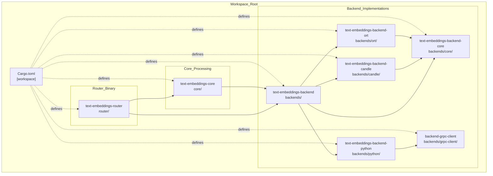
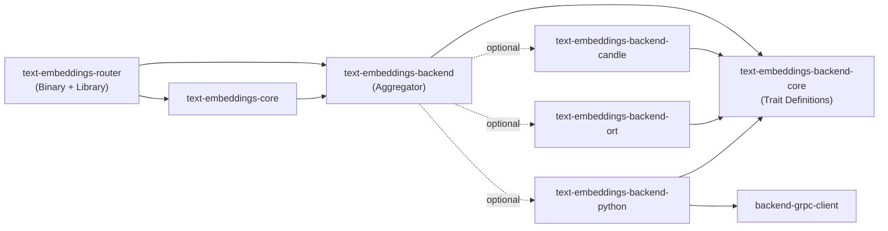
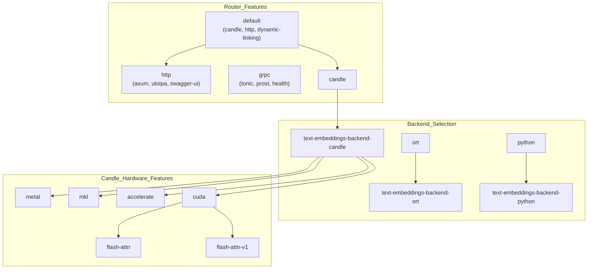
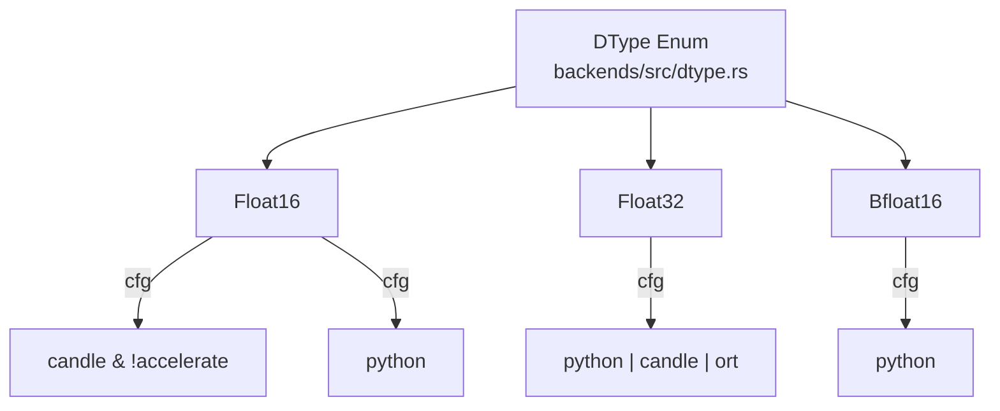

<!-- source: DeepWiki mcp.deepwiki.com · repo huggingface/text-embeddings-inference · page 8.1 Project Structure · fetched 2026-10-26 -->

# Project Structure

<details>
<summary>Relevant source files</summary>

The following files were used as context for generating this wiki page:

- [Cargo.lock](Cargo.lock)
- [Cargo.toml](Cargo.toml)
- [backends/Cargo.toml](backends/Cargo.toml)
- [backends/candle/Cargo.toml](backends/candle/Cargo.toml)
- [backends/core/Cargo.toml](backends/core/Cargo.toml)
- [backends/src/dtype.rs](backends/src/dtype.rs)
- [core/Cargo.toml](core/Cargo.toml)
- [docs/openapi.json](docs/openapi.json)
- [router/Cargo.toml](router/Cargo.toml)

</details>


This page describes the workspace organization, crate architecture, and module dependencies in the Text Embeddings Inference codebase. For information about building from source with specific features, see [Building from Source](#8.2). For details on specific backend implementations, see [Backend Architecture and Selection](#4.1).

---

## Workspace Organization

Text Embeddings Inference is structured as a Cargo workspace containing multiple interdependent crates. The workspace follows a layered architecture where higher-level crates depend on lower-level abstractions.

### Workspace Members

The project is organized into three main layers:

| Layer | Crates | Purpose |
|-------|--------|---------|
| **Router Layer** | `text-embeddings-router` | HTTP/gRPC servers, request handling, API endpoints |
| **Core Layer** | `text-embeddings-core` | Tokenization workers, batching queue, orchestration |
| **Backend Layer** | `text-embeddings-backend`<br/>`text-embeddings-backend-core`<br/>`text-embeddings-backend-candle`<br/>`text-embeddings-backend-ort`<br/>`text-embeddings-backend-python`<br/>`backend-grpc-client` | Model inference implementations and abstractions |

**Workspace Structure Diagram**



**Sources:** [Cargo.toml:1-21]()

---

## Crate Dependency Graph

The crates are organized in a strict hierarchy to maintain clean separation of concerns and avoid circular dependencies.

### Dependency Relationships



### Dependency Details

**Router Crate** (`text-embeddings-router`)
- **Path:** [router/]()
- **Type:** Binary crate with library components defined in `src/lib.rs` [router/Cargo.toml:10-11]() and `src/main.rs` [router/Cargo.toml:13-15]().
- **Dependencies:**
  - `text-embeddings-core` [router/Cargo.toml:20]()
  - `text-embeddings-backend` with `clap` feature [router/Cargo.toml:19]()
  - HTTP stack: `axum`, `tower-http`, `utoipa` (optional via `http` feature) [router/Cargo.toml:83]()
  - gRPC stack: `tonic`, `prost`, `tonic-health` (optional via `grpc` feature) [router/Cargo.toml:84]()
- **Purpose:** Entry point for the application, implements HTTP/gRPC servers and API routes.

**Core Crate** (`text-embeddings-core`)
- **Path:** [core/]()
- **Type:** Library
- **Dependencies:**
  - `text-embeddings-backend` [core/Cargo.toml:13]()
  - `async-channel` for tokenization worker communication [core/Cargo.toml:9]()
  - `tokenizers` for HuggingFace tokenizer integration [core/Cargo.toml:15]()
- **Purpose:** Implements tokenization workers, dynamic batching queue, and orchestration logic.

**Backends Aggregator** (`text-embeddings-backend`)
- **Path:** [backends/]()
- **Type:** Library (feature aggregator)
- **Dependencies:**
  - `text-embeddings-backend-core` [backends/Cargo.toml:13]()
  - `text-embeddings-backend-candle` (optional via `candle` feature) [backends/Cargo.toml:15]()
  - `text-embeddings-backend-ort` (optional via `ort` feature) [backends/Cargo.toml:16]()
  - `text-embeddings-backend-python` (optional via `python` feature) [backends/Cargo.toml:14]()
- **Purpose:** Aggregates backend implementations and provides backend selection logic.

**Backend Core** (`text-embeddings-backend-core`)
- **Path:** [backends/core/]()
- **Type:** Library
- **Dependencies:** Minimal (only basic traits, `nohash-hasher`, `serde`) [backends/core/Cargo.toml:8-13]()
- **Purpose:** Defines common abstractions and the core traits used by all backend implementations.

**Candle Backend** (`text-embeddings-backend-candle`)
- **Path:** [backends/candle/]()
- **Type:** Library
- **Dependencies:**
  - `candle-core`, `candle-nn`, `candle-transformers` [backends/candle/Cargo.toml:12-14]()
  - `candle-flash-attn` (optional via `flash-attn` feature) [backends/candle/Cargo.toml:15]()
  - `candle-flash-attn-v1` (optional via `flash-attn-v1` feature) [backends/candle/Cargo.toml:16]()
- **Purpose:** Rust-native ML backend using the Candle framework.

**Sources:** [Cargo.toml:1-21](), [router/Cargo.toml:1-97](), [backends/Cargo.toml:1-32](), [core/Cargo.toml:1-18](), [backends/candle/Cargo.toml:1-47]()

---

## Feature Flag Architecture

The project uses Cargo feature flags extensively to control compilation of optional backends and hardware-specific optimizations.

### Feature Organization



### Feature Flag Matrix

| Feature | Crate | Purpose | Enables |
|---------|-------|---------|---------|
| `http` | router | HTTP server support | axum, tower-http, utoipa [router/Cargo.toml:83]() |
| `grpc` | router | gRPC server support | tonic, prost, tonic-health [router/Cargo.toml:84]() |
| `candle` | router, backends | Rust ML backend | text-embeddings-backend-candle [router/Cargo.toml:90]() |
| `ort` | router, backends | ONNX Runtime backend | text-embeddings-backend-ort [router/Cargo.toml:89]() |
| `python` | router, backends | Python backend | text-embeddings-backend-python [router/Cargo.toml:88]() |
| `metal` | router, backends, candle | Apple GPU support | candle/metal, candle-nn/metal [backends/candle/Cargo.toml:43]() |
| `mkl` | router, backends, candle | Intel MKL math library | intel-mkl-src, candle/_mkl [backends/candle/Cargo.toml:44]() |
| `accelerate` | router, backends, candle | Apple Accelerate framework | accelerate-src, candle/accelerate [backends/candle/Cargo.toml:42]() |
| `candle-cuda` | router | NVIDIA GPU (Ampere+) | flash-attn, cudarc [router/Cargo.toml:91]() |
| `candle-cuda-turing` | router | NVIDIA GPU (Turing) | flash-attn-v1, cudarc [router/Cargo.toml:92]() |
| `candle-cuda-volta` | router | NVIDIA GPU (Volta) | cuda, cudarc [router/Cargo.toml:93]() |
| `static-linking` | router | Static linking | cudarc/static-linking, mkl-static [router/Cargo.toml:94]() |
| `dynamic-linking` | router | Dynamic linking (default) | cudarc/dynamic-linking, mkl-dynamic [router/Cargo.toml:95]() |

**Sources:** [router/Cargo.toml:81-97](), [backends/Cargo.toml:21-32](), [backends/candle/Cargo.toml:41-48]()

---

## Directory Structure

The project follows a consistent directory layout across all crates.

### Complete Project Tree

```
text-embeddings-inference/
├── Cargo.toml                    # Workspace manifest [Cargo.toml:1]()
├── Cargo.lock                    # Dependency lock file [Cargo.lock:1]()
├── router/                       # Router crate (main binary)
│   ├── Cargo.toml
│   ├── build.rs                  # Generates version info [router/Cargo.toml:4]()
│   └── src/
│       ├── lib.rs
│       └── main.rs               # Application entry point [router/Cargo.toml:15]()
├── core/                         # Core processing crate
│   ├── Cargo.toml
│   └── src/
│       └── lib.rs
├── backends/                     # Backend implementations
│   ├── Cargo.toml                # Aggregator crate
│   ├── src/
│   │   ├── lib.rs                # Backend selection logic
│   │   └── dtype.rs              # Data type definitions [backends/src/dtype.rs:1]()
│   ├── core/                     # Backend trait definitions
│   │   └── Cargo.toml
│   ├── candle/                   # Candle (Rust ML) backend
│   │   ├── Cargo.toml
│   │   └── src/
│   │       └── lib.rs
│   ├── ort/                      # ONNX Runtime backend
│   │   └── Cargo.toml
│   └── python/                   # Python backend
│       └── Cargo.toml
└── docs/                         # Documentation
    └── openapi.json              # OpenAPI specification [docs/openapi.json:1]()
```

**Sources:** [Cargo.toml:1-21](), [router/Cargo.toml:1-15](), [core/Cargo.toml:1-18](), [backends/Cargo.toml:1-32]()

---

## Workspace Configuration

The workspace defines common configurations and dependencies shared across all member crates.

### Workspace-Level Dependencies

The workspace manifest defines common dependencies with locked versions that are shared across multiple crates [Cargo.toml:30-56](). Individual crates reference these using `{ workspace = true }` syntax.

**Core Dependencies:**
- `anyhow = "1.0.75"` [Cargo.toml:31]()
- `clap = { version = "4.1", features = ["derive", "env"] }` [Cargo.toml:32]()
- `hf-hub = { version = "0.4", features = ["tokio"], default-features = false }` [Cargo.toml:33]()
- `tokenizers = { version = "0.21.0", ... }` [Cargo.toml:37]()
- `tokio = { version = "1.25", ... }` [Cargo.toml:38]()

**ML Framework Dependencies:**
- `candle = { version = "0.8", package = "candle-core" }` [Cargo.toml:47]()
- `candle-nn = { version = "0.8" }` [Cargo.toml:48]()
- `candle-transformers = { version = "0.8" }` [Cargo.toml:49]()

### Dependency Patches

The workspace uses Cargo's patch mechanism to override specific dependencies with git versions for `cudarc` and `candle` components [Cargo.toml:58-64]().

### Compilation Profile

The workspace defines optimized release profiles for production builds:

```toml
[profile.release]
debug = 0                 # No debug symbols [Cargo.toml:66]
lto = "fat"              # Full link-time optimization [Cargo.toml:67]
opt-level = 3            # Maximum optimization [Cargo.toml:68]
codegen-units = 1        # Single codegen unit [Cargo.toml:69]
strip = "symbols"        # Strip symbols [Cargo.toml:70]
panic = "abort"          # Abort on panic [Cargo.toml:71]
```

**Sources:** [Cargo.toml:24-78]()

---

## Module Architecture

### Data Types and Backend Selection

The `text-embeddings-backend` crate manages the selection of numerical precision and backend dispatch.

**Natural Language to Code Entity Space**

| System Concept | Code Entity | File Path |
| :--- | :--- | :--- |
| **Precision Control** | `enum DType` | [backends/src/dtype.rs:8]() |
| **Model Loader** | `init_backend` (implied) | [backends/src/lib.rs]() |
| **Request Schema** | `EmbedRequest` | [docs/openapi.json:100]() |
| **API Definition** | `openapi.json` | [docs/openapi.json:1]() |

### DType Module

The `DType` enum manages precision across different backends and hardware features:



**Sources:** [backends/src/dtype.rs:1-60](), [docs/openapi.json:1-113]()

---

## Import Patterns

### Feature-Conditional Imports

The codebase uses conditional compilation extensively to manage hardware-specific code and dependencies:

```rust
// From backends/src/dtype.rs
#[cfg(feature = "clap")]
use clap::ValueEnum; // [backends/src/dtype.rs:4]

#[cfg(any(feature = "python", all(feature = "candle", not(feature = "accelerate"))))]
DType::Float16, // [backends/src/dtype.rs:14]
```

This pattern allows the same code to expose different APIs and support different data types based on the enabled hardware features at compile time.

**Sources:** [backends/src/dtype.rs:1-36](), [router/Cargo.toml:81-97]()

---

