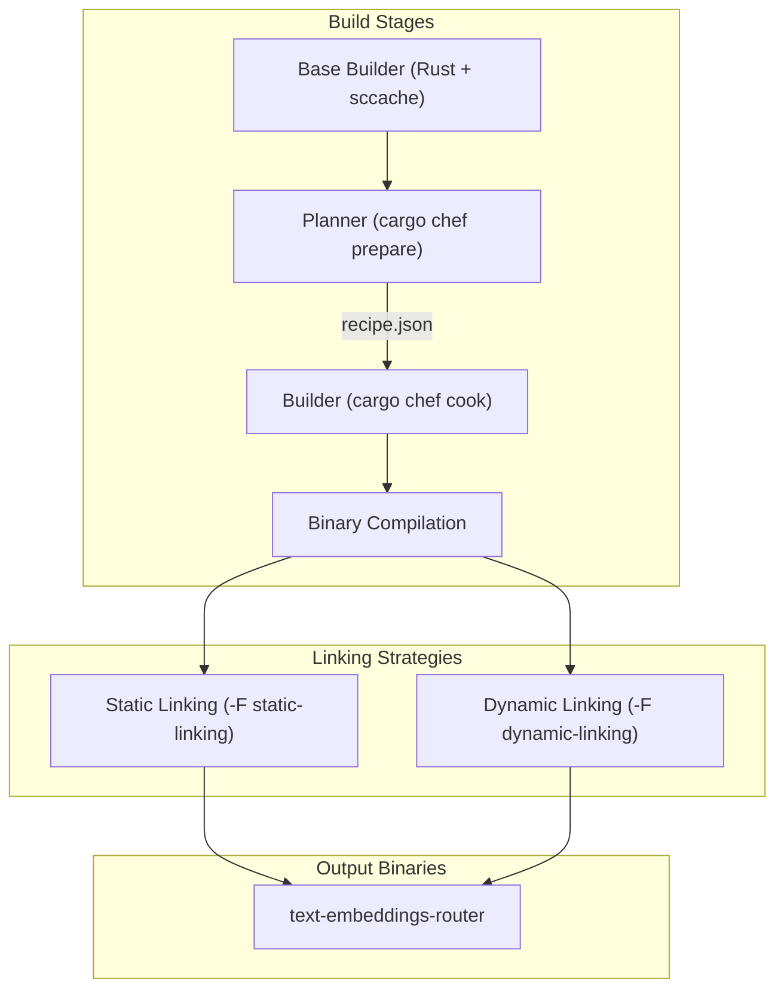
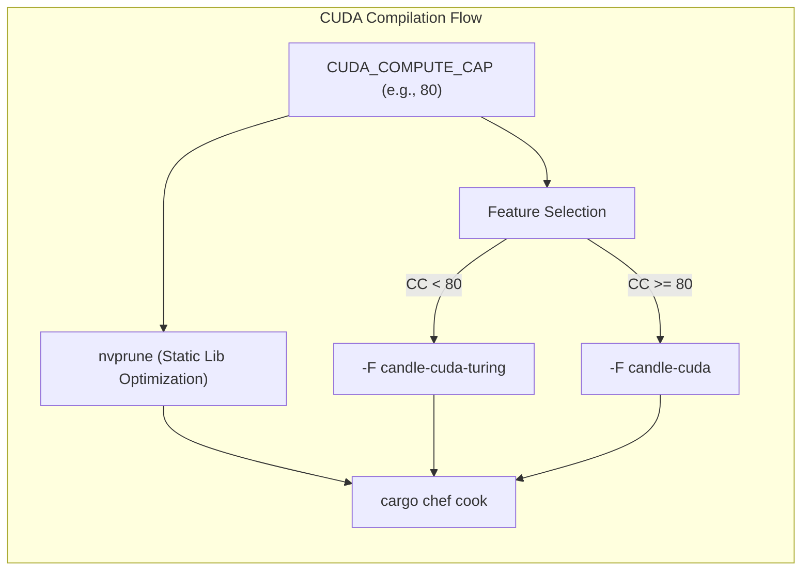

<!-- source: DeepWiki mcp.deepwiki.com · repo huggingface/text-embeddings-inference · page 8.2 Building from Source · fetched 2026-10-26 -->

# Building from Source

<details>
<summary>Relevant source files</summary>

The following files were used as context for generating this wiki page:

- [Dockerfile](Dockerfile)
- [Dockerfile-cuda](Dockerfile-cuda)
- [Dockerfile-cuda-all](Dockerfile-cuda-all)
- [Makefile](Makefile)
- [backends/Cargo.toml](backends/Cargo.toml)
- [backends/candle/Cargo.toml](backends/candle/Cargo.toml)
- [backends/candle/build.rs](backends/candle/build.rs)
- [backends/src/dtype.rs](backends/src/dtype.rs)
- [core/Cargo.toml](core/Cargo.toml)
- [cuda-all-entrypoint.sh](cuda-all-entrypoint.sh)
- [cuda-entrypoint.sh](cuda-entrypoint.sh)
- [router/Cargo.toml](router/Cargo.toml)

</details>


This guide provides technical instructions for building the Text Embeddings Inference (TEI) system from source code. It covers compilation with feature flags, dependency management using `cargo-chef` and `sccache`, and linking strategies for different hardware targets.

## Overview of the Build Pipeline

TEI utilizes a multi-stage build process to optimize compilation times and binary sizes. The architecture relies on `cargo-chef` for layer caching and `sccache` for compiler result caching.



Sources: [Dockerfile-cuda:1-41](), [Dockerfile:1-21](), [router/Cargo.toml:94-95]()

## Dependency Management and Caching

### cargo-chef
TEI uses `cargo-chef` to separate the dependency download and compilation phase from the source code compilation phase. This ensures that Docker layer caches remain valid unless `Cargo.lock` changes.
- **Planner Stage**: Generates a `recipe.json` containing the dependency tree [Dockerfile-cuda:39]().
- **Cook Stage**: Compiles all dependencies listed in the recipe [Dockerfile-cuda:87-89]().

### sccache
To further accelerate builds, `sccache` is used as a `RUSTC_WRAPPER`. It caches compiled object files across different build runs.
- Configured via environment variables: `RUSTC_WRAPPER=/usr/local/bin/sccache` [Dockerfile-cuda:4]().
- In CI/CD, it can be backed by GitHub Actions cache or S3 [Dockerfile-cuda:53]().

Sources: [Dockerfile-cuda:3-7](), [Dockerfile-cuda:39](), [Dockerfile-cuda:87-89]()

## Compilation Feature Flags

The `text-embeddings-router` crate defines several feature flags that control backend selection and API protocol support.

| Feature Flag | Description | Included Dependencies |
| :--- | :--- | :--- |
| `candle` | Enables the Rust-native Candle ML backend | `text-embeddings-backend-candle` |
| `ort` | Enables the ONNX Runtime backend | `text-embeddings-backend-ort` |
| `python` | Enables the gRPC-based Python backend | `text-embeddings-backend-python` |
| `http` | Enables Axum-based HTTP endpoints | `axum`, `tower-http`, `utoipa` |
| `grpc` | Enables Tonic-based gRPC services | `tonic`, `prost`, `async-stream` |
| `mkl` | Enables Intel Math Kernel Library optimizations | `intel-mkl-src` |
| `candle-cuda` | Enables CUDA support for Candle (Ampere+) | `cudarc`, `flash-attn` |
| `candle-cuda-turing` | Enables CUDA support for Turing GPUs | `cudarc`, `flash-attn-v1` |

Sources: [router/Cargo.toml:81-97](), [backends/Cargo.toml:21-32]()

## Hardware-Specific Build Arguments

### NVIDIA CUDA
For CUDA builds, the `CUDA_COMPUTE_CAP` argument is critical as it determines which GPU kernels are compiled and how `libcublas_static.a` is pruned using `nvprune` to reduce binary size.



Sources: [Dockerfile-cuda:43-90](), [backends/candle/build.rs:4-7]()

### Intel MKL and "FakeIntel" Patch
When building for Intel CPUs with MKL, TEI implements a specific patch to force MKL to use optimized kernels even on non-genuine Intel CPUs (e.g., AMD) or certain virtualized environments.
- **Implementation**: A small C shim `fakeintel.c` defines `mkl_serv_intel_cpu_true() {return 1;}` [Dockerfile:39-40]().
- **Linking**: This is compiled into `libfakeintel.so` and loaded via `LD_PRELOAD` at runtime [Dockerfile:80]().

Sources: [Dockerfile:29-40](), [Dockerfile:80-81]()

## Linking Strategies

TEI supports both static and dynamic linking for heavy dependencies like CUDA and MKL.

1.  **Static Linking (`-F static-linking`)**:
    - For CUDA: Links `libcublas_static.a`, `libcudart_static.a`, etc. [router/Cargo.toml:94]().
    - For MKL: Uses `mkl-static-lp64-iomp` [router/Cargo.toml:94]().
    - Benefit: Produces a more portable binary with fewer runtime shared library dependencies.
2.  **Dynamic Linking (`-F dynamic-linking`)**:
    - Links against system shared objects (`.so` or `.dll`).
    - Benefit: Faster build times and smaller binary size, but requires the environment to have the correct libraries in `LD_LIBRARY_PATH`.

Sources: [router/Cargo.toml:94-95](), [Dockerfile-cuda:87-89]()

## Multi-Architecture Support

TEI builds binaries for both `amd64` (x86_64) and `arm64` (aarch64). The `Dockerfile-cuda` handles this by selecting the appropriate `sccache` and `protoc` binaries based on the `TARGETARCH` build argument.

| Architecture | sccache suffix | protoc suffix |
| :--- | :--- | :--- |
| `amd64` | `x86_64-unknown-linux-musl` | `x86_64` |
| `arm64` | `aarch64-unknown-linux-musl` | `aarch_64` |

Sources: [Dockerfile-cuda:16-23](), [Dockerfile-cuda:115-125]()

## Build Commands Summary

### Local Development (CPU)
```bash
cargo build --release --features candle,http
```

### Local Development (CUDA)
```bash
CUDA_COMPUTE_CAP=80 cargo build --release --features candle-cuda,http
```

### Production Docker (CUDA All)
This build creates a single image containing multiple binaries optimized for different compute capabilities (75, 80, 90, 100, 120), with a wrapper entrypoint to select the best one at runtime.
```bash
docker build -f Dockerfile-cuda-all -t tei-cuda-all .
```

Sources: [Makefile:4-5](), [Dockerfile-cuda-all:82-111](), [cuda-all-entrypoint.sh:29-44]()

---

