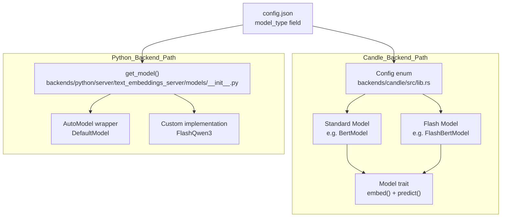
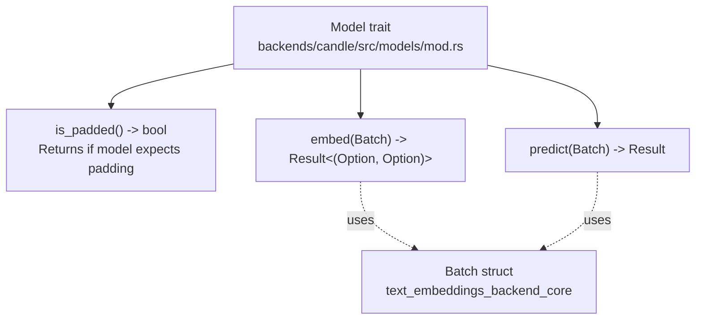
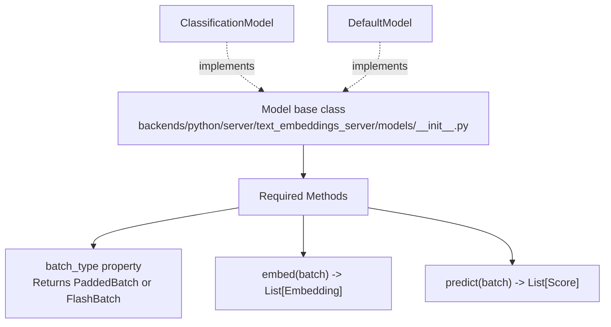

<!-- source: DeepWiki mcp.deepwiki.com · repo huggingface/text-embeddings-inference · page 8.3 Adding New Model Architectures · fetched 2026-10-26 -->

# Adding New Model Architectures

<details>
<summary>Relevant source files</summary>

The following files were used as context for generating this wiki page:

- [backends/candle/src/layers/rotary.rs](backends/candle/src/layers/rotary.rs)
- [backends/candle/src/lib.rs](backends/candle/src/lib.rs)
- [backends/candle/src/models/flash_mistral.rs](backends/candle/src/models/flash_mistral.rs)
- [backends/candle/src/models/flash_qwen3.rs](backends/candle/src/models/flash_qwen3.rs)
- [backends/candle/src/models/gemma3.rs](backends/candle/src/models/gemma3.rs)
- [backends/candle/src/models/llama.rs](backends/candle/src/models/llama.rs)
- [backends/candle/src/models/mistral.rs](backends/candle/src/models/mistral.rs)
- [backends/candle/src/models/mod.rs](backends/candle/src/models/mod.rs)
- [backends/python/server/text_embeddings_server/models/classification_model.py](backends/python/server/text_embeddings_server/models/classification_model.py)
- [backends/python/server/text_embeddings_server/models/default_model.py](backends/python/server/text_embeddings_server/models/default_model.py)
- [backends/python/server/text_embeddings_server/models/types.py](backends/python/server/text_embeddings_server/models/types.py)
- [backends/python/server/text_embeddings_server/server.py](backends/python/server/text_embeddings_server/server.py)

</details>


## Purpose and Scope

This document explains how to implement support for new model architectures in Text Embeddings Inference (TEI). It covers adding models to both the Candle backend (Rust-native) and Python backend, including configuration parsing, weight loading, forward pass implementation, and testing strategies.

For information about the overall backend system architecture and selection logic, see [Backend Architecture and Selection](#4.1). For details on existing model implementations, see [Model Implementations](#4.7).

---

## Model System Overview

TEI supports model architectures through two backend implementations:

**Diagram: Model Implementation Paths**



**Sources:** [backends/candle/src/lib.rs:124-154](), [backends/python/server/text_embeddings_server/models/default_model.py:16-53](), [backends/python/server/text_embeddings_server/server.py:10-10]()

---

## Candle Backend Implementation

### Configuration Registration

Models are registered through the `Config` enum using serde's tagged enum deserialization based on the `model_type` field in `config.json`.

**Step 1: Add Model Config Struct**

Create a configuration struct matching the model's `config.json` schema. For example, the `Gemma3Config` includes fields for attention bias and RoPE parameters.

```rust
// In backends/candle/src/models/gemma3.rs
#[derive(Debug, Clone, PartialEq, Deserialize)]
pub struct Gemma3Config {
    pub attention_bias: bool,
    pub hidden_size: usize,
    pub num_hidden_layers: usize,
    pub num_attention_heads: usize,
    pub intermediate_size: usize,
    pub rms_norm_eps: f32,
    pub rope_theta: Option<f32>,
    // ...
}
```

**Step 2: Register in Config Enum**

Add the new model type to the `Config` enum in `lib.rs`. The `#[serde(tag = "model_type")]` attribute tells serde to match the `model_type` field value against the enum variant name.

```rust
// In backends/candle/src/lib.rs
#[derive(Deserialize)]
#[serde(tag = "model_type", rename_all = "kebab-case")]
enum Config {
    Bert(BertConfigWrapper),
    Gemma3(Gemma3Config), // Registered here
    Qwen3(Qwen3Config),
    // ...
}
```

**Sources:** [backends/candle/src/models/gemma3.rs:12-34](), [backends/candle/src/lib.rs:124-154]()

---

### Model Trait Implementation

All Candle models must implement the `Model` trait, which provides the interface for embedding and prediction tasks.

**Diagram: Model Trait Interface**



**Step 3: Implement Model Structure and Load**

The `load` function constructs the model from weights using `VarBuilder`. It typically initializes layers and normalization components.

```rust
// Example load logic for Gemma3
pub fn load(vb: VarBuilder, config: &Gemma3Config, model_type: ModelType) -> Result<Self> {
    let pool = match model_type {
        ModelType::Classifier => Pool::Cls,
        ModelType::Embedding(pool) => pool,
    };
    // ... initialize layers ...
}
```

**Sources:** [backends/candle/src/models/mod.rs:104-114](), [backends/candle/src/models/gemma3.rs:315-325]()

---

### Forward Pass Implementation

The forward pass processes a `Batch` through the model layers. It involves preparing input tensors and iterating through transformer blocks.

**Step 4: Implement Forward Method**

Models like `Mistral` or `Qwen3` use cumulative sequence lengths for variable-length processing in Flash Attention variants.

```rust
// Example from FlashMistral
pub fn forward(&self, batch: Batch) -> Result<(Option<Tensor>, Option<Tensor>)> {
    let cu_seqlens = Tensor::from_vec(batch.cumulative_seq_lengths, (batch.len() + 1,), &self.device)?;
    // ... layer loop ...
}
```

**Step 5: Implement Attention and MLP**

Model-specific components like `MistralAttention` and `MistralMLP` are loaded with `VarBuilder` paths (e.g., `vb.pp("self_attn")`, `vb.pp("mlp")`).

**Sources:** [backends/candle/src/models/flash_mistral.rs:178-201](), [backends/candle/src/models/flash_qwen3.rs:186-213]()

---

### Flash Attention and Rotary Embeddings

For CUDA devices, implement a Flash variant using `flash_attn_varlen`. These models frequently utilize Rotary Positional Embeddings (RoPE).

**Rotary Embedding Helpers:**
- `get_inv_freqs`: Computes inverse frequencies for RoPE, supporting Llama3 and NTK scaling.
- `apply_rotary_inplace`: Applies rotary transformations to Query and Key tensors.

**Flash Attention Dispatch:**
Flash variants (e.g., `FlashMistralModel`, `FlashQwen3Model`) call `flash_attn_varlen` with `cu_seqlens` and `max_s`.

**Sources:** [backends/candle/src/layers/rotary.rs:29-97](), [backends/candle/src/models/flash_mistral.rs:97-110](), [backends/candle/src/models/flash_qwen3.rs:155-169]()

---

### Registration in Backend Loading

**Step 6: Add Model Loading Cases**

In `backends/candle/src/lib.rs`, the `CandleBackend::new` function dispatches to specific model implementations based on the deserialized `Config` and available hardware features (like Flash Attention).

```rust
// Example dispatch logic
let model: Box<dyn Model + Send> = match (config, &device) {
    (Config::Gemma3(config), _) => Box::new(Gemma3Model::load(vb, &config, model_type)?),
    #[cfg(feature = "cuda")]
    (Config::Mistral(config), Device::Cuda(_)) if use_flash_attn(&[FlashAttn::V2]) => {
        Box::new(FlashMistralModel::load(vb, &config, model_type)?)
    }
    // ...
};
```

**Sources:** [backends/candle/src/lib.rs:25-36](), [backends/candle/src/lib.rs:39-68]()

---

## Python Backend Implementation

### Default Model Path

The Python backend uses `AutoModel` from the Transformers library. The `DefaultModel` class acts as a generic wrapper that handles pooling and tokenization offsets.

```python
# backends/python/server/text_embeddings_server/models/default_model.py
class DefaultModel(Model):
    def __init__(self, model_path: Path, device: torch.device, dtype: torch.dtype, ...):
        model = AutoModel.from_pretrained(model_path, ...)
        self.pooling = DefaultPooling(self.hidden_size, pooling_mode=pool)
        # ...
```

**Sources:** [backends/python/server/text_embeddings_server/models/default_model.py:16-53]()

### Custom Python Implementations

For models requiring specialized logic (e.g., specific HPU bucketing or Flash Attention implementations not covered by `AutoModel`), you can implement custom classes.

**Diagram: Python Model Class Structure**



**Sources:** [backends/python/server/text_embeddings_server/models/classification_model.py:15-52](), [backends/python/server/text_embeddings_server/models/types.py:22-31]()

---

## Implementation Checklist

### Candle Backend Checklist

- [ ] Define configuration struct in `backends/candle/src/models/` (e.g., `Gemma3Config`).
- [ ] Add variant to `Config` enum in `backends/candle/src/lib.rs`.
- [ ] Implement `Model` trait for the new architecture.
- [ ] Implement `load` function using `VarBuilder` to map weights.
- [ ] (Optional) Implement Flash variant in `flash_*.rs` using `flash_attn_varlen`.
- [ ] Add model dispatch logic in `CandleBackend::new`.

### Python Backend Checklist

- [ ] Verify if the model is supported by `AutoModel`.
- [ ] If custom pooling or inference logic is needed, create a new class in `backends/python/server/text_embeddings_server/models/`.
- [ ] Ensure the class implements `embed` and/or `predict`.
- [ ] Define the appropriate `batch_type` (`PaddedBatch` or `FlashBatch`).

**Sources:** [backends/candle/src/lib.rs:124-154](), [backends/candle/src/models/mod.rs:104-114](), [backends/python/server/text_embeddings_server/models/types.py:34-123]()

---

