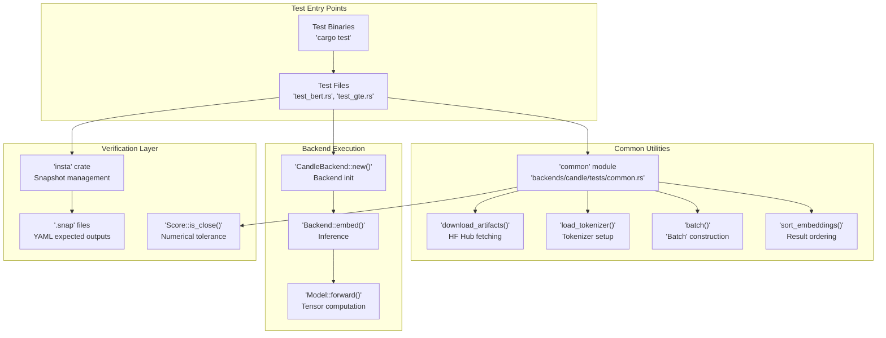
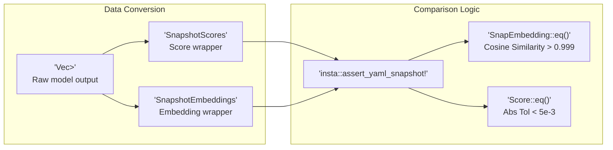

<!-- source: DeepWiki mcp.deepwiki.com · repo huggingface/text-embeddings-inference · page 8.4 Testing Strategy · fetched 2026-10-26 -->

# Testing Strategy

<details>
<summary>Relevant source files</summary>

The following files were used as context for generating this wiki page:

- [.github/workflows/integration-test.yaml](.github/workflows/integration-test.yaml)
- [.github/workflows/linting.yaml](.github/workflows/linting.yaml)
- [.github/workflows/test.yaml](.github/workflows/test.yaml)
- [.github/workflows/trufflehog.yml](.github/workflows/trufflehog.yml)
- [.gitignore](.gitignore)
- [backends/candle/src/layers/linear.rs](backends/candle/src/layers/linear.rs)
- [backends/candle/src/models/debertav2.rs](backends/candle/src/models/debertav2.rs)
- [backends/candle/tests/common.rs](backends/candle/tests/common.rs)
- [backends/candle/tests/snapshots/test_debertav2__debertav2_reranker_single.snap](backends/candle/tests/snapshots/test_debertav2__debertav2_reranker_single.snap)
- [backends/candle/tests/test_bert.rs](backends/candle/tests/test_bert.rs)
- [backends/candle/tests/test_debertav2.rs](backends/candle/tests/test_debertav2.rs)
- [backends/candle/tests/test_dense.rs](backends/candle/tests/test_dense.rs)
- [backends/candle/tests/test_gte.rs](backends/candle/tests/test_gte.rs)
- [backends/candle/tests/test_jina.rs](backends/candle/tests/test_jina.rs)
- [backends/candle/tests/test_modernbert.rs](backends/candle/tests/test_modernbert.rs)
- [docs/source/en/intel_container.md](docs/source/en/intel_container.md)
- [integration_tests/README.md](integration_tests/README.md)
- [integration_tests/gaudi/conftest.py](integration_tests/gaudi/conftest.py)
- [integration_tests/gaudi/test_embed.py](integration_tests/gaudi/test_embed.py)
- [integration_tests/pyproject.toml](integration_tests/pyproject.toml)
- [integration_tests/uv.lock](integration_tests/uv.lock)
- [router/tests/test_http_predict.rs](router/tests/test_http_predict.rs)
- [router/tests/test_http_rerank.rs](router/tests/test_http_rerank.rs)
- [rust-toolchain.toml](rust-toolchain.toml)

</details>


This document describes the testing strategy for Text Embeddings Inference (TEI), covering unit tests, integration tests, snapshot testing for model outputs, and the test infrastructure. For information about the CI/CD pipeline that executes these tests, see [CI/CD Pipeline](#8.5).

## Overview

TEI employs a multi-layered testing strategy focused on ensuring correctness of model outputs, backend implementations, and API behavior. The testing approach emphasizes:

- **Snapshot Testing**: Deterministic verification of model embeddings and classification scores against known-good outputs using the `insta` crate [backends/candle/tests/common.rs:4]().
- **Model Consistency**: Validation that single-item and batched inference produce identical results [backends/candle/tests/test_gte.rs:48-49]().
- **Backend Verification**: Testing each backend implementation (Candle, ORT, Python) independently.
- **Integration Testing**: End-to-end testing of tokenization, batching, and inference, including specialized hardware like Intel Gaudi (HPU) [.github/workflows/integration-test.yaml:22-31]().

Sources: [backends/candle/tests/common.rs:1-15](), [backends/candle/tests/test_gte.rs:9-52](), [.github/workflows/integration-test.yaml:1-32]()

## Test Architecture

The testing framework bridges the gap between the high-level Rust test functions and the low-level model implementations.



**Diagram: Test Execution Flow and Component Relationships**

Sources: [backends/candle/tests/common.rs:130-198](), [backends/candle/tests/test_bert.rs:11-68](), [backends/candle/tests/test_gte.rs:9-52]()

## Test Types and Organization

| Test Category | Location | Purpose | Execution |
|--------------|----------|---------|-----------|
| **Model Tests** | `backends/candle/tests/test_*.rs` | Verify specific model architectures (BERT, GTE, ModernBERT, etc.) | `cargo test --package text-embeddings-backend-candle` |
| **Router Tests** | `router/tests/` | Test HTTP/gRPC API endpoints like `/predict` and `/rerank` | `cargo test --package text-embeddings-router` |
| **HPU Integration** | `integration_tests/gaudi/` | End-to-end validation on Intel Gaudi hardware | `pytest` inside HPU container |
| **Security/Lint** | `.github/workflows/` | Secret scanning (TruffleHog) and code style (Clippy) | GitHub Actions on PR |

Sources: [.github/workflows/test.yaml:44](), [.github/workflows/integration-test.yaml:31](), [.github/workflows/trufflehog.yml:15](), [backends/candle/tests/test_modernbert.rs:11-78]()

## Snapshot Testing with Insta

### Numerical Verification

TEI uses custom wrappers to handle floating-point comparisons in snapshots. The `Score` struct implements `is_close` with a default absolute tolerance of `5e-3` [backends/candle/tests/common.rs:18-30](). For embeddings, `SnapEmbedding` uses cosine similarity, asserting a match if the similarity is greater than `0.999` [backends/candle/tests/common.rs:57-73]().



**Diagram: Snapshot Comparison Logic**

Sources: [backends/candle/tests/common.rs:18-30](), [backends/candle/tests/common.rs:57-73](), [backends/candle/tests/test_bert.rs:35-36]()

### Artifact Management

The `download_artifacts` function handles the retrieval of models from the Hugging Face Hub [backends/candle/tests/common.rs:130-134](). It prioritizes `model.safetensors` but falls back to `pytorch_model.bin` if necessary [backends/candle/tests/common.rs:159-167](). It also parses `modules.json` to identify dense layers or pooling configurations [backends/candle/tests/common.rs:169-171]().

Sources: [backends/candle/tests/common.rs:130-198]()

## Model-Specific Testing

### BERT and ModernBERT

Tests for BERT-based models verify both pooled embeddings (Mean/CLS) and raw token embeddings [backends/candle/tests/test_bert.rs:72-139](). ModernBERT tests include conditional snapshots for Flash Attention when running on CUDA [backends/candle/tests/test_modernbert.rs:38-42]().

```rust
// Example from backends/candle/tests/test_modernbert.rs:36-42
let (pooled_embeddings, _) = sort_embeddings(backend.embed(input_batch)?);
let embeddings_batch = SnapshotEmbeddings::from(pooled_embeddings);
if cfg!(all(feature = "cuda", feature = "flash-attn")) {
    insta::assert_yaml_snapshot!("modernbert_batch_flash", embeddings_batch, &matcher);
} else {
    insta::assert_yaml_snapshot!("modernbert_batch", embeddings_batch, &matcher);
}
```

Sources: [backends/candle/tests/test_bert.rs:11-68](), [backends/candle/tests/test_modernbert.rs:11-78]()

### Classification and Reranking

Classification models (like Rerankers) are tested using the `predict` method [backends/candle/tests/test_gte.rs:167](). These tests verify the probability scores or logits returned by the model [backends/candle/tests/test_jina.rs:73-76]().

Sources: [backends/candle/tests/test_gte.rs:147-174](), [backends/candle/tests/test_jina.rs:55-79]()

## Hardware Integration Testing

### Intel HPU (Gaudi)

Integration tests for Intel Gaudi are executed nightly [.github/workflows/integration-test.yaml:6](). The process involves:
1. Building a specialized Docker image using `Dockerfile-intel` and `PLATFORM=hpu` [.github/workflows/integration-test.yaml:25]().
2. Running `pytest` within the container environment to validate embedding accuracy on HPU hardware [.github/workflows/integration-test.yaml:31]().

Sources: [.github/workflows/integration-test.yaml:1-32](), [docs/source/en/intel_container.md:67-91]()

## CI/CD Pipeline Execution

The primary test suite is triggered on every push to `main` and on pull requests [.github/workflows/test.yaml:5-8](). 

- **Basic Tests**: Executes `cargo test` using a `release-debug` profile on AWS high-memory instances [.github/workflows/test.yaml:28-44]().
- **Linting**: Runs `clippy` and `rustfmt` to ensure code quality [.github/workflows/linting.yaml:24]().
- **Secret Scanning**: Uses `trufflehog` to prevent credential leaks [.github/workflows/trufflehog.yml:15]().

Sources: [.github/workflows/test.yaml:1-45](), [.github/workflows/linting.yaml:1-65](), [.github/workflows/trufflehog.yml:1-18]()

---

