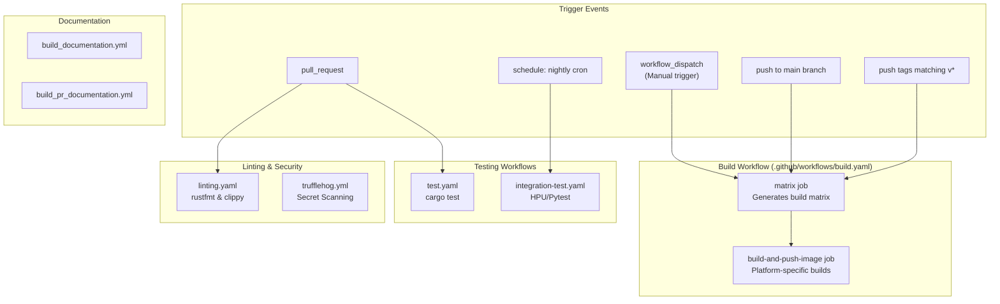
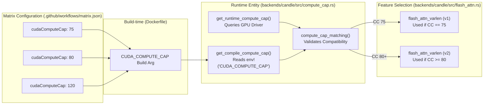

<!-- source: DeepWiki mcp.deepwiki.com · repo huggingface/text-embeddings-inference · page 8.5 CI/CD Pipeline · fetched 2026-10-26 -->

# CI/CD Pipeline

Relevant source files

The following files were used as context for generating this wiki page:

- [.github/workflows/build.yaml](.github/workflows/build.yaml)
- [.github/workflows/build_documentation.yml](.github/workflows/build_documentation.yml)
- [.github/workflows/build_pr_documentation.yml](.github/workflows/build_pr_documentation.yml)
- [.github/workflows/integration-test.yaml](.github/workflows/integration-test.yaml)
- [.github/workflows/linting.yaml](.github/workflows/linting.yaml)
- [.github/workflows/matrix.json](.github/workflows/matrix.json)
- [.github/workflows/test.yaml](.github/workflows/test.yaml)
- [.github/workflows/trufflehog.yml](.github/workflows/trufflehog.yml)
- [.github/workflows/upload_pr_documentation.yml](.github/workflows/upload_pr_documentation.yml)
- [backends/candle/src/compute_cap.rs](backends/candle/src/compute_cap.rs)
- [backends/candle/src/flash_attn.rs](backends/candle/src/flash_attn.rs)
- [backends/candle/src/models/debertav2.rs](backends/candle/src/models/debertav2.rs)
- [rust-toolchain.toml](rust-toolchain.toml)

## Purpose and Scope

This document describes the Continuous Integration and Continuous Deployment (CI/CD) pipeline for Text Embeddings Inference (TEI). The pipeline is implemented using GitHub Actions and handles automated building, testing, and deployment of multi-platform Docker images.

The CI/CD system supports 10+ hardware platforms including NVIDIA GPUs (Turing through Blackwell), Intel CPUs/XPUs, and Habana HPUs, each with optimized builds and specialized compilation flags.

## Workflow Architecture

The CI/CD pipeline consists of several specialized workflows that handle build, test, linting, and documentation tasks.

### Workflow Trigger System

**Sources:** [.github/workflows/build.yaml:3-22](), [.github/workflows/test.yaml:3-20](), [.github/workflows/integration-test.yaml:3-6](), [.github/workflows/linting.yaml:3-4]()

The build workflow uses path-based filtering to avoid unnecessary builds on pull requests. Only changes to specific directories like `backends/`, `core/`, `router/`, or `Dockerfile*` trigger the full build matrix [.github/workflows/build.yaml:11-20]().

## Build Matrix Configuration

The build matrix is defined in `matrix.json` and dynamically loaded. This allows for easy addition of new hardware platforms (like Blackwell) without modifying the workflow YAML.

### Matrix Structure and Platforms

| Platform Name | Image Prefix | CUDA CC | Dockerfile | Purpose |
|---------------|--------------|---------|------------|---------|
| `turing` | `turing-` | 75 | `Dockerfile-cuda` | NVIDIA T4, RTX 20-series |
| `ampere-80` | (default) | 80 | `Dockerfile-cuda` | NVIDIA A100, H100 (fallback) |
| `hopper` | `hopper-` | 90 | `Dockerfile-cuda` | NVIDIA H100 native |
| `blackwell-120`| `120-` | 120 | `Dockerfile-cuda` | NVIDIA B200 |
| `cpu` | `cpu-` | N/A | `Dockerfile` | Standard x86 CPU |
| `cpu-ipex` | `cpu-ipex-` | N/A | `Dockerfile-intel` | Intel CPU Optimizations |
| `hpu` | `hpu-` | N/A | `Dockerfile-intel` | Habana Gaudi accelerators |

**Sources:** [.github/workflows/matrix.json:1-128]()

The `matrix` job in `build.yaml` parses this JSON and filters entries based on the `runOn` field (e.g., `"always"` or `"main"`) to determine which images to build for the current branch [.github/workflows/build.yaml:33-40]().

### Hardware-Specific Compilation

**Sources:** [backends/candle/src/compute_cap.rs:8-47](), [backends/candle/src/flash_attn.rs:37-115](), [.github/workflows/build.yaml:132]()

At runtime, `compatible_compute_cap()` checks if the binary compiled for a specific `CUDA_COMPUTE_CAP` is compatible with the physical GPU detected via `get_runtime_compute_cap()` [backends/candle/src/compute_cap.rs:40-47](). This ensures the correct Flash Attention kernels are dispatched [backends/candle/src/flash_attn.rs:37-69]().

## Build and Release Process

### Docker Image Tagging
The `meta` step generates tags based on the hardware prefix and the git reference [.github/workflows/build.yaml:105-119]():
- `semver`: `v1.5.0` -> `turing-1.5.0`
- `latest`: `turing-latest`
- `sha`: `turing-sha-abc1234`

For platforms with `grpc: true`, a separate image is built targeting the `grpc` stage in the Dockerfile, suffixed with `-grpc` [.github/workflows/build.yaml:144-183]().

### Caching Strategy
The pipeline employs two primary caching mechanisms:
1.  **Sccache**: Caches Rust compilation artifacts. It is configured to use the GitHub Actions cache backend [.github/workflows/build.yaml:70-76]() and [.github/workflows/linting.yaml:35-42]().
2.  **Docker S3 Cache**: Uses AWS S3 as a Buildx cache backend to persist Docker layers across runs [.github/workflows/build.yaml:141-142]().

## Testing and Quality Assurance

### Basic Tests (`test.yaml`)
Runs unit and doc tests using `cargo test`. It utilizes `sccache` for faster compilation and requires a `HF_TOKEN` for model downloading during tests [.github/workflows/test.yaml:32-44]().

### Integration Tests (`integration-test.yaml`)
A nightly workflow that specifically validates HPU (Habana Gaudi) integration. It builds the `Dockerfile-intel` image with `PLATFORM=hpu` and runs a Python-based `pytest` suite [.github/workflows/integration-test.yaml:22-31]().

### Linting (`linting.yaml`)
Enforces code standards on every pull request [.github/workflows/linting.yaml:1-65]():
- **Rustfmt**: Checks code formatting.
- **Clippy**: Performs static analysis for common Rust errors.
- **Pre-commit**: Runs a suite of hooks across all files.
- **Multi-feature Build**: Ensures the project compiles with both default features and specific combinations like `candle` + `grpc`.

### Documentation Builds
Documentation is automatically built using the `huggingface/doc-builder`.
- `build_documentation.yml`: Builds and pushes the main documentation on pushes to `main` [.github/workflows/build_documentation.yml:1-23]().
- `build_pr_documentation.yml` & `upload_pr_documentation.yml`: Builds documentation for PRs and uploads it for previewing [.github/workflows/build_pr_documentation.yml:1-21]().

**Sources:** [.github/workflows/build.yaml:1-183](), [.github/workflows/test.yaml:1-45](), [.github/workflows/linting.yaml:1-65](), [.github/workflows/matrix.json:1-128](), [backends/candle/src/compute_cap.rs:1-110]()

---

