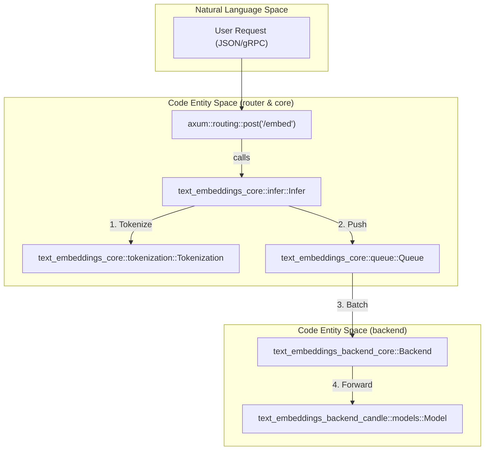
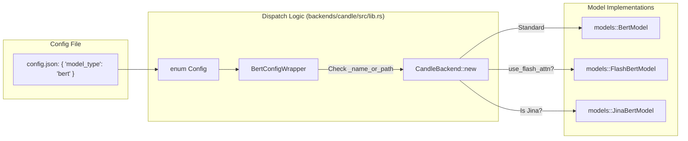

<!-- source: DeepWiki mcp.deepwiki.com · repo huggingface/text-embeddings-inference · page 9 Glossary · fetched 2026-10-26 -->

# Glossary

Relevant source files

The following files were used as context for generating this wiki page:

- [.github/workflows/build.yaml](.github/workflows/build.yaml)
- [.github/workflows/matrix.json](.github/workflows/matrix.json)
- [Cargo.lock](Cargo.lock)
- [Cargo.toml](Cargo.toml)
- [README.md](README.md)
- [backends/candle/src/compute_cap.rs](backends/candle/src/compute_cap.rs)
- [backends/candle/src/flash_attn.rs](backends/candle/src/flash_attn.rs)
- [backends/candle/src/layers/rotary.rs](backends/candle/src/layers/rotary.rs)
- [backends/candle/src/lib.rs](backends/candle/src/lib.rs)
- [backends/candle/src/models/flash_mistral.rs](backends/candle/src/models/flash_mistral.rs)
- [backends/candle/src/models/flash_qwen3.rs](backends/candle/src/models/flash_qwen3.rs)
- [backends/candle/src/models/gemma3.rs](backends/candle/src/models/gemma3.rs)
- [backends/candle/src/models/llama.rs](backends/candle/src/models/llama.rs)
- [backends/candle/src/models/mistral.rs](backends/candle/src/models/mistral.rs)
- [backends/candle/src/models/mod.rs](backends/candle/src/models/mod.rs)
- [backends/ort/Cargo.toml](backends/ort/Cargo.toml)
- [backends/ort/src/lib.rs](backends/ort/src/lib.rs)
- [backends/src/lib.rs](backends/src/lib.rs)
- [core/src/infer.rs](core/src/infer.rs)
- [core/src/queue.rs](core/src/queue.rs)
- [core/src/tokenization.rs](core/src/tokenization.rs)
- [docs/openapi.json](docs/openapi.json)
- [docs/source/en/cli_arguments.md](docs/source/en/cli_arguments.md)
- [proto/tei.proto](proto/tei.proto)
- [router/src/grpc/server.rs](router/src/grpc/server.rs)
- [router/src/http/server.rs](router/src/http/server.rs)
- [router/src/http/types.rs](router/src/http/types.rs)
- [router/src/lib.rs](router/src/lib.rs)
- [router/src/main.rs](router/src/main.rs)
- [router/tests/test_http_embed.rs](router/tests/test_http_embed.rs)

This page defines codebase-specific terms, abbreviations, and domain concepts used throughout the Text Embeddings Inference (TEI) project.

## Core System Concepts

### Dynamic Batching
The mechanism that aggregates incoming asynchronous requests into a single batch for efficient GPU/CPU execution. Unlike traditional fixed-size batching, TEI uses token-based dynamic batching.
*   **Implementation**: Managed by the `Queue` struct [core/src/queue.rs:17-45]().
*   **Key Parameter**: `max_batch_tokens` defines the upper limit of total tokens (across all requests) that can fit in one inference pass [router/src/main.rs:73-74]().

### Backend
The abstraction layer responsible for executing the model's forward pass. TEI supports multiple backends depending on the hardware and model format.
*   **Candle Backend**: A Rust-native implementation using the `candle` ML framework [backends/candle/src/lib.rs:156-160]().
*   **ORT Backend**: Uses ONNX Runtime for cross-platform compatibility [backends/ort/src/lib.rs:61-73]().
*   **Python Backend**: Spawns a Python process to run models via PyTorch, communicating over gRPC [backends/python/src/lib.rs:10-25]().

### Pooling
The process of converting a sequence of token embeddings (produced by the transformer) into a single fixed-size vector (the embedding).
*   **CLS**: Uses the embedding of the `[CLS]` token [backends/ort/src/lib.rs:88]().
*   **Mean**: Averages all token embeddings [router/src/main.rs:47-54]().
*   **Splade**: Sparse pooling strategy for term-importance based retrieval [README.md:39]().

---

## Code Entity Mapping

The following diagrams illustrate the relationship between high-level concepts and the specific Rust structs/functions that implement them.

### Request Lifecycle: From HTTP to Backend
This diagram shows how a user request (Natural Language Space) is transformed into code entities (Code Space).

**Sources**: [router/src/http/server.rs:89-109](), [core/src/infer.rs:100-150](), [core/src/queue.rs:100-120](), [backends/candle/src/lib.rs:156-160]()

### Model Dispatch Logic
How TEI determines which specific model architecture to initialize based on the `config.json`.

**Sources**: [backends/candle/src/lib.rs:73-122](), [backends/candle/src/lib.rs:126-154](), [backends/candle/src/lib.rs:240-300]()

---

## Technical Glossary Table

| Term | Definition | Code Pointer |
| :--- | :--- | :--- |
| **`max_batch_tokens`** | The maximum sum of sequence lengths in a single batch. | [router/src/main.rs:73-74]() |
| **`max_client_batch_size`** | Max number of strings a user can send in one request. | [router/src/main.rs:81-82]() |
| **`DType`** | Data type used for weights/tensors (F32, F16, BF16). | [backends/src/dtype.rs:1-10]() |
| **`Safetensors`** | The preferred zero-copy weight format for loading models. | [README.md:60]() |
| **`UDS`** | Unix Domain Socket used for internal gRPC communication. | [router/src/main.rs:156-157]() |
| **`Flash Attention`** | Memory-efficient attention mechanism for NVIDIA GPUs. | [backends/candle/src/flash_attn.rs:1-10]() |
| **`Warmup`** | Initial inference passes to allocate memory/compile kernels. | [backends/src/lib.rs:133-140]() |
| **`id2label`** | Mapping of class indices to string labels for classifiers. | [router/src/lib.rs:120-130]() |

---

## Domain Abbreviations

*   **TEI**: Text Embeddings Inference.
*   **HPU**: Habana Processing Unit (Intel Gaudi). Optimized via `warmup_hpu` [backends/src/lib.rs:133]().
*   **ROCm**: Radeon Open Compute (AMD GPUs). Supported via specific build flags [README.md:46]().
*   **MRL**: Matryoshka Representation Learning. Supports truncating embedding dimensions [README.md:51]().
*   **OTLP**: OpenTelemetry Protocol. Used for distributed tracing [router/src/main.rs:218-221]().

**Sources**: [README.md:49-63](), [router/src/main.rs:15-160](), [backends/src/lib.rs:61-80](), [core/src/tokenization.rs:14-17]()