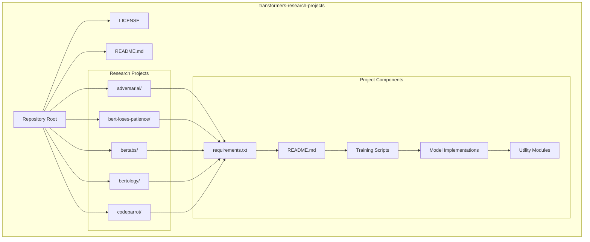
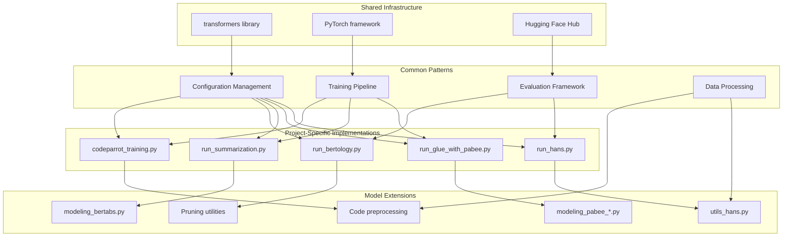

<!-- source: DeepWiki mcp.deepwiki.com · repo huggingface/transformers-research-projects · page 1 Overview · fetched 2026-10-26 -->

# Overview

Relevant source files

The following files were used as context for generating this wiki page:

- [LICENSE](LICENSE)
- [README.md](README.md)

## Purpose and Scope

This document provides an overview of the transformers-research-projects repository, which contains independent research projects that extend and experiment with transformer models using the Hugging Face Transformers library. Each project focuses on different aspects of transformer research including model efficiency, robustness evaluation, domain-specific applications, and architectural analysis.

The repository is organized as a collection of self-contained research projects, each with its own dependencies, training scripts, and evaluation frameworks. For detailed documentation of specific projects, see:
- Adversarial evaluation: [HANS](#2)
- Model efficiency: [PABEE](#3) 
- Text summarization: [BertAbs](#4)
- Model analysis: [Bertology](#5)
- Code generation: [CodeParrot](#6)

## Repository Structure

The repository follows a modular design where each research project is contained within its own directory with complete implementation and documentation.

**Sources:** [README.md:17-29]()

## Research Project Matrix

| Project | Directory | Primary Focus | Key Components |
|---------|-----------|---------------|----------------|
| HANS Adversarial Evaluation | `adversarial/` | NLI model robustness testing | `run_hans.py`, `utils_hans.py` |
| PABEE Early Exit | `bert-loses-patience/` | Inference efficiency optimization | `modeling_pabee_*.py`, `run_glue_with_pabee.py` |
| BertAbs Summarization | `bertabs/` | Abstractive text summarization | `modeling_bertabs.py`, `run_summarization.py` |
| Bertology Analysis | `bertology/` | Attention analysis and pruning | `run_bertology.py`, `run_prune_gpt.py` |
| CodeParrot Generation | `codeparrot/` | Code generation training | `codeparrot_training.py`, preprocessing scripts |

## Common Architecture Patterns

The projects share common implementation patterns while maintaining independence through modular design.

**Sources:** [README.md:19-20]()

## Dependency Management

Each research project maintains its own dependency specifications to ensure reproducibility with specific transformer library versions.

| Component | Description | Location |
|-----------|-------------|----------|
| `requirements.txt` | Project-specific dependencies | Each project directory |
| Transformers version | Specific library version per project | Varies by project needs |
| Installation command | `pip install -r requirements.txt` | Per project basis |

## Getting Started

To use any research project:

1. Navigate to the desired project directory
2. Install dependencies: `pip install -r requirements.txt`
3. Follow project-specific README instructions
4. Contact project authors for support (listed in each project's README)

**Sources:** [README.md:22-28]()

## Licensing and Attribution

The repository is licensed under the Apache License 2.0, providing permissive usage rights for research and commercial applications. Each project maintains individual author attribution in their respective README files.

| License Component | Details |
|-------------------|---------|
| License Type | Apache License 2.0 |
| Copyright Holder | The HuggingFace Team |
| Distribution Rights | Reproduction, modification, distribution permitted |
| Attribution Requirements | Copyright notice and license text must be included |

**Sources:** [LICENSE:1-201](), [README.md:2-14]()

---

