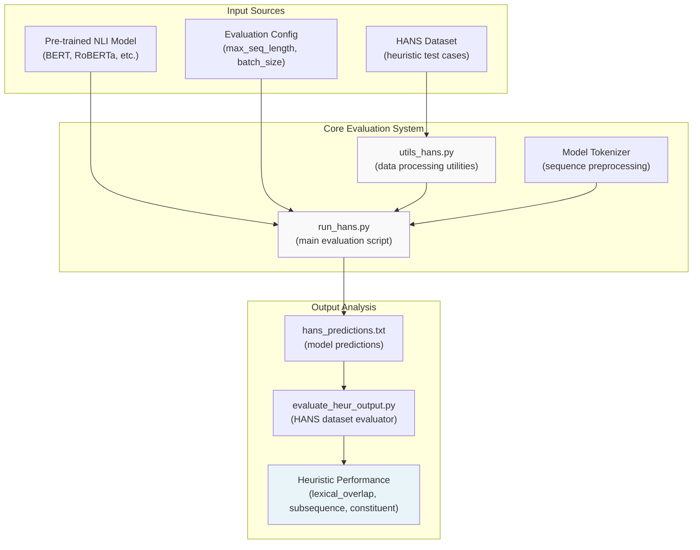
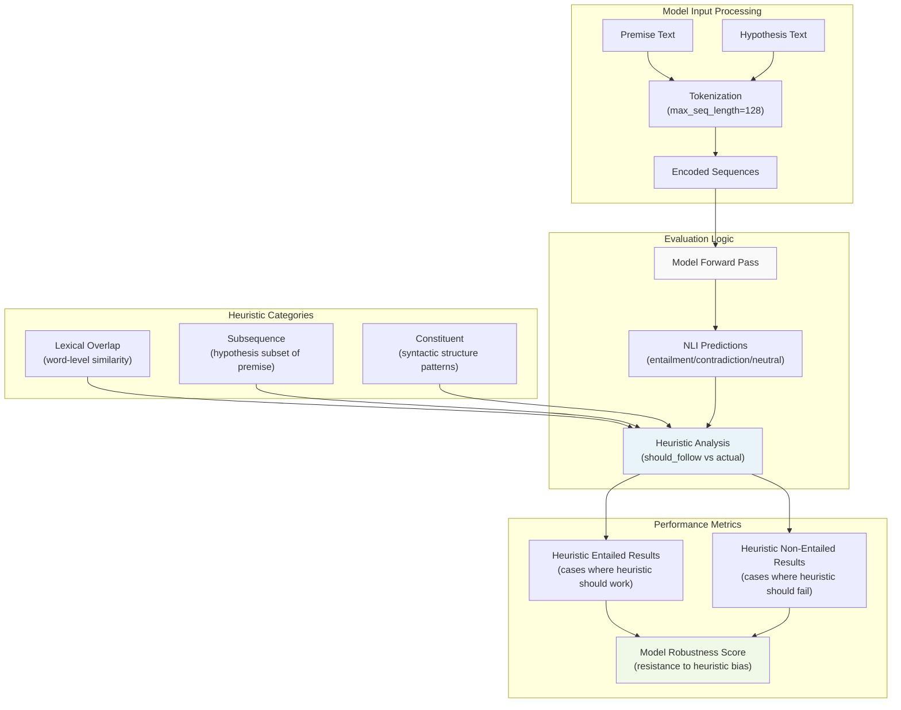

<!-- source: DeepWiki mcp.deepwiki.com · repo huggingface/transformers-research-projects · page 2 Adversarial Evaluation (HANS) · fetched 2026-10-26 -->

# Adversarial Evaluation (HANS)

Relevant source files

The following files were used as context for generating this wiki page:

- [adversarial/README.md](adversarial/README.md)
- [adversarial/requirements.txt](adversarial/requirements.txt)

## Purpose and Scope

The Adversarial Evaluation (HANS) system provides tools for testing the robustness of Natural Language Inference (NLI) models against linguistic heuristics. This system implements the Heuristic Analysis for NLI Systems (HANS) dataset evaluation framework from McCoy et al., 2019, which specifically tests whether NLI models inappropriately rely on syntactic heuristics rather than genuine semantic understanding.

The system evaluates models trained on standard NLI datasets (like MNLI) by exposing them to carefully constructed adversarial examples that reveal over-reliance on three key heuristics: lexical overlap, subsequence matching, and constituent ordering. For detailed information about the evaluation pipeline implementation, see [HANS Evaluation Pipeline](#2.1). For data processing utilities and dataset handling, see [HANS Data Processing](#2.2).

## System Overview

The HANS evaluation system operates as a standalone adversarial testing framework that takes pre-trained NLI models and evaluates their performance on heuristic-based adversarial examples. The system distinguishes between cases where heuristics should lead to correct predictions (entailed examples) versus cases where they should not (non-entailed examples), revealing the extent to which models rely on superficial patterns.

### HANS Evaluation Architecture

Sources: [adversarial/README.md:1-39]()

### Heuristic Testing Workflow

Sources: [adversarial/README.md:14-38]()

## Key Components

### Evaluation Script and Configuration

The primary evaluation interface is provided through `run_hans.py`, which accepts standard transformer model configurations and HANS dataset specifications. The script requires several key parameters:

| Parameter | Purpose | Example Value |
|-----------|---------|---------------|
| `task_name` | Specifies HANS evaluation task | `hans` |
| `model_type` | Model architecture type | `bert`, `roberta`, `xlnet` |
| `model_name_or_path` | Path to trained NLI model | `/path/to/mnli-model` |
| `data_dir` | HANS dataset directory | `/path/to/hans` |
| `max_seq_length` | Maximum input sequence length | `128` |
| `output_dir` | Output directory for predictions | `/path/to/output` |

Sources: [adversarial/README.md:14-22]()

### Heuristic Categories and Expected Performance

The HANS evaluation framework tests three specific linguistic heuristics that NLI models often inappropriately rely on:

**Lexical Overlap Heuristic**: Models may incorrectly assume that high word overlap between premise and hypothesis indicates entailment.

**Subsequence Heuristic**: Models may incorrectly treat cases where the hypothesis is a subsequence of the premise as entailment.

**Constituent Heuristic**: Models may incorrectly rely on syntactic constituent order patterns to make entailment decisions.

For robust models, the expected performance pattern shows high accuracy on entailed cases (where heuristics align with correct answers) but also high accuracy on non-entailed cases (where heuristics would lead to incorrect answers). The example BERT-base results demonstrate a common failure pattern where models achieve high accuracy on entailed cases but poor accuracy on non-entailed cases, indicating over-reliance on heuristics.

Sources: [adversarial/README.md:26-38]()

### Dependencies and Environment

The system requires `transformers == 4.48.0` as its primary dependency, ensuring compatibility with the latest transformer model implementations and tokenization utilities. The evaluation framework leverages the standard Hugging Face ecosystem for model loading, tokenization, and inference.

Sources: [adversarial/requirements.txt:1-2]()

The HANS adversarial evaluation system serves as a critical diagnostic tool for assessing whether NLI models have learned genuine semantic understanding or have simply memorized surface-level patterns that fail to generalize to adversarial cases.

---

