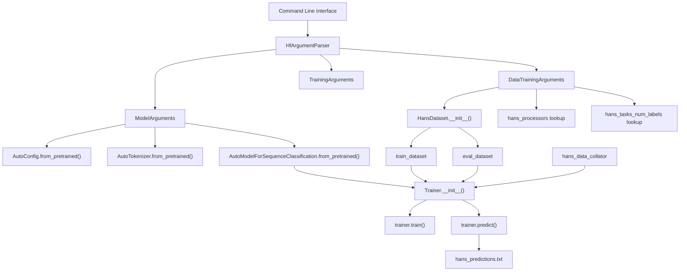
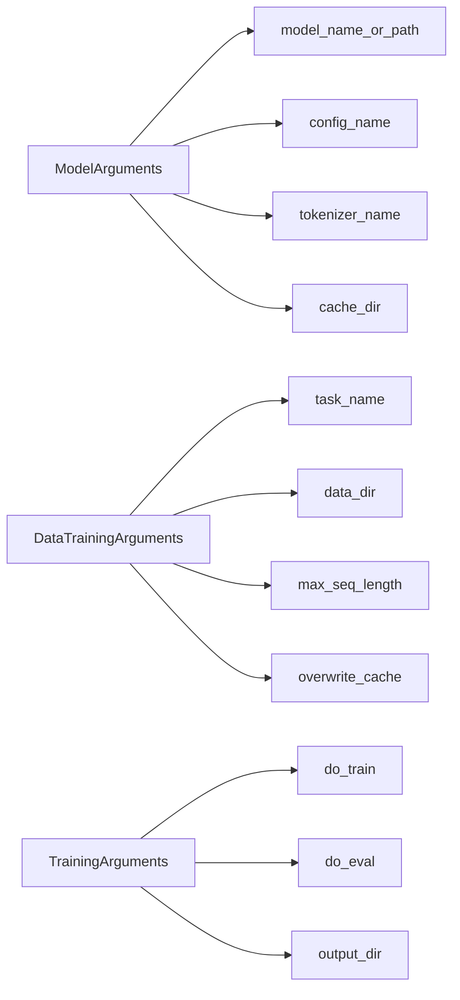
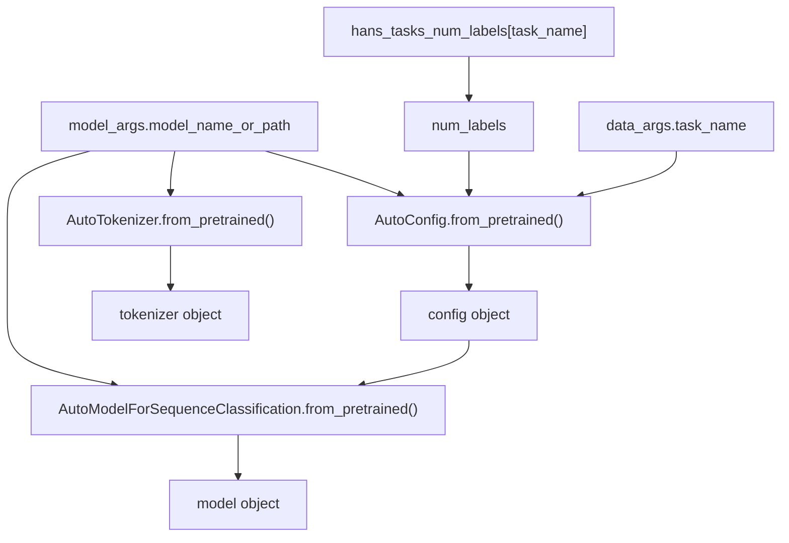
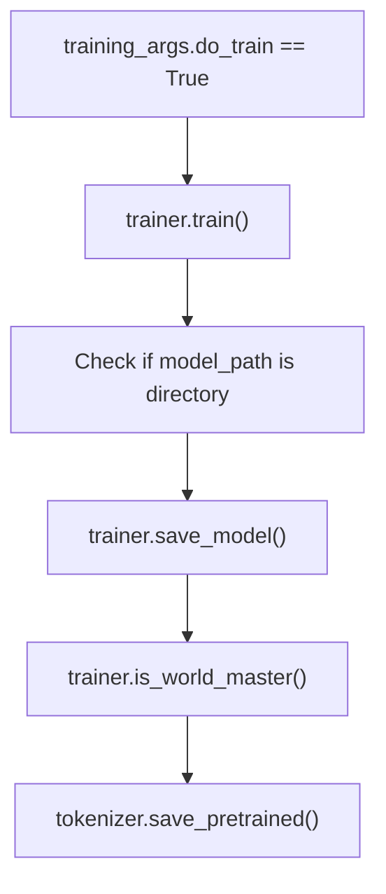
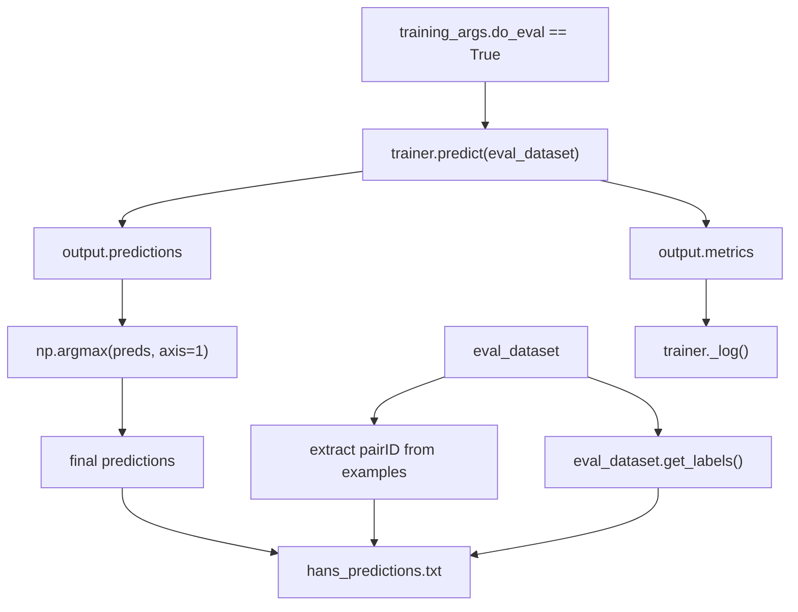

<!-- source: DeepWiki mcp.deepwiki.com · repo huggingface/transformers-research-projects · page 2.1 HANS Evaluation Pipeline · fetched 2026-10-26 -->

# HANS Evaluation Pipeline

<details>
<summary>Relevant source files</summary>

The following files were used as context for generating this wiki page:

- [adversarial/run_hans.py](adversarial/run_hans.py)

</details>


This document covers the core evaluation pipeline implemented in `run_hans.py` for testing Natural Language Inference (NLI) models against the HANS (Heuristic Analysis for NLI Systems) dataset. The pipeline provides functionality for both fine-tuning models on HANS data and evaluating their robustness against linguistic heuristics.

For detailed information about HANS dataset utilities and data preprocessing components, see [HANS Data Processing](#2.2).

## Purpose and Scope

The HANS evaluation pipeline serves as the primary entry point for conducting adversarial evaluation of NLI models. It implements a complete training and evaluation workflow that:

- Loads pretrained transformer models for sequence classification
- Processes HANS dataset through custom data handling components  
- Supports both training and evaluation modes with configurable parameters
- Generates detailed prediction outputs for analysis of model performance against heuristic biases

Sources: [adversarial/run_hans.py:16-17](), [adversarial/run_hans.py:100-103]()

## Pipeline Architecture Overview

The HANS evaluation pipeline follows a modular architecture with distinct components for configuration, model management, data processing, and execution control.

### Core Pipeline Flow



Sources: [adversarial/run_hans.py:105-106](), [adversarial/run_hans.py:154-169](), [adversarial/run_hans.py:172-194](), [adversarial/run_hans.py:197-203]()

## Configuration System

The pipeline uses a structured configuration system with three main argument classes that define the complete execution parameters.

### Configuration Classes

| Class | Purpose | Key Parameters |
|-------|---------|----------------|
| `ModelArguments` | Model and tokenizer configuration | `model_name_or_path`, `config_name`, `tokenizer_name`, `cache_dir` |
| `DataTrainingArguments` | Dataset and task configuration | `task_name`, `data_dir`, `max_seq_length`, `overwrite_cache` |
| `TrainingArguments` | Training execution parameters | Inherited from transformers library |



Sources: [adversarial/run_hans.py:44-63](), [adversarial/run_hans.py:65-89]()

## Model Loading and Setup

The pipeline implements a standardized model loading sequence using the transformers `Auto*` classes with HANS-specific configuration.

### Model Initialization Sequence

1. **Configuration Loading**: Uses `AutoConfig.from_pretrained()` with task-specific `num_labels` from `hans_tasks_num_labels`
2. **Tokenizer Loading**: Loads tokenizer via `AutoTokenizer.from_pretrained()` with caching support
3. **Model Loading**: Instantiates sequence classification model through `AutoModelForSequenceClassification.from_pretrained()`



Sources: [adversarial/run_hans.py:143-146](), [adversarial/run_hans.py:154-169]()

## Dataset Handling

The pipeline creates `HansDataset` instances for both training and evaluation, with conditional instantiation based on execution mode flags.

### Dataset Creation Logic

- **Training Dataset**: Created when `training_args.do_train` is True
- **Evaluation Dataset**: Created when `training_args.do_eval` is True, with `evaluate=True` parameter
- **Data Collation**: Uses custom `hans_data_collator` that removes `pairID` key from batches

Sources: [adversarial/run_hans.py:172-194](), [adversarial/run_hans.py:91-97]()

## Training Pipeline

When training mode is enabled, the pipeline executes a complete training workflow with model and tokenizer persistence.

### Training Execution Flow



Sources: [adversarial/run_hans.py:206-214]()

## Evaluation Pipeline

The evaluation pipeline generates predictions and outputs them in a structured format for downstream analysis.

### Evaluation Workflow

1. **Prediction Generation**: Uses `trainer.predict()` to generate model predictions
2. **Prediction Processing**: Applies `np.argmax()` to get class predictions
3. **Output File Creation**: Writes predictions to `hans_predictions.txt` with pair IDs
4. **Metrics Logging**: Logs evaluation metrics through trainer logging system

### Prediction Output Format

The evaluation generates a CSV-formatted output file with the following structure:

```
pairID,gold_label
ex{pair_id},{predicted_label}
```



Sources: [adversarial/run_hans.py:217-233]()

## Data Collation

The pipeline implements a custom data collator specifically designed for HANS dataset requirements.

### hans_data_collator Function

The `hans_data_collator` extends the default transformer data collator by removing the `pairID` field, which is used for tracking but not needed during model forward passes.

```python
def hans_data_collator(features: List[InputFeatures]) -> Dict[str, torch.Tensor]:
    batch = default_data_collator(features)
    _ = batch.pop("pairID", None)
    return batch
```

Sources: [adversarial/run_hans.py:91-97]()

## Error Handling and Validation

The pipeline implements several validation checks to ensure proper execution:

- **Output Directory Validation**: Prevents overwriting existing outputs unless explicitly allowed
- **Task Validation**: Validates task names against `hans_processors` registry
- **Distributed Training Support**: Configures logging and process coordination for multi-GPU setups

Sources: [adversarial/run_hans.py:108-117](), [adversarial/run_hans.py:143-146](), [adversarial/run_hans.py:125-137]()

---

