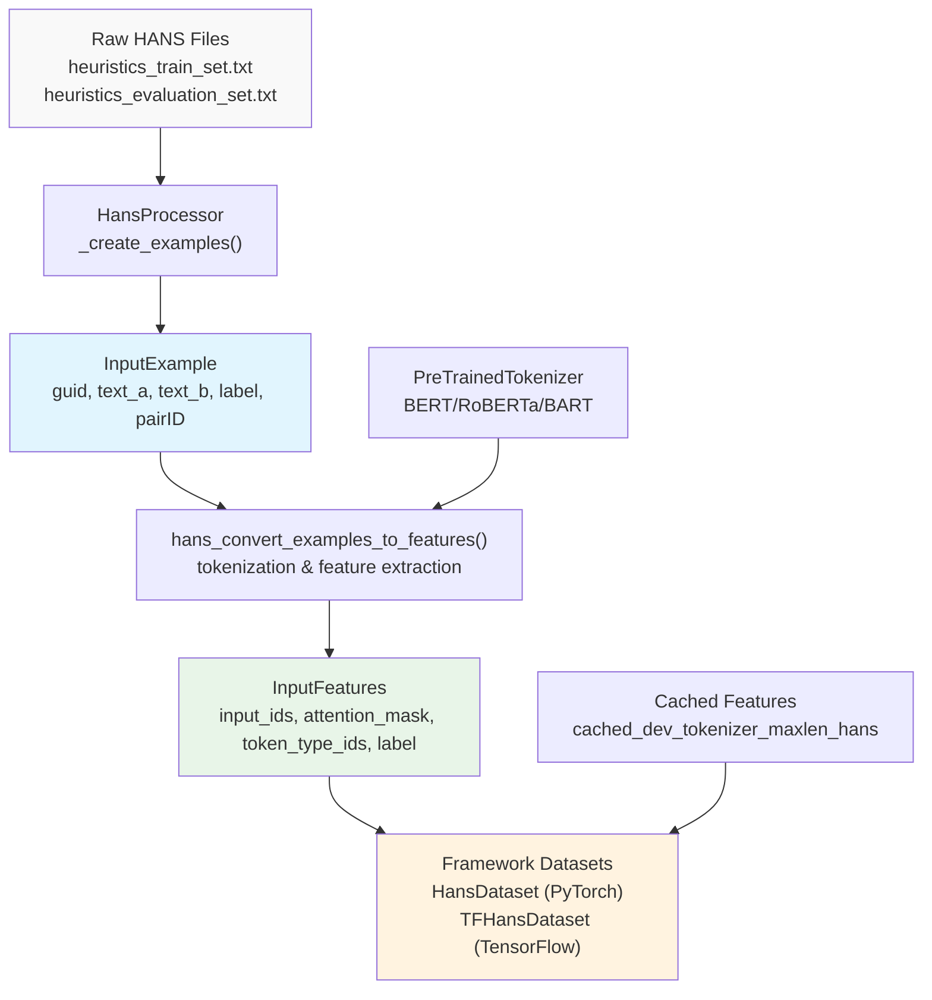
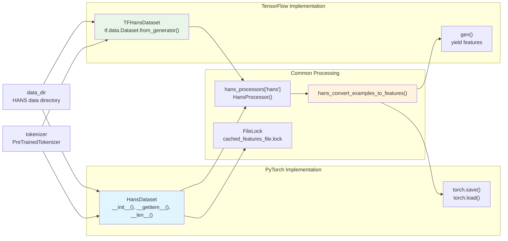
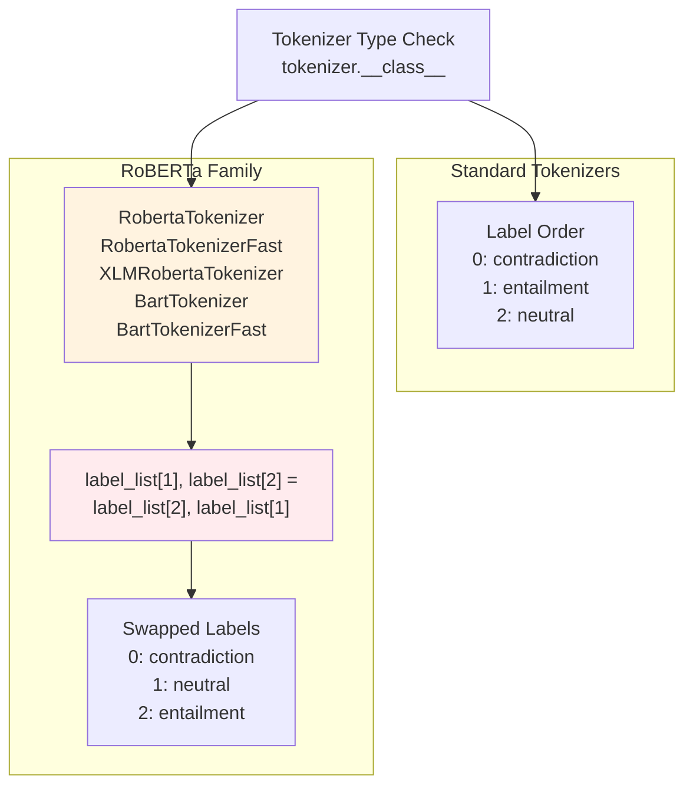
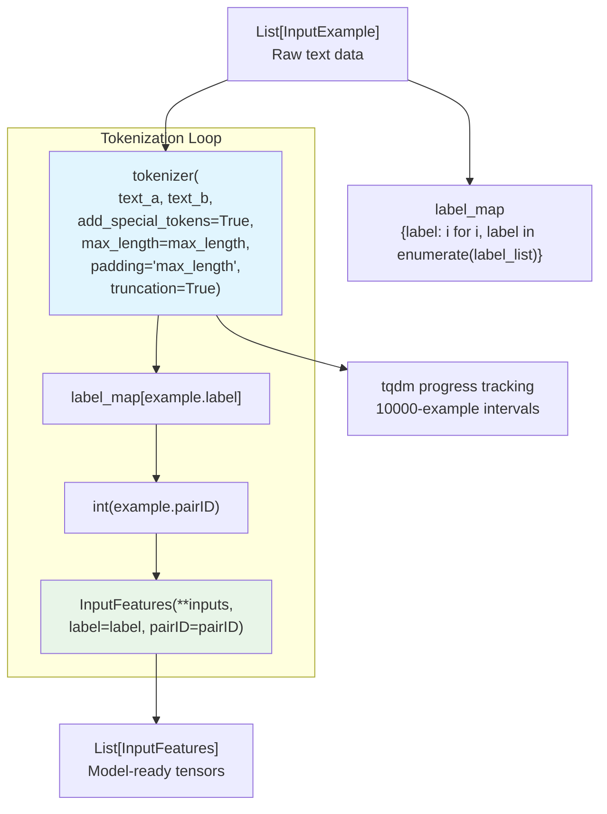
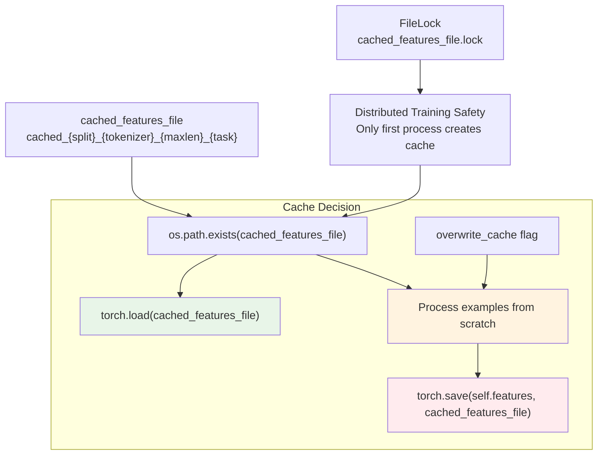

<!-- source: DeepWiki mcp.deepwiki.com · repo huggingface/transformers-research-projects · page 2.2 HANS Data Processing · fetched 2026-10-26 -->

# HANS Data Processing

<details>
<summary>Relevant source files</summary>

The following files were used as context for generating this wiki page:

- [adversarial/utils_hans.py](adversarial/utils_hans.py)

</details>


## Purpose and Scope

This document covers the data processing components for the HANS (Heuristic Analysis for NLI Systems) adversarial evaluation framework. The HANS data processing system handles loading, tokenizing, and converting HANS dataset examples into model-ready features for Natural Language Inference (NLI) evaluation. This system is designed to test model robustness against linguistic heuristics through carefully crafted adversarial examples.

For information about the complete HANS evaluation pipeline and model testing workflow, see [HANS Evaluation Pipeline](#2.1).

## Data Processing Architecture

The HANS data processing system follows a multi-stage pipeline that transforms raw text data into tokenized features suitable for transformer model evaluation.

### Core Data Structures Pipeline



**Sources:** [adversarial/utils_hans.py:248-340]()

### Data Structure Specifications

The HANS processing system uses well-defined data structures to maintain consistency throughout the pipeline:

| Component | Purpose | Key Fields | File Location |
|-----------|---------|------------|---------------|
| `InputExample` | Raw text representation | `guid`, `text_a`, `text_b`, `label`, `pairID` | [adversarial/utils_hans.py:41-62]() |
| `InputFeatures` | Tokenized model input | `input_ids`, `attention_mask`, `token_type_ids`, `label`, `pairID` | [adversarial/utils_hans.py:64-87]() |
| `HansProcessor` | Data file processor | `get_train_examples()`, `get_dev_examples()`, `_create_examples()` | [adversarial/utils_hans.py:248-280]() |

**Sources:** [adversarial/utils_hans.py:41-87](), [adversarial/utils_hans.py:248-280]()

## Dataset Implementation

### Framework-Specific Dataset Classes



**Sources:** [adversarial/utils_hans.py:93-160](), [adversarial/utils_hans.py:162-246]()

### Dataset Initialization Process

The dataset classes handle caching, distributed training synchronization, and tokenizer-specific label adjustments:

```python
# Key initialization parameters from HansDataset.__init__()
data_dir: str                    # Directory containing HANS data files
tokenizer: PreTrainedTokenizer   # Tokenizer instance (BERT/RoBERTa/etc.)
task: str                        # Task identifier ("hans")
max_seq_length: Optional[int]    # Maximum sequence length for truncation
overwrite_cache: bool            # Whether to regenerate cached features
evaluate: bool                   # Whether loading train or dev data
```

**Sources:** [adversarial/utils_hans.py:101-109]()

## Tokenizer Integration and Label Handling

### Special Tokenizer Handling

The system includes special processing for RoBERTa-family tokenizers that have different label mappings:



**Sources:** [adversarial/utils_hans.py:122-131](), [adversarial/utils_hans.py:184-192]()

## Feature Conversion Process

### Example to Features Transformation

The `hans_convert_examples_to_features` function handles the core transformation from raw text to model-ready tensors:



**Sources:** [adversarial/utils_hans.py:282-330]()

### Tokenization Configuration

The tokenization process uses specific parameters optimized for HANS evaluation:

| Parameter | Value | Purpose |
|-----------|-------|---------|
| `add_special_tokens` | `True` | Include [CLS], [SEP] tokens |
| `max_length` | User-defined | Sequence length limit |
| `padding` | `"max_length"` | Consistent tensor dimensions |
| `truncation` | `True` | Handle long sequences |
| `return_overflowing_tokens` | `True` | Track truncated content |

**Sources:** [adversarial/utils_hans.py:309-317]()

## File Management and Caching

### Caching Strategy

The system implements intelligent caching to avoid reprocessing data across runs:



**Sources:** [adversarial/utils_hans.py:112-150]()

## Data File Structure

### HANS Dataset Format

The HANS processor expects specific file formats and column structures:

| File | Purpose | Key Columns |
|------|---------|-------------|
| `heuristics_train_set.txt` | Training data | label, premise, hypothesis, pairID |
| `heuristics_evaluation_set.txt` | Evaluation data | label, premise, hypothesis, pairID |

The `_create_examples` method extracts data from these files using fixed column indices:

```python
# Column extraction from HANS files
guid = "%s-%s" % (set_type, line[0])     # Line 0: label  
text_a = line[5]                         # Line 5: premise
text_b = line[6]                         # Line 6: hypothesis  
pairID = line[7][2:] if line[7].startswith("ex") else line[7]  # Line 7: pair ID
label = line[0]                          # Line 0: label
```

**Sources:** [adversarial/utils_hans.py:267-279]()

## Registry and Task Configuration

### Processor Registry

The system uses a registry pattern for task processors and label counting:

```python
hans_tasks_num_labels = {
    "hans": 3,
}

hans_processors = {
    "hans": HansProcessor,
}
```

This configuration supports the three-class NLI setup (contradiction, entailment, neutral) while allowing for extension to additional HANS-style tasks.

**Sources:** [adversarial/utils_hans.py:333-339]()

The HANS data processing system provides a robust, framework-agnostic foundation for adversarial NLI evaluation, with optimizations for caching, distributed training, and multiple tokenizer types.

---

