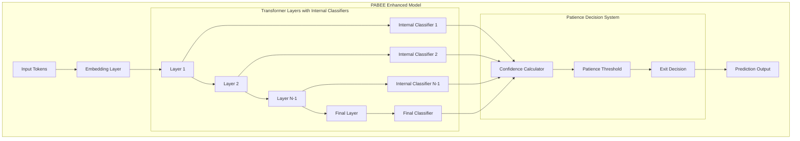
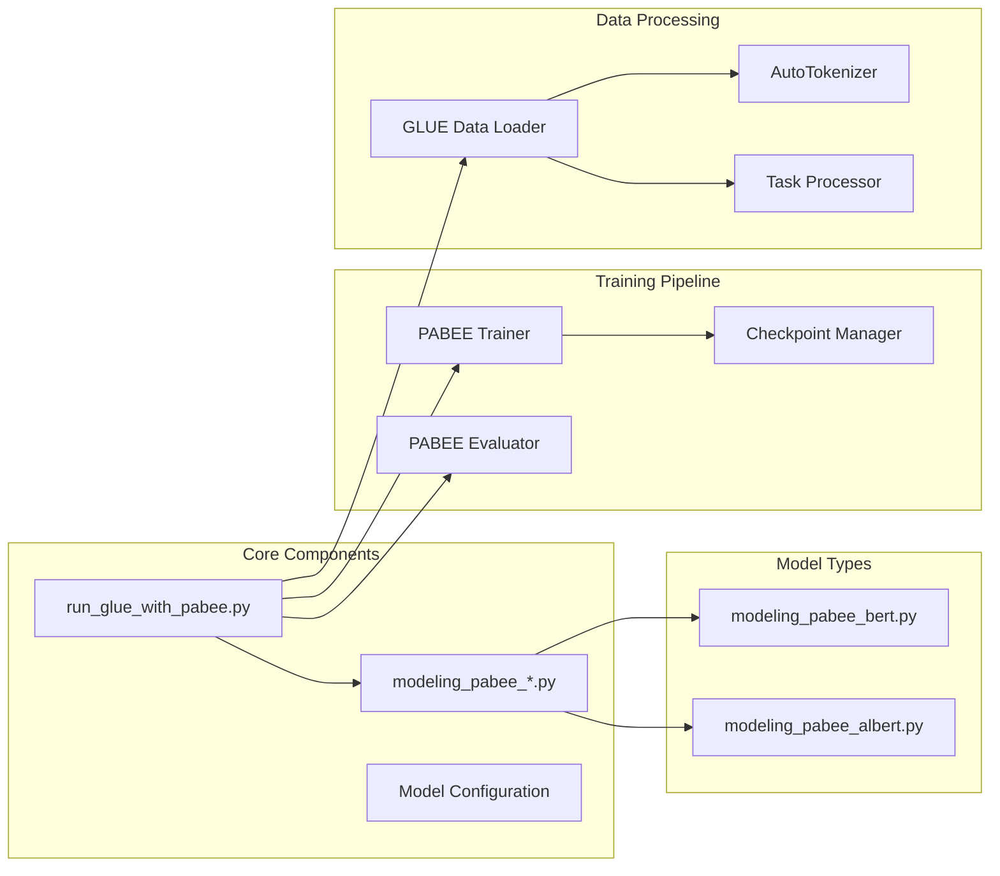
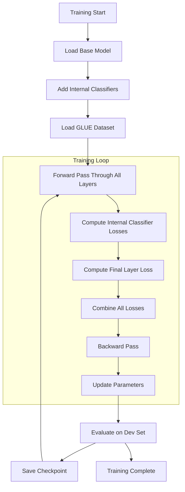
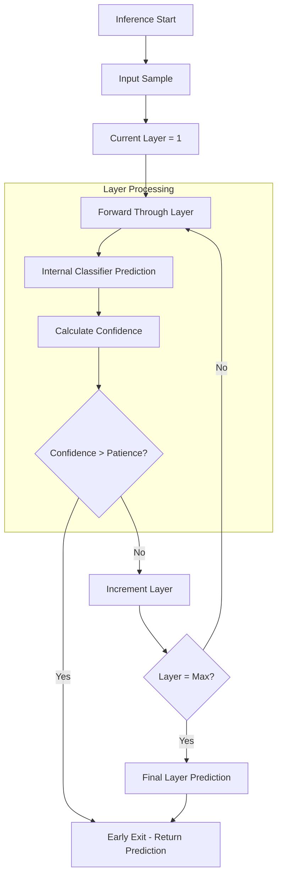

<!-- source: DeepWiki mcp.deepwiki.com · repo huggingface/transformers-research-projects · page 3 Patience-Based Early Exit (PABEE) · fetched 2026-10-26 -->

# Patience-Based Early Exit (PABEE)

<details>
<summary>Relevant source files</summary>

The following files were used as context for generating this wiki page:

- [bert-loses-patience/README.md](bert-loses-patience/README.md)
- [bert-loses-patience/pabee/__init__.py](bert-loses-patience/pabee/__init__.py)
- [bert-loses-patience/requirements.txt](bert-loses-patience/requirements.txt)

</details>


## Purpose and Scope

This document covers the Patience-Based Early Exit (PABEE) system, a plug-and-play inference optimization method for pretrained language models. PABEE enables faster and more robust inference by allowing models to exit early from their forward pass when confidence is sufficiently high. The system is implemented for BERT and ALBERT models and integrates with GLUE benchmark tasks.

For information about other model analysis and optimization techniques, see [Model Analysis and Optimization (Bertology)](#5).

## Overview

PABEE is a training and inference method that adds internal classifiers to transformer layers, enabling the model to make predictions at intermediate layers when confidence exceeds a patience threshold. This approach reduces computational cost during inference while maintaining or even improving model performance.

### Core Concepts

The system introduces several key concepts:

- **Early Exit Mechanism**: Internal classifiers at each transformer layer that can produce final predictions
- **Patience Parameter**: A threshold that determines when the model should exit early based on prediction confidence
- **Internal Classifiers**: Additional classification heads trained alongside the main model
- **Confidence Assessment**: A method to evaluate prediction reliability at each layer

Sources: [bert-loses-patience/README.md:1-90]()

## System Architecture

### PABEE Component Structure



### Model Implementation Architecture



Sources: [bert-loses-patience/README.md:11-33](), [bert-loses-patience/README.md:37-58]()

## Training Process

### Training Configuration

The training process extends standard GLUE fine-tuning to include internal classifier training. The system uses the `run_glue_with_pabee.py` script with the following key parameters:

| Parameter | Purpose | Example Value |
|-----------|---------|---------------|
| `model_type` | Specifies base model architecture | `albert`, `bert` |
| `model_name_or_path` | Base pretrained model | `albert-base-v2` |
| `task_name` | GLUE task to fine-tune on | `MRPC`, `SST-2` |
| `per_gpu_train_batch_size` | Training batch size | `32` |
| `learning_rate` | Optimizer learning rate | `2e-5` |
| `num_train_epochs` | Training duration | `5` |

### Training Command Structure

```bash
python ./run_glue_with_pabee.py \
  --model_type albert \
  --model_name_or_path albert-base-v2 \
  --task_name $TASK_NAME \
  --do_train \
  --do_eval \
  --data_dir "$GLUE_DIR/$TASK_NAME" \
  --output_dir /path/to/save/
```

### Training Flow



Sources: [bert-loses-patience/README.md:11-33]()

## Inference Process

### Patience-Based Decision Making

During inference, PABEE evaluates prediction confidence at each layer and exits early when the patience threshold is met. The inference process differs significantly from training as it uses batch size 1 and dynamic exit points.

### Inference Configuration

| Parameter | Purpose | Example Value |
|-----------|---------|---------------|
| `patience` | Comma-separated patience values | `3,4,5,6,7,8` |
| `per_gpu_eval_batch_size` | Must be 1 for early exit | `1` |
| `eval_all_checkpoints` | Evaluate multiple checkpoints | `True` |
| `regression_threshold` | STS-B regression threshold | `0.1` |

### Inference Flow



### Usage Example

```bash
python ./run_glue_with_pabee.py \
  --model_name_or_path /path/to/trained/model/ \
  --do_eval \
  --per_gpu_eval_batch_size 1 \
  --patience 3,4,5,6,7,8
```

Sources: [bert-loses-patience/README.md:37-61]()

## Performance Results

### GLUE Benchmark Performance

The system demonstrates both speed improvements and performance gains across GLUE tasks:

#### ALBERT-base Results

| Model | Parameters | Speed-up | CoLA | MNLI | MRPC | QNLI | QQP | RTE | SST-2 | STS-B |
|-------|------------|----------|------|------|------|------|-----|-----|-------|-------|
| ALBERT-base | 12M | - | 58.9 | 84.6 | 89.5 | 91.7 | 89.6 | 78.6 | 92.8 | 89.5 |
| +PABEE | 12M | 1.57x | 61.2 | 85.1 | 90.0 | 91.8 | 89.6 | 80.1 | 93.0 | 90.1 |

#### Comparative Results

| Model | Parameters | Speed-up | MNLI | SST-2 | STS-B |
|-------|------------|----------|------|-------|-------|
| BERT-base | 108M | - | 84.5 | 92.1 | 88.9 |
| +PABEE | 108M | 1.62x | 83.6 | 92.0 | 88.7 |
| ALBERT-large | 18M | - | 86.4 | 94.9 | 90.4 |
| +PABEE | 18M | 2.42x | 86.8 | 95.2 | 90.6 |

### Key Performance Insights

- **Speed Improvements**: 1.57x to 2.42x faster inference across different model sizes
- **Performance Maintenance**: Comparable or improved accuracy on most tasks
- **ALBERT Enhancement**: Particularly effective for ALBERT models, showing consistent improvements
- **Scalability**: Larger models (ALBERT-large) show greater speed-up potential

Sources: [bert-loses-patience/README.md:63-76]()

## Implementation Dependencies

### Core Requirements

The system requires specific library versions for compatibility:

```
transformers == 4.38.0
```

### Integration Points

PABEE integrates with several key components:

- **Transformers Library**: Uses `AutoTokenizer`, `AutoModel`, and training utilities
- **GLUE Framework**: Compatible with standard GLUE data processing and evaluation
- **PyTorch**: Leverages PyTorch's neural network primitives and optimization
- **Hugging Face Hub**: Supports model loading and saving through Hub integration

Sources: [bert-loses-patience/requirements.txt:1](), [bert-loses-patience/pabee/__init__.py:1]()

## Limitations and Considerations

### Batch Size Constraint

The primary limitation of PABEE is the requirement for batch size 1 during inference. This constraint arises from the dynamic nature of early exit decisions, where different samples may exit at different layers.

### Task-Specific Tuning

- **Regression Tasks**: STS-B requires a `regression_threshold` parameter for optimal performance
- **Patience Tuning**: Different tasks may require different optimal patience values
- **Model Architecture**: Currently limited to BERT and ALBERT architectures

### Trade-offs

- **Speed vs. Accuracy**: Lower patience values increase speed but may reduce accuracy
- **Memory Usage**: Internal classifiers add modest parameter overhead
- **Training Complexity**: Requires joint training of multiple classification heads

Sources: [bert-loses-patience/README.md:4](), [bert-loses-patience/README.md:60]()

---

