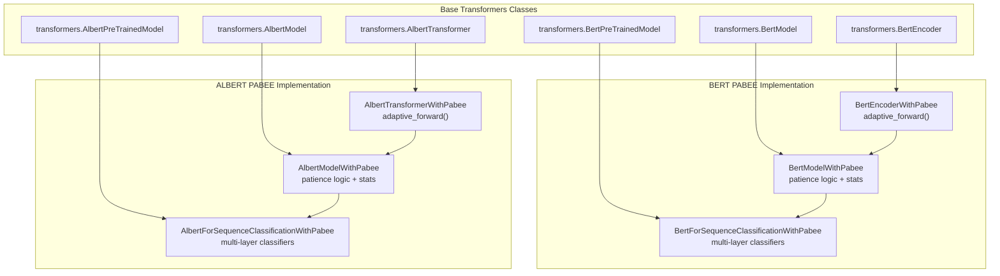
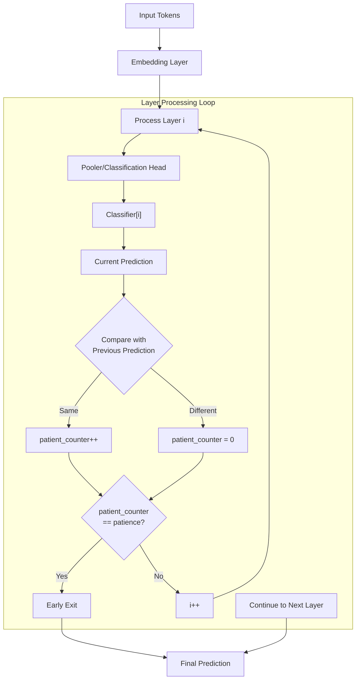
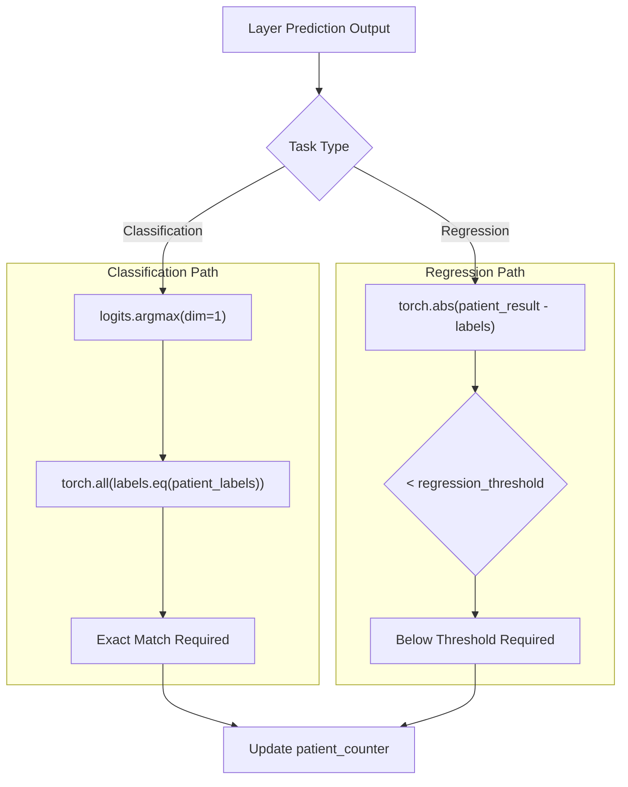

<!-- source: DeepWiki mcp.deepwiki.com · repo huggingface/transformers-research-projects · page 3.1 PABEE Model Implementations · fetched 2026-10-26 -->

# PABEE Model Implementations

<details>
<summary>Relevant source files</summary>

The following files were used as context for generating this wiki page:

- [bert-loses-patience/pabee/modeling_pabee_albert.py](bert-loses-patience/pabee/modeling_pabee_albert.py)
- [bert-loses-patience/pabee/modeling_pabee_bert.py](bert-loses-patience/pabee/modeling_pabee_bert.py)

</details>


This document covers the PABEE (Patience-based Early Exit) model implementations for BERT and ALBERT architectures. These implementations enable dynamic inference where models can exit early from transformer layers when consecutive predictions remain stable, reducing computational cost while maintaining accuracy.

For information about PABEE training and evaluation workflows, see [3.2](#3.2).

## Architecture Overview

The PABEE system extends standard BERT and ALBERT models with patience-based early exit mechanisms. Each implementation follows a consistent pattern of extending base transformers classes with adaptive processing capabilities.

### PABEE Component Architecture



**Sources:** [bert-loses-patience/pabee/modeling_pabee_bert.py:37-43](), [bert-loses-patience/pabee/modeling_pabee_albert.py:36-55](), [bert-loses-patience/pabee/modeling_pabee_bert.py:50-65](), [bert-loses-patience/pabee/modeling_pabee_albert.py:62-72]()

## Core PABEE Mechanisms

### Patience-Based Exit Logic

The PABEE mechanism operates by comparing consecutive layer outputs and exiting early when predictions stabilize. The system maintains a patience counter that increments when consecutive layers produce identical results.

### PABEE Forward Pass Flow



**Sources:** [bert-loses-patience/pabee/modeling_pabee_bert.py:202-237](), [bert-loses-patience/pabee/modeling_pabee_albert.py:176-214]()

## BERT PABEE Implementation

### BertEncoderWithPabee

The `BertEncoderWithPabee` class extends the standard BERT encoder with an `adaptive_forward` method that processes single layers sequentially rather than all layers at once.

| Method | Purpose | Key Parameters |
|--------|---------|----------------|
| `adaptive_forward` | Process single transformer layer | `current_layer`, `hidden_states`, `attention_mask`, `head_mask` |

**Sources:** [bert-loses-patience/pabee/modeling_pabee_bert.py:37-43]()

### BertModelWithPabee

The `BertModelWithPabee` class implements the core patience logic and statistics tracking. It manages three execution modes:

| Mode | Condition | Behavior |
|------|-----------|----------|
| Training | `self.training == True` | Process all layers, collect outputs from each |
| Full Inference | `self.patience == 0` | Use all layers, no early exit |
| Patience Inference | `self.patience > 0` | Apply early exit with patience counter |

Key attributes:
- `patience`: Number of consecutive identical predictions required for early exit
- `inference_instances_num`: Total inference instances processed  
- `inference_layers_num`: Total layers computed across all instances
- `regression_threshold`: Threshold for regression task early exit decisions

**Sources:** [bert-loses-patience/pabee/modeling_pabee_bert.py:67-95](), [bert-loses-patience/pabee/modeling_pabee_bert.py:182-237]()

### BertForSequenceClassificationWithPabee

This class implements the sequence classification head with multiple classifiers - one per transformer layer to enable predictions at any exit point.

Key components:
- `classifiers`: `nn.ModuleList` containing one linear classifier per layer
- Weighted loss computation across all layers during training
- Support for both classification and regression tasks

**Sources:** [bert-loses-patience/pabee/modeling_pabee_bert.py:246-257](), [bert-loses-patience/pabee/modeling_pabee_bert.py:327-344]()

## ALBERT PABEE Implementation

### AlbertTransformerWithPabee

The ALBERT implementation adapts to ALBERT's parameter sharing architecture, where layer groups are reused across transformer layers.

Key differences from BERT:
- Handles `embedding_hidden_mapping_in` for layer 0
- Computes group index for ALBERT's layer group structure
- Processes specific layer group based on current layer position

**Sources:** [bert-loses-patience/pabee/modeling_pabee_albert.py:36-55]()

### AlbertModelWithPabee and AlbertForSequenceClassificationWithPabee

These classes follow the same pattern as the BERT implementation but integrate with ALBERT's architecture, including:
- ALBERT-specific pooler activation
- Classifier dropout probability configuration
- Compatible loss computation and statistics tracking

**Sources:** [bert-loses-patience/pabee/modeling_pabee_albert.py:62-95](), [bert-loses-patience/pabee/modeling_pabee_albert.py:223-234]()

## Prediction Comparison Logic

### Classification vs Regression

The PABEE models handle two types of tasks with different comparison strategies:



**Sources:** [bert-loses-patience/pabee/modeling_pabee_bert.py:214-229](), [bert-loses-patience/pabee/modeling_pabee_albert.py:191-206]()

## Statistics and Performance Tracking

Both implementations include comprehensive performance tracking:

| Method | Purpose | Formula |
|--------|---------|---------|
| `set_patience` | Configure patience parameter | N/A |
| `reset_stats` | Reset inference counters | Set counters to 0 |
| `log_stats` | Report performance metrics | `avg_layers = layers_num / instances_num`<br/>`speedup = 1 - avg_layers / total_layers` |
| `set_regression_threshold` | Configure regression exit threshold | N/A |

**Sources:** [bert-loses-patience/pabee/modeling_pabee_bert.py:79-95](), [bert-loses-patience/pabee/modeling_pabee_albert.py:75-91]()

## Training Loss Computation

During training, PABEE models compute weighted losses across all layers to encourage earlier layers to make accurate predictions:

```python
total_loss += loss * (ix + 1)  # Layer weight increases with depth
total_weights += ix + 1
final_loss = total_loss / total_weights
```

This weighting scheme incentivizes deeper layers while ensuring earlier layers remain capable of making predictions.

**Sources:** [bert-loses-patience/pabee/modeling_pabee_bert.py:327-343](), [bert-loses-patience/pabee/modeling_pabee_albert.py:302-318]()

---

