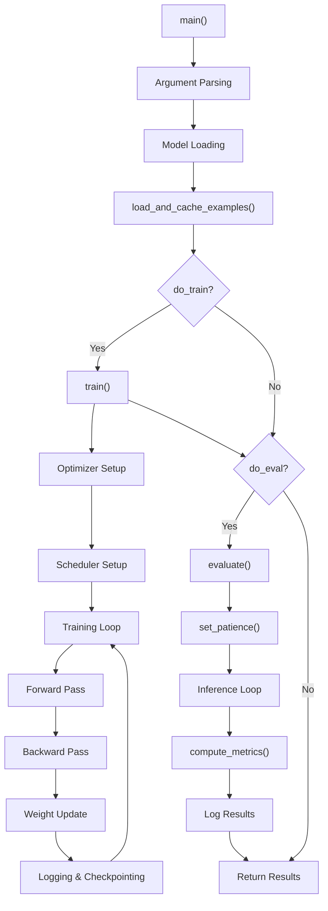
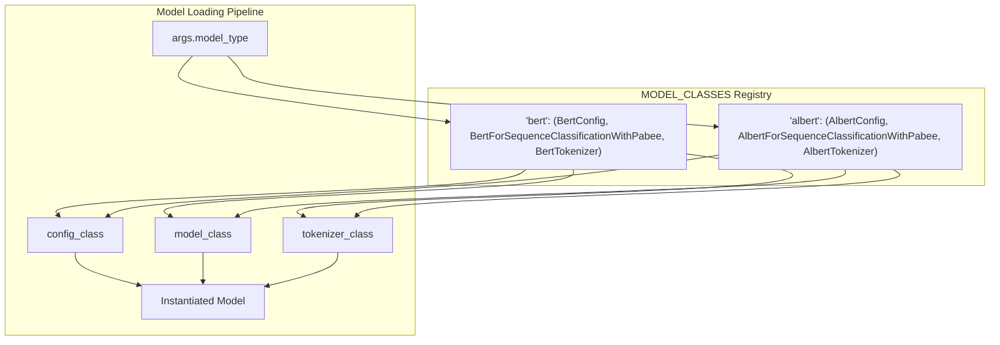
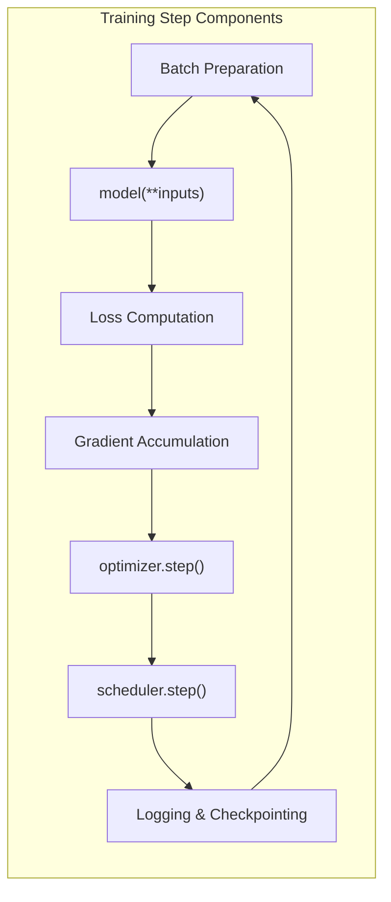
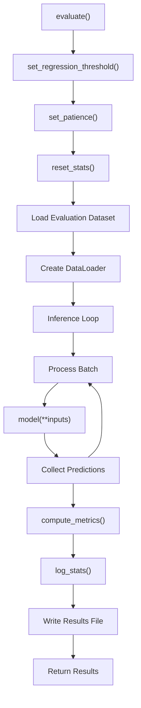
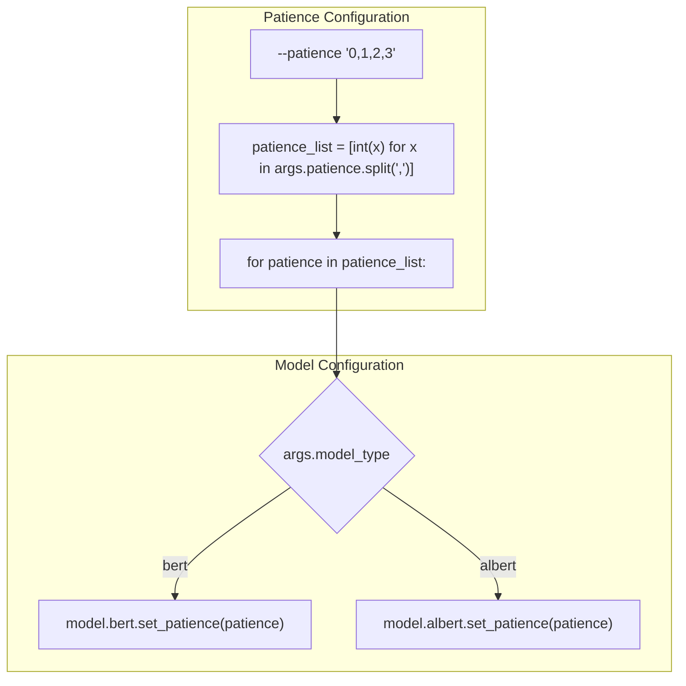
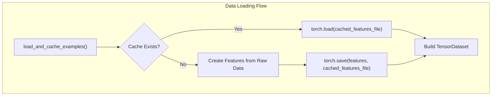
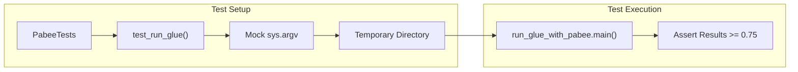

<!-- source: DeepWiki mcp.deepwiki.com · repo huggingface/transformers-research-projects · page 3.2 PABEE Training and Evaluation · fetched 2026-10-26 -->

# PABEE Training and Evaluation

<details>
<summary>Relevant source files</summary>

The following files were used as context for generating this wiki page:

- [bert-loses-patience/run_glue_with_pabee.py](bert-loses-patience/run_glue_with_pabee.py)
- [bert-loses-patience/test_run_glue_with_pabee.py](bert-loses-patience/test_run_glue_with_pabee.py)

</details>


This document covers the training and evaluation infrastructure for PABEE (Patience-based Early Exit) models on GLUE benchmark tasks. The system provides a complete pipeline for fine-tuning PABEE-enhanced BERT and ALBERT models and evaluating their performance with configurable patience thresholds.

For information about the PABEE model architectures and early exit mechanisms, see [PABEE Model Implementations](#3.1).

## Training Pipeline Architecture

The PABEE training system is built around the `run_glue_with_pabee.py` script, which extends the standard GLUE fine-tuning pipeline with PABEE-specific functionality. The training pipeline supports both BERT and ALBERT base models with patience-based early exit capabilities.

### Training Pipeline Flow



Sources: [bert-loses-patience/run_glue_with_pabee.py:408-751]()

### Model Class Integration

The training system integrates with PABEE-enhanced model classes through a centralized model registry:



Sources: [bert-loses-patience/run_glue_with_pabee.py:59-62](), [bert-loses-patience/run_glue_with_pabee.py:662-679]()

## Training Function Implementation

The `train()` function implements the core training loop with PABEE-specific optimizations and standard distributed training support.

### Training Configuration

| Parameter | Default | Description |
|-----------|---------|-------------|
| `per_gpu_train_batch_size` | 8 | Batch size per GPU for training |
| `gradient_accumulation_steps` | 1 | Steps to accumulate gradients |
| `learning_rate` | 5e-5 | Initial learning rate for Adam |
| `num_train_epochs` | 3.0 | Total training epochs |
| `warmup_steps` | 0 | Linear warmup steps |
| `max_grad_norm` | 1.0 | Maximum gradient norm for clipping |
| `fp16` | False | Enable mixed precision training |

Sources: [bert-loses-patience/run_glue_with_pabee.py:501-540]()

### Training Loop Components

The training loop includes several key components for PABEE model training:



Sources: [bert-loses-patience/run_glue_with_pabee.py:172-255]()

### Distributed Training Support

The system supports distributed training with the following features:

- **Multi-GPU Training**: Automatic DataParallel wrapping when `n_gpu > 1`
- **Distributed Training**: DistributedDataParallel for multi-node training
- **Mixed Precision**: NVIDIA Apex integration for FP16 training
- **Gradient Synchronization**: Proper gradient accumulation across devices

Sources: [bert-loses-patience/run_glue_with_pabee.py:111-129]()

## Evaluation Framework

The evaluation system provides comprehensive testing capabilities for PABEE models with configurable patience thresholds and performance tracking.

### Evaluation Pipeline



Sources: [bert-loses-patience/run_glue_with_pabee.py:263-350]()

### Patience Configuration

The evaluation system supports multiple patience values for comprehensive testing:



Sources: [bert-loses-patience/run_glue_with_pabee.py:725](), [bert-loses-patience/run_glue_with_pabee.py:264-273]()

### GLUE Task Integration

The system integrates with GLUE benchmark tasks through the transformers library:

| Component | Function | Purpose |
|-----------|----------|---------|
| `processors` | Task-specific data processors | Handle different GLUE task formats |
| `output_modes` | Classification/regression modes | Determine output processing |
| `convert_examples_to_features` | Feature conversion | Transform examples to model inputs |
| `compute_metrics` | Metric computation | Calculate task-specific metrics |

Sources: [bert-loses-patience/run_glue_with_pabee.py:44-47]()

## Data Processing Pipeline

### Feature Caching System

The data loading system includes an efficient caching mechanism:



Sources: [bert-loses-patience/run_glue_with_pabee.py:353-405]()

### Tensor Dataset Construction

The system creates tensor datasets with the following structure:

- `all_input_ids`: Token IDs for input sequences
- `all_attention_mask`: Attention masks for padding tokens
- `all_token_type_ids`: Segment IDs for sequence pairs
- `all_labels`: Task-specific labels (classification/regression)

Sources: [bert-loses-patience/run_glue_with_pabee.py:396-404]()

## Configuration Parameters

### PABEE-Specific Parameters

| Parameter | Type | Default | Description |
|-----------|------|---------|-------------|
| `patience` | str | "0" | Comma-separated patience values for evaluation |
| `regression_threshold` | float | 0 | Threshold for early exit decision |

### Training Parameters

| Parameter | Type | Default | Description |
|-----------|------|---------|-------------|
| `per_gpu_eval_batch_size` | int | 1 | Must be 1 when patience > 0 |
| `evaluate_during_training` | bool | False | Run evaluation during training |
| `eval_all_checkpoints` | bool | False | Evaluate all saved checkpoints |

Sources: [bert-loses-patience/run_glue_with_pabee.py:447-458](), [bert-loses-patience/run_glue_with_pabee.py:654-655]()

## Testing Framework

The system includes comprehensive testing through `test_run_glue_with_pabee.py`:

### Test Configuration



### Test Parameters

The test uses the following configuration:
- Model: `albert/albert-base-v2`
- Task: `mrpc` (Microsoft Research Paraphrase Corpus)
- Training steps: 50 (minimal for testing)
- Batch sizes: 2 for training, 1 for evaluation
- Expected performance: ≥ 0.75 on all metrics

Sources: [bert-loses-patience/test_run_glue_with_pabee.py:23-51]()

## Usage Patterns

### Basic Training Command

```bash
python run_glue_with_pabee.py \
    --model_type bert \
    --model_name_or_path bert-base-uncased \
    --task_name cola \
    --do_train \
    --data_dir ./glue_data/CoLA \
    --output_dir ./output/cola \
    --per_gpu_train_batch_size 32 \
    --learning_rate 2e-5 \
    --num_train_epochs 3
```

### Evaluation with Multiple Patience Values

```bash
python run_glue_with_pabee.py \
    --model_type albert \
    --model_name_or_path ./trained_model \
    --task_name sst-2 \
    --do_eval \
    --data_dir ./glue_data/SST-2 \
    --output_dir ./results \
    --patience "0,1,2,3,4,5" \
    --per_gpu_eval_batch_size 1
```

Sources: [bert-loses-patience/run_glue_with_pabee.py:408-751](), [bert-loses-patience/test_run_glue_with_pabee.py:29-46]()

---

