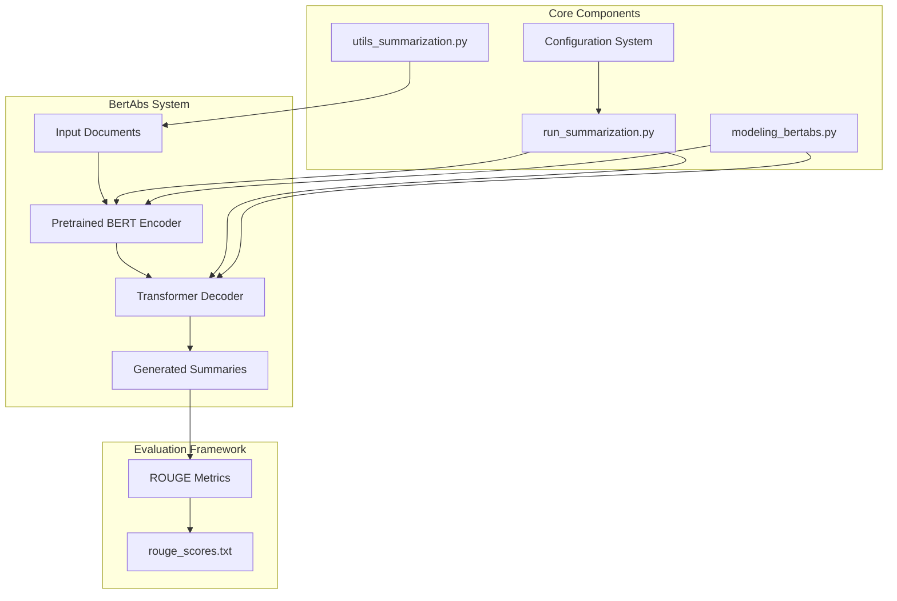
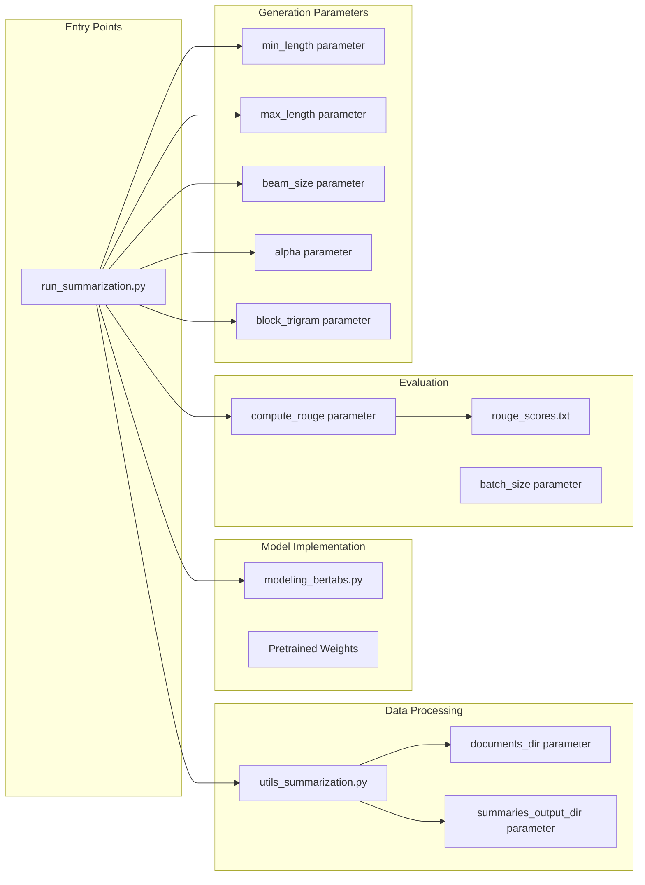
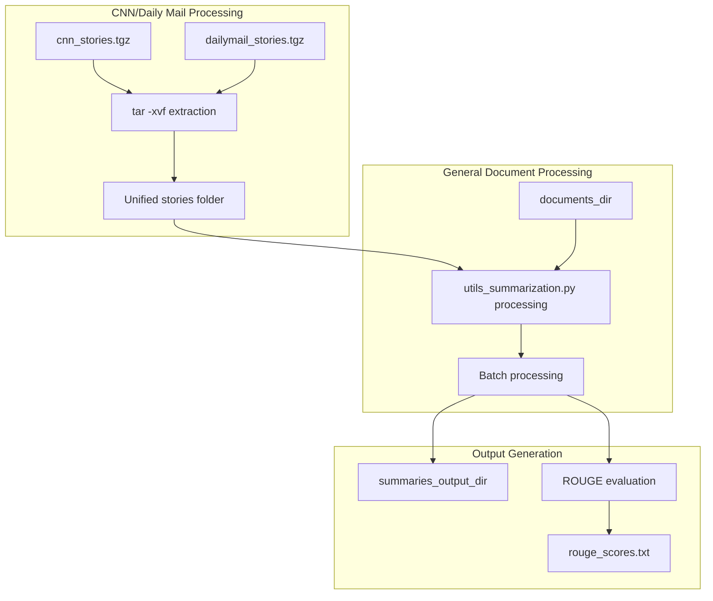

<!-- source: DeepWiki mcp.deepwiki.com · repo huggingface/transformers-research-projects · page 4 Abstractive Summarization (BertAbs) · fetched 2026-10-26 -->

# Abstractive Summarization (BertAbs)

Relevant source files

The following files were used as context for generating this wiki page:

- [bertabs/README.md](bertabs/README.md)
- [bertabs/__init__.py](bertabs/__init__.py)
- [bertabs/requirements.txt](bertabs/requirements.txt)

## Purpose and Scope

The BertAbs system implements abstractive text summarization using pretrained encoder models, based on the research paper "Text Summarization with Pretrained Encoders" by Yang Liu and Mirella Lapata. This system provides both research reproduction capabilities for the CNN/Daily Mail dataset and general-purpose document summarization functionality.

For model architecture details, see [BertAbs Model Architecture](#4.1). For training and evaluation workflows, see [BertAbs Training and Evaluation](#4.2). For data processing utilities, see [BertAbs Data Processing](#4.3).

## System Overview

The BertAbs system combines pretrained BERT encoders with transformer decoders to generate abstractive summaries. The implementation supports both research evaluation on standard datasets and practical summarization of arbitrary documents.

### High-Level Architecture

**Sources:** [bertabs/README.md:1-62]()

### Code Entity Mapping

**Sources:** [bertabs/README.md:29-40](), [bertabs/README.md:49-59]()

## Key Components

### Main Execution Script

The `run_summarization.py` script serves as the primary interface for the BertAbs system, supporting both CNN/Daily Mail dataset evaluation and general document summarization.

| Parameter | Purpose | Default/Example |
|-----------|---------|-----------------|
| `documents_dir` | Input documents directory | `$DATA_PATH` |
| `summaries_output_dir` | Output summaries directory | `$SUMMARIES_PATH` |
| `no_cuda` | Disable GPU usage | `false` |
| `batch_size` | Processing batch size | `4` |
| `min_length` | Minimum summary length | `50` |
| `max_length` | Maximum summary length | `200` |
| `beam_size` | Beam search size | `5` |
| `alpha` | Length penalty parameter | `0.95` |
| `block_trigram` | Prevent trigram repetition | `true` |
| `compute_rouge` | Enable ROUGE evaluation | `true` |

**Sources:** [bertabs/README.md:29-40](), [bertabs/README.md:49-59]()

### Model Architecture

The system uses pretrained weights from models trained on CNN/Daily Mail dataset with both extractive and abstractive tasks. The architecture combines:

- **Encoder**: Pretrained BERT model for document understanding
- **Decoder**: Transformer decoder for summary generation
- **Training Strategy**: Sequential extractive then abstractive training

**Sources:** [bertabs/README.md:7-8]()

### Data Processing Pipeline

**Sources:** [bertabs/README.md:20-27](), [bertabs/README.md:46-61]()

## Dependencies and Requirements

The system requires specific dependencies for proper functionality:

| Component | Version/Package | Purpose |
|-----------|----------------|---------|
| `transformers` | `== 4.38.0` | Core transformer models |
| `nltk` | Latest | Text processing utilities |
| `py-rouge` | Latest | ROUGE metric computation |

**Sources:** [bertabs/requirements.txt:1-6]()

## Performance Characteristics

The system provides the following performance characteristics:

- **Evaluation Time**: 30 hours for full CNN/Daily Mail dataset (300,000 texts)
- **Hardware**: Single Tesla V100 GPU with batch size 10
- **GPU Support**: Single GPU inference (multi-GPU not supported)
- **Scalability**: Configurable batch size for memory optimization

**Sources:** [bertabs/README.md:42-43]()

## Research Foundation

The implementation is based on the original PreSumm codebase and reproduces results from "Text Summarization with Pretrained Encoders" research. The system enables:

- **Research Reproduction**: Exact replication of paper results on CNN/Daily Mail
- **General Summarization**: Application to arbitrary document collections
- **Evaluation Framework**: ROUGE-based performance measurement

**Sources:** [bertabs/README.md:3-6]()

---

