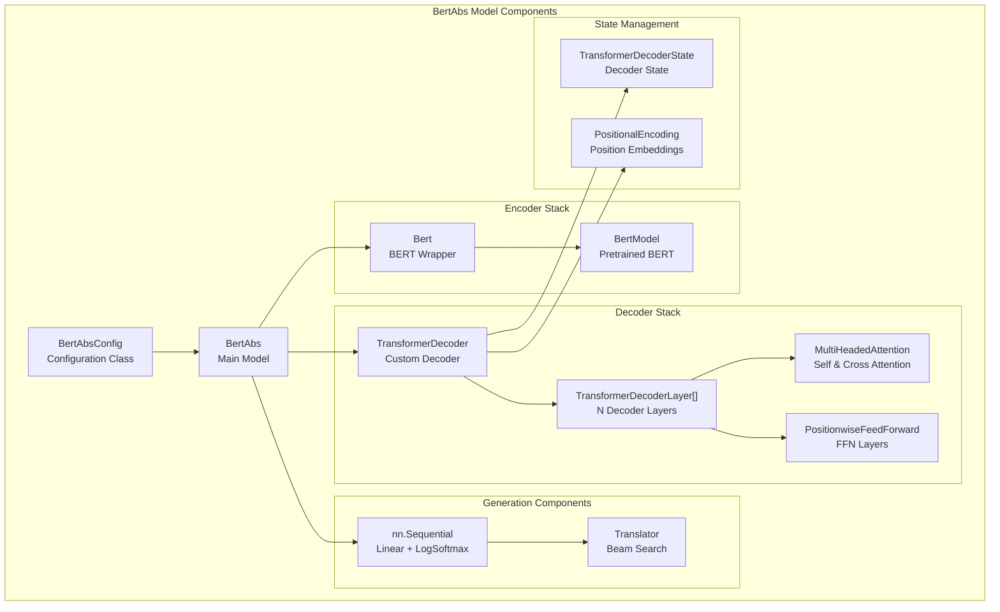
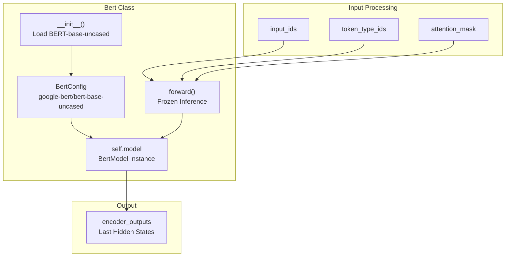
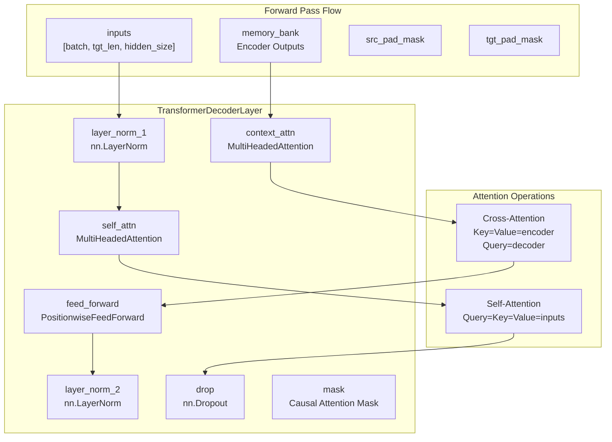
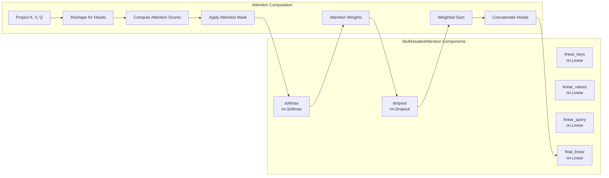
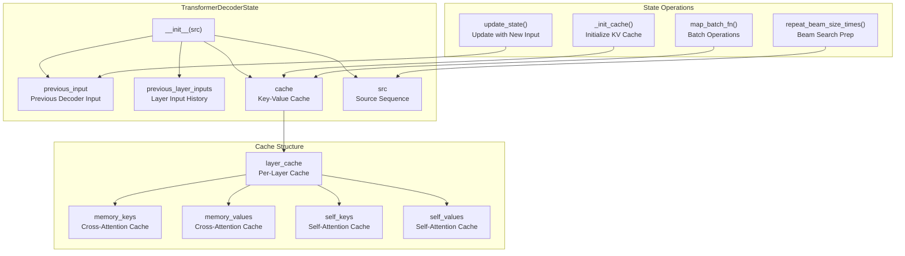
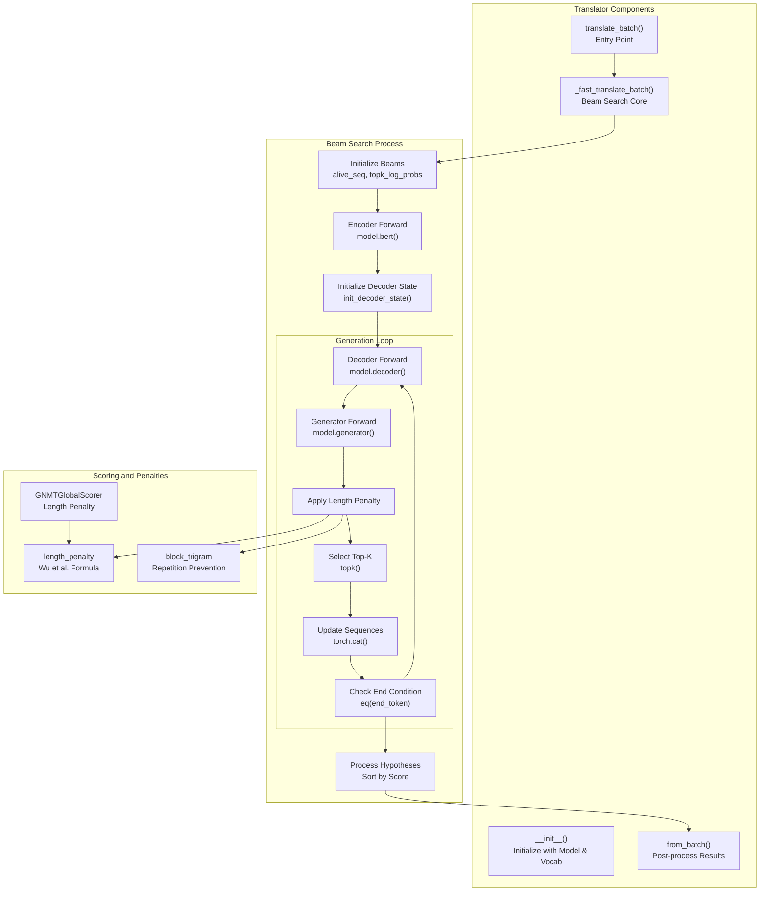
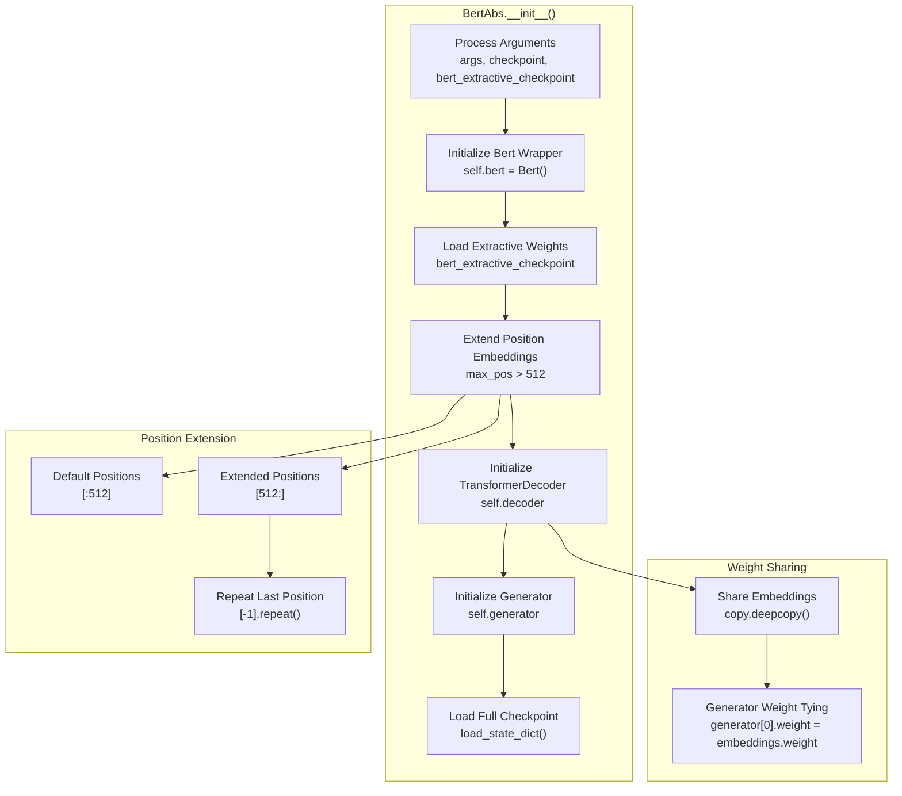
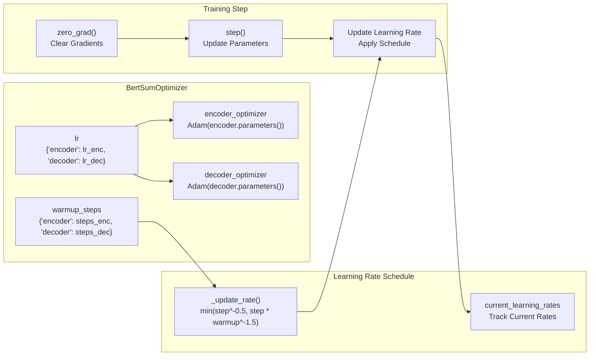

<!-- source: DeepWiki mcp.deepwiki.com · repo huggingface/transformers-research-projects · page 4.1 BertAbs Model Architecture · fetched 2026-10-26 -->

# BertAbs Model Architecture

Relevant source files

The following files were used as context for generating this wiki page:

- [bertabs/configuration_bertabs.py](bertabs/configuration_bertabs.py)
- [bertabs/modeling_bertabs.py](bertabs/modeling_bertabs.py)

This document covers the architectural design and implementation of the BertAbs model for abstractive text summarization. BertAbs combines a pretrained BERT encoder with a custom Transformer decoder to generate summaries. The system is implemented as an encoder-decoder architecture where BERT provides contextual representations that guide the decoder's summary generation process.

For information about BertAbs training and evaluation workflows, see [4.2](#4.2). For data processing utilities, see [4.3](#4.3).

## Overall Architecture

BertAbs implements an encoder-decoder architecture specifically designed for abstractive summarization tasks. The model leverages a frozen BERT encoder to generate rich contextual representations of input documents, which are then used by a trainable Transformer decoder to generate summary sequences.

### Model Architecture Overview

Sources: [bertabs/modeling_bertabs.py:37-120](), [bertabs/configuration_bertabs.py:31-99]()

### Data Flow Architecture

```mermaid
graph LR
    subgraph "Input Processing"
        InputText["Input Document"]
        Tokenization["Tokenization<br/>BERT Tokenizer"]
        InputIds["encoder_input_ids<br/>token_type_ids<br/>encoder_attention_mask"]
    end
    
    subgraph "Encoder Processing"
        BertEncoder["Bert.forward()<br/>BERT Encoding"]
        EncoderOutput["encoder_hidden_states<br/>[batch, seq_len, hidden_size]"]
    end
    
    subgraph "Decoder Processing"
        DecoderState["TransformerDecoderState<br/>init_decoder_state()"]
        DecoderInput["decoder_input_ids<br/>decoder_attention_mask"]
        DecoderForward["TransformerDecoder.forward()"]
        DecoderOutput["decoder_outputs<br/>[batch, tgt_len, hidden_size]"]
    end
    
    subgraph "Generation"
        Generator["Generator<br/>Linear + LogSoftmax"]
        Logits["log_probabilities<br/>[batch, tgt_len, vocab_size]"]
        BeamSearch["Translator._fast_translate_batch()<br/>Beam Search"]
        Summary["Generated Summary"]
    end
    
    InputText --> Tokenization
    Tokenization --> InputIds
    InputIds --> BertEncoder
    BertEncoder --> EncoderOutput
    
    EncoderOutput --> DecoderState
    DecoderInput --> DecoderForward
    DecoderState --> DecoderForward
    EncoderOutput --> DecoderForward
    DecoderForward --> DecoderOutput
    
    DecoderOutput --> Generator
    Generator --> Logits
    Logits --> BeamSearch
    BeamSearch --> Summary
```

Sources: [bertabs/modeling_bertabs.py:103-119](), [bertabs/modeling_bertabs.py:823-954]()

## Configuration System

The `BertAbsConfig` class defines the architectural hyperparameters for both encoder and decoder components. The configuration inherits from Hugging Face's `PretrainedConfig` to maintain compatibility with the transformers ecosystem.

### Configuration Parameters

| Parameter | Default | Description |
|-----------|---------|-------------|
| `vocab_size` | 30522 | Vocabulary size for tokenization |
| `max_pos` | 512 | Maximum sequence length |
| `enc_layers` | 6 | Number of encoder layers |
| `enc_hidden_size` | 512 | Encoder hidden dimension |
| `enc_heads` | 8 | Encoder attention heads |
| `enc_ff_size` | 512 | Encoder feed-forward dimension |
| `dec_layers` | 6 | Number of decoder layers |
| `dec_hidden_size` | 768 | Decoder hidden dimension |
| `dec_heads` | 8 | Decoder attention heads |
| `dec_ff_size` | 2048 | Decoder feed-forward dimension |

Sources: [bertabs/configuration_bertabs.py:67-98]()

## Encoder Architecture

The encoder component wraps a pretrained BERT model to generate contextual representations of input documents. The implementation freezes the BERT parameters during training to preserve pretrained knowledge.

### BERT Encoder Implementation

The encoder runs in evaluation mode with gradient computation disabled to ensure the pretrained weights remain frozen during training.

Sources: [bertabs/modeling_bertabs.py:122-136]()

## Decoder Architecture

The decoder implements a standard Transformer architecture with modifications for summarization. It consists of multiple `TransformerDecoderLayer` instances that perform self-attention and cross-attention operations.

### Decoder Layer Components

Sources: [bertabs/modeling_bertabs.py:284-366](), [bertabs/modeling_bertabs.py:139-247]()

### Multi-Head Attention Mechanism

The `MultiHeadedAttention` class implements scaled dot-product attention with multiple heads, supporting both self-attention and cross-attention patterns required for the decoder.

Sources: [bertabs/modeling_bertabs.py:386-557]()

## State Management and Caching

The decoder uses `TransformerDecoderState` to manage hidden states and implement key-value caching for efficient beam search during inference.

### Decoder State Architecture

Sources: [bertabs/modeling_bertabs.py:590-651]()

## Generation and Inference

The generation process uses beam search implemented in the `Translator` class. The system generates summaries by autoregressively predicting tokens while maintaining multiple candidate sequences.

### Beam Search Implementation

Sources: [bertabs/modeling_bertabs.py:766-979](), [bertabs/modeling_bertabs.py:697-763]()

## Model Initialization and Weight Loading

The `BertAbs` model supports multiple initialization strategies including loading from pretrained extractive checkpoints and handling extended position embeddings.

### Initialization Process

Sources: [bertabs/modeling_bertabs.py:44-86]()

## Custom Optimizer

The `BertSumOptimizer` implements the specialized training procedure described in the original BertSum paper, using separate optimizers for encoder and decoder with different learning rates and warmup schedules.

### Optimizer Architecture

Sources: [bertabs/modeling_bertabs.py:1005-1054]()

## Key Design Patterns

The BertAbs implementation follows several important design patterns:

1. **Frozen Encoder**: The BERT encoder runs in evaluation mode with disabled gradients to preserve pretrained representations
2. **Weight Sharing**: Target embeddings and generator weights are tied to reduce parameters and improve training
3. **Position Extension**: Supports sequences longer than BERT's default 512 tokens by repeating the last position embedding
4. **State Caching**: Implements key-value caching for efficient beam search during inference
5. **Modular Design**: Separates encoder, decoder, and generation components for maintainability

Sources: [bertabs/modeling_bertabs.py:44-119](), [bertabs/modeling_bertabs.py:249-254]()

---

