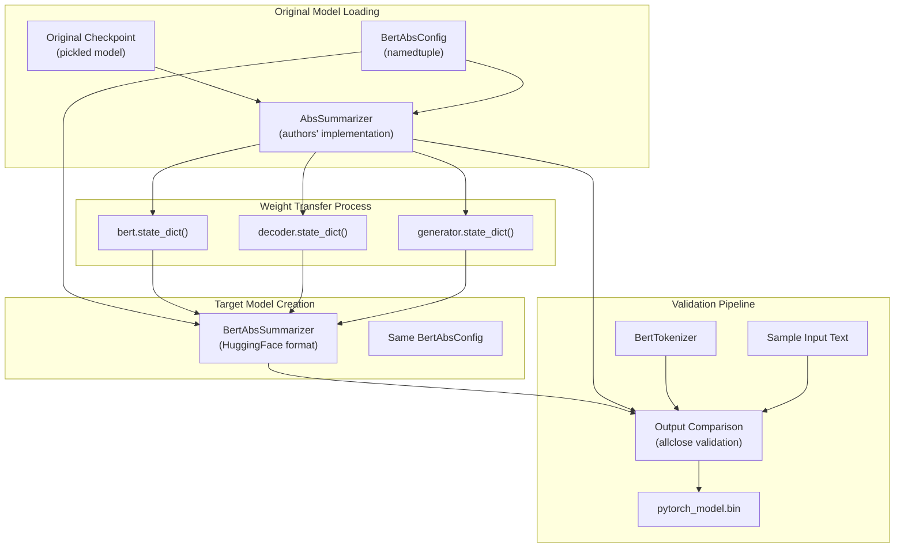
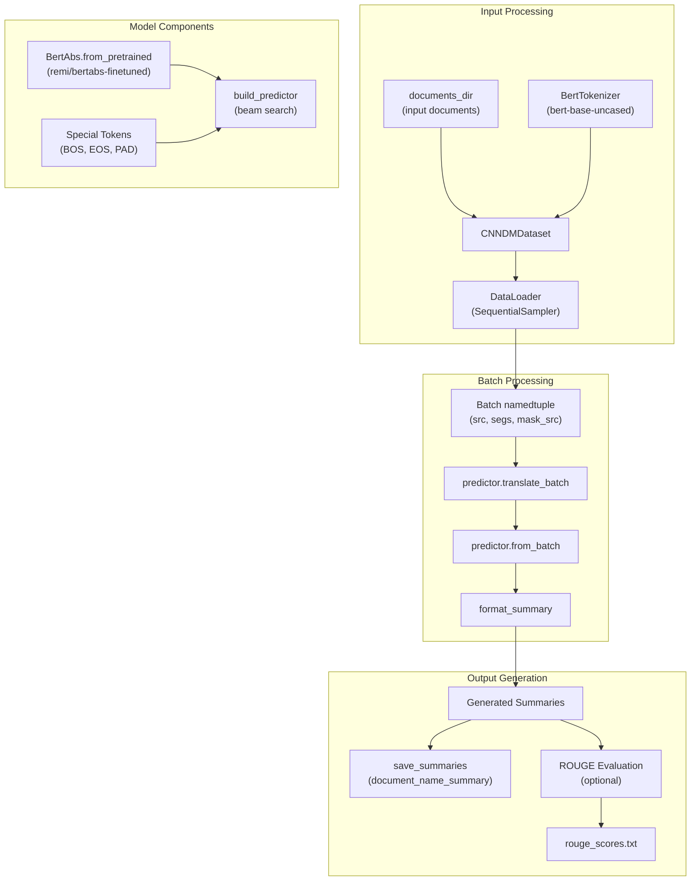
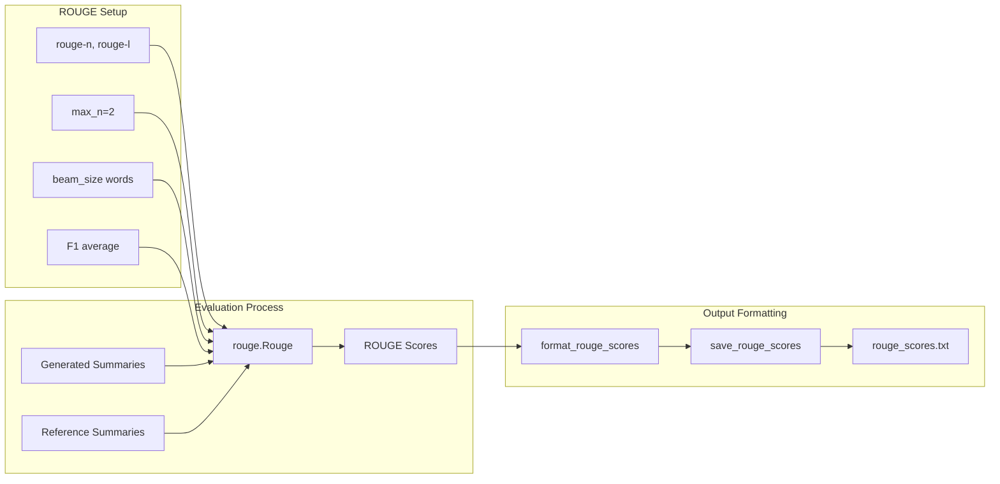

<!-- source: DeepWiki mcp.deepwiki.com · repo huggingface/transformers-research-projects · page 4.2 BertAbs Training and Evaluation · fetched 2026-10-26 -->

# BertAbs Training and Evaluation

Relevant source files

The following files were used as context for generating this wiki page:

- [bertabs/convert_bertabs_original_pytorch_checkpoint.py](bertabs/convert_bertabs_original_pytorch_checkpoint.py)
- [bertabs/run_summarization.py](bertabs/run_summarization.py)

This document covers the BertAbs training and evaluation pipeline, including checkpoint conversion utilities and the summarization evaluation framework. The system provides tools for converting original BertAbs model checkpoints to HuggingFace format and running inference with ROUGE evaluation on document summarization tasks.

For details about the BertAbs model architecture and configuration system, see [BertAbs Model Architecture](#4.1). For information about data processing utilities and preprocessing components, see [BertAbs Data Processing](#4.3).

## Checkpoint Conversion System

The BertAbs system includes a checkpoint conversion utility that transforms original PyTorch model checkpoints into the HuggingFace-compatible format. This conversion process ensures compatibility between the original research implementation and the standardized model architecture.

### Conversion Architecture

Sources: [bertabs/convert_bertabs_original_pytorch_checkpoint.py:1-186]()

### Configuration Parameters

The conversion process uses a `BertAbsConfig` namedtuple that defines the model architecture parameters:

| Parameter | Default Value | Description |
|-----------|---------------|-------------|
| `finetune_bert` | False | Whether to finetune BERT encoder |
| `large` | False | Use BERT-large architecture |
| `share_emb` | True | Share embeddings between encoder/decoder |
| `use_bert_emb` | False | Use BERT embeddings |
| `encoder` | "bert" | Encoder type |
| `max_pos` | 512 | Maximum position embeddings |
| `enc_layers` | 6 | Number of encoder layers |
| `enc_hidden_size` | 512 | Encoder hidden dimension |
| `enc_heads` | 8 | Number of encoder attention heads |
| `dec_layers` | 6 | Number of decoder layers |
| `dec_hidden_size` | 768 | Decoder hidden dimension |
| `dec_heads` | 8 | Number of decoder attention heads |

Sources: [bertabs/convert_bertabs_original_pytorch_checkpoint.py:40-61](), [bertabs/convert_bertabs_original_pytorch_checkpoint.py:70-88]()

### Weight Transfer Process

The `convert_bertabs_checkpoints` function performs the core conversion logic by loading the original model and transferring weights to the new architecture:

1. **Model Instantiation**: Creates both original `AbsSummarizer` and new `BertAbsSummarizer` instances
2. **Weight Transfer**: Copies state dictionaries for `bert`, `decoder`, and `generator` components
3. **Validation**: Compares outputs using sample inputs to ensure identical behavior
4. **Checkpoint Saving**: Saves the converted model as `pytorch_model.bin`

Sources: [bertabs/convert_bertabs_original_pytorch_checkpoint.py:64-162]()

## Evaluation Pipeline

The evaluation system provides a comprehensive framework for running inference and computing metrics on document summarization tasks. The pipeline supports configurable beam search parameters and automatic ROUGE score computation.

### Evaluation Workflow

Sources: [bertabs/run_summarization.py:31-98]()

### Data Processing and Batching

The `collate` function handles batch-level data processing with the following transformations:

1. **Text Encoding**: Uses `encode_for_summarization` to tokenize stories and summaries
2. **Sequence Processing**: Applies `truncate_or_pad` to ensure consistent sequence lengths
3. **Attention Masks**: Generates encoder masks using `build_mask`
4. **Token Type IDs**: Computes segment embeddings with `compute_token_type_ids`

The processed data is organized into `Batch` namedtuples containing:
- `document_names`: Original file names for output organization
- `batch_size`: Number of documents in batch
- `src`: Encoded source sequences
- `segs`: Token type IDs for segment distinction
- `mask_src`: Attention masks for padded positions
- `tgt_str`: Target summary strings for evaluation

Sources: [bertabs/run_summarization.py:207-235]()

### Beam Search Configuration

The evaluation pipeline supports configurable beam search parameters:

| Parameter | Default | Description |
|-----------|---------|-------------|
| `beam_size` | 5 | Number of beams for search |
| `min_length` | 50 | Minimum summary length |
| `max_length` | 200 | Maximum summary length |
| `alpha` | 0.95 | Length penalty coefficient |
| `block_trigram` | True | Prevent repeating trigrams |

Sources: [bertabs/run_summarization.py:286-315]()

## ROUGE Evaluation System

When `compute_rouge` is enabled, the system automatically computes ROUGE metrics comparing generated summaries against reference summaries. The evaluation uses the `rouge` library with specific configuration parameters.

### ROUGE Configuration

Sources: [bertabs/run_summarization.py:43-97]()

### ROUGE Metrics Reported

The system computes and reports the following ROUGE metrics:
- **ROUGE-1**: Unigram overlap (F1, Precision, Recall)
- **ROUGE-2**: Bigram overlap (F1, Precision, Recall)  
- **ROUGE-L**: Longest common subsequence (F1, Precision, Recall)

The `format_rouge_scores` function generates a structured output format displaying all metrics with 3-decimal precision.

Sources: [bertabs/run_summarization.py:145-172]()

## Summary Post-Processing

Generated summaries undergo post-processing through the `format_summary` function, which:
1. Removes special tokens (`[unused0]`, `[unused1]`, `[unused3]`, `[PAD]`)
2. Converts sentence boundary markers (`[unused2]`) to periods
3. Cleans up extra whitespace
4. Strips leading/trailing whitespace

Output summaries are saved with the naming convention `{original_name}_summary.{extension}` in the specified output directory.

Sources: [bertabs/run_summarization.py:126-142](), [bertabs/run_summarization.py:100-124]()

---

