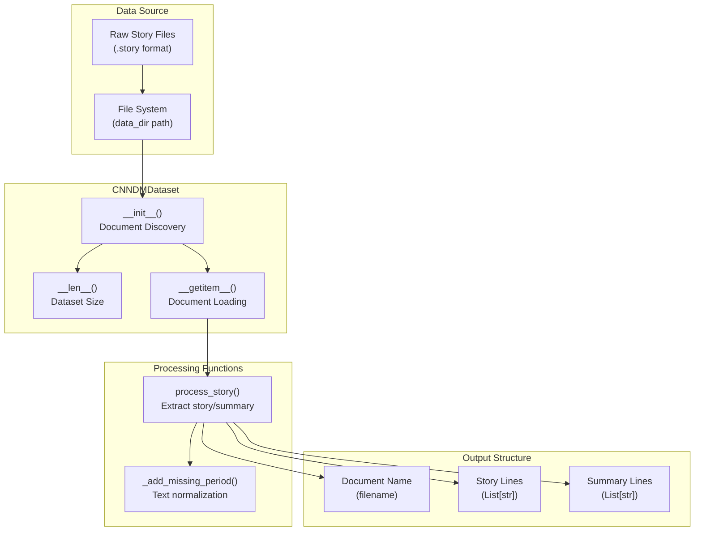
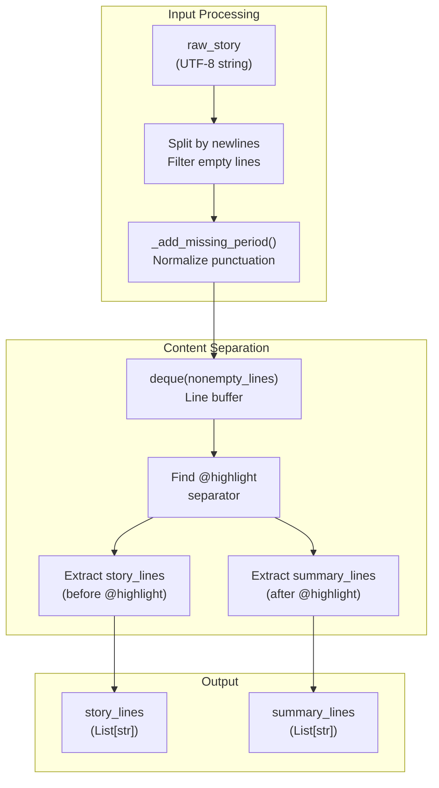
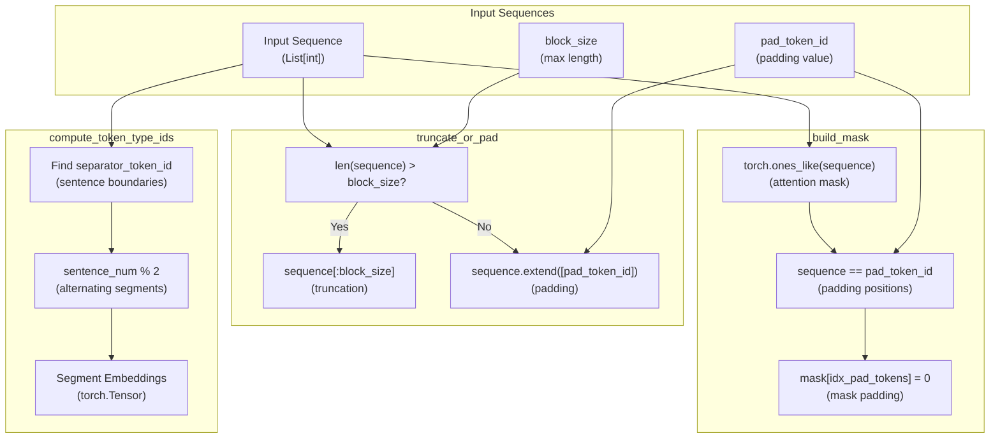

<!-- source: DeepWiki mcp.deepwiki.com · repo huggingface/transformers-research-projects · page 4.3 BertAbs Data Processing · fetched 2026-10-26 -->

# BertAbs Data Processing

<details>
<summary>Relevant source files</summary>

The following files were used as context for generating this wiki page:

- [bertabs/test_utils_summarization.py](bertabs/test_utils_summarization.py)
- [bertabs/utils_summarization.py](bertabs/utils_summarization.py)

</details>


This document covers the data processing utilities and pipeline components for the BertAbs abstractive summarization system. The data processing layer handles the ingestion, preprocessing, and formatting of summarization datasets (primarily CNN/DailyMail) into the token sequences required by the BertAbs model architecture.

For information about the BertAbs model architecture itself, see [4.1](#4.1). For details about training and evaluation workflows, see [4.2](#4.2).

## Dataset Processing Pipeline

The BertAbs data processing system centers around the `CNNDMDataset` class, which provides a PyTorch-compatible interface for loading and processing summarization datasets. The pipeline transforms raw story files into structured story and summary line collections.

### CNNDMDataset Architecture



The `CNNDMDataset` class implements the standard PyTorch `Dataset` interface, scanning a directory for story files and processing them on-demand to extract structured story and summary content.

**Sources:** [bertabs/utils_summarization.py:13-60]()

## Text Preprocessing and Story Processing

The core text processing logic is implemented in the `process_story` function, which parses the CNN/DailyMail file format to separate article content from summary highlights.

### Story Processing Workflow



The `process_story` function handles several edge cases:
- Missing punctuation: Automatically adds periods to lines without proper sentence endings
- Missing highlights: Returns empty summary list when no `@highlight` sections are found
- Empty stories: Returns empty lists for both story and summary components

**Sources:** [bertabs/utils_summarization.py:62-103]()

## Sequence Processing Utilities

The data processing pipeline includes several utility functions for handling tokenized sequences and preparing them for model input. These functions manage sequence length constraints and attention masking.

### Sequence Processing Functions



### Key Processing Functions

| Function | Purpose | Input | Output |
|----------|---------|-------|--------|
| `truncate_or_pad` | Normalize sequence length | `sequence`, `block_size`, `pad_token_id` | Fixed-length sequence |
| `build_mask` | Create attention mask | `sequence`, `pad_token_id` | Binary attention mask |
| `compute_token_type_ids` | Generate segment embeddings | `batch`, `separator_token_id` | Token type embeddings |

**Sources:** [bertabs/utils_summarization.py:110-167]()

## Tokenization and Encoding

The `encode_for_summarization` function handles the tokenization of story and summary lines using the provided tokenizer, following the BertAbs paper's approach of using `[SEP] [CLS]` tokens to separate sentences.

### Encoding Process

The encoding workflow processes both story and summary lines:

1. **Line-by-line tokenization**: Each story and summary line is tokenized individually using `tokenizer.encode(line)`
2. **Token flattening**: Token IDs from all sentences are concatenated into single sequences
3. **Separator handling**: The tokenizer automatically inserts appropriate separator tokens

```python
# Example encoding workflow from bertabs/utils_summarization.py:130-140
story_lines_token_ids = [tokenizer.encode(line) for line in story_lines]
story_token_ids = [token for sentence in story_lines_token_ids for token in sentence]
```

**Sources:** [bertabs/utils_summarization.py:130-141]()

## Testing Framework

The data processing utilities are thoroughly tested through the `SummarizationDataProcessingTest` class, which validates all core processing functions.

### Test Coverage

| Test Method | Function Tested | Validation Focus |
|-------------|----------------|------------------|
| `test_fit_to_block_sequence_*` | `truncate_or_pad` | Padding, truncation, exact fit |
| `test_process_story_*` | `process_story` | Highlight extraction, empty stories, missing periods |
| `test_build_mask_*` | `build_mask` | Attention mask generation, padding detection |
| `test_compute_token_type_ids` | `compute_token_type_ids` | Segment embedding computation |

### Key Test Scenarios

The test suite covers several critical edge cases:

- **Sequence length handling**: Tests for sequences that are too short, exact length, and too long
- **Story format variations**: Tests for stories with missing highlights, empty content, and missing punctuation
- **Mask generation**: Tests for sequences with and without padding tokens
- **Token type computation**: Tests for proper segment alternation with separator tokens

**Sources:** [bertabs/test_utils_summarization.py:23-98]()

---

