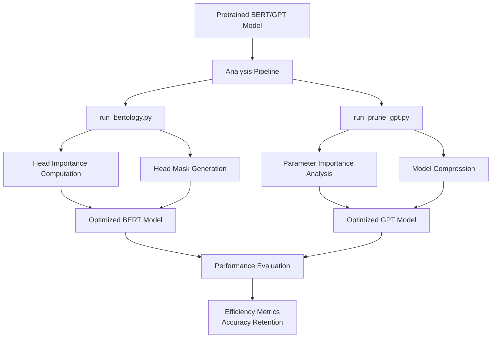
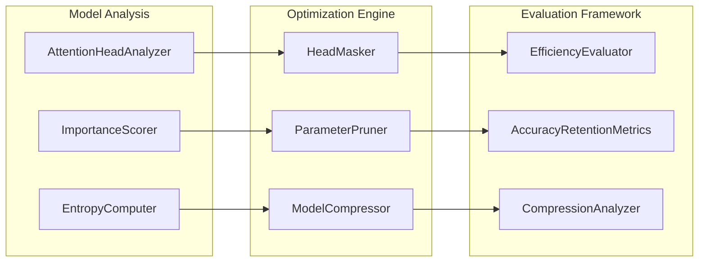
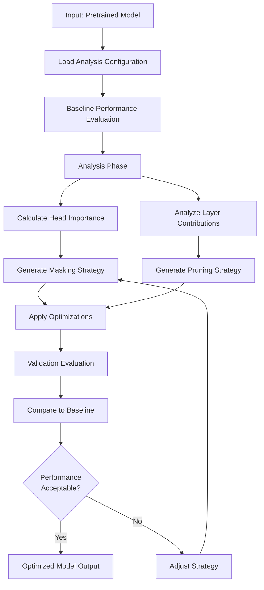

<!-- source: DeepWiki mcp.deepwiki.com · repo huggingface/transformers-research-projects · page 5 Model Analysis and Optimization (Bertology) · fetched 2026-10-26 -->

# Model Analysis and Optimization (Bertology)

<details>
<summary>Relevant source files</summary>

The following files were used as context for generating this wiki page:

- [bertology/requirements.txt](bertology/requirements.txt)

</details>


## Purpose and Scope

The Bertology module provides tools for analyzing and optimizing transformer models through systematic attention head analysis and model pruning techniques. This module implements research methodologies for understanding the internal mechanisms of BERT-style models and reducing their computational complexity while maintaining performance.

The system focuses on two primary optimization approaches: attention head importance analysis for BERT models and parameter pruning for GPT models. For training optimization through early exit mechanisms, see [Patience-Based Early Exit (PABEE)](#3). For adversarial robustness evaluation, see [Adversarial Evaluation (HANS)](#2).

## System Overview

The Bertology system implements model introspection and optimization techniques that operate on pre-trained transformer models. The core approach involves analyzing the contribution of individual attention heads and systematically removing less important components to create more efficient models.

### Bertology Analysis Pipeline



### Core Components Architecture



## Technical Architecture

The Bertology system operates through a systematic analysis and optimization pipeline that examines transformer model components and selectively removes or masks less critical elements.

### Analysis Methodology

| Analysis Type | Target Models | Key Metrics | Output |
|---------------|---------------|-------------|---------|
| Attention Head Analysis | BERT, RoBERTa | Head importance scores, attention entropy | Head masks, pruning recommendations |
| Parameter Pruning | GPT-2, GPT variants | Parameter significance, layer contributions | Compressed model checkpoints |
| Performance Retention | All transformer models | Accuracy preservation, efficiency gains | Optimization reports |

### Optimization Workflow



## Dependencies and Requirements

The Bertology module requires specific versions of the transformers library to ensure compatibility with the analysis and optimization algorithms.

```
transformers == 4.38.0
```

This version dependency ensures access to the required model internals and attention mechanisms needed for the head importance analysis and pruning operations.

Sources: [bertology/requirements.txt:1]()

## Module Components

The Bertology system is organized into specialized components for different aspects of model analysis and optimization:

### Analysis Components
- **Attention Head Analysis**: Systematic evaluation of attention head contributions across model layers
- **Parameter Importance Scoring**: Statistical analysis of parameter significance in model performance
- **Efficiency Profiling**: Computational cost analysis of model components

### Optimization Components  
- **Head Masking System**: Selective deactivation of attention heads based on importance scores
- **Parameter Pruning Engine**: Removal of low-impact parameters while preserving model functionality
- **Model Compression Pipeline**: End-to-end optimization workflow with validation

For detailed documentation of the attention head analysis implementation, see [Attention Head Analysis](#5.1). For GPT model pruning specifics, see [GPT Model Pruning](#5.2).

---

