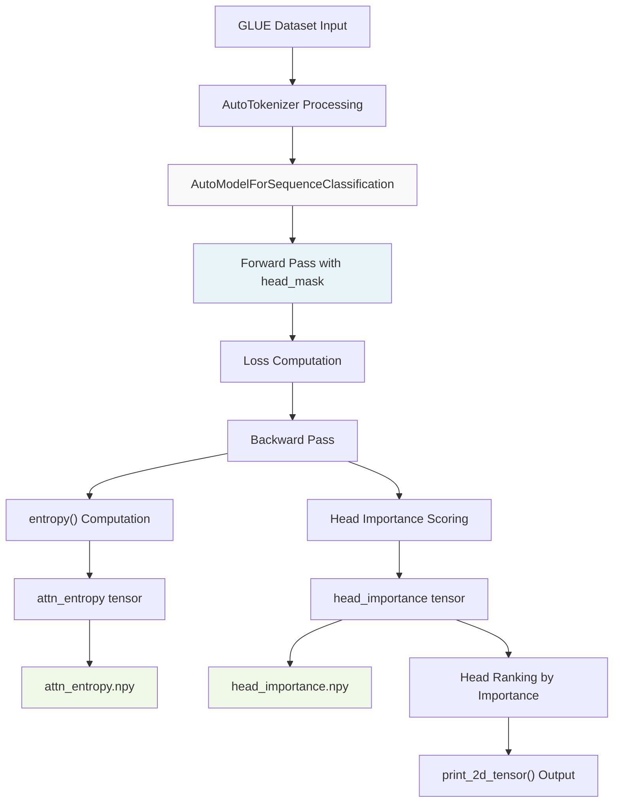
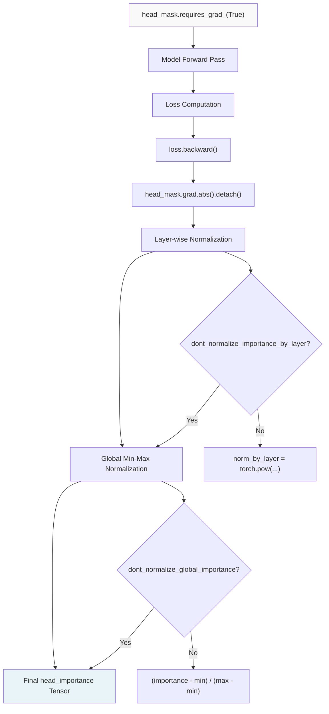
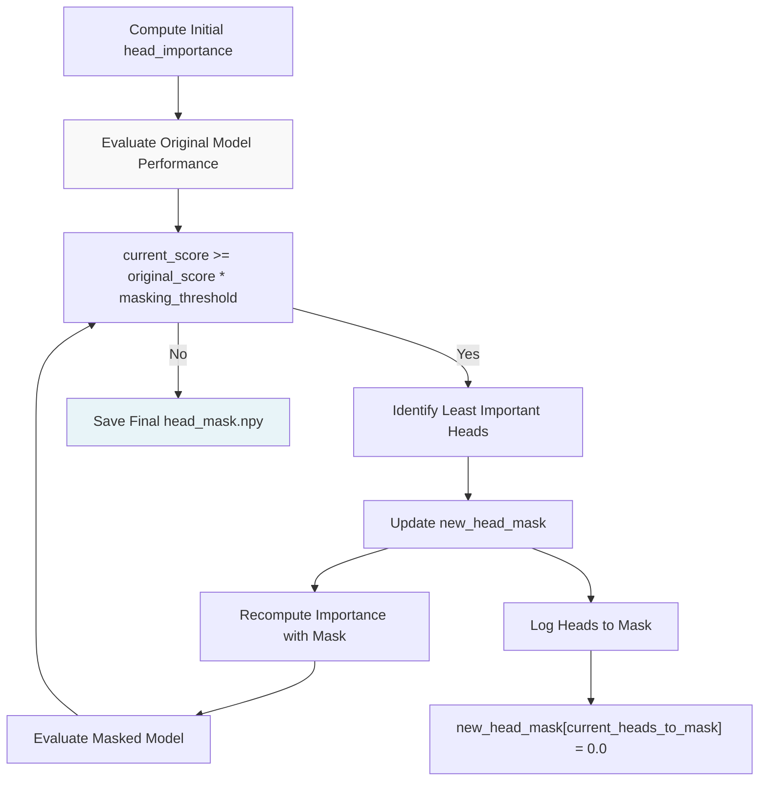
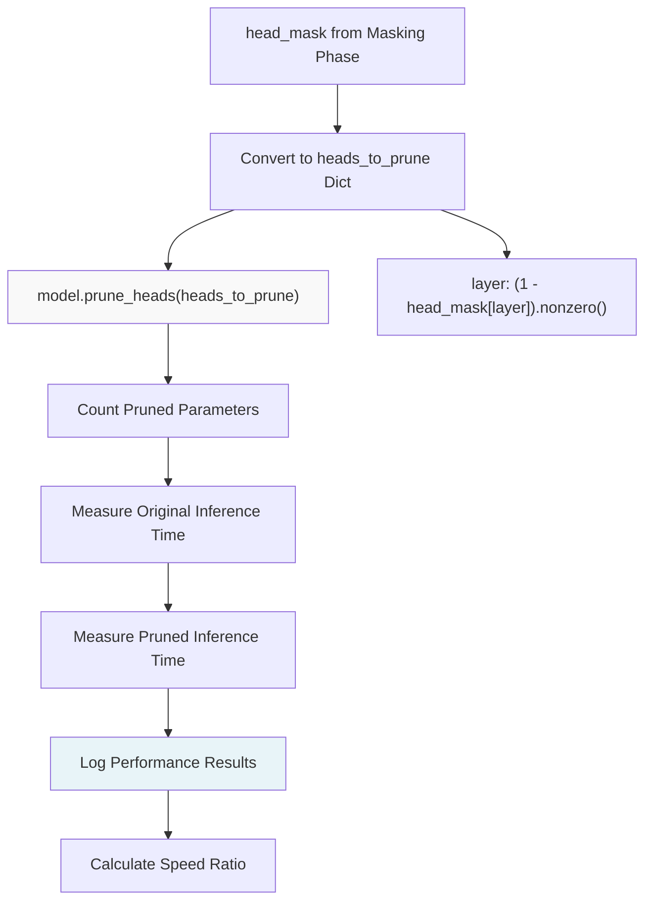
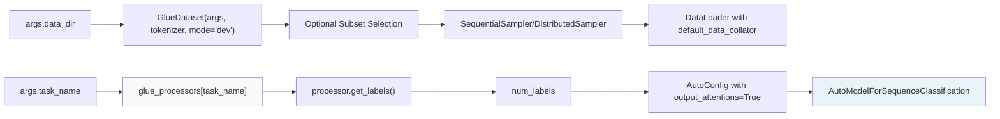
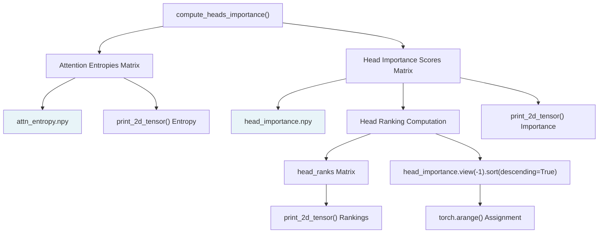

<!-- source: DeepWiki mcp.deepwiki.com · repo huggingface/transformers-research-projects · page 5.1 Attention Head Analysis · fetched 2026-10-26 -->

# Attention Head Analysis

Relevant source files

The following files were used as context for generating this wiki page:

- [bertology/run_bertology.py](bertology/run_bertology.py)

## Purpose and Scope

The Attention Head Analysis system provides tools for analyzing and optimizing transformer models by computing attention head importance scores, entropy metrics, and supporting head masking and pruning operations. This system is primarily implemented in the `run_bertology.py` script and is based on research by Michel et al. investigating whether all attention heads in transformer models are necessary.

The system focuses specifically on BERT-style models for sequence classification tasks using GLUE benchmarks. For information about GPT model pruning, see [GPT Model Pruning](#5.2).

## Core Analysis Framework

The attention head analysis system operates through a structured pipeline that computes multiple metrics to evaluate the importance and behavior of individual attention heads across transformer layers.

### Analysis Pipeline Flow

**Core Analysis Components**

The system implements two primary analysis metrics through the `compute_heads_importance()` function:

| Metric | Purpose | Implementation |
|--------|---------|----------------|
| Attention Entropy | Measures attention focus/distribution | `entropy()` function on attention matrices |
| Head Importance | Quantifies head contribution to task performance | Gradient magnitude on head mask parameters |

Sources: [bertology/run_bertology.py:70-153]()

### Entropy Computation

The `entropy()` function computes the entropy of attention probability distributions to measure how focused or dispersed attention patterns are:

The entropy computation handles zero probabilities explicitly to avoid numerical instability and computes entropy across the attention dimension.

Sources: [bertology/run_bertology.py:53-57]()

### Head Importance Scoring

Head importance is computed by measuring the gradient magnitude of the loss with respect to head mask parameters. The system applies several normalization strategies:

Sources: [bertology/run_bertology.py:78-135]()

## Head Masking and Pruning Pipeline

The system supports progressive head masking and actual head pruning to test the effect of removing attention heads on model performance.

### Masking Strategy

The `mask_heads()` function implements an iterative masking approach that progressively removes the least important heads while monitoring task performance:

**Masking Parameters**

| Parameter | Purpose | Default |
|-----------|---------|---------|
| `masking_threshold` | Performance threshold for stopping | 0.9 |
| `masking_amount` | Fraction of heads to mask per iteration | 0.1 |
| `metric_name` | Evaluation metric to monitor | "acc" |

Sources: [bertology/run_bertology.py:156-204]()

### Head Pruning Process

The `prune_heads()` function performs actual weight removal and measures the performance and efficiency gains:

The pruning process converts the head mask to a dictionary format expected by the model's `prune_heads()` method and measures both parameter reduction and inference speed improvements.

Sources: [bertology/run_bertology.py:207-252]()

## GLUE Task Integration

The system integrates with GLUE benchmark tasks through the transformers library's data processing pipeline:

### Data Loading and Configuration

**Supported Configuration**

| Component | Implementation | Purpose |
|-----------|----------------|---------|
| Tasks | `glue_processors.keys()` | All GLUE benchmark tasks |
| Metrics | `glue_compute_metrics()` | Task-specific evaluation |
| Data Collation | `default_data_collator` | Batch preparation |
| Attention Output | `output_attentions=True` | Required for analysis |

Sources: [bertology/run_bertology.py:386-440]()

## Output Analysis and Metrics

The system generates comprehensive analysis outputs including numerical matrices, rankings, and performance measurements.

### Analysis Output Format

**Matrix Visualization**

The `print_2d_tensor()` function formats output matrices for easy interpretation:

- **Rows**: Transformer layers (layer 1, layer 2, ...)
- **Columns**: Attention heads (head 1, head 2, ...)
- **Values**: Entropy scores, importance scores, or rank positions

Sources: [bertology/run_bertology.py:60-67](), [bertology/run_bertology.py:138-151]()

### Performance Metrics

The system tracks multiple performance indicators during the masking and pruning process:

| Metric Type | Measurement | Purpose |
|-------------|-------------|---------|
| Task Performance | `glue_compute_metrics()` scores | Model quality retention |
| Parameter Count | `sum(p.numel() for p in model.parameters())` | Model compression ratio |
| Inference Speed | `datetime.now()` timing | Speed improvement measurement |
| Head Retention | `new_head_mask.sum()` percentage | Sparsity quantification |

The analysis provides detailed logging of masking progression, final performance comparisons, and efficiency gains from head pruning operations.

Sources: [bertology/run_bertology.py:192-198](), [bertology/run_bertology.py:244-251]()

---

