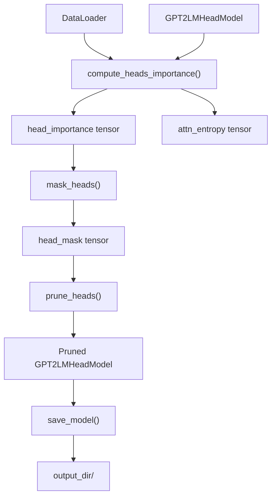
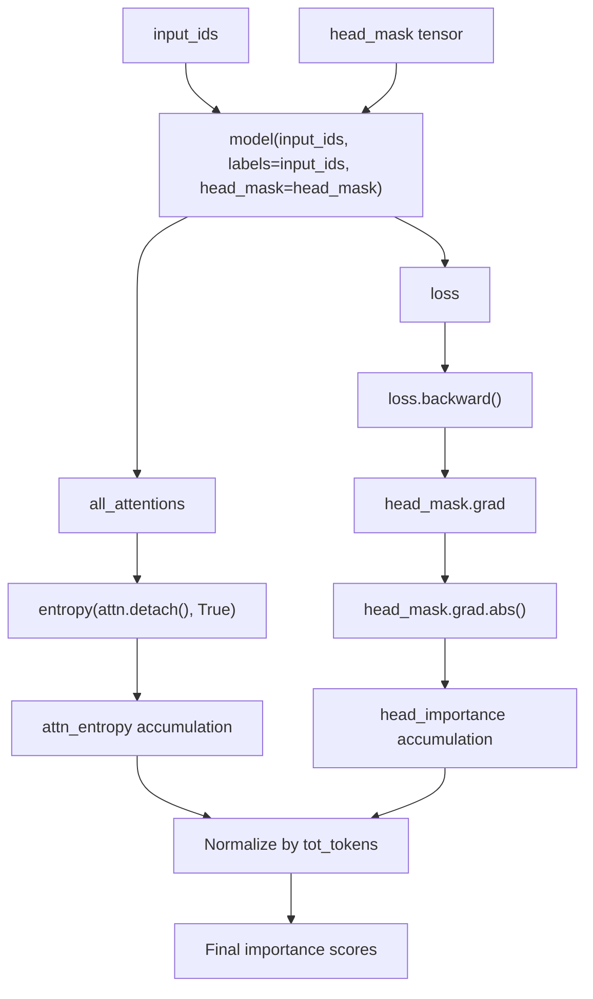
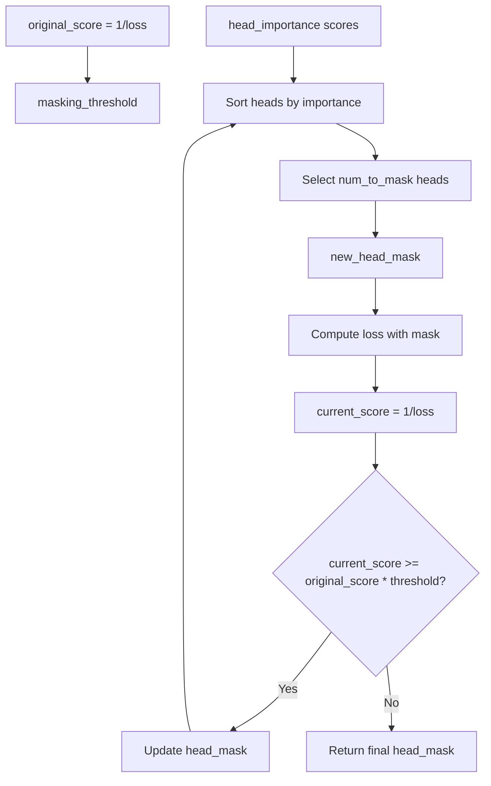
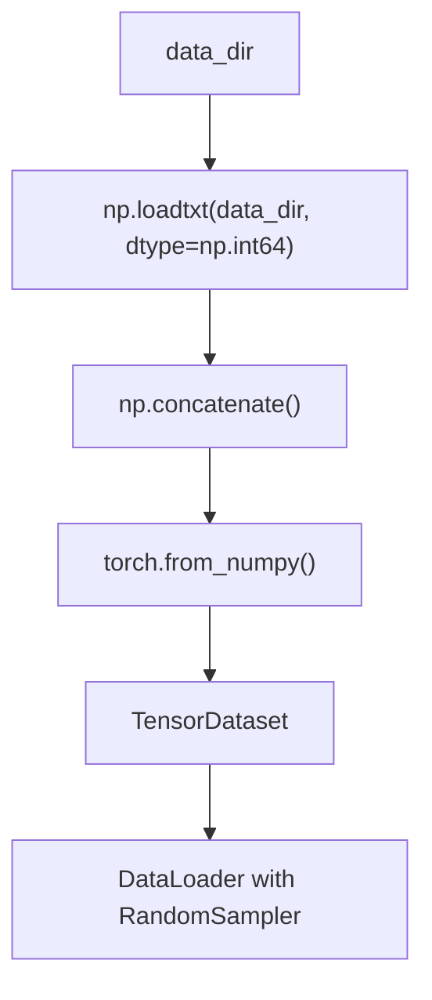
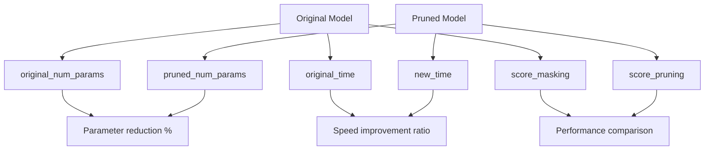

<!-- source: DeepWiki mcp.deepwiki.com · repo huggingface/transformers-research-projects · page 5.2 GPT Model Pruning · fetched 2026-10-26 -->

# GPT Model Pruning

Relevant source files

The following files were used as context for generating this wiki page:

- [bertology/run_prune_gpt.py](bertology/run_prune_gpt.py)

This document covers the GPT model pruning system that analyzes and removes less important attention heads from GPT-2 models to reduce computational complexity while maintaining performance. The system implements head importance scoring and iterative pruning based on the methodology described in Michel et al. (2019).

For information about attention head analysis for BERT models, see [Attention Head Analysis](#5.1). This page focuses specifically on the GPT pruning implementation.

## System Overview

The GPT model pruning system provides tools to systematically reduce GPT-2 model complexity by identifying and removing attention heads that contribute least to model performance. The system uses gradient-based importance scoring and iterative masking to determine which heads can be safely pruned.

## Architecture and Workflow

### Core Pruning Pipeline

Sources: [bertology/run_prune_gpt.py:59-131](), [bertology/run_prune_gpt.py:133-180](), [bertology/run_prune_gpt.py:183-234]()

### Head Importance Computation Process

Sources: [bertology/run_prune_gpt.py:79-130]()

## Key Components

### Head Importance Scoring

The `compute_heads_importance()` function implements the gradient-based head importance methodology:

| Component | Purpose | Implementation |
|-----------|---------|----------------|
| Gradient computation | Calculate head importance via backpropagation | [bertology/run_prune_gpt.py:86-93]() |
| Entropy calculation | Measure attention distribution sharpness | [bertology/run_prune_gpt.py:96-98]() |
| Normalization | Layer-wise and global score normalization | [bertology/run_prune_gpt.py:108-114]() |
| Ranking | Sort heads by importance for pruning decisions | [bertology/run_prune_gpt.py:124-129]() |

### Iterative Head Masking

The `mask_heads()` function implements progressive head masking with performance monitoring:

Sources: [bertology/run_prune_gpt.py:133-180]()

### Model Pruning and Evaluation

The pruning process involves several key steps:

| Step | Function | Purpose |
|------|----------|---------|
| Pre-pruning evaluation | `compute_heads_importance()` | Baseline performance with masking |
| Head removal | `model.prune_heads()` | Physical removal of attention head weights |
| Post-pruning evaluation | `compute_heads_importance()` | Performance after actual pruning |
| Model persistence | `save_model()` | Save pruned model to disk |

## Configuration Parameters

### Pruning Control Parameters

| Parameter | Type | Default | Purpose |
|-----------|------|---------|---------|
| `masking_threshold` | float | 0.9 | Performance threshold for stopping pruning |
| `masking_amount` | float | 0.1 | Fraction of heads to mask in each iteration |
| `try_masking` | bool | False | Enable iterative head masking |

### Normalization Options

| Parameter | Purpose | Default Behavior |
|-----------|---------|------------------|
| `dont_normalize_importance_by_layer` | Disable layer-wise normalization | Layer normalization enabled |
| `dont_normalize_global_importance` | Disable global 0-1 normalization | Global normalization enabled |

Sources: [bertology/run_prune_gpt.py:290-311]()

## Data Processing and Model Setup

### Input Data Handling

The system expects numerical data files containing tokenized sequences:

Sources: [bertology/run_prune_gpt.py:369-378]()

### Model Initialization

The system uses standard Hugging Face model loading with support for distributed training:

| Component | Implementation | Purpose |
|-----------|----------------|---------|
| Model loading | `GPT2LMHeadModel.from_pretrained()` | Load pretrained GPT-2 model |
| Device setup | CUDA detection and distributed setup | Multi-GPU support |
| Model wrapping | `DistributedDataParallel` or `DataParallel` | Distributed training compatibility |

Sources: [bertology/run_prune_gpt.py:353-362]()

## Output Artifacts

### Generated Files

The pruning process generates several output files in the specified output directory:

| File | Content | Purpose |
|------|---------|---------|
| `head_mask.npy` | Binary head mask matrix | Record of pruned heads |
| `config.json` | Model configuration | Pruned model configuration |
| `pytorch_model.bin` | Model weights | Pruned model parameters |
| `run_args.bin` | Execution arguments | Reproducibility metadata |

### Performance Metrics

The system reports several key metrics during pruning:

Sources: [bertology/run_prune_gpt.py:196-233]()

## Utility Functions

### Mathematical Operations

The system includes several utility functions for mathematical computations:

| Function | Purpose | Key Features |
|----------|---------|--------------|
| `entropy()` | Compute probability distribution entropy | Handles zero probabilities, configurable exponent |
| `print_2d_tensor()` | Display 2D tensors in readable format | Layer-wise formatting, precision control |

Sources: [bertology/run_prune_gpt.py:39-56]()

### Model Management

| Function | Purpose | Implementation Details |
|----------|---------|------------------------|
| `save_model()` | Persist pruned models | Cleanup existing files, use HuggingFace format |

Sources: [bertology/run_prune_gpt.py:23-36]()

---

