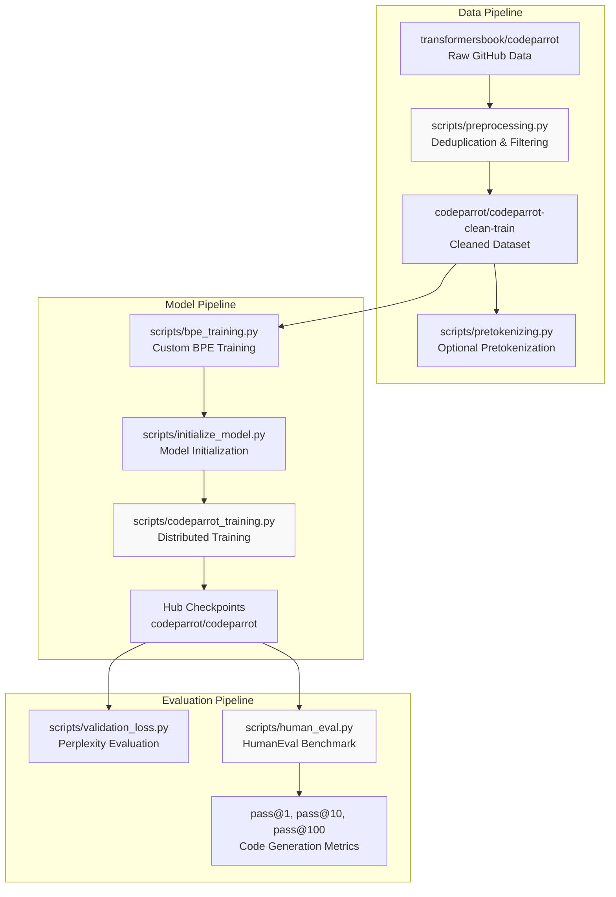
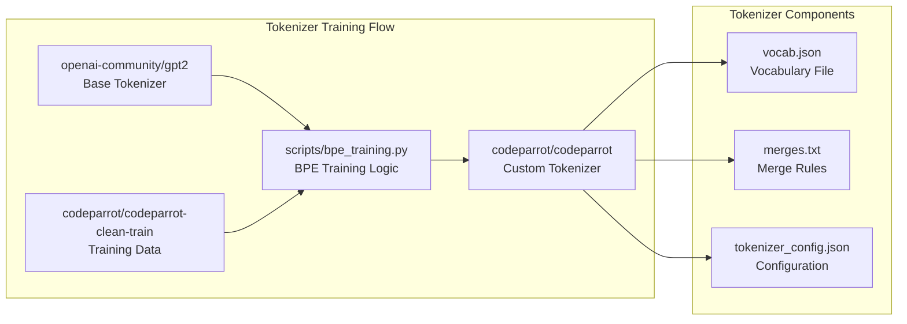
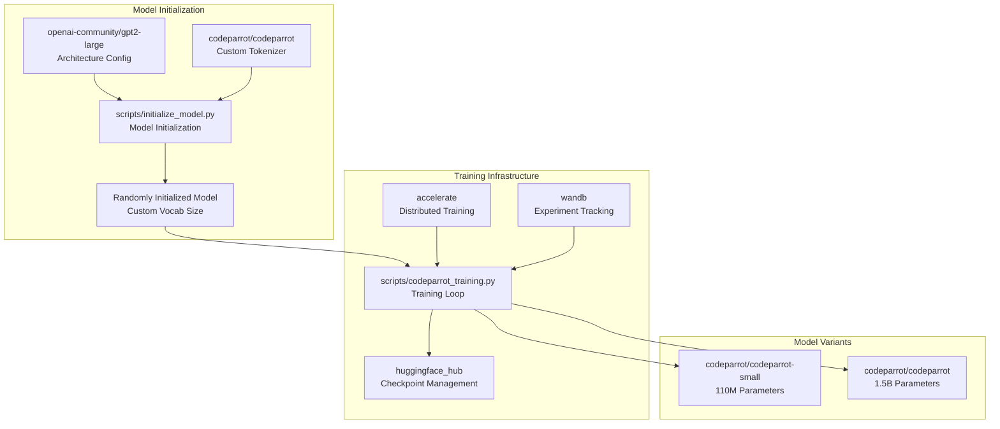
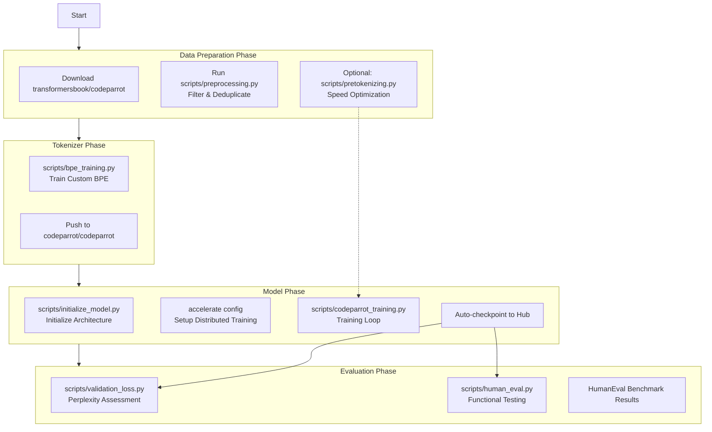
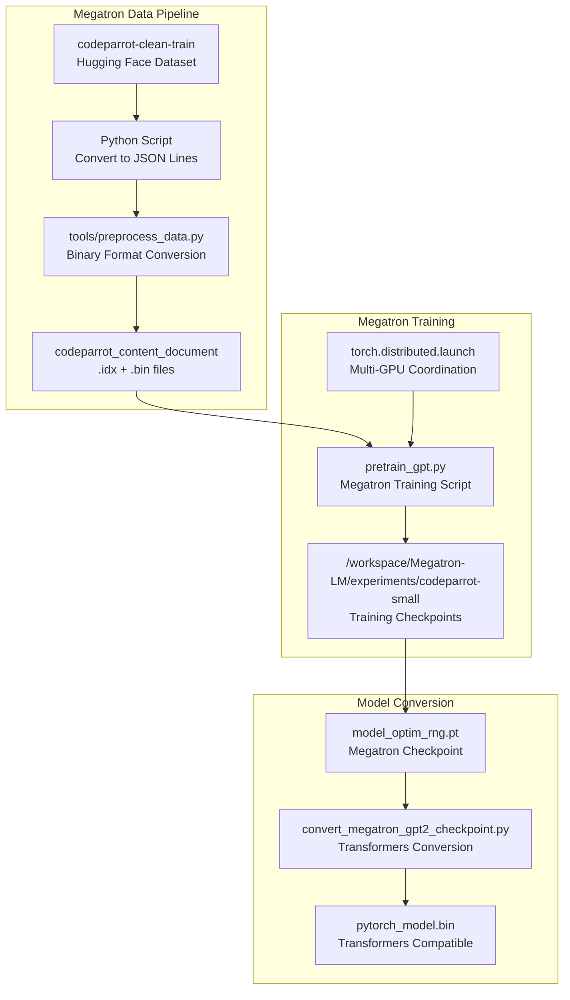

<!-- source: DeepWiki mcp.deepwiki.com · repo huggingface/transformers-research-projects · page 6 Code Generation (CodeParrot) · fetched 2026-10-26 -->

# Code Generation (CodeParrot)

Relevant source files

The following files were used as context for generating this wiki page:

- [codeparrot/README.md](codeparrot/README.md)

## Purpose and Scope

The CodeParrot system provides a comprehensive framework for training GPT-2 based code generation models from scratch. This system handles the complete pipeline from raw GitHub data processing to model evaluation on code generation benchmarks. The implementation focuses specifically on Python code generation using custom tokenization, large-scale data preprocessing, and distributed training capabilities.

For CodeParrot example applications and fine-tuning procedures for NLP4Code tasks, see [CodeParrot Examples and Fine-tuning](#6.1).

## System Overview

CodeParrot implements an end-to-end training pipeline for code generation models, featuring custom tokenization adapted for Python syntax, scalable data preprocessing with deduplication, and distributed training using the `accelerate` framework. The system produces models ranging from 110M to 1.5B parameters trained on cleaned GitHub Python code.

Sources: [codeparrot/README.md:1-317]()

## Core Components

### Dataset Processing Pipeline

The dataset pipeline transforms raw GitHub data into training-ready format through extensive filtering and deduplication. The system processes over 180GB of Python files, applying heuristics from OpenAI's Codex paper to remove duplicates and low-quality code.

| Component | Script | Purpose |
|-----------|--------|---------|
| Raw Data Source | `transformersbook/codeparrot` | 20M+ Python files from GitHub BigQuery |
| Preprocessing | `scripts/preprocessing.py` | Deduplication and quality filtering |
| Clean Datasets | `codeparrot-clean-train/valid` | 30% of original data after filtering |
| Pretokenization | `scripts/pretokenizing.py` | Optional speed optimization |

Key filtering criteria include exact hash-based deduplication, MinHash near-deduplication with Jaccard similarity threshold of 0.85, and content-based filters for auto-generated files, test files, and files with insufficient code patterns.

Sources: [codeparrot/README.md:40-77]()

### Tokenizer Training System

The tokenizer system creates a custom BPE tokenizer optimized for Python code structure, trained on the cleaned dataset to handle code-specific patterns more efficiently than general-purpose tokenizers.

Sources: [codeparrot/README.md:78-87]()

### Model Training Architecture

The training system uses `accelerate` for distributed training across multiple GPUs with mixed precision support. Models are initialized from scratch using GPT-2 architecture configurations but with custom tokenizer embeddings.

Training configurations support both streaming from Hub datasets and local data storage, with automatic checkpoint saving and resume capabilities.

Sources: [codeparrot/README.md:88-161]()

### Evaluation Framework

The evaluation system provides both perplexity-based validation and functional code generation assessment through the HumanEval benchmark.

| Evaluation Type | Script | Metrics | Purpose |
|----------------|--------|---------|---------|
| Language Modeling | `scripts/validation_loss.py` | Perplexity, Cross-entropy | Model convergence assessment |
| Code Generation | `scripts/human_eval.py` | pass@1, pass@10, pass@100 | Functional correctness |

The HumanEval evaluation supports configurable sampling parameters including temperature, top-p filtering, and multiple sample generation for pass@k metric computation.

Sources: [codeparrot/README.md:163-198]()

## Training Workflow

The complete training workflow encompasses data preparation, tokenizer creation, model initialization, distributed training, and comprehensive evaluation.

The workflow supports both small-scale experimentation (110M parameters) and production-scale training (1.5B parameters) with different batch sizes and learning rates optimized for each configuration.

Sources: [codeparrot/README.md:88-198]()

## Alternative Training with Megatron

CodeParrot includes integration with NVIDIA's Megatron framework for accelerated training of larger models. The Megatron pipeline requires data conversion to binary format and uses different distributed training configurations.

The Megatron integration requires Docker containers with NVIDIA PyTorch runtime and involves data format conversion but provides faster training performance for large-scale experiments.

Sources: [codeparrot/README.md:206-312]()

---

