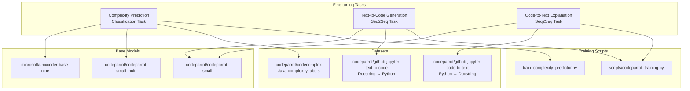
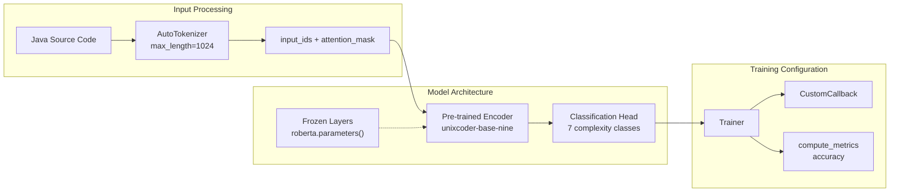
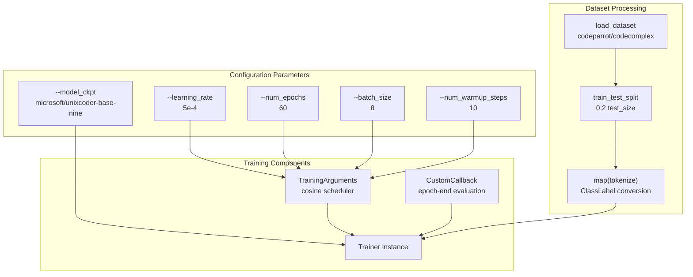
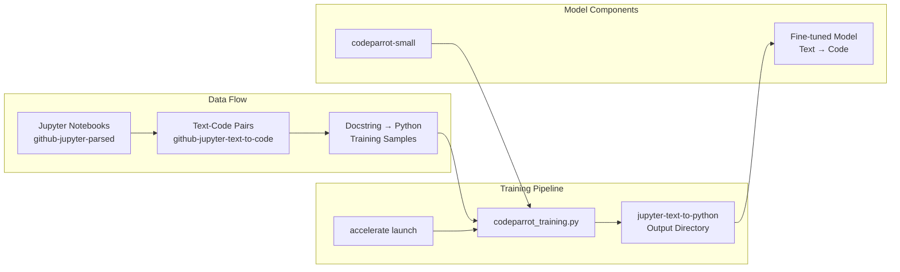
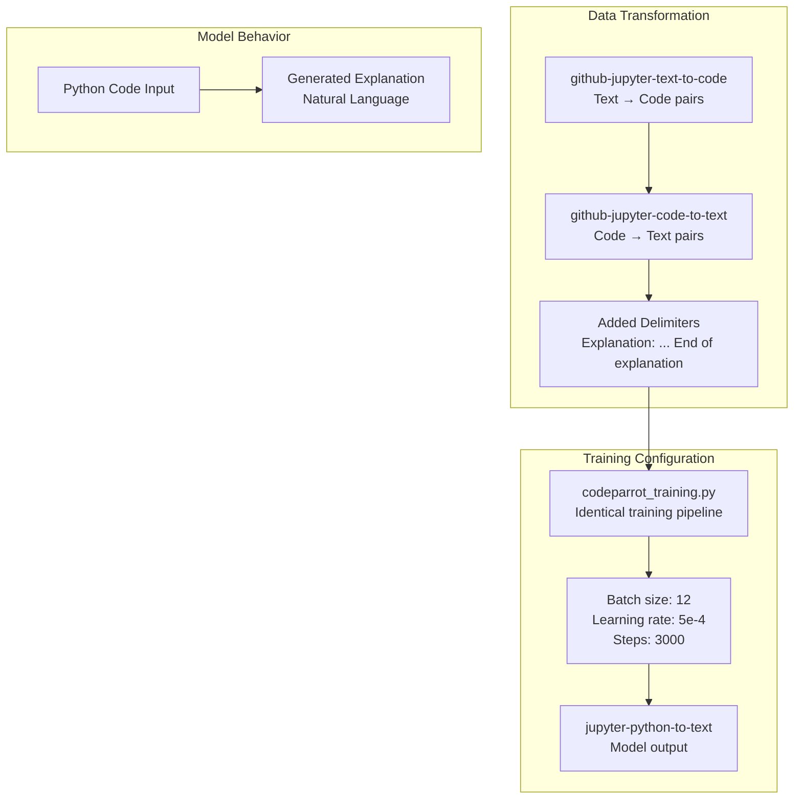
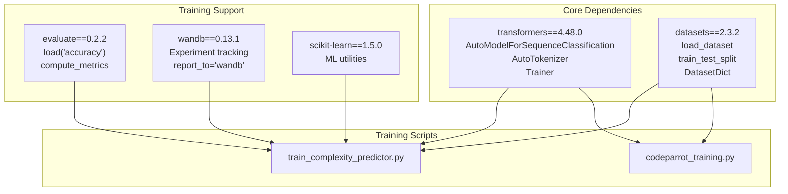

<!-- source: DeepWiki mcp.deepwiki.com · repo huggingface/transformers-research-projects · page 6.1 CodeParrot Examples and Fine-tuning · fetched 2026-10-26 -->

# CodeParrot Examples and Fine-tuning

Relevant source files

The following files were used as context for generating this wiki page:

- [codeparrot/examples/README.md](codeparrot/examples/README.md)
- [codeparrot/examples/requirements.txt](codeparrot/examples/requirements.txt)
- [codeparrot/examples/train_complexity_predictor.py](codeparrot/examples/train_complexity_predictor.py)

This document covers the practical applications and fine-tuning examples for CodeParrot models on downstream NLP4Code tasks. It focuses on three specific use cases: complexity prediction, code generation, and code explanation, demonstrating how to adapt pre-trained CodeParrot models for specialized code-related tasks.

For information about the core CodeParrot training pipeline and infrastructure, see [CodeParrot Overview](#6).

## Overview

The CodeParrot examples demonstrate three distinct approaches to fine-tuning code generation models for downstream tasks. Each example showcases different aspects of NLP4Code applications, from classification tasks to sequence-to-sequence generation.

### Example Tasks and Architectures

Sources: [codeparrot/examples/README.md:1-58]()

## Complexity Prediction Task

The complexity prediction task fine-tunes code models to classify Java programs by their computational complexity using the CodeComplex dataset. This demonstrates how to adapt code models for classification tasks.

### Model Architecture and Configuration

The complexity predictor uses `AutoModelForSequenceClassification` with 7 complexity classes. The implementation supports model freezing to preserve pre-trained representations while training only the classification head.

The training script implements several key components:

| Component | Implementation | Purpose |
|-----------|----------------|---------|
| Model Loading | `AutoModelForSequenceClassification.from_pretrained()` | Initialize pre-trained model with classification head |
| Tokenization | `AutoTokenizer` with truncation at 1024 tokens | Process Java source code for model input |
| Data Splitting | `train_test_split()` with 60/20/20 ratio | Create train/validation/test datasets |
| Metrics | `load("accuracy")` with `np.argmax()` predictions | Evaluate classification performance |
| Freezing | `param.requires_grad = False` for base model | Preserve pre-trained representations |

Sources: [codeparrot/examples/train_complexity_predictor.py:1-133](), [codeparrot/examples/README.md:4-16]()

### Training Parameters and Execution

The complexity predictor training supports configurable hyperparameters through command-line arguments:

Sources: [codeparrot/examples/train_complexity_predictor.py:19-32](), [codeparrot/examples/train_complexity_predictor.py:99-128]()

## Code Generation Task

The text-to-code generation task fine-tunes CodeParrot models to generate Python code from natural language descriptions, using the `github-jupyter-text-to-code` dataset extracted from Jupyter notebooks.

### Dataset and Training Configuration

This task reuses the main CodeParrot training script [`codeparrot_training.py`] with specific dataset and hyperparameter configurations:

| Parameter | Value | Purpose |
|-----------|-------|---------|
| `model_ckpt` | `codeparrot/codeparrot-small` | Base model for fine-tuning |
| `dataset_name_train` | `codeparrot/github-jupyter-text-to-code` | Training data source |
| `train_batch_size` | 12 | Batch size for training |
| `learning_rate` | 5e-4 | Learning rate for fine-tuning |
| `max_train_steps` | 3000 | Total training steps |
| `save_checkpoint_steps` | 200 | Checkpoint frequency |

Sources: [codeparrot/examples/README.md:18-37]()

## Code Explanation Task

The code explanation task trains models to generate natural language explanations for Python code, using the inverse of the text-to-code dataset with specialized formatting.

### Data Format and Processing

The code explanation task uses `github-jupyter-code-to-text` dataset, which inverts the order of the text-to-code pairs and adds specific delimiters:

- Input: Python code segments
- Output: Explanation text with "Explanation:" and "End of explanation" delimiters
- Training approach: Same `codeparrot_training.py` script with different dataset

Sources: [codeparrot/examples/README.md:39-58]()

## Dependencies and Environment

The examples require specific versions of core libraries to ensure compatibility:

### Required Dependencies

| Package | Version | Purpose |
|---------|---------|---------|
| `transformers` | 4.48.0 | Model architectures and training |
| `datasets` | 2.3.2 | Dataset loading and processing |
| `evaluate` | 0.2.2 | Metrics computation |
| `wandb` | 0.13.1 | Experiment tracking |
| `scikit-learn` | 1.5.0 | Additional ML utilities |

Sources: [codeparrot/examples/requirements.txt:1-5]()