# Page: Overview

# Overview

<details>
<summary>Relevant source files</summary>

The following files were used as context for generating this wiki page:

- [LICENSE](LICENSE)
- [README.md](README.md)

</details>


## Purpose and Scope

This document provides an overview of the transformers-research-projects repository, which contains independent research projects that extend and experiment with transformer models using the Hugging Face Transformers library. Each project focuses on different aspects of transformer research including model efficiency, robustness evaluation, domain-specific applications, and architectural analysis.

The repository is organized as a collection of self-contained research projects, each with its own dependencies, training scripts, and evaluation frameworks. For detailed documentation of specific projects, see:
- Adversarial evaluation: [HANS](#2)
- Model efficiency: [PABEE](#3) 
- Text summarization: [BertAbs](#4)
- Model analysis: [Bertology](#5)
- Code generation: [CodeParrot](#6)

## Repository Structure

The repository follows a modular design where each research project is contained within its own directory with complete implementation and documentation.

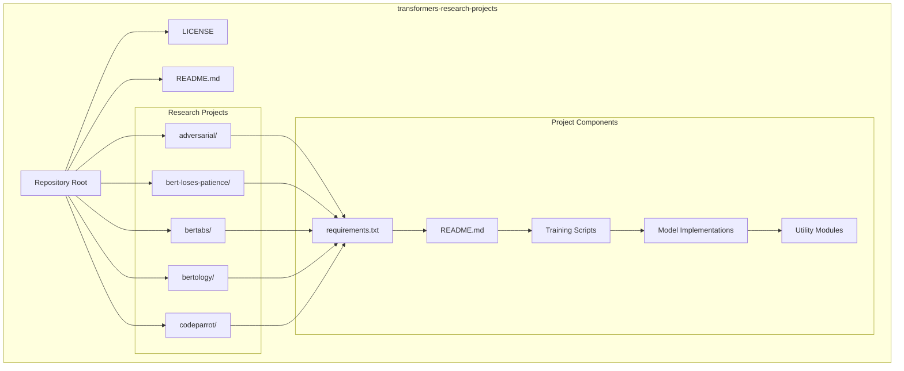

**Sources:** [README.md:17-29]()

## Research Project Matrix

| Project | Directory | Primary Focus | Key Components |
|---------|-----------|---------------|----------------|
| HANS Adversarial Evaluation | `adversarial/` | NLI model robustness testing | `run_hans.py`, `utils_hans.py` |
| PABEE Early Exit | `bert-loses-patience/` | Inference efficiency optimization | `modeling_pabee_*.py`, `run_glue_with_pabee.py` |
| BertAbs Summarization | `bertabs/` | Abstractive text summarization | `modeling_bertabs.py`, `run_summarization.py` |
| Bertology Analysis | `bertology/` | Attention analysis and pruning | `run_bertology.py`, `run_prune_gpt.py` |
| CodeParrot Generation | `codeparrot/` | Code generation training | `codeparrot_training.py`, preprocessing scripts |

## Common Architecture Patterns

The projects share common implementation patterns while maintaining independence through modular design.

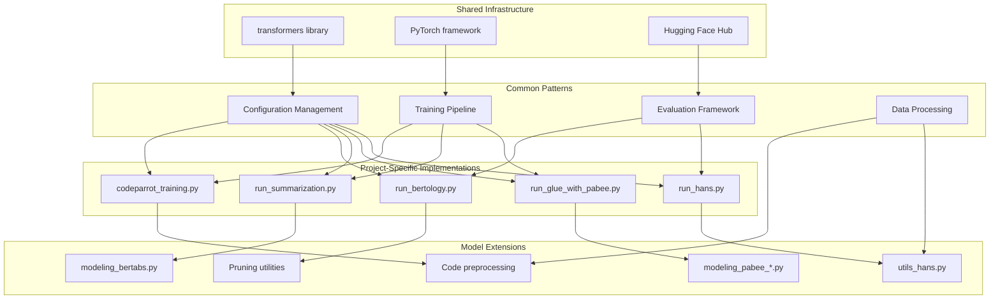

**Sources:** [README.md:19-20]()

## Dependency Management

Each research project maintains its own dependency specifications to ensure reproducibility with specific transformer library versions.

| Component | Description | Location |
|-----------|-------------|----------|
| `requirements.txt` | Project-specific dependencies | Each project directory |
| Transformers version | Specific library version per project | Varies by project needs |
| Installation command | `pip install -r requirements.txt` | Per project basis |

## Getting Started

To use any research project:

1. Navigate to the desired project directory
2. Install dependencies: `pip install -r requirements.txt`
3. Follow project-specific README instructions
4. Contact project authors for support (listed in each project's README)

**Sources:** [README.md:22-28]()

## Licensing and Attribution

The repository is licensed under the Apache License 2.0, providing permissive usage rights for research and commercial applications. Each project maintains individual author attribution in their respective README files.

| License Component | Details |
|-------------------|---------|
| License Type | Apache License 2.0 |
| Copyright Holder | The HuggingFace Team |
| Distribution Rights | Reproduction, modification, distribution permitted |
| Attribution Requirements | Copyright notice and license text must be included |

**Sources:** [LICENSE:1-201](), [README.md:2-14]()

---

# Page: Adversarial Evaluation (HANS)

# Adversarial Evaluation (HANS)

<details>
<summary>Relevant source files</summary>

The following files were used as context for generating this wiki page:

- [adversarial/README.md](adversarial/README.md)
- [adversarial/requirements.txt](adversarial/requirements.txt)

</details>


## Purpose and Scope

The Adversarial Evaluation (HANS) system provides tools for testing the robustness of Natural Language Inference (NLI) models against linguistic heuristics. This system implements the Heuristic Analysis for NLI Systems (HANS) dataset evaluation framework from McCoy et al., 2019, which specifically tests whether NLI models inappropriately rely on syntactic heuristics rather than genuine semantic understanding.

The system evaluates models trained on standard NLI datasets (like MNLI) by exposing them to carefully constructed adversarial examples that reveal over-reliance on three key heuristics: lexical overlap, subsequence matching, and constituent ordering. For detailed information about the evaluation pipeline implementation, see [HANS Evaluation Pipeline](#2.1). For data processing utilities and dataset handling, see [HANS Data Processing](#2.2).

## System Overview

The HANS evaluation system operates as a standalone adversarial testing framework that takes pre-trained NLI models and evaluates their performance on heuristic-based adversarial examples. The system distinguishes between cases where heuristics should lead to correct predictions (entailed examples) versus cases where they should not (non-entailed examples), revealing the extent to which models rely on superficial patterns.

### HANS Evaluation Architecture

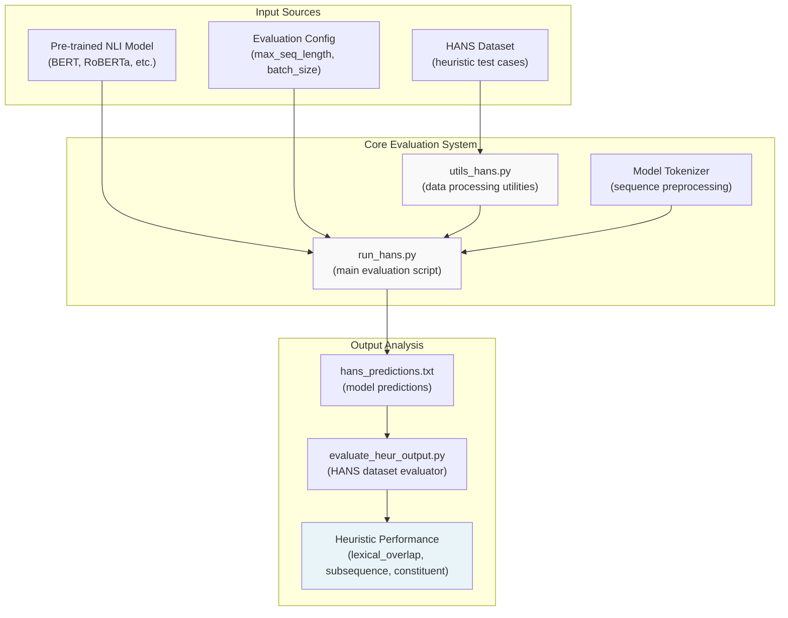

Sources: [adversarial/README.md:1-39]()

### Heuristic Testing Workflow

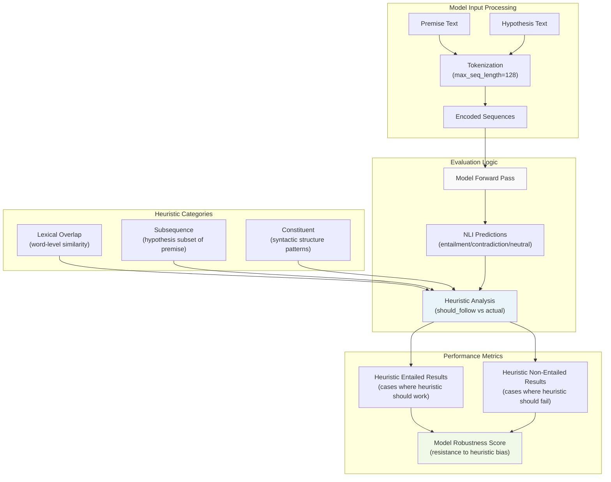

Sources: [adversarial/README.md:14-38]()

## Key Components

### Evaluation Script and Configuration

The primary evaluation interface is provided through `run_hans.py`, which accepts standard transformer model configurations and HANS dataset specifications. The script requires several key parameters:

| Parameter | Purpose | Example Value |
|-----------|---------|---------------|
| `task_name` | Specifies HANS evaluation task | `hans` |
| `model_type` | Model architecture type | `bert`, `roberta`, `xlnet` |
| `model_name_or_path` | Path to trained NLI model | `/path/to/mnli-model` |
| `data_dir` | HANS dataset directory | `/path/to/hans` |
| `max_seq_length` | Maximum input sequence length | `128` |
| `output_dir` | Output directory for predictions | `/path/to/output` |

Sources: [adversarial/README.md:14-22]()

### Heuristic Categories and Expected Performance

The HANS evaluation framework tests three specific linguistic heuristics that NLI models often inappropriately rely on:

**Lexical Overlap Heuristic**: Models may incorrectly assume that high word overlap between premise and hypothesis indicates entailment.

**Subsequence Heuristic**: Models may incorrectly treat cases where the hypothesis is a subsequence of the premise as entailment.

**Constituent Heuristic**: Models may incorrectly rely on syntactic constituent order patterns to make entailment decisions.

For robust models, the expected performance pattern shows high accuracy on entailed cases (where heuristics align with correct answers) but also high accuracy on non-entailed cases (where heuristics would lead to incorrect answers). The example BERT-base results demonstrate a common failure pattern where models achieve high accuracy on entailed cases but poor accuracy on non-entailed cases, indicating over-reliance on heuristics.

Sources: [adversarial/README.md:26-38]()

### Dependencies and Environment

The system requires `transformers == 4.48.0` as its primary dependency, ensuring compatibility with the latest transformer model implementations and tokenization utilities. The evaluation framework leverages the standard Hugging Face ecosystem for model loading, tokenization, and inference.

Sources: [adversarial/requirements.txt:1-2]()

The HANS adversarial evaluation system serves as a critical diagnostic tool for assessing whether NLI models have learned genuine semantic understanding or have simply memorized surface-level patterns that fail to generalize to adversarial cases.

---

# Page: HANS Evaluation Pipeline

# HANS Evaluation Pipeline

<details>
<summary>Relevant source files</summary>

The following files were used as context for generating this wiki page:

- [adversarial/run_hans.py](adversarial/run_hans.py)

</details>


This document covers the core evaluation pipeline implemented in `run_hans.py` for testing Natural Language Inference (NLI) models against the HANS (Heuristic Analysis for NLI Systems) dataset. The pipeline provides functionality for both fine-tuning models on HANS data and evaluating their robustness against linguistic heuristics.

For detailed information about HANS dataset utilities and data preprocessing components, see [HANS Data Processing](#2.2).

## Purpose and Scope

The HANS evaluation pipeline serves as the primary entry point for conducting adversarial evaluation of NLI models. It implements a complete training and evaluation workflow that:

- Loads pretrained transformer models for sequence classification
- Processes HANS dataset through custom data handling components  
- Supports both training and evaluation modes with configurable parameters
- Generates detailed prediction outputs for analysis of model performance against heuristic biases

Sources: [adversarial/run_hans.py:16-17](), [adversarial/run_hans.py:100-103]()

## Pipeline Architecture Overview

The HANS evaluation pipeline follows a modular architecture with distinct components for configuration, model management, data processing, and execution control.

### Core Pipeline Flow

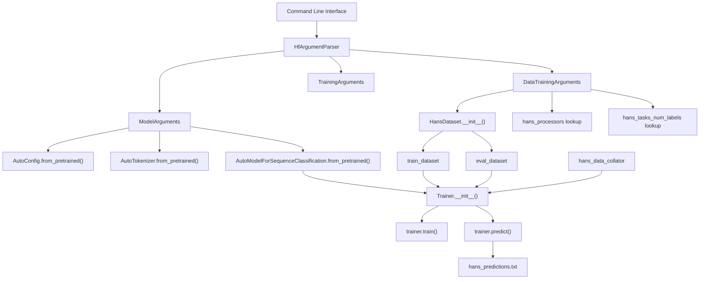

Sources: [adversarial/run_hans.py:105-106](), [adversarial/run_hans.py:154-169](), [adversarial/run_hans.py:172-194](), [adversarial/run_hans.py:197-203]()

## Configuration System

The pipeline uses a structured configuration system with three main argument classes that define the complete execution parameters.

### Configuration Classes

| Class | Purpose | Key Parameters |
|-------|---------|----------------|
| `ModelArguments` | Model and tokenizer configuration | `model_name_or_path`, `config_name`, `tokenizer_name`, `cache_dir` |
| `DataTrainingArguments` | Dataset and task configuration | `task_name`, `data_dir`, `max_seq_length`, `overwrite_cache` |
| `TrainingArguments` | Training execution parameters | Inherited from transformers library |

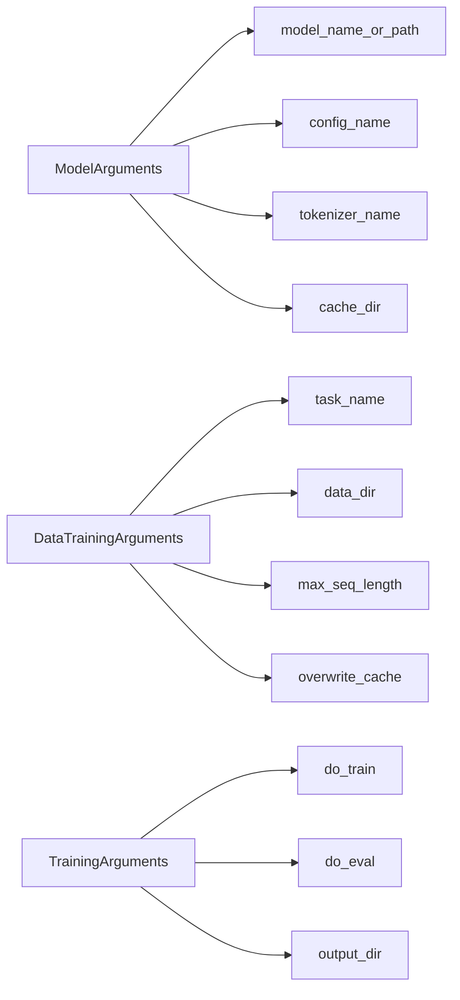

Sources: [adversarial/run_hans.py:44-63](), [adversarial/run_hans.py:65-89]()

## Model Loading and Setup

The pipeline implements a standardized model loading sequence using the transformers `Auto*` classes with HANS-specific configuration.

### Model Initialization Sequence

1. **Configuration Loading**: Uses `AutoConfig.from_pretrained()` with task-specific `num_labels` from `hans_tasks_num_labels`
2. **Tokenizer Loading**: Loads tokenizer via `AutoTokenizer.from_pretrained()` with caching support
3. **Model Loading**: Instantiates sequence classification model through `AutoModelForSequenceClassification.from_pretrained()`

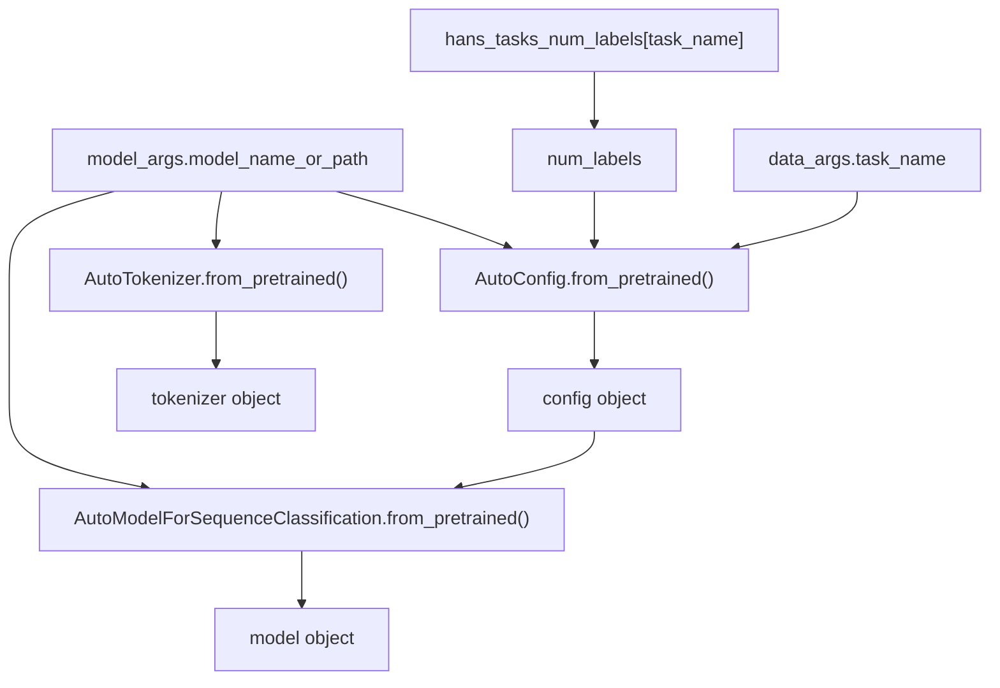

Sources: [adversarial/run_hans.py:143-146](), [adversarial/run_hans.py:154-169]()

## Dataset Handling

The pipeline creates `HansDataset` instances for both training and evaluation, with conditional instantiation based on execution mode flags.

### Dataset Creation Logic

- **Training Dataset**: Created when `training_args.do_train` is True
- **Evaluation Dataset**: Created when `training_args.do_eval` is True, with `evaluate=True` parameter
- **Data Collation**: Uses custom `hans_data_collator` that removes `pairID` key from batches

Sources: [adversarial/run_hans.py:172-194](), [adversarial/run_hans.py:91-97]()

## Training Pipeline

When training mode is enabled, the pipeline executes a complete training workflow with model and tokenizer persistence.

### Training Execution Flow

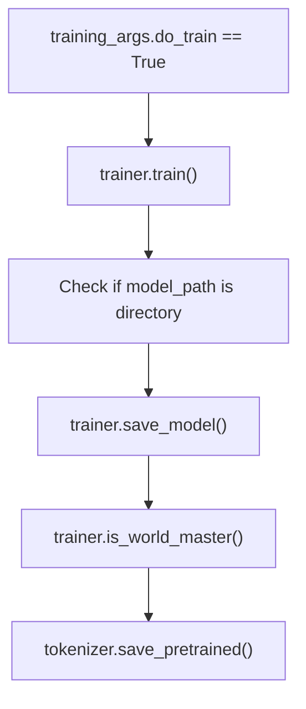

Sources: [adversarial/run_hans.py:206-214]()

## Evaluation Pipeline

The evaluation pipeline generates predictions and outputs them in a structured format for downstream analysis.

### Evaluation Workflow

1. **Prediction Generation**: Uses `trainer.predict()` to generate model predictions
2. **Prediction Processing**: Applies `np.argmax()` to get class predictions
3. **Output File Creation**: Writes predictions to `hans_predictions.txt` with pair IDs
4. **Metrics Logging**: Logs evaluation metrics through trainer logging system

### Prediction Output Format

The evaluation generates a CSV-formatted output file with the following structure:

```
pairID,gold_label
ex{pair_id},{predicted_label}
```

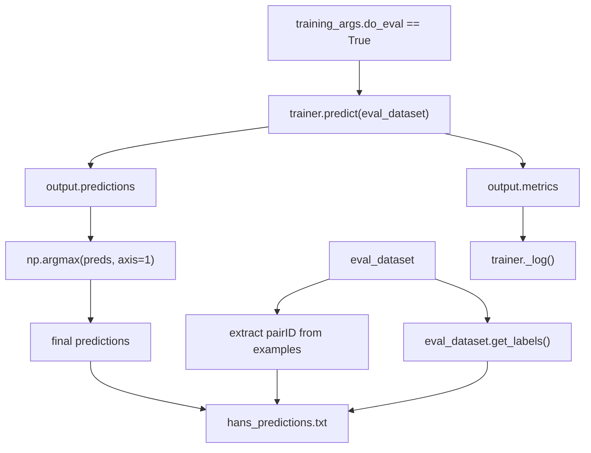

Sources: [adversarial/run_hans.py:217-233]()

## Data Collation

The pipeline implements a custom data collator specifically designed for HANS dataset requirements.

### hans_data_collator Function

The `hans_data_collator` extends the default transformer data collator by removing the `pairID` field, which is used for tracking but not needed during model forward passes.

```python
def hans_data_collator(features: List[InputFeatures]) -> Dict[str, torch.Tensor]:
    batch = default_data_collator(features)
    _ = batch.pop("pairID", None)
    return batch
```

Sources: [adversarial/run_hans.py:91-97]()

## Error Handling and Validation

The pipeline implements several validation checks to ensure proper execution:

- **Output Directory Validation**: Prevents overwriting existing outputs unless explicitly allowed
- **Task Validation**: Validates task names against `hans_processors` registry
- **Distributed Training Support**: Configures logging and process coordination for multi-GPU setups

Sources: [adversarial/run_hans.py:108-117](), [adversarial/run_hans.py:143-146](), [adversarial/run_hans.py:125-137]()

---

# Page: HANS Data Processing

# HANS Data Processing

<details>
<summary>Relevant source files</summary>

The following files were used as context for generating this wiki page:

- [adversarial/utils_hans.py](adversarial/utils_hans.py)

</details>


## Purpose and Scope

This document covers the data processing components for the HANS (Heuristic Analysis for NLI Systems) adversarial evaluation framework. The HANS data processing system handles loading, tokenizing, and converting HANS dataset examples into model-ready features for Natural Language Inference (NLI) evaluation. This system is designed to test model robustness against linguistic heuristics through carefully crafted adversarial examples.

For information about the complete HANS evaluation pipeline and model testing workflow, see [HANS Evaluation Pipeline](#2.1).

## Data Processing Architecture

The HANS data processing system follows a multi-stage pipeline that transforms raw text data into tokenized features suitable for transformer model evaluation.

### Core Data Structures Pipeline

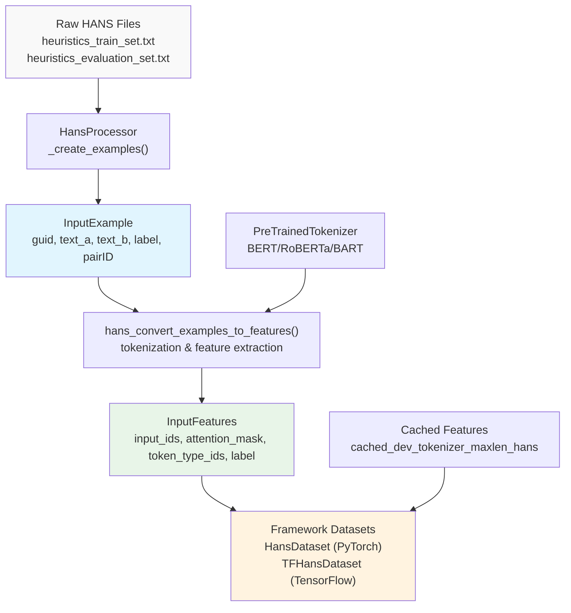

**Sources:** [adversarial/utils_hans.py:248-340]()

### Data Structure Specifications

The HANS processing system uses well-defined data structures to maintain consistency throughout the pipeline:

| Component | Purpose | Key Fields | File Location |
|-----------|---------|------------|---------------|
| `InputExample` | Raw text representation | `guid`, `text_a`, `text_b`, `label`, `pairID` | [adversarial/utils_hans.py:41-62]() |
| `InputFeatures` | Tokenized model input | `input_ids`, `attention_mask`, `token_type_ids`, `label`, `pairID` | [adversarial/utils_hans.py:64-87]() |
| `HansProcessor` | Data file processor | `get_train_examples()`, `get_dev_examples()`, `_create_examples()` | [adversarial/utils_hans.py:248-280]() |

**Sources:** [adversarial/utils_hans.py:41-87](), [adversarial/utils_hans.py:248-280]()

## Dataset Implementation

### Framework-Specific Dataset Classes

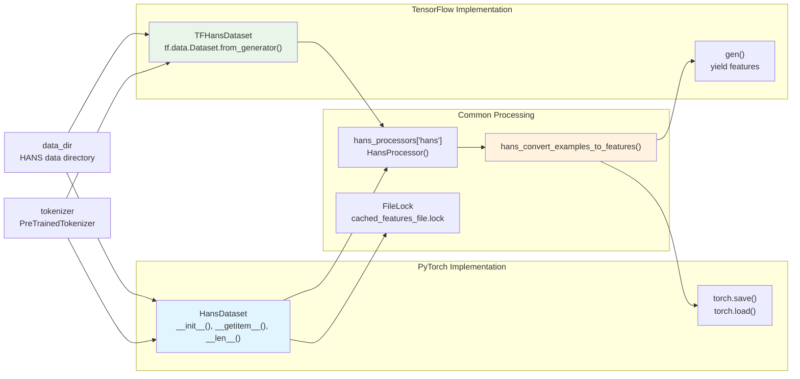

**Sources:** [adversarial/utils_hans.py:93-160](), [adversarial/utils_hans.py:162-246]()

### Dataset Initialization Process

The dataset classes handle caching, distributed training synchronization, and tokenizer-specific label adjustments:

```python
# Key initialization parameters from HansDataset.__init__()
data_dir: str                    # Directory containing HANS data files
tokenizer: PreTrainedTokenizer   # Tokenizer instance (BERT/RoBERTa/etc.)
task: str                        # Task identifier ("hans")
max_seq_length: Optional[int]    # Maximum sequence length for truncation
overwrite_cache: bool            # Whether to regenerate cached features
evaluate: bool                   # Whether loading train or dev data
```

**Sources:** [adversarial/utils_hans.py:101-109]()

## Tokenizer Integration and Label Handling

### Special Tokenizer Handling

The system includes special processing for RoBERTa-family tokenizers that have different label mappings:

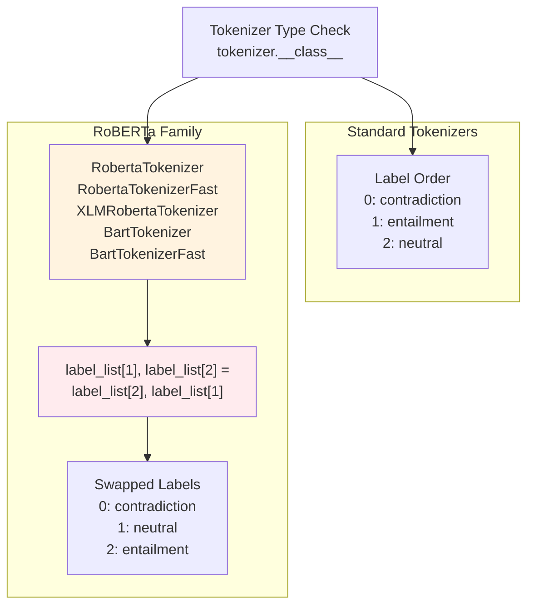

**Sources:** [adversarial/utils_hans.py:122-131](), [adversarial/utils_hans.py:184-192]()

## Feature Conversion Process

### Example to Features Transformation

The `hans_convert_examples_to_features` function handles the core transformation from raw text to model-ready tensors:

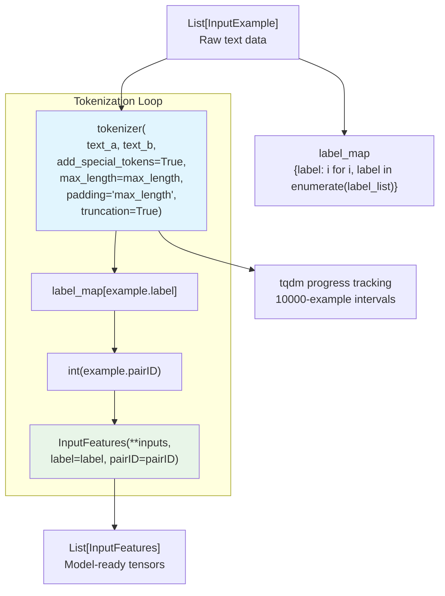

**Sources:** [adversarial/utils_hans.py:282-330]()

### Tokenization Configuration

The tokenization process uses specific parameters optimized for HANS evaluation:

| Parameter | Value | Purpose |
|-----------|-------|---------|
| `add_special_tokens` | `True` | Include [CLS], [SEP] tokens |
| `max_length` | User-defined | Sequence length limit |
| `padding` | `"max_length"` | Consistent tensor dimensions |
| `truncation` | `True` | Handle long sequences |
| `return_overflowing_tokens` | `True` | Track truncated content |

**Sources:** [adversarial/utils_hans.py:309-317]()

## File Management and Caching

### Caching Strategy

The system implements intelligent caching to avoid reprocessing data across runs:

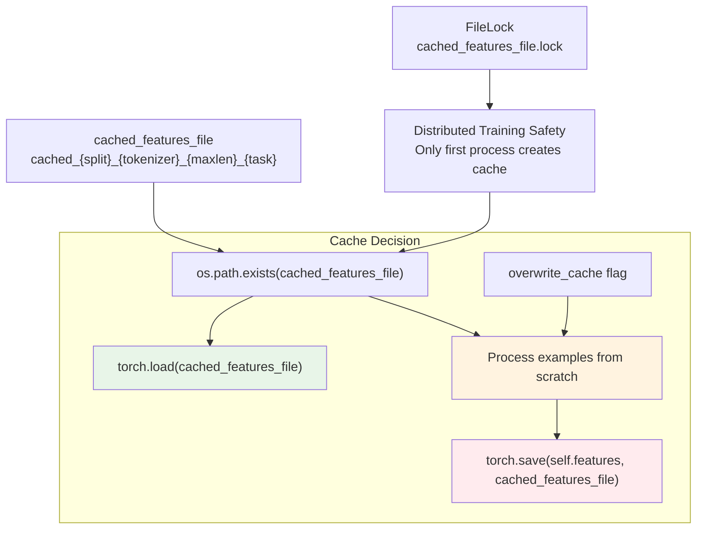

**Sources:** [adversarial/utils_hans.py:112-150]()

## Data File Structure

### HANS Dataset Format

The HANS processor expects specific file formats and column structures:

| File | Purpose | Key Columns |
|------|---------|-------------|
| `heuristics_train_set.txt` | Training data | label, premise, hypothesis, pairID |
| `heuristics_evaluation_set.txt` | Evaluation data | label, premise, hypothesis, pairID |

The `_create_examples` method extracts data from these files using fixed column indices:

```python
# Column extraction from HANS files
guid = "%s-%s" % (set_type, line[0])     # Line 0: label  
text_a = line[5]                         # Line 5: premise
text_b = line[6]                         # Line 6: hypothesis  
pairID = line[7][2:] if line[7].startswith("ex") else line[7]  # Line 7: pair ID
label = line[0]                          # Line 0: label
```

**Sources:** [adversarial/utils_hans.py:267-279]()

## Registry and Task Configuration

### Processor Registry

The system uses a registry pattern for task processors and label counting:

```python
hans_tasks_num_labels = {
    "hans": 3,
}

hans_processors = {
    "hans": HansProcessor,
}
```

This configuration supports the three-class NLI setup (contradiction, entailment, neutral) while allowing for extension to additional HANS-style tasks.

**Sources:** [adversarial/utils_hans.py:333-339]()

The HANS data processing system provides a robust, framework-agnostic foundation for adversarial NLI evaluation, with optimizations for caching, distributed training, and multiple tokenizer types.

---

# Page: Patience-Based Early Exit (PABEE)

# Patience-Based Early Exit (PABEE)

<details>
<summary>Relevant source files</summary>

The following files were used as context for generating this wiki page:

- [bert-loses-patience/README.md](bert-loses-patience/README.md)
- [bert-loses-patience/pabee/__init__.py](bert-loses-patience/pabee/__init__.py)
- [bert-loses-patience/requirements.txt](bert-loses-patience/requirements.txt)

</details>


## Purpose and Scope

This document covers the Patience-Based Early Exit (PABEE) system, a plug-and-play inference optimization method for pretrained language models. PABEE enables faster and more robust inference by allowing models to exit early from their forward pass when confidence is sufficiently high. The system is implemented for BERT and ALBERT models and integrates with GLUE benchmark tasks.

For information about other model analysis and optimization techniques, see [Model Analysis and Optimization (Bertology)](#5).

## Overview

PABEE is a training and inference method that adds internal classifiers to transformer layers, enabling the model to make predictions at intermediate layers when confidence exceeds a patience threshold. This approach reduces computational cost during inference while maintaining or even improving model performance.

### Core Concepts

The system introduces several key concepts:

- **Early Exit Mechanism**: Internal classifiers at each transformer layer that can produce final predictions
- **Patience Parameter**: A threshold that determines when the model should exit early based on prediction confidence
- **Internal Classifiers**: Additional classification heads trained alongside the main model
- **Confidence Assessment**: A method to evaluate prediction reliability at each layer

Sources: [bert-loses-patience/README.md:1-90]()

## System Architecture

### PABEE Component Structure

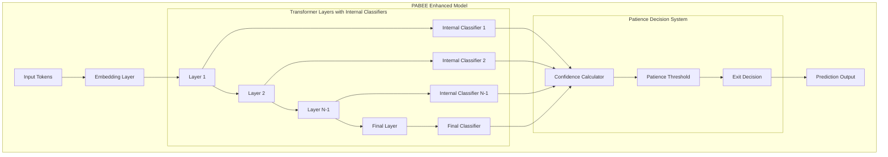

### Model Implementation Architecture

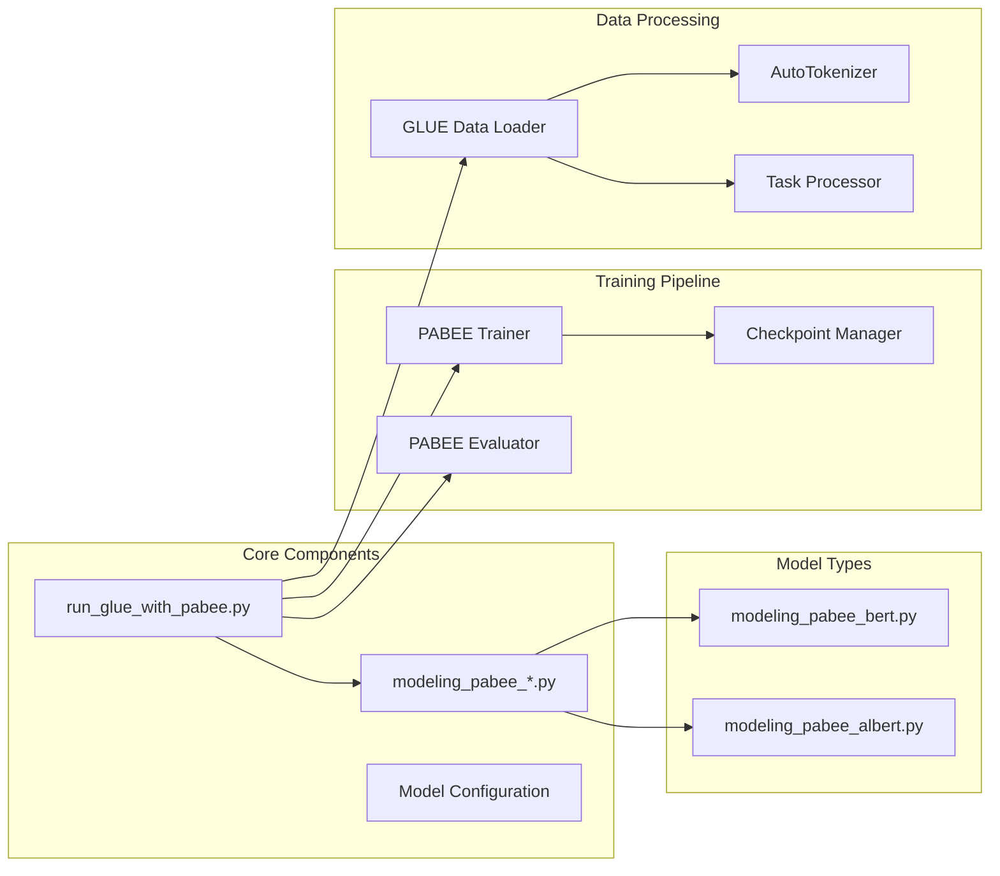

Sources: [bert-loses-patience/README.md:11-33](), [bert-loses-patience/README.md:37-58]()

## Training Process

### Training Configuration

The training process extends standard GLUE fine-tuning to include internal classifier training. The system uses the `run_glue_with_pabee.py` script with the following key parameters:

| Parameter | Purpose | Example Value |
|-----------|---------|---------------|
| `model_type` | Specifies base model architecture | `albert`, `bert` |
| `model_name_or_path` | Base pretrained model | `albert-base-v2` |
| `task_name` | GLUE task to fine-tune on | `MRPC`, `SST-2` |
| `per_gpu_train_batch_size` | Training batch size | `32` |
| `learning_rate` | Optimizer learning rate | `2e-5` |
| `num_train_epochs` | Training duration | `5` |

### Training Command Structure

```bash
python ./run_glue_with_pabee.py \
  --model_type albert \
  --model_name_or_path albert-base-v2 \
  --task_name $TASK_NAME \
  --do_train \
  --do_eval \
  --data_dir "$GLUE_DIR/$TASK_NAME" \
  --output_dir /path/to/save/
```

### Training Flow

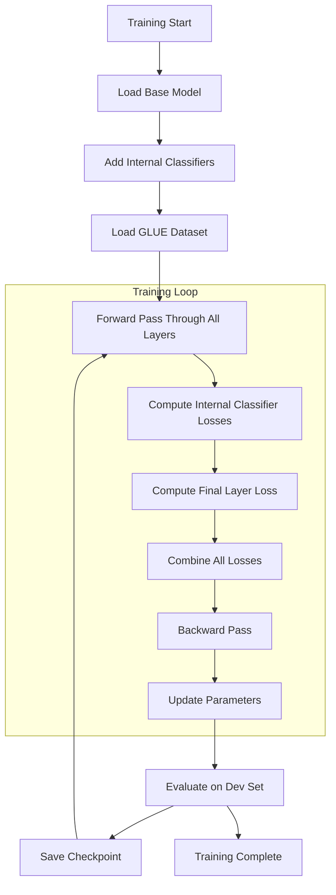

Sources: [bert-loses-patience/README.md:11-33]()

## Inference Process

### Patience-Based Decision Making

During inference, PABEE evaluates prediction confidence at each layer and exits early when the patience threshold is met. The inference process differs significantly from training as it uses batch size 1 and dynamic exit points.

### Inference Configuration

| Parameter | Purpose | Example Value |
|-----------|---------|---------------|
| `patience` | Comma-separated patience values | `3,4,5,6,7,8` |
| `per_gpu_eval_batch_size` | Must be 1 for early exit | `1` |
| `eval_all_checkpoints` | Evaluate multiple checkpoints | `True` |
| `regression_threshold` | STS-B regression threshold | `0.1` |

### Inference Flow

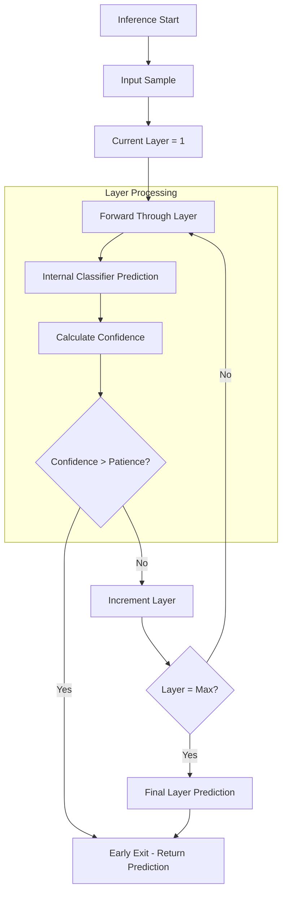

### Usage Example

```bash
python ./run_glue_with_pabee.py \
  --model_name_or_path /path/to/trained/model/ \
  --do_eval \
  --per_gpu_eval_batch_size 1 \
  --patience 3,4,5,6,7,8
```

Sources: [bert-loses-patience/README.md:37-61]()

## Performance Results

### GLUE Benchmark Performance

The system demonstrates both speed improvements and performance gains across GLUE tasks:

#### ALBERT-base Results

| Model | Parameters | Speed-up | CoLA | MNLI | MRPC | QNLI | QQP | RTE | SST-2 | STS-B |
|-------|------------|----------|------|------|------|------|-----|-----|-------|-------|
| ALBERT-base | 12M | - | 58.9 | 84.6 | 89.5 | 91.7 | 89.6 | 78.6 | 92.8 | 89.5 |
| +PABEE | 12M | 1.57x | 61.2 | 85.1 | 90.0 | 91.8 | 89.6 | 80.1 | 93.0 | 90.1 |

#### Comparative Results

| Model | Parameters | Speed-up | MNLI | SST-2 | STS-B |
|-------|------------|----------|------|-------|-------|
| BERT-base | 108M | - | 84.5 | 92.1 | 88.9 |
| +PABEE | 108M | 1.62x | 83.6 | 92.0 | 88.7 |
| ALBERT-large | 18M | - | 86.4 | 94.9 | 90.4 |
| +PABEE | 18M | 2.42x | 86.8 | 95.2 | 90.6 |

### Key Performance Insights

- **Speed Improvements**: 1.57x to 2.42x faster inference across different model sizes
- **Performance Maintenance**: Comparable or improved accuracy on most tasks
- **ALBERT Enhancement**: Particularly effective for ALBERT models, showing consistent improvements
- **Scalability**: Larger models (ALBERT-large) show greater speed-up potential

Sources: [bert-loses-patience/README.md:63-76]()

## Implementation Dependencies

### Core Requirements

The system requires specific library versions for compatibility:

```
transformers == 4.38.0
```

### Integration Points

PABEE integrates with several key components:

- **Transformers Library**: Uses `AutoTokenizer`, `AutoModel`, and training utilities
- **GLUE Framework**: Compatible with standard GLUE data processing and evaluation
- **PyTorch**: Leverages PyTorch's neural network primitives and optimization
- **Hugging Face Hub**: Supports model loading and saving through Hub integration

Sources: [bert-loses-patience/requirements.txt:1](), [bert-loses-patience/pabee/__init__.py:1]()

## Limitations and Considerations

### Batch Size Constraint

The primary limitation of PABEE is the requirement for batch size 1 during inference. This constraint arises from the dynamic nature of early exit decisions, where different samples may exit at different layers.

### Task-Specific Tuning

- **Regression Tasks**: STS-B requires a `regression_threshold` parameter for optimal performance
- **Patience Tuning**: Different tasks may require different optimal patience values
- **Model Architecture**: Currently limited to BERT and ALBERT architectures

### Trade-offs

- **Speed vs. Accuracy**: Lower patience values increase speed but may reduce accuracy
- **Memory Usage**: Internal classifiers add modest parameter overhead
- **Training Complexity**: Requires joint training of multiple classification heads

Sources: [bert-loses-patience/README.md:4](), [bert-loses-patience/README.md:60]()

---

# Page: PABEE Model Implementations

# PABEE Model Implementations

<details>
<summary>Relevant source files</summary>

The following files were used as context for generating this wiki page:

- [bert-loses-patience/pabee/modeling_pabee_albert.py](bert-loses-patience/pabee/modeling_pabee_albert.py)
- [bert-loses-patience/pabee/modeling_pabee_bert.py](bert-loses-patience/pabee/modeling_pabee_bert.py)

</details>


This document covers the PABEE (Patience-based Early Exit) model implementations for BERT and ALBERT architectures. These implementations enable dynamic inference where models can exit early from transformer layers when consecutive predictions remain stable, reducing computational cost while maintaining accuracy.

For information about PABEE training and evaluation workflows, see [3.2](#3.2).

## Architecture Overview

The PABEE system extends standard BERT and ALBERT models with patience-based early exit mechanisms. Each implementation follows a consistent pattern of extending base transformers classes with adaptive processing capabilities.

### PABEE Component Architecture

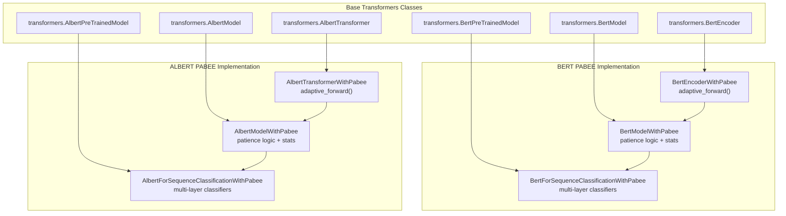

**Sources:** [bert-loses-patience/pabee/modeling_pabee_bert.py:37-43](), [bert-loses-patience/pabee/modeling_pabee_albert.py:36-55](), [bert-loses-patience/pabee/modeling_pabee_bert.py:50-65](), [bert-loses-patience/pabee/modeling_pabee_albert.py:62-72]()

## Core PABEE Mechanisms

### Patience-Based Exit Logic

The PABEE mechanism operates by comparing consecutive layer outputs and exiting early when predictions stabilize. The system maintains a patience counter that increments when consecutive layers produce identical results.

### PABEE Forward Pass Flow

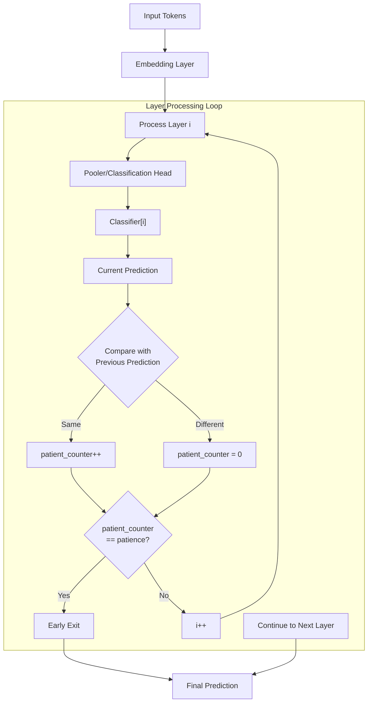

**Sources:** [bert-loses-patience/pabee/modeling_pabee_bert.py:202-237](), [bert-loses-patience/pabee/modeling_pabee_albert.py:176-214]()

## BERT PABEE Implementation

### BertEncoderWithPabee

The `BertEncoderWithPabee` class extends the standard BERT encoder with an `adaptive_forward` method that processes single layers sequentially rather than all layers at once.

| Method | Purpose | Key Parameters |
|--------|---------|----------------|
| `adaptive_forward` | Process single transformer layer | `current_layer`, `hidden_states`, `attention_mask`, `head_mask` |

**Sources:** [bert-loses-patience/pabee/modeling_pabee_bert.py:37-43]()

### BertModelWithPabee

The `BertModelWithPabee` class implements the core patience logic and statistics tracking. It manages three execution modes:

| Mode | Condition | Behavior |
|------|-----------|----------|
| Training | `self.training == True` | Process all layers, collect outputs from each |
| Full Inference | `self.patience == 0` | Use all layers, no early exit |
| Patience Inference | `self.patience > 0` | Apply early exit with patience counter |

Key attributes:
- `patience`: Number of consecutive identical predictions required for early exit
- `inference_instances_num`: Total inference instances processed  
- `inference_layers_num`: Total layers computed across all instances
- `regression_threshold`: Threshold for regression task early exit decisions

**Sources:** [bert-loses-patience/pabee/modeling_pabee_bert.py:67-95](), [bert-loses-patience/pabee/modeling_pabee_bert.py:182-237]()

### BertForSequenceClassificationWithPabee

This class implements the sequence classification head with multiple classifiers - one per transformer layer to enable predictions at any exit point.

Key components:
- `classifiers`: `nn.ModuleList` containing one linear classifier per layer
- Weighted loss computation across all layers during training
- Support for both classification and regression tasks

**Sources:** [bert-loses-patience/pabee/modeling_pabee_bert.py:246-257](), [bert-loses-patience/pabee/modeling_pabee_bert.py:327-344]()

## ALBERT PABEE Implementation

### AlbertTransformerWithPabee

The ALBERT implementation adapts to ALBERT's parameter sharing architecture, where layer groups are reused across transformer layers.

Key differences from BERT:
- Handles `embedding_hidden_mapping_in` for layer 0
- Computes group index for ALBERT's layer group structure
- Processes specific layer group based on current layer position

**Sources:** [bert-loses-patience/pabee/modeling_pabee_albert.py:36-55]()

### AlbertModelWithPabee and AlbertForSequenceClassificationWithPabee

These classes follow the same pattern as the BERT implementation but integrate with ALBERT's architecture, including:
- ALBERT-specific pooler activation
- Classifier dropout probability configuration
- Compatible loss computation and statistics tracking

**Sources:** [bert-loses-patience/pabee/modeling_pabee_albert.py:62-95](), [bert-loses-patience/pabee/modeling_pabee_albert.py:223-234]()

## Prediction Comparison Logic

### Classification vs Regression

The PABEE models handle two types of tasks with different comparison strategies:

```mermaid
graph TD
    PredictionOutput["Layer Prediction Output"]
    TaskType{"Task Type"}
    
    subgraph "Classification Path"
        ClassArgmax["logits.argmax(dim=1)"]
        ClassCompare["torch.all(labels.eq(patient_labels))"]
        ClassResult["Exact Match Required"]
    end
    
    subgraph "Regression Path"
        RegAbsDiff["torch.abs(patient_result - labels)"]
        RegThreshold{"< regression_threshold"}
        RegResult["Below Threshold Required"]
    end
    
    PatientCounter["Update patient_counter"]
    
    PredictionOutput --> TaskType
    TaskType -->|"Classification"| ClassArgmax
    TaskType -->|"Regression"| RegAbsDiff
    
    ClassArgmax --> ClassCompare
    ClassCompare --> ClassResult
    ClassResult --> PatientCounter
    
    RegAbsDiff --> RegThreshold
    RegThreshold --> RegResult
    RegResult --> PatientCounter
```

**Sources:** [bert-loses-patience/pabee/modeling_pabee_bert.py:214-229](), [bert-loses-patience/pabee/modeling_pabee_albert.py:191-206]()

## Statistics and Performance Tracking

Both implementations include comprehensive performance tracking:

| Method | Purpose | Formula |
|--------|---------|---------|
| `set_patience` | Configure patience parameter | N/A |
| `reset_stats` | Reset inference counters | Set counters to 0 |
| `log_stats` | Report performance metrics | `avg_layers = layers_num / instances_num`<br/>`speedup = 1 - avg_layers / total_layers` |
| `set_regression_threshold` | Configure regression exit threshold | N/A |

**Sources:** [bert-loses-patience/pabee/modeling_pabee_bert.py:79-95](), [bert-loses-patience/pabee/modeling_pabee_albert.py:75-91]()

## Training Loss Computation

During training, PABEE models compute weighted losses across all layers to encourage earlier layers to make accurate predictions:

```python
total_loss += loss * (ix + 1)  # Layer weight increases with depth
total_weights += ix + 1
final_loss = total_loss / total_weights
```

This weighting scheme incentivizes deeper layers while ensuring earlier layers remain capable of making predictions.

**Sources:** [bert-loses-patience/pabee/modeling_pabee_bert.py:327-343](), [bert-loses-patience/pabee/modeling_pabee_albert.py:302-318]()

---

# Page: PABEE Training and Evaluation

# PABEE Training and Evaluation

<details>
<summary>Relevant source files</summary>

The following files were used as context for generating this wiki page:

- [bert-loses-patience/run_glue_with_pabee.py](bert-loses-patience/run_glue_with_pabee.py)
- [bert-loses-patience/test_run_glue_with_pabee.py](bert-loses-patience/test_run_glue_with_pabee.py)

</details>


This document covers the training and evaluation infrastructure for PABEE (Patience-based Early Exit) models on GLUE benchmark tasks. The system provides a complete pipeline for fine-tuning PABEE-enhanced BERT and ALBERT models and evaluating their performance with configurable patience thresholds.

For information about the PABEE model architectures and early exit mechanisms, see [PABEE Model Implementations](#3.1).

## Training Pipeline Architecture

The PABEE training system is built around the `run_glue_with_pabee.py` script, which extends the standard GLUE fine-tuning pipeline with PABEE-specific functionality. The training pipeline supports both BERT and ALBERT base models with patience-based early exit capabilities.

### Training Pipeline Flow

```mermaid
flowchart TD
    Start["main()"] --> ParseArgs["Argument Parsing"]
    ParseArgs --> LoadModel["Model Loading"]
    LoadModel --> LoadData["load_and_cache_examples()"]
    LoadData --> TrainCheck{"do_train?"}
    
    TrainCheck -->|Yes| TrainFunc["train()"]
    TrainFunc --> SetupOpt["Optimizer Setup"]
    SetupOpt --> SetupSched["Scheduler Setup"]
    SetupSched --> TrainLoop["Training Loop"]
    TrainLoop --> ForwardPass["Forward Pass"]
    ForwardPass --> BackwardPass["Backward Pass"]
    BackwardPass --> UpdateWeights["Weight Update"]
    UpdateWeights --> LogMetrics["Logging & Checkpointing"]
    LogMetrics --> TrainLoop
    
    TrainCheck -->|No| EvalCheck{"do_eval?"}
    TrainFunc --> EvalCheck
    EvalCheck -->|Yes| EvalFunc["evaluate()"]
    EvalFunc --> SetPatience["set_patience()"]
    SetPatience --> InferenceLoop["Inference Loop"]
    InferenceLoop --> ComputeMetrics["compute_metrics()"]
    ComputeMetrics --> LogResults["Log Results"]
    
    EvalCheck -->|No| End["Return Results"]
    LogResults --> End
```

Sources: [bert-loses-patience/run_glue_with_pabee.py:408-751]()

### Model Class Integration

The training system integrates with PABEE-enhanced model classes through a centralized model registry:

```mermaid
graph TB
    subgraph "MODEL_CLASSES Registry"
        BertEntry["'bert': (BertConfig, BertForSequenceClassificationWithPabee, BertTokenizer)"]
        AlbertEntry["'albert': (AlbertConfig, AlbertForSequenceClassificationWithPabee, AlbertTokenizer)"]
    end
    
    subgraph "Model Loading Pipeline"
        ModelType["args.model_type"]
        ConfigClass["config_class"]
        ModelClass["model_class"]
        TokenizerClass["tokenizer_class"]
        LoadedModel["Instantiated Model"]
    end
    
    ModelType --> BertEntry
    ModelType --> AlbertEntry
    BertEntry --> ConfigClass
    BertEntry --> ModelClass
    BertEntry --> TokenizerClass
    AlbertEntry --> ConfigClass
    AlbertEntry --> ModelClass
    AlbertEntry --> TokenizerClass
    
    ConfigClass --> LoadedModel
    ModelClass --> LoadedModel
    TokenizerClass --> LoadedModel
```

Sources: [bert-loses-patience/run_glue_with_pabee.py:59-62](), [bert-loses-patience/run_glue_with_pabee.py:662-679]()

## Training Function Implementation

The `train()` function implements the core training loop with PABEE-specific optimizations and standard distributed training support.

### Training Configuration

| Parameter | Default | Description |
|-----------|---------|-------------|
| `per_gpu_train_batch_size` | 8 | Batch size per GPU for training |
| `gradient_accumulation_steps` | 1 | Steps to accumulate gradients |
| `learning_rate` | 5e-5 | Initial learning rate for Adam |
| `num_train_epochs` | 3.0 | Total training epochs |
| `warmup_steps` | 0 | Linear warmup steps |
| `max_grad_norm` | 1.0 | Maximum gradient norm for clipping |
| `fp16` | False | Enable mixed precision training |

Sources: [bert-loses-patience/run_glue_with_pabee.py:501-540]()

### Training Loop Components

The training loop includes several key components for PABEE model training:

```mermaid
graph LR
    subgraph "Training Step Components"
        BatchPrep["Batch Preparation"]
        ModelForward["model(**inputs)"]
        LossComp["Loss Computation"]
        GradAccum["Gradient Accumulation"]
        OptimStep["optimizer.step()"]
        SchedStep["scheduler.step()"]
        Logging["Logging & Checkpointing"]
    end
    
    BatchPrep --> ModelForward
    ModelForward --> LossComp
    LossComp --> GradAccum
    GradAccum --> OptimStep
    OptimStep --> SchedStep
    SchedStep --> Logging
    Logging --> BatchPrep
```

Sources: [bert-loses-patience/run_glue_with_pabee.py:172-255]()

### Distributed Training Support

The system supports distributed training with the following features:

- **Multi-GPU Training**: Automatic DataParallel wrapping when `n_gpu > 1`
- **Distributed Training**: DistributedDataParallel for multi-node training
- **Mixed Precision**: NVIDIA Apex integration for FP16 training
- **Gradient Synchronization**: Proper gradient accumulation across devices

Sources: [bert-loses-patience/run_glue_with_pabee.py:111-129]()

## Evaluation Framework

The evaluation system provides comprehensive testing capabilities for PABEE models with configurable patience thresholds and performance tracking.

### Evaluation Pipeline

```mermaid
flowchart TD
    EvalStart["evaluate()"] --> SetThreshold["set_regression_threshold()"]
    SetThreshold --> SetPatience["set_patience()"]
    SetPatience --> ResetStats["reset_stats()"]
    ResetStats --> LoadDataset["Load Evaluation Dataset"]
    LoadDataset --> CreateLoader["Create DataLoader"]
    CreateLoader --> InferLoop["Inference Loop"]
    
    InferLoop --> BatchProcess["Process Batch"]
    BatchProcess --> ModelInfer["model(**inputs)"]
    ModelInfer --> CollectPreds["Collect Predictions"]
    CollectPreds --> BatchProcess
    
    CollectPreds --> ComputeMetrics["compute_metrics()"]
    ComputeMetrics --> LogStats["log_stats()"]
    LogStats --> WriteResults["Write Results File"]
    WriteResults --> ReturnResults["Return Results"]
```

Sources: [bert-loses-patience/run_glue_with_pabee.py:263-350]()

### Patience Configuration

The evaluation system supports multiple patience values for comprehensive testing:

```mermaid
graph TB
    subgraph "Patience Configuration"
        PatienceArg["--patience '0,1,2,3'"]
        PatienceList["patience_list = [int(x) for x in args.patience.split(',')]"]
        EvalLoop["for patience in patience_list:"]
    end
    
    subgraph "Model Configuration"
        ModelType{"args.model_type"}
        BertConfig["model.bert.set_patience(patience)"]
        AlbertConfig["model.albert.set_patience(patience)"]
    end
    
    PatienceArg --> PatienceList
    PatienceList --> EvalLoop
    EvalLoop --> ModelType
    ModelType -->|bert| BertConfig
    ModelType -->|albert| AlbertConfig
```

Sources: [bert-loses-patience/run_glue_with_pabee.py:725](), [bert-loses-patience/run_glue_with_pabee.py:264-273]()

### GLUE Task Integration

The system integrates with GLUE benchmark tasks through the transformers library:

| Component | Function | Purpose |
|-----------|----------|---------|
| `processors` | Task-specific data processors | Handle different GLUE task formats |
| `output_modes` | Classification/regression modes | Determine output processing |
| `convert_examples_to_features` | Feature conversion | Transform examples to model inputs |
| `compute_metrics` | Metric computation | Calculate task-specific metrics |

Sources: [bert-loses-patience/run_glue_with_pabee.py:44-47]()

## Data Processing Pipeline

### Feature Caching System

The data loading system includes an efficient caching mechanism:

```mermaid
graph TB
    subgraph "Data Loading Flow"
        LoadCall["load_and_cache_examples()"]
        CacheCheck{"Cache Exists?"}
        LoadCache["torch.load(cached_features_file)"]
        CreateFeatures["Create Features from Raw Data"]
        SaveCache["torch.save(features, cached_features_file)"]
        BuildDataset["Build TensorDataset"]
    end
    
    LoadCall --> CacheCheck
    CacheCheck -->|Yes| LoadCache
    CacheCheck -->|No| CreateFeatures
    CreateFeatures --> SaveCache
    LoadCache --> BuildDataset
    SaveCache --> BuildDataset
```

Sources: [bert-loses-patience/run_glue_with_pabee.py:353-405]()

### Tensor Dataset Construction

The system creates tensor datasets with the following structure:

- `all_input_ids`: Token IDs for input sequences
- `all_attention_mask`: Attention masks for padding tokens
- `all_token_type_ids`: Segment IDs for sequence pairs
- `all_labels`: Task-specific labels (classification/regression)

Sources: [bert-loses-patience/run_glue_with_pabee.py:396-404]()

## Configuration Parameters

### PABEE-Specific Parameters

| Parameter | Type | Default | Description |
|-----------|------|---------|-------------|
| `patience` | str | "0" | Comma-separated patience values for evaluation |
| `regression_threshold` | float | 0 | Threshold for early exit decision |

### Training Parameters

| Parameter | Type | Default | Description |
|-----------|------|---------|-------------|
| `per_gpu_eval_batch_size` | int | 1 | Must be 1 when patience > 0 |
| `evaluate_during_training` | bool | False | Run evaluation during training |
| `eval_all_checkpoints` | bool | False | Evaluate all saved checkpoints |

Sources: [bert-loses-patience/run_glue_with_pabee.py:447-458](), [bert-loses-patience/run_glue_with_pabee.py:654-655]()

## Testing Framework

The system includes comprehensive testing through `test_run_glue_with_pabee.py`:

### Test Configuration

```mermaid
graph LR
    subgraph "Test Setup"
        TestClass["PabeeTests"]
        TestMethod["test_run_glue()"]
        MockArgs["Mock sys.argv"]
        TmpDir["Temporary Directory"]
    end
    
    subgraph "Test Execution"
        RunMain["run_glue_with_pabee.main()"]
        CheckResults["Assert Results >= 0.75"]
    end
    
    TestClass --> TestMethod
    TestMethod --> MockArgs
    MockArgs --> TmpDir
    TmpDir --> RunMain
    RunMain --> CheckResults
```

### Test Parameters

The test uses the following configuration:
- Model: `albert/albert-base-v2`
- Task: `mrpc` (Microsoft Research Paraphrase Corpus)
- Training steps: 50 (minimal for testing)
- Batch sizes: 2 for training, 1 for evaluation
- Expected performance: ≥ 0.75 on all metrics

Sources: [bert-loses-patience/test_run_glue_with_pabee.py:23-51]()

## Usage Patterns

### Basic Training Command

```bash
python run_glue_with_pabee.py \
    --model_type bert \
    --model_name_or_path bert-base-uncased \
    --task_name cola \
    --do_train \
    --data_dir ./glue_data/CoLA \
    --output_dir ./output/cola \
    --per_gpu_train_batch_size 32 \
    --learning_rate 2e-5 \
    --num_train_epochs 3
```

### Evaluation with Multiple Patience Values

```bash
python run_glue_with_pabee.py \
    --model_type albert \
    --model_name_or_path ./trained_model \
    --task_name sst-2 \
    --do_eval \
    --data_dir ./glue_data/SST-2 \
    --output_dir ./results \
    --patience "0,1,2,3,4,5" \
    --per_gpu_eval_batch_size 1
```

Sources: [bert-loses-patience/run_glue_with_pabee.py:408-751](), [bert-loses-patience/test_run_glue_with_pabee.py:29-46]()

---

# Page: Abstractive Summarization (BertAbs)

# Abstractive Summarization (BertAbs)

<details>
<summary>Relevant source files</summary>

The following files were used as context for generating this wiki page:

- [bertabs/README.md](bertabs/README.md)
- [bertabs/__init__.py](bertabs/__init__.py)
- [bertabs/requirements.txt](bertabs/requirements.txt)

</details>


## Purpose and Scope

The BertAbs system implements abstractive text summarization using pretrained encoder models, based on the research paper "Text Summarization with Pretrained Encoders" by Yang Liu and Mirella Lapata. This system provides both research reproduction capabilities for the CNN/Daily Mail dataset and general-purpose document summarization functionality.

For model architecture details, see [BertAbs Model Architecture](#4.1). For training and evaluation workflows, see [BertAbs Training and Evaluation](#4.2). For data processing utilities, see [BertAbs Data Processing](#4.3).

## System Overview

The BertAbs system combines pretrained BERT encoders with transformer decoders to generate abstractive summaries. The implementation supports both research evaluation on standard datasets and practical summarization of arbitrary documents.

### High-Level Architecture

```mermaid
graph TB
    subgraph "BertAbs System"
        INPUT["Input Documents"]
        ENCODER["Pretrained BERT Encoder"]
        DECODER["Transformer Decoder"]
        OUTPUT["Generated Summaries"]
        
        INPUT --> ENCODER
        ENCODER --> DECODER
        DECODER --> OUTPUT
    end
    
    subgraph "Core Components"
        RUN_SCRIPT["run_summarization.py"]
        MODEL_ARCH["modeling_bertabs.py"]
        UTILS["utils_summarization.py"]
        CONFIG["Configuration System"]
    end
    
    subgraph "Evaluation Framework"
        ROUGE["ROUGE Metrics"]
        SCORES["rouge_scores.txt"]
    end
    
    RUN_SCRIPT --> ENCODER
    RUN_SCRIPT --> DECODER
    MODEL_ARCH --> ENCODER
    MODEL_ARCH --> DECODER
    UTILS --> INPUT
    CONFIG --> RUN_SCRIPT
    
    OUTPUT --> ROUGE
    ROUGE --> SCORES
```

**Sources:** [bertabs/README.md:1-62]()

### Code Entity Mapping

```mermaid
graph LR
    subgraph "Entry Points"
        RUN_SUM["run_summarization.py"]
    end
    
    subgraph "Model Implementation"
        MODELING["modeling_bertabs.py"]
        PRETRAINED["Pretrained Weights"]
    end
    
    subgraph "Data Processing"
        UTILS_SUM["utils_summarization.py"]
        DOCUMENTS_DIR["documents_dir parameter"]
        SUMMARIES_OUTPUT["summaries_output_dir parameter"]
    end
    
    subgraph "Evaluation"
        ROUGE_COMP["compute_rouge parameter"]
        ROUGE_FILE["rouge_scores.txt"]
        BATCH_SIZE["batch_size parameter"]
    end
    
    subgraph "Generation Parameters"
        MIN_LEN["min_length parameter"]
        MAX_LEN["max_length parameter"]
        BEAM_SIZE["beam_size parameter"]
        ALPHA["alpha parameter"]
        BLOCK_TRI["block_trigram parameter"]
    end
    
    RUN_SUM --> MODELING
    RUN_SUM --> UTILS_SUM
    RUN_SUM --> ROUGE_COMP
    UTILS_SUM --> DOCUMENTS_DIR
    UTILS_SUM --> SUMMARIES_OUTPUT
    ROUGE_COMP --> ROUGE_FILE
    
    RUN_SUM --> MIN_LEN
    RUN_SUM --> MAX_LEN
    RUN_SUM --> BEAM_SIZE
    RUN_SUM --> ALPHA
    RUN_SUM --> BLOCK_TRI
```

**Sources:** [bertabs/README.md:29-40](), [bertabs/README.md:49-59]()

## Key Components

### Main Execution Script

The `run_summarization.py` script serves as the primary interface for the BertAbs system, supporting both CNN/Daily Mail dataset evaluation and general document summarization.

| Parameter | Purpose | Default/Example |
|-----------|---------|-----------------|
| `documents_dir` | Input documents directory | `$DATA_PATH` |
| `summaries_output_dir` | Output summaries directory | `$SUMMARIES_PATH` |
| `no_cuda` | Disable GPU usage | `false` |
| `batch_size` | Processing batch size | `4` |
| `min_length` | Minimum summary length | `50` |
| `max_length` | Maximum summary length | `200` |
| `beam_size` | Beam search size | `5` |
| `alpha` | Length penalty parameter | `0.95` |
| `block_trigram` | Prevent trigram repetition | `true` |
| `compute_rouge` | Enable ROUGE evaluation | `true` |

**Sources:** [bertabs/README.md:29-40](), [bertabs/README.md:49-59]()

### Model Architecture

The system uses pretrained weights from models trained on CNN/Daily Mail dataset with both extractive and abstractive tasks. The architecture combines:

- **Encoder**: Pretrained BERT model for document understanding
- **Decoder**: Transformer decoder for summary generation
- **Training Strategy**: Sequential extractive then abstractive training

**Sources:** [bertabs/README.md:7-8]()

### Data Processing Pipeline

```mermaid
graph TD
    subgraph "CNN/Daily Mail Processing"
        CNN_TAR["cnn_stories.tgz"]
        DM_TAR["dailymail_stories.tgz"]
        EXTRACT["tar -xvf extraction"]
        UNIFIED["Unified stories folder"]
    end
    
    subgraph "General Document Processing"
        DOC_DIR["documents_dir"]
        UTILS_PROC["utils_summarization.py processing"]
        BATCH_PROC["Batch processing"]
    end
    
    subgraph "Output Generation"
        SUMMARY_DIR["summaries_output_dir"]
        ROUGE_EVAL["ROUGE evaluation"]
        SCORES_FILE["rouge_scores.txt"]
    end
    
    CNN_TAR --> EXTRACT
    DM_TAR --> EXTRACT
    EXTRACT --> UNIFIED
    UNIFIED --> UTILS_PROC
    
    DOC_DIR --> UTILS_PROC
    UTILS_PROC --> BATCH_PROC
    BATCH_PROC --> SUMMARY_DIR
    BATCH_PROC --> ROUGE_EVAL
    ROUGE_EVAL --> SCORES_FILE
```

**Sources:** [bertabs/README.md:20-27](), [bertabs/README.md:46-61]()

## Dependencies and Requirements

The system requires specific dependencies for proper functionality:

| Component | Version/Package | Purpose |
|-----------|----------------|---------|
| `transformers` | `== 4.38.0` | Core transformer models |
| `nltk` | Latest | Text processing utilities |
| `py-rouge` | Latest | ROUGE metric computation |

**Sources:** [bertabs/requirements.txt:1-6]()

## Performance Characteristics

The system provides the following performance characteristics:

- **Evaluation Time**: 30 hours for full CNN/Daily Mail dataset (300,000 texts)
- **Hardware**: Single Tesla V100 GPU with batch size 10
- **GPU Support**: Single GPU inference (multi-GPU not supported)
- **Scalability**: Configurable batch size for memory optimization

**Sources:** [bertabs/README.md:42-43]()

## Research Foundation

The implementation is based on the original PreSumm codebase and reproduces results from "Text Summarization with Pretrained Encoders" research. The system enables:

- **Research Reproduction**: Exact replication of paper results on CNN/Daily Mail
- **General Summarization**: Application to arbitrary document collections
- **Evaluation Framework**: ROUGE-based performance measurement

**Sources:** [bertabs/README.md:3-6]()

---

# Page: BertAbs Model Architecture

# BertAbs Model Architecture

<details>
<summary>Relevant source files</summary>

The following files were used as context for generating this wiki page:

- [bertabs/configuration_bertabs.py](bertabs/configuration_bertabs.py)
- [bertabs/modeling_bertabs.py](bertabs/modeling_bertabs.py)

</details>


This document covers the architectural design and implementation of the BertAbs model for abstractive text summarization. BertAbs combines a pretrained BERT encoder with a custom Transformer decoder to generate summaries. The system is implemented as an encoder-decoder architecture where BERT provides contextual representations that guide the decoder's summary generation process.

For information about BertAbs training and evaluation workflows, see [4.2](#4.2). For data processing utilities, see [4.3](#4.3).

## Overall Architecture

BertAbs implements an encoder-decoder architecture specifically designed for abstractive summarization tasks. The model leverages a frozen BERT encoder to generate rich contextual representations of input documents, which are then used by a trainable Transformer decoder to generate summary sequences.

### Model Architecture Overview

```mermaid
graph TB
    subgraph "BertAbs Model Components"
        BertAbsConfig["BertAbsConfig<br/>Configuration Class"]
        BertAbs["BertAbs<br/>Main Model"]
        
        subgraph "Encoder Stack"
            Bert["Bert<br/>BERT Wrapper"]
            BertModel["BertModel<br/>Pretrained BERT"]
        end
        
        subgraph "Decoder Stack"
            TransformerDecoder["TransformerDecoder<br/>Custom Decoder"]
            TransformerDecoderLayer["TransformerDecoderLayer[]<br/>N Decoder Layers"]
            MultiHeadedAttention["MultiHeadedAttention<br/>Self & Cross Attention"]
            PositionwiseFeedForward["PositionwiseFeedForward<br/>FFN Layers"]
        end
        
        subgraph "Generation Components"
            Generator["nn.Sequential<br/>Linear + LogSoftmax"]
            Translator["Translator<br/>Beam Search"]
        end
        
        subgraph "State Management"
            TransformerDecoderState["TransformerDecoderState<br/>Decoder State"]
            PositionalEncoding["PositionalEncoding<br/>Position Embeddings"]
        end
    end
    
    BertAbsConfig --> BertAbs
    BertAbs --> Bert
    BertAbs --> TransformerDecoder
    BertAbs --> Generator
    
    Bert --> BertModel
    
    TransformerDecoder --> TransformerDecoderLayer
    TransformerDecoder --> PositionalEncoding
    TransformerDecoder --> TransformerDecoderState
    
    TransformerDecoderLayer --> MultiHeadedAttention
    TransformerDecoderLayer --> PositionwiseFeedForward
    
    Generator --> Translator
```

Sources: [bertabs/modeling_bertabs.py:37-120](), [bertabs/configuration_bertabs.py:31-99]()

### Data Flow Architecture

```mermaid
graph LR
    subgraph "Input Processing"
        InputText["Input Document"]
        Tokenization["Tokenization<br/>BERT Tokenizer"]
        InputIds["encoder_input_ids<br/>token_type_ids<br/>encoder_attention_mask"]
    end
    
    subgraph "Encoder Processing"
        BertEncoder["Bert.forward()<br/>BERT Encoding"]
        EncoderOutput["encoder_hidden_states<br/>[batch, seq_len, hidden_size]"]
    end
    
    subgraph "Decoder Processing"
        DecoderState["TransformerDecoderState<br/>init_decoder_state()"]
        DecoderInput["decoder_input_ids<br/>decoder_attention_mask"]
        DecoderForward["TransformerDecoder.forward()"]
        DecoderOutput["decoder_outputs<br/>[batch, tgt_len, hidden_size]"]
    end
    
    subgraph "Generation"
        Generator["Generator<br/>Linear + LogSoftmax"]
        Logits["log_probabilities<br/>[batch, tgt_len, vocab_size]"]
        BeamSearch["Translator._fast_translate_batch()<br/>Beam Search"]
        Summary["Generated Summary"]
    end
    
    InputText --> Tokenization
    Tokenization --> InputIds
    InputIds --> BertEncoder
    BertEncoder --> EncoderOutput
    
    EncoderOutput --> DecoderState
    DecoderInput --> DecoderForward
    DecoderState --> DecoderForward
    EncoderOutput --> DecoderForward
    DecoderForward --> DecoderOutput
    
    DecoderOutput --> Generator
    Generator --> Logits
    Logits --> BeamSearch
    BeamSearch --> Summary
```

Sources: [bertabs/modeling_bertabs.py:103-119](), [bertabs/modeling_bertabs.py:823-954]()

## Configuration System

The `BertAbsConfig` class defines the architectural hyperparameters for both encoder and decoder components. The configuration inherits from Hugging Face's `PretrainedConfig` to maintain compatibility with the transformers ecosystem.

### Configuration Parameters

| Parameter | Default | Description |
|-----------|---------|-------------|
| `vocab_size` | 30522 | Vocabulary size for tokenization |
| `max_pos` | 512 | Maximum sequence length |
| `enc_layers` | 6 | Number of encoder layers |
| `enc_hidden_size` | 512 | Encoder hidden dimension |
| `enc_heads` | 8 | Encoder attention heads |
| `enc_ff_size` | 512 | Encoder feed-forward dimension |
| `dec_layers` | 6 | Number of decoder layers |
| `dec_hidden_size` | 768 | Decoder hidden dimension |
| `dec_heads` | 8 | Decoder attention heads |
| `dec_ff_size` | 2048 | Decoder feed-forward dimension |

Sources: [bertabs/configuration_bertabs.py:67-98]()

## Encoder Architecture

The encoder component wraps a pretrained BERT model to generate contextual representations of input documents. The implementation freezes the BERT parameters during training to preserve pretrained knowledge.

### BERT Encoder Implementation

```mermaid
graph TB
    subgraph "Bert Class"
        BertInit["__init__()<br/>Load BERT-base-uncased"]
        BertForward["forward()<br/>Frozen Inference"]
        BertConfig["BertConfig<br/>google-bert/bert-base-uncased"]
        BertModelInstance["self.model<br/>BertModel Instance"]
    end
    
    subgraph "Input Processing"
        InputIds["input_ids"]
        TokenTypeIds["token_type_ids"]
        AttentionMask["attention_mask"]
    end
    
    subgraph "Output"
        EncoderOutputs["encoder_outputs<br/>Last Hidden States"]
    end
    
    BertInit --> BertConfig
    BertConfig --> BertModelInstance
    
    InputIds --> BertForward
    TokenTypeIds --> BertForward
    AttentionMask --> BertForward
    BertForward --> BertModelInstance
    BertModelInstance --> EncoderOutputs
```

The encoder runs in evaluation mode with gradient computation disabled to ensure the pretrained weights remain frozen during training.

Sources: [bertabs/modeling_bertabs.py:122-136]()

## Decoder Architecture

The decoder implements a standard Transformer architecture with modifications for summarization. It consists of multiple `TransformerDecoderLayer` instances that perform self-attention and cross-attention operations.

### Decoder Layer Components

```mermaid
graph TB
    subgraph "TransformerDecoderLayer"
        SelfAttn["self_attn<br/>MultiHeadedAttention"]
        ContextAttn["context_attn<br/>MultiHeadedAttention"]
        FeedForward["feed_forward<br/>PositionwiseFeedForward"]
        LayerNorm1["layer_norm_1<br/>nn.LayerNorm"]
        LayerNorm2["layer_norm_2<br/>nn.LayerNorm"]
        Dropout["drop<br/>nn.Dropout"]
        SubsequentMask["mask<br/>Causal Attention Mask"]
    end
    
    subgraph "Forward Pass Flow"
        Input["inputs<br/>[batch, tgt_len, hidden_size]"]
        MemoryBank["memory_bank<br/>Encoder Outputs"]
        SrcPadMask["src_pad_mask"]
        TgtPadMask["tgt_pad_mask"]
    end
    
    subgraph "Attention Operations"
        SelfAttention["Self-Attention<br/>Query=Key=Value=inputs"]
        CrossAttention["Cross-Attention<br/>Key=Value=encoder<br/>Query=decoder"]
    end
    
    Input --> LayerNorm1
    LayerNorm1 --> SelfAttn
    SelfAttn --> SelfAttention
    SelfAttention --> Dropout
    
    MemoryBank --> ContextAttn
    ContextAttn --> CrossAttention
    CrossAttention --> FeedForward
    FeedForward --> LayerNorm2
```

Sources: [bertabs/modeling_bertabs.py:284-366](), [bertabs/modeling_bertabs.py:139-247]()

### Multi-Head Attention Mechanism

The `MultiHeadedAttention` class implements scaled dot-product attention with multiple heads, supporting both self-attention and cross-attention patterns required for the decoder.

```mermaid
graph LR
    subgraph "MultiHeadedAttention Components"
        LinearKeys["linear_keys<br/>nn.Linear"]
        LinearValues["linear_values<br/>nn.Linear"]
        LinearQuery["linear_query<br/>nn.Linear"]
        FinalLinear["final_linear<br/>nn.Linear"]
        Softmax["softmax<br/>nn.Softmax"]
        DropoutLayer["dropout<br/>nn.Dropout"]
    end
    
    subgraph "Attention Computation"
        ProjectKVQ["Project K, V, Q"]
        ReshapeHeads["Reshape for Heads"]
        ComputeScores["Compute Attention Scores"]
        ApplyMask["Apply Attention Mask"]
        AttentionWeights["Attention Weights"]
        WeightedSum["Weighted Sum"]
        ConcatHeads["Concatenate Heads"]
    end
    
    ProjectKVQ --> ReshapeHeads
    ReshapeHeads --> ComputeScores
    ComputeScores --> ApplyMask
    ApplyMask --> Softmax
    Softmax --> AttentionWeights
    AttentionWeights --> DropoutLayer
    DropoutLayer --> WeightedSum
    WeightedSum --> ConcatHeads
    ConcatHeads --> FinalLinear
```

Sources: [bertabs/modeling_bertabs.py:386-557]()

## State Management and Caching

The decoder uses `TransformerDecoderState` to manage hidden states and implement key-value caching for efficient beam search during inference.

### Decoder State Architecture

```mermaid
graph TB
    subgraph "TransformerDecoderState"
        StateInit["__init__(src)"]
        PreviousInput["previous_input<br/>Previous Decoder Input"]
        PreviousLayers["previous_layer_inputs<br/>Layer Input History"]
        Cache["cache<br/>Key-Value Cache"]
        Src["src<br/>Source Sequence"]
    end
    
    subgraph "Cache Structure"
        LayerCache["layer_cache<br/>Per-Layer Cache"]
        MemoryKeys["memory_keys<br/>Cross-Attention Cache"]
        MemoryValues["memory_values<br/>Cross-Attention Cache"]
        SelfKeys["self_keys<br/>Self-Attention Cache"]
        SelfValues["self_values<br/>Self-Attention Cache"]
    end
    
    subgraph "State Operations"
        InitCache["_init_cache()<br/>Initialize KV Cache"]
        UpdateState["update_state()<br/>Update with New Input"]
        MapBatch["map_batch_fn()<br/>Batch Operations"]
        RepeatBeam["repeat_beam_size_times()<br/>Beam Search Prep"]
    end
    
    StateInit --> PreviousInput
    StateInit --> PreviousLayers
    StateInit --> Cache
    StateInit --> Src
    
    Cache --> LayerCache
    LayerCache --> MemoryKeys
    LayerCache --> MemoryValues
    LayerCache --> SelfKeys
    LayerCache --> SelfValues
    
    InitCache --> Cache
    UpdateState --> PreviousInput
    MapBatch --> Cache
    RepeatBeam --> Src
```

Sources: [bertabs/modeling_bertabs.py:590-651]()

## Generation and Inference

The generation process uses beam search implemented in the `Translator` class. The system generates summaries by autoregressively predicting tokens while maintaining multiple candidate sequences.

### Beam Search Implementation

```mermaid
graph TB
    subgraph "Translator Components"
        TranslatorInit["__init__()<br/>Initialize with Model & Vocab"]
        TranslateBatch["translate_batch()<br/>Entry Point"]
        FastTranslate["_fast_translate_batch()<br/>Beam Search Core"]
        FromBatch["from_batch()<br/>Post-process Results"]
    end
    
    subgraph "Beam Search Process"
        InitBeams["Initialize Beams<br/>alive_seq, topk_log_probs"]
        EncoderStep["Encoder Forward<br/>model.bert()"]
        InitDecoderState["Initialize Decoder State<br/>init_decoder_state()"]
        
        subgraph "Generation Loop"
            DecoderStep["Decoder Forward<br/>model.decoder()"]
            GeneratorStep["Generator Forward<br/>model.generator()"]
            ApplyPenalty["Apply Length Penalty"]
            SelectTopK["Select Top-K<br/>topk()"]
            UpdateSequences["Update Sequences<br/>torch.cat()"]
            CheckFinished["Check End Condition<br/>eq(end_token)"]
        end
        
        ProcessResults["Process Hypotheses<br/>Sort by Score"]
    end
    
    subgraph "Scoring and Penalties"
        GNMTScorer["GNMTGlobalScorer<br/>Length Penalty"]
        LengthPenalty["length_penalty<br/>Wu et al. Formula"]
        TrigramBlocking["block_trigram<br/>Repetition Prevention"]
    end
    
    TranslateBatch --> FastTranslate
    FastTranslate --> InitBeams
    InitBeams --> EncoderStep
    EncoderStep --> InitDecoderState
    InitDecoderState --> DecoderStep
    
    DecoderStep --> GeneratorStep
    GeneratorStep --> ApplyPenalty
    ApplyPenalty --> SelectTopK
    SelectTopK --> UpdateSequences
    UpdateSequences --> CheckFinished
    CheckFinished --> DecoderStep
    CheckFinished --> ProcessResults
    
    ProcessResults --> FromBatch
    
    GNMTScorer --> LengthPenalty
    ApplyPenalty --> LengthPenalty
    ApplyPenalty --> TrigramBlocking
```

Sources: [bertabs/modeling_bertabs.py:766-979](), [bertabs/modeling_bertabs.py:697-763]()

## Model Initialization and Weight Loading

The `BertAbs` model supports multiple initialization strategies including loading from pretrained extractive checkpoints and handling extended position embeddings.

### Initialization Process

```mermaid
graph TB
    subgraph "BertAbs.__init__()"
        InitArgs["Process Arguments<br/>args, checkpoint, bert_extractive_checkpoint"]
        InitBert["Initialize Bert Wrapper<br/>self.bert = Bert()"]
        LoadExtractiveWeights["Load Extractive Weights<br/>bert_extractive_checkpoint"]
        ExtendPositions["Extend Position Embeddings<br/>max_pos > 512"]
        InitDecoder["Initialize TransformerDecoder<br/>self.decoder"]
        InitGenerator["Initialize Generator<br/>self.generator"]
        LoadCheckpoint["Load Full Checkpoint<br/>load_state_dict()"]
    end
    
    subgraph "Weight Sharing"
        EmbeddingSharing["Share Embeddings<br/>copy.deepcopy()"]
        GeneratorSharing["Generator Weight Tying<br/>generator[0].weight = embeddings.weight"]
    end
    
    subgraph "Position Extension"
        DefaultPositions["Default Positions<br/>[:512]"]
        ExtendedPositions["Extended Positions<br/>[512:]"]
        RepeatLast["Repeat Last Position<br/>[-1].repeat()"]
    end
    
    InitArgs --> InitBert
    InitBert --> LoadExtractiveWeights
    LoadExtractiveWeights --> ExtendPositions
    
    ExtendPositions --> DefaultPositions
    ExtendPositions --> ExtendedPositions
    ExtendedPositions --> RepeatLast
    
    ExtendPositions --> InitDecoder
    InitDecoder --> EmbeddingSharing
    EmbeddingSharing --> GeneratorSharing
    
    InitDecoder --> InitGenerator
    InitGenerator --> LoadCheckpoint
```

Sources: [bertabs/modeling_bertabs.py:44-86]()

## Custom Optimizer

The `BertSumOptimizer` implements the specialized training procedure described in the original BertSum paper, using separate optimizers for encoder and decoder with different learning rates and warmup schedules.

### Optimizer Architecture

```mermaid
graph LR
    subgraph "BertSumOptimizer"
        EncoderOptim["encoder_optimizer<br/>Adam(encoder.parameters())"]
        DecoderOptim["decoder_optimizer<br/>Adam(decoder.parameters())"]
        LearningRates["lr<br/>{'encoder': lr_enc, 'decoder': lr_dec}"]
        WarmupSteps["warmup_steps<br/>{'encoder': steps_enc, 'decoder': steps_dec}"]
    end
    
    subgraph "Learning Rate Schedule"
        UpdateRate["_update_rate()<br/>min(step^-0.5, step * warmup^-1.5)"]
        CurrentLR["current_learning_rates<br/>Track Current Rates"]
    end
    
    subgraph "Training Step"
        ZeroGrad["zero_grad()<br/>Clear Gradients"]
        StepOptim["step()<br/>Update Parameters"]
        UpdateLR["Update Learning Rate<br/>Apply Schedule"]
    end
    
    LearningRates --> EncoderOptim
    LearningRates --> DecoderOptim
    WarmupSteps --> UpdateRate
    
    UpdateRate --> UpdateLR
    UpdateLR --> CurrentLR
    
    ZeroGrad --> StepOptim
    StepOptim --> UpdateLR
```

Sources: [bertabs/modeling_bertabs.py:1005-1054]()

## Key Design Patterns

The BertAbs implementation follows several important design patterns:

1. **Frozen Encoder**: The BERT encoder runs in evaluation mode with disabled gradients to preserve pretrained representations
2. **Weight Sharing**: Target embeddings and generator weights are tied to reduce parameters and improve training
3. **Position Extension**: Supports sequences longer than BERT's default 512 tokens by repeating the last position embedding
4. **State Caching**: Implements key-value caching for efficient beam search during inference
5. **Modular Design**: Separates encoder, decoder, and generation components for maintainability

Sources: [bertabs/modeling_bertabs.py:44-119](), [bertabs/modeling_bertabs.py:249-254]()

---

# Page: BertAbs Training and Evaluation

# BertAbs Training and Evaluation

<details>
<summary>Relevant source files</summary>

The following files were used as context for generating this wiki page:

- [bertabs/convert_bertabs_original_pytorch_checkpoint.py](bertabs/convert_bertabs_original_pytorch_checkpoint.py)
- [bertabs/run_summarization.py](bertabs/run_summarization.py)

</details>


This document covers the BertAbs training and evaluation pipeline, including checkpoint conversion utilities and the summarization evaluation framework. The system provides tools for converting original BertAbs model checkpoints to HuggingFace format and running inference with ROUGE evaluation on document summarization tasks.

For details about the BertAbs model architecture and configuration system, see [BertAbs Model Architecture](#4.1). For information about data processing utilities and preprocessing components, see [BertAbs Data Processing](#4.3).

## Checkpoint Conversion System

The BertAbs system includes a checkpoint conversion utility that transforms original PyTorch model checkpoints into the HuggingFace-compatible format. This conversion process ensures compatibility between the original research implementation and the standardized model architecture.

### Conversion Architecture

```mermaid
graph TD
    subgraph "Original Model Loading"
        ORIG_CHECKPOINT["Original Checkpoint<br/>(pickled model)"]
        ORIG_CONFIG["BertAbsConfig<br/>(namedtuple)"]
        ORIG_MODEL["AbsSummarizer<br/>(authors' implementation)"]
    end
    
    subgraph "Target Model Creation"
        NEW_MODEL["BertAbsSummarizer<br/>(HuggingFace format)"]
        NEW_CONFIG["Same BertAbsConfig"]
    end
    
    subgraph "Weight Transfer Process"
        BERT_WEIGHTS["bert.state_dict()"]
        DECODER_WEIGHTS["decoder.state_dict()"]
        GENERATOR_WEIGHTS["generator.state_dict()"]
    end
    
    subgraph "Validation Pipeline"
        TOKENIZER["BertTokenizer"]
        TEST_INPUT["Sample Input Text"]
        OUTPUT_COMPARISON["Output Comparison<br/>(allclose validation)"]
        FINAL_SAVE["pytorch_model.bin"]
    end
    
    ORIG_CHECKPOINT --> ORIG_MODEL
    ORIG_CONFIG --> ORIG_MODEL
    ORIG_CONFIG --> NEW_MODEL
    
    ORIG_MODEL --> BERT_WEIGHTS
    ORIG_MODEL --> DECODER_WEIGHTS
    ORIG_MODEL --> GENERATOR_WEIGHTS
    
    BERT_WEIGHTS --> NEW_MODEL
    DECODER_WEIGHTS --> NEW_MODEL
    GENERATOR_WEIGHTS --> NEW_MODEL
    
    NEW_MODEL --> OUTPUT_COMPARISON
    ORIG_MODEL --> OUTPUT_COMPARISON
    TOKENIZER --> OUTPUT_COMPARISON
    TEST_INPUT --> OUTPUT_COMPARISON
    
    OUTPUT_COMPARISON --> FINAL_SAVE
```

Sources: [bertabs/convert_bertabs_original_pytorch_checkpoint.py:1-186]()

### Configuration Parameters

The conversion process uses a `BertAbsConfig` namedtuple that defines the model architecture parameters:

| Parameter | Default Value | Description |
|-----------|---------------|-------------|
| `finetune_bert` | False | Whether to finetune BERT encoder |
| `large` | False | Use BERT-large architecture |
| `share_emb` | True | Share embeddings between encoder/decoder |
| `use_bert_emb` | False | Use BERT embeddings |
| `encoder` | "bert" | Encoder type |
| `max_pos` | 512 | Maximum position embeddings |
| `enc_layers` | 6 | Number of encoder layers |
| `enc_hidden_size` | 512 | Encoder hidden dimension |
| `enc_heads` | 8 | Number of encoder attention heads |
| `dec_layers` | 6 | Number of decoder layers |
| `dec_hidden_size` | 768 | Decoder hidden dimension |
| `dec_heads` | 8 | Number of decoder attention heads |

Sources: [bertabs/convert_bertabs_original_pytorch_checkpoint.py:40-61](), [bertabs/convert_bertabs_original_pytorch_checkpoint.py:70-88]()

### Weight Transfer Process

The `convert_bertabs_checkpoints` function performs the core conversion logic by loading the original model and transferring weights to the new architecture:

1. **Model Instantiation**: Creates both original `AbsSummarizer` and new `BertAbsSummarizer` instances
2. **Weight Transfer**: Copies state dictionaries for `bert`, `decoder`, and `generator` components
3. **Validation**: Compares outputs using sample inputs to ensure identical behavior
4. **Checkpoint Saving**: Saves the converted model as `pytorch_model.bin`

Sources: [bertabs/convert_bertabs_original_pytorch_checkpoint.py:64-162]()

## Evaluation Pipeline

The evaluation system provides a comprehensive framework for running inference and computing metrics on document summarization tasks. The pipeline supports configurable beam search parameters and automatic ROUGE score computation.

### Evaluation Workflow

```mermaid
graph TD
    subgraph "Input Processing"
        DOCS_DIR["documents_dir<br/>(input documents)"]
        TOKENIZER["BertTokenizer<br/>(bert-base-uncased)"]
        DATASET["CNNDMDataset"]
        DATALOADER["DataLoader<br/>(SequentialSampler)"]
    end
    
    subgraph "Model Components"
        MODEL["BertAbs.from_pretrained<br/>(remi/bertabs-finetuned)"]
        PREDICTOR["build_predictor<br/>(beam search)"]
        SYMBOLS["Special Tokens<br/>(BOS, EOS, PAD)"]
    end
    
    subgraph "Batch Processing"
        BATCH["Batch namedtuple<br/>(src, segs, mask_src)"]
        TRANSLATE["predictor.translate_batch"]
        FROM_BATCH["predictor.from_batch"]
        FORMAT["format_summary"]
    end
    
    subgraph "Output Generation"
        SUMMARIES["Generated Summaries"]
        SAVE_FILES["save_summaries<br/>(document_name_summary)"]
        ROUGE_EVAL["ROUGE Evaluation<br/>(optional)"]
        ROUGE_SCORES["rouge_scores.txt"]
    end
    
    DOCS_DIR --> DATASET
    TOKENIZER --> DATASET
    DATASET --> DATALOADER
    
    DATALOADER --> BATCH
    MODEL --> PREDICTOR
    SYMBOLS --> PREDICTOR
    
    BATCH --> TRANSLATE
    TRANSLATE --> FROM_BATCH
    FROM_BATCH --> FORMAT
    
    FORMAT --> SUMMARIES
    SUMMARIES --> SAVE_FILES
    SUMMARIES --> ROUGE_EVAL
    ROUGE_EVAL --> ROUGE_SCORES
```

Sources: [bertabs/run_summarization.py:31-98]()

### Data Processing and Batching

The `collate` function handles batch-level data processing with the following transformations:

1. **Text Encoding**: Uses `encode_for_summarization` to tokenize stories and summaries
2. **Sequence Processing**: Applies `truncate_or_pad` to ensure consistent sequence lengths
3. **Attention Masks**: Generates encoder masks using `build_mask`
4. **Token Type IDs**: Computes segment embeddings with `compute_token_type_ids`

The processed data is organized into `Batch` namedtuples containing:
- `document_names`: Original file names for output organization
- `batch_size`: Number of documents in batch
- `src`: Encoded source sequences
- `segs`: Token type IDs for segment distinction
- `mask_src`: Attention masks for padded positions
- `tgt_str`: Target summary strings for evaluation

Sources: [bertabs/run_summarization.py:207-235]()

### Beam Search Configuration

The evaluation pipeline supports configurable beam search parameters:

| Parameter | Default | Description |
|-----------|---------|-------------|
| `beam_size` | 5 | Number of beams for search |
| `min_length` | 50 | Minimum summary length |
| `max_length` | 200 | Maximum summary length |
| `alpha` | 0.95 | Length penalty coefficient |
| `block_trigram` | True | Prevent repeating trigrams |

Sources: [bertabs/run_summarization.py:286-315]()

## ROUGE Evaluation System

When `compute_rouge` is enabled, the system automatically computes ROUGE metrics comparing generated summaries against reference summaries. The evaluation uses the `rouge` library with specific configuration parameters.

### ROUGE Configuration

```mermaid
graph LR
    subgraph "ROUGE Setup"
        ROUGE_METRICS["rouge-n, rouge-l"]
        MAX_N["max_n=2"]
        LENGTH_LIMIT["beam_size words"]
        SCORING["F1 average"]
    end
    
    subgraph "Evaluation Process"
        GEN_SUMMARIES["Generated Summaries"]
        REF_SUMMARIES["Reference Summaries"]
        ROUGE_EVALUATOR["rouge.Rouge"]
        SCORES["ROUGE Scores"]
    end
    
    subgraph "Output Formatting"
        FORMAT_SCORES["format_rouge_scores"]
        SAVE_SCORES["save_rouge_scores"]
        ROUGE_FILE["rouge_scores.txt"]
    end
    
    ROUGE_METRICS --> ROUGE_EVALUATOR
    MAX_N --> ROUGE_EVALUATOR
    LENGTH_LIMIT --> ROUGE_EVALUATOR
    SCORING --> ROUGE_EVALUATOR
    
    GEN_SUMMARIES --> ROUGE_EVALUATOR
    REF_SUMMARIES --> ROUGE_EVALUATOR
    ROUGE_EVALUATOR --> SCORES
    
    SCORES --> FORMAT_SCORES
    FORMAT_SCORES --> SAVE_SCORES
    SAVE_SCORES --> ROUGE_FILE
```

Sources: [bertabs/run_summarization.py:43-97]()

### ROUGE Metrics Reported

The system computes and reports the following ROUGE metrics:
- **ROUGE-1**: Unigram overlap (F1, Precision, Recall)
- **ROUGE-2**: Bigram overlap (F1, Precision, Recall)  
- **ROUGE-L**: Longest common subsequence (F1, Precision, Recall)

The `format_rouge_scores` function generates a structured output format displaying all metrics with 3-decimal precision.

Sources: [bertabs/run_summarization.py:145-172]()

## Summary Post-Processing

Generated summaries undergo post-processing through the `format_summary` function, which:
1. Removes special tokens (`[unused0]`, `[unused1]`, `[unused3]`, `[PAD]`)
2. Converts sentence boundary markers (`[unused2]`) to periods
3. Cleans up extra whitespace
4. Strips leading/trailing whitespace

Output summaries are saved with the naming convention `{original_name}_summary.{extension}` in the specified output directory.

Sources: [bertabs/run_summarization.py:126-142](), [bertabs/run_summarization.py:100-124]()

---

# Page: BertAbs Data Processing

# BertAbs Data Processing

<details>
<summary>Relevant source files</summary>

The following files were used as context for generating this wiki page:

- [bertabs/test_utils_summarization.py](bertabs/test_utils_summarization.py)
- [bertabs/utils_summarization.py](bertabs/utils_summarization.py)

</details>


This document covers the data processing utilities and pipeline components for the BertAbs abstractive summarization system. The data processing layer handles the ingestion, preprocessing, and formatting of summarization datasets (primarily CNN/DailyMail) into the token sequences required by the BertAbs model architecture.

For information about the BertAbs model architecture itself, see [4.1](#4.1). For details about training and evaluation workflows, see [4.2](#4.2).

## Dataset Processing Pipeline

The BertAbs data processing system centers around the `CNNDMDataset` class, which provides a PyTorch-compatible interface for loading and processing summarization datasets. The pipeline transforms raw story files into structured story and summary line collections.

### CNNDMDataset Architecture

```mermaid
graph TD
    subgraph "Data Source"
        RAW_FILES["Raw Story Files<br/>(.story format)"]
        FILE_SYSTEM["File System<br/>(data_dir path)"]
    end
    
    subgraph "CNNDMDataset"
        INIT["__init__()<br/>Document Discovery"]
        LEN["__len__()<br/>Dataset Size"]
        GETITEM["__getitem__()<br/>Document Loading"]
    end
    
    subgraph "Processing Functions"
        PROCESS_STORY["process_story()<br/>Extract story/summary"]
        ADD_PERIOD["_add_missing_period()<br/>Text normalization"]
    end
    
    subgraph "Output Structure"
        DOC_NAME["Document Name<br/>(filename)"]
        STORY_LINES["Story Lines<br/>(List[str])"]
        SUMMARY_LINES["Summary Lines<br/>(List[str])"]
    end
    
    RAW_FILES --> FILE_SYSTEM
    FILE_SYSTEM --> INIT
    INIT --> LEN
    INIT --> GETITEM
    GETITEM --> PROCESS_STORY
    PROCESS_STORY --> ADD_PERIOD
    PROCESS_STORY --> DOC_NAME
    PROCESS_STORY --> STORY_LINES
    PROCESS_STORY --> SUMMARY_LINES
```

The `CNNDMDataset` class implements the standard PyTorch `Dataset` interface, scanning a directory for story files and processing them on-demand to extract structured story and summary content.

**Sources:** [bertabs/utils_summarization.py:13-60]()

## Text Preprocessing and Story Processing

The core text processing logic is implemented in the `process_story` function, which parses the CNN/DailyMail file format to separate article content from summary highlights.

### Story Processing Workflow

```mermaid
graph TD
    subgraph "Input Processing"
        RAW_STORY["raw_story<br/>(UTF-8 string)"]
        SPLIT_LINES["Split by newlines<br/>Filter empty lines"]
        ADD_PERIODS["_add_missing_period()<br/>Normalize punctuation"]
    end
    
    subgraph "Content Separation"
        DEQUE_LINES["deque(nonempty_lines)<br/>Line buffer"]
        FIND_HIGHLIGHT["Find @highlight<br/>separator"]
        STORY_EXTRACTION["Extract story_lines<br/>(before @highlight)"]
        SUMMARY_EXTRACTION["Extract summary_lines<br/>(after @highlight)"]
    end
    
    subgraph "Output"
        STORY_LINES_OUT["story_lines<br/>(List[str])"]
        SUMMARY_LINES_OUT["summary_lines<br/>(List[str])"]
    end
    
    RAW_STORY --> SPLIT_LINES
    SPLIT_LINES --> ADD_PERIODS
    ADD_PERIODS --> DEQUE_LINES
    DEQUE_LINES --> FIND_HIGHLIGHT
    FIND_HIGHLIGHT --> STORY_EXTRACTION
    FIND_HIGHLIGHT --> SUMMARY_EXTRACTION
    STORY_EXTRACTION --> STORY_LINES_OUT
    SUMMARY_EXTRACTION --> SUMMARY_LINES_OUT
```

The `process_story` function handles several edge cases:
- Missing punctuation: Automatically adds periods to lines without proper sentence endings
- Missing highlights: Returns empty summary list when no `@highlight` sections are found
- Empty stories: Returns empty lists for both story and summary components

**Sources:** [bertabs/utils_summarization.py:62-103]()

## Sequence Processing Utilities

The data processing pipeline includes several utility functions for handling tokenized sequences and preparing them for model input. These functions manage sequence length constraints and attention masking.

### Sequence Processing Functions

```mermaid
graph TD
    subgraph "Input Sequences"
        RAW_SEQUENCE["Input Sequence<br/>(List[int])"]
        BLOCK_SIZE["block_size<br/>(max length)"]
        PAD_TOKEN["pad_token_id<br/>(padding value)"]
    end
    
    subgraph "truncate_or_pad"
        LENGTH_CHECK["len(sequence) > block_size?"]
        TRUNCATE["sequence[:block_size]<br/>(truncation)"]
        PAD_EXTEND["sequence.extend([pad_token_id])<br/>(padding)"]
    end
    
    subgraph "build_mask"
        ONES_LIKE["torch.ones_like(sequence)<br/>(attention mask)"]
        FIND_PAD["sequence == pad_token_id<br/>(padding positions)"]
        MASK_PAD["mask[idx_pad_tokens] = 0<br/>(mask padding)"]
    end
    
    subgraph "compute_token_type_ids"
        SEPARATOR_FIND["Find separator_token_id<br/>(sentence boundaries)"]
        SENTENCE_NUM["sentence_num % 2<br/>(alternating segments)"]
        SEGMENT_EMBEDDINGS["Segment Embeddings<br/>(torch.Tensor)"]
    end
    
    RAW_SEQUENCE --> LENGTH_CHECK
    BLOCK_SIZE --> LENGTH_CHECK
    LENGTH_CHECK -->|"Yes"| TRUNCATE
    LENGTH_CHECK -->|"No"| PAD_EXTEND
    PAD_TOKEN --> PAD_EXTEND
    
    RAW_SEQUENCE --> ONES_LIKE
    ONES_LIKE --> FIND_PAD
    PAD_TOKEN --> FIND_PAD
    FIND_PAD --> MASK_PAD
    
    RAW_SEQUENCE --> SEPARATOR_FIND
    SEPARATOR_FIND --> SENTENCE_NUM
    SENTENCE_NUM --> SEGMENT_EMBEDDINGS
```

### Key Processing Functions

| Function | Purpose | Input | Output |
|----------|---------|-------|--------|
| `truncate_or_pad` | Normalize sequence length | `sequence`, `block_size`, `pad_token_id` | Fixed-length sequence |
| `build_mask` | Create attention mask | `sequence`, `pad_token_id` | Binary attention mask |
| `compute_token_type_ids` | Generate segment embeddings | `batch`, `separator_token_id` | Token type embeddings |

**Sources:** [bertabs/utils_summarization.py:110-167]()

## Tokenization and Encoding

The `encode_for_summarization` function handles the tokenization of story and summary lines using the provided tokenizer, following the BertAbs paper's approach of using `[SEP] [CLS]` tokens to separate sentences.

### Encoding Process

The encoding workflow processes both story and summary lines:

1. **Line-by-line tokenization**: Each story and summary line is tokenized individually using `tokenizer.encode(line)`
2. **Token flattening**: Token IDs from all sentences are concatenated into single sequences
3. **Separator handling**: The tokenizer automatically inserts appropriate separator tokens

```python
# Example encoding workflow from bertabs/utils_summarization.py:130-140
story_lines_token_ids = [tokenizer.encode(line) for line in story_lines]
story_token_ids = [token for sentence in story_lines_token_ids for token in sentence]
```

**Sources:** [bertabs/utils_summarization.py:130-141]()

## Testing Framework

The data processing utilities are thoroughly tested through the `SummarizationDataProcessingTest` class, which validates all core processing functions.

### Test Coverage

| Test Method | Function Tested | Validation Focus |
|-------------|----------------|------------------|
| `test_fit_to_block_sequence_*` | `truncate_or_pad` | Padding, truncation, exact fit |
| `test_process_story_*` | `process_story` | Highlight extraction, empty stories, missing periods |
| `test_build_mask_*` | `build_mask` | Attention mask generation, padding detection |
| `test_compute_token_type_ids` | `compute_token_type_ids` | Segment embedding computation |

### Key Test Scenarios

The test suite covers several critical edge cases:

- **Sequence length handling**: Tests for sequences that are too short, exact length, and too long
- **Story format variations**: Tests for stories with missing highlights, empty content, and missing punctuation
- **Mask generation**: Tests for sequences with and without padding tokens
- **Token type computation**: Tests for proper segment alternation with separator tokens

**Sources:** [bertabs/test_utils_summarization.py:23-98]()

---

# Page: Model Analysis and Optimization (Bertology)

# Model Analysis and Optimization (Bertology)

<details>
<summary>Relevant source files</summary>

The following files were used as context for generating this wiki page:

- [bertology/requirements.txt](bertology/requirements.txt)

</details>


## Purpose and Scope

The Bertology module provides tools for analyzing and optimizing transformer models through systematic attention head analysis and model pruning techniques. This module implements research methodologies for understanding the internal mechanisms of BERT-style models and reducing their computational complexity while maintaining performance.

The system focuses on two primary optimization approaches: attention head importance analysis for BERT models and parameter pruning for GPT models. For training optimization through early exit mechanisms, see [Patience-Based Early Exit (PABEE)](#3). For adversarial robustness evaluation, see [Adversarial Evaluation (HANS)](#2).

## System Overview

The Bertology system implements model introspection and optimization techniques that operate on pre-trained transformer models. The core approach involves analyzing the contribution of individual attention heads and systematically removing less important components to create more efficient models.

### Bertology Analysis Pipeline

```mermaid
graph TD
    PretrainedModel["Pretrained BERT/GPT Model"] --> AnalysisPipeline["Analysis Pipeline"]
    
    AnalysisPipeline --> AttentionAnalysis["run_bertology.py"]
    AnalysisPipeline --> GPTPruning["run_prune_gpt.py"]
    
    AttentionAnalysis --> HeadImportance["Head Importance Computation"]
    AttentionAnalysis --> MaskGeneration["Head Mask Generation"]
    
    GPTPruning --> ParameterAnalysis["Parameter Importance Analysis"]
    GPTPruning --> ModelCompression["Model Compression"]
    
    HeadImportance --> PrunedBERT["Optimized BERT Model"]
    MaskGeneration --> PrunedBERT
    
    ParameterAnalysis --> PrunedGPT["Optimized GPT Model"]
    ModelCompression --> PrunedGPT
    
    PrunedBERT --> PerformanceEval["Performance Evaluation"]
    PrunedGPT --> PerformanceEval
    
    PerformanceEval --> MetricsOutput["Efficiency Metrics\nAccuracy Retention"]
```

### Core Components Architecture

```mermaid
graph LR
    subgraph "Model Analysis"
        AttentionHeadAnalyzer["AttentionHeadAnalyzer"]
        ImportanceScorer["ImportanceScorer"]
        EntropyComputer["EntropyComputer"]
    end
    
    subgraph "Optimization Engine"
        HeadMasker["HeadMasker"]
        ParameterPruner["ParameterPruner"]
        ModelCompressor["ModelCompressor"]
    end
    
    subgraph "Evaluation Framework"
        EfficiencyEvaluator["EfficiencyEvaluator"]
        AccuracyRetentionMetrics["AccuracyRetentionMetrics"]
        CompressionAnalyzer["CompressionAnalyzer"]
    end
    
    AttentionHeadAnalyzer --> HeadMasker
    ImportanceScorer --> ParameterPruner
    EntropyComputer --> ModelCompressor
    
    HeadMasker --> EfficiencyEvaluator
    ParameterPruner --> AccuracyRetentionMetrics
    ModelCompressor --> CompressionAnalyzer
```

## Technical Architecture

The Bertology system operates through a systematic analysis and optimization pipeline that examines transformer model components and selectively removes or masks less critical elements.

### Analysis Methodology

| Analysis Type | Target Models | Key Metrics | Output |
|---------------|---------------|-------------|---------|
| Attention Head Analysis | BERT, RoBERTa | Head importance scores, attention entropy | Head masks, pruning recommendations |
| Parameter Pruning | GPT-2, GPT variants | Parameter significance, layer contributions | Compressed model checkpoints |
| Performance Retention | All transformer models | Accuracy preservation, efficiency gains | Optimization reports |

### Optimization Workflow

```mermaid
flowchart TD
    ModelInput["Input: Pretrained Model"] --> ConfigLoad["Load Analysis Configuration"]
    ConfigLoad --> BaselineEval["Baseline Performance Evaluation"]
    
    BaselineEval --> AnalysisPhase["Analysis Phase"]
    AnalysisPhase --> HeadImportanceCalc["Calculate Head Importance"]
    AnalysisPhase --> LayerAnalysis["Analyze Layer Contributions"]
    
    HeadImportanceCalc --> MaskStrategy["Generate Masking Strategy"]
    LayerAnalysis --> PruningStrategy["Generate Pruning Strategy"]
    
    MaskStrategy --> OptimizedModel["Apply Optimizations"]
    PruningStrategy --> OptimizedModel
    
    OptimizedModel --> ValidationEval["Validation Evaluation"]
    ValidationEval --> MetricsComparison["Compare to Baseline"]
    
    MetricsComparison --> AcceptablePerformance{"Performance\nAcceptable?"}
    AcceptablePerformance -->|Yes| FinalModel["Optimized Model Output"]
    AcceptablePerformance -->|No| AdjustStrategy["Adjust Strategy"]
    AdjustStrategy --> MaskStrategy
```

## Dependencies and Requirements

The Bertology module requires specific versions of the transformers library to ensure compatibility with the analysis and optimization algorithms.

```
transformers == 4.38.0
```

This version dependency ensures access to the required model internals and attention mechanisms needed for the head importance analysis and pruning operations.

Sources: [bertology/requirements.txt:1]()

## Module Components

The Bertology system is organized into specialized components for different aspects of model analysis and optimization:

### Analysis Components
- **Attention Head Analysis**: Systematic evaluation of attention head contributions across model layers
- **Parameter Importance Scoring**: Statistical analysis of parameter significance in model performance
- **Efficiency Profiling**: Computational cost analysis of model components

### Optimization Components  
- **Head Masking System**: Selective deactivation of attention heads based on importance scores
- **Parameter Pruning Engine**: Removal of low-impact parameters while preserving model functionality
- **Model Compression Pipeline**: End-to-end optimization workflow with validation

For detailed documentation of the attention head analysis implementation, see [Attention Head Analysis](#5.1). For GPT model pruning specifics, see [GPT Model Pruning](#5.2).

---

# Page: Attention Head Analysis

# Attention Head Analysis

<details>
<summary>Relevant source files</summary>

The following files were used as context for generating this wiki page:

- [bertology/run_bertology.py](bertology/run_bertology.py)

</details>


## Purpose and Scope

The Attention Head Analysis system provides tools for analyzing and optimizing transformer models by computing attention head importance scores, entropy metrics, and supporting head masking and pruning operations. This system is primarily implemented in the `run_bertology.py` script and is based on research by Michel et al. investigating whether all attention heads in transformer models are necessary.

The system focuses specifically on BERT-style models for sequence classification tasks using GLUE benchmarks. For information about GPT model pruning, see [GPT Model Pruning](#5.2).

## Core Analysis Framework

The attention head analysis system operates through a structured pipeline that computes multiple metrics to evaluate the importance and behavior of individual attention heads across transformer layers.

### Analysis Pipeline Flow

```mermaid
flowchart TD
    Input["GLUE Dataset Input"] --> Tokenizer["AutoTokenizer Processing"]
    Tokenizer --> Model["AutoModelForSequenceClassification"]
    Model --> Forward["Forward Pass with head_mask"]
    Forward --> Loss["Loss Computation"]
    Loss --> Backward["Backward Pass"]
    Backward --> Entropy["entropy() Computation"]
    Backward --> Importance["Head Importance Scoring"]
    
    Entropy --> EntropyTensor["attn_entropy tensor"]
    Importance --> ImportanceTensor["head_importance tensor"]
    
    EntropyTensor --> Save1["attn_entropy.npy"]
    ImportanceTensor --> Save2["head_importance.npy"]
    
    ImportanceTensor --> Ranking["Head Ranking by Importance"]
    Ranking --> Visualization["print_2d_tensor() Output"]
    
    style Model fill:#f9f9f9
    style Forward fill:#e8f4f8
    style Save1 fill:#f0f8e8
    style Save2 fill:#f0f8e8
```

**Core Analysis Components**

The system implements two primary analysis metrics through the `compute_heads_importance()` function:

| Metric | Purpose | Implementation |
|--------|---------|----------------|
| Attention Entropy | Measures attention focus/distribution | `entropy()` function on attention matrices |
| Head Importance | Quantifies head contribution to task performance | Gradient magnitude on head mask parameters |

Sources: [bertology/run_bertology.py:70-153]()

### Entropy Computation

The `entropy()` function computes the entropy of attention probability distributions to measure how focused or dispersed attention patterns are:

```mermaid
flowchart LR
    AttentionMatrix["Attention Matrix p"] --> LogComputation["p * torch.log(p)"]
    LogComputation --> ZeroHandling["plogp[p == 0] = 0"]
    ZeroHandling --> SumNegation["-plogp.sum(dim=-1)"]
    SumNegation --> EntropyScore["Entropy Score"]
    
    style AttentionMatrix fill:#f9f9f9
    style EntropyScore fill:#e8f4f8
```

The entropy computation handles zero probabilities explicitly to avoid numerical instability and computes entropy across the attention dimension.

Sources: [bertology/run_bertology.py:53-57]()

### Head Importance Scoring

Head importance is computed by measuring the gradient magnitude of the loss with respect to head mask parameters. The system applies several normalization strategies:

```mermaid
flowchart TD
    HeadMask["head_mask.requires_grad_(True)"] --> ForwardPass["Model Forward Pass"]
    ForwardPass --> LossComputation["Loss Computation"]
    LossComputation --> BackwardPass["loss.backward()"]
    BackwardPass --> GradientAccumulation["head_mask.grad.abs().detach()"]
    
    GradientAccumulation --> LayerNorm["Layer-wise Normalization"]
    LayerNorm --> GlobalNorm["Global Min-Max Normalization"]
    GlobalNorm --> FinalImportance["Final head_importance Tensor"]
    
    LayerNorm --> LayerNormCheck{"dont_normalize_importance_by_layer?"}
    LayerNormCheck -->|No| LayerNormCompute["norm_by_layer = torch.pow(...)"]
    LayerNormCheck -->|Yes| GlobalNorm
    
    GlobalNorm --> GlobalNormCheck{"dont_normalize_global_importance?"}
    GlobalNormCheck -->|No| MinMaxNorm["(importance - min) / (max - min)"]
    GlobalNormCheck -->|Yes| FinalImportance
    
    style HeadMask fill:#f9f9f9
    style FinalImportance fill:#e8f4f8
```

Sources: [bertology/run_bertology.py:78-135]()

## Head Masking and Pruning Pipeline

The system supports progressive head masking and actual head pruning to test the effect of removing attention heads on model performance.

### Masking Strategy

The `mask_heads()` function implements an iterative masking approach that progressively removes the least important heads while monitoring task performance:

```mermaid
flowchart TD
    InitialImportance["Compute Initial head_importance"] --> OriginalScore["Evaluate Original Model Performance"]
    OriginalScore --> ThresholdCheck["current_score >= original_score * masking_threshold"]
    
    ThresholdCheck -->|Yes| IdentifyHeads["Identify Least Important Heads"]
    IdentifyHeads --> CreateMask["Update new_head_mask"]
    CreateMask --> RecomputeImportance["Recompute Importance with Mask"]
    RecomputeImportance --> EvaluatePerformance["Evaluate Masked Model"]
    EvaluatePerformance --> ThresholdCheck
    
    ThresholdCheck -->|No| SaveMask["Save Final head_mask.npy"]
    
    CreateMask --> LogMasking["Log Heads to Mask"]
    LogMasking --> UpdateMask["new_head_mask[current_heads_to_mask] = 0.0"]
    
    style OriginalScore fill:#f9f9f9
    style SaveMask fill:#e8f4f8
```

**Masking Parameters**

| Parameter | Purpose | Default |
|-----------|---------|---------|
| `masking_threshold` | Performance threshold for stopping | 0.9 |
| `masking_amount` | Fraction of heads to mask per iteration | 0.1 |
| `metric_name` | Evaluation metric to monitor | "acc" |

Sources: [bertology/run_bertology.py:156-204]()

### Head Pruning Process

The `prune_heads()` function performs actual weight removal and measures the performance and efficiency gains:

```mermaid
flowchart TD
    InputMask["head_mask from Masking Phase"] --> PrepareDict["Convert to heads_to_prune Dict"]
    PrepareDict --> PruneCall["model.prune_heads(heads_to_prune)"]
    
    PruneCall --> ParamCount["Count Pruned Parameters"]
    ParamCount --> TimingBefore["Measure Original Inference Time"]
    TimingBefore --> TimingAfter["Measure Pruned Inference Time"]
    
    TimingAfter --> Results["Log Performance Results"]
    Results --> SpeedupRatio["Calculate Speed Ratio"]
    
    PrepareDict --> DictConstruction["layer: (1 - head_mask[layer]).nonzero()"]
    
    style PruneCall fill:#f9f9f9
    style Results fill:#e8f4f8
```

The pruning process converts the head mask to a dictionary format expected by the model's `prune_heads()` method and measures both parameter reduction and inference speed improvements.

Sources: [bertology/run_bertology.py:207-252]()

## GLUE Task Integration

The system integrates with GLUE benchmark tasks through the transformers library's data processing pipeline:

### Data Loading and Configuration

```mermaid
flowchart LR
    TaskName["args.task_name"] --> Processor["glue_processors[task_name]"]
    Processor --> LabelList["processor.get_labels()"]
    LabelList --> NumLabels["num_labels"]
    
    DataDir["args.data_dir"] --> Dataset["GlueDataset(args, tokenizer, mode='dev')"]
    Dataset --> Subset["Optional Subset Selection"]
    Subset --> Sampler["SequentialSampler/DistributedSampler"]
    Sampler --> DataLoader["DataLoader with default_data_collator"]
    
    NumLabels --> ModelConfig["AutoConfig with output_attentions=True"]
    ModelConfig --> Model["AutoModelForSequenceClassification"]
    
    style Processor fill:#f9f9f9
    style Model fill:#e8f4f8
```

**Supported Configuration**

| Component | Implementation | Purpose |
|-----------|----------------|---------|
| Tasks | `glue_processors.keys()` | All GLUE benchmark tasks |
| Metrics | `glue_compute_metrics()` | Task-specific evaluation |
| Data Collation | `default_data_collator` | Batch preparation |
| Attention Output | `output_attentions=True` | Required for analysis |

Sources: [bertology/run_bertology.py:386-440]()

## Output Analysis and Metrics

The system generates comprehensive analysis outputs including numerical matrices, rankings, and performance measurements.

### Analysis Output Format

```mermaid
flowchart TD
    Analysis["compute_heads_importance()"] --> EntropyMatrix["Attention Entropies Matrix"]
    Analysis --> ImportanceMatrix["Head Importance Scores Matrix"]
    
    EntropyMatrix --> SaveEntropy["attn_entropy.npy"]
    ImportanceMatrix --> SaveImportance["head_importance.npy"]
    
    ImportanceMatrix --> Ranking["Head Ranking Computation"]
    Ranking --> RankMatrix["head_ranks Matrix"]
    
    EntropyMatrix --> PrintEntropy["print_2d_tensor() Entropy"]
    ImportanceMatrix --> PrintImportance["print_2d_tensor() Importance"]
    RankMatrix --> PrintRanks["print_2d_tensor() Rankings"]
    
    Ranking --> SortOperation["head_importance.view(-1).sort(descending=True)"]
    SortOperation --> RankAssignment["torch.arange() Assignment"]
    
    style SaveEntropy fill:#e8f4f8
    style SaveImportance fill:#e8f4f8
```

**Matrix Visualization**

The `print_2d_tensor()` function formats output matrices for easy interpretation:

- **Rows**: Transformer layers (layer 1, layer 2, ...)
- **Columns**: Attention heads (head 1, head 2, ...)
- **Values**: Entropy scores, importance scores, or rank positions

Sources: [bertology/run_bertology.py:60-67](), [bertology/run_bertology.py:138-151]()

### Performance Metrics

The system tracks multiple performance indicators during the masking and pruning process:

| Metric Type | Measurement | Purpose |
|-------------|-------------|---------|
| Task Performance | `glue_compute_metrics()` scores | Model quality retention |
| Parameter Count | `sum(p.numel() for p in model.parameters())` | Model compression ratio |
| Inference Speed | `datetime.now()` timing | Speed improvement measurement |
| Head Retention | `new_head_mask.sum()` percentage | Sparsity quantification |

The analysis provides detailed logging of masking progression, final performance comparisons, and efficiency gains from head pruning operations.

Sources: [bertology/run_bertology.py:192-198](), [bertology/run_bertology.py:244-251]()

---

# Page: GPT Model Pruning

# GPT Model Pruning

<details>
<summary>Relevant source files</summary>

The following files were used as context for generating this wiki page:

- [bertology/run_prune_gpt.py](bertology/run_prune_gpt.py)

</details>


This document covers the GPT model pruning system that analyzes and removes less important attention heads from GPT-2 models to reduce computational complexity while maintaining performance. The system implements head importance scoring and iterative pruning based on the methodology described in Michel et al. (2019).

For information about attention head analysis for BERT models, see [Attention Head Analysis](#5.1). This page focuses specifically on the GPT pruning implementation.

## System Overview

The GPT model pruning system provides tools to systematically reduce GPT-2 model complexity by identifying and removing attention heads that contribute least to model performance. The system uses gradient-based importance scoring and iterative masking to determine which heads can be safely pruned.

## Architecture and Workflow

### Core Pruning Pipeline

```mermaid
graph TD
    DataLoader["DataLoader"] --> ComputeImportance["compute_heads_importance()"]
    GPT2Model["GPT2LMHeadModel"] --> ComputeImportance
    
    ComputeImportance --> ImportanceScores["head_importance tensor"]
    ComputeImportance --> EntropyScores["attn_entropy tensor"]
    
    ImportanceScores --> MaskHeads["mask_heads()"]
    MaskHeads --> HeadMask["head_mask tensor"]
    
    HeadMask --> PruneHeads["prune_heads()"]
    PruneHeads --> PrunedModel["Pruned GPT2LMHeadModel"]
    
    PrunedModel --> SaveModel["save_model()"]
    SaveModel --> OutputDir["output_dir/"]
```

Sources: [bertology/run_prune_gpt.py:59-131](), [bertology/run_prune_gpt.py:133-180](), [bertology/run_prune_gpt.py:183-234]()

### Head Importance Computation Process

```mermaid
graph TD
    InputData["input_ids"] --> ForwardPass["model(input_ids, labels=input_ids, head_mask=head_mask)"]
    HeadMask["head_mask tensor"] --> ForwardPass
    
    ForwardPass --> Loss["loss"]
    ForwardPass --> Attentions["all_attentions"]
    
    Loss --> Backward["loss.backward()"]
    Backward --> Gradients["head_mask.grad"]
    
    Attentions --> Entropy["entropy(attn.detach(), True)"]
    Entropy --> AttnEntropy["attn_entropy accumulation"]
    
    Gradients --> ImportanceAbs["head_mask.grad.abs()"]
    ImportanceAbs --> HeadImportance["head_importance accumulation"]
    
    AttnEntropy --> Normalize["Normalize by tot_tokens"]
    HeadImportance --> Normalize
    Normalize --> FinalScores["Final importance scores"]
```

Sources: [bertology/run_prune_gpt.py:79-130]()

## Key Components

### Head Importance Scoring

The `compute_heads_importance()` function implements the gradient-based head importance methodology:

| Component | Purpose | Implementation |
|-----------|---------|----------------|
| Gradient computation | Calculate head importance via backpropagation | [bertology/run_prune_gpt.py:86-93]() |
| Entropy calculation | Measure attention distribution sharpness | [bertology/run_prune_gpt.py:96-98]() |
| Normalization | Layer-wise and global score normalization | [bertology/run_prune_gpt.py:108-114]() |
| Ranking | Sort heads by importance for pruning decisions | [bertology/run_prune_gpt.py:124-129]() |

### Iterative Head Masking

The `mask_heads()` function implements progressive head masking with performance monitoring:

```mermaid
graph TD
    OriginalScore["original_score = 1/loss"] --> Threshold["masking_threshold"]
    HeadImportance["head_importance scores"] --> SortHeads["Sort heads by importance"]
    
    SortHeads --> SelectMask["Select num_to_mask heads"]
    SelectMask --> NewMask["new_head_mask"]
    
    NewMask --> TestPerformance["Compute loss with mask"]
    TestPerformance --> CurrentScore["current_score = 1/loss"]
    
    CurrentScore --> CheckThreshold{"current_score >= original_score * threshold?"}
    CheckThreshold -->|Yes| UpdateMask["Update head_mask"]
    CheckThreshold -->|No| FinalMask["Return final head_mask"]
    
    UpdateMask --> SortHeads
```

Sources: [bertology/run_prune_gpt.py:133-180]()

### Model Pruning and Evaluation

The pruning process involves several key steps:

| Step | Function | Purpose |
|------|----------|---------|
| Pre-pruning evaluation | `compute_heads_importance()` | Baseline performance with masking |
| Head removal | `model.prune_heads()` | Physical removal of attention head weights |
| Post-pruning evaluation | `compute_heads_importance()` | Performance after actual pruning |
| Model persistence | `save_model()` | Save pruned model to disk |

## Configuration Parameters

### Pruning Control Parameters

| Parameter | Type | Default | Purpose |
|-----------|------|---------|---------|
| `masking_threshold` | float | 0.9 | Performance threshold for stopping pruning |
| `masking_amount` | float | 0.1 | Fraction of heads to mask in each iteration |
| `try_masking` | bool | False | Enable iterative head masking |

### Normalization Options

| Parameter | Purpose | Default Behavior |
|-----------|---------|------------------|
| `dont_normalize_importance_by_layer` | Disable layer-wise normalization | Layer normalization enabled |
| `dont_normalize_global_importance` | Disable global 0-1 normalization | Global normalization enabled |

Sources: [bertology/run_prune_gpt.py:290-311]()

## Data Processing and Model Setup

### Input Data Handling

The system expects numerical data files containing tokenized sequences:

```mermaid
graph TD
    DataDir["data_dir"] --> LoadData["np.loadtxt(data_dir, dtype=np.int64)"]
    LoadData --> ConcatData["np.concatenate()"]
    ConcatData --> TensorData["torch.from_numpy()"]
    TensorData --> TensorDataset["TensorDataset"]
    TensorDataset --> DataLoader["DataLoader with RandomSampler"]
```

Sources: [bertology/run_prune_gpt.py:369-378]()

### Model Initialization

The system uses standard Hugging Face model loading with support for distributed training:

| Component | Implementation | Purpose |
|-----------|----------------|---------|
| Model loading | `GPT2LMHeadModel.from_pretrained()` | Load pretrained GPT-2 model |
| Device setup | CUDA detection and distributed setup | Multi-GPU support |
| Model wrapping | `DistributedDataParallel` or `DataParallel` | Distributed training compatibility |

Sources: [bertology/run_prune_gpt.py:353-362]()

## Output Artifacts

### Generated Files

The pruning process generates several output files in the specified output directory:

| File | Content | Purpose |
|------|---------|---------|
| `head_mask.npy` | Binary head mask matrix | Record of pruned heads |
| `config.json` | Model configuration | Pruned model configuration |
| `pytorch_model.bin` | Model weights | Pruned model parameters |
| `run_args.bin` | Execution arguments | Reproducibility metadata |

### Performance Metrics

The system reports several key metrics during pruning:

```mermaid
graph TD
    OriginalModel["Original Model"] --> OriginalParams["original_num_params"]
    OriginalModel --> OriginalTime["original_time"]
    OriginalModel --> ScoreMasking["score_masking"]
    
    PrunedModel["Pruned Model"] --> PrunedParams["pruned_num_params"]
    PrunedModel --> NewTime["new_time"]
    PrunedModel --> ScorePruning["score_pruning"]
    
    OriginalParams --> ParamReduction["Parameter reduction %"]
    PrunedParams --> ParamReduction
    
    OriginalTime --> SpeedRatio["Speed improvement ratio"]
    NewTime --> SpeedRatio
    
    ScoreMasking --> PerformanceComparison["Performance comparison"]
    ScorePruning --> PerformanceComparison
```

Sources: [bertology/run_prune_gpt.py:196-233]()

## Utility Functions

### Mathematical Operations

The system includes several utility functions for mathematical computations:

| Function | Purpose | Key Features |
|----------|---------|--------------|
| `entropy()` | Compute probability distribution entropy | Handles zero probabilities, configurable exponent |
| `print_2d_tensor()` | Display 2D tensors in readable format | Layer-wise formatting, precision control |

Sources: [bertology/run_prune_gpt.py:39-56]()

### Model Management

| Function | Purpose | Implementation Details |
|----------|---------|------------------------|
| `save_model()` | Persist pruned models | Cleanup existing files, use HuggingFace format |

Sources: [bertology/run_prune_gpt.py:23-36]()

---

# Page: Code Generation (CodeParrot)

# Code Generation (CodeParrot)

<details>
<summary>Relevant source files</summary>

The following files were used as context for generating this wiki page:

- [codeparrot/README.md](codeparrot/README.md)

</details>


## Purpose and Scope

The CodeParrot system provides a comprehensive framework for training GPT-2 based code generation models from scratch. This system handles the complete pipeline from raw GitHub data processing to model evaluation on code generation benchmarks. The implementation focuses specifically on Python code generation using custom tokenization, large-scale data preprocessing, and distributed training capabilities.

For CodeParrot example applications and fine-tuning procedures for NLP4Code tasks, see [CodeParrot Examples and Fine-tuning](#6.1).

## System Overview

CodeParrot implements an end-to-end training pipeline for code generation models, featuring custom tokenization adapted for Python syntax, scalable data preprocessing with deduplication, and distributed training using the `accelerate` framework. The system produces models ranging from 110M to 1.5B parameters trained on cleaned GitHub Python code.

```mermaid
graph TB
    subgraph "Data Pipeline"
        raw_data["transformersbook/codeparrot<br/>Raw GitHub Data"]
        preprocessing["scripts/preprocessing.py<br/>Deduplication & Filtering"]
        clean_data["codeparrot/codeparrot-clean-train<br/>Cleaned Dataset"]
        pretokenize["scripts/pretokenizing.py<br/>Optional Pretokenization"]
    end
    
    subgraph "Model Pipeline"
        tokenizer_train["scripts/bpe_training.py<br/>Custom BPE Training"]
        model_init["scripts/initialize_model.py<br/>Model Initialization"]
        training["scripts/codeparrot_training.py<br/>Distributed Training"]
        checkpoints["Hub Checkpoints<br/>codeparrot/codeparrot"]
    end
    
    subgraph "Evaluation Pipeline"
        validation["scripts/validation_loss.py<br/>Perplexity Evaluation"]
        human_eval["scripts/human_eval.py<br/>HumanEval Benchmark"]
        metrics["pass@1, pass@10, pass@100<br/>Code Generation Metrics"]
    end
    
    raw_data --> preprocessing
    preprocessing --> clean_data
    clean_data --> pretokenize
    clean_data --> tokenizer_train
    
    tokenizer_train --> model_init
    model_init --> training
    training --> checkpoints
    
    checkpoints --> validation
    checkpoints --> human_eval
    human_eval --> metrics
    
    style preprocessing fill:#f9f9f9
    style training fill:#f9f9f9
    style human_eval fill:#f9f9f9
```

Sources: [codeparrot/README.md:1-317]()

## Core Components

### Dataset Processing Pipeline

The dataset pipeline transforms raw GitHub data into training-ready format through extensive filtering and deduplication. The system processes over 180GB of Python files, applying heuristics from OpenAI's Codex paper to remove duplicates and low-quality code.

| Component | Script | Purpose |
|-----------|--------|---------|
| Raw Data Source | `transformersbook/codeparrot` | 20M+ Python files from GitHub BigQuery |
| Preprocessing | `scripts/preprocessing.py` | Deduplication and quality filtering |
| Clean Datasets | `codeparrot-clean-train/valid` | 30% of original data after filtering |
| Pretokenization | `scripts/pretokenizing.py` | Optional speed optimization |

Key filtering criteria include exact hash-based deduplication, MinHash near-deduplication with Jaccard similarity threshold of 0.85, and content-based filters for auto-generated files, test files, and files with insufficient code patterns.

Sources: [codeparrot/README.md:40-77]()

### Tokenizer Training System

The tokenizer system creates a custom BPE tokenizer optimized for Python code structure, trained on the cleaned dataset to handle code-specific patterns more efficiently than general-purpose tokenizers.

```mermaid
graph LR
    subgraph "Tokenizer Training Flow"
        base_tok["openai-community/gpt2<br/>Base Tokenizer"]
        clean_train["codeparrot/codeparrot-clean-train<br/>Training Data"]
        bpe_script["scripts/bpe_training.py<br/>BPE Training Logic"]
        custom_tok["codeparrot/codeparrot<br/>Custom Tokenizer"]
    end
    
    subgraph "Tokenizer Components"
        vocab["vocab.json<br/>Vocabulary File"]
        merges["merges.txt<br/>Merge Rules"]
        config["tokenizer_config.json<br/>Configuration"]
    end
    
    base_tok --> bpe_script
    clean_train --> bpe_script
    bpe_script --> custom_tok
    
    custom_tok --> vocab
    custom_tok --> merges
    custom_tok --> config
```

Sources: [codeparrot/README.md:78-87]()

### Model Training Architecture

The training system uses `accelerate` for distributed training across multiple GPUs with mixed precision support. Models are initialized from scratch using GPT-2 architecture configurations but with custom tokenizer embeddings.

```mermaid
graph TB
    subgraph "Model Initialization"
        gpt2_config["openai-community/gpt2-large<br/>Architecture Config"]
        custom_tokenizer["codeparrot/codeparrot<br/>Custom Tokenizer"]
        init_script["scripts/initialize_model.py<br/>Model Initialization"]
        base_model["Randomly Initialized Model<br/>Custom Vocab Size"]
    end
    
    subgraph "Training Infrastructure"
        accelerate["accelerate<br/>Distributed Training"]
        wandb["wandb<br/>Experiment Tracking"]
        train_script["scripts/codeparrot_training.py<br/>Training Loop"]
        hub_push["huggingface_hub<br/>Checkpoint Management"]
    end
    
    subgraph "Model Variants"
        small_model["codeparrot/codeparrot-small<br/>110M Parameters"]
        large_model["codeparrot/codeparrot<br/>1.5B Parameters"]
    end
    
    gpt2_config --> init_script
    custom_tokenizer --> init_script
    init_script --> base_model
    
    base_model --> train_script
    accelerate --> train_script
    wandb --> train_script
    train_script --> hub_push
    
    train_script --> small_model
    train_script --> large_model
```

Training configurations support both streaming from Hub datasets and local data storage, with automatic checkpoint saving and resume capabilities.

Sources: [codeparrot/README.md:88-161]()

### Evaluation Framework

The evaluation system provides both perplexity-based validation and functional code generation assessment through the HumanEval benchmark.

| Evaluation Type | Script | Metrics | Purpose |
|----------------|--------|---------|---------|
| Language Modeling | `scripts/validation_loss.py` | Perplexity, Cross-entropy | Model convergence assessment |
| Code Generation | `scripts/human_eval.py` | pass@1, pass@10, pass@100 | Functional correctness |

The HumanEval evaluation supports configurable sampling parameters including temperature, top-p filtering, and multiple sample generation for pass@k metric computation.

Sources: [codeparrot/README.md:163-198]()

## Training Workflow

The complete training workflow encompasses data preparation, tokenizer creation, model initialization, distributed training, and comprehensive evaluation.

```mermaid
flowchart TD
    start["Start"] --> data_prep["Data Preparation Phase"]
    
    subgraph data_prep["Data Preparation Phase"]
        download["Download transformersbook/codeparrot"]
        preprocess["Run scripts/preprocessing.py<br/>Filter & Deduplicate"]
        optional_pretok["Optional: scripts/pretokenizing.py<br/>Speed Optimization"]
    end
    
    subgraph tokenizer_phase["Tokenizer Phase"]
        train_bpe["scripts/bpe_training.py<br/>Train Custom BPE"]
        push_tokenizer["Push to codeparrot/codeparrot"]
    end
    
    subgraph model_phase["Model Phase"]
        init_model["scripts/initialize_model.py<br/>Initialize Architecture"]
        config_accel["accelerate config<br/>Setup Distributed Training"]
        train_model["scripts/codeparrot_training.py<br/>Training Loop"]
        checkpoint["Auto-checkpoint to Hub"]
    end
    
    subgraph eval_phase["Evaluation Phase"]
        val_loss["scripts/validation_loss.py<br/>Perplexity Assessment"]
        human_eval["scripts/human_eval.py<br/>Functional Testing"]
        benchmark["HumanEval Benchmark Results"]
    end
    
    data_prep --> tokenizer_phase
    tokenizer_phase --> model_phase
    model_phase --> eval_phase
    
    optional_pretok -.-> train_model
    checkpoint --> val_loss
    checkpoint --> human_eval
```

The workflow supports both small-scale experimentation (110M parameters) and production-scale training (1.5B parameters) with different batch sizes and learning rates optimized for each configuration.

Sources: [codeparrot/README.md:88-198]()

## Alternative Training with Megatron

CodeParrot includes integration with NVIDIA's Megatron framework for accelerated training of larger models. The Megatron pipeline requires data conversion to binary format and uses different distributed training configurations.

```mermaid
graph TB
    subgraph "Megatron Data Pipeline"
        clean_data["codeparrot-clean-train<br/>Hugging Face Dataset"]
        json_convert["Python Script<br/>Convert to JSON Lines"]
        megatron_preprocess["tools/preprocess_data.py<br/>Binary Format Conversion"]
        binary_data["codeparrot_content_document<br/>.idx + .bin files"]
    end
    
    subgraph "Megatron Training"
        pretrain_gpt["pretrain_gpt.py<br/>Megatron Training Script"]
        distributed_args["torch.distributed.launch<br/>Multi-GPU Coordination"]
        checkpoint_path["/workspace/Megatron-LM/experiments/codeparrot-small<br/>Training Checkpoints"]
    end
    
    subgraph "Model Conversion"
        megatron_ckpt["model_optim_rng.pt<br/>Megatron Checkpoint"]
        convert_script["convert_megatron_gpt2_checkpoint.py<br/>Transformers Conversion"]
        transformers_model["pytorch_model.bin<br/>Transformers Compatible"]
    end
    
    clean_data --> json_convert
    json_convert --> megatron_preprocess
    megatron_preprocess --> binary_data
    
    binary_data --> pretrain_gpt
    distributed_args --> pretrain_gpt
    pretrain_gpt --> checkpoint_path
    
    checkpoint_path --> megatron_ckpt
    megatron_ckpt --> convert_script
    convert_script --> transformers_model
```

The Megatron integration requires Docker containers with NVIDIA PyTorch runtime and involves data format conversion but provides faster training performance for large-scale experiments.

Sources: [codeparrot/README.md:206-312]()

---

# Page: CodeParrot Examples and Fine-tuning

# CodeParrot Examples and Fine-tuning

<details>
<summary>Relevant source files</summary>

The following files were used as context for generating this wiki page:

- [codeparrot/examples/README.md](codeparrot/examples/README.md)
- [codeparrot/examples/requirements.txt](codeparrot/examples/requirements.txt)
- [codeparrot/examples/train_complexity_predictor.py](codeparrot/examples/train_complexity_predictor.py)

</details>


This document covers the practical applications and fine-tuning examples for CodeParrot models on downstream NLP4Code tasks. It focuses on three specific use cases: complexity prediction, code generation, and code explanation, demonstrating how to adapt pre-trained CodeParrot models for specialized code-related tasks.

For information about the core CodeParrot training pipeline and infrastructure, see [CodeParrot Overview](#6).

## Overview

The CodeParrot examples demonstrate three distinct approaches to fine-tuning code generation models for downstream tasks. Each example showcases different aspects of NLP4Code applications, from classification tasks to sequence-to-sequence generation.

### Example Tasks and Architectures

```mermaid
graph TB
    subgraph "Fine-tuning Tasks"
        COMPLEXITY["Complexity Prediction<br/>Classification Task"]
        GENERATION["Text-to-Code Generation<br/>Seq2Seq Task"]
        EXPLANATION["Code-to-Text Explanation<br/>Seq2Seq Task"]
    end
    
    subgraph "Base Models"
        UNIXCODER["microsoft/unixcoder-base-nine"]
        CODEPARROT_SMALL["codeparrot/codeparrot-small"]
        CODEPARROT_MULTI["codeparrot/codeparrot-small-multi"]
    end
    
    subgraph "Datasets"
        CODECOMPLEX["codeparrot/codecomplex<br/>Java complexity labels"]
        JUPYTER_T2C["codeparrot/github-jupyter-text-to-code<br/>Docstring → Python"]
        JUPYTER_C2T["codeparrot/github-jupyter-code-to-text<br/>Python → Docstring"]
    end
    
    subgraph "Training Scripts"
        COMPLEXITY_SCRIPT["train_complexity_predictor.py"]
        CODEPARROT_SCRIPT["scripts/codeparrot_training.py"]
    end
    
    COMPLEXITY --> UNIXCODER
    COMPLEXITY --> CODEPARROT_MULTI
    GENERATION --> CODEPARROT_SMALL
    EXPLANATION --> CODEPARROT_SMALL
    
    COMPLEXITY --> CODECOMPLEX
    GENERATION --> JUPYTER_T2C
    EXPLANATION --> JUPYTER_C2T
    
    COMPLEXITY --> COMPLEXITY_SCRIPT
    GENERATION --> CODEPARROT_SCRIPT
    EXPLANATION --> CODEPARROT_SCRIPT
```

Sources: [codeparrot/examples/README.md:1-58]()

## Complexity Prediction Task

The complexity prediction task fine-tunes code models to classify Java programs by their computational complexity using the CodeComplex dataset. This demonstrates how to adapt code models for classification tasks.

### Model Architecture and Configuration

The complexity predictor uses `AutoModelForSequenceClassification` with 7 complexity classes. The implementation supports model freezing to preserve pre-trained representations while training only the classification head.

```mermaid
graph LR
    subgraph "Input Processing"
        INPUT["Java Source Code"]
        TOKENIZER["AutoTokenizer<br/>max_length=1024"]
        TOKENS["input_ids + attention_mask"]
    end
    
    subgraph "Model Architecture"
        ENCODER["Pre-trained Encoder<br/>unixcoder-base-nine"]
        CLASSIFIER["Classification Head<br/>7 complexity classes"]
        FROZEN["Frozen Layers<br/>roberta.parameters()"]
    end
    
    subgraph "Training Configuration"
        TRAINER["Trainer"]
        CALLBACK["CustomCallback"]
        METRICS["compute_metrics<br/>accuracy"]
    end
    
    INPUT --> TOKENIZER
    TOKENIZER --> TOKENS
    TOKENS --> ENCODER
    ENCODER --> CLASSIFIER
    FROZEN -.-> ENCODER
    
    CLASSIFIER --> TRAINER
    TRAINER --> CALLBACK
    TRAINER --> METRICS
```

The training script implements several key components:

| Component | Implementation | Purpose |
|-----------|----------------|---------|
| Model Loading | `AutoModelForSequenceClassification.from_pretrained()` | Initialize pre-trained model with classification head |
| Tokenization | `AutoTokenizer` with truncation at 1024 tokens | Process Java source code for model input |
| Data Splitting | `train_test_split()` with 60/20/20 ratio | Create train/validation/test datasets |
| Metrics | `load("accuracy")` with `np.argmax()` predictions | Evaluate classification performance |
| Freezing | `param.requires_grad = False` for base model | Preserve pre-trained representations |

Sources: [codeparrot/examples/train_complexity_predictor.py:1-133](), [codeparrot/examples/README.md:4-16]()

### Training Parameters and Execution

The complexity predictor training supports configurable hyperparameters through command-line arguments:

```mermaid
graph TB
    subgraph "Configuration Parameters"
        MODEL_CKPT["--model_ckpt<br/>microsoft/unixcoder-base-nine"]
        LEARNING["--learning_rate<br/>5e-4"]
        EPOCHS["--num_epochs<br/>60"]
        BATCH["--batch_size<br/>8"]
        WARMUP["--num_warmup_steps<br/>10"]
    end
    
    subgraph "Training Components"
        ARGS["TrainingArguments<br/>cosine scheduler"]
        TRAINER_INST["Trainer instance"]
        CALLBACK_INST["CustomCallback<br/>epoch-end evaluation"]
    end
    
    subgraph "Dataset Processing"
        DATASET_LOAD["load_dataset<br/>codeparrot/codecomplex"]
        SPLIT["train_test_split<br/>0.2 test_size"]
        TOKENIZE_MAP["map(tokenize)<br/>ClassLabel conversion"]
    end
    
    MODEL_CKPT --> TRAINER_INST
    LEARNING --> ARGS
    EPOCHS --> ARGS
    BATCH --> ARGS
    WARMUP --> ARGS
    
    ARGS --> TRAINER_INST
    CALLBACK_INST --> TRAINER_INST
    
    DATASET_LOAD --> SPLIT
    SPLIT --> TOKENIZE_MAP
    TOKENIZE_MAP --> TRAINER_INST
```

Sources: [codeparrot/examples/train_complexity_predictor.py:19-32](), [codeparrot/examples/train_complexity_predictor.py:99-128]()

## Code Generation Task

The text-to-code generation task fine-tunes CodeParrot models to generate Python code from natural language descriptions, using the `github-jupyter-text-to-code` dataset extracted from Jupyter notebooks.

### Dataset and Training Configuration

This task reuses the main CodeParrot training script [`codeparrot_training.py`] with specific dataset and hyperparameter configurations:

| Parameter | Value | Purpose |
|-----------|-------|---------|
| `model_ckpt` | `codeparrot/codeparrot-small` | Base model for fine-tuning |
| `dataset_name_train` | `codeparrot/github-jupyter-text-to-code` | Training data source |
| `train_batch_size` | 12 | Batch size for training |
| `learning_rate` | 5e-4 | Learning rate for fine-tuning |
| `max_train_steps` | 3000 | Total training steps |
| `save_checkpoint_steps` | 200 | Checkpoint frequency |

```mermaid
graph LR
    subgraph "Data Flow"
        JUPYTER["Jupyter Notebooks<br/>github-jupyter-parsed"]
        EXTRACTED["Text-Code Pairs<br/>github-jupyter-text-to-code"]
        PROCESSED["Docstring → Python<br/>Training Samples"]
    end
    
    subgraph "Training Pipeline"
        ACCELERATE["accelerate launch"]
        TRAINING_SCRIPT["codeparrot_training.py"]
        MODEL_SAVE["jupyter-text-to-python<br/>Output Directory"]
    end
    
    subgraph "Model Components"
        BASE_MODEL["codeparrot-small"]
        FINE_TUNED["Fine-tuned Model<br/>Text → Code"]
    end
    
    JUPYTER --> EXTRACTED
    EXTRACTED --> PROCESSED
    PROCESSED --> TRAINING_SCRIPT
    
    ACCELERATE --> TRAINING_SCRIPT
    BASE_MODEL --> TRAINING_SCRIPT
    TRAINING_SCRIPT --> MODEL_SAVE
    MODEL_SAVE --> FINE_TUNED
```

Sources: [codeparrot/examples/README.md:18-37]()

## Code Explanation Task

The code explanation task trains models to generate natural language explanations for Python code, using the inverse of the text-to-code dataset with specialized formatting.

### Data Format and Processing

The code explanation task uses `github-jupyter-code-to-text` dataset, which inverts the order of the text-to-code pairs and adds specific delimiters:

- Input: Python code segments
- Output: Explanation text with "Explanation:" and "End of explanation" delimiters
- Training approach: Same `codeparrot_training.py` script with different dataset

```mermaid
graph TD
    subgraph "Data Transformation"
        ORIGINAL["github-jupyter-text-to-code<br/>Text → Code pairs"]
        INVERTED["github-jupyter-code-to-text<br/>Code → Text pairs"]
        DELIMITED["Added Delimiters<br/>Explanation: ... End of explanation"]
    end
    
    subgraph "Training Configuration"
        SAME_SCRIPT["codeparrot_training.py<br/>Identical training pipeline"]
        SAME_PARAMS["Batch size: 12<br/>Learning rate: 5e-4<br/>Steps: 3000"]
        OUTPUT_DIR["jupyter-python-to-text<br/>Model output"]
    end
    
    subgraph "Model Behavior"
        INPUT_CODE["Python Code Input"]
        GENERATED_TEXT["Generated Explanation<br/>Natural Language"]
    end
    
    ORIGINAL --> INVERTED
    INVERTED --> DELIMITED
    DELIMITED --> SAME_SCRIPT
    
    SAME_SCRIPT --> SAME_PARAMS
    SAME_PARAMS --> OUTPUT_DIR
    
    INPUT_CODE --> GENERATED_TEXT
```

Sources: [codeparrot/examples/README.md:39-58]()

## Dependencies and Environment

The examples require specific versions of core libraries to ensure compatibility:

### Required Dependencies

| Package | Version | Purpose |
|---------|---------|---------|
| `transformers` | 4.48.0 | Model architectures and training |
| `datasets` | 2.3.2 | Dataset loading and processing |
| `evaluate` | 0.2.2 | Metrics computation |
| `wandb` | 0.13.1 | Experiment tracking |
| `scikit-learn` | 1.5.0 | Additional ML utilities |

```mermaid
graph TB
    subgraph "Core Dependencies"
        TRANSFORMERS["transformers==4.48.0<br/>AutoModelForSequenceClassification<br/>AutoTokenizer<br/>Trainer"]
        DATASETS["datasets==2.3.2<br/>load_dataset<br/>train_test_split<br/>DatasetDict"]
    end
    
    subgraph "Training Support"
        EVALUATE["evaluate==0.2.2<br/>load('accuracy')<br/>compute_metrics"]
        WANDB["wandb==0.13.1<br/>Experiment tracking<br/>report_to='wandb'"]
        SKLEARN["scikit-learn==1.5.0<br/>ML utilities"]
    end
    
    subgraph "Training Scripts"
        COMPLEXITY_TRAIN["train_complexity_predictor.py"]
        CODEPARROT_TRAIN["codeparrot_training.py"]
    end
    
    TRANSFORMERS --> COMPLEXITY_TRAIN
    TRANSFORMERS --> CODEPARROT_TRAIN
    DATASETS --> COMPLEXITY_TRAIN
    DATASETS --> CODEPARROT_TRAIN
    EVALUATE --> COMPLEXITY_TRAIN
    WANDB --> COMPLEXITY_TRAIN
    SKLEARN --> COMPLEXITY_TRAIN
```

Sources: [codeparrot/examples/requirements.txt:1-5]()