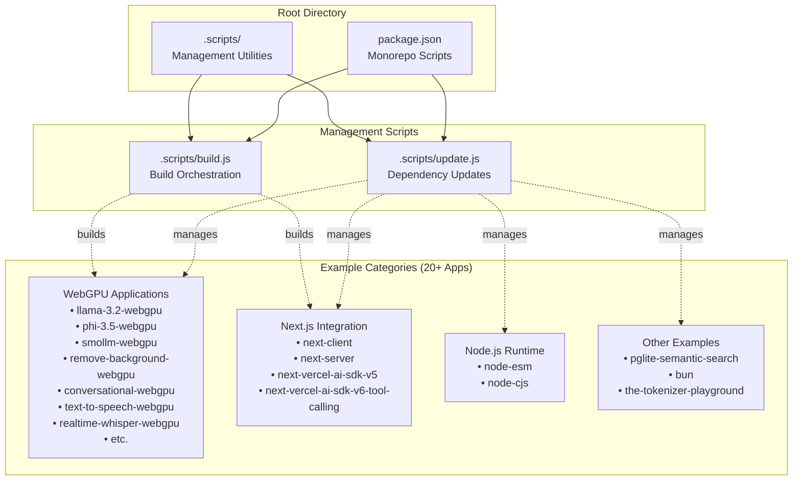
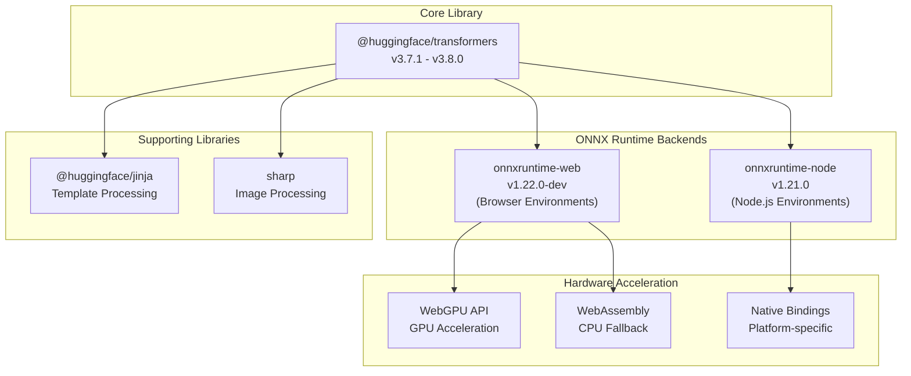
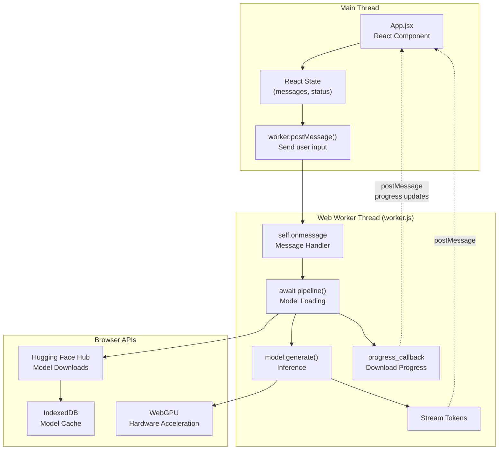
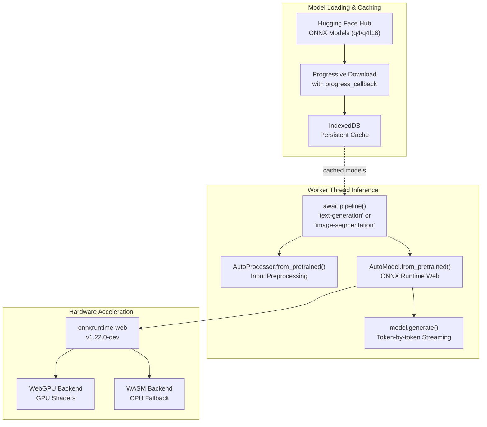
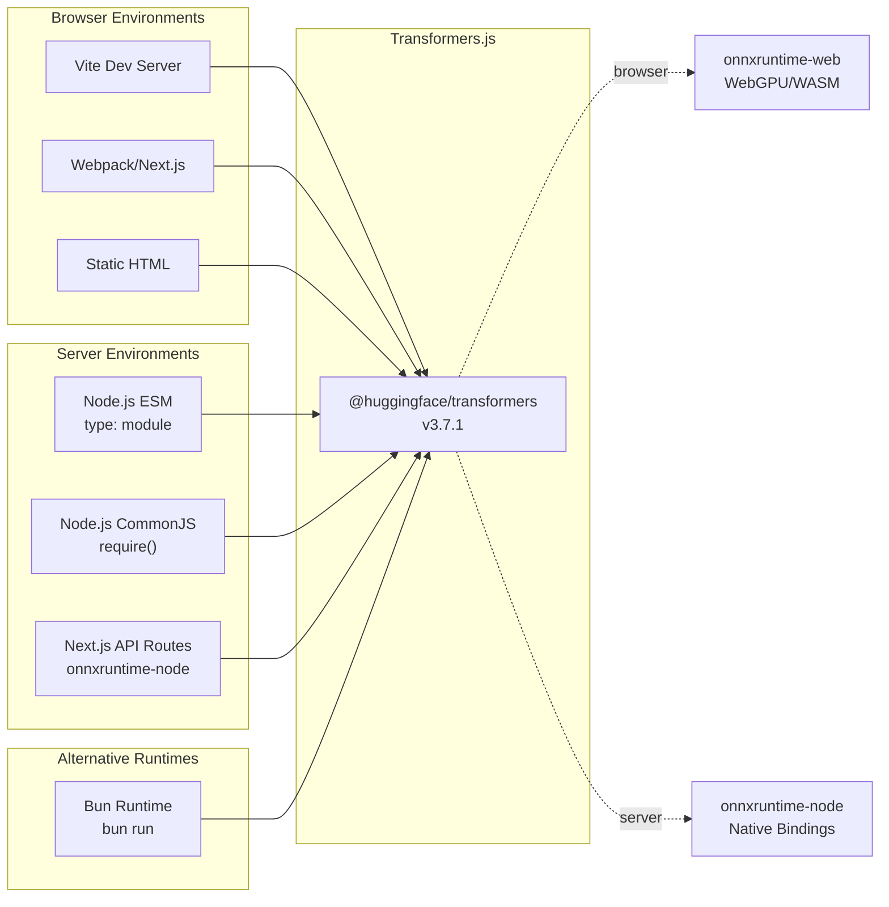
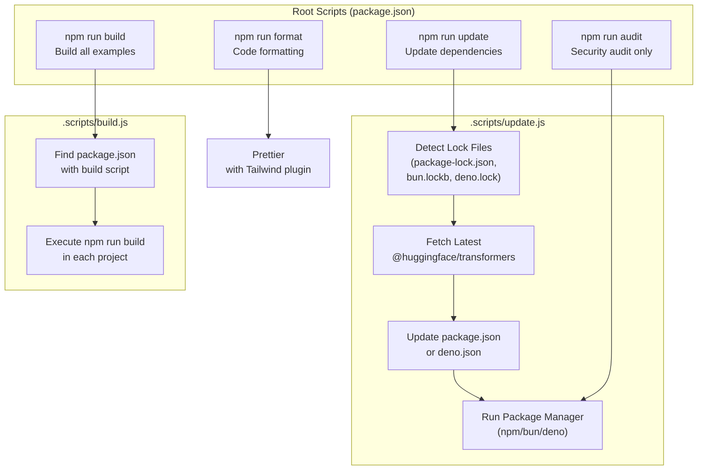

<!-- source: DeepWiki mcp.deepwiki.com · repo huggingface/transformers.js-examples · page 1 Overview · fetched 2026-10-26 -->

# Overview

Relevant source files

The following files were used as context for generating this wiki page:

- [.gitignore](.gitignore)
- [.prettierrc](.prettierrc)
- [bun/bun.lockb](bun/bun.lockb)
- [bun/package.json](bun/package.json)
- [package-lock.json](package-lock.json)
- [package.json](package.json)
- [pglite-semantic-search/package-lock.json](pglite-semantic-search/package-lock.json)
- [pglite-semantic-search/package.json](pglite-semantic-search/package.json)
- [phi-3.5-webgpu/package-lock.json](phi-3.5-webgpu/package-lock.json)
- [phi-3.5-webgpu/package.json](phi-3.5-webgpu/package.json)
- [remove-background-webgpu/package-lock.json](remove-background-webgpu/package-lock.json)
- [remove-background-webgpu/package.json](remove-background-webgpu/package.json)
- [smollm-webgpu/package-lock.json](smollm-webgpu/package-lock.json)
- [smollm-webgpu/package.json](smollm-webgpu/package.json)

This document introduces the transformers.js-examples repository, which showcases practical implementations of Hugging Face's Transformers.js library across various JavaScript environments and machine learning tasks. For detailed information about specific example categories, see [WebGPU Applications](#2) or [Environment Integration](#3).

## Purpose and Scope

The transformers.js-examples repository is a monorepo containing 20+ reference implementations that demonstrate practical usage of the `@huggingface/transformers` library (v3.7.1-3.8.0) across different JavaScript environments and ML tasks. The repository showcases:

1. **WebGPU-accelerated browser applications** - LLM chat interfaces, image processing, speech recognition, and computer vision
2. **Next.js integration patterns** - Client-side, server-side, and Vercel AI SDK integrations
3. **Node.js applications** - ESM and CommonJS module examples
4. **Alternative runtimes** - Bun compatibility demonstrations
5. **Specialized use cases** - In-browser vector search with PGlite, tokenizer visualization tools

All examples demonstrate client-side or server-side ML inference without requiring Python dependencies or remote API calls. Models are downloaded from Hugging Face Hub and cached locally (IndexedDB for browsers, filesystem for Node.js).

Sources: [package.json:1-27](), [remove-background-webgpu/package-lock.json:10-16](), [smollm-webgpu/package-lock.json:10-16]()

## Repository Structure

The repository follows a flat monorepo structure where each example application resides in its own top-level directory. Monorepo management utilities are provided in the `.scripts/` directory.

**Monorepo Structure and Management**

The [.scripts/update.js]() script updates `@huggingface/transformers` across all examples, detecting lock file types (package-lock.json, bun.lockb, deno.lock) and running appropriate package manager commands. The [.scripts/build.js]() script orchestrates builds for projects defining build scripts.

Sources: [package.json:1-27](), [.scripts/update.js:1-98](), [.scripts/build.js:1-38]()

## Shared Dependency Architecture

All examples share a common dependency on `@huggingface/transformers` (v3.7.1-3.8.0), which provides a unified ML API. The library automatically selects the appropriate ONNX Runtime backend based on the execution environment.

**Core Dependencies and Runtime Backends**

The [.scripts/update.js]() script maintains version consistency across all examples, with support for npm, Bun, and Deno package managers. Run `npm run update` to update dependencies or `npm run audit` for security audits only.

Sources: [package.json:1-27](), [.scripts/update.js:14-71](), [remove-background-webgpu/package-lock.json:844-854]()

## Example Applications by Category

The repository organizes examples by deployment environment and ML task:

| Category | Example Applications | Key Technologies | ML Tasks |
|----------|---------------------|------------------|----------|
| **WebGPU LLMs** | llama-3.2-webgpu phi-3.5-webgpu smollm-webgpu deepseek-r1-webgpu gemma-2-2b-jpn-webgpu | React, Vite, WebGPU | Text generation, chat interfaces with streaming |
| **WebGPU Computer Vision** | remove-background-webgpu video-object-detection | React, Vite, Canvas API | Background removal (MODNet), object detection |
| **WebGPU Speech** | conversational-webgpu text-to-speech-webgpu realtime-whisper-webgpu | AudioWorklets, Web Workers | Speech-to-text (Whisper), text-to-speech (OuteTTS), voice activity detection |
| **Next.js Client-Side** | next-client | Next.js, onnxruntime-web | Browser-based inference in Next.js |
| **Next.js Server-Side** | next-server | Next.js, onnxruntime-node, API routes | Server-side model inference |
| **Next.js AI SDK** | next-vercel-ai-sdk-v5 next-vercel-ai-sdk-v6-tool-calling | Vercel AI SDK, custom ChatTransport | Streaming chat, tool calling |
| **Vector Search** | pglite-semantic-search | PGlite, pgvector, Web Workers | In-browser semantic search with embeddings |
| **Node.js** | node-esm node-cjs | Pure Node.js, onnxruntime-node | ESM/CommonJS examples |
| **Alternative Runtimes** | bun | Bun runtime | Compatibility demonstration |
| **Developer Tools** | the-tokenizer-playground | React, Web Workers | Token visualization |

Sources: [package.json:1-27](), [remove-background-webgpu/package.json:1-36](), [smollm-webgpu/package.json:1-35](), [pglite-semantic-search/package.json:1-34]()

## Common Architecture Patterns

Browser-based examples consistently implement a worker-based architecture to maintain UI responsiveness during intensive ML operations.

**Browser Application Worker Architecture**

This architecture separates UI rendering (main thread) from ML inference (worker thread), enabling 60fps UI updates even during multi-gigabyte model downloads or intensive inference. Worker communication uses `postMessage()` for bidirectional message passing.

Key files implementing this pattern:
- React component: `src/App.jsx`
- Web Worker: `src/worker.js` or `public/worker.js`
- Build configuration: `vite.config.js`

Sources: [smollm-webgpu/package.json:1-35](), [remove-background-webgpu/package.json:1-36](), [pglite-semantic-search/package.json:1-34]()

## WebGPU Application Architecture

WebGPU examples leverage browser GPU hardware for accelerated ML inference with quantized ONNX models. All WebGPU applications run entirely client-side, ensuring data privacy.

**WebGPU Inference Pipeline**

**Key Technical Details:**
- **Model Quantization**: Examples use q4 (4-bit weights), q4f16 (4-bit weights + 16-bit activations), or fp16 quantization to reduce model sizes
- **Progressive Loading**: Models stream download with real-time progress updates via `progress_callback`
- **Caching**: Downloaded models persist in IndexedDB, eliminating repeat downloads
- **Streaming Generation**: LLM examples use token-by-token streaming for immediate user feedback

Sources: [remove-background-webgpu/package-lock.json:844-854](), [smollm-webgpu/package.json:12-18](), [phi-3.5-webgpu/package.json:12-18]()

## Cross-Environment Compatibility

The `@huggingface/transformers` library runs across multiple JavaScript environments with automatic backend selection.

**Runtime Environment Support**

**Environment-Specific Configurations:**

| Environment | Package Manager | Module System | ONNX Backend | Example |
|-------------|----------------|---------------|--------------|---------|
| Browser (Vite) | npm | ESM | onnxruntime-web | smollm-webgpu |
| Next.js Client | npm | ESM | onnxruntime-web | next-client |
| Next.js Server | npm | ESM | onnxruntime-node | next-server |
| Node.js ESM | npm | ESM | onnxruntime-node | node-esm |
| Node.js CJS | npm | CommonJS | onnxruntime-node | node-cjs |
| Bun | Bun | ESM | onnxruntime-node | bun |

The library automatically detects the runtime environment and loads the appropriate ONNX Runtime backend, ensuring optimal performance without code changes.

Sources: [package.json:1-27](), [bun/package.json:1-15](), [remove-background-webgpu/package-lock.json:844-854]()

## Build System and Development Tools

The repository provides unified scripts for building and maintaining all examples.

**Monorepo Build Orchestration**

**Per-Project Build Tools:**

Most examples use consistent development tooling:
- **Build Tool**: Vite (WebGPU examples) or Next.js built-in bundler
- **Code Quality**: ESLint with `eslint-config-next` or `@eslint/js`
- **Formatting**: Prettier with Tailwind CSS plugin
- **Styling**: Tailwind CSS with PostCSS and Autoprefixer
- **TypeScript**: Type checking in applicable projects

Run `npm run build` from the repository root to build all examples with defined build scripts.

Sources: [package.json:1-27](), [.scripts/update.js:1-98](), [.scripts/build.js:1-38](), [remove-background-webgpu/package.json:1-36]()

## Key Example Implementations

The repository demonstrates advanced ML capabilities across different domains:

**Large Language Model Applications:**
- **Streaming Chat Interfaces**: llama-3.2-webgpu, phi-3.5-webgpu, smollm-webgpu implement token-by-token streaming with marked/DOMPurify for Markdown rendering
- **Reasoning Models**: deepseek-r1-webgpu showcases reasoning trace extraction from model outputs
- **Multilingual Models**: gemma-2-2b-jpn-webgpu demonstrates Japanese language support

**Computer Vision Applications:**
- **Background Removal**: remove-background-webgpu uses MODNet with Canvas API for alpha channel manipulation and JSZip for batch downloads
- **Video Processing**: video-object-detection implements real-time object detection on video streams

**Audio Processing Applications:**
- **Voice Assistant**: conversational-webgpu combines Whisper (speech-to-text), LLM (reasoning), and OuteTTS (text-to-speech) with AudioWorklets for low-latency audio
- **Speech Recognition**: realtime-whisper-webgpu implements streaming transcription with voice activity detection
- **Speech Synthesis**: text-to-speech-webgpu demonstrates OuteTTS integration

**Advanced Integrations:**
- **In-Browser Vector Search**: pglite-semantic-search runs PostgreSQL with pgvector extension entirely in-browser using PGlite and HNSW indexing
- **Vercel AI SDK**: next-vercel-ai-sdk-v5 and v6 examples implement custom ChatTransport for seamless Transformers.js integration with AI SDK patterns
- **Tool Calling**: next-vercel-ai-sdk-v6-tool-calling demonstrates function calling within browser-based LLMs

All examples include dependency information in their respective `package.json` files and detailed README documentation.

Sources: [remove-background-webgpu/package.json:12-18](), [smollm-webgpu/package.json:12-18](), [pglite-semantic-search/package.json:12-16]()

## Getting Started

To use these examples, developers can:

1. Clone the repository
2. Navigate to a specific example directory
3. Install dependencies using npm/bun/deno
4. Run the example using the provided scripts

Most examples include detailed README files explaining their functionality and usage.

The repository is maintained by Hugging Face and is licensed under the Apache-2.0 license.

Sources: [package.json:1-27](), [README.md:21-22]()

---

