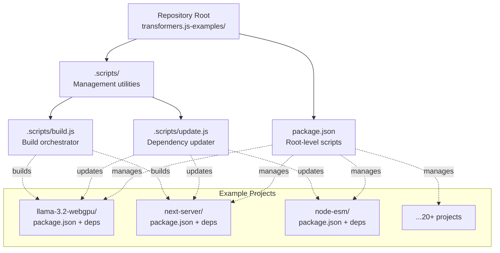
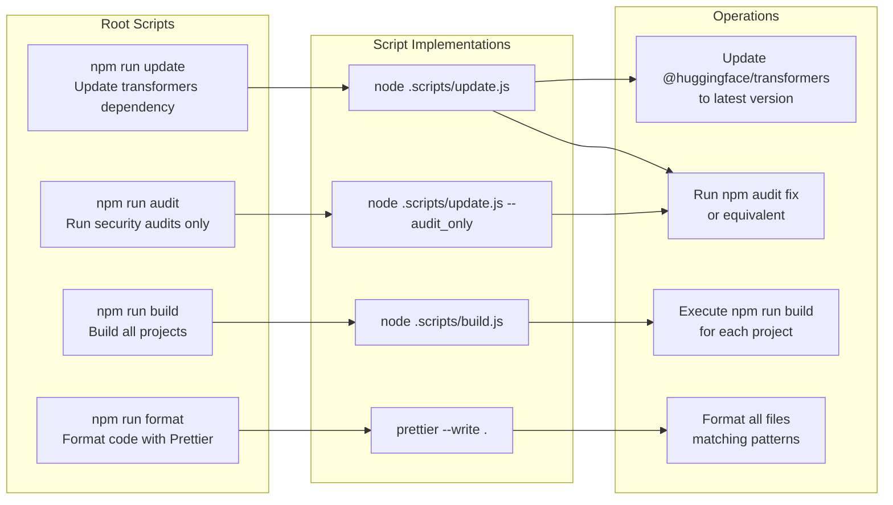
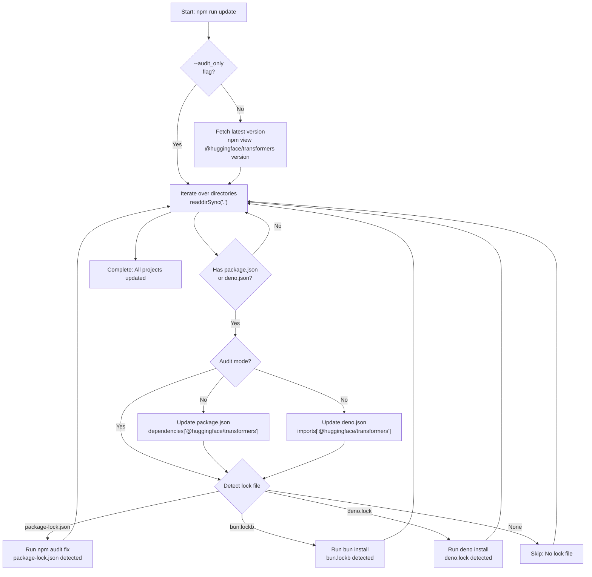
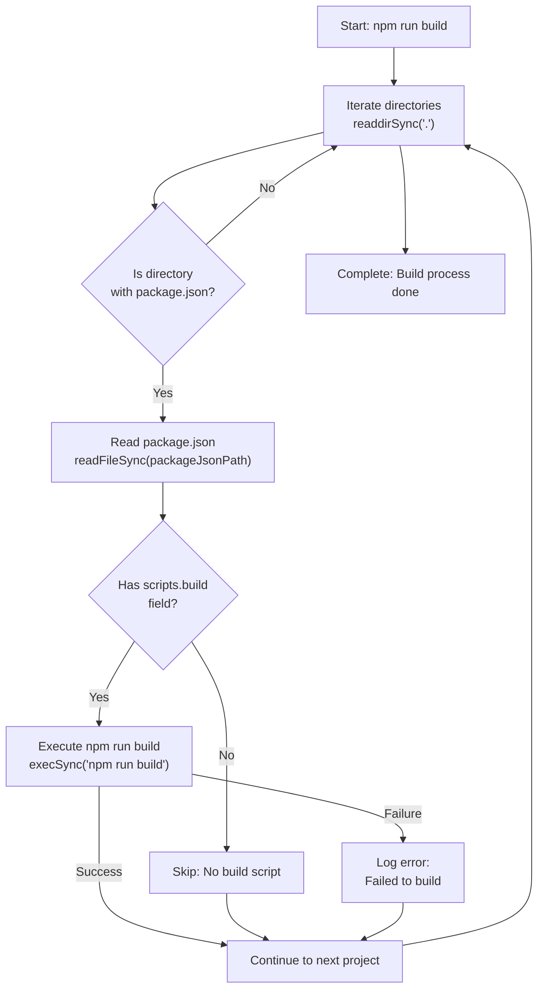
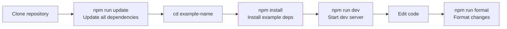

<!-- source: DeepWiki mcp.deepwiki.com · repo huggingface/transformers.js-examples · page 2 Getting Started · fetched 2026-10-26 -->

# Getting Started

<details>
<summary>Relevant source files</summary>

The following files were used as context for generating this wiki page:

- [.gitignore](.gitignore)
- [.prettierrc](.prettierrc)
- [.scripts/build.js](.scripts/build.js)
- [.scripts/update.js](.scripts/update.js)
- [deepseek-r1-webgpu/src/App.jsx](deepseek-r1-webgpu/src/App.jsx)
- [package-lock.json](package-lock.json)
- [package.json](package.json)

</details>


This page provides practical instructions for setting up the transformers.js-examples monorepo, installing dependencies, and running example applications. It covers the monorepo structure, available management scripts, and development workflows.

For detailed information about specific application categories, see [WebGPU Applications](#3), [Next.js Integration](#4), and [Runtime Integration](#5). For architectural patterns used across examples, see [Architecture Patterns](#6).

---

## Monorepo Structure

The repository is organized as a monorepo containing 20+ independent example applications. Each example is a self-contained project with its own `package.json`, dependencies, and build configuration.



**Sources:** [package.json:1-27](), [.scripts/update.js:1-98](), [.scripts/build.js:1-38]()

### Directory Layout

| Path | Purpose |
|------|---------|
| Root `package.json` | Defines monorepo-wide scripts: `update`, `audit`, `build`, `format` |
| `.scripts/update.js` | Updates `@huggingface/transformers` across all projects |
| `.scripts/build.js` | Runs build commands for projects that define them |
| `.prettierrc` | Code formatting configuration (empty, uses defaults) |
| `.gitignore` | Excludes `node_modules`, `dist`, `.next`, `.DS_Store` |
| Individual project directories | Self-contained examples with their own dependencies |

**Sources:** [package.json:1-27](), [.prettierrc:1-2](), [.gitignore:1-5]()

---

## Prerequisites

Before setting up the repository, ensure you have one of the following package managers installed:

- **Node.js** v14+ with npm (most examples)
- **Bun** (for `bun/` example)
- **Deno** (for Deno-based examples)

WebGPU examples require a browser with WebGPU support (Chrome 113+, Edge 113+, or compatible browsers).

---

## Initial Setup

### 1. Clone the Repository

```bash
git clone https://github.com/huggingface/transformers.js-examples.git
cd transformers.js-examples
```

### 2. Install Root Dependencies (Optional)

The root `package.json` contains only development tools for formatting:

```bash
npm install
```

This installs `prettier`, `prettier-plugin-svelte`, and `prettier-plugin-tailwindcss` as defined in [package.json:22-26]().

### 3. Install Example Dependencies

Each example must be installed individually:

```bash
cd llama-3.2-webgpu
npm install
```

Or use the monorepo update script (see [Updating Dependencies](#updating-dependencies)):

```bash
npm run update
```

**Sources:** [package.json:1-27]()

---

## Running Examples

Each example is independent and must be run from its own directory. Most examples use Vite for development or Next.js for full-stack applications.

### Running a WebGPU Example

```bash
cd deepseek-r1-webgpu
npm install
npm run dev
```

The application will start on `http://localhost:5173` (default Vite port).

### Running a Next.js Example

```bash
cd next-server
npm install
npm run dev
```

The application will start on `http://localhost:3000` (default Next.js port).

### Running a Node.js Example

```bash
cd node-esm
npm install
node index.js
```

**Sources:** [deepseek-r1-webgpu/src/App.jsx:1-400]()

---

## Monorepo Management Scripts

The root `package.json` defines four scripts that operate across the entire monorepo:



**Sources:** [package.json:6-11]()

---

## Updating Dependencies

The `update.js` script automates dependency updates across all projects in the monorepo.

### Update Script Workflow



**Sources:** [.scripts/update.js:1-98]()

### Usage

**Update all projects to the latest `@huggingface/transformers` version:**

```bash
npm run update
```

This command:
1. Fetches the latest version from npm registry ([.scripts/update.js:76-83]())
2. Updates each `package.json` to use that version ([.scripts/update.js:26-36]())
3. Detects lock file type (npm, Bun, or Deno) ([.scripts/update.js:56-67]())
4. Runs the appropriate package manager command

**Run security audits without updating versions:**

```bash
npm run audit
```

This uses the `--audit_only` flag ([.scripts/update.js:12]()) to skip version updates and only run `npm audit fix` or equivalent commands.

### Lock File Detection

The script automatically detects which package manager is used:

| Lock File | Command Executed | Reference |
|-----------|------------------|-----------|
| `package-lock.json` | `npm audit fix` | [.scripts/update.js:56-58]() |
| `bun.lockb` | `bun install` | [.scripts/update.js:59-61]() |
| `deno.lock` | `deno install` | [.scripts/update.js:62-64]() |
| None | Skip with message | [.scripts/update.js:65-66]() |

### Key Functions

The `updateDependency` function ([.scripts/update.js:15-71]()) handles both `package.json` and `deno.json` manifests:

- **For package.json**: Updates the `dependencies` field ([.scripts/update.js:26-36]())
- **For deno.json**: Updates the `imports` field with `npm:` prefix ([.scripts/update.js:40-49]())

**Sources:** [.scripts/update.js:1-98]()

---

## Building Projects

The `build.js` script orchestrates builds across all projects that define a `build` script in their `package.json`.

### Build Script Workflow



**Sources:** [.scripts/build.js:1-38]()

### Usage

```bash
npm run build
```

This command:
1. Scans all directories in the repository ([.scripts/build.js:28-35]())
2. Checks each for a `package.json` with a `build` script ([.scripts/build.js:12]())
3. Executes `npm run build` in each matching directory ([.scripts/build.js:17]())
4. Continues on errors, logging failures ([.scripts/build.js:19]())

### Build Script Detection

The `buildProject` function ([.scripts/build.js:6-25]()) reads each project's `package.json` and checks for `packageJson?.scripts?.build` ([.scripts/build.js:12]()). Projects without this field are skipped.

**Sources:** [.scripts/build.js:1-38]()

---

## Code Formatting

The repository uses Prettier with plugins for consistent code formatting across all examples.

### Installed Plugins

From [package.json:22-26]():

- `prettier` - Core formatter
- `prettier-plugin-svelte` - Svelte component formatting
- `prettier-plugin-tailwindcss` - Tailwind class sorting

### Usage

Format all files in the repository:

```bash
npm run format
```

This executes `prettier --write .` ([package.json:10]()), which formats all supported file types according to `.prettierrc` (currently empty, using Prettier defaults).

**Sources:** [package.json:22-26](), [.prettierrc:1-2]()

---

## Package Manager Support

The monorepo management scripts support three package managers:

### Lock File and Command Mapping

| Package Manager | Lock File | Update Command | Install Command |
|-----------------|-----------|----------------|-----------------|
| npm | `package-lock.json` | `npm audit fix` | `npm install` |
| Bun | `bun.lockb` | `bun install` | `bun install` |
| Deno | `deno.lock` | `deno install` | `deno install` |

The update script automatically detects which system to use by checking for lock files ([.scripts/update.js:56-67]()).

### Adding New Examples

When adding a new example to the repository:

1. Create a new directory with a descriptive name
2. Add a `package.json` with `@huggingface/transformers` dependency
3. Run `npm run update` from the root to synchronize versions
4. (Optional) Add a `build` script if the example requires building

**Sources:** [.scripts/update.js:56-67](), [.scripts/build.js:12]()

---

## Development Workflow Summary

A typical development workflow:



**Sources:** [package.json:6-11](), [.scripts/update.js:1-98]()

---

## Troubleshooting

### Common Issues

| Issue | Cause | Solution |
|-------|-------|----------|
| `WebGPU is not supported` | Browser lacks WebGPU support | Use Chrome 113+ or Edge 113+ |
| `Module not found` errors | Dependencies not installed | Run `npm install` in project directory |
| Lock file conflicts | Mixed package managers | Use consistent package manager per project |
| Build failures during `npm run build` | Project-specific errors | Check individual project logs |

### WebGPU Availability Check

Most WebGPU examples check for `navigator.gpu` ([deepseek-r1-webgpu/src/App.jsx:8]()):

```javascript
const IS_WEBGPU_AVAILABLE = !!navigator.gpu;
```

If unavailable, they display an error message ([deepseek-r1-webgpu/src/App.jsx:391-396]()).

**Sources:** [deepseek-r1-webgpu/src/App.jsx:8](), [deepseek-r1-webgpu/src/App.jsx:391-396]()

---

## Next Steps

After setting up the monorepo:

- Explore [WebGPU Applications](#3) for browser-based AI examples
- Learn about [Next.js Integration](#4) patterns for full-stack applications
- Review [Architecture Patterns](#6) to understand shared design patterns
- Check [Monorepo Management](#7.1) for detailed script documentation

**Sources:** [package.json:1-27](), [.scripts/update.js:1-98](), [.scripts/build.js:1-38]()

---

