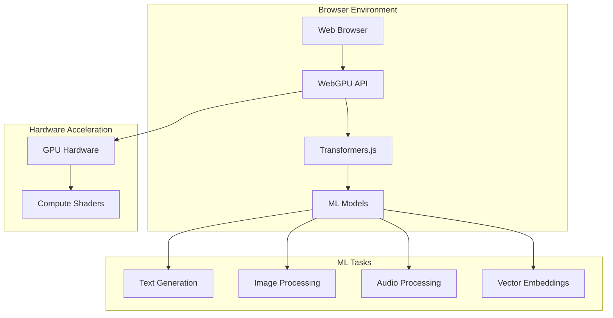
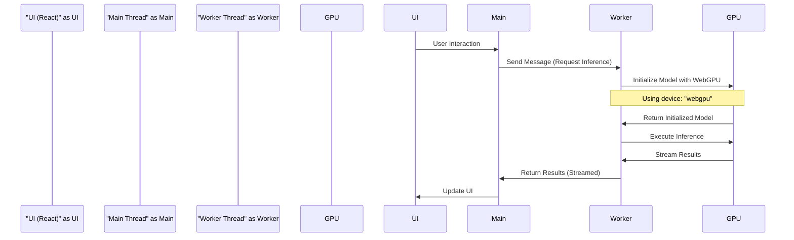
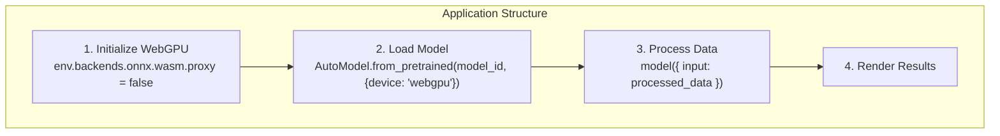
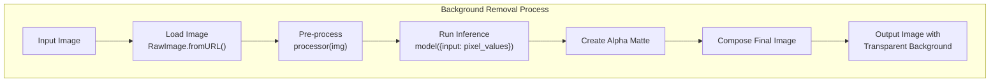
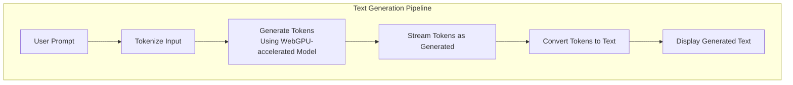
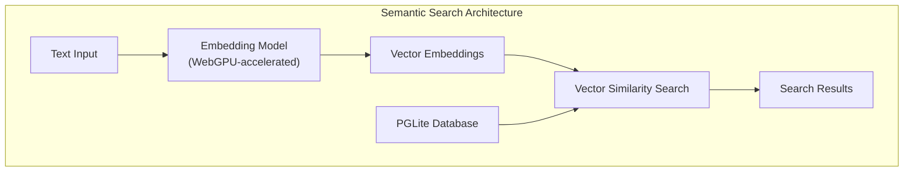

<!-- source: DeepWiki mcp.deepwiki.com · repo huggingface/transformers.js-examples · page 3 WebGPU Applications · fetched 2026-10-26 -->

# WebGPU Applications

<details>
<summary>Relevant source files</summary>

The following files were used as context for generating this wiki page:

- [bun/bun.lockb](bun/bun.lockb)
- [bun/package.json](bun/package.json)
- [gemma-2-2b-jpn-webgpu/package-lock.json](gemma-2-2b-jpn-webgpu/package-lock.json)
- [gemma-2-2b-jpn-webgpu/package.json](gemma-2-2b-jpn-webgpu/package.json)
- [llama-3.2-webgpu/package-lock.json](llama-3.2-webgpu/package-lock.json)
- [llama-3.2-webgpu/package.json](llama-3.2-webgpu/package.json)
- [llama-3.2-webgpu/src/App.jsx](llama-3.2-webgpu/src/App.jsx)
- [llama-3.2-webgpu/src/worker.js](llama-3.2-webgpu/src/worker.js)
- [pglite-semantic-search/package-lock.json](pglite-semantic-search/package-lock.json)
- [pglite-semantic-search/package.json](pglite-semantic-search/package.json)
- [phi-3.5-webgpu/package-lock.json](phi-3.5-webgpu/package-lock.json)
- [phi-3.5-webgpu/package.json](phi-3.5-webgpu/package.json)
- [realtime-whisper-webgpu/package-lock.json](realtime-whisper-webgpu/package-lock.json)
- [remove-background-webgpu/package-lock.json](remove-background-webgpu/package-lock.json)
- [remove-background-webgpu/package.json](remove-background-webgpu/package.json)
- [smollm-webgpu/package-lock.json](smollm-webgpu/package-lock.json)
- [smollm-webgpu/package.json](smollm-webgpu/package.json)
- [video-object-detection/package-lock.json](video-object-detection/package-lock.json)

</details>


This page documents the WebGPU-accelerated machine learning applications in the transformers.js-examples repository. These examples showcase client-side ML inference using the WebGPU API for hardware acceleration, enabling high-performance machine learning directly in the browser without server-side processing.

For information about integrating these applications with specific JavaScript environments like Next.js or Node.js, see [Environment Integration](#3).

## Overview of WebGPU in Transformers.js

WebGPU is a modern graphics and compute API that provides access to GPU hardware acceleration from the browser. In the context of Transformers.js, WebGPU enables significant performance improvements for machine learning inference by offloading tensor operations to the GPU.



Sources: [smollm-webgpu/package.json](), [phi-3.5-webgpu/package.json](), [remove-background-webgpu/package.json]()

## Common Architecture

The WebGPU examples share a common architectural pattern to optimize performance and responsiveness in the browser environment.

### Web Worker Pattern

To prevent blocking the main thread during intensive ML computations, these applications implement a web worker pattern that offloads model loading and inference to a separate thread.



Sources: [remove-background-webgpu/src/App.jsx:24-41]()

### Core Implementation Pattern

Most WebGPU applications in this repository follow this implementation pattern:



Sources: [remove-background-webgpu/src/App.jsx:24-41](), [remove-background-webgpu/src/App.jsx:70-117]()

## Example WebGPU Applications

The repository contains several WebGPU-accelerated applications across different ML domains:

| Category | Examples | Description |
|----------|----------|-------------|
| Text Generation | smollm-webgpu<br>phi-3.5-webgpu<br>deepseek-r1-webgpu<br>llama-3.2-webgpu | Language models that generate text responses |
| Image Processing | remove-background-webgpu<br>depth-estimation-video<br>depth-anything | Image segmentation, background removal, and depth estimation |
| Vector Search | pglite-semantic-search | Semantic search using vector embeddings with PGLite |
| Audio | text-to-speech-webgpu | Text-to-speech synthesis using WebGPU |
| Visualization | attention-visualization | Visual representation of transformer attention patterns |

Sources: [smollm-webgpu/package-lock.json](), [remove-background-webgpu/package-lock.json](), [phi-3.5-webgpu/package-lock.json](), [pglite-semantic-search/package-lock.json]()

### Model Initialization Pattern

All WebGPU examples initialize their models using a similar pattern that enables WebGPU acceleration:

```javascript
// Enable WebGPU acceleration
env.backends.onnx.wasm.proxy = false;

// Load model with WebGPU device
const model = await AutoModel.from_pretrained(model_id, {
  device: "webgpu",
});
```

Sources: [remove-background-webgpu/src/App.jsx:28-36]()

## Image Processing with WebGPU

The image processing examples demonstrate how to use WebGPU for computer vision tasks. The `remove-background-webgpu` example showcases image background removal:



Sources: [remove-background-webgpu/src/App.jsx:70-117]()

The implementation performs the following steps:
1. Loads the image using `RawImage.fromURL`
2. Pre-processes the image with the model's processor
3. Runs inference using the WebGPU-accelerated model
4. Applies the resulting alpha matte to create transparency
5. Returns the processed image with the background removed

## Text Generation with WebGPU

Text generation models like `phi-3.5-webgpu`, `smollm-webgpu`, and `llama-3.2-webgpu` demonstrate how to run large language models in the browser using WebGPU acceleration.



Sources: [phi-3.5-webgpu/package-lock.json](), [smollm-webgpu/package.json]()

## Vector Search with WebGPU

The `pglite-semantic-search` example demonstrates how to combine WebGPU-accelerated embeddings with PGLite for vector search directly in the browser.



Sources: [pglite-semantic-search/package.json](), [pglite-semantic-search/package-lock.json]()

This example uses:
- WebGPU acceleration for generating embeddings
- `@electric-sql/pglite` for in-browser PostgreSQL vector operations
- Transformers.js for the embedding model

## Dependencies and Build System

All WebGPU examples share common dependencies and build configuration:

| Dependency | Purpose |
|------------|---------|
| @huggingface/transformers | The core ML library providing model loading and inference |
| react & react-dom | Frontend UI framework |
| vite | Build system optimized for modern web applications |
| tailwindcss | Utility-first CSS framework for styling |

Sources: [smollm-webgpu/package.json](), [remove-background-webgpu/package.json](), [phi-3.5-webgpu/package.json]()

## WebGPU Browser Support

WebGPU is supported in modern browsers:

- Chrome/Edge 113+ (Stable)
- Firefox 121+ (Stable)
- Safari 17.4+ (Stable)

A common pattern in these applications is to check for WebGPU support before initialization:

```javascript
if (!navigator.gpu) {
  throw new Error("WebGPU is not supported in this browser.");
}
```

Sources: [remove-background-webgpu/src/App.jsx:27-29]()

## Performance Considerations

When using WebGPU for ML inference, consider the following:

1. **Initial Load Time**: The first load includes downloading ONNX models and WebGPU pipeline compilation
2. **Memory Management**: Larger models require more GPU memory
3. **Device Compatibility**: Performance varies significantly based on GPU hardware
4. **Batching**: Processing multiple inputs in batches can improve throughput

Sources: [remove-background-webgpu/src/App.jsx](), [smollm-webgpu/package-lock.json]()

## Conclusion

The WebGPU applications in the transformers.js-examples repository demonstrate how to leverage modern browser capabilities for high-performance ML inference. By using WebGPU acceleration, these examples achieve near-native performance for various ML tasks directly in the browser.

For more detailed information about specific categories of WebGPU applications, refer to the dedicated pages:
- [Text Generation Models](#2.1)
- [Image Processing Applications](#2.2)
- [Semantic Search and Embeddings](#2.3)
- [Speech and Audio Applications](#2.4)

---

