<!-- source: DeepWiki mcp.deepwiki.com · repo huggingface/transformers.js-examples · page 3.1 Large Language Models · fetched 2026-10-26 -->

# Large Language Models

Relevant source files

The following files were used as context for generating this wiki page:

- [.scripts/build.js](.scripts/build.js)
- [.scripts/update.js](.scripts/update.js)
- [bun/bun.lockb](bun/bun.lockb)
- [bun/package.json](bun/package.json)
- [deepseek-r1-webgpu/src/App.jsx](deepseek-r1-webgpu/src/App.jsx)
- [gemma-2-2b-jpn-webgpu/package-lock.json](gemma-2-2b-jpn-webgpu/package-lock.json)
- [gemma-2-2b-jpn-webgpu/package.json](gemma-2-2b-jpn-webgpu/package.json)
- [llama-3.2-webgpu/package-lock.json](llama-3.2-webgpu/package-lock.json)
- [llama-3.2-webgpu/package.json](llama-3.2-webgpu/package.json)
- [llama-3.2-webgpu/src/App.jsx](llama-3.2-webgpu/src/App.jsx)
- [llama-3.2-webgpu/src/worker.js](llama-3.2-webgpu/src/worker.js)
- [pglite-semantic-search/package-lock.json](pglite-semantic-search/package-lock.json)
- [pglite-semantic-search/package.json](pglite-semantic-search/package.json)
- [phi-3.5-webgpu/package-lock.json](phi-3.5-webgpu/package-lock.json)
- [phi-3.5-webgpu/package.json](phi-3.5-webgpu/package.json)
- [realtime-whisper-webgpu/package-lock.json](realtime-whisper-webgpu/package-lock.json)
- [remove-background-webgpu/package-lock.json](remove-background-webgpu/package-lock.json)
- [remove-background-webgpu/package.json](remove-background-webgpu/package.json)
- [smollm-webgpu/package-lock.json](smollm-webgpu/package-lock.json)
- [smollm-webgpu/package.json](smollm-webgpu/package.json)
- [video-object-detection/package-lock.json](video-object-detection/package-lock.json)

This page documents the browser-based Large Language Model (LLM) examples that demonstrate text generation using WebGPU acceleration. These examples include chat interfaces powered by models such as Llama-3.2, SmolLM, Phi-3.5, DeepSeek-R1, and Gemma-2-2b-jpn. All implementations follow a shared worker-based architecture pattern for offloading inference from the main UI thread.

For speech and audio processing with LLMs, see [Speech and Audio Applications](#3.4). For Next.js-based LLM integrations, see [Vercel AI SDK Integration](#4.3).

## Architecture Overview

All LLM examples implement a consistent worker-based architecture that separates UI rendering from computationally intensive model inference operations.

### High-Level Component Architecture

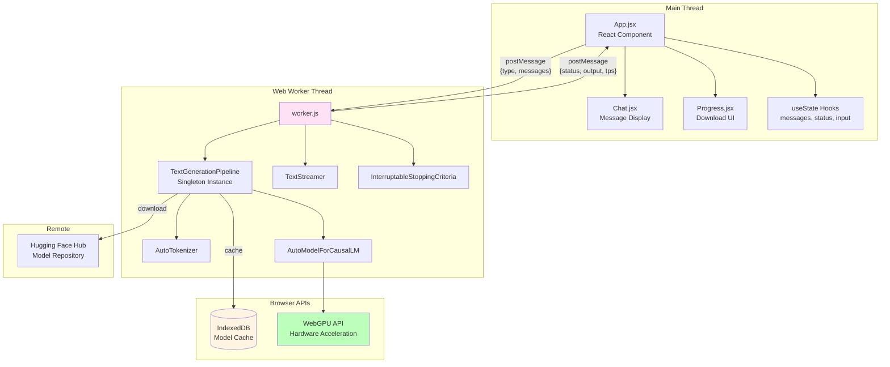

**Sources:** [llama-3.2-webgpu/src/App.jsx:1-250](), [llama-3.2-webgpu/src/worker.js:1-150]()

### Message Flow Protocol

The main thread and worker communicate through a well-defined message protocol:

| Message Type | Direction | Purpose | Payload |
|--------------|-----------|---------|---------|
| `check` | Main → Worker | Feature detection | None |
| `webgpu` | Worker → Main | WebGPU availability | `{supported: boolean}` |
| `loading` | Worker → Main | Model load start | `{data: string}` |
| `initiate` | Worker → Main | File download start | `{file: string}` |
| `progress` | Worker → Main | Download progress | `{file, loaded, total, progress}` |
| `done` | Worker → Main | File complete | `{file}` |
| `ready` | Worker → Main | Model ready | None |
| `generate` | Main → Worker | Start generation | `{messages: array}` |
| `start` | Worker → Main | Generation started | None |
| `update` | Worker → Main | Token generated | `{output, tps, numTokens}` |
| `complete` | Worker → Main | Generation done | `{output}` |
| `interrupt` | Main → Worker | Stop generation | None |

**Sources:** [llama-3.2-webgpu/src/App.jsx:72-150](), [llama-3.2-webgpu/src/worker.js:90-140]()

## Model Loading and Initialization

### Singleton Pattern Implementation

The `TextGenerationPipeline` class uses the Singleton pattern to ensure models are loaded only once and reused across multiple generation requests:

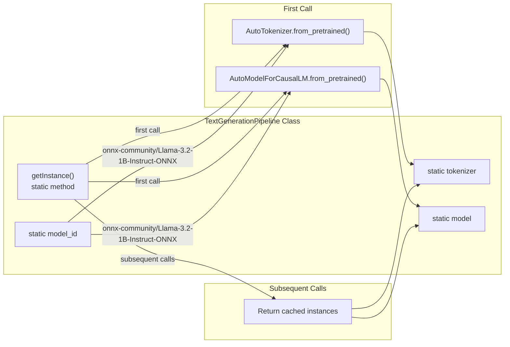

**Sources:** [llama-3.2-webgpu/src/worker.js:11-27]()

### Supported Model Configurations

| Example | Model ID | Quantization | Special Features |
|---------|----------|--------------|------------------|
| llama-3.2-webgpu | `onnx-community/Llama-3.2-1B-Instruct-ONNX` | q4f16 | Chat template, instruction tuned |
| smollm-webgpu | `HuggingFaceTB/SmolLM2-135M-Instruct-ONNX` | q4f16 | Small size, fast inference |
| phi-3.5-webgpu | `Xenova/Phi-3.5-mini-instruct` | q4 | Extended context (128K) |
| gemma-2-2b-jpn-webgpu | `onnx-community/gemma-2-2b-jpn-it-onnx` | q4f16 | Japanese language support |
| deepseek-r1-webgpu | Various DeepSeek models | q4/q4f16 | Reasoning capabilities |

**Sources:** [llama-3.2-webgpu/src/worker.js:12](), [smollm-webgpu/package-lock.json:1-50](), [phi-3.5-webgpu/package-lock.json:1-50]()

### Model Download Progress Tracking

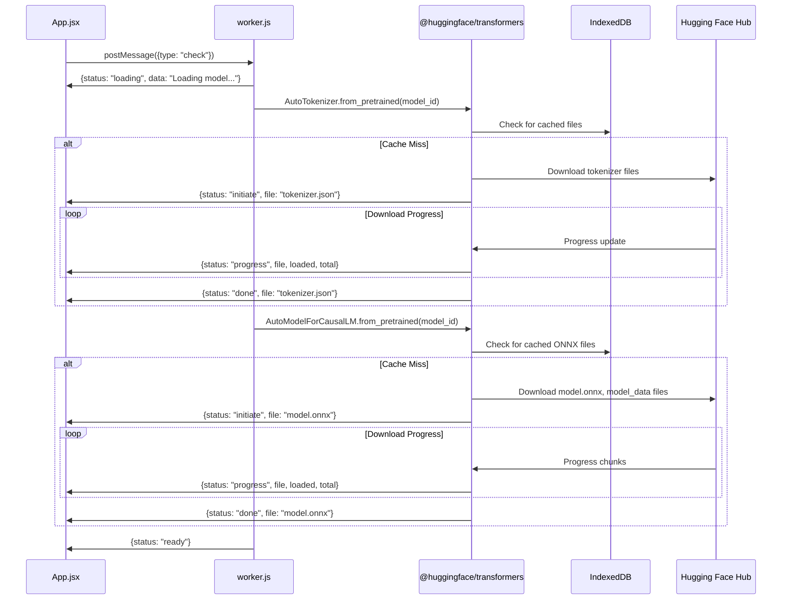

**Sources:** [llama-3.2-webgpu/src/App.jsx:74-110](), [llama-3.2-webgpu/src/worker.js:14-25]()

## Text Generation Pipeline

### Chat Template Application

Chat messages are formatted using model-specific templates via `apply_chat_template`:

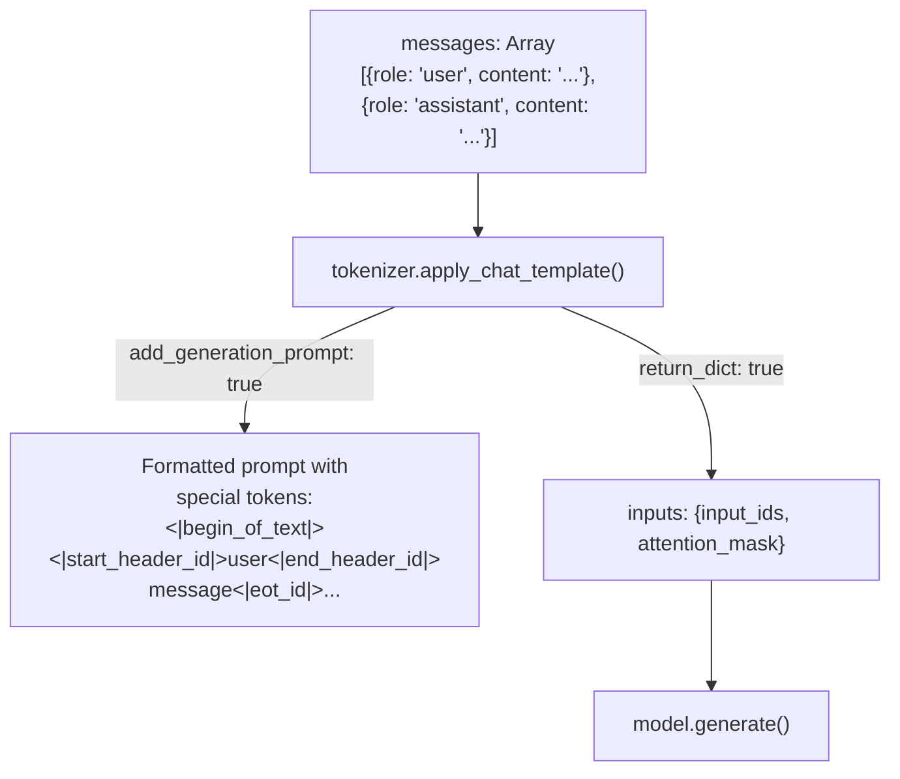

The `add_generation_prompt` parameter adds the assistant's turn prefix, preparing the model to continue generation.

**Sources:** [llama-3.2-webgpu/src/worker.js:36-39]()

### Token Generation with Streaming

The generation process produces tokens incrementally using `TextStreamer`:

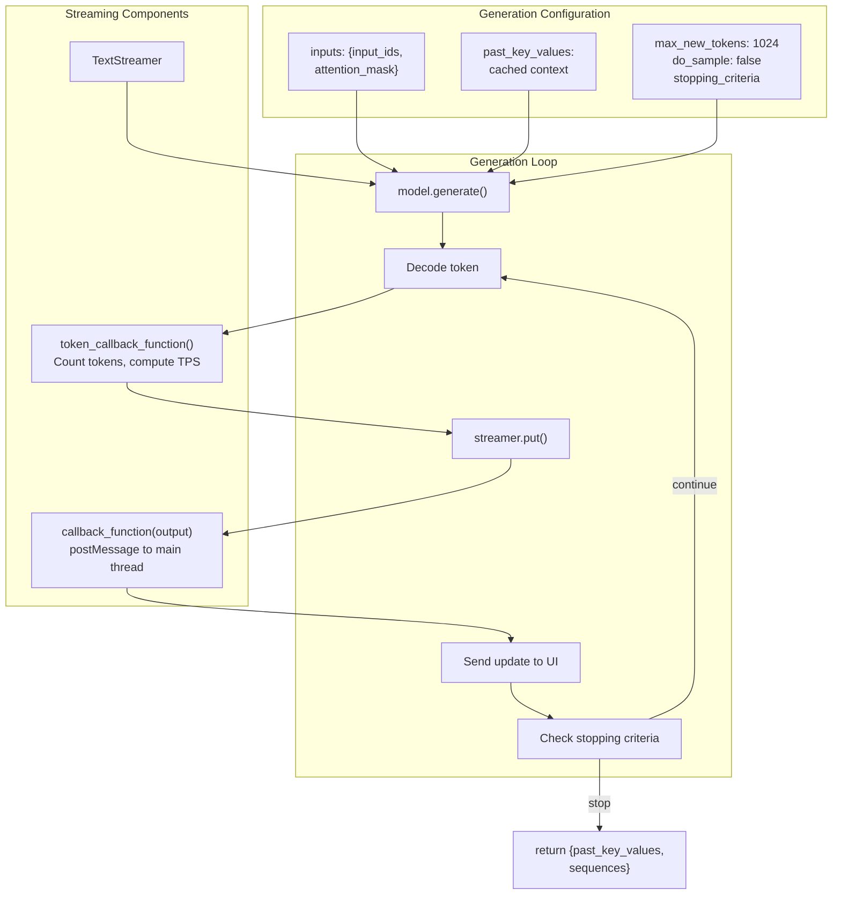

**Sources:** [llama-3.2-webgpu/src/worker.js:32-90]()

### KV Cache Management

The `past_key_values_cache` stores attention context between generation calls for multi-turn conversations:

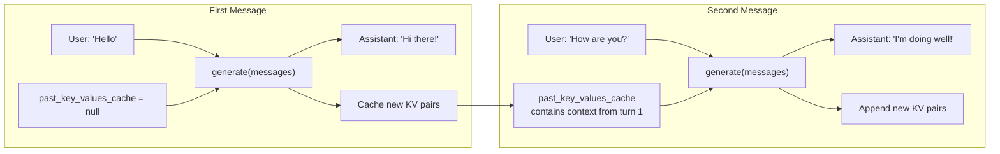

The cache is stored in `past_key_values_cache` at [llama-3.2-webgpu/src/worker.js:31]() and updated after each generation at [llama-3.2-webgpu/src/worker.js:82]().

**Sources:** [llama-3.2-webgpu/src/worker.js:31-82]()

### Generation Parameters

Generation behavior is controlled through parameters passed to `model.generate()`:

| Parameter | Type | Purpose | Common Values |
|-----------|------|---------|---------------|
| `max_new_tokens` | number | Maximum tokens to generate | 512-2048 |
| `do_sample` | boolean | Use sampling vs greedy | false (greedy) |
| `temperature` | number | Sampling randomness | 0.6-1.0 |
| `top_p` | number | Nucleus sampling threshold | 0.9 |
| `top_k` | number | Top-k sampling | 50 |
| `repetition_penalty` | number | Penalize repeated tokens | 1.0-1.2 |
| `stopping_criteria` | object | Early stopping conditions | `InterruptableStoppingCriteria` |
| `return_dict_in_generate` | boolean | Return full output dict | true |

**Sources:** [llama-3.2-webgpu/src/worker.js:70-81]()

## User Interface Components

### State Management

The main application component manages several state variables:

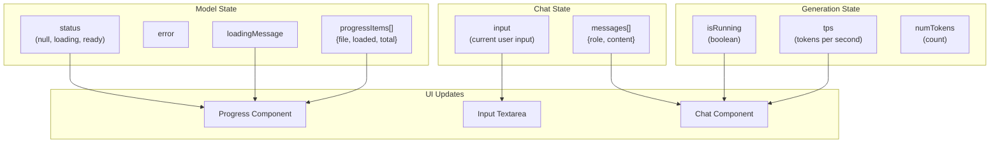

**Sources:** [llama-3.2-webgpu/src/App.jsx:24-34]()

### Message Display Flow

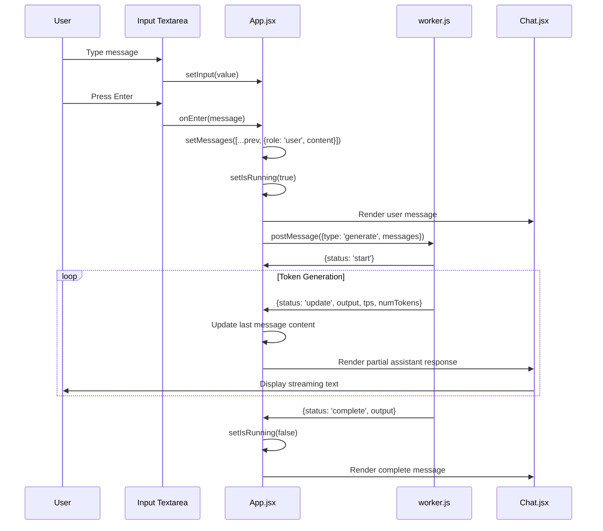

**Sources:** [llama-3.2-webgpu/src/App.jsx:36-200]()

### Progress Display During Model Loading

The progress bars show granular download progress for each model file:

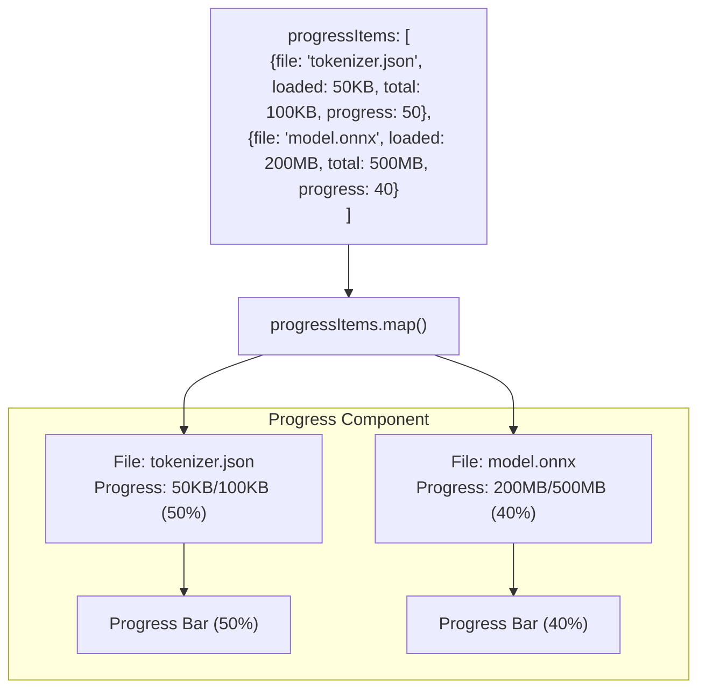

**Sources:** [llama-3.2-webgpu/src/App.jsx:82-95](), [llama-3.2-webgpu/src/components/Progress.jsx:1-50]()

## Performance Optimization

### WebGPU Acceleration

All LLM examples require WebGPU support and configure models with `device: "webgpu"`:

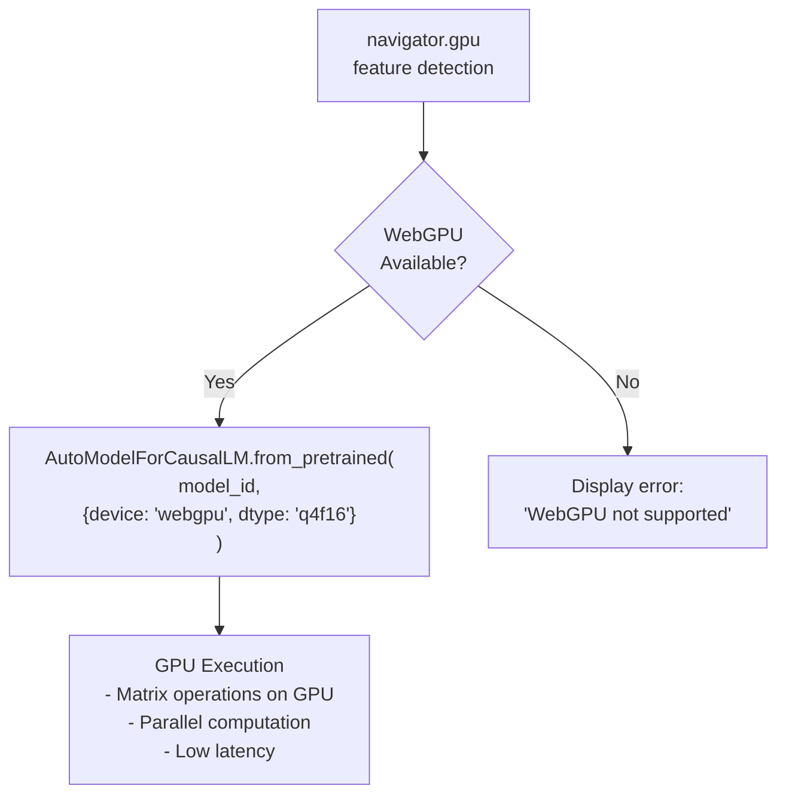

The availability check occurs at [llama-3.2-webgpu/src/App.jsx:8]() with `IS_WEBGPU_AVAILABLE = !!navigator.gpu`.

**Sources:** [llama-3.2-webgpu/src/App.jsx:8](), [llama-3.2-webgpu/src/worker.js:19-23]()

### Quantization Strategies

Models use quantization to reduce memory footprint while maintaining quality:

| Quantization | Weight Bits | Activation Bits | Size Reduction | Use Case |
|--------------|-------------|-----------------|----------------|----------|
| `q4` | 4-bit | INT8 | ~75% | Maximum compression |
| `q4f16` | 4-bit | FP16 | ~70% | Balance quality/size |
| `fp16` | 16-bit | FP16 | ~50% | Higher quality |

The quantization is specified in the `dtype` parameter: `AutoModelForCausalLM.from_pretrained(model_id, {dtype: "q4f16"})`.

**Sources:** [llama-3.2-webgpu/src/worker.js:20]()

### Interrupt Mechanism

Users can stop generation mid-stream using `InterruptableStoppingCriteria`:

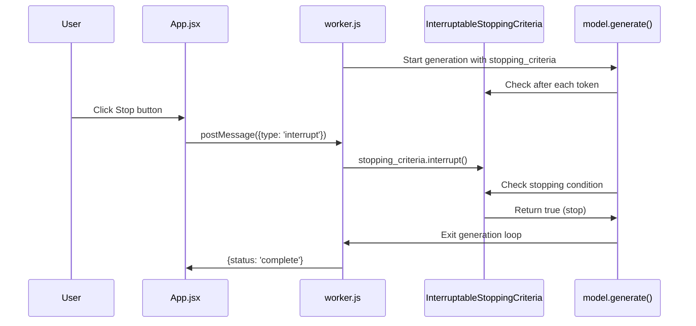

The `InterruptableStoppingCriteria` instance is created at [llama-3.2-webgpu/src/worker.js:29]() and interrupted at [llama-3.2-webgpu/src/worker.js:100]().

**Sources:** [llama-3.2-webgpu/src/worker.js:29-106](), [llama-3.2-webgpu/src/App.jsx:43-47]()

## Example Applications

### Llama-3.2 Chat Interface

The primary example demonstrating instruction-tuned chat:

- **Model:** `onnx-community/Llama-3.2-1B-Instruct-ONNX`
- **Features:** Multi-turn conversation, streaming responses, example prompts
- **UI:** Full chat interface with markdown rendering via `marked` and sanitization via `dompurify`

**Sources:** [llama-3.2-webgpu/src/App.jsx:1-300](), [llama-3.2-webgpu/src/worker.js:1-150](), [llama-3.2-webgpu/package.json:1-35]()

### SmolLM Compact Model

Optimized for speed with a small 135M parameter model:

- **Model:** `HuggingFaceTB/SmolLM2-135M-Instruct-ONNX`
- **Features:** Fast inference, low memory usage
- **Use Case:** Lightweight applications, resource-constrained environments

**Sources:** [smollm-webgpu/package.json:12-17]()

### Phi-3.5 Extended Context

Supports very long context windows:

- **Model:** `Xenova/Phi-3.5-mini-instruct`
- **Features:** 128K token context, efficient attention
- **Use Case:** Long document processing, extended conversations

**Sources:** [phi-3.5-webgpu/package.json:12-17]()

### Gemma Japanese Model

Specialized for Japanese language tasks:

- **Model:** `onnx-community/gemma-2-2b-jpn-it-onnx`
- **Features:** Japanese instruction tuning, cultural context
- **Use Case:** Japanese chatbots, multilingual applications

**Sources:** [gemma-2-2b-jpn-webgpu/package.json:12-17]()

---

