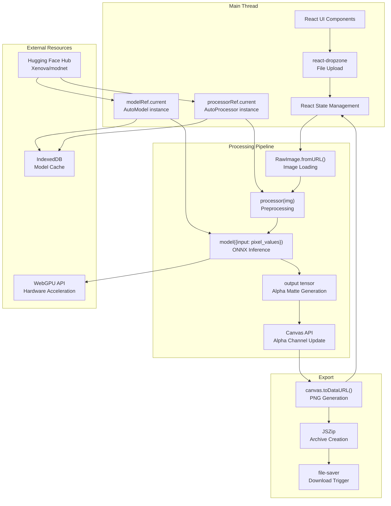
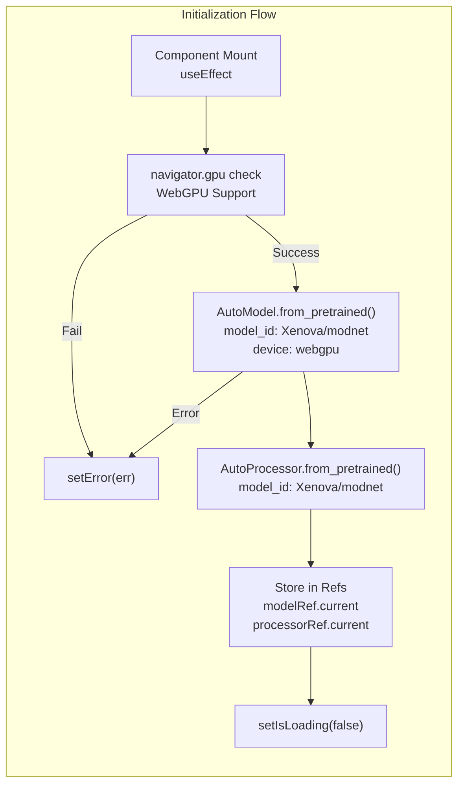
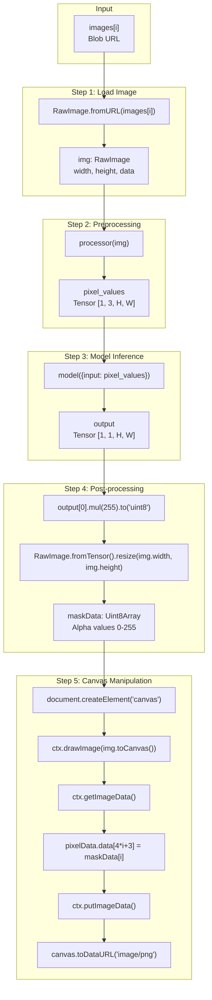
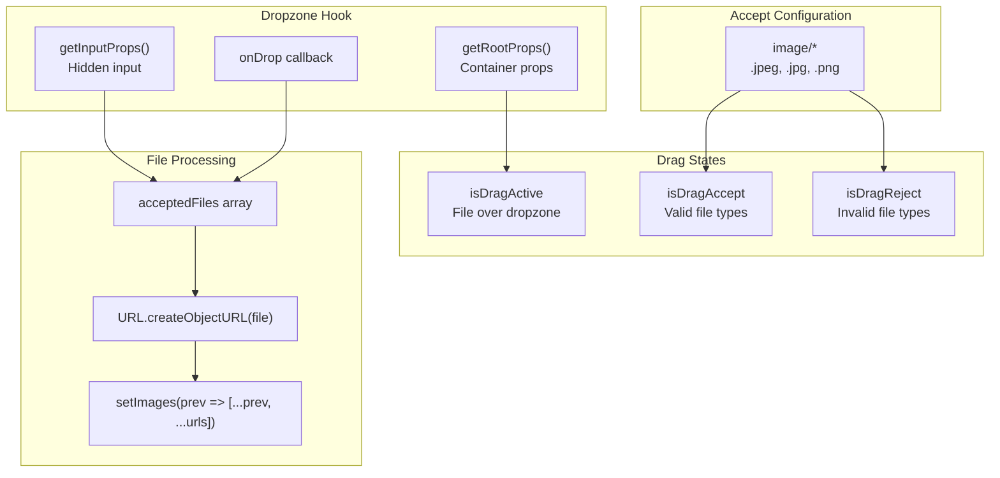
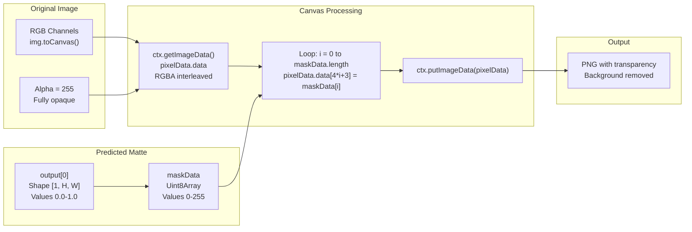
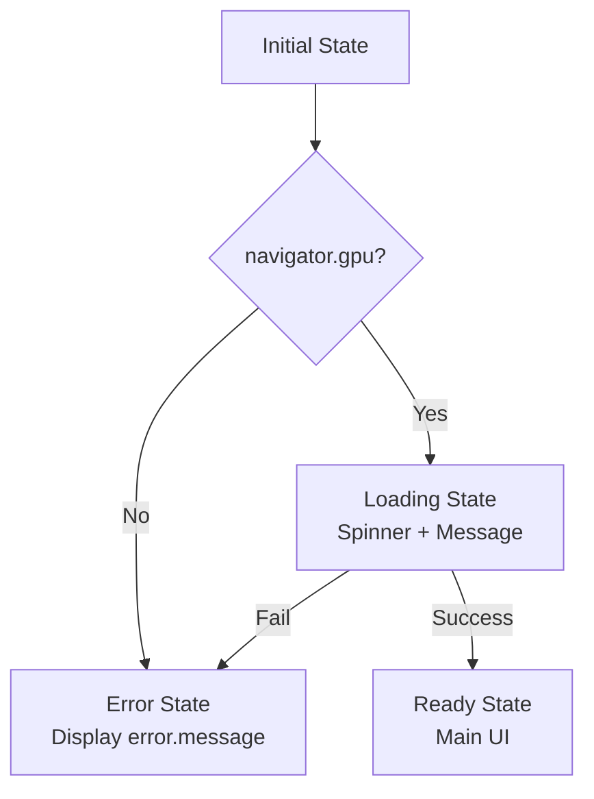

<!-- source: DeepWiki mcp.deepwiki.com · repo huggingface/transformers.js-examples · page 3.2 Image Processing Applications · fetched 2026-10-26 -->

# Image Processing Applications

<details>
<summary>Relevant source files</summary>

The following files were used as context for generating this wiki page:

- [bun/bun.lockb](bun/bun.lockb)
- [bun/package.json](bun/package.json)
- [pglite-semantic-search/package-lock.json](pglite-semantic-search/package-lock.json)
- [pglite-semantic-search/package.json](pglite-semantic-search/package.json)
- [phi-3.5-webgpu/package-lock.json](phi-3.5-webgpu/package-lock.json)
- [phi-3.5-webgpu/package.json](phi-3.5-webgpu/package.json)
- [remove-background-webgpu/README.md](remove-background-webgpu/README.md)
- [remove-background-webgpu/eslint.config.js](remove-background-webgpu/eslint.config.js)
- [remove-background-webgpu/index.html](remove-background-webgpu/index.html)
- [remove-background-webgpu/package-lock.json](remove-background-webgpu/package-lock.json)
- [remove-background-webgpu/package.json](remove-background-webgpu/package.json)
- [remove-background-webgpu/src/App.jsx](remove-background-webgpu/src/App.jsx)
- [remove-background-webgpu/src/main.jsx](remove-background-webgpu/src/main.jsx)
- [smollm-webgpu/package-lock.json](smollm-webgpu/package-lock.json)
- [smollm-webgpu/package.json](smollm-webgpu/package.json)

</details>


This document covers image processing applications in the repository, specifically the background removal example using computer vision models. These applications demonstrate client-side image processing with WebGPU acceleration. For text generation applications, see [Large Language Models](#3.1). For vector search with embeddings, see [Semantic Search and Embeddings](#3.3).

## Overview

The image processing category currently contains the **remove-background-webgpu** application, which performs portrait background removal using the MODNet model. This application runs entirely in the browser with WebGPU acceleration, supporting batch processing and ZIP export without requiring a backend server.

**Sources:** [remove-background-webgpu/README.md:1-56](), [remove-background-webgpu/package.json:1-36]()

## Application Architecture

The remove-background-webgpu application uses a direct model execution pattern, loading the model in the main thread rather than using a Web Worker architecture. This differs from the LLM examples because image processing operations are typically faster and the model size is smaller (~10MB for MODNet).



**Sources:** [remove-background-webgpu/src/App.jsx:1-326](), [remove-background-webgpu/package.json:12-19]()

## Model Loading and Initialization

The application loads the MODNet model and its processor during component initialization using React's `useEffect` hook. Model references are stored in `useRef` to persist across re-renders without triggering updates.



The initialization code sets `env.backends.onnx.wasm.proxy = false` to disable worker-based WASM execution, as the model runs on WebGPU in the main thread.

| Configuration | Value | Purpose |
|--------------|-------|---------|
| Model ID | `Xenova/modnet` | Portrait matting model |
| Device | `webgpu` | Hardware acceleration |
| WASM Proxy | `false` | Disable worker delegation |
| Cache Location | IndexedDB | Browser storage |

**Sources:** [remove-background-webgpu/src/App.jsx:24-41]()

## Image Processing Pipeline

The core processing pipeline converts uploaded images into transparent PNG files by predicting alpha mattes. The process executes synchronously in a loop for batch processing.



**Sources:** [remove-background-webgpu/src/App.jsx:70-117]()

## Component State Management

The application uses React's `useState` hooks to manage application state, avoiding external state management libraries for simplicity.

| State Variable | Type | Purpose |
|---------------|------|---------|
| `images` | `string[]` | Array of blob URLs for uploaded images |
| `processedImages` | `string[]` | Array of data URLs for processed images |
| `isProcessing` | `boolean` | Processing operation in progress flag |
| `isDownloadReady` | `boolean` | Enable ZIP download button |
| `isLoading` | `boolean` | Initial model loading state |
| `error` | `Error | null` | Error state for WebGPU unsupported |

**Sources:** [remove-background-webgpu/src/App.jsx:13-19]()

## File Upload and Dropzone Integration

The application uses `react-dropzone` for drag-and-drop file upload with visual feedback states.



The dropzone configuration restricts uploads to JPEG and PNG image formats. Visual feedback changes border and background colors based on drag state.

**Sources:** [remove-background-webgpu/src/App.jsx:43-61](), [remove-background-webgpu/src/App.jsx:244-259]()

## Alpha Channel Manipulation

The core image processing technique involves manipulating the alpha channel of a canvas element using the predicted alpha matte.



The algorithm iterates through each pixel, replacing the alpha channel value (at index `4*i+3` in the RGBA array) with the corresponding value from the predicted matte.

**Sources:** [remove-background-webgpu/src/App.jsx:94-112]()

## Batch Processing and ZIP Export

The application supports batch processing multiple images and exporting them as a single ZIP archive using `jszip` and `file-saver`.

```mermaid
graph TB
    subgraph "Batch Processing"
        ClickProcess["User clicks Process button"]
        SetProcessing["setIsProcessing(true)"]
        Loop["for i = 0 to images.length"]
        ProcessImage["processImages() pipeline"]
        AppendResult["setProcessedImages(prev => [...prev, dataURL])"]
        Complete["setIsProcessing(false)<br/>setIsDownloadReady(true)"]
    end
    
    subgraph "ZIP Generation"
        ClickDownload["User clicks Download as ZIP"]
        CreateZip["new JSZip()"]
        CreatePromises["images.map() => Promise array"]
        LoadCanvas["Load image to canvas"]
        ToBlob["canvas.toBlob()"]
        AddToZip["zip.file('image-N.png', blob)"]
        AwaitAll["Promise.all(promises)"]
        Generate["zip.generateAsync({type: 'blob'})"]
        Save["saveAs(content, 'images.zip')"]
    end
    
    ClickProcess --> SetProcessing
    SetProcessing --> Loop
    Loop --> ProcessImage
    ProcessImage --> AppendResult
    Loop --> Complete
    
    ClickDownload --> CreateZip
    CreateZip --> CreatePromises
    CreatePromises --> LoadCanvas
    LoadCanvas --> ToBlob
    ToBlob --> AddToZip
    CreatePromises --> AwaitAll
    AwaitAll --> Generate
    Generate --> Save
```



Each image is named sequentially as `image-1.png`, `image-2.png`, etc. The ZIP generation uses promises to handle asynchronous blob creation.

**Sources:** [remove-background-webgpu/src/App.jsx:70-117](), [remove-background-webgpu/src/App.jsx:119-148]()

## Additional Features

### Individual Image Actions

Processed images display hover overlays with action buttons:

| Action | Function | Implementation |
|--------|----------|---------------|
| Copy | `copyToClipboard(url)` | Uses Clipboard API to copy image blob |
| Download | `downloadImage(url)` | Creates temporary `<a>` element with download attribute |
| Remove | `removeImage(index)` | Filters image from both `images` and `processedImages` arrays |

**Sources:** [remove-background-webgpu/src/App.jsx:156-181](), [remove-background-webgpu/src/App.jsx:284-320]()

### Clipboard Integration

The copy functionality converts data URLs to blobs and writes them to the clipboard using the modern Clipboard API:

```javascript
const response = await fetch(url);
const blob = await response.blob();
const clipboardItem = new ClipboardItem({ [blob.type]: blob });
await navigator.clipboard.write([clipboardItem]);
```

**Sources:** [remove-background-webgpu/src/App.jsx:156-172]()

## Error Handling and Loading States

The application handles three distinct UI states:



| State | Condition | UI Display |
|-------|-----------|------------|
| Loading | `isLoading === true` | Spinner animation with "Loading background removal model..." |
| Error | `error !== null` | Error message with "WebGPU is not supported" or other error text |
| Ready | `!isLoading && !error` | Full application UI with dropzone and controls |

**Sources:** [remove-background-webgpu/src/App.jsx:183-203]()

## Dependencies and Build Configuration

The application uses Vite for development and builds, with Tailwind CSS for styling and ESLint for code quality.

| Dependency | Version | Purpose |
|-----------|---------|---------|
| `@huggingface/transformers` | 3.7.1 | ML model execution |
| `react` | ^18.3.1 | UI framework |
| `react-dropzone` | ^14.2.3 | File upload |
| `jszip` | ^3.10.1 | ZIP archive creation |
| `file-saver` | ^2.0.5 | Browser file download |
| `tailwindcss` | ^3.4.10 | Utility-first CSS |
| `vite` | ^6.2.0 | Build tool and dev server |

Build commands:
- `npm run dev` - Start development server on port 5173
- `npm run build` - Production build to `dist/` directory
- `npm run preview` - Preview production build locally

**Sources:** [remove-background-webgpu/package.json:1-36](), [remove-background-webgpu/package-lock.json:1-50]()

## Model Details

### MODNet Architecture

MODNet (Matting Objective Decomposition Network) is a trimap-free portrait matting model optimized for real-time performance. The model used is `Xenova/modnet`, which is the ONNX-converted version hosted on Hugging Face.

| Model Property | Value |
|---------------|-------|
| Model ID | `Xenova/modnet` |
| Task | Image matting / Background removal |
| Input Shape | `[1, 3, H, W]` (RGB image) |
| Output Shape | `[1, 1, H, W]` (Alpha matte) |
| Model Size | ~10 MB |
| Quantization | Not quantized (FP32) |

**Sources:** [remove-background-webgpu/README.md:17-17](), [remove-background-webgpu/src/App.jsx:30-35]()

## Performance Characteristics

The application benefits from WebGPU acceleration for model inference:

- **Model Loading**: First-time download from Hugging Face Hub, subsequent loads from IndexedDB cache
- **Preprocessing**: CPU-based tensor operations using `AutoProcessor`
- **Inference**: WebGPU-accelerated ONNX runtime execution
- **Post-processing**: CPU-based canvas manipulation

The main thread architecture is suitable for MODNet because:
1. Model is small (~10 MB) compared to LLMs (GBs)
2. Inference time is fast (typically <500ms per image on modern GPUs)
3. Processing is batch-oriented rather than interactive

**Sources:** [remove-background-webgpu/src/App.jsx:24-41](), [remove-background-webgpu/src/App.jsx:70-117]()

---

