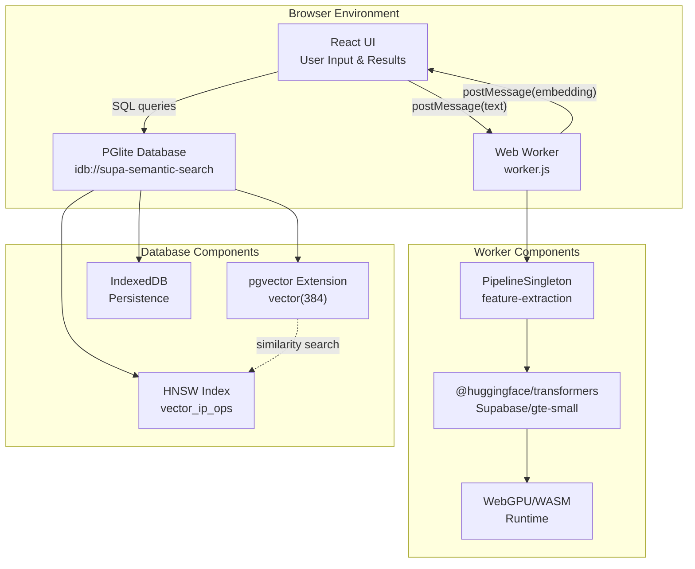
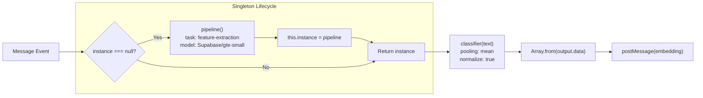
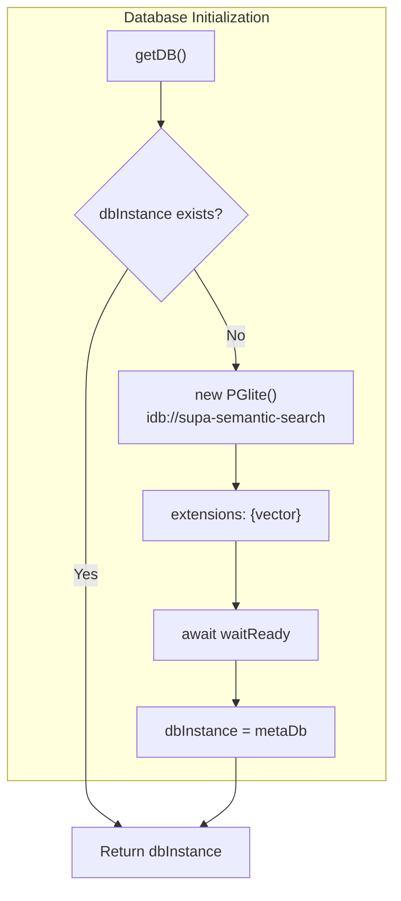
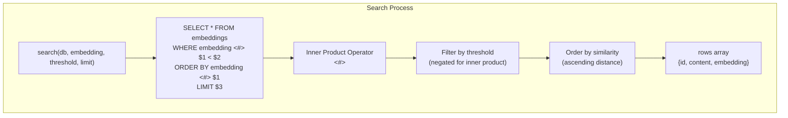
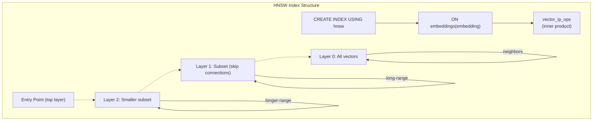

<!-- source: DeepWiki mcp.deepwiki.com · repo huggingface/transformers.js-examples · page 3.3 Semantic Search and Embeddings · fetched 2026-10-26 -->

# Semantic Search and Embeddings

<details>
<summary>Relevant source files</summary>

The following files were used as context for generating this wiki page:

- [README.md](README.md)
- [pglite-semantic-search/README.md](pglite-semantic-search/README.md)
- [pglite-semantic-search/eslint.config.js](pglite-semantic-search/eslint.config.js)
- [pglite-semantic-search/index.html](pglite-semantic-search/index.html)
- [pglite-semantic-search/postcss.config.js](pglite-semantic-search/postcss.config.js)
- [pglite-semantic-search/src/main.jsx](pglite-semantic-search/src/main.jsx)
- [pglite-semantic-search/src/utils/db.js](pglite-semantic-search/src/utils/db.js)
- [pglite-semantic-search/src/worker.js](pglite-semantic-search/src/worker.js)
- [pglite-semantic-search/tailwind.config.js](pglite-semantic-search/tailwind.config.js)
- [pglite-semantic-search/vite.config.js](pglite-semantic-search/vite.config.js)

</details>


## Purpose and Scope

This document covers the **pglite-semantic-search** example, which demonstrates in-browser semantic search capabilities without requiring a backend server. The application combines embedding generation via Transformers.js with vector similarity search using PGlite and the pgvector extension. All computation and data storage occurs entirely within the browser using IndexedDB for persistence.

For information about other machine learning tasks, see [Image Processing Applications](#3.2) and [Speech and Audio Applications](#3.4). For server-side alternatives to in-browser vector search, see [Next.js Integration](#4).

**Sources:** [pglite-semantic-search/README.md:1-18](), [README.md:12]()

---

## Architecture Overview

The semantic search system uses a three-tier architecture: a React-based UI, a Web Worker for embedding generation, and an in-browser PostgreSQL database with vector search capabilities. This design keeps the UI responsive while performing computationally intensive embedding operations.



**Sources:** [pglite-semantic-search/src/worker.js:1-46](), [pglite-semantic-search/src/utils/db.js:1-18]()

---

## Embedding Generation

### PipelineSingleton Pattern

The worker implements a Singleton pattern to ensure the embedding model is loaded only once and reused across requests. The `PipelineSingleton` class manages the lifecycle of the feature extraction pipeline.



**Key Configuration:**
- **Model:** `Supabase/gte-small` - A 384-dimensional embedding model optimized for semantic similarity
- **dtype:** `fp32` - 32-bit floating point precision
- **device:** Automatically selects `webgpu` if available, falls back to `wasm`
- **Pooling:** `mean` - Averages token embeddings to produce sentence embedding
- **Normalize:** `true` - Normalizes embeddings to unit length for cosine similarity

**Sources:** [pglite-semantic-search/src/worker.js:4-19](), [pglite-semantic-search/src/worker.js:22-45]()

### Worker Message Protocol

The worker implements a bidirectional message protocol for embedding generation with progress tracking:

| Direction | Message Type | Content | Purpose |
|-----------|-------------|---------|---------|
| Main → Worker | Request | `{text: string}` | Initiate embedding generation |
| Worker → Main | Progress | `{status, file, progress, loaded, total}` | Model download progress |
| Worker → Main | Complete | `{status: "complete", embedding: number[]}` | Return 384-dimensional embedding array |

**Sources:** [pglite-semantic-search/src/worker.js:22-45]()

---

## Database Schema and Vector Storage

### PGlite Initialization

The database is initialized with PGlite, an in-browser implementation of PostgreSQL that stores data in IndexedDB. The database instance is created as a singleton accessible via `getDB()`.



**Sources:** [pglite-semantic-search/src/utils/db.js:4-18]()

### Embeddings Table Schema

The `initSchema()` function creates the core table structure for storing text content with their vector embeddings:

```sql
create extension if not exists vector;

create table if not exists embeddings (
  id bigint primary key generated always as identity,
  content text not null,
  embedding vector (384)
);

create index on embeddings using hnsw (embedding vector_ip_ops);
```

**Schema Components:**
- **id:** Auto-incrementing primary key
- **content:** Original text content
- **embedding:** 384-dimensional vector matching the output of `Supabase/gte-small`
- **HNSW Index:** Hierarchical Navigable Small World graph index optimized for inner product operations

**Sources:** [pglite-semantic-search/src/utils/db.js:20-32]()

---

## Vector Similarity Search

### Search Function

The `search()` function performs approximate nearest neighbor search using the pgvector extension. It uses inner product as the distance metric, which is mathematically equivalent to cosine similarity for normalized vectors.



**Distance Function Details:**

| Operator | Name | Use Case | Formula |
|----------|------|----------|---------|
| `<#>` | Negative inner product | Normalized vectors (cosine similarity) | `-sum(a[i] * b[i])` |
| `<->` | L2 distance | Euclidean distance | `sqrt(sum((a[i] - b[i])^2))` |
| `<=>` | Cosine distance | Non-normalized vectors | `1 - (a·b)/(‖a‖‖b‖)` |

The implementation uses inner product because:
1. Embeddings are normalized to unit length (`normalize: true`)
2. Inner product is faster to compute than cosine distance
3. For normalized vectors: `cosine_similarity(a,b) = a·b = -(-a·b) = -(a <#> b)`

**Query Parameters:**
- `$1`: Query embedding as JSON string (e.g., `"[0.1, -0.2, ...]"`)
- `$2`: Negative threshold (e.g., `-0.8` for 0.8 similarity)
- `$3`: Maximum number of results

**Sources:** [pglite-semantic-search/src/utils/db.js:39-64]()

### HNSW Index Configuration

The HNSW (Hierarchical Navigable Small World) index provides approximate nearest neighbor search with sub-linear query time:



**Index Characteristics:**
- **Algorithm:** Multi-layer navigable small world graph
- **Complexity:** O(log n) query time on average
- **Operator Class:** `vector_ip_ops` - optimized for inner product distance
- **Trade-off:** Approximate results for fast queries on large datasets

**Sources:** [pglite-semantic-search/src/utils/db.js:30]()

---

## Utility Functions

### Row Counting

The `countRows()` function provides statistics on stored embeddings:

```javascript
const res = await db.query(`SELECT COUNT(*) FROM ${table};`);
return res.rows[0].count;
```

**Sources:** [pglite-semantic-search/src/utils/db.js:34-37]()

### Database Seeding

The `seedDb()` function populates the database with pre-computed embeddings for common objects. Sample data includes embeddings for: Bed, Car, Train, Cat, Dog, Apple, Boat, Mouse, and Chair.

**Seed Data Format:**
```sql
INSERT INTO embeddings (content, embedding) VALUES
  ('Bed', '[embedding_vector_384_dimensions]'),
  ('Car', '[embedding_vector_384_dimensions]'),
  ...
```

This seed data enables immediate testing of semantic search without requiring the user to generate embeddings first.

**Sources:** [pglite-semantic-search/src/utils/db.js:66-78]()

---

## Integration with React UI

### Component Flow

The main application coordinates between the UI, worker, and database:


**Sources:** [pglite-semantic-search/src/main.jsx:1-11](), [pglite-semantic-search/src/utils/db.js:1-78]()

---

## Build Configuration

### Vite Setup

The project uses Vite for development and building, with a special optimization for PGlite:

```javascript
optimizeDeps: {
  exclude: ["@electric-sql/pglite"],
}
```

This exclusion prevents Vite from pre-bundling PGlite, which must be loaded dynamically to function correctly in the browser.

**Sources:** [pglite-semantic-search/vite.config.js:1-11]()

### Styling Configuration

The application uses Tailwind CSS for styling with PostCSS processing:

| Tool | Purpose | Configuration File |
|------|---------|-------------------|
| Tailwind CSS | Utility-first CSS framework | [pglite-semantic-search/tailwind.config.js:1-9]() |
| PostCSS | CSS transformation | [pglite-semantic-search/postcss.config.js:1-6]() |
| Autoprefixer | Vendor prefix addition | Included in PostCSS plugins |

**Sources:** [pglite-semantic-search/tailwind.config.js:1-9](), [pglite-semantic-search/postcss.config.js:1-6]()

---

## Technical Advantages

### Browser-Only Architecture

The application demonstrates several key advantages of client-side semantic search:

| Advantage | Implementation | Benefit |
|-----------|----------------|---------|
| **Privacy** | All data stays in browser | No server sees user queries or documents |
| **Offline Capability** | IndexedDB persistence | Works without internet after initial load |
| **Zero Backend Cost** | Static hosting only | No database or compute infrastructure needed |
| **Instant Response** | Local computation | No network latency for search operations |
| **Scalability** | Client resources | Each user provides their own compute |

**Sources:** [pglite-semantic-search/README.md:14-18]()

### Performance Characteristics

The system provides fast semantic search through several optimizations:

1. **WebGPU Acceleration:** When available, embedding generation uses GPU compute shaders
2. **HNSW Index:** Approximate nearest neighbor search in O(log n) time
3. **Normalized Embeddings:** Inner product reduces to simple dot product
4. **Worker Thread:** Embedding generation doesn't block UI thread
5. **IndexedDB Caching:** PGlite database persists between sessions

**Sources:** [pglite-semantic-search/src/worker.js:11-15](), [pglite-semantic-search/src/utils/db.js:10-17](), [pglite-semantic-search/src/utils/db.js:30]()

---

