<!-- source: DeepWiki mcp.deepwiki.com · repo huggingface/transformers.js-examples · page 3.4 Speech and Audio Applications · fetched 2026-10-26 -->

# Speech and Audio Applications

<details>
<summary>Relevant source files</summary>

The following files were used as context for generating this wiki page:

- [conversational-webgpu/.gitignore](conversational-webgpu/.gitignore)
- [conversational-webgpu/eslint.config.js](conversational-webgpu/eslint.config.js)
- [conversational-webgpu/index.html](conversational-webgpu/index.html)
- [conversational-webgpu/package-lock.json](conversational-webgpu/package-lock.json)
- [conversational-webgpu/package.json](conversational-webgpu/package.json)
- [conversational-webgpu/public/logo.png](conversational-webgpu/public/logo.png)
- [conversational-webgpu/src/App.jsx](conversational-webgpu/src/App.jsx)
- [conversational-webgpu/src/constants.js](conversational-webgpu/src/constants.js)
- [conversational-webgpu/src/index.css](conversational-webgpu/src/index.css)
- [conversational-webgpu/src/main.jsx](conversational-webgpu/src/main.jsx)
- [conversational-webgpu/src/play-worklet.js](conversational-webgpu/src/play-worklet.js)
- [realtime-whisper-webgpu/src/components/AudioVisualizer.jsx](realtime-whisper-webgpu/src/components/AudioVisualizer.jsx)
- [text-to-speech-webgpu/README.md](text-to-speech-webgpu/README.md)
- [text-to-speech-webgpu/eslint.config.js](text-to-speech-webgpu/eslint.config.js)
- [text-to-speech-webgpu/postcss.config.js](text-to-speech-webgpu/postcss.config.js)
- [text-to-speech-webgpu/src/App.jsx](text-to-speech-webgpu/src/App.jsx)
- [text-to-speech-webgpu/src/index.css](text-to-speech-webgpu/src/index.css)
- [text-to-speech-webgpu/src/main.jsx](text-to-speech-webgpu/src/main.jsx)
- [text-to-speech-webgpu/src/worker.js](text-to-speech-webgpu/src/worker.js)
- [text-to-speech-webgpu/tailwind.config.js](text-to-speech-webgpu/tailwind.config.js)
- [text-to-speech-webgpu/vite.config.js](text-to-speech-webgpu/vite.config.js)
- [the-tokenizer-playground/src/worker.js](the-tokenizer-playground/src/worker.js)

</details>


This page documents the speech and audio processing applications in the transformers.js-examples repository. These examples demonstrate real-time voice processing pipelines, including conversational AI, text-to-speech (TTS), and automatic speech recognition (ASR), all running in the browser with WebGPU acceleration.

## Overview

The repository includes three speech and audio applications demonstrating progressively complex voice processing capabilities:

| Application | Purpose | Models Used | Key Features |
|-------------|---------|-------------|--------------|
| **text-to-speech-webgpu** | Text-to-speech generation | OuteTTS-0.2-500M | Multiple voice profiles, WebGPU acceleration |
| **realtime-whisper-webgpu** | Real-time speech transcription | Whisper variants | Live audio visualization, streaming transcription |
| **conversational-webgpu** | Full voice assistant pipeline | Whisper + LLM + Kokoro | VAD, speech-to-text, LLM inference, text-to-speech |

**Application Architecture Overview**

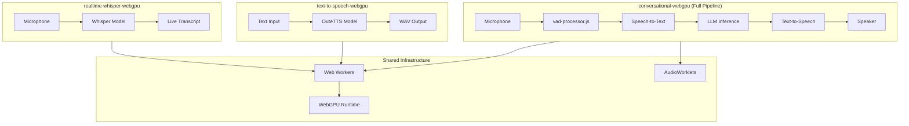

Sources:
- [conversational-webgpu/src/App.jsx:1-386]()
- [text-to-speech-webgpu/src/App.jsx:1-195]()
- [conversational-webgpu/src/constants.js:1-54]()

## Conversational Voice Assistant (conversational-webgpu)

The conversational-webgpu application implements a complete voice assistant pipeline combining speech recognition, language model inference, and speech synthesis. This demonstrates the most complex audio processing architecture in the repository.

### System Architecture

The application orchestrates three distinct audio processing stages using a Web Worker for model inference and AudioWorklets for low-latency audio handling.

**Complete Voice Assistant Pipeline**

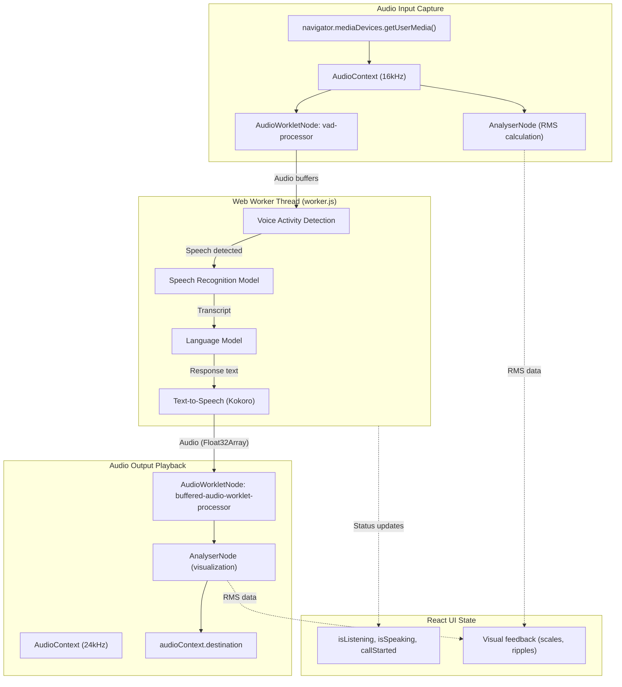

Sources:
- [conversational-webgpu/src/App.jsx:102-221]()
- [conversational-webgpu/src/constants.js:1-54]()
- [conversational-webgpu/package.json:12-19]()

### Voice Activity Detection (VAD)

The application uses a custom AudioWorklet processor for continuous voice activity detection. This runs on a separate audio processing thread to minimize latency.

**VAD Configuration Parameters**

| Parameter | Value | Purpose |
|-----------|-------|---------|
| `INPUT_SAMPLE_RATE` | 16000 Hz | Audio sampling rate for input |
| `SPEECH_THRESHOLD` | 0.3 | Probability threshold for detecting speech |
| `EXIT_THRESHOLD` | 0.1 | Probability threshold for ending speech segment |
| `MIN_SILENCE_DURATION_MS` | 400 ms | Minimum silence before new speech chunk |
| `SPEECH_PAD_MS` | 80 ms | Padding on each side of speech chunk |
| `MIN_SPEECH_DURATION_SAMPLES` | 4000 samples | Minimum speech duration to process (250ms) |
| `MAX_BUFFER_DURATION` | 30 seconds | Maximum audio buffer size for processing |
| `NEW_BUFFER_SIZE` | 512 samples | Size of incoming audio buffers |

Sources:
- [conversational-webgpu/src/constants.js:1-54]()
- [conversational-webgpu/src/App.jsx:140-155]()

### Audio Worklet Processors

The application uses two custom AudioWorklet processors for efficient audio handling.

**VAD Processor Registration**

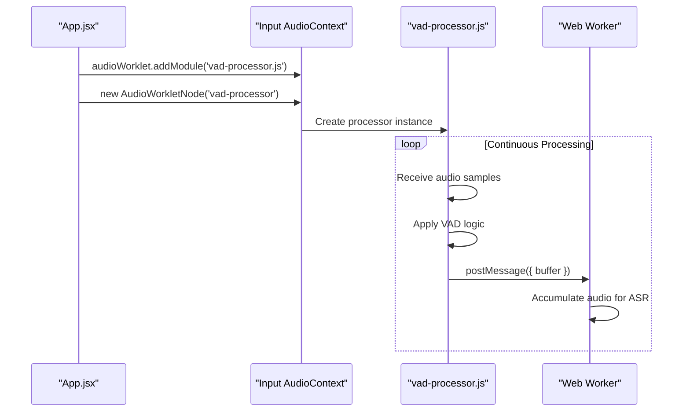

**Buffered Playback Processor**

The playback worklet implements a queue-based buffering system for smooth audio output:

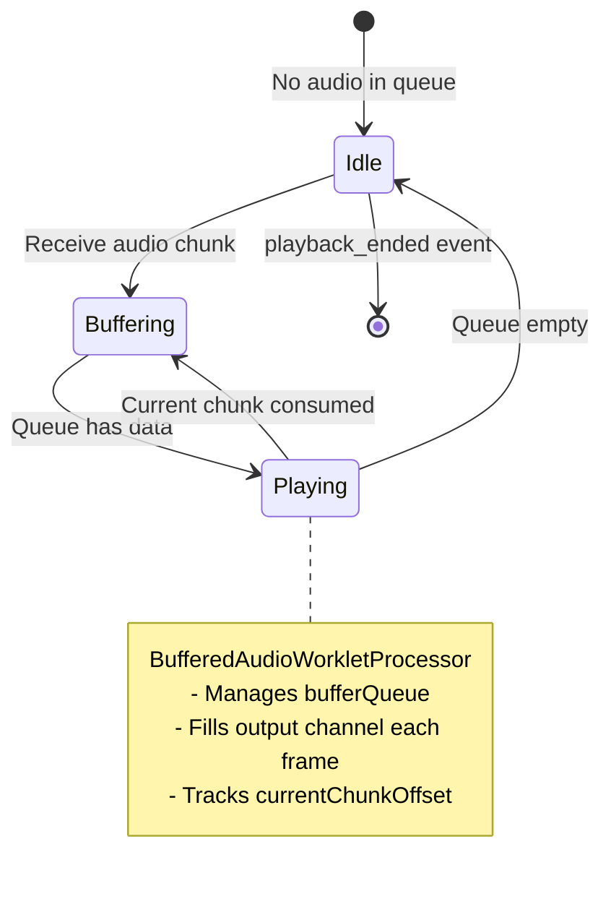

Sources:
- [conversational-webgpu/src/App.jsx:140-155]()
- [conversational-webgpu/src/play-worklet.js:1-74]()

### Dual Audio Context Architecture

The application maintains two separate AudioContext instances with different sample rates optimized for their respective tasks.

**Audio Context Configuration**

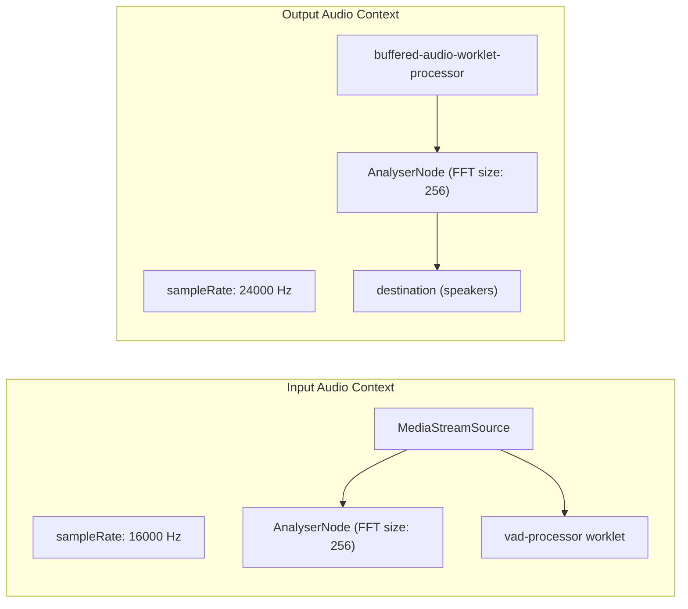

Sources:
- [conversational-webgpu/src/App.jsx:117-160]()
- [conversational-webgpu/src/App.jsx:162-187]()

### Real-time Audio Visualization

The application provides visual feedback through RMS (Root Mean Square) calculations on both input and output audio streams.

**RMS Calculation and Scale Animation**

The visualization system uses requestAnimationFrame to continuously update visual indicators:

1. Calculate RMS from time domain data: `rms = sqrt(sum(normalized^2) / length)`
2. Convert to target scale: `targetScale = 1 + min(1.25 * rms, 0.25)`
3. Apply smoothing: `scale += (targetScale - scale) * 0.25`
4. Update UI with transformed scale values

Sources:
- [conversational-webgpu/src/App.jsx:130-204]()
- [conversational-webgpu/src/App.jsx:192-204]()

### Worker Communication Protocol

The Web Worker uses a message-based protocol for coordination with the main thread.

**Worker Message Types**

| Message Type | Direction | Purpose | Data Fields |
|--------------|-----------|---------|-------------|
| `start_call` | Main → Worker | Initialize conversation session | - |
| `end_call` | Main → Worker | Cleanup conversation state | - |
| `set_voice` | Main → Worker | Change TTS voice | `voice` (speaker ID) |
| `audio` | Main → Worker | Send audio buffer for processing | `buffer` (Float32Array) |
| `playback_ended` | Main → Worker | Signal audio playback complete | - |
| `status` | Worker → Main | Report state changes | `status` ("ready", "recording_start", etc.) |
| `output` | Worker → Main | Return generated audio | `result.audio` (Float32Array) |
| `error` | Worker → Main | Report errors | `error` (error message) |

Sources:
- [conversational-webgpu/src/App.jsx:29-43]()
- [conversational-webgpu/src/App.jsx:64-99]()
- [conversational-webgpu/src/App.jsx:152-155]()
- [conversational-webgpu/src/App.jsx:174-180]()

### State Management

The application manages complex state for coordinating audio input, model processing, and output playback.

**React State Variables**

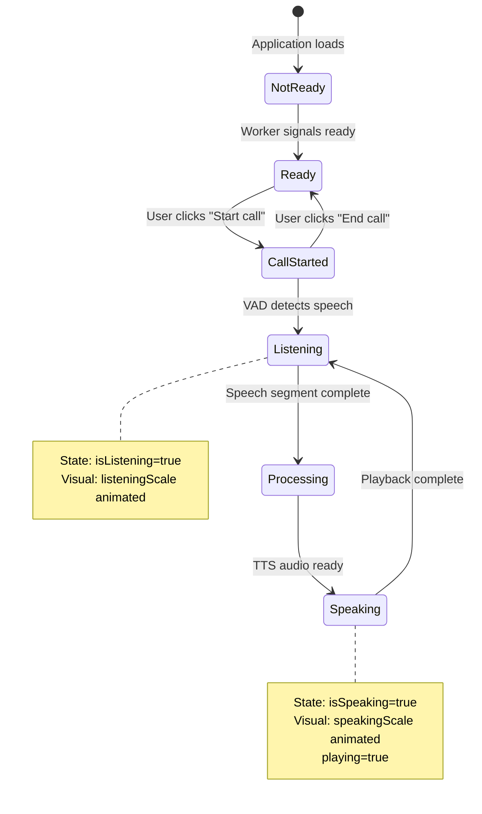

Sources:
- [conversational-webgpu/src/App.jsx:8-28]()
- [conversational-webgpu/src/App.jsx:64-89]()

## Text-to-Speech (text-to-speech-webgpu)

The text-to-speech-webgpu application demonstrates standalone TTS using OuteTTS, an experimental text-to-speech model based on language modeling.

### Architecture

**OuteTTS Worker-Based Architecture**

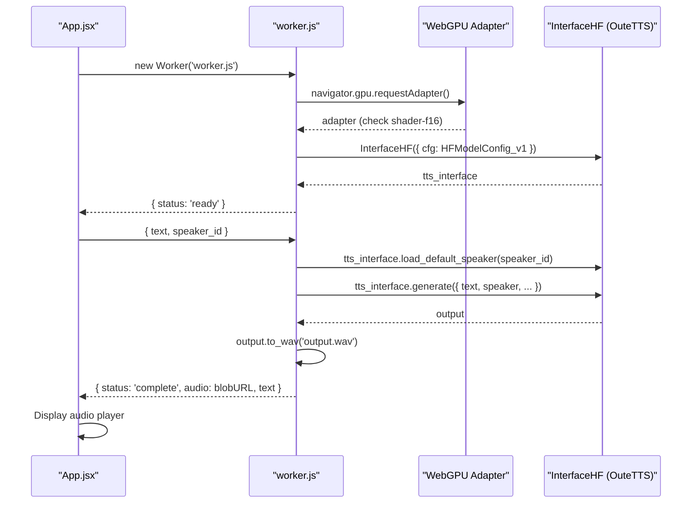

Sources:
- [text-to-speech-webgpu/src/worker.js:1-66]()
- [text-to-speech-webgpu/src/App.jsx:22-67]()

### Model Configuration

The OuteTTS model uses the `HFModelConfig_v1` configuration class from the outetts library.

**Model Configuration Parameters**

| Parameter | Value | Options | Purpose |
|-----------|-------|---------|---------|
| `model_path` | "onnx-community/OuteTTS-0.2-500M" | - | HuggingFace model identifier |
| `language` | "en" | "en", "zh", "ja", "ko" | Output language |
| `dtype` | "q4f16" or "q4" | "fp32", "fp16", "q8", "q4", "q4f16" | Quantization level (based on shader-f16 support) |
| `device` | "webgpu" | "webgpu", "wasm" | Inference backend |

The worker performs WebGPU feature detection to select the optimal quantization:
```
fp16_supported = adapter.features.has("shader-f16")
dtype = fp16_supported ? "q4f16" : "q4"
```

Sources:
- [text-to-speech-webgpu/src/worker.js:3-26]()

### Generation Parameters

When generating speech, the following parameters control output quality:

| Parameter | Value | Effect |
|-----------|-------|--------|
| `temperature` | 0.1 | Lower values produce more stable tone |
| `repetition_penalty` | 1.1 | Reduces repetitive patterns |
| `max_length` | 4096 | Maximum sequence length |
| `speaker` | Profile object or null | Consistent voice characteristics (null = random) |

Sources:
- [text-to-speech-webgpu/src/worker.js:36-56]()

### Speaker Profiles

The application provides seven pre-configured speaker profiles accessible via dropdown:

- male_1, male_2, male_3, male_4
- female_1, female_2
- random (generates with random characteristics)

Sources:
- [text-to-speech-webgpu/src/App.jsx:140-152]()
- [text-to-speech-webgpu/src/worker.js:39-43]()

### User Interface Flow

**Generation Workflow**

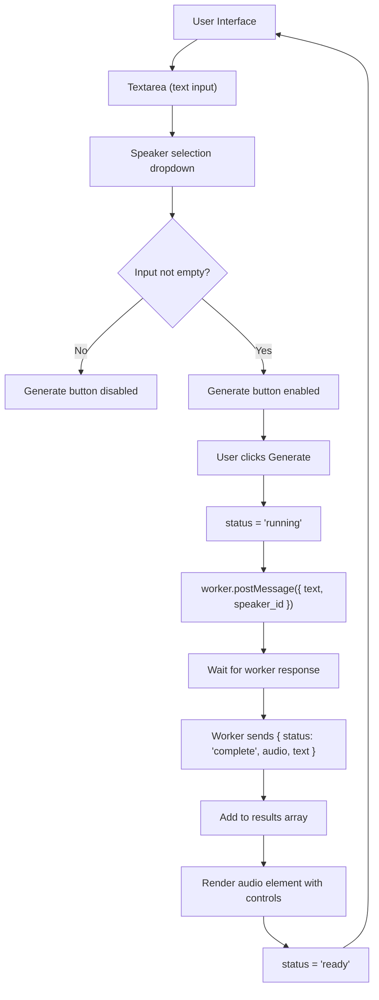

Sources:
- [text-to-speech-webgpu/src/App.jsx:69-78]()
- [text-to-speech-webgpu/src/App.jsx:131-162]()
- [text-to-speech-webgpu/src/App.jsx:164-185]()

## Real-time Speech Recognition (realtime-whisper-webgpu)

The realtime-whisper-webgpu application demonstrates continuous speech recognition using Whisper models with live audio visualization.

### Audio Visualization

The application provides real-time visual feedback of the microphone input using the Web Audio API's AnalyserNode.

**AudioVisualizer Component Architecture**

```mermaid
flowchart LR
    subgraph Visualization["AudioVisualizer.jsx"]
        Stream["MediaStream prop"] --> CreateContext["new AudioContext()"]
        CreateContext --> SourceNode["createMediaStreamSource(stream)"]
        SourceNode --> AnalyserNode["createAnalyser()"]
        AnalyserNode --> Config["fftSize = 2048"]
        Config --> DataArray["new Uint8Array(frequencyBinCount)"]
        DataArray --> Draw["requestAnimationFrame loop"]
    end
    
    subgraph Canvas["Canvas Rendering"]
        Draw --> Clear["fillRect (white background)"]
        Clear --> GetData["getByteTimeDomainData(dataArray)"]
        GetData --> DrawWave["Draw waveform line"]
        DrawWave --> Loop["Loop via requestAnimationFrame"]
        Loop --> Draw
    end
```

**Waveform Drawing Logic:**
1. Get time domain data: `analyser.getByteTimeDomainData(dataArray)`
2. For each sample point:
   - Normalize: `v = dataArray[i] / 128.0`
   - Calculate y position: `y = v * height / 2`
   - Draw line segment to next point
3. Refresh at 60 FPS using `requestAnimationFrame`

Sources:
- [realtime-whisper-webgpu/src/components/AudioVisualizer.jsx:1-59]()

### Web Worker Integration

Similar to other audio applications, realtime-whisper-webgpu uses a Web Worker for ASR model inference to keep the UI responsive during transcription.

**Worker-Based ASR Architecture**

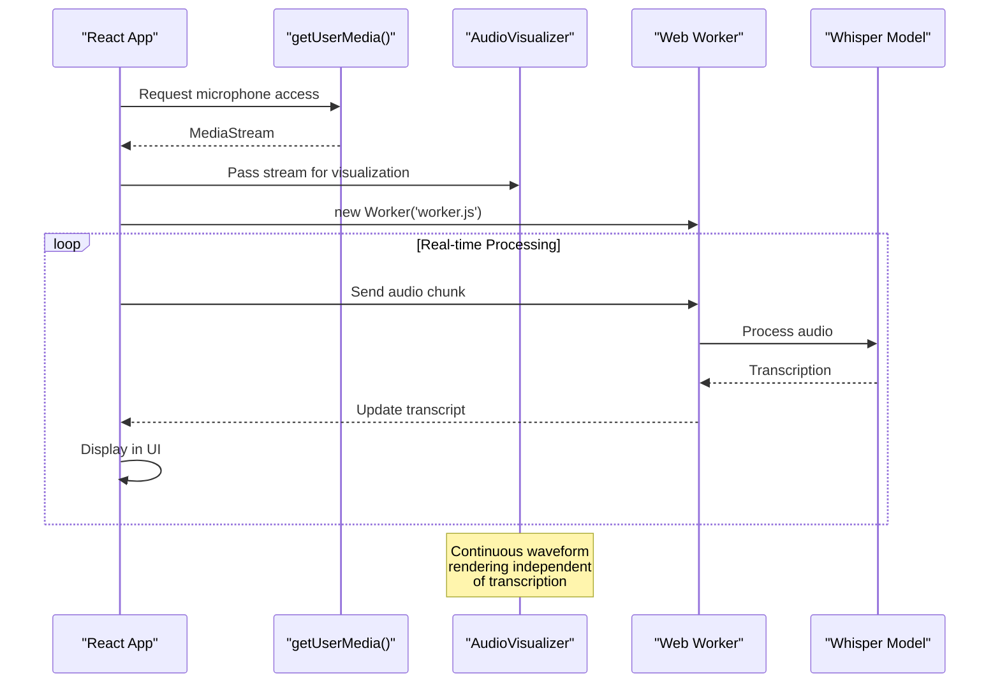

Sources:
- [realtime-whisper-webgpu/src/components/AudioVisualizer.jsx:1-59]()

## Common Implementation Patterns

Across these speech and audio applications, several common implementation patterns emerge:

### Web Worker Architecture

Both browser-based examples (Text-to-Speech WebGPU and Moonshine Web) utilize Web Workers to offload intensive processing from the main UI thread. This pattern is crucial for maintaining responsive user interfaces during model loading and inference.

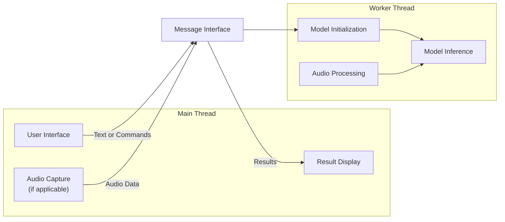

Sources:
- [text-to-speech-webgpu/src/worker.js:1-65]()
- [text-to-speech-webgpu/src/App.jsx:21-78]()
- [moonshine-web/src/App.jsx:18-48]()

### Model Acceleration Strategies

The examples showcase different acceleration strategies:

1. **WebGPU Acceleration**: Used in the browser examples to leverage GPU hardware for faster inference
   - Detects WebGPU support and features (like fp16)
   - Falls back to alternative methods when not available

2. **Quantization**: All examples use model quantization to reduce size and improve performance
   - Different precision levels (fp32, fp16, q4) for different parts of the model
   - Balances accuracy and performance constraints

Sources:
- [text-to-speech-webgpu/src/worker.js:3-18]()
- [whisper-node/index.js:4-9]()

### Audio Processing Techniques

Both ASR examples implement specific audio processing techniques:

1. **Audio Format Normalization**:
   - Converting to appropriate sample rates (16kHz for Whisper)
   - Handling bit depth conversion (32-bit float)
   - Channel processing (mono conversion for speech)

2. **Voice Activity Detection**: For real-time applications, detecting when speech is occurring helps optimize processing and improve transcription quality.

Sources:
- [whisper-node/utils.js:3-25]()
- [moonshine-web/src/App.jsx:50-137]()

## Conclusion

The speech and audio applications in the transformers.js-examples repository demonstrate how to implement both text-to-speech and speech recognition capabilities using Transformers.js. These examples showcase different deployment options (browser vs. Node.js), acceleration techniques, and integration patterns that can be adapted for various use cases.

By leveraging WebGPU acceleration, Web Workers, and efficient models, these examples achieve good performance directly in the browser or in server-side JavaScript environments, making advanced speech AI capabilities more accessible to web developers.

---

