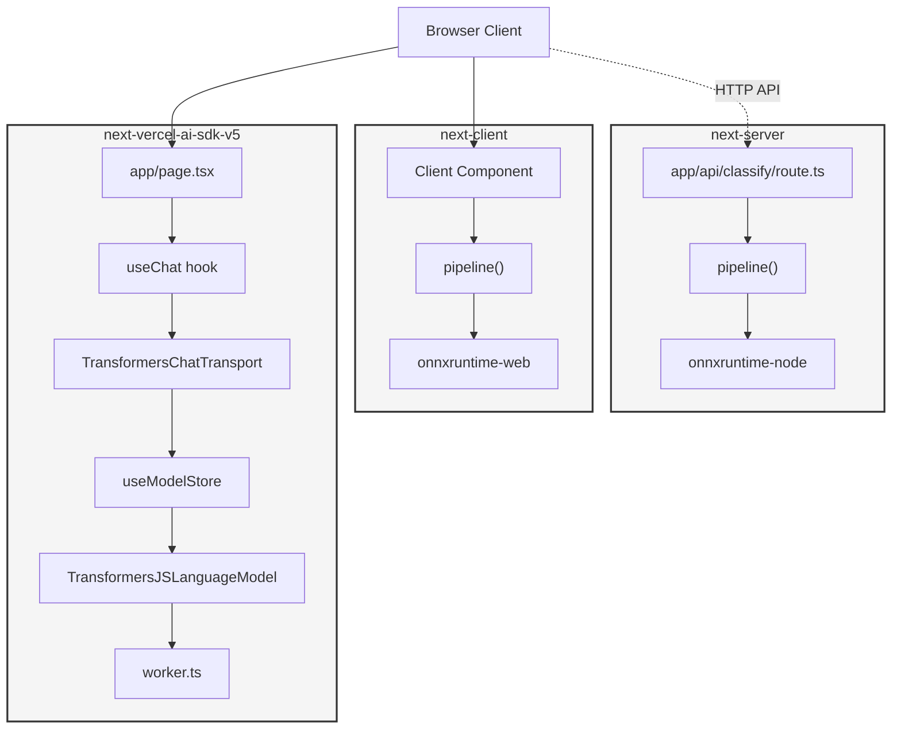
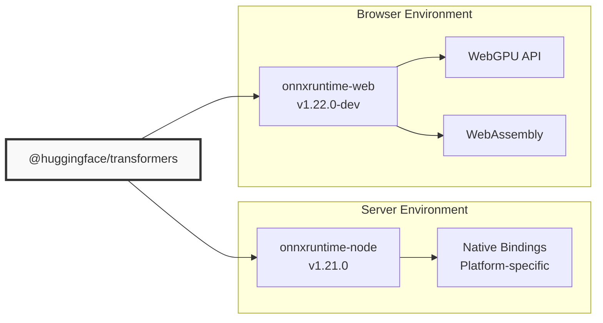
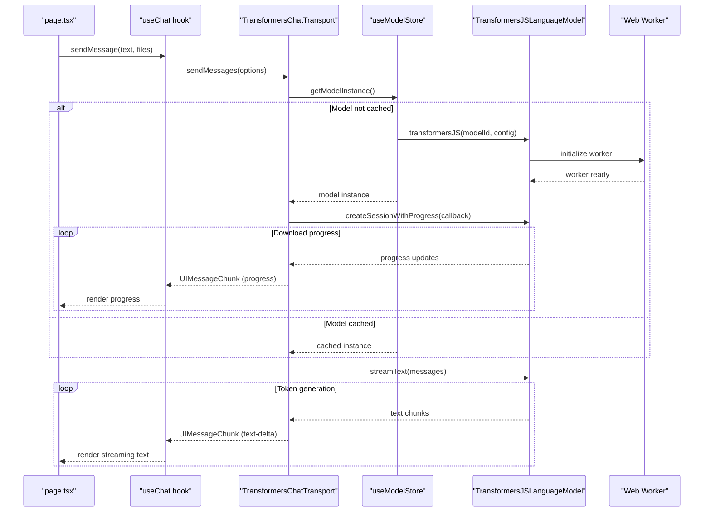
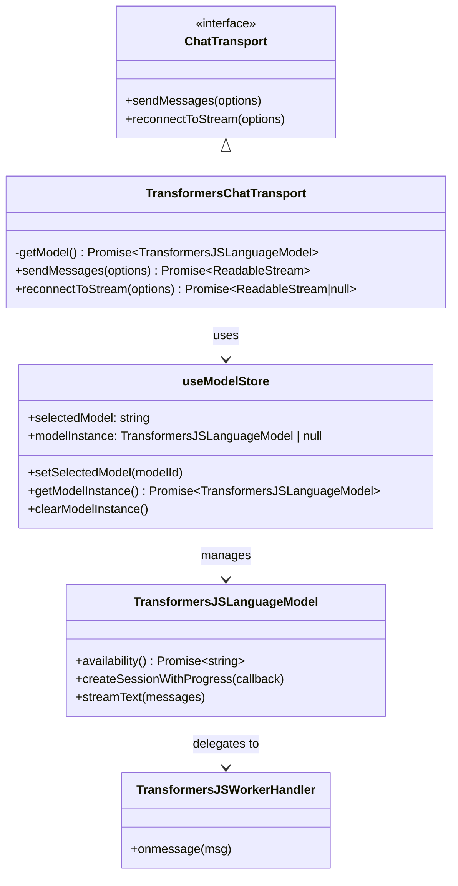
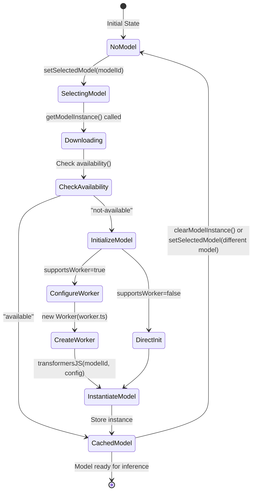
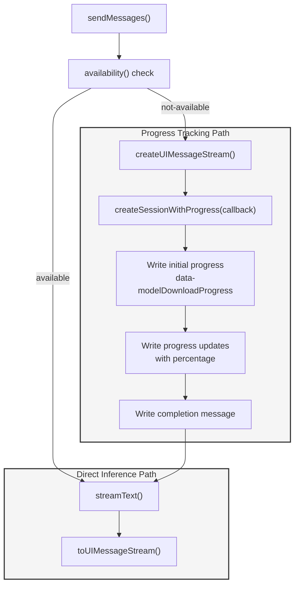
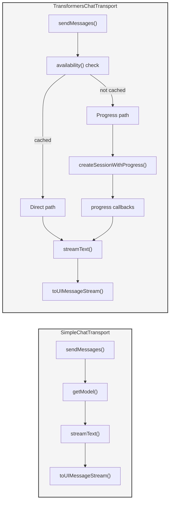
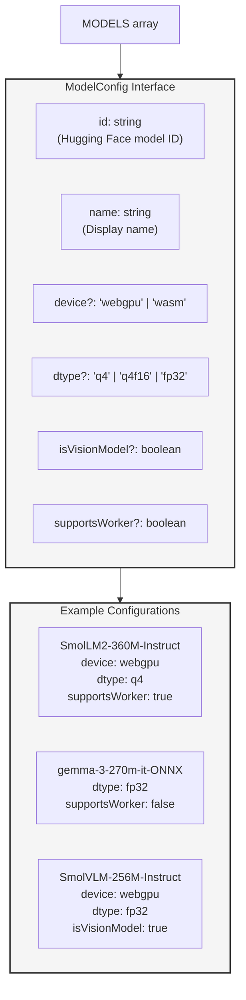
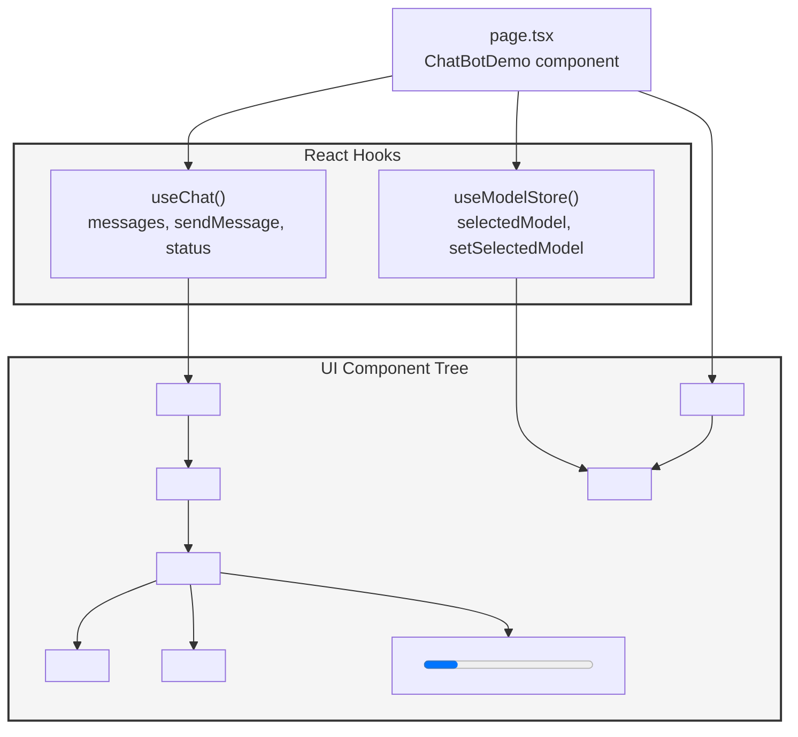

<!-- source: DeepWiki mcp.deepwiki.com · repo huggingface/transformers.js-examples · page 4 Next.js Integration · fetched 2026-10-26 -->

# Next.js Integration

<details>
<summary>Relevant source files</summary>

The following files were used as context for generating this wiki page:

- [next-client/package-lock.json](next-client/package-lock.json)
- [next-client/package.json](next-client/package.json)
- [next-server/package-lock.json](next-server/package-lock.json)
- [next-server/package.json](next-server/package.json)
- [next-vercel-ai-sdk-v5/README.md](next-vercel-ai-sdk-v5/README.md)
- [next-vercel-ai-sdk-v5/package-lock.json](next-vercel-ai-sdk-v5/package-lock.json)
- [next-vercel-ai-sdk-v5/package.json](next-vercel-ai-sdk-v5/package.json)
- [next-vercel-ai-sdk-v5/src/app/chat-transport.ts](next-vercel-ai-sdk-v5/src/app/chat-transport.ts)
- [next-vercel-ai-sdk-v5/src/app/models.ts](next-vercel-ai-sdk-v5/src/app/models.ts)
- [next-vercel-ai-sdk-v5/src/app/page.tsx](next-vercel-ai-sdk-v5/src/app/page.tsx)
- [next-vercel-ai-sdk-v5/src/app/simple-chat-transport.ts](next-vercel-ai-sdk-v5/src/app/simple-chat-transport.ts)
- [next-vercel-ai-sdk-v5/src/app/worker.ts](next-vercel-ai-sdk-v5/src/app/worker.ts)
- [next-vercel-ai-sdk-v5/src/store/store.ts](next-vercel-ai-sdk-v5/src/store/store.ts)

</details>


## Purpose and Scope

This document provides an overview of the Next.js integration patterns available in the transformers.js-examples repository. It covers the architectural approaches for integrating `@huggingface/transformers` with Next.js applications, including server-side inference, client-side inference, and Vercel AI SDK integration patterns.

For detailed implementation of server-side inference using API routes, see [Server-Side Inference](#4.1). For browser-based model execution within Next.js, see [Client-Side Inference](#4.2). For comprehensive integration with Vercel AI SDK including chat interfaces and streaming, see [Vercel AI SDK Integration](#4.3).

---

## Integration Patterns Overview

The repository demonstrates three distinct approaches to integrating Transformers.js with Next.js applications, each optimized for different use cases and deployment scenarios.

### Pattern Comparison

| Pattern | Runtime | ONNX Backend | Use Case | Model Storage |
|---------|---------|--------------|----------|---------------|
| Server-Side | Node.js server | onnxruntime-node | API endpoints, batch processing | Server filesystem (~/.cache/huggingface) |
| Client-Side | Browser | onnxruntime-web | Privacy-focused, offline-capable | Browser IndexedDB |
| AI SDK Hybrid | Both | Both (configurable) | Rich chat UIs, streaming responses | Configurable per model |

**Integration Pattern Architecture**



Sources: [next-server/package.json:1-25](), [next-client/package.json:1-25](), [next-vercel-ai-sdk-v5/package.json:1-59]()

---

## Shared Dependencies

All Next.js examples share the core `@huggingface/transformers` library but differ in their runtime backends and additional dependencies:

### Core Dependencies

- **@huggingface/transformers**: Version 3.7.1-3.8.1 across examples
- **next**: Version ^15.2.4 to 15.4.6
- **react**: Version ^19.0.0 to 19.1.0
- **react-dom**: Matches React version

### Runtime-Specific Backend Selection

The `@huggingface/transformers` library automatically selects the appropriate ONNX Runtime backend based on the execution environment:



Sources: [next-server/package-lock.json:179-190](), [next-vercel-ai-sdk-v5/package-lock.json:358-370]()

---

## Vercel AI SDK Integration Architecture

The `next-vercel-ai-sdk-v5` example demonstrates the most sophisticated integration pattern, bridging Transformers.js with the Vercel AI SDK through a custom transport layer.

### Custom ChatTransport Implementation

The `TransformersChatTransport` class implements the `ChatTransport` interface to enable Vercel AI SDK's `useChat` hook to work with Transformers.js models running in the browser.

**ChatTransport Data Flow**



Sources: [next-vercel-ai-sdk-v5/src/app/chat-transport.ts:1-162](), [next-vercel-ai-sdk-v5/src/app/page.tsx:54-58]()

### Key Components and Their Roles

**TransformersChatTransport Class Structure**



Sources: [next-vercel-ai-sdk-v5/src/app/chat-transport.ts:17-161](), [next-vercel-ai-sdk-v5/src/store/store.ts:1-74](), [next-vercel-ai-sdk-v5/src/app/worker.ts:1-7]()

### Model State Management with Zustand

The `useModelStore` provides centralized model instance management to avoid redundant downloads and initialization:

**State Management Flow**



Sources: [next-vercel-ai-sdk-v5/src/store/store.ts:8-73](), [next-vercel-ai-sdk-v5/src/app/models.ts:1-51]()

### Progress Tracking During Model Downloads

The `TransformersChatTransport.sendMessages()` method implements granular progress tracking for model downloads, providing real-time feedback to the user:

**Progress Tracking Implementation**



Sources: [next-vercel-ai-sdk-v5/src/app/chat-transport.ts:38-52](), [next-vercel-ai-sdk-v5/src/app/chat-transport.ts:54-151]()

The progress callback writes custom `data-modelDownloadProgress` message parts with the following structure:

```typescript
{
  type: "data-modelDownloadProgress",
  id: string,
  data: {
    status: "downloading" | "complete",
    progress: number,  // 0-100
    message: string
  }
}
```

Sources: [next-vercel-ai-sdk-v5/src/app/chat-transport.ts:72-96]()

### Message Part Types and Rendering

The AI SDK integration handles multiple message part types, rendered conditionally in the UI:

| Part Type | Purpose | Rendering Location |
|-----------|---------|-------------------|
| `text` | Standard text content | `<Response>` component |
| `reasoning` | Model reasoning (e.g., DeepSeek) | `<Reasoning>` collapsible |
| `file` | Uploaded images | Image preview |
| `data-modelDownloadProgress` | Download progress | Progress bar |

Sources: [next-vercel-ai-sdk-v5/src/app/page.tsx:157-214]()

### Web Worker Configuration

Models can optionally use Web Workers for inference, configured per model in the `MODELS` array:

```typescript
// From models.ts
{
  id: "HuggingFaceTB/SmolLM2-360M-Instruct",
  name: "SmolLM2 360M",
  device: "webgpu",
  dtype: "q4",
  supportsWorker: true,  // Enable worker for this model
}
```

The store conditionally creates the worker based on `supportsWorker`:

```typescript
const workerConfig = modelConfig.supportsWorker
  ? {
      worker: new Worker(new URL("../app/worker.ts", import.meta.url), {
        type: "module",
      }),
    }
  : {};
```

Sources: [next-vercel-ai-sdk-v5/src/app/models.ts:9-51](), [next-vercel-ai-sdk-v5/src/store/store.ts:47-54]()

---

## Simplified ChatTransport Alternative

The repository includes a simplified version of the ChatTransport without progress tracking in `simple-chat-transport.ts`. This version is useful for understanding the minimal requirements:

**Comparison: Full vs Simplified Transport**



Sources: [next-vercel-ai-sdk-v5/src/app/simple-chat-transport.ts:1-61](), [next-vercel-ai-sdk-v5/src/app/chat-transport.ts:1-162]()

---

## Reasoning Extraction Middleware

The AI SDK integration uses `extractReasoningMiddleware` to parse and separate reasoning content from model output:

```typescript
wrapLanguageModel({
  model,
  middleware: extractReasoningMiddleware({
    tagName: "think",
  }),
})
```

This middleware extracts content within `<think>` tags from models like DeepSeek-R1, creating separate `reasoning` message parts that are rendered in a collapsible UI component.

Sources: [next-vercel-ai-sdk-v5/src/app/chat-transport.ts:42-46](), [next-vercel-ai-sdk-v5/src/app/page.tsx:199-211]()

---

## Model Configuration System

The `MODELS` array in `models.ts` defines available models and their configurations:

**Model Configuration Structure**



Sources: [next-vercel-ai-sdk-v5/src/app/models.ts:3-51]()

The configuration controls:
- **device**: Hardware acceleration preference (WebGPU vs WebAssembly)
- **dtype**: Model quantization level affecting size and performance
- **isVisionModel**: Enables image input processing
- **supportsWorker**: Determines whether to offload to Web Worker

---

## UI Component Integration

The main page component demonstrates comprehensive integration with the AI SDK:

**Component Hierarchy and Data Flow**



Sources: [next-vercel-ai-sdk-v5/src/app/page.tsx:48-360]()

### Key Event Handlers

| Handler | Purpose | Implementation |
|---------|---------|----------------|
| `handleSubmit` | Send message with text/files | [page.tsx:60-74]() |
| `handleFileChange` | Process image uploads | [page.tsx:76-80]() |
| `removeImage` | Remove uploaded image | [page.tsx:82-96]() |
| `handleSuggestionClick` | Click suggestion chip | [page.tsx:98-100]() |
| `copyMessageToClipboard` | Copy assistant response | [page.tsx:102-109]() |

---

## Build Configuration and Deployment

### Standalone Build Mode

Next.js 15 standalone mode creates self-contained builds suitable for containerized deployments:

```json
// next.config.js configuration (inferred from build output)
{
  "output": "standalone"
}
```

The standalone build includes:
- All dependencies bundled
- Node.js server files
- Static assets
- Optimized for Docker/container deployment

Sources: [next-server/package-lock.json:1-25]() (implied by Next.js 15.2.4 capabilities)

### Development vs Production

| Mode | Command | Features |
|------|---------|----------|
| Development | `npm run dev --turbopack` | Fast refresh, Turbopack bundler, source maps |
| Production | `npm run build && npm run start` | Optimized bundles, tree shaking, minification |

Sources: [next-server/package.json:5-9](), [next-vercel-ai-sdk-v5/package.json:5-9]()

---

## Cross-Cutting Concerns

### Error Handling in ChatTransport

The transport implements try-catch error handling with custom notification message parts:

```typescript
catch (error) {
  writer.write({
    type: "data-notification",
    data: {
      message: `Error: ${error instanceof Error ? error.message : "Unknown error"}`,
      level: "error",
    },
    transient: true,
  });
  throw error;
}
```

Sources: [next-vercel-ai-sdk-v5/src/app/chat-transport.ts:138-148]()

### Abort Signal Support

All transport implementations support request cancellation through AbortSignal:

```typescript
const result = streamText({
  model: wrapLanguageModel({ model, middleware }),
  messages: prompt,
  abortSignal: abortSignal,  // Passed from useChat hook
});
```

Sources: [next-vercel-ai-sdk-v5/src/app/chat-transport.ts:39-50]()

### Model Caching Strategy

Models are cached at two levels:
1. **Store level**: In-memory `modelInstance` in Zustand store
2. **Browser level**: ONNX model files cached in IndexedDB by onnxruntime-web

The `availability()` check determines if a model needs downloading:

```typescript
const availability = await model.availability();
if (availability === "available") {
  // Skip progress tracking, model is ready
}
```

Sources: [next-vercel-ai-sdk-v5/src/app/chat-transport.ts:38-52]()

---

## TypeScript Type Integration

### TransformersUIMessage Type

The AI SDK integration uses custom message types from `@browser-ai/transformers-js`:

```typescript
import { TransformersUIMessage } from "@browser-ai/transformers-js";

const { messages, sendMessage, status, stop, regenerate } =
  useChat<TransformersUIMessage>({
    transport: new TransformersChatTransport(),
    experimental_throttle: 75,
  });
```

This provides type safety for message parts including custom data types like `data-modelDownloadProgress`.

Sources: [next-vercel-ai-sdk-v5/src/app/page.tsx:32-58]()

### ChatRequestOptions Extension

The transport's `sendMessages` method signature extends `ChatRequestOptions` to support additional metadata:

```typescript
async sendMessages(
  options: {
    chatId: string;
    messages: TransformersUIMessage[];
    abortSignal: AbortSignal | undefined;
  } & {
    trigger: "submit-message" | "submit-tool-result" | "regenerate-message";
    messageId: string | undefined;
  } & ChatRequestOptions,
): Promise<ReadableStream<UIMessageChunk>>
```

Sources: [next-vercel-ai-sdk-v5/src/app/chat-transport.ts:22-31]()

---

## Performance Considerations

### Throttling Configuration

The `useChat` hook is configured with throttling to reduce render frequency during streaming:

```typescript
useChat<TransformersUIMessage>({
  transport: new TransformersChatTransport(),
  experimental_throttle: 75,  // 75ms between updates
});
```

This prevents excessive re-renders while maintaining responsive UI updates.

Sources: [next-vercel-ai-sdk-v5/src/app/page.tsx:54-58]()

### Worker vs Main Thread Execution

The decision to use Web Workers is model-specific:

- **Worker execution**: Better for larger models (>500MB), prevents UI blocking
- **Main thread**: Simpler for small models (<100MB), avoids worker overhead

The `supportsWorker` flag in model configuration controls this behavior.

Sources: [next-vercel-ai-sdk-v5/src/app/models.ts:9-51](), [next-vercel-ai-sdk-v5/src/store/store.ts:47-59]()

---

