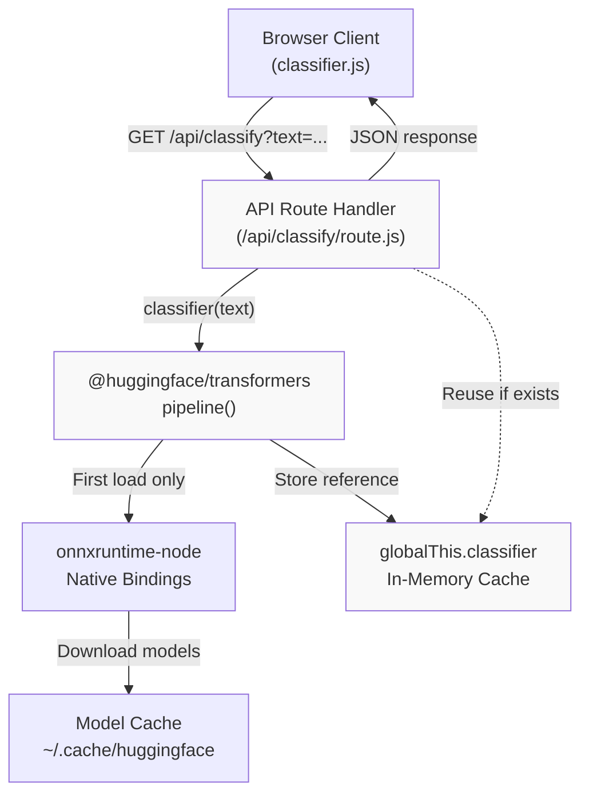
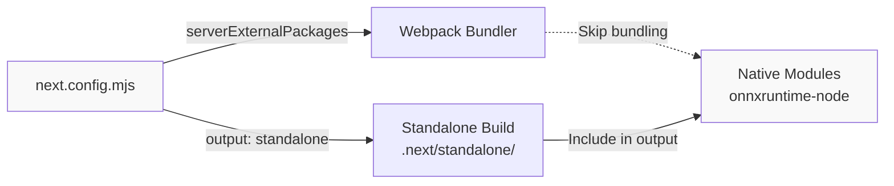
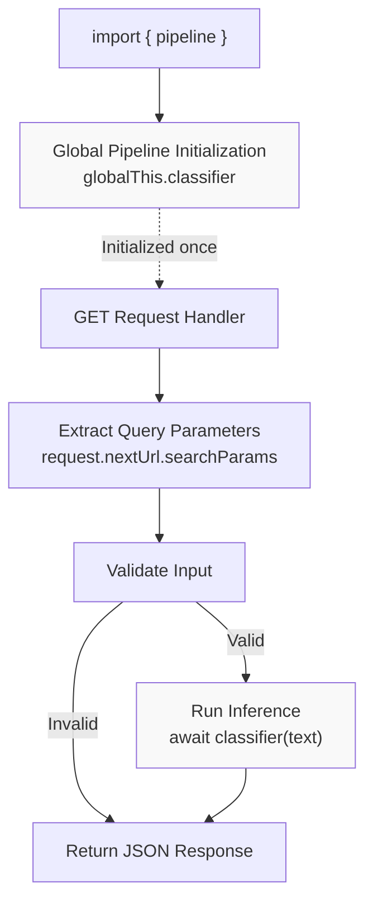
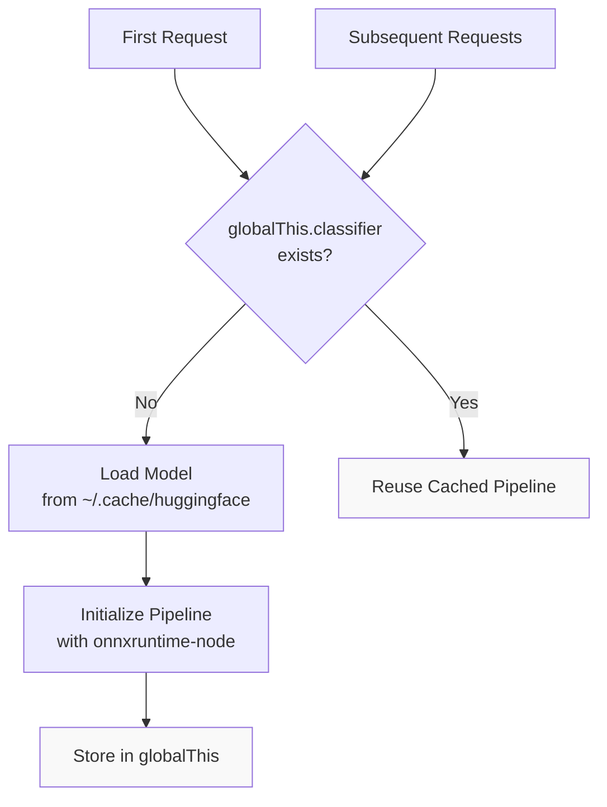
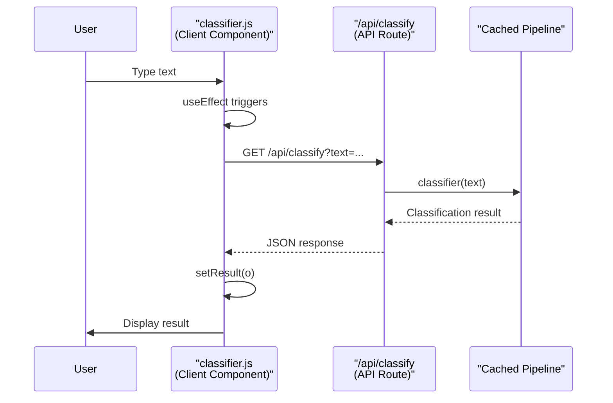
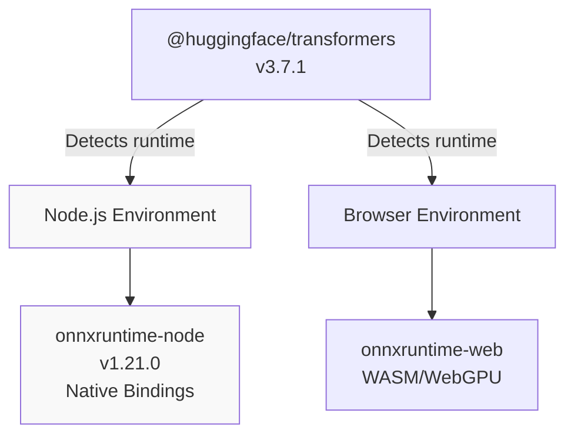
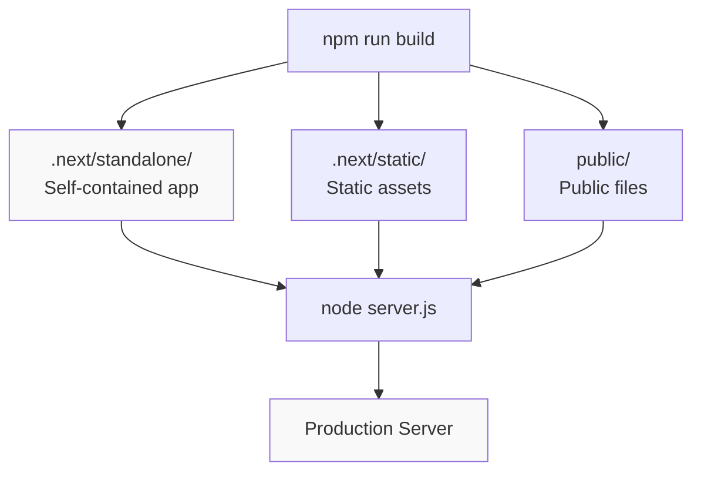
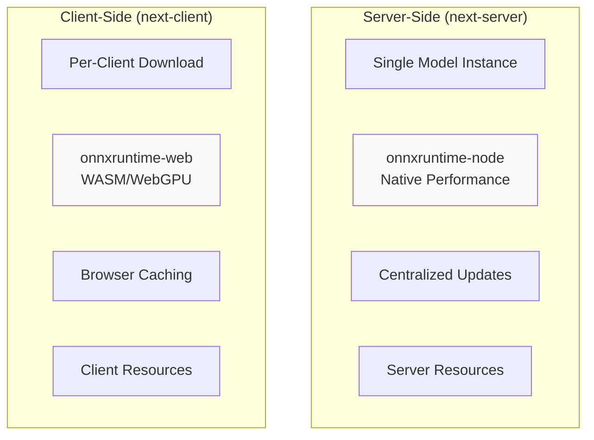
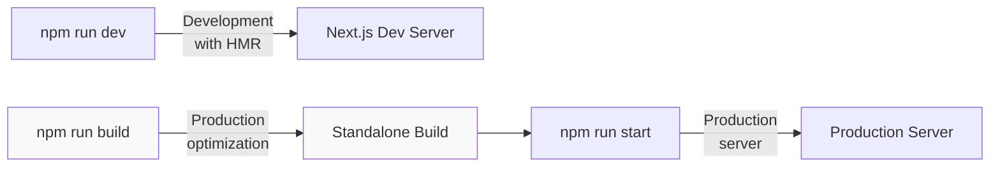

<!-- source: DeepWiki mcp.deepwiki.com · repo huggingface/transformers.js-examples · page 4.1 Server-Side Inference · fetched 2026-10-26 -->

# Server-Side Inference

<details>
<summary>Relevant source files</summary>

The following files were used as context for generating this wiki page:

- [next-client/next.config.mjs](next-client/next.config.mjs)
- [next-client/package-lock.json](next-client/package-lock.json)
- [next-client/package.json](next-client/package.json)
- [next-server/app/api/classify/route.js](next-server/app/api/classify/route.js)
- [next-server/app/classifier.js](next-server/app/classifier.js)
- [next-server/app/favicon.ico](next-server/app/favicon.ico)
- [next-server/app/page.js](next-server/app/page.js)
- [next-server/next.config.mjs](next-server/next.config.mjs)
- [next-server/package-lock.json](next-server/package-lock.json)
- [next-server/package.json](next-server/package.json)
- [next-server/public/github.svg](next-server/public/github.svg)
- [next-server/public/hf-logo.svg](next-server/public/hf-logo.svg)

</details>


## Purpose and Scope

This document covers the `next-server` example, which demonstrates how to run Transformers.js models in Next.js API routes for server-side inference. Models execute on the Node.js runtime using `onnxruntime-node` with native bindings, providing better performance and resource control compared to browser-based execution.

For client-side inference in Next.js, see [Client-Side Inference](#4.2). For integration with Vercel AI SDK, see [Vercel AI SDK Integration](#4.3). For general Node.js usage patterns, see [Node.js Applications](#5.1).

**Sources:** [next-server/package.json:1-25](), [next-server/next.config.mjs:1-10](), [next-server/app/api/classify/route.js:1-21]()

---

## Architecture Overview

The server-side inference pattern executes models in Next.js API Routes, keeping computation on the server and exposing results via HTTP endpoints. This architecture is optimal for resource-intensive models, privacy-sensitive applications, or scenarios requiring centralized model management.



**Diagram: Request Flow and Model Caching Architecture**

The architecture implements two layers of caching: persistent filesystem cache for ONNX models and in-memory cache for the pipeline instance. This dual-layer approach eliminates model reloading overhead across requests.

**Sources:** [next-server/app/api/classify/route.js:1-21](), [next-server/app/classifier.js:1-33](), [next-server/package-lock.json:184-203]()

---

## Configuration

### Next.js Configuration

The `next.config.mjs` file requires two critical settings for server-side inference:

| Configuration Key | Value | Purpose |
|-------------------|-------|---------|
| `output` | `"standalone"` | Generates self-contained build with all dependencies, suitable for Docker deployment |
| `serverExternalPackages` | `["@huggingface/transformers"]` | Excludes Transformers.js from webpack bundling, allowing native module resolution |



**Diagram: Next.js Build Configuration**

The `serverExternalPackages` configuration is essential because `onnxruntime-node` contains platform-specific native binaries that cannot be webpack-bundled. The `standalone` output mode ensures these dependencies are correctly included in deployment artifacts.

**Sources:** [next-server/next.config.mjs:1-10](), [next-server/package-lock.json:179-203]()

### Dependency Configuration

The project requires these core dependencies:

| Package | Version | Runtime |
|---------|---------|---------|
| `@huggingface/transformers` | 3.7.1 | Both |
| `onnxruntime-node` | 1.21.0 | Server |
| `next` | ^15.2.4 | Both |

The `onnxruntime-node` package is automatically included as a dependency of `@huggingface/transformers` and provides native bindings for ONNX Runtime, enabling optimized inference on server hardware.

**Sources:** [next-server/package.json:11-15](), [next-server/package-lock.json:179-203]()

---

## API Route Implementation

### Route Handler Structure

The API route at [next-server/app/api/classify/route.js:1-21]() demonstrates the standard pattern for server-side inference:



**Diagram: API Route Handler Flow**

The route handler implements these key patterns:

1. **Module-level initialization**: Pipeline creation occurs at module load time ([next-server/app/api/classify/route.js:6-9]()), not per-request
2. **Global caching**: Uses `globalThis.classifier` to persist the pipeline instance across requests
3. **Request validation**: Checks for required parameters before inference ([next-server/app/api/classify/route.js:14-16]())
4. **Async/await pattern**: Handles model inference with proper async flow

**Sources:** [next-server/app/api/classify/route.js:1-21]()

### Model Loading and Caching



**Diagram: Model Caching Strategy**

The caching implementation uses the nullish coalescing assignment operator:

```javascript
const classifier = (globalThis.classifier ??= await pipeline(
  "text-classification",
  "Xenova/distilbert-base-uncased-finetuned-sst-2-english",
));
```

This pattern ensures the pipeline initializes only once per Node.js process, avoiding expensive model reloading on each request. During development with hot reloading, models persist across file changes but reload when the process restarts.

**Sources:** [next-server/app/api/classify/route.js:6-9]()

---

## Client-Server Communication

### Client Component Pattern

The client component at [next-server/app/classifier.js:1-33]() demonstrates the standard fetch pattern:



**Diagram: Client-Server Interaction Sequence**

The client component implements React's `useEffect` hook to trigger API calls on text changes ([next-server/app/classifier.js:9-17]()), creating a reactive interface that updates results as the user types.

**Sources:** [next-server/app/classifier.js:1-33]()

### Request/Response Format

| Direction | Format | Example |
|-----------|--------|---------|
| Request | Query string | `GET /api/classify?text=I%20love%20Transformers.js!` |
| Response | JSON | `{"label": "POSITIVE", "score": 0.9998}` |
| Error | JSON | `{"message": "No text provided"}` with 400 status |

The API route uses Next.js's `Response.json()` method for serialization ([next-server/app/api/classify/route.js:15,19]()), ensuring consistent JSON formatting and proper content-type headers.

**Sources:** [next-server/app/api/classify/route.js:11-20](), [next-server/app/classifier.js:10-16]()

---

## Runtime Architecture

### Backend Selection



**Diagram: ONNX Runtime Backend Selection**

Transformers.js automatically selects `onnxruntime-node` when executing in Node.js environments. This backend provides:

- **Native performance**: Direct CPU/GPU access through compiled bindings
- **Multi-threading**: Parallel execution across available cores
- **Memory efficiency**: Lower overhead than WASM-based execution
- **Platform-specific optimization**: Tailored binaries for each OS/architecture

**Sources:** [next-server/package-lock.json:179-203]()

### Model Storage

Models are cached in the filesystem at `~/.cache/huggingface` on first load. This cache is shared across all Node.js applications using Transformers.js on the same system, reducing redundant downloads.

**Sources:** [next-server/package-lock.json:179-203]()

---

## Deployment Considerations

### Standalone Build

The `output: "standalone"` configuration generates a complete deployment artifact at `.next/standalone/`:



**Diagram: Standalone Build Output Structure**

The standalone build includes all dependencies (including `onnxruntime-node` native binaries) in a single directory, enabling straightforward containerization:

```dockerfile
COPY .next/standalone ./
COPY .next/static ./.next/static
COPY public ./public
CMD ["node", "server.js"]
```

**Sources:** [next-server/next.config.mjs:3-4]()

### Environment Requirements

| Requirement | Details |
|-------------|---------|
| Node.js | Version 18.17.0 or higher |
| Architecture | Match native binaries (x64, arm64, etc.) |
| Storage | Sufficient space for model cache (~100MB-2GB per model) |
| Memory | Minimum 512MB, recommended 2GB+ for larger models |

**Sources:** [next-server/package-lock.json:179-203]()

### Container Deployment

When deploying in containers, ensure the base image architecture matches the target deployment platform. The `onnxruntime-node` package includes platform-specific binaries that must match the runtime environment:

- **Linux x64**: `@img/sharp-linux-x64`, native ONNX Runtime bindings
- **Linux ARM64**: `@img/sharp-linux-arm64`, native ONNX Runtime bindings
- **macOS x64**: `@img/sharp-darwin-x64`, native ONNX Runtime bindings
- **macOS ARM64**: `@img/sharp-darwin-arm64`, native ONNX Runtime bindings

**Sources:** [next-server/package-lock.json:429-450]()

---

## Performance Characteristics

### Cold Start vs. Warm Requests

| Metric | Cold Start | Warm Request |
|--------|-----------|--------------|
| Model loading | ~2-5 seconds | 0ms (cached) |
| Inference time | + inference | ~50-200ms (model-dependent) |
| Memory overhead | Full model size | Minimal |

The global caching strategy eliminates model loading overhead for all requests after the first, making the pattern suitable for production APIs with sustained traffic.

**Sources:** [next-server/app/api/classify/route.js:6-9]()

### Comparison with Client-Side Inference



**Diagram: Server-Side vs. Client-Side Trade-offs**

| Aspect | Server-Side | Client-Side |
|--------|-------------|-------------|
| Model download | Once per server | Once per client |
| Processing power | Server hardware | Client device |
| Latency | Network + inference | Inference only (after load) |
| Privacy | Data sent to server | Data stays local |
| Scalability | Vertical (server resources) | Horizontal (client devices) |
| Update control | Immediate, centralized | Requires cache invalidation |

**Sources:** [next-server/app/api/classify/route.js:1-21](), [next-client/package.json:1-25]()

---

## Example Use Cases

### Text Classification Endpoint

The reference implementation demonstrates sentiment analysis:

- **Model**: `Xenova/distilbert-base-uncased-finetuned-sst-2-english`
- **Task**: Binary sentiment classification (POSITIVE/NEGATIVE)
- **Input**: URL query parameter `text`
- **Output**: JSON object with `label` and `score` fields

**Sources:** [next-server/app/api/classify/route.js:8-9]()

### Extending to Other Tasks

The same pattern applies to any pipeline-supported task:

| Task | Pipeline Type | Typical Model |
|------|---------------|---------------|
| Translation | `translation` | `Xenova/nllb-200-distilled-600M` |
| Summarization | `summarization` | `Xenova/distilbart-cnn-6-6` |
| Question Answering | `question-answering` | `Xenova/distilbert-base-cased-distilled-squad` |
| Feature Extraction | `feature-extraction` | `Xenova/all-MiniLM-L6-v2` |
| Image Classification | `image-classification` | `Xenova/vit-base-patch16-224` |

Each task requires only changing the pipeline type and model identifier in the route handler initialization.

**Sources:** [next-server/app/api/classify/route.js:6-9]()

---

## Development Workflow

### Local Development

The development server (`npm run dev`) supports hot module reloading while preserving the cached pipeline instance via `globalThis`. Changes to the route handler code reload the module, but the model remains in memory if the process continues running.

**Sources:** [next-server/package.json:6]()

### Build Process



**Diagram: Development to Production Pipeline**

The build process compiles the application, generates the standalone output, and prepares static assets for production deployment.

**Sources:** [next-server/package.json:6-9]()

---

## Error Handling and Validation

### Input Validation

The route handler implements basic validation to ensure the `text` parameter exists before attempting inference:

```javascript
if (!text) {
  return Response.json({ message: "No text provided" }, { status: 400 });
}
```

This pattern returns a 400 Bad Request status with a descriptive error message when validation fails.

**Sources:** [next-server/app/api/classify/route.js:14-16]()

### Common Error Scenarios

| Error Type | Cause | Resolution |
|------------|-------|------------|
| Module loading errors | Missing `serverExternalPackages` config | Add to `next.config.mjs` |
| Model download failures | Network issues, invalid model ID | Check connectivity, verify model name |
| Memory errors | Insufficient RAM for model | Increase server memory allocation |
| Native binding errors | Architecture mismatch | Rebuild dependencies for target platform |

**Sources:** [next-server/next.config.mjs:6](), [next-server/app/api/classify/route.js:1-21]()

---

## Security Considerations

### Input Sanitization

While the example performs basic validation, production implementations should include:

- Rate limiting to prevent abuse
- Input length restrictions to prevent memory exhaustion
- Content filtering for inappropriate inputs
- Request authentication/authorization

**Sources:** [next-server/app/api/classify/route.js:14-16]()

### Model Security

Server-side execution provides control over model selection and updates, preventing client-side model tampering. However, ensure models are downloaded from trusted sources and verify checksums when possible.

**Sources:** [next-server/app/api/classify/route.js:6-9]()

---

