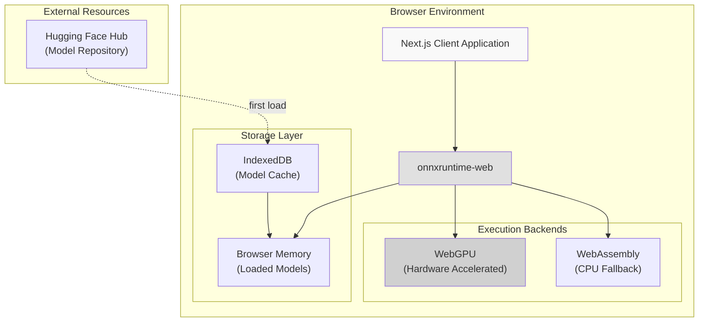
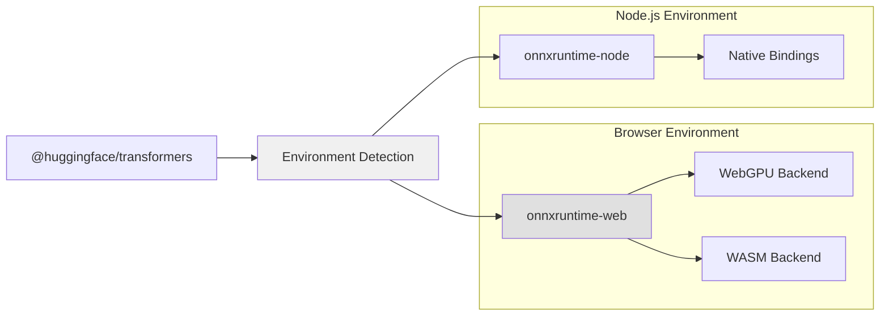
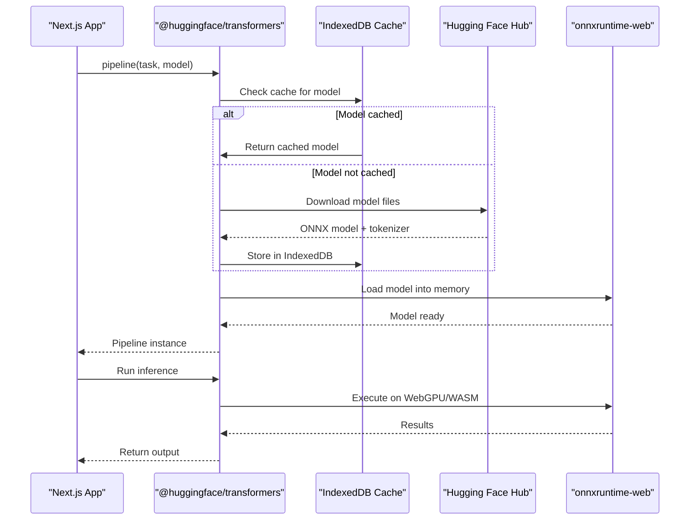
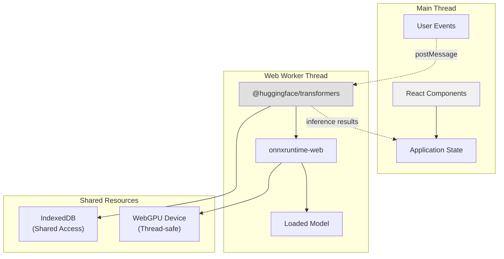
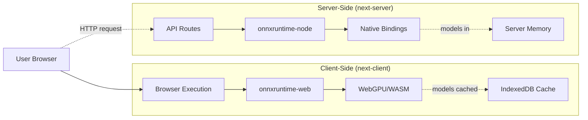

<!-- source: DeepWiki mcp.deepwiki.com · repo huggingface/transformers.js-examples · page 4.2 Client-Side Inference · fetched 2026-10-26 -->

# Client-Side Inference

<details>
<summary>Relevant source files</summary>

The following files were used as context for generating this wiki page:

- [next-client/package-lock.json](next-client/package-lock.json)
- [next-client/package.json](next-client/package.json)
- [next-server/package-lock.json](next-server/package-lock.json)
- [next-server/package.json](next-server/package.json)

</details>


## Purpose and Scope

This document describes the `next-client` example, which demonstrates how to run ML inference entirely in the browser within a Next.js application using `@huggingface/transformers`. This pattern executes models on the client side using `onnxruntime-web` with WebGPU acceleration or WebAssembly fallback, keeping all data processing within the user's browser.

For server-side inference patterns using `onnxruntime-node`, see [Server-Side Inference](#4.1). For integrating Transformers.js with Vercel AI SDK's chat interfaces, see [Vercel AI SDK Integration](#4.3).

**Sources:** High-level architecture Diagram 4, next-client/package.json

---

## Architecture Overview

The `next-client` example implements a pure client-side inference pattern where all model operations occur in the browser without backend API calls. This architecture prioritizes user privacy, eliminates server infrastructure costs, and leverages modern browser capabilities for hardware acceleration.



**Diagram: Client-Side Inference Architecture in Next.js**

The architecture consists of three main layers:

1. **Application Layer**: Next.js client components handle UI rendering and user interactions
2. **Runtime Layer**: `onnxruntime-web` manages model execution with automatic backend selection (WebGPU or WASM)
3. **Storage Layer**: IndexedDB caches downloaded models for subsequent page loads, while browser memory holds active model instances

**Sources:** next-client/package.json:11-12, High-level architecture Diagram 4

---

## Dependencies and Runtime Selection

The `next-client` example uses the same `@huggingface/transformers` library (version 3.7.1) as other examples, but the runtime backend differs fundamentally from server-side implementations.

### Core Dependencies

| Package | Version | Role |
|---------|---------|------|
| `@huggingface/transformers` | 3.7.1 | Unified ML API for browser and Node.js |
| `onnxruntime-web` | 1.22.0-dev | Browser-specific ONNX Runtime with WebGPU support |
| `next` | ^15.2.4 | React framework with app router support |

**Sources:** next-client/package.json:11-15

### Runtime Backend Selection

The `@huggingface/transformers` library automatically detects the execution environment and selects the appropriate ONNX Runtime backend:



**Diagram: Automatic Runtime Backend Selection**

In the browser environment (Next.js client components):
- **Detection**: The library checks for `window` object to identify browser context
- **Backend**: Loads `onnxruntime-web` instead of `onnxruntime-node`
- **Acceleration**: Attempts WebGPU first, falls back to WebAssembly if unavailable
- **No Configuration**: Selection happens automatically without code changes

**Sources:** next-server/package-lock.json:179-189, High-level architecture Diagram 2

---

## Next.js Configuration Considerations

Running Transformers.js in Next.js client components requires specific configuration to handle the browser-only runtime and WebAssembly modules.

### Client Component Directive

All components that use `@huggingface/transformers` must include the `'use client'` directive to ensure they execute only in the browser:

```typescript
'use client'

import { pipeline } from '@huggingface/transformers'
```

This directive instructs Next.js to:
- Exclude the component from server-side rendering
- Bundle the component for client-side execution
- Make browser-only APIs (IndexedDB, WebGPU) available

### WebAssembly Module Support

Next.js 15+ provides built-in support for WebAssembly modules required by `onnxruntime-web`. The framework automatically:
- Bundles `.wasm` files correctly
- Handles async module initialization
- Configures webpack for WASM loading

No additional `next.config.js` configuration is required for basic usage.

**Sources:** next-client/package.json:6-8, next-server/package-lock.json:1119-1122

---

## Model Loading and Caching

Client-side inference requires downloading models to the browser, where they are cached in IndexedDB for subsequent sessions.



**Diagram: Model Loading and Inference Flow**

### Caching Behavior

1. **First Load**: Models download from Hugging Face Hub (may take several seconds for large models)
2. **Subsequent Loads**: Models load from IndexedDB cache (near-instantaneous)
3. **Cache Persistence**: Models remain cached until browser storage is cleared
4. **Storage Location**: IndexedDB database named based on model identifier

### Model Selection

Client-side deployments typically use quantized models to reduce download size and memory usage:

| Quantization | File Size Reduction | Quality Impact |
|--------------|---------------------|----------------|
| `q4` | ~75% smaller | Minimal for most tasks |
| `q4f16` | ~50% smaller | Near-identical to fp16 |
| `fp16` | ~50% of fp32 | Negligible quality loss |

**Sources:** High-level architecture Diagram 7, next-client/package.json:11-12

---

## Web Worker Pattern (Optional)

While the basic `next-client` example may run inference on the main thread, production applications typically offload model operations to a Web Worker to maintain UI responsiveness.



**Diagram: Web Worker Architecture (Optional Enhancement)**

### Worker Implementation Pattern

The worker pattern separates concerns:
- **Main Thread**: Handles React rendering, DOM updates, user interactions
- **Worker Thread**: Executes model loading, tokenization, inference
- **Communication**: Uses `postMessage` API for bidirectional data transfer

This pattern is demonstrated extensively in WebGPU examples like `llama-3.2-webgpu`, `conversational-webgpu`, and others. See [Web Worker Pattern](#6.1) for detailed implementation guidance.

**Sources:** High-level architecture Diagram 3, next-client/package.json

---

## Deployment Configuration

Client-side inference applications can be deployed as static sites or serverless functions, with specific considerations for each approach.

### Static Export

Next.js can generate a fully static site suitable for CDN deployment:

```json
{
  "scripts": {
    "build": "next build",
    "export": "next export"
  }
}
```

Static exports:
- Generate pure HTML/CSS/JS without server runtime
- Deploy to any static hosting (Vercel, Netlify, S3, etc.)
- Require `'use client'` for all Transformers.js usage
- Cannot use API routes (server functions)

### Hybrid Deployment

The `next-client` example uses Next.js 15's app router, which supports:
- **Client components** with `'use client'` directive for inference
- **Server components** for static content and layouts
- **API routes** for non-ML backend functionality
- **Standalone output** for containerized deployments

**Sources:** next-client/package.json:6-8

---

## Performance Characteristics

Client-side inference exhibits distinct performance characteristics compared to server-side approaches.

| Aspect | Client-Side | Server-Side |
|--------|-------------|-------------|
| **Cold Start** | Model download (first visit) | Model preloaded in memory |
| **Warm Start** | Cached, near-instant | Consistent response time |
| **Throughput** | Limited by device hardware | Scalable with infrastructure |
| **Latency** | No network round-trip | Network + inference time |
| **Concurrent Users** | Unlimited (distributed load) | Limited by server capacity |
| **Privacy** | Complete (data never leaves device) | Requires trust in server |

### WebGPU Acceleration

When available, WebGPU provides significant speedup over CPU execution:
- **Availability**: Chrome 113+, Edge 113+, Firefox behind flag
- **Performance**: 10-100x faster than WASM for large models
- **Fallback**: Automatic degradation to WebAssembly on unsupported browsers

**Sources:** High-level architecture Diagrams 2, 4

---

## Comparison with Server-Side Inference

The choice between client-side and server-side inference involves several trade-offs:



**Diagram: Client-Side vs. Server-Side Architecture Comparison**

### When to Choose Client-Side

**Advantages:**
- **Privacy**: Sensitive data never leaves the user's device
- **Cost**: No server infrastructure or API costs
- **Scalability**: Load distributed across client devices
- **Offline**: Works without internet after initial model download

**Disadvantages:**
- **Device Limitations**: Performance varies by user hardware
- **Model Size**: Large models impractical for browser download
- **Browser Support**: Requires modern browser with WebGPU/WASM
- **Initial Load**: First-time users experience download delay

### When to Choose Server-Side

See [Server-Side Inference](#4.1) for detailed comparison and guidance on server-side patterns.

**Sources:** next-client/package.json, next-server/package.json, High-level architecture Diagram 4

---

## Development Workflow

### Local Development

Start the Next.js development server with Turbopack:

```bash
npm run dev
```

This command:
- Starts Next.js dev server on `http://localhost:3000`
- Enables Turbopack for faster builds (via `--turbopack` flag)
- Provides hot module replacement for rapid iteration
- Automatically handles WASM module loading

**Sources:** next-client/package.json:6

### Production Build

Build and start the production server:

```bash
npm run build
npm start
```

The build process:
- Optimizes client bundles with tree-shaking
- Pre-compiles server and client components
- Generates static assets for CDN deployment
- Creates standalone output for containerization

**Sources:** next-client/package.json:7-8

---

## Code Quality and Linting

The `next-client` example includes ESLint configuration for code quality enforcement.

### ESLint Configuration

Development dependencies include:

| Package | Purpose |
|---------|---------|
| `eslint` | Core linting engine (v9) |
| `eslint-config-next` | Next.js-specific rules (v15.1.6) |
| `@eslint/eslintrc` | Legacy config format support |

Run linting:

```bash
npm run lint
```

The `eslint-config-next` preset provides:
- React Hooks rules
- Next.js best practices
- Accessibility checks (jsx-a11y)
- Import ordering validation

**Sources:** next-client/package.json:17-22

---

## Summary

The `next-client` example demonstrates a complete client-side inference pattern using:

1. **Browser Execution**: All inference occurs in the user's browser using `onnxruntime-web`
2. **Automatic Caching**: Models download once and cache in IndexedDB
3. **Hardware Acceleration**: WebGPU support with WebAssembly fallback
4. **Privacy by Design**: No data transmission to servers
5. **Next.js Integration**: Works seamlessly with app router and client components

This pattern is ideal for privacy-sensitive applications, cost-conscious deployments, and scenarios where offline functionality is valuable. For server-side patterns with more consistent performance across devices, see [Server-Side Inference](#4.1). For rich chat interfaces combining client or server inference with streaming, see [Vercel AI SDK Integration](#4.3).

**Sources:** next-client/package.json, High-level architecture Diagrams 2, 4

---

