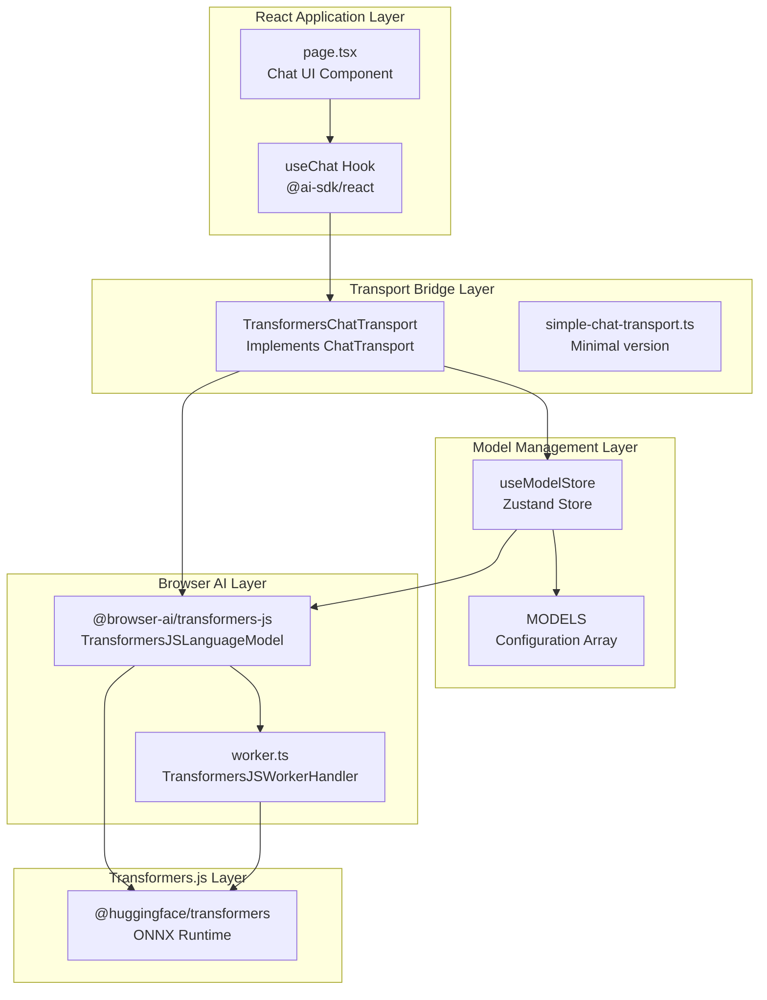
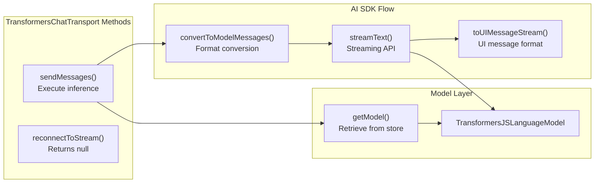
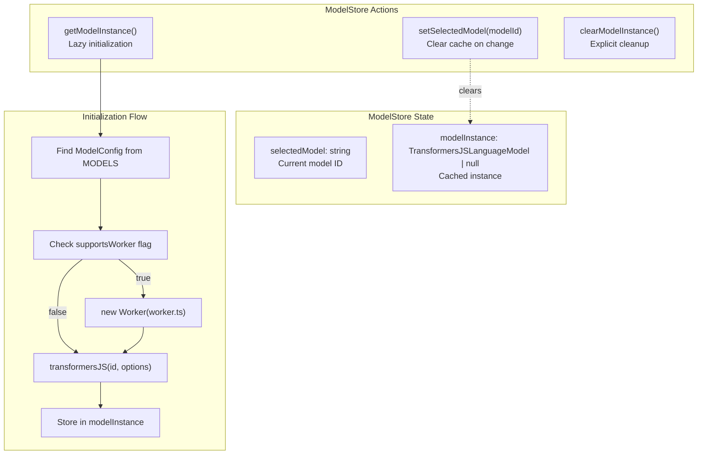
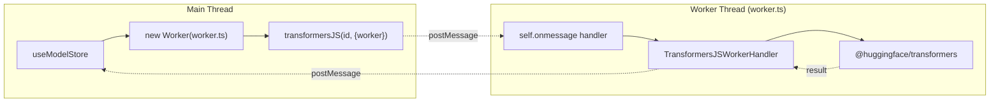
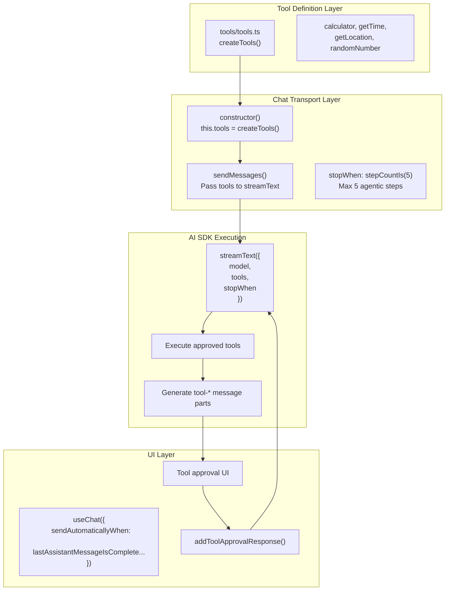

<!-- source: DeepWiki mcp.deepwiki.com · repo huggingface/transformers.js-examples · page 4.3 Vercel AI SDK Integration · fetched 2026-10-26 -->

# Vercel AI SDK Integration

<details>
<summary>Relevant source files</summary>

The following files were used as context for generating this wiki page:

- [next-vercel-ai-sdk-v5/README.md](next-vercel-ai-sdk-v5/README.md)
- [next-vercel-ai-sdk-v5/package-lock.json](next-vercel-ai-sdk-v5/package-lock.json)
- [next-vercel-ai-sdk-v5/package.json](next-vercel-ai-sdk-v5/package.json)
- [next-vercel-ai-sdk-v5/src/app/chat-transport.ts](next-vercel-ai-sdk-v5/src/app/chat-transport.ts)
- [next-vercel-ai-sdk-v5/src/app/models.ts](next-vercel-ai-sdk-v5/src/app/models.ts)
- [next-vercel-ai-sdk-v5/src/app/page.tsx](next-vercel-ai-sdk-v5/src/app/page.tsx)
- [next-vercel-ai-sdk-v5/src/app/simple-chat-transport.ts](next-vercel-ai-sdk-v5/src/app/simple-chat-transport.ts)
- [next-vercel-ai-sdk-v5/src/app/worker.ts](next-vercel-ai-sdk-v5/src/app/worker.ts)
- [next-vercel-ai-sdk-v5/src/store/store.ts](next-vercel-ai-sdk-v5/src/store/store.ts)
- [next-vercel-ai-sdk-v6-tool-calling/README.md](next-vercel-ai-sdk-v6-tool-calling/README.md)
- [next-vercel-ai-sdk-v6-tool-calling/package-lock.json](next-vercel-ai-sdk-v6-tool-calling/package-lock.json)
- [next-vercel-ai-sdk-v6-tool-calling/package.json](next-vercel-ai-sdk-v6-tool-calling/package.json)
- [next-vercel-ai-sdk-v6-tool-calling/src/app/chat-transport.ts](next-vercel-ai-sdk-v6-tool-calling/src/app/chat-transport.ts)
- [next-vercel-ai-sdk-v6-tool-calling/src/app/models.ts](next-vercel-ai-sdk-v6-tool-calling/src/app/models.ts)
- [next-vercel-ai-sdk-v6-tool-calling/src/app/page.tsx](next-vercel-ai-sdk-v6-tool-calling/src/app/page.tsx)
- [next-vercel-ai-sdk-v6-tool-calling/src/app/simple-chat-transport.ts](next-vercel-ai-sdk-v6-tool-calling/src/app/simple-chat-transport.ts)
- [next-vercel-ai-sdk-v6-tool-calling/src/app/worker.ts](next-vercel-ai-sdk-v6-tool-calling/src/app/worker.ts)
- [next-vercel-ai-sdk-v6-tool-calling/src/store/store.ts](next-vercel-ai-sdk-v6-tool-calling/src/store/store.ts)

</details>


## Purpose and Scope

This document describes the integration patterns for using Transformers.js with the Vercel AI SDK in Next.js applications. The repository contains two reference implementations: `next-vercel-ai-sdk-v5` (basic chat with reasoning) and `next-vercel-ai-sdk-v6-tool-calling` (chat with tool calling and Human-in-the-Loop approval). Both examples demonstrate browser-based AI inference using the `@browser-ai/transformers-js` adapter package that bridges Transformers.js models with the AI SDK's provider interface.

For server-side inference patterns in Next.js, see [4.1](#4.1). For client-side inference without the AI SDK, see [4.2](#4.2). For general WebGPU application patterns, see [3](#3).

## Integration Architecture

Both examples use a custom `ChatTransport` implementation to connect the AI SDK's chat interface (`useChat` hook) with Transformers.js models running in the browser. The architecture separates model lifecycle management (Zustand store), inference execution (ChatTransport), and UI rendering (AI SDK React components).



**Sources:** [next-vercel-ai-sdk-v5/src/app/page.tsx:1-362](), [next-vercel-ai-sdk-v5/src/app/chat-transport.ts:1-162](), [next-vercel-ai-sdk-v5/src/store/store.ts:1-74](), [next-vercel-ai-sdk-v6-tool-calling/src/app/chat-transport.ts:1-131]()

## The ChatTransport Interface

The `ChatTransport` interface is the core abstraction that enables AI SDK chat components to work with custom model providers. Both examples implement this interface to adapt Transformers.js models to the AI SDK's streaming protocol.

### Basic Implementation (Simple Transport)

The minimal implementation demonstrates the essential contract:



The simple transport [next-vercel-ai-sdk-v5/src/app/simple-chat-transport.ts:18-60]() provides a reference implementation without progress tracking. Key responsibilities:

1. **Message Conversion**: Uses `convertToModelMessages()` to transform AI SDK message format to the model's expected format [next-vercel-ai-sdk-v5/src/app/simple-chat-transport.ts:36]()
2. **Model Retrieval**: Fetches the model instance from Zustand store [next-vercel-ai-sdk-v5/src/app/simple-chat-transport.ts:19-21]()
3. **Streaming Setup**: Calls `streamText()` with model and messages [next-vercel-ai-sdk-v5/src/app/simple-chat-transport.ts:39-48]()
4. **UI Stream Conversion**: Returns `toUIMessageStream()` for AI SDK consumption [next-vercel-ai-sdk-v5/src/app/simple-chat-transport.ts:49]()
5. **Reconnection Handling**: Returns `null` since client-side AI doesn't support stream reconnection [next-vercel-ai-sdk-v5/src/app/simple-chat-transport.ts:52-59]()

**Sources:** [next-vercel-ai-sdk-v5/src/app/simple-chat-transport.ts:1-61](), [next-vercel-ai-sdk-v6-tool-calling/src/app/simple-chat-transport.ts:1-61]()

### Enhanced Implementation with Progress Tracking

The full transport implementation adds model download progress tracking using `createUIMessageStream()`:

| Feature | Simple Transport | Full Transport |
|---------|-----------------|----------------|
| Progress Tracking | ❌ | ✅ |
| Model Availability Check | ❌ | ✅ |
| Custom Data Messages | ❌ | ✅ (`data-modelDownloadProgress`) |
| Error Handling | Basic | Enhanced with notifications |
| Implementation Complexity | Minimal | Moderate |

The progress tracking implementation [next-vercel-ai-sdk-v5/src/app/chat-transport.ts:38-52]() checks model availability first. If the model is already cached, it uses the simple path. Otherwise, it wraps the entire flow in `createUIMessageStream()` to inject custom progress updates.

Progress updates are written using the `writer` API [next-vercel-ai-sdk-v5/src/app/chat-transport.ts:71-111]():
- Type: `"data-modelDownloadProgress"`
- Data: `{ status: "downloading" | "complete", progress: number, message: string }`
- Transient: `true` for initial message to prevent persistence

The progress ID is cleared when the first text chunk arrives [next-vercel-ai-sdk-v5/src/app/chat-transport.ts:124-134](), removing the progress indicator from the UI.

**Sources:** [next-vercel-ai-sdk-v5/src/app/chat-transport.ts:1-162](), [next-vercel-ai-sdk-v6-tool-calling/src/app/chat-transport.ts:49-119]()

## Model Store Implementation

Model lifecycle management is centralized in a Zustand store that handles model selection, instantiation, and caching.



**Sources:** [next-vercel-ai-sdk-v5/src/store/store.ts:1-74](), [next-vercel-ai-sdk-v6-tool-calling/src/store/store.ts:1-74]()

### Store Structure

The store interface [next-vercel-ai-sdk-v5/src/store/store.ts:8-14]():

```typescript
interface ModelStore {
  selectedModel: string;           // ID from MODELS config
  modelInstance: TransformersJSLanguageModel | null;
  setSelectedModel: (modelId: string) => void;
  getModelInstance: () => Promise<TransformersJSLanguageModel>;
  clearModelInstance: () => void;
}
```

### Model Configuration

Models are defined in a configuration array [next-vercel-ai-sdk-v5/src/app/models.ts:9-50]():

| Property | Type | Purpose |
|----------|------|---------|
| `id` | string | Hugging Face model identifier |
| `name` | string | Display name for UI |
| `device` | "webgpu" \| "wasm" | Execution backend |
| `dtype` | "q4" \| "q4f16" \| "fp16" \| "fp32" | Quantization level |
| `supportsWorker` | boolean | Whether model can run in Web Worker |
| `isVisionModel` | boolean | Vision model flag (v5 only) |

### Lazy Initialization Pattern

The `getModelInstance()` method [next-vercel-ai-sdk-v5/src/store/store.ts:27-65]() implements lazy initialization:

1. Returns cached instance if available
2. Finds model configuration by ID
3. Creates Web Worker if `supportsWorker` is true
4. Instantiates `transformersJS()` with config + optional worker
5. Caches instance in store state

This pattern ensures models are only loaded when needed and reused across multiple chat interactions.

**Sources:** [next-vercel-ai-sdk-v5/src/store/store.ts:1-74](), [next-vercel-ai-sdk-v5/src/app/models.ts:1-51](), [next-vercel-ai-sdk-v6-tool-calling/src/app/models.ts:1-39]()

## Web Worker Architecture

Models that support it can offload inference to a Web Worker to keep the main thread responsive. The worker setup is minimal but essential.



**Sources:** [next-vercel-ai-sdk-v5/src/app/worker.ts:1-7](), [next-vercel-ai-sdk-v5/src/store/store.ts:47-54]()

### Worker Implementation

The worker file [next-vercel-ai-sdk-v5/src/app/worker.ts:1-7]() is identical in both examples:

```typescript
import { TransformersJSWorkerHandler } from "@browser-ai/transformers-js";

const handler = new TransformersJSWorkerHandler();
self.onmessage = (msg: MessageEvent) => {
  handler.onmessage(msg);
};
```

The `TransformersJSWorkerHandler` from `@browser-ai/transformers-js` handles all message protocol details, model loading, and inference execution. The main thread communicates via `postMessage()` automatically when the worker is passed to `transformersJS()`.

### Worker Conditional Loading

Not all models support worker execution. The store conditionally creates workers [next-vercel-ai-sdk-v5/src/store/store.ts:47-54]():

```typescript
const workerConfig = modelConfig.supportsWorker
  ? {
      worker: new Worker(new URL("../app/worker.ts", import.meta.url), {
        type: "module",
      }),
    }
  : {};
```

The `new URL()` syntax with `import.meta.url` ensures proper module resolution in the Next.js build system. Models marked with `supportsWorker: false` run inference on the main thread.

**Sources:** [next-vercel-ai-sdk-v5/src/app/worker.ts:1-7](), [next-vercel-ai-sdk-v6-tool-calling/src/app/worker.ts:1-7](), [next-vercel-ai-sdk-v5/src/store/store.ts:47-54]()

## Reasoning Extraction Middleware

Both examples support reasoning models (like Qwen3 and DeepSeek-R1) that output internal thoughts in `answer'"]
    end
    
    subgraph "Middleware Processing"
        WrapModel["wrapLanguageModel({<br/>  model,<br/>  middleware: extractReasoningMiddleware<br/>})"]
        ExtractTags["Extract content from ` tags in the model's output.

### UI Rendering

The UI handles reasoning parts separately [next-vercel-ai-sdk-v5/src/app/page.tsx:198-210]():

```typescript
case "reasoning":
  return (
    <Reasoning
      key={`${message.id}-${i}`}
      className="w-full"
      isStreaming={
        status === "streaming" &&
        messageIndex === messages.length - 1
      }
    >
      <ReasoningTrigger />
      <ReasoningContent>{part.text}</ReasoningContent>
    </Reasoning>
  );
```

The `Reasoning` component provides an expandable/collapsible interface for viewing the model's internal reasoning process. The `isStreaming` prop animates the reasoning indicator while content is being generated.

**Sources:** [next-vercel-ai-sdk-v5/src/app/chat-transport.ts:40-47](), [next-vercel-ai-sdk-v5/src/app/page.tsx:198-210]()

## Tool Calling Support (AI SDK v6)

The v6 example extends the basic chat functionality with tool calling, enabling the LLM to invoke external functions. This includes Human-in-the-Loop (HITL) approval for tool executions.



**Sources:** [next-vercel-ai-sdk-v6-tool-calling/src/app/chat-transport.ts:1-131](), [next-vercel-ai-sdk-v6-tool-calling/src/app/page.tsx:77-81]()

### Tool Definition Structure

Tools are defined in [next-vercel-ai-sdk-v6-tool-calling/src/app/tools/tools.ts]() using the AI SDK's tool definition format:

| Tool | Description | Parameters | Requires Approval |
|------|-------------|-----------|-------------------|
| `calculator` | Evaluate math expressions | `expression: string` | Yes |
| `getTime` | Get current time | None | No |
| `getLocation` | Get browser geolocation | None | Yes |
| `randomNumber` | Generate random number | `min: number, max: number` | No |

Each tool definition includes:
- Schema using Zod for parameter validation
- Approval requirement flag (`requireApproval: true/false`)
- Execute function that performs the actual operation

### Transport Integration

The transport initializes tools in the constructor [next-vercel-ai-sdk-v6-tool-calling/src/app/chat-transport.ts:27-29]() and passes them to `streamText()` [next-vercel-ai-sdk-v6-tool-calling/src/app/chat-transport.ts:94-104]():

```typescript
const result = streamText({
  model: wrapLanguageModel({
    model,
    middleware: extractReasoningMiddleware({
      tagName: "think",
    }),
  }),
  tools: this.tools,
  stopWhen: stepCountIs(5),
  messages: prompt,
  abortSignal,
  // ...
});
```

The `stopWhen: stepCountIs(5)` parameter limits agentic iterations to prevent infinite loops.

### HITL Approval Flow

The approval mechanism requires explicit user consent before executing sensitive tools:

1. Model requests tool execution → generates `tool-*` part with `state: "approval-requested"`
2. UI renders approval dialog [next-vercel-ai-sdk-v6-tool-calling/src/app/page.tsx:218-278]()
3. User clicks Accept/Reject
4. `addToolApprovalResponse()` is called [next-vercel-ai-sdk-v6-tool-calling/src/app/page.tsx:252-268]()
5. `sendAutomaticallyWhen` predicate detects approval response
6. Message is automatically re-sent to trigger tool execution
7. Tool executes and result appears as `state: "output-complete"`

The `lastAssistantMessageIsCompleteWithApprovalResponses` predicate [next-vercel-ai-sdk-v6-tool-calling/src/app/page.tsx:80]() ensures the chat automatically continues after tool approval without requiring manual submission.

**Sources:** [next-vercel-ai-sdk-v6-tool-calling/src/app/chat-transport.ts:1-131](), [next-vercel-ai-sdk-v6-tool-calling/src/app/page.tsx:66-96](), [next-vercel-ai-sdk-v6-tool-calling/src/app/page.tsx:218-278]()

## UI Integration Patterns

Both examples use the AI SDK's React hooks and components to render chat interfaces. The main differences lie in handling tool-related message parts.

### Basic Chat Flow (v5)

The v5 example [next-vercel-ai-sdk-v5/src/app/page.tsx:54-58]() uses `useChat` with basic configuration:

```typescript
const { messages, sendMessage, status, stop, regenerate } =
  useChat<TransformersUIMessage>({
    transport: new TransformersChatTransport(),
    experimental_throttle: 75,
  });
```

The `experimental_throttle: 75` parameter batches UI updates every 75ms to prevent excessive re-renders during streaming.

### Message Part Rendering

Messages contain an array of `parts` that must be individually rendered [next-vercel-ai-sdk-v5/src/app/page.tsx:157-214]():

| Part Type | Rendering Strategy |
|-----------|-------------------|
| `"text"` | Markdown rendering via `Response` component |
| `"reasoning"` | Expandable reasoning display |
| `"file"` | Image preview for uploaded files |
| `"data-modelDownloadProgress"` | Progress bar with status message |

The v6 example adds tool-related parts [next-vercel-ai-sdk-v6-tool-calling/src/app/page.tsx:208-326]():

| Part Type | Component | Shows |
|-----------|-----------|-------|
| `"tool-*"` with `state: "approval-requested"` | `Confirmation` | Approval buttons |
| `"tool-*"` with `state: "input-streaming"` | `Tool` + `ToolInput` | Tool parameters |
| `"tool-*"` with `state: "output-complete"` | `Tool` + `ToolOutput` | Execution result |
| `"tool-*"` with `state: "output-denied"` | `Confirmation` | Rejection notice |

### Progress Tracking UI

Download progress parts are conditionally rendered [next-vercel-ai-sdk-v5/src/app/page.tsx:154-177]():

```typescript
case "data-modelDownloadProgress":
  if (!part.data.message) return null;
  if (status === "ready") return null;
  return (
    <div key={i}>
      <div className="flex items-center justify-between mb-2">
        <span className="flex items-center gap-1">
          <Loader />
          {part.data.message}
        </span>
      </div>
      {part.data.status === "downloading" &&
        part.data.progress !== undefined && (
          <Progress value={part.data.progress} />
        )}
    </div>
  );
```

The progress indicator is hidden when `status === "ready"` or when the message is empty (cleared by the transport after first text chunk).

**Sources:** [next-vercel-ai-sdk-v5/src/app/page.tsx:1-362](), [next-vercel-ai-sdk-v6-tool-calling/src/app/page.tsx:1-450]()

## Dependency Configuration

Both examples share similar dependency structures with key differences in AI SDK versions.

### Core Dependencies Comparison

| Package | v5 Example | v6 Example | Purpose |
|---------|-----------|-----------|---------|
| `ai` | ^5.0.15 | ^6.0.39 | AI SDK core |
| `@ai-sdk/react` | ^2.0.15 | ^3.0.41 | React hooks |
| `@browser-ai/transformers-js` | 1.0.0 | ^2.0.0 | Transformers.js adapter |
| `@huggingface/transformers` | ^3.8.1 | ^3.8.1 | ML library |
| `next` | 15.4.6 | 15.4.6 | Framework |
| `react` | 19.1.0 | 19.1.2 | UI library |
| `zustand` | ^5.0.7 | ^5.0.7 | State management |

### AI SDK Version Differences

**v5 Features:**
- Basic chat interface with streaming
- Reasoning extraction
- File attachments for vision models
- Simpler API surface

**v6 Features:**
- All v5 features
- Built-in tool calling support
- Human-in-the-Loop approval workflow
- `sendAutomaticallyWhen` predicate
- Enhanced streaming protocol with approval states

The v6 tool calling implementation requires `@browser-ai/transformers-js` v2.0.0+ which includes the necessary type definitions for tool-related message parts.

**Sources:** [next-vercel-ai-sdk-v5/package.json:1-59](), [next-vercel-ai-sdk-v6-tool-calling/package.json:1-66]()

## Development and Deployment

Both examples use identical Next.js configuration and build processes.

### Development Commands

```bash
npm install          # Install dependencies
npm run dev          # Start dev server with Turbopack
npm run build        # Production build
npm start            # Start production server
npm run lint         # ESLint validation
```

The dev server [next-vercel-ai-sdk-v5/package.json:6]() uses `--turbopack` flag for faster HMR.

### Build Output Characteristics

| Characteristic | Details |
|---------------|---------|
| Build System | Next.js 15 App Router |
| Bundler | Webpack (production), Turbopack (dev) |
| Model Loading | Runtime in browser via fetch |
| Static Assets | React components, styles |
| Dynamic Imports | Web Worker modules |
| Deployment Target | Vercel, any static host |

Models are **not** bundled with the application. They are downloaded from Hugging Face Hub on first use and cached in IndexedDB. This keeps deployment sizes small (typically < 1MB) while supporting multi-GB models.

### Deployment Considerations

1. **CORS Requirements**: Models load from `cdn-lfs.huggingface.co`, no CORS configuration needed
2. **SharedArrayBuffer**: Required for WebGPU, needs `Cross-Origin-Opener-Policy` and `Cross-Origin-Embedder-Policy` headers (automatically handled by Next.js)
3. **Storage Quota**: Browser needs sufficient quota for model caching (check via Storage API)
4. **WebGPU Support**: Required for `device: "webgpu"` models, falls back to WASM if unavailable

**Sources:** [next-vercel-ai-sdk-v5/package.json:1-59](), [next-vercel-ai-sdk-v5/README.md:1-50](), [next-vercel-ai-sdk-v6-tool-calling/README.md:1-50]()

---

