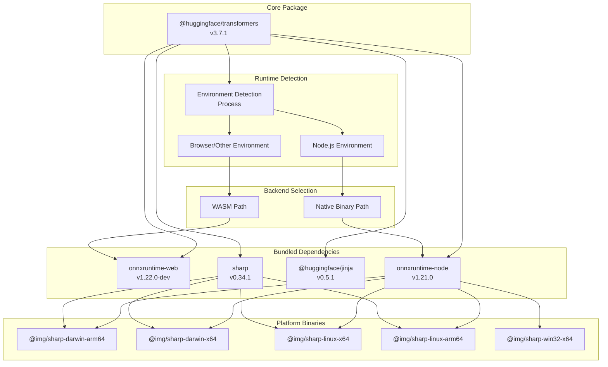
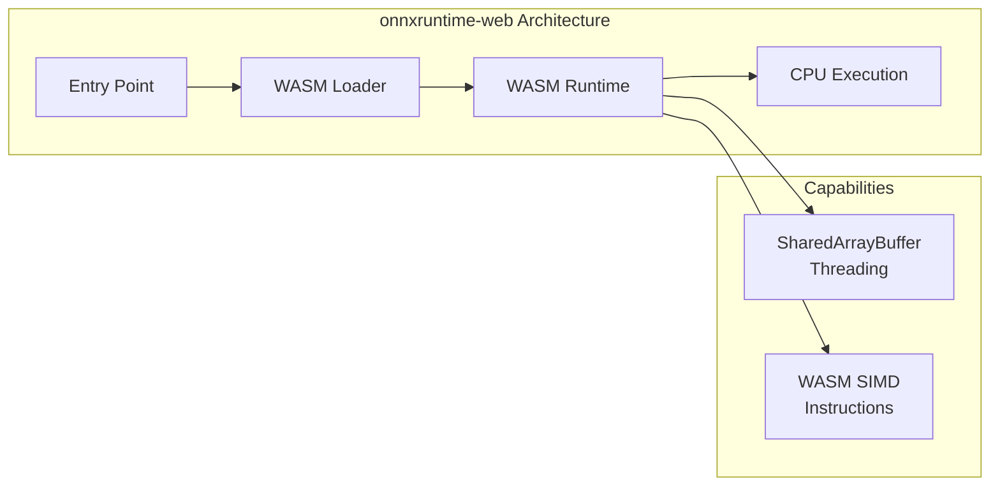
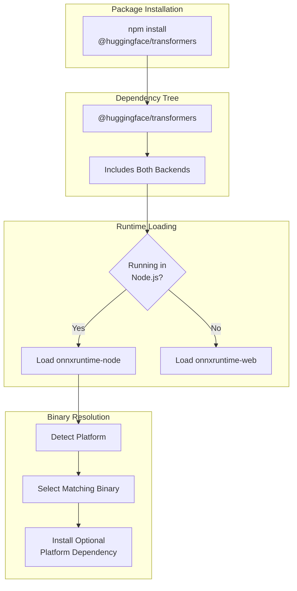
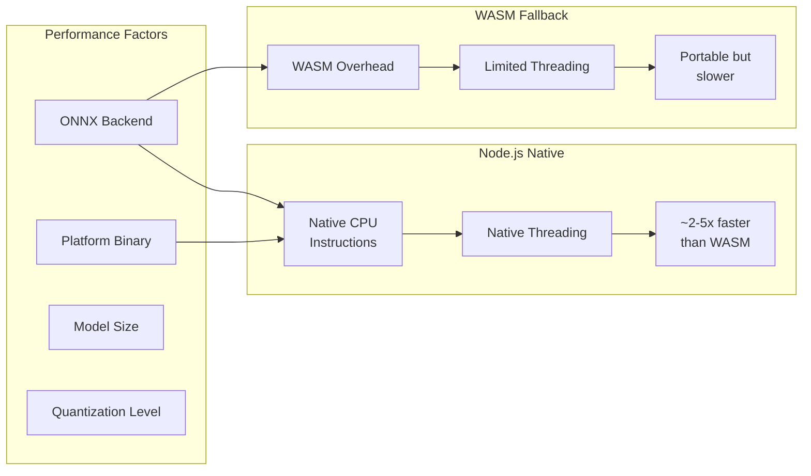
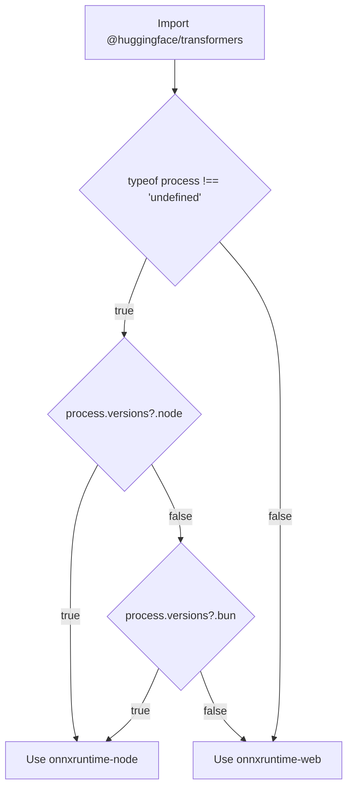

<!-- source: DeepWiki mcp.deepwiki.com · repo huggingface/transformers.js-examples · page 5 Runtime Integration · fetched 2026-10-26 -->

# Runtime Integration

<details>
<summary>Relevant source files</summary>

The following files were used as context for generating this wiki page:

- [bun/bun.lockb](bun/bun.lockb)
- [bun/package.json](bun/package.json)
- [node-cjs/package-lock.json](node-cjs/package-lock.json)
- [node-cjs/package.json](node-cjs/package.json)
- [node-esm/package-lock.json](node-esm/package-lock.json)
- [node-esm/package.json](node-esm/package.json)
- [pglite-semantic-search/package-lock.json](pglite-semantic-search/package-lock.json)
- [pglite-semantic-search/package.json](pglite-semantic-search/package.json)
- [phi-3.5-webgpu/package-lock.json](phi-3.5-webgpu/package-lock.json)
- [phi-3.5-webgpu/package.json](phi-3.5-webgpu/package.json)
- [remove-background-webgpu/package-lock.json](remove-background-webgpu/package-lock.json)
- [remove-background-webgpu/package.json](remove-background-webgpu/package.json)
- [smollm-webgpu/package-lock.json](smollm-webgpu/package-lock.json)
- [smollm-webgpu/package.json](smollm-webgpu/package.json)

</details>


## Purpose and Scope

This document covers how `@huggingface/transformers` integrates with different JavaScript runtimes outside the browser environment. It explains the dual-backend architecture that enables the library to run efficiently on Node.js, Bun, and other server-side JavaScript runtimes, focusing on the automatic runtime detection, ONNX backend selection, and platform-specific optimizations.

For browser-specific integration patterns, see [WebGPU Applications](#3). For Next.js server-side integration, see [Next.js Integration](#4). For detailed Node.js usage patterns, see [Node.js Applications](#5.1). For Bun-specific details, see [Bun Runtime](#5.2).

## Dual Backend Architecture

The `@huggingface/transformers` library employs a sophisticated dual-backend system that automatically selects the appropriate ONNX Runtime implementation based on the execution environment:



**Sources:** [remove-background-webgpu/package-lock.json:844-854](), [node-cjs/package-lock.json:34-44](), [bun/package.json:11-13]()

## ONNX Runtime Backend Selection

### onnxruntime-node Backend

When `@huggingface/transformers` detects a Node.js environment, it automatically utilizes `onnxruntime-node` which provides native performance through platform-specific binaries:

| Platform | Architecture | Binary Package | Size Optimization |
|----------|-------------|----------------|-------------------|
| macOS | arm64 | `@img/sharp-darwin-arm64` | Native M-series optimization |
| macOS | x64 | `@img/sharp-darwin-x64` | Intel optimization |
| Linux | x64 | `@img/sharp-linux-x64` | Standard glibc |
| Linux | arm64 | `@img/sharp-linux-arm64` | ARM64 server optimization |
| Linux | arm | `@img/sharp-linux-arm` | 32-bit ARM |
| Linux | s390x | `@img/sharp-linux-s390x` | IBM Z architecture |
| Linux (musl) | x64 | `@img/sharp-linuxmusl-x64` | Alpine Linux compatible |
| Linux (musl) | arm64 | `@img/sharp-linuxmusl-arm64` | Alpine ARM compatible |
| Windows | x64 | `@img/sharp-win32-x64` | MSVC runtime |
| Windows | ia32 | `@img/sharp-win32-ia32` | 32-bit Windows |
| Windows | arm64 | `@img/sharp-win32-arm64` | ARM64 Windows |

The native backend provides significant performance advantages:
- Direct access to CPU SIMD instructions
- No WebAssembly overhead
- Native threading support
- Optimized memory management

**Sources:** [node-cjs/package-lock.json:46-320](), [remove-background-webgpu/package-lock.json:882-1037]()

### onnxruntime-web Backend

For environments without native binary support (including Bun in some configurations), the library falls back to `onnxruntime-web`:



The web backend provides:
- **WASM-based execution**: Cross-platform compatibility without native binaries
- **SIMD support**: Hardware-accelerated vector operations where available
- **Multi-threading**: Via SharedArrayBuffer in supported environments
- **Fallback compatibility**: Works in restricted environments

**Sources:** [remove-background-webgpu/package-lock.json:844-854]()

## Dependency Resolution Strategy



The `@huggingface/transformers` package bundles both backends as dependencies, allowing the runtime to select the appropriate one. Platform-specific binaries are marked as `optional` dependencies, so only the matching binary for the current platform is downloaded during installation.

**Sources:** [node-cjs/package-lock.json:1-13](), [bun/package.json:1-14]()

## Supporting Libraries

### @huggingface/jinja

Template processing engine used for chat templates and prompt formatting:

```javascript
// Automatically imported and used by transformers
// Supports Jinja2-style template syntax
```

Version: `^0.5.1`  
Purpose: Model-specific prompt template rendering  
Runtime: Works identically across all runtimes

**Sources:** [node-cjs/package-lock.json:25-33]()

### sharp

Cross-platform image processing library with native bindings:

```javascript
// Used internally for image preprocessing
// Automatically selects platform-specific binary
```

Version: `^0.34.1`  
Purpose: High-performance image resizing, format conversion  
Backend: Native bindings via platform-specific packages

The `sharp` library follows the same optional dependency pattern as ONNX Runtime, with platform-specific packages installed only for the target platform.

**Sources:** [node-cjs/package-lock.json:46-89](), [remove-background-webgpu/package-lock.json:882-1037]()

## Model Caching Behavior

Runtime-specific model caching strategies differ significantly:

| Runtime | Cache Location | API | Persistence |
|---------|---------------|-----|-------------|
| Node.js | `~/.cache/huggingface/hub` | Filesystem | Permanent until manual deletion |
| Browser | IndexedDB | Browser Storage API | Subject to browser quota |
| Bun | `~/.cache/huggingface/hub` | Filesystem (Node.js compatible) | Permanent until manual deletion |

### Node.js Cache Structure

```
~/.cache/huggingface/hub/
├── models--<org>--<model>/
│   ├── snapshots/
│   │   └── <commit-hash>/
│   │       ├── onnx/
│   │       │   ├── model.onnx
│   │       │   └── model_quantized.onnx
│   │       ├── tokenizer.json
│   │       └── config.json
│   └── refs/
│       └── main
```

The filesystem cache persists across application restarts and is shared between all applications using the same model.

**Sources:** High-level architecture Diagram 7

## Module System Support

The library supports both ECMAScript Modules (ESM) and CommonJS (CJS) in Node.js:

### ECMAScript Modules (ESM)

```javascript
// package.json configuration
{
  "type": "module"
}
```

Used when `"type": "module"` is specified in `package.json`. Import syntax:

```javascript
import { pipeline } from '@huggingface/transformers';
```

**Sources:** [node-esm/package.json:1-12](), [bun/package.json:1-14]()

### CommonJS (CJS)

Default module system when `"type"` is not specified:

```javascript
const { pipeline } = require('@huggingface/transformers');
```

The library automatically provides the correct export format based on the module system used by the importing code.

**Sources:** [node-cjs/package.json:1-11]()

## Runtime-Specific Considerations

### Node.js Specifics

- **Native Performance**: Full access to `onnxruntime-node` native binaries
- **Filesystem Access**: Direct model caching to disk
- **Process Management**: Can spawn worker threads for parallel processing
- **Memory Management**: V8 heap with configurable limits

### Bun Specifics

- **Node.js Compatibility Layer**: Bun provides Node.js API compatibility
- **Backend Selection**: May use either `onnxruntime-node` or `onnxruntime-web` depending on configuration
- **Faster Module Resolution**: Bun's optimized module loader
- **Built-in TypeScript**: No separate transpilation needed

**Sources:** [bun/package.json:1-14](), [bun/bun.lockb]()

## Performance Characteristics



Native binaries (`onnxruntime-node`) typically provide 2-5x performance improvement over WASM (`onnxruntime-web`) for inference operations, with the exact speedup depending on:

- Model architecture (transformer layer count, attention mechanism)
- Quantization level (fp32, fp16, int8, int4)
- CPU capabilities (AVX2, AVX-512, NEON)
- Memory bandwidth

**Sources:** High-level architecture Diagrams 2, 7

## Environment Detection Logic

The library uses the following detection strategy:



This ensures the optimal backend is selected automatically without requiring user configuration.

**Sources:** [node-cjs/package-lock.json:34-44](), [bun/package.json:11-13]()

## Supported Runtimes Overview

The following JavaScript runtimes are officially supported:

| Runtime | Status | Backend | Notes |
|---------|--------|---------|-------|
| Node.js 18+ | ✅ Fully Supported | `onnxruntime-node` | Recommended for production |
| Node.js 16 | ⚠️ Limited Support | `onnxruntime-node` | Some features may be unavailable |
| Bun | ✅ Supported | `onnxruntime-node` or `onnxruntime-web` | Growing compatibility |
| Deno | 🔄 Experimental | `onnxruntime-web` | Limited testing |

For detailed Node.js implementation examples and best practices, see [Node.js Applications](#5.1).  
For Bun-specific configuration and usage, see [Bun Runtime](#5.2).

**Sources:** [node-esm/package.json:1-12](), [node-cjs/package.json:1-11](), [bun/package.json:1-14]()

---

