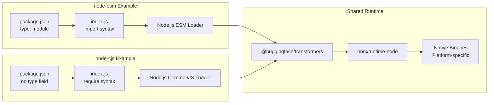
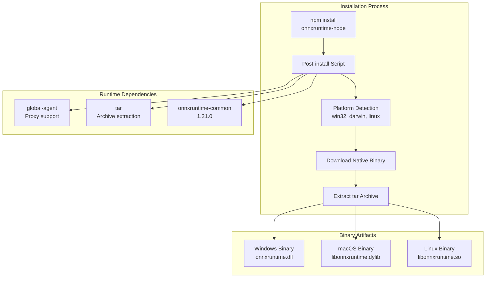
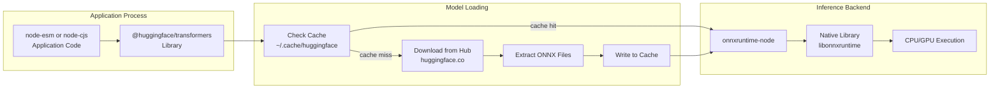
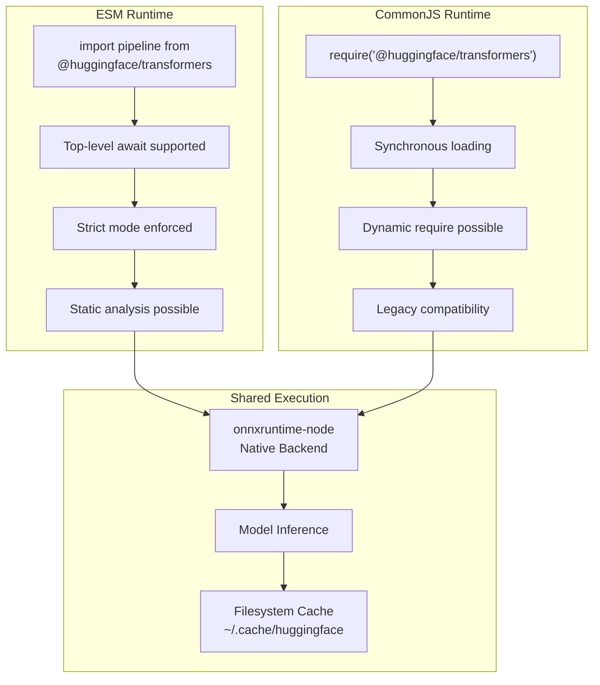

<!-- source: DeepWiki mcp.deepwiki.com · repo huggingface/transformers.js-examples · page 5.1 Node.js Applications · fetched 2026-10-26 -->

# Node.js Applications

<details>
<summary>Relevant source files</summary>

The following files were used as context for generating this wiki page:

- [node-cjs/package-lock.json](node-cjs/package-lock.json)
- [node-cjs/package.json](node-cjs/package.json)
- [node-esm/package-lock.json](node-esm/package-lock.json)
- [node-esm/package.json](node-esm/package.json)

</details>


This document covers the Node.js integration examples in the repository, demonstrating how to use `@huggingface/transformers` in server-side JavaScript environments. Two minimal examples showcase both ECMAScript Modules (ESM) and CommonJS (CJS) module systems, highlighting the configuration differences and runtime behavior with `onnxruntime-node`.

For client-side Next.js patterns with server-side rendering, see [Server-Side Inference](#4.1). For alternative JavaScript runtimes, see [Bun Runtime](#5.2). For runtime architecture details across all environments, see [Shared Dependencies and Runtime Architecture](#6.2).

## Module System Patterns

The repository provides two parallel examples demonstrating the two primary JavaScript module systems. Both examples implement identical functionality but differ in their module configuration.

### ESM Configuration

The `node-esm` example uses ECMAScript Modules by explicitly setting the module type in [node-esm/package.json:5]():

```
"type": "module"
```

This configuration enables top-level `await`, native `import`/`export` syntax, and strict module semantics. Files are treated as ES modules by default, and the `import` statement is used to load `@huggingface/transformers`.

**Sources:** [node-esm/package.json:1-12]()

### CommonJS Configuration

The `node-cjs` example uses the traditional CommonJS module system by omitting the `type` field in [node-cjs/package.json:1-11](). This is the default Node.js module system supporting:

- `require()` function for module loading
- `module.exports` for exporting values
- Synchronous module resolution
- Compatibility with legacy Node.js codebases

**Sources:** [node-cjs/package.json:1-11]()

### Module System Comparison



**Sources:** [node-esm/package.json:1-12](), [node-cjs/package.json:1-11]()

## Runtime Architecture

Both Node.js examples use identical runtime dependencies but load them through different module systems. The `@huggingface/transformers` library automatically detects the Node.js environment and uses the appropriate backend.

### Dependency Structure

| Package | Version | Purpose |
|---------|---------|---------|
| `@huggingface/transformers` | 3.7.1 | Core ML library and unified API |
| `onnxruntime-node` | 1.21.0 | Node.js native ONNX Runtime backend |
| `onnxruntime-web` | 1.22.0-dev | Fallback web backend (unused in Node.js) |
| `sharp` | 0.34.1 | High-performance image processing |
| `@huggingface/jinja` | 0.5.1 | Template engine for prompt formatting |

**Sources:** [node-esm/package-lock.json:34-44](), [node-cjs/package-lock.json:34-44]()

### ONNX Runtime Node Backend

The `onnxruntime-node` package provides native C++ bindings for model inference, delivering significantly better performance than WebAssembly-based alternatives. The package is installed via [node-cjs/package-lock.json:800-816]():



The package declares `"hasInstallScript": true` in [node-cjs/package-lock.json:804](), which triggers automatic download and extraction of platform-specific binaries during installation. The supported platforms are explicitly declared as `["win32", "darwin", "linux"]` in [node-cjs/package-lock.json:806-810]().

**Sources:** [node-cjs/package-lock.json:800-816](), [node-esm/package-lock.json:800-816]()

### Sharp Image Processing

The `sharp` library provides fast image preprocessing with native bindings to libvips. It includes extensive platform-specific optional dependencies:

```mermaid
graph TB
    SHARP["sharp@0.34.1"]
    
    subgraph "Core Dependencies"
        COLOR["color@4.2.3"]
        DETECT_LIBC["detect-libc@2.0.3"]
        SEMVER["semver@7.7.1"]
    end
    
    subgraph "macOS Binaries"
        DARWIN_ARM["@img/sharp-darwin-arm64"]
        DARWIN_X64["@img/sharp-darwin-x64"]
        LIBVIPS_ARM["@img/sharp-libvips-darwin-arm64"]
        LIBVIPS_X64["@img/sharp-libvips-darwin-x64"]
    end
    
    subgraph "Linux Binaries"
        LINUX_ARM["@img/sharp-linux-arm"]
        LINUX_ARM64["@img/sharp-linux-arm64"]
        LINUX_X64["@img/sharp-linux-x64"]
        MUSL_ARM64["@img/sharp-linuxmusl-arm64"]
        MUSL_X64["@img/sharp-linuxmusl-x64"]
    end
    
    subgraph "Windows Binaries"
        WIN_IA32["@img/sharp-win32-ia32"]
        WIN_X64["@img/sharp-win32-x64"]
    end
    
    subgraph "Other Platforms"
        WASM["@img/sharp-wasm32"]
    end
    
    SHARP --> COLOR
    SHARP --> DETECT_LIBC
    SHARP --> SEMVER
    
    SHARP -.optional.-> DARWIN_ARM
    SHARP -.optional.-> DARWIN_X64
    SHARP -.optional.-> LINUX_ARM
    SHARP -.optional.-> LINUX_ARM64
    SHARP -.optional.-> LINUX_X64
    SHARP -.optional.-> MUSL_ARM64
    SHARP -.optional.-> MUSL_X64
    SHARP -.optional.-> WIN_IA32
    SHARP -.optional.-> WIN_X64
    SHARP -.optional.-> WASM
    
    DARWIN_ARM --> LIBVIPS_ARM
    DARWIN_X64 --> LIBVIPS_X64
```



All platform-specific packages are marked as `"optional": true` in the lock files [node-cjs/package-lock.json:46-422](), meaning installation failures on unsupported platforms will not prevent the overall installation from succeeding. The package manager only downloads binaries matching the host platform based on `"cpu"` and `"os"` constraints.

**Sources:** [node-cjs/package-lock.json:917-956](), [node-cjs/package-lock.json:46-422]()

## Model Caching and Storage

Unlike browser environments that use IndexedDB, Node.js applications cache models in the filesystem at `~/.cache/huggingface` (or `HF_HOME` environment variable if set). This cache is shared across all Node.js applications using transformers.js on the same system.



**Sources:** Referenced from high-level architecture Diagram 7

## Installation and Dependencies

Both examples share identical installation requirements. The dependency tree is extensive due to platform-specific binaries:

| Dependency Category | Package Count | Purpose |
|-------------------|---------------|---------|
| Core libraries | 4 | Transformers.js, ONNX runtimes, Sharp, Jinja |
| ONNX Runtime deps | 8 | Protobuf, flatbuffers, platform detection |
| Sharp platform binaries | 14 | CPU-specific image processing libraries |
| libvips platform deps | 8 | Image processing native dependencies |
| Utility libraries | ~20 | tar, minipass, color utilities, etc. |

The full dependency tree contains 60+ packages in [node-cjs/package-lock.json:1-1025](), with optional dependencies automatically filtered based on the host platform during installation.

### Installation Command

```bash
# ESM example
cd node-esm && npm install

# CommonJS example  
cd node-cjs && npm install
```

The installation process automatically:
1. Downloads platform-appropriate binaries for `onnxruntime-node` [node-cjs/package-lock.json:800-816]()
2. Installs matching `sharp` platform binaries [node-cjs/package-lock.json:917-956]()
3. Skips incompatible optional dependencies
4. Executes post-install scripts for native modules

**Sources:** [node-esm/package-lock.json:1-1025](), [node-cjs/package-lock.json:1-1025]()

## Runtime Behavior Comparison



Both module systems provide identical functionality once loaded. The primary differences are syntactic and relate to module loading behavior, not inference performance.

**Sources:** [node-esm/package.json:5](), [node-cjs/package.json:1-11]()

## Dependency Version Pinning

Both examples pin `@huggingface/transformers` to version 3.7.1 in [node-esm/package.json:10]() and [node-cjs/package.json:9](). This ensures:

- Consistent behavior across installations
- Compatibility with `onnxruntime-node` 1.21.0
- Stable API for example code

The monorepo management script at `.scripts/update.js` can update this version across all examples simultaneously. See [Monorepo Management](#7.1) for details on batch dependency updates.

**Sources:** [node-esm/package.json:10](), [node-cjs/package.json:9]()

## Platform Support Matrix

The `onnxruntime-node` package explicitly supports three operating systems as declared in [node-cjs/package-lock.json:806-810]():

| Platform | Status | Binary Format |
|----------|--------|---------------|
| Windows (win32) | ✓ Supported | `.dll` |
| macOS (darwin) | ✓ Supported | `.dylib` |
| Linux | ✓ Supported | `.so` |

The `sharp` library extends this with architecture-specific binaries for:
- ARM and ARM64 on Linux and macOS
- x64 on all platforms
- ia32 on Windows
- musl-based Linux distributions (Alpine)
- WebAssembly fallback

**Sources:** [node-cjs/package-lock.json:806-810](), [node-cjs/package-lock.json:46-422]()

---

