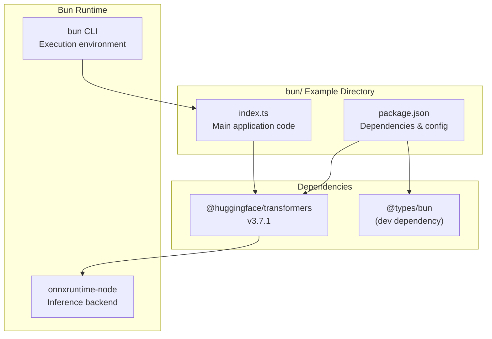
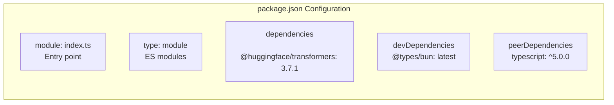
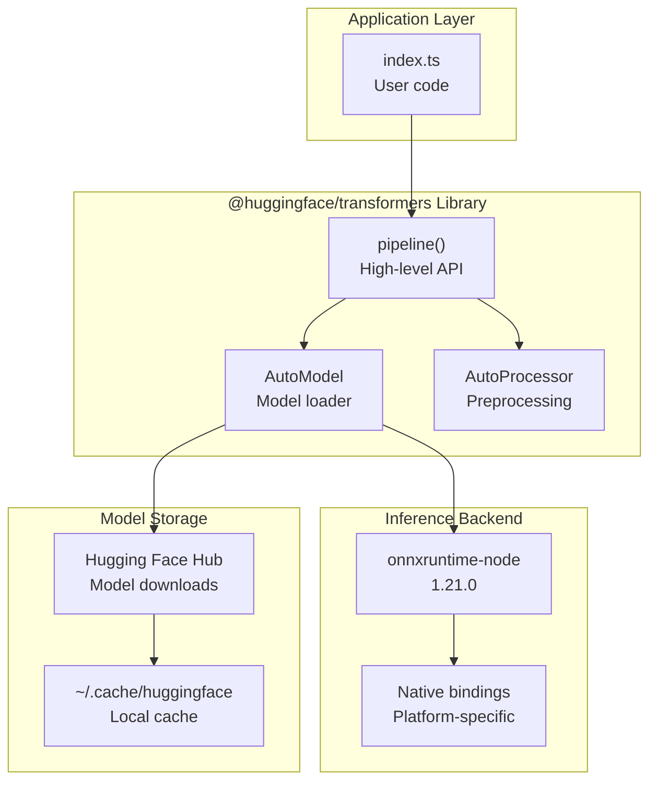
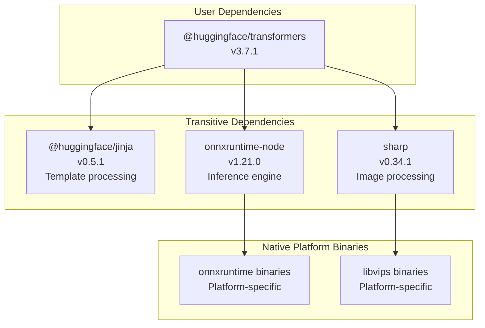
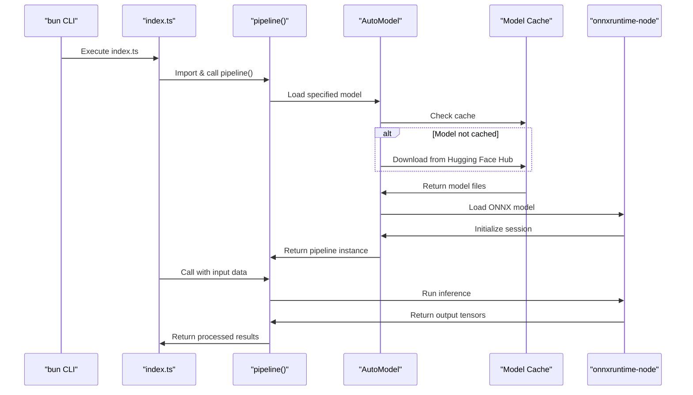

<!-- source: DeepWiki mcp.deepwiki.com · repo huggingface/transformers.js-examples · page 5.2 Bun Runtime · fetched 2026-10-26 -->

# Bun Runtime

<details>
<summary>Relevant source files</summary>

The following files were used as context for generating this wiki page:

- [bun/bun.lockb](bun/bun.lockb)
- [bun/package.json](bun/package.json)
- [pglite-semantic-search/package-lock.json](pglite-semantic-search/package-lock.json)
- [pglite-semantic-search/package.json](pglite-semantic-search/package.json)
- [phi-3.5-webgpu/package-lock.json](phi-3.5-webgpu/package-lock.json)
- [phi-3.5-webgpu/package.json](phi-3.5-webgpu/package.json)
- [remove-background-webgpu/package-lock.json](remove-background-webgpu/package-lock.json)
- [remove-background-webgpu/package.json](remove-background-webgpu/package.json)
- [smollm-webgpu/package-lock.json](smollm-webgpu/package-lock.json)
- [smollm-webgpu/package.json](smollm-webgpu/package.json)

</details>


This page documents the minimal Bun runtime example in the `bun/` directory, demonstrating how to use `@huggingface/transformers` with Bun's fast JavaScript runtime. For Node.js examples, see page 5.1.

## Overview

The `bun/` example demonstrates the simplest possible integration of Transformers.js with the Bun runtime. Bun is a fast JavaScript runtime that includes a bundler, transpiler, and package manager. The example shows that Transformers.js works seamlessly with Bun without requiring special configuration.



Sources: [bun/package.json]()

## Project Structure

The Bun example has a minimal structure with just the essential configuration files:

**Directory Structure**
```
bun/
├── package.json       # Dependencies and module configuration
└── index.ts          # Main application code (entry point)
```

### Package Configuration

The [bun/package.json:1-14]() file configures the project for Bun execution:



Key configuration elements:
- `"module": "index.ts"` - Specifies the entry point for the application
- `"type": "module"` - Enables ES module syntax
- `@huggingface/transformers` version 3.7.1 as the only runtime dependency
- `@types/bun` for TypeScript type definitions
- TypeScript 5.0+ as a peer dependency

Sources: [bun/package.json:1-14]()

## Running the Example

The example can be executed directly with the Bun CLI without any build step:

```bash
cd bun
bun run index.ts
```

Bun's built-in TypeScript support means `index.ts` can be executed directly without transpilation. The runtime automatically handles module resolution, TypeScript compilation, and execution.

Sources: [bun/package.json:1-14]()

## Runtime Architecture

Bun uses `onnxruntime-node` as the inference backend, which is the same backend used by Node.js. This provides consistent behavior across these server-side JavaScript runtimes.



Sources: [bun/package.json:1-14](), [remove-background-webgpu/package-lock.json:844-854]()

## Dependency Resolution

Bun automatically resolves and installs the transitive dependencies required by `@huggingface/transformers`:



The `@huggingface/transformers` library includes:
- `@huggingface/jinja` for chat template processing
- `onnxruntime-node` for CPU-based model inference
- `sharp` for image preprocessing operations

Bun handles the installation of platform-specific native binaries automatically during dependency installation.

Sources: [bun/package.json:11-12](), [remove-background-webgpu/package-lock.json:844-854]()

## Supported Features

All Transformers.js features that work in Node.js also work in Bun, since both use the same `onnxruntime-node` backend:

| Feature Category | Support | Notes |
|-----------------|---------|-------|
| Text Generation | ✓ | Full support for autoregressive models |
| Feature Extraction | ✓ | Embeddings and encoders |
| Image Processing | ✓ | Via Sharp library |
| Audio Processing | ✓ | Transcription and audio classification |
| Object Detection | ✓ | Computer vision tasks |
| Model Caching | ✓ | Stored in `~/.cache/huggingface/` |
| WebGPU Acceleration | ✗ | Server-side only; uses CPU inference |
| Quantized Models | ✓ | ONNX quantization formats supported |

Sources: [bun/package.json:11-12](), [remove-background-webgpu/package-lock.json:844-854]()

## Execution Flow

When running the Bun example, the following sequence of operations occurs:



Sources: [bun/package.json:3](), [bun/package.json:11-12]()

## Considerations and Limitations

When using Transformers.js with Bun or Deno, keep the following in mind:

1. **Version Compatibility**: Check that you're using compatible versions of Transformers.js and the runtime.

2. **GPU Acceleration**: While WebGPU acceleration is available in browser environments, it's not currently supported in Bun or Deno.

3. **Permissions**: Deno's security model requires explicitly granting permissions for network, file system, and FFI operations.

4. **Performance Differences**: 
   - Bun typically offers faster startup times and potentially better performance for certain workloads
   - Deno provides stronger security guarantees with its permissions model

5. **Native Dependencies**: Both runtimes handle native dependencies differently from Node.js, which is managed internally by Transformers.js.

Sources: `deno-embed/README.md`, `bun/package.json`

## Conclusion

Transformers.js provides robust support for both Bun and Deno JavaScript runtimes, offering the full capabilities of the library across these modern environments. This gives developers flexibility in choosing their preferred JavaScript runtime while maintaining access to state-of-the-art machine learning models.

By including Transformers.js in your Bun or Deno projects, you can easily integrate machine learning capabilities such as text generation, feature extraction, and image processing without having to switch between different environments.

---

