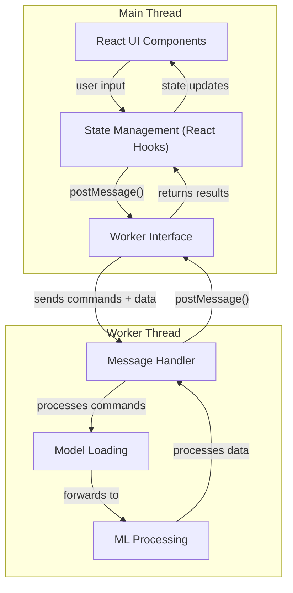
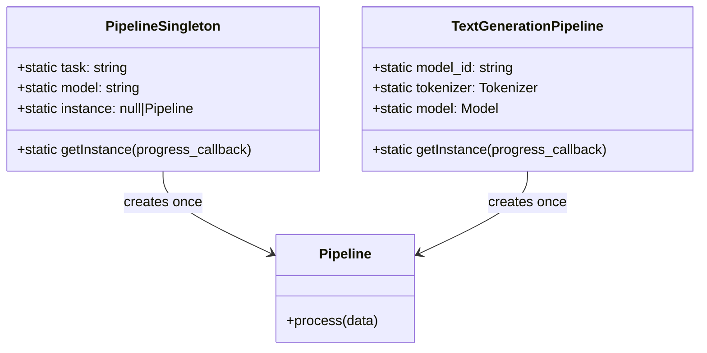
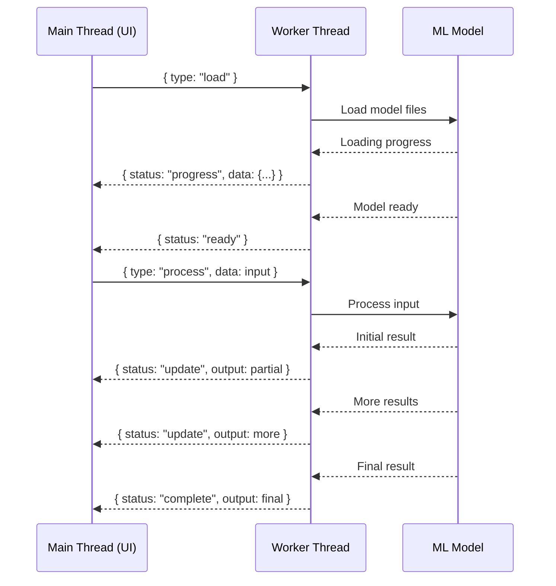
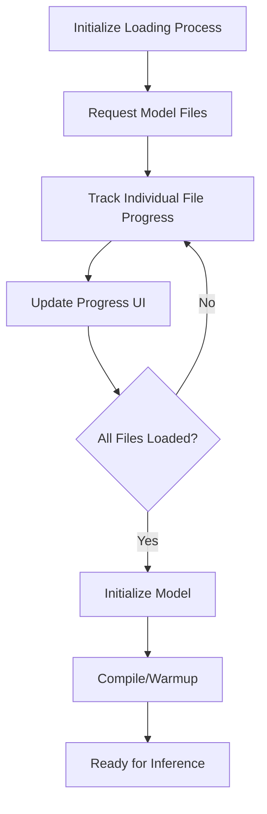
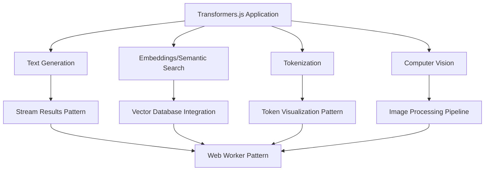

<!-- source: DeepWiki mcp.deepwiki.com · repo huggingface/transformers.js-examples · page 6 Architecture Patterns · fetched 2026-10-26 -->

# Architecture Patterns

<details>
<summary>Relevant source files</summary>

The following files were used as context for generating this wiki page:

- [bun/bun.lockb](bun/bun.lockb)
- [bun/package.json](bun/package.json)
- [gemma-2-2b-jpn-webgpu/package-lock.json](gemma-2-2b-jpn-webgpu/package-lock.json)
- [gemma-2-2b-jpn-webgpu/package.json](gemma-2-2b-jpn-webgpu/package.json)
- [llama-3.2-webgpu/package-lock.json](llama-3.2-webgpu/package-lock.json)
- [llama-3.2-webgpu/package.json](llama-3.2-webgpu/package.json)
- [llama-3.2-webgpu/src/App.jsx](llama-3.2-webgpu/src/App.jsx)
- [llama-3.2-webgpu/src/worker.js](llama-3.2-webgpu/src/worker.js)
- [pglite-semantic-search/package-lock.json](pglite-semantic-search/package-lock.json)
- [pglite-semantic-search/package.json](pglite-semantic-search/package.json)
- [phi-3.5-webgpu/package-lock.json](phi-3.5-webgpu/package-lock.json)
- [phi-3.5-webgpu/package.json](phi-3.5-webgpu/package.json)
- [realtime-whisper-webgpu/package-lock.json](realtime-whisper-webgpu/package-lock.json)
- [remove-background-webgpu/package-lock.json](remove-background-webgpu/package-lock.json)
- [remove-background-webgpu/package.json](remove-background-webgpu/package.json)
- [smollm-webgpu/package-lock.json](smollm-webgpu/package-lock.json)
- [smollm-webgpu/package.json](smollm-webgpu/package.json)
- [video-object-detection/package-lock.json](video-object-detection/package-lock.json)

</details>


This document describes the common architectural patterns used across the transformers.js-examples repository. These patterns provide consistent approaches for integrating machine learning models into JavaScript applications, with a focus on browser-based inference. For environment-specific integration details, see [Environment Integration](#3).

## Overview of Architecture Patterns

The examples in this repository implement several core architecture patterns that enable efficient machine learning inference in JavaScript environments:

1. Web Worker Pattern - Offloading ML tasks to separate threads
2. Singleton Pattern - Efficient model instantiation and caching
3. Message Passing Pattern - Communication between UI and ML threads
4. Progressive Loading Pattern - Handling large model files
5. UI Feedback Patterns - Providing real-time feedback during ML operations

## Web Worker Pattern

The Web Worker pattern is foundational across browser-based examples, enabling non-blocking ML processing by moving computationally intensive tasks to a separate thread.

### Worker Architecture



### Implementation Pattern

The pattern follows a consistent implementation across examples:

1. **Worker Creation**: The main thread creates a web worker as a module
2. **Message Handling**: Setup of event listeners for worker communication
3. **State Management**: React state tracks model status and results
4. **Clean Up**: Proper event listener removal on component unmount

#### Worker Creation (Main Thread)

```javascript
// Create a reference to the worker
const worker = useRef(null);

// Initialize the worker in useEffect
useEffect(() => {
  if (!worker.current) {
    worker.current = new Worker(new URL("./worker.js", import.meta.url), {
      type: "module",
    });
  }
  
  // Set up message handling
  const onMessageReceived = (e) => {
    // Process messages from worker
  };
  
  worker.current.addEventListener("message", onMessageReceived);
  
  // Clean up
  return () => {
    worker.current.removeEventListener("message", onMessageReceived);
  };
}, []);
```

#### Worker Implementation (Worker Thread)

```javascript
// Listen for messages from main thread
self.addEventListener("message", async (event) => {
  const { type, data } = event.data;
  
  switch (type) {
    case "load":
      // Initialize model
      break;
    case "process":
      // Process data with model
      break;
    // Other operations
  }
  
  // Send results back to main thread
  self.postMessage({ status: "complete", result: output });
});
```

Sources: [smollm-webgpu/src/worker.js](), [pglite-semantic-search/src/worker.js](). [the-tokenizer-playground/src/worker.js](), [smollm-webgpu/src/App.jsx]()

## Singleton Pattern for Model Loading

To avoid redundant model loading and efficiently manage resources, examples implement a Singleton pattern for model initialization.



### Implementation

```javascript
// Example: Singleton Pattern for Model Loading
class PipelineSingleton {
  static task = "feature-extraction";
  static model = "Supabase/gte-small";
  static instance = null;

  static async getInstance(progress_callback = null) {
    if (this.instance === null) {
      this.instance = pipeline(this.task, this.model, {
        progress_callback,
        dtype: "fp32",
        device: !!navigator.gpu ? "webgpu" : "wasm",
      });
    }
    return this.instance;
  }
}
```

Sources: [pglite-semantic-search/src/worker.js:4-19](), [smollm-webgpu/src/worker.js:30-46]()

## Message Passing Pattern

Communication between the main thread and worker thread follows a consistent message passing pattern:



### Command Types

Most examples implement a command-based message structure:

| Command Type | Direction | Purpose |
|-------------|-----------|---------|
| `load` | UI → Worker | Load and initialize model |
| `check` | UI → Worker | Check WebGPU compatibility |
| `process`/`generate`/`embed` | UI → Worker | Process data with model |
| `interrupt` | UI → Worker | Stop ongoing processing |
| `reset` | UI → Worker | Reset model state |

### Status Updates

Workers send standardized status updates:

| Status | Purpose |
|--------|---------|
| `loading` | Model is being downloaded/initialized |
| `progress` | Progress update during loading |
| `ready` | Model is ready for use |
| `start` | Processing has started |
| `update` | Partial results are available |
| `complete` | Processing is complete |
| `error` | An error occurred |

Sources: [smollm-webgpu/src/worker.js:141-166](), [pglite-semantic-search/src/worker.js:21-45](), [the-tokenizer-playground/src/worker.js:10-68]()

## Progressive Loading Pattern

To handle large ML models efficiently, examples implement a progressive loading pattern that provides feedback during model initialization.



### Implementation

```javascript
// Worker sends progress updates during loading
self.postMessage({
  status: "progress",
  file: filename,
  progress: bytesLoaded,
  total: totalBytes
});

// UI component displays progress
{progressItems.map(({ file, progress, total }, i) => (
  <Progress
    key={i}
    text={file}
    percentage={progress}
    total={total}
  />
))}
```

Sources: [smollm-webgpu/src/App.jsx:264-277](), [smollm-webgpu/src/worker.js:117-128]()

## UI Feedback Patterns

Examples implement consistent patterns for providing feedback during ML operations:

1. **Loading Indicators**: Progress bars for model loading
2. **Processing Indicators**: Visual feedback during inference
3. **Result Streaming**: Incrementally displaying results as they become available
4. **Performance Metrics**: Displaying metrics like tokens-per-second

### Loading State Management

```javascript
// State variables for tracking loading and processing
const [status, setStatus] = useState(null);
const [error, setError] = useState(null);
const [loadingMessage, setLoadingMessage] = useState("");
const [progressItems, setProgressItems] = useState([]);
const [isRunning, setIsRunning] = useState(false);
```

### Result Streaming

```javascript
// Main thread updates UI as results stream in
case "update":
  {
    // Update with new output
    const { output, tps, numTokens } = e.data;
    setTps(tps);
    setNumTokens(numTokens);
    setMessages((prev) => {
      const cloned = [...prev];
      const last = cloned.at(-1);
      cloned[cloned.length - 1] = {
        ...last,
        content: last.content + output,
      };
      return cloned;
    });
  }
  break;
```

Sources: [smollm-webgpu/src/App.jsx:24-34](), [smollm-webgpu/src/App.jsx:119-135]()

## Architecture Variations by Application Type

Different transformers.js applications implement variations of the core patterns based on requirements:



### Text Generation Applications

Text generation applications (e.g., SmolLM, Phi-3.5, Llama-3.2) implement:
- Streaming results pattern
- Message history management
- Interruption handling
- Caching of previous generation results

### Embedding and Semantic Search Applications

Vector embedding applications (e.g., PGlite Semantic Search) implement:
- Vector database integration (PGlite)
- Cosine similarity search
- Synchronization between embeddings and database

### Tokenizer Applications

The Tokenizer Playground implements:
- Visual token representation
- Token boundary detection
- Special token handling

Sources: [smollm-webgpu/src/worker.js:51-115](), [pglite-semantic-search/src/utils/db.js:40-64](), [the-tokenizer-playground/src/components/Token.jsx:11-26]()

## Environment-Specific Variations

While this document focuses on browser-based patterns, the repository includes variations for different JavaScript environments:

| Environment | Key Architectural Differences |
|-------------|------------------------------|
| Browser (WebGPU) | Web Worker + streaming pattern |
| Node.js | Direct model loading (no workers) |
| Next.js | Server components + API routes |
| SvelteKit | Server endpoints + client loading |
| Bun/Deno | Direct imports + platform adaptations |

For more details on environment-specific implementations, see [Environment Integration](#3).

Sources: [README.md:1-21]()

---

