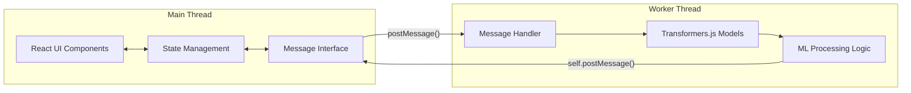
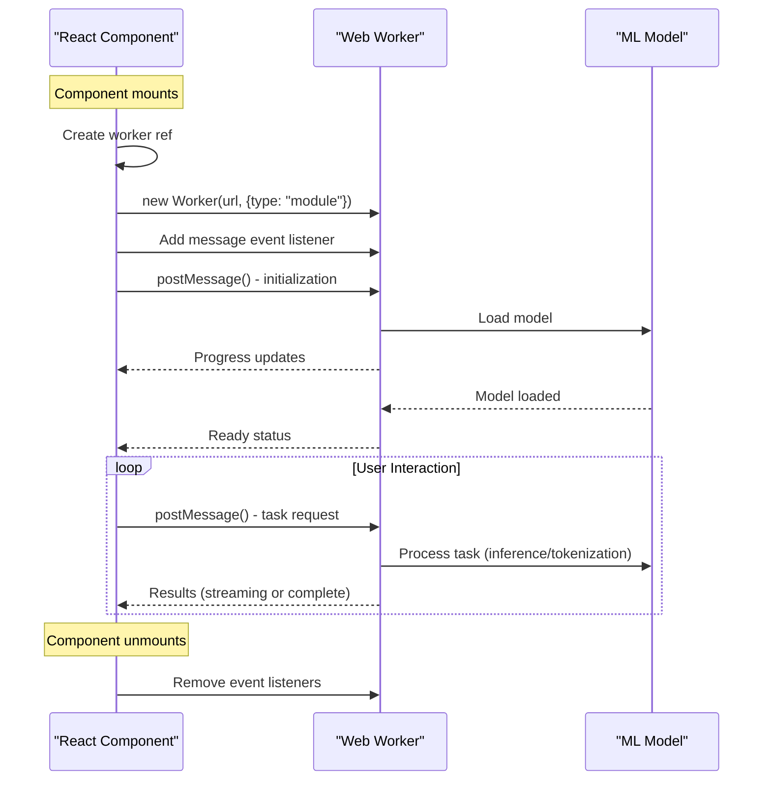
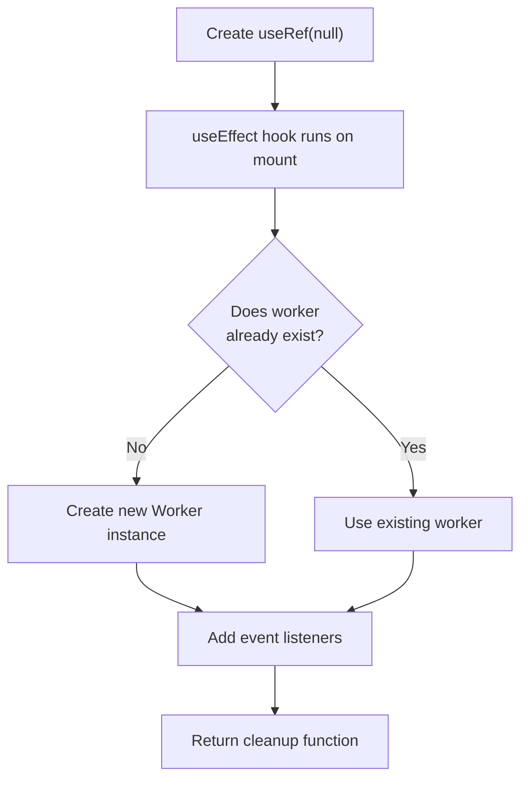
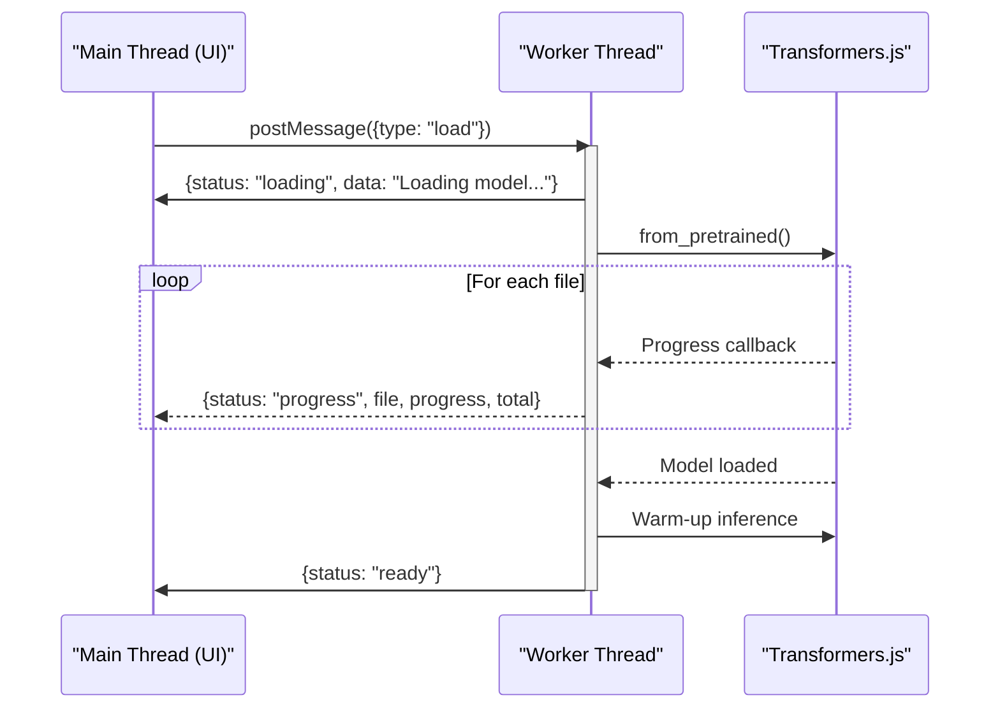
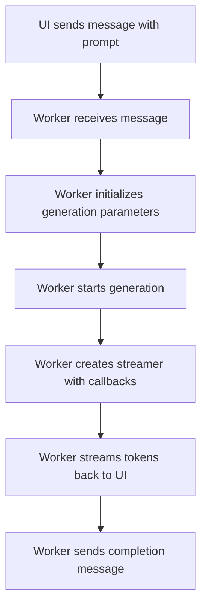
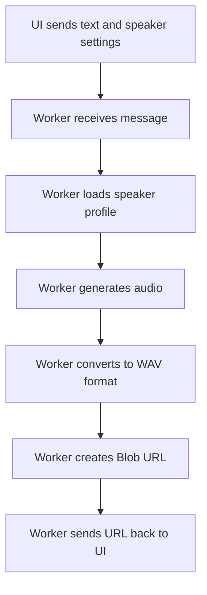
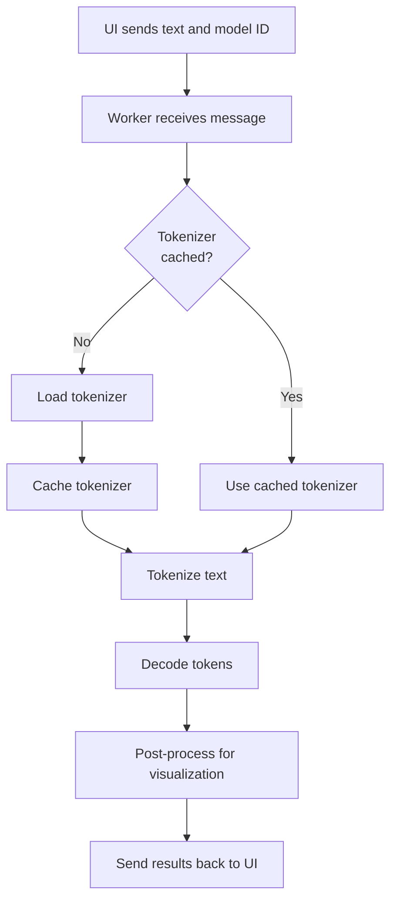
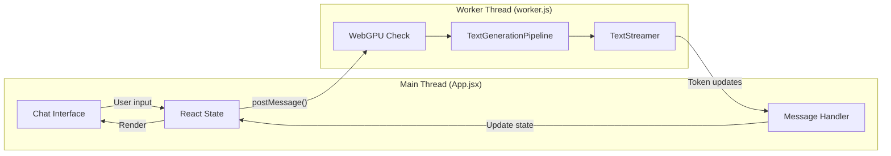
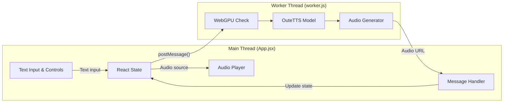
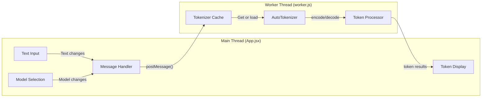

<!-- source: DeepWiki mcp.deepwiki.com · repo huggingface/transformers.js-examples · page 6.1 Web Worker Pattern · fetched 2026-10-26 -->

# Web Worker Pattern

<details>
<summary>Relevant source files</summary>

The following files were used as context for generating this wiki page:

- [conversational-webgpu/.gitignore](conversational-webgpu/.gitignore)
- [conversational-webgpu/eslint.config.js](conversational-webgpu/eslint.config.js)
- [conversational-webgpu/index.html](conversational-webgpu/index.html)
- [conversational-webgpu/package-lock.json](conversational-webgpu/package-lock.json)
- [conversational-webgpu/package.json](conversational-webgpu/package.json)
- [conversational-webgpu/public/logo.png](conversational-webgpu/public/logo.png)
- [conversational-webgpu/src/App.jsx](conversational-webgpu/src/App.jsx)
- [conversational-webgpu/src/constants.js](conversational-webgpu/src/constants.js)
- [conversational-webgpu/src/index.css](conversational-webgpu/src/index.css)
- [conversational-webgpu/src/main.jsx](conversational-webgpu/src/main.jsx)
- [conversational-webgpu/src/play-worklet.js](conversational-webgpu/src/play-worklet.js)
- [gemma-2-2b-jpn-webgpu/package-lock.json](gemma-2-2b-jpn-webgpu/package-lock.json)
- [gemma-2-2b-jpn-webgpu/package.json](gemma-2-2b-jpn-webgpu/package.json)
- [llama-3.2-webgpu/package-lock.json](llama-3.2-webgpu/package-lock.json)
- [llama-3.2-webgpu/package.json](llama-3.2-webgpu/package.json)
- [llama-3.2-webgpu/src/App.jsx](llama-3.2-webgpu/src/App.jsx)
- [llama-3.2-webgpu/src/worker.js](llama-3.2-webgpu/src/worker.js)
- [realtime-whisper-webgpu/package-lock.json](realtime-whisper-webgpu/package-lock.json)
- [realtime-whisper-webgpu/src/components/AudioVisualizer.jsx](realtime-whisper-webgpu/src/components/AudioVisualizer.jsx)
- [text-to-speech-webgpu/README.md](text-to-speech-webgpu/README.md)
- [text-to-speech-webgpu/eslint.config.js](text-to-speech-webgpu/eslint.config.js)
- [text-to-speech-webgpu/postcss.config.js](text-to-speech-webgpu/postcss.config.js)
- [text-to-speech-webgpu/src/App.jsx](text-to-speech-webgpu/src/App.jsx)
- [text-to-speech-webgpu/src/index.css](text-to-speech-webgpu/src/index.css)
- [text-to-speech-webgpu/src/main.jsx](text-to-speech-webgpu/src/main.jsx)
- [text-to-speech-webgpu/src/worker.js](text-to-speech-webgpu/src/worker.js)
- [text-to-speech-webgpu/tailwind.config.js](text-to-speech-webgpu/tailwind.config.js)
- [text-to-speech-webgpu/vite.config.js](text-to-speech-webgpu/vite.config.js)
- [the-tokenizer-playground/src/worker.js](the-tokenizer-playground/src/worker.js)
- [video-object-detection/package-lock.json](video-object-detection/package-lock.json)

</details>


This page explains the web worker pattern used throughout the transformers.js-examples repository to implement non-blocking machine learning processing in browser environments. The pattern enables computationally intensive operations to run in background threads without freezing the user interface.

For information about UI components and visualization techniques, see [UI Components and Visualization](#4.2).

## Overview of Web Workers

Web Workers are a browser API that allows JavaScript to run in background threads. In the context of transformers.js examples, they serve a critical purpose:

1. **UI Responsiveness**: ML tasks like model loading and inference are computationally intensive and would freeze the main thread
2. **Clean Separation**: Separating UI logic from ML processing makes code more maintainable
3. **Parallel Processing**: Allows ML computations to run in parallel with UI rendering



Sources: 
- [the-tokenizer-playground/src/App.jsx:39-62](the-tokenizer-playground/src/App.jsx:39-62)
- [text-to-speech-webgpu/src/App.jsx:21-67](text-to-speech-webgpu/src/App.jsx:21-67)
- [smollm-webgpu/src/App.jsx:62-162](smollm-webgpu/src/App.jsx:62-162)

## Worker Lifecycle

The typical lifecycle of a web worker in transformers.js examples follows this pattern:



Sources:
- [smollm-webgpu/src/App.jsx:62-67](smollm-webgpu/src/App.jsx:62-67)
- [the-tokenizer-playground/src/App.jsx:43-47](the-tokenizer-playground/src/App.jsx:43-47)
- [text-to-speech-webgpu/src/App.jsx:24-26](text-to-speech-webgpu/src/App.jsx:24-26)

## Worker Implementation

### Creating Workers in React Components

Web workers are typically created when a component mounts and stored in a React ref:



Sources:
- [the-tokenizer-playground/src/App.jsx:39-47](the-tokenizer-playground/src/App.jsx:39-47)
- [text-to-speech-webgpu/src/App.jsx:21-26](text-to-speech-webgpu/src/App.jsx:21-26)
- [smollm-webgpu/src/App.jsx:62-67](smollm-webgpu/src/App.jsx:62-67)

### Message Communication

Communication between the main thread and worker thread uses a structured message protocol:

| Direction | Method | Common Pattern |
|-----------|--------|---------------|
| Main → Worker | `worker.postMessage(message)` | `{type: "command", ...data}` |
| Worker → Main | `self.postMessage(message)` | `{status: "state", ...data}` |

Sources:
- [the-tokenizer-playground/src/App.jsx:82](the-tokenizer-playground/src/App.jsx:82)
- [text-to-speech-webgpu/src/App.jsx:73-77](text-to-speech-webgpu/src/App.jsx:73-77)
- [smollm-webgpu/src/App.jsx:175](smollm-webgpu/src/App.jsx:175)
- [the-tokenizer-playground/src/worker.js:64-68](the-tokenizer-playground/src/worker.js:64-68)
- [text-to-speech-webgpu/src/worker.js:60-64](text-to-speech-webgpu/src/worker.js:60-64)

### Event Listening

Message handlers are set up in the main thread component to process worker responses:

```jsx
// Create a callback function for messages from the worker thread
const onMessageReceived = (e) => {
  // Process worker data based on status or message type
  if (e.data.status === "complete") {
    // Handle completion
  } else if (e.data.status === "progress") {
    // Update progress indicators
  }
};

// Attach the callback function as an event listener
worker.current.addEventListener("message", onMessageReceived);

// Define a cleanup function for when the component is unmounted
return () => worker.current.removeEventListener("message", onMessageReceived);
```

Sources:
- [the-tokenizer-playground/src/App.jsx:50-61](the-tokenizer-playground/src/App.jsx:50-61)
- [text-to-speech-webgpu/src/App.jsx:29-51](text-to-speech-webgpu/src/App.jsx:29-51)
- [smollm-webgpu/src/App.jsx:73-146](smollm-webgpu/src/App.jsx:73-146)

## Common ML Worker Patterns

### Model Loading and Initialization



Sources:
- [smollm-webgpu/src/worker.js:117-139](smollm-webgpu/src/worker.js:117-139)
- [text-to-speech-webgpu/src/worker.js:19-33](text-to-speech-webgpu/src/worker.js:19-33)

### Text Generation Processing



Sources:
- [smollm-webgpu/src/worker.js:51-115](smollm-webgpu/src/worker.js:51-115)

### Text-to-Speech Processing



Sources:
- [text-to-speech-webgpu/src/worker.js:36-65](text-to-speech-webgpu/src/worker.js:36-65)

### Tokenization Processing



Sources:
- [the-tokenizer-playground/src/worker.js:10-69](the-tokenizer-playground/src/worker.js:10-69)

## Example Implementations

### SmolLM Chat Interface

The SmolLM WebGPU example implements a chat interface with streaming text generation:



Sources:
- [smollm-webgpu/src/App.jsx:62-187](smollm-webgpu/src/App.jsx:62-187)
- [smollm-webgpu/src/worker.js:30-45](smollm-webgpu/src/worker.js:30-45)
- [smollm-webgpu/src/worker.js:79-103](smollm-webgpu/src/worker.js:79-103)

### Text-to-Speech Interface

The Text-to-Speech WebGPU example implements a speech generation interface:



Sources:
- [text-to-speech-webgpu/src/App.jsx:24-67](text-to-speech-webgpu/src/App.jsx:24-67)
- [text-to-speech-webgpu/src/App.jsx:69-78](text-to-speech-webgpu/src/App.jsx:69-78)
- [text-to-speech-webgpu/src/worker.js:4-65](text-to-speech-webgpu/src/worker.js:4-65)

### Tokenizer Playground

The Tokenizer Playground implements an interactive interface for experimenting with tokenization:



Sources:
- [the-tokenizer-playground/src/App.jsx:43-62](the-tokenizer-playground/src/App.jsx:43-62)
- [the-tokenizer-playground/src/App.jsx:71-84](the-tokenizer-playground/src/App.jsx:71-84)
- [the-tokenizer-playground/src/worker.js:10-69](the-tokenizer-playground/src/worker.js:10-69)

## Best Practices

Based on the implementations in the repository, here are key best practices for the web worker pattern:

1. **Single Worker Instance**: Create workers once and store them in refs to persist across renders
2. **Structured Messages**: Use consistent message structures with status/type fields
3. **Progress Reporting**: Provide regular progress updates for long-running operations
4. **Proper Cleanup**: Always remove event listeners when components unmount
5. **Error Handling**: Implement error handling in both worker and main threads
6. **Feature Detection**: Check for required features (like WebGPU) before attempting operations
7. **Caching**: Cache resources like models and tokenizers for efficient reuse

## Limitations and Considerations

When implementing the web worker pattern, consider these limitations:

1. **Memory Isolation**: Workers have separate memory spaces, making data transfer potentially expensive
2. **Browser Support**: Ensure compatibility or fallbacks for browsers without required features
3. **Debugging**: Workers can be harder to debug than main thread code
4. **Startup Overhead**: There's some overhead in creating workers, so they're best for longer-running tasks

By following the patterns demonstrated across the examples, you can effectively implement web workers to create responsive ML applications that provide a smooth user experience while performing complex computations.

---

