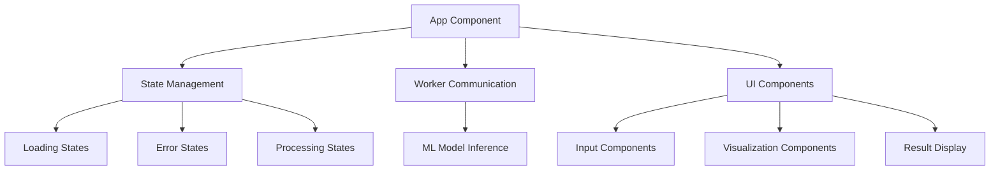
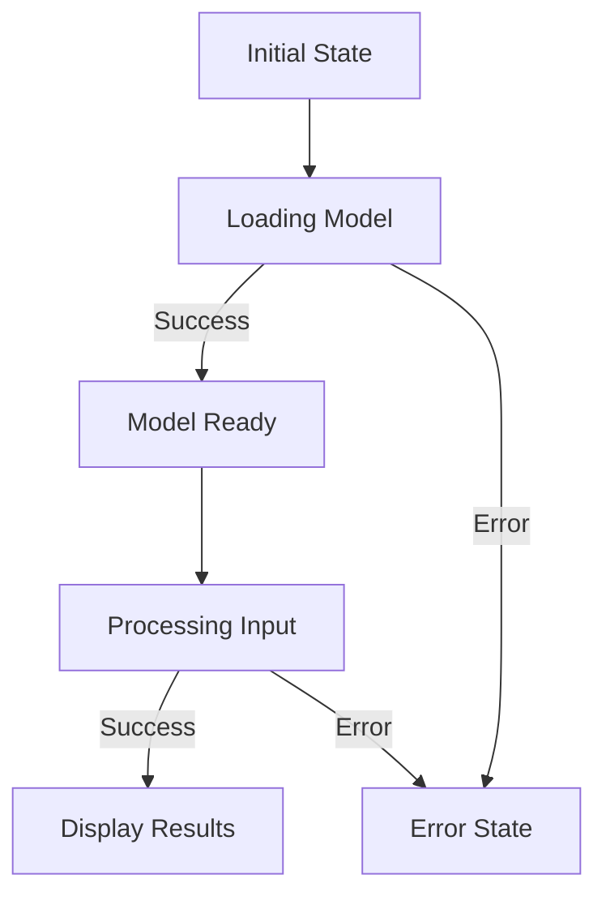
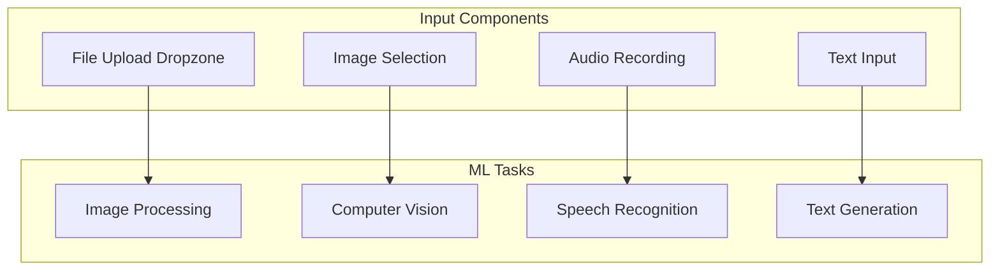
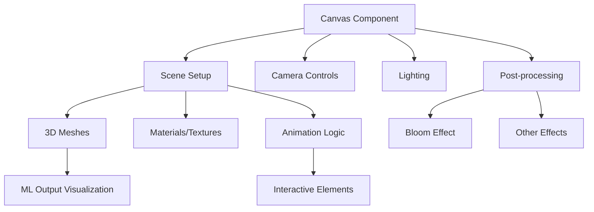
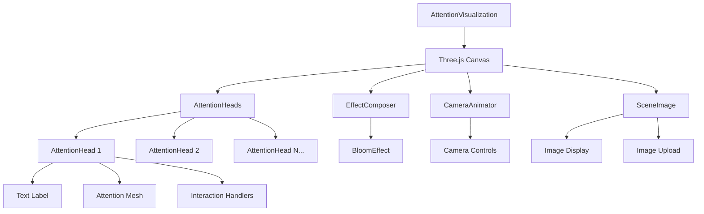
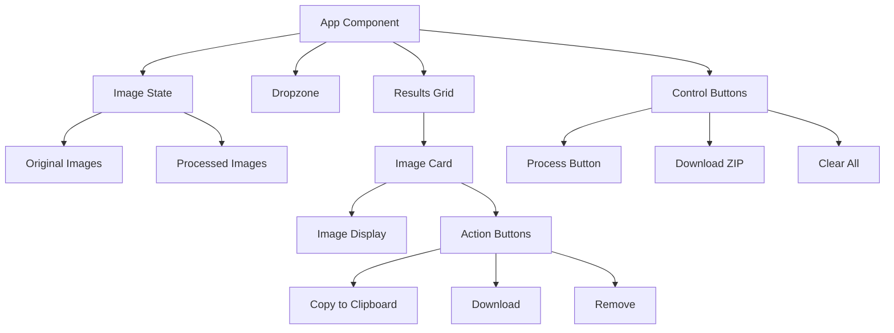
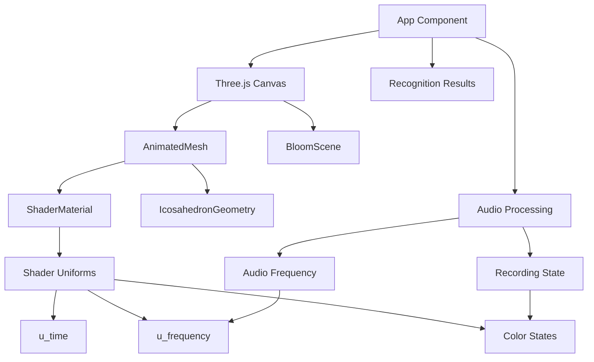
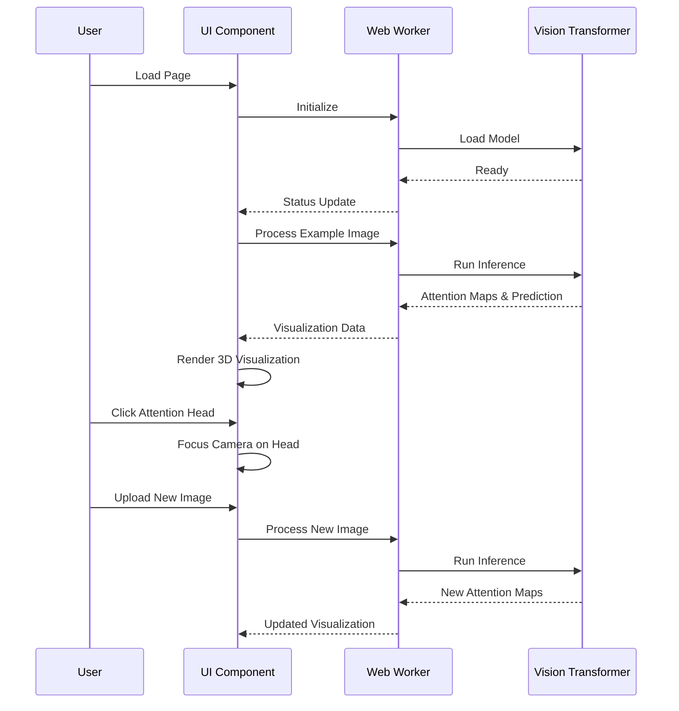
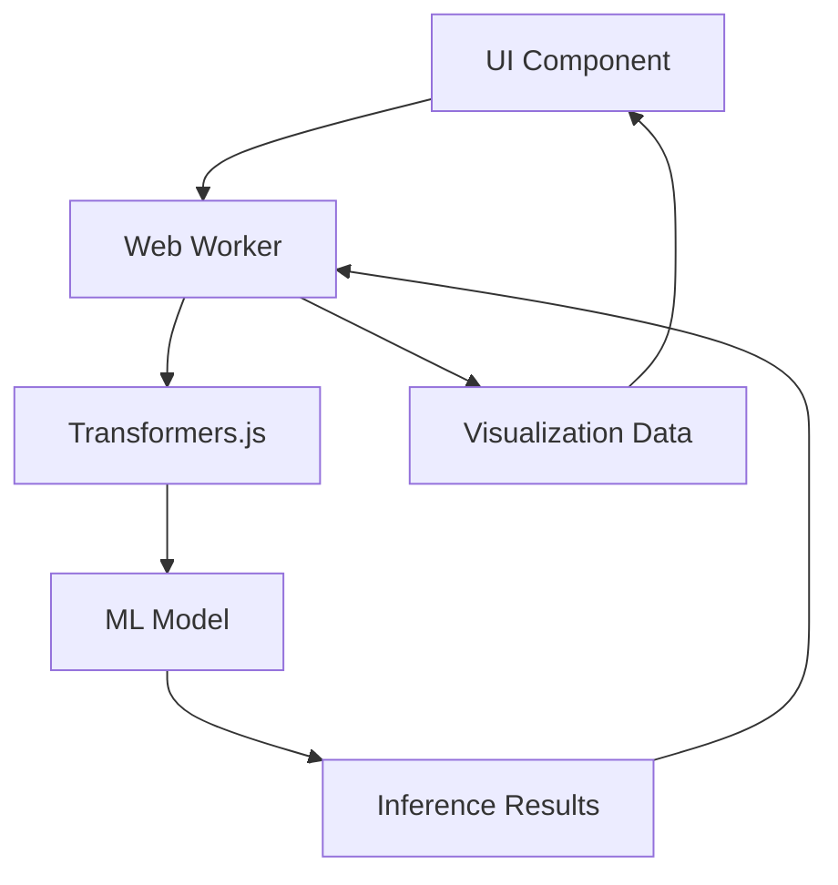

<!-- source: DeepWiki mcp.deepwiki.com · repo huggingface/transformers.js-examples · page 6.2 Shared Dependencies and Runtime Architecture · fetched 2026-10-26 -->

# UI Components and Visualization

Relevant source files

The following files were used as context for generating this wiki page:

- [bun/bun.lockb](bun/bun.lockb)
- [bun/package.json](bun/package.json)
- [node-cjs/package-lock.json](node-cjs/package-lock.json)
- [node-cjs/package.json](node-cjs/package.json)
- [node-esm/package-lock.json](node-esm/package-lock.json)
- [node-esm/package.json](node-esm/package.json)
- [pglite-semantic-search/package-lock.json](pglite-semantic-search/package-lock.json)
- [pglite-semantic-search/package.json](pglite-semantic-search/package.json)
- [phi-3.5-webgpu/package-lock.json](phi-3.5-webgpu/package-lock.json)
- [phi-3.5-webgpu/package.json](phi-3.5-webgpu/package.json)
- [remove-background-webgpu/package-lock.json](remove-background-webgpu/package-lock.json)
- [remove-background-webgpu/package.json](remove-background-webgpu/package.json)
- [smollm-webgpu/package-lock.json](smollm-webgpu/package-lock.json)
- [smollm-webgpu/package.json](smollm-webgpu/package.json)

This page covers the user interface components and visualization techniques used throughout the Transformers.js examples repository. It explains how these components are designed, implemented, and integrated with machine learning models to create interactive and visually engaging experiences. For information about the Web Worker Pattern that supports many of these interfaces, see [Web Worker Pattern](#4.1).

## Common UI Component Patterns

The examples in the repository demonstrate several recurring UI patterns that facilitate interaction with machine learning models. These patterns ensure a consistent user experience while allowing for specialized visualizations tailored to different ML tasks.

### React Component Architecture

Most examples follow a common React architecture pattern that separates concerns and manages the ML processing workflow:

This architecture allows for effective separation between UI rendering and compute-intensive ML tasks, which typically run in a Web Worker.

Sources:
- remove-background-webgpu/src/App.jsx
- attention-visualization/src/App.jsx
- moonshine-web/src/App.jsx

### Loading and Error States

A consistent pattern across examples is the handling of loading and error states to provide feedback during model initialization and processing:

Examples implement dedicated UI components for these states, providing clear visual feedback about the current application status:

Sources:
- [remove-background-webgpu/src/App.jsx:183-203]()
- [attention-visualization/src/App.jsx:501-514]()

### User Input Components

The examples implement various specialized input components depending on the ML task:

For example, the background removal example uses a customized dropzone component for image uploads:

Sources:
- [remove-background-webgpu/src/App.jsx:43-61]()
- [remove-background-webgpu/src/App.jsx:244-253]()

## Visualization Techniques

### 3D Visualizations with Three.js/React Three Fiber

Several examples use Three.js via React Three Fiber to create interactive 3D visualizations of ML model behaviors:

The React Three Fiber library provides React bindings for Three.js, enabling declarative 3D scene creation in a React component structure.

Sources:
- [attention-visualization/src/App.jsx:354-422]()
- [moonshine-web/src/components/AnimatedMesh.jsx]()
- [moonshine-web/src/components/BloomScene.jsx]()

### Attention Visualization

The attention visualization example demonstrates a sophisticated 3D representation of vision transformer attention patterns:

This visualization allows users to:
- Interact with individual attention heads 
- See how different transformer layers attend to image regions
- Upload custom images for analysis
- Navigate and zoom within the 3D space

Sources:
- [attention-visualization/src/App.jsx:45-146]()
- [attention-visualization/src/App.jsx:284-422]()

### Image Processing UI

The background removal example implements a clean, task-focused UI for image processing:

The UI is designed for an intuitive workflow: upload images, process them, and then view and export the results.

Sources:
- [remove-background-webgpu/src/App.jsx:13-19]() (state)
- [remove-background-webgpu/src/App.jsx:284-321]() (image grid)
- [remove-background-webgpu/src/App.jsx:261-282]() (control buttons)

### Audio Visualization

The Moonshine Web example visualizes speech recognition with animated 3D representations:

This visualization creates a dynamic, responsive 3D mesh that reacts to audio input and changes appearance based on the recognition state.

Sources:
- [moonshine-web/src/components/AnimatedMesh.jsx]()
- [moonshine-web/src/components/BloomScene.jsx]()

## Implementation Examples

### Attention Visualization Implementation

The attention visualization example showcases a sophisticated implementation that bridges ML model outputs with interactive 3D visualization:

Key components:
- `AttentionHead`: Renders individual attention head visualizations with interactive capabilities
- `CameraAnimator`: Controls camera movement and focus based on user interaction
- `SceneImage`: Displays the input image and handles image uploads
- `EffectComposer`: Applies post-processing effects for visual enhancement

Sources:
- [attention-visualization/src/App.jsx:45-146]() (AttentionHead)
- [attention-visualization/src/App.jsx:206-282]() (CameraAnimator)
- [attention-visualization/src/App.jsx:425-498]() (App implementation)

### Background Removal UI Implementation

The background removal example demonstrates a straightforward yet effective UI for image processing:

Key features:
- Drag-and-drop file upload with responsive visual feedback
- Clear state indicators during model loading and processing 
- Interactive grid display of processed images with hover actions
- Clipboard integration and download functionality
- Batch processing with ZIP export option

The implementation handles the entire pipeline from image selection through WebGPU-accelerated processing to result presentation within a cohesive UI.

Sources:
- [remove-background-webgpu/src/App.jsx:70-117]() (image processing)
- [remove-background-webgpu/src/App.jsx:119-148]() (ZIP download)
- [remove-background-webgpu/src/App.jsx:156-181]() (clipboard functionality)

### Audio Visualization in Moonshine Web

The Moonshine Web example combines speech recognition with real-time 3D visualization:

Key components:
- `AnimatedMesh`: A wireframe 3D icosahedron that responds to audio input
- `BloomScene`: Post-processing effects that enhance the visual experience
- Custom shaders that animate based on audio frequency data
- Color transitions that indicate recognition state (ready, recording, processing)

The visualization uses WebGL shaders to create dynamic, responsive animations that transform based on the audio input and recognition status.

Sources:
- [moonshine-web/src/components/AnimatedMesh.jsx:11-50]()
- [moonshine-web/src/components/BloomScene.jsx:11-58]()

## Integration with Transformers.js

The UI components in these examples integrate with the Transformers.js library through a consistent pattern:

This architecture ensures that:
1. UI remains responsive during compute-intensive operations
2. Model loading and inference happen in a separate thread
3. Visualization components receive processed data ready for rendering

The UI components are designed to visualize the specific outputs of different model types:
- Attention heads for vision transformers
- Processed images for segmentation models
- Transcription results for speech recognition models

Sources:
- [attention-visualization/src/App.jsx:450-486]()
- [remove-background-webgpu/src/App.jsx:24-41]()
- [moonshine-web/src/App.jsx:17-25]()

---

