<!-- source: DeepWiki mcp.deepwiki.com · repo huggingface/transformers.js-examples · page 6.3 State Management · fetched 2026-10-26 -->

# State Management

<details>
<summary>Relevant source files</summary>

The following files were used as context for generating this wiki page:

- [gemma-2-2b-jpn-webgpu/package-lock.json](gemma-2-2b-jpn-webgpu/package-lock.json)
- [gemma-2-2b-jpn-webgpu/package.json](gemma-2-2b-jpn-webgpu/package.json)
- [llama-3.2-webgpu/package-lock.json](llama-3.2-webgpu/package-lock.json)
- [llama-3.2-webgpu/package.json](llama-3.2-webgpu/package.json)
- [llama-3.2-webgpu/src/App.jsx](llama-3.2-webgpu/src/App.jsx)
- [llama-3.2-webgpu/src/worker.js](llama-3.2-webgpu/src/worker.js)
- [next-vercel-ai-sdk-v5/README.md](next-vercel-ai-sdk-v5/README.md)
- [next-vercel-ai-sdk-v5/package-lock.json](next-vercel-ai-sdk-v5/package-lock.json)
- [next-vercel-ai-sdk-v5/package.json](next-vercel-ai-sdk-v5/package.json)
- [next-vercel-ai-sdk-v5/src/app/chat-transport.ts](next-vercel-ai-sdk-v5/src/app/chat-transport.ts)
- [next-vercel-ai-sdk-v5/src/app/models.ts](next-vercel-ai-sdk-v5/src/app/models.ts)
- [next-vercel-ai-sdk-v5/src/app/page.tsx](next-vercel-ai-sdk-v5/src/app/page.tsx)
- [next-vercel-ai-sdk-v5/src/app/simple-chat-transport.ts](next-vercel-ai-sdk-v5/src/app/simple-chat-transport.ts)
- [next-vercel-ai-sdk-v5/src/app/worker.ts](next-vercel-ai-sdk-v5/src/app/worker.ts)
- [next-vercel-ai-sdk-v5/src/store/store.ts](next-vercel-ai-sdk-v5/src/store/store.ts)
- [realtime-whisper-webgpu/package-lock.json](realtime-whisper-webgpu/package-lock.json)
- [video-object-detection/package-lock.json](video-object-detection/package-lock.json)

</details>


This document describes the state management patterns used across transformers.js examples to coordinate UI state, model lifecycle, and machine learning operations. The examples demonstrate two primary approaches: Zustand-based centralized stores in Next.js applications, and React hooks-based local state in Vite applications. Both patterns handle the complexity of offloading ML inference to Web Workers while maintaining responsive UIs.

For information about the Web Worker architecture patterns, see [Web Worker Pattern](#6.1). For details on shared dependencies and runtime selection, see [Shared Dependencies and Runtime Architecture](#6.2).

## State Architecture Overview

State management in transformers.js examples follows a split architecture pattern where UI state resides on the main thread while model and inference operations execute in Web Workers. This separation ensures responsive interfaces during computationally intensive operations.

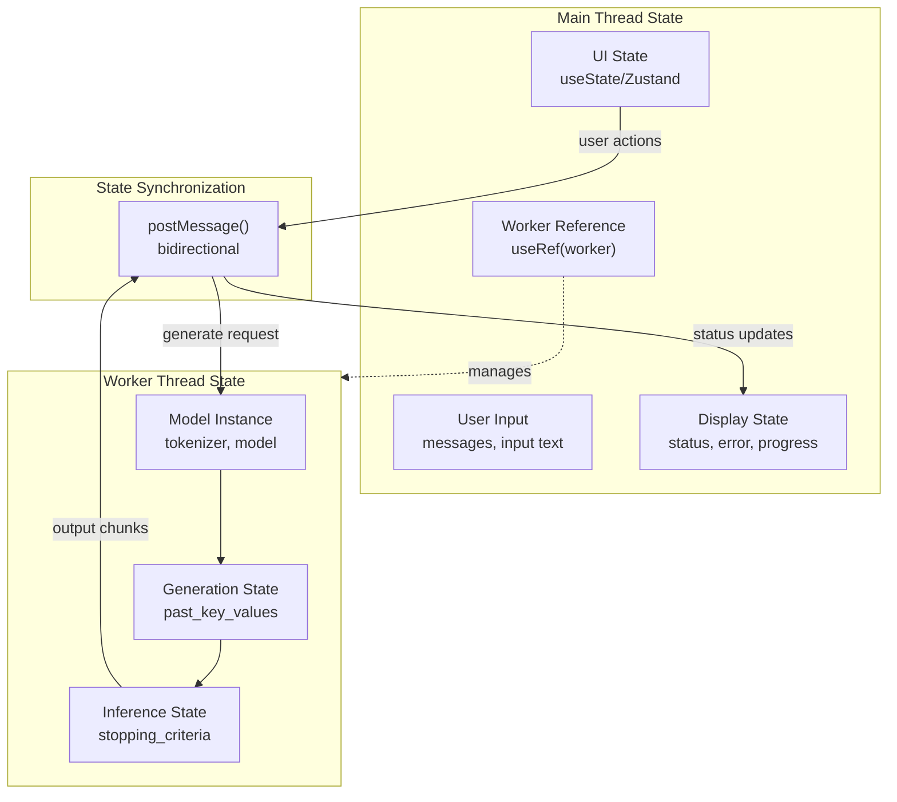

**Sources**: [llama-3.2-webgpu/src/App.jsx:1-400](), [next-vercel-ai-sdk-v5/src/store/store.ts:1-74]()

## Zustand Store Pattern

The Next.js Vercel AI SDK examples use Zustand for centralized model state management. The `useModelStore` provides singleton model instances with lazy initialization.

### Model Store Structure

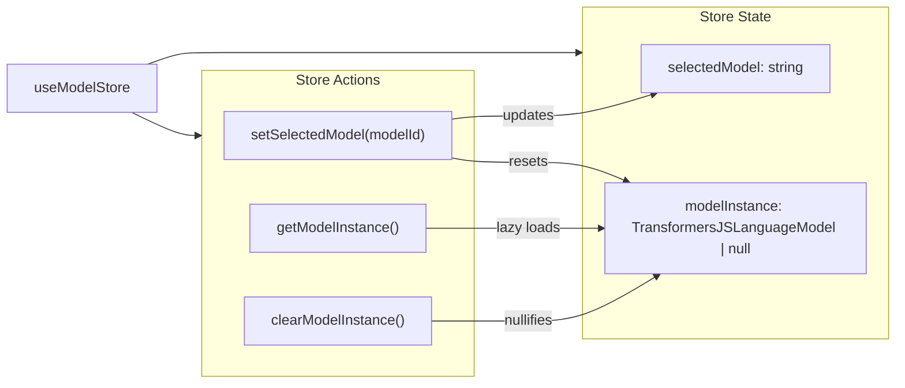

The store implementation at [next-vercel-ai-sdk-v5/src/store/store.ts:16-73]() demonstrates the core pattern:

| Store Property | Type | Purpose |
|----------------|------|---------|
| `selectedModel` | `string` | Currently selected model ID from MODELS array |
| `modelInstance` | `TransformersJSLanguageModel \| null` | Cached model instance, lazily initialized |
| `setSelectedModel` | `(modelId: string) => void` | Updates selection and clears stale instance |
| `getModelInstance` | `() => Promise<TransformersJSLanguageModel>` | Returns cached or creates new instance |
| `clearModelInstance` | `() => void` | Invalidates cached instance |

The store ensures model instances are reused across chat sessions but cleared when switching models ([next-vercel-ai-sdk-v5/src/store/store.ts:20-25]()).

### Model Lifecycle State Transitions

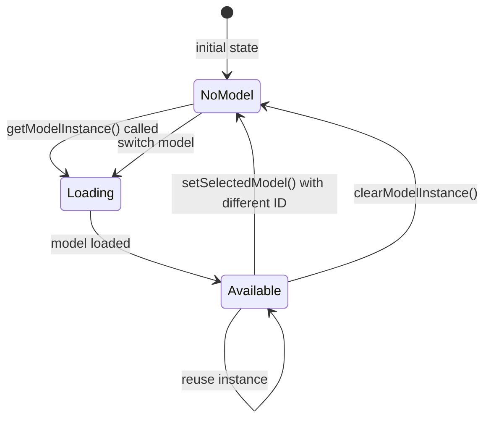

**Sources**: [next-vercel-ai-sdk-v5/src/store/store.ts:1-74](), [next-vercel-ai-sdk-v5/src/app/models.ts:1-51]()

## React Hooks State Pattern

WebGPU examples use React's built-in state management hooks without external libraries. The pattern centers on `useState` for state variables and `useRef` for worker references.

### Component State Structure

The Llama 3.2 WebGPU example at [llama-3.2-webgpu/src/App.jsx:16-47]() maintains the following state variables:

| State Variable | Type | Purpose |
|----------------|------|---------|
| `status` | `string \| null` | Model loading status: `null`, `"loading"`, `"ready"` |
| `error` | `string \| null` | Error message from worker or initialization |
| `loadingMessage` | `string` | User-facing loading status text |
| `progressItems` | `Array<{file, progress, total}>` | Model file download progress |
| `isRunning` | `boolean` | Whether generation is in progress |
| `input` | `string` | Current user input text |
| `messages` | `Array<{role, content}>` | Chat conversation history |
| `tps` | `number \| null` | Tokens per second performance metric |
| `numTokens` | `number \| null` | Total tokens generated |
| `worker` | `Worker` (ref) | Web Worker instance reference |

### State Update Flow

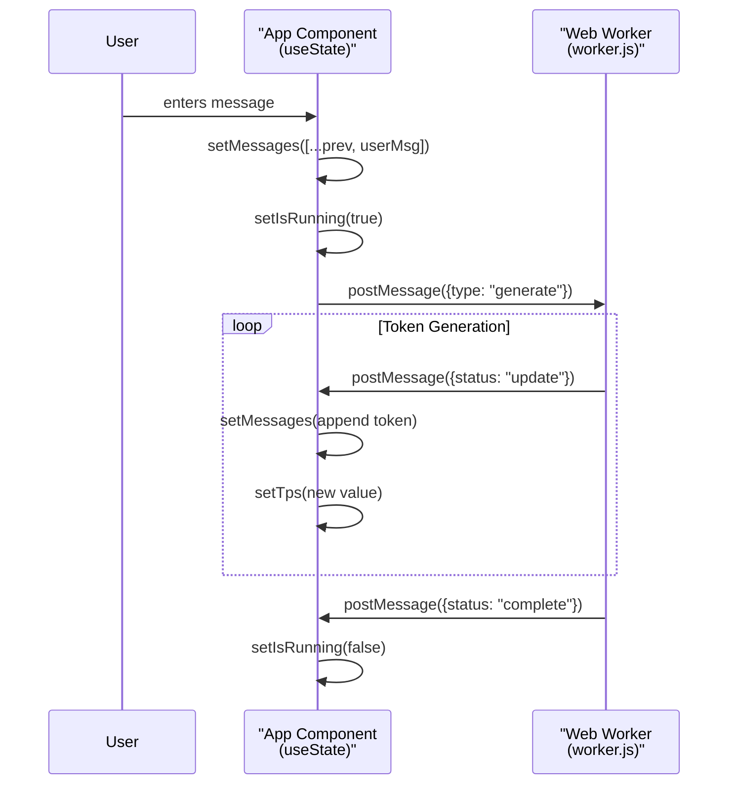

The message handler at [llama-3.2-webgpu/src/App.jsx:73-147]() updates state based on worker messages:

- `"loading"` → updates `status` and `loadingMessage`
- `"initiate"` → adds new progress item to `progressItems`
- `"progress"` → updates matching progress item
- `"done"` → removes completed progress item
- `"ready"` → sets `status` to `"ready"`
- `"start"` → appends empty assistant message
- `"update"` → appends tokens to last message, updates `tps` and `numTokens`
- `"complete"` → sets `isRunning` to `false`
- `"error"` → sets `error` state

**Sources**: [llama-3.2-webgpu/src/App.jsx:16-162]()

## Progress Tracking State

Progress tracking state enables real-time feedback during model downloads, which can involve multi-gigabyte files. Two patterns are used across examples.

### Array-Based Progress Tracking

The standalone WebGPU examples use an array of progress items, where each item represents one model file:

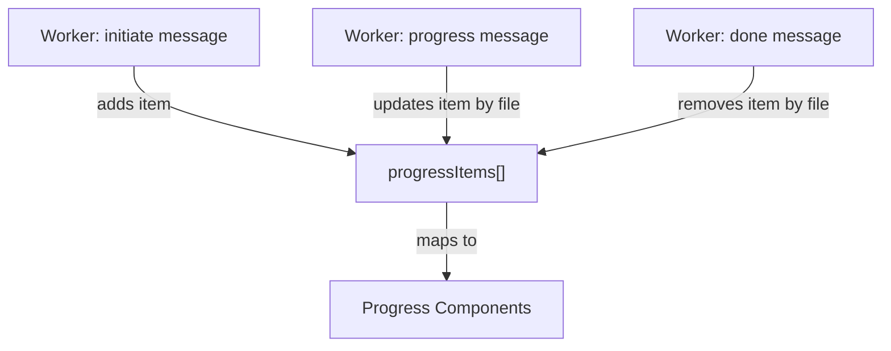

Implementation at [llama-3.2-webgpu/src/App.jsx:82-102]():
- `"initiate"` → `setProgressItems(prev => [...prev, e.data])`
- `"progress"` → `setProgressItems(prev => prev.map(item => item.file === e.data.file ? {...item, ...e.data} : item))`
- `"done"` → `setProgressItems(prev => prev.filter(item => item.file !== e.data.file))`

### Message-Based Progress Tracking

The Vercel AI SDK examples use custom message types within the AI SDK's message stream. Progress updates are transient data messages that get cleared once complete.

At [next-vercel-ai-sdk-v5/src/app/chat-transport.ts:63-111](), progress is tracked through the AI SDK's `UIMessageChunk` stream:

```typescript
writer.write({
  type: "data-modelDownloadProgress",
  id: downloadProgressId,
  data: {
    status: "downloading" | "complete",
    progress: percent,
    message: string
  },
  transient: true  // automatically removed when complete
})
```

The component at [next-vercel-ai-sdk-v5/src/app/page.tsx:159-177]() conditionally renders progress based on message parts:

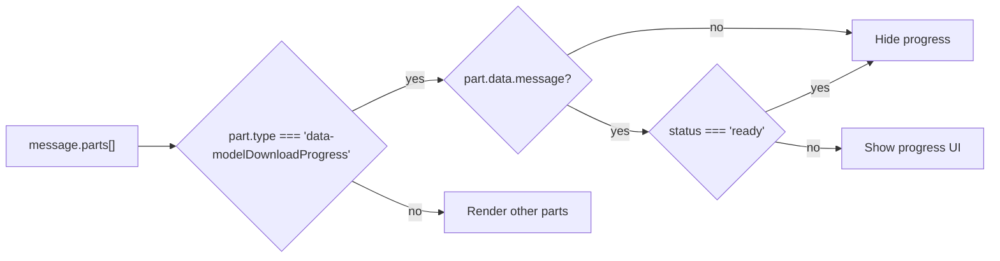

**Sources**: [llama-3.2-webgpu/src/App.jsx:82-102](), [next-vercel-ai-sdk-v5/src/app/chat-transport.ts:54-111](), [next-vercel-ai-sdk-v5/src/app/page.tsx:159-177]()

## Chat Message State Management

Chat messages follow a standardized structure across examples, representing the conversation history between user and assistant.

### Message Structure

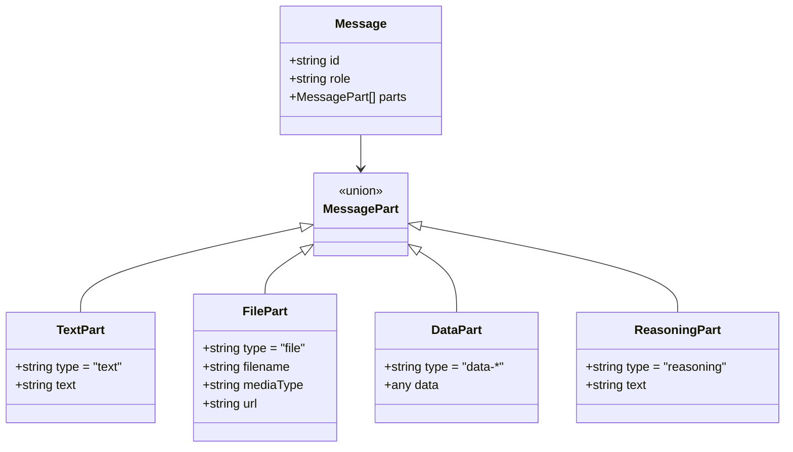

### State Update Patterns

**Appending User Messages**: New user messages are appended to the messages array using spread syntax:

```typescript
setMessages(prev => [...prev, { role: "user", content: message }])
```

**Streaming Assistant Responses**: Assistant responses are built incrementally. The pattern initializes an empty message, then updates it with each token:

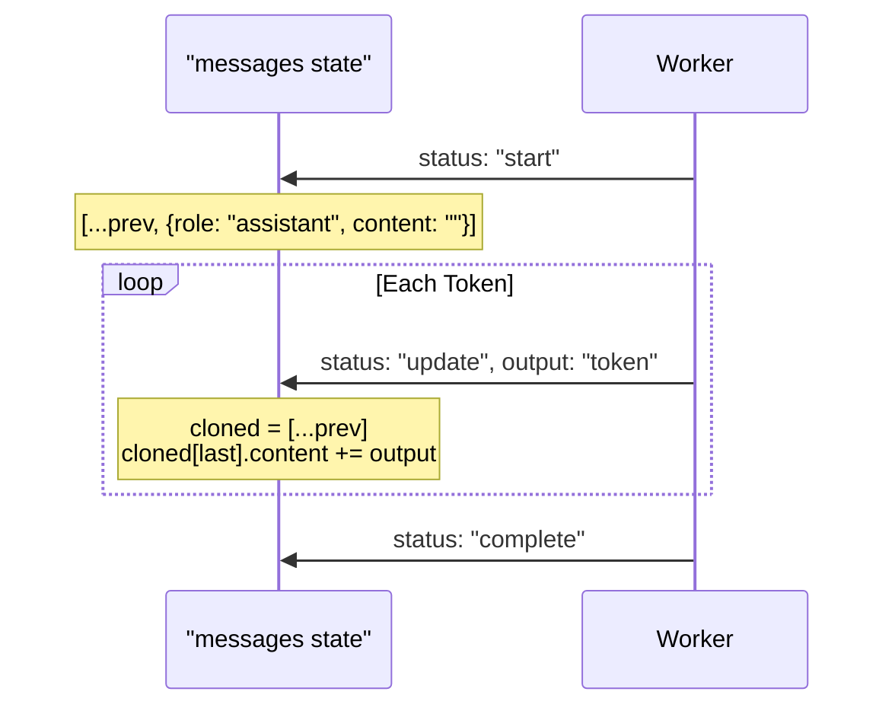

Implementation at [llama-3.2-webgpu/src/App.jsx:119-136]():

```javascript
// Start: add empty assistant message
setMessages(prev => [...prev, { role: "assistant", content: "" }])

// Update: append to last message
setMessages(prev => {
  const cloned = [...prev];
  const last = cloned.at(-1);
  cloned[cloned.length - 1] = {
    ...last,
    content: last.content + output
  };
  return cloned;
})
```

### AI SDK Message State

The Vercel AI SDK's `useChat` hook at [next-vercel-ai-sdk-v5/src/app/page.tsx:54-58]() manages message state internally:

```typescript
const { messages, sendMessage, status, stop, regenerate } = useChat<TransformersUIMessage>({
  transport: new TransformersChatTransport(),
  experimental_throttle: 75
})
```

The hook provides:
- `messages`: Array of `TransformersUIMessage` objects with multi-part structure
- `sendMessage`: Function to add user message and trigger generation
- `status`: Generation state (`"ready"`, `"submitted"`, `"streaming"`)
- `stop`: Function to interrupt ongoing generation
- `regenerate`: Function to regenerate last assistant message

**Sources**: [llama-3.2-webgpu/src/App.jsx:36-176](), [next-vercel-ai-sdk-v5/src/app/page.tsx:48-101]()

## Worker State Management

Web Workers maintain their own state separate from the main thread, primarily for ML model instances and generation state.

### Worker Singleton Pattern

The worker at [llama-3.2-webgpu/src/worker.js:11-27]() uses a singleton pattern for model instances:

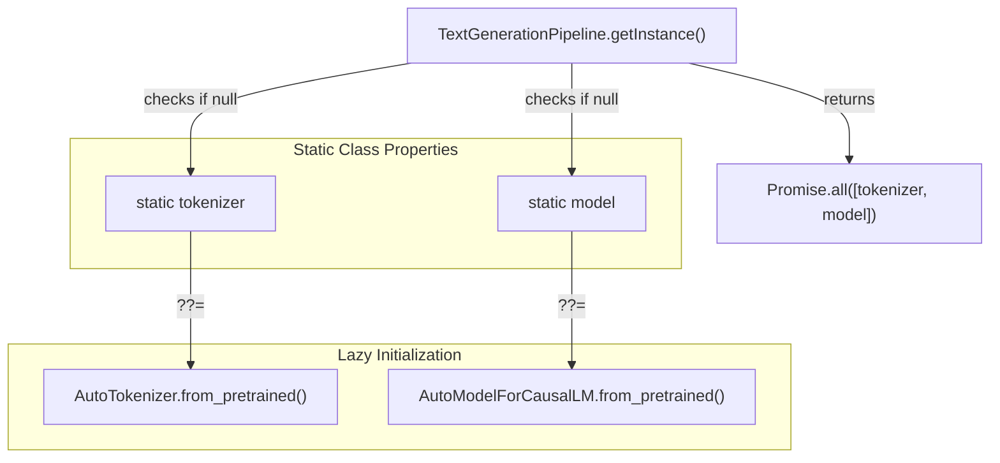

The nullish coalescing assignment operator (`??=`) ensures model instances are created only once:

```javascript
this.tokenizer ??= AutoTokenizer.from_pretrained(this.model_id, { progress_callback });
this.model ??= AutoModelForCausalLM.from_pretrained(this.model_id, { dtype: "q4f16", device: "webgpu", progress_callback });
```

### Generation State: KV Cache

The worker maintains `past_key_values_cache` at [llama-3.2-webgpu/src/worker.js:31-82]() to optimize generation performance:

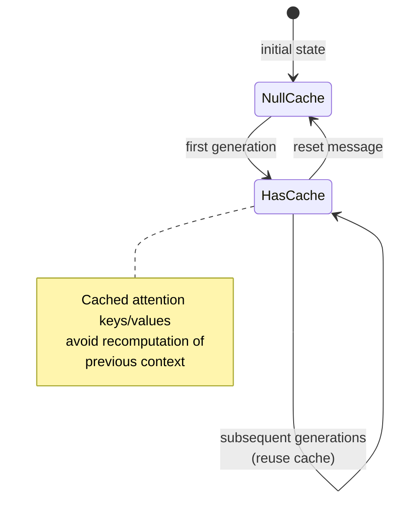

The cache is populated from generation output and reused in subsequent calls:

```javascript
const { past_key_values, sequences } = await model.generate({
  ...inputs,
  past_key_values: past_key_values_cache,  // reuse from previous generation
  max_new_tokens: 1024,
  // ...
});
past_key_values_cache = past_key_values;  // save for next generation
```

### Interruptable Generation State

The `InterruptableStoppingCriteria` at [llama-3.2-webgpu/src/worker.js:29]() manages interrupt state:

| State Transitions | Triggered By | Effect |
|-------------------|--------------|--------|
| Ready → Generating | `generate` message | Calls `stopping_criteria.reset()` |
| Generating → Interrupted | `interrupt` message | Calls `stopping_criteria.interrupt()` |
| Interrupted → Ready | Generation completes | Worker sends `"complete"` message |

**Sources**: [llama-3.2-webgpu/src/worker.js:1-160](), [next-vercel-ai-sdk-v5/src/app/worker.ts:1-7]()

## State Coordination Between Main Thread and Worker

State consistency across thread boundaries requires careful message-based coordination.

### State Synchronization Protocol

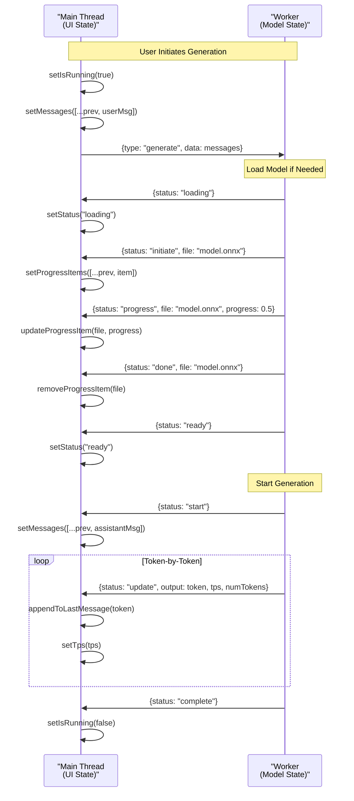

### Status State Machine

Main thread `status` state coordinates UI rendering with worker lifecycle:

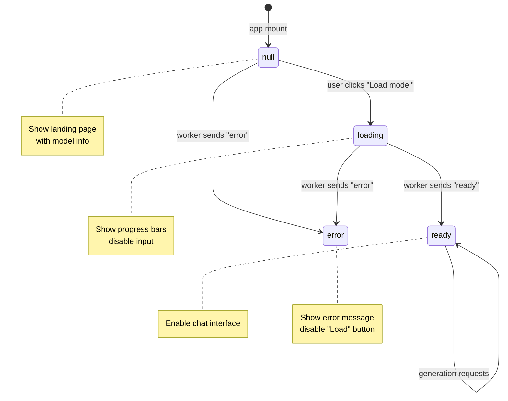

Implementation at [llama-3.2-webgpu/src/App.jsx:74-107]():
- Worker `"loading"` → UI `setStatus("loading")`
- Worker `"ready"` → UI `setStatus("ready")`
- Worker `"error"` → UI `setError(e.data.data)`

### Preventing Race Conditions

The examples use `isRunning` state to prevent concurrent generation requests:

```javascript
// Guard in message effect
if (messages.at(-1).role === "assistant") {
  return;  // Don't send if last message is already assistant
}
```

Button states also reflect `isRunning` at [llama-3.2-webgpu/src/App.jsx:356-363]():

```javascript
onKeyDown={(e) => {
  if (input.length > 0 && !isRunning && e.key === "Enter" && !e.shiftKey) {
    e.preventDefault();
    onEnter(input);
  }
}}
```

**Sources**: [llama-3.2-webgpu/src/App.jsx:73-188](), [next-vercel-ai-sdk-v5/src/app/chat-transport.ts:22-151]()

## State Persistence and Caching

State persistence differs between the two architectural patterns.

### Zustand Store Persistence

The Zustand store maintains model instance state across component re-renders and chat sessions. Model instances remain cached until explicitly cleared:

```typescript
// Model persists in store
const modelInstance = await getModelInstance();  // cached
// ... user sends multiple messages ...
const modelInstance2 = await getModelInstance();  // same instance
```

Model change triggers cache invalidation at [next-vercel-ai-sdk-v5/src/store/store.ts:20-25]():

```typescript
setSelectedModel: (modelId: string) => {
  const state = get();
  if (state.selectedModel !== modelId) {
    set({ selectedModel: modelId, modelInstance: null });  // clear cache
  }
}
```

### Worker-Level State Persistence

Worker state persists across multiple generation calls until page reload or worker termination:

- **Model instance**: Lives for entire worker lifetime (singleton pattern)
- **KV cache**: Persists across generations within same chat session
- **Stopping criteria**: Reset between generations via `reset()` call

The worker never terminates in these examples, so model state is effectively permanent after first load.

### Browser-Level Caching

Model files downloaded via ONNX Runtime are cached in IndexedDB by the browser automatically. This cache is separate from application state but affects first-load performance:

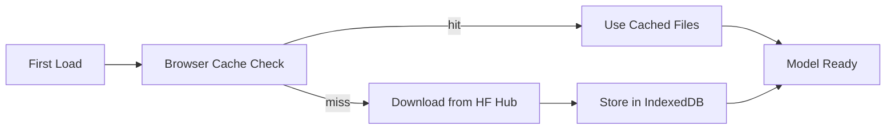

**Sources**: [next-vercel-ai-sdk-v5/src/store/store.ts:16-73](), [llama-3.2-webgpu/src/worker.js:11-27]()

## Performance Metrics State

Performance metrics (tokens per second, token count) are tracked in UI state to provide user feedback.

### TPS Calculation in Worker

The worker calculates TPS during generation at [llama-3.2-webgpu/src/worker.js:41-50]():

```javascript
let startTime;
let numTokens = 0;
let tps;
const token_callback_function = () => {
  startTime ??= performance.now();
  if (numTokens++ > 0) {
    tps = (numTokens / (performance.now() - startTime)) * 1000;
  }
};
```

These metrics are sent to the main thread with each token update:

```javascript
self.postMessage({
  status: "update",
  output,
  tps,
  numTokens
});
```

### TPS Display State

The main thread maintains TPS state and displays it in the UI at [llama-3.2-webgpu/src/App.jsx:307-340]():

```javascript
{tps && messages.length > 0 && (
  <>
    {!isRunning && (
      <span>Generated {numTokens} tokens in {(numTokens / tps).toFixed(2)} seconds (</span>
    )}
    <span className="font-medium">{tps.toFixed(2)}</span>
    <span>tokens/second</span>
  </>
)}
```

The state is nullified when starting new generations to show fresh metrics:

```javascript
function onEnter(message) {
  setMessages(prev => [...prev, { role: "user", content: message }]);
  setTps(null);  // clear previous metrics
  setIsRunning(true);
}
```

**Sources**: [llama-3.2-webgpu/src/App.jsx:33-41](), [llama-3.2-webgpu/src/worker.js:41-58]()

## State Management Comparison

| Aspect | Zustand Pattern (AI SDK) | React Hooks Pattern (WebGPU) |
|--------|-------------------------|------------------------------|
| **State Location** | Centralized store + component state | Component-level state only |
| **Model Instance** | Cached in Zustand store | Singleton in worker |
| **Message Management** | `useChat` hook manages internally | Manual `useState` array |
| **Progress Tracking** | AI SDK message parts | `progressItems` state array |
| **Model Switching** | Store method with cache clear | Requires page reload |
| **Type Safety** | Full TypeScript types | JavaScript with JSDoc |
| **Complexity** | Higher (external libs) | Lower (built-in hooks) |
| **Best For** | Multi-model apps with switching | Single-model focused demos |

**Sources**: [next-vercel-ai-sdk-v5/src/store/store.ts:1-74](), [llama-3.2-webgpu/src/App.jsx:1-400]()

---

