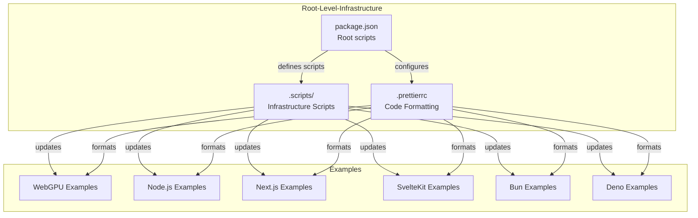
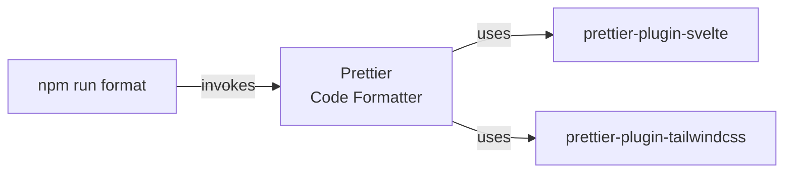
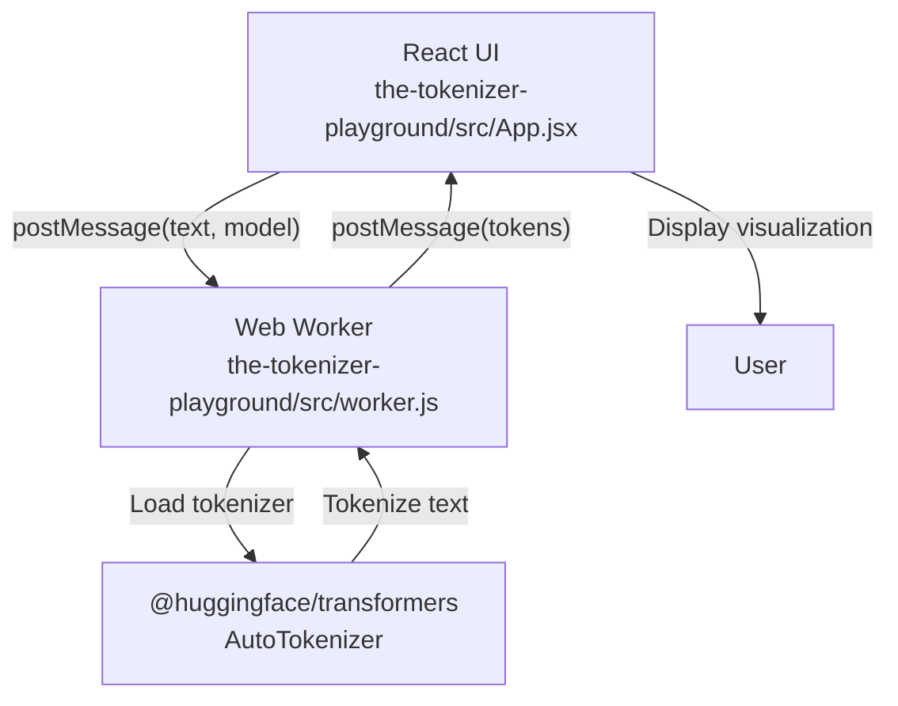
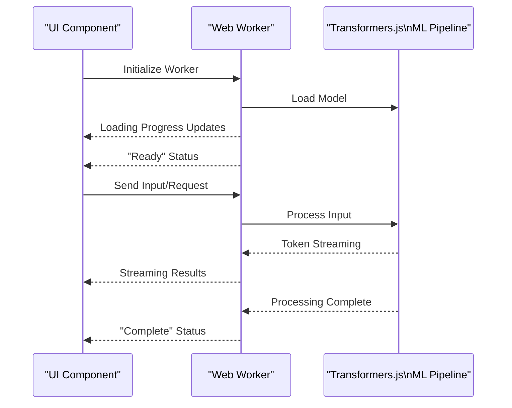
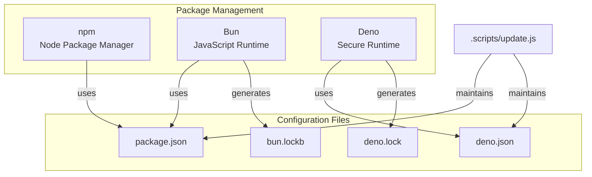

<!-- source: DeepWiki mcp.deepwiki.com · repo huggingface/transformers.js-examples · page 7 Developer Tools · fetched 2026-10-26 -->

# Developer Tools

<details>
<summary>Relevant source files</summary>

The following files were used as context for generating this wiki page:

- [.gitignore](.gitignore)
- [.prettierrc](.prettierrc)
- [.scripts/build.js](.scripts/build.js)
- [.scripts/update.js](.scripts/update.js)
- [deepseek-r1-webgpu/src/App.jsx](deepseek-r1-webgpu/src/App.jsx)
- [package-lock.json](package-lock.json)
- [package.json](package.json)

</details>


This document provides an overview of the development tools and utilities provided in the repository for maintaining the monorepo and debugging. The repository includes infrastructure scripts for dependency management and building, code formatting tools, and a tokenizer visualization playground.

For detailed information about monorepo management scripts, see page 7.1. For the tokenizer playground, see page 7.2.

## Repository Structure

The repository is organized as a collection of independent examples that share common infrastructure for development, building, and maintenance.



Sources: [package.json:5-9](), [.scripts/update.js](), [.scripts/build.js]()

## Monorepo Management Scripts

The repository includes infrastructure scripts for maintaining dependencies and building projects across the monorepo. These scripts are located in the `.scripts/` directory and provide commands for:

| Script | Command | Purpose |
|--------|---------|---------|
| `update.js` | `npm run update` | Updates `@huggingface/transformers` across all projects and runs security audits |
| `update.js --audit_only` | `npm run audit` | Runs security audits without updating versions |
| `build.js` | `npm run build` | Builds all projects that define a build script |

**Update Script Overview**

The [.scripts/update.js]() script automatically maintains version consistency across all examples by:
- Fetching the latest version of `@huggingface/transformers`
- Updating each project's `package.json` or `deno.json`
- Running the appropriate package manager (npm, Bun, or Deno) to update lock files
- Executing security audits via `npm audit fix`

**Build Script Overview**

The [.scripts/build.js]() script orchestrates builds across the monorepo by:
- Scanning all project directories
- Detecting projects with a `build` script in their `package.json`
- Running `npm run build` in each applicable project

For detailed documentation of these scripts, including their implementations and workflow diagrams, see page 7.1.

Sources: [.scripts/update.js:1-98](), [.scripts/build.js:1-38](), [package.json:6-11]()

## Code Formatting

The repository uses Prettier for consistent code formatting across all examples, with additional plugins for Svelte and Tailwind CSS.



Sources: [package.json:9](), [package.json:21-25](), [.prettierrc]()

The formatting configuration is minimal, using Prettier's default settings through an empty .prettierrc file, which ensures consistency while relying on Prettier's sensible defaults.

## Tokenizer Playground

The repository includes a tokenizer visualization tool at `the-tokenizer-playground/` that helps developers understand how different models tokenize text. This interactive tool allows users to:

- Select from various pre-trained tokenizers
- Input text and see token-by-token breakdowns
- Visualize token IDs and their corresponding text
- Compare tokenization behavior across different models

**Architecture Overview**

The tokenizer playground follows the standard worker-based architecture used throughout the repository:



The playground uses Vite for development and building, with React for the UI layer and Tailwind CSS for styling. Tokenization is performed in a Web Worker to prevent blocking the main thread during model loading.

For detailed implementation documentation, see page 7.2.

Sources: [the-tokenizer-playground/package.json:1-31]()

## Development Workflow

The typical development workflow for the repository involves:

1. **Repository Setup**:
   ```bash
   # Clone the repository
   git clone https://github.com/huggingface/transformers.js-examples
   cd transformers.js-examples
   
   # Install root dependencies
   npm install
   ```

2. **Update Dependencies**:
   ```bash
   npm run update
   ```

3. **Develop an Example**:
   ```bash
   cd example-directory
   npm run dev
   ```

4. **Build All Examples**:
   ```bash
   # From repository root
   npm run build
   ```

5. **Format Code**:
   ```bash
   # From repository root
   npm run format
   ```

## Example-Specific Infrastructure

Different examples may have specific infrastructure needs based on their environment and use case.

### Web Worker Architecture

Many WebGPU examples use a web worker architecture to offload ML processing from the main thread, preventing UI freezing during computation.



Sources: [deepseek-r1-webgpu/src/App.jsx:62-71](), [deepseek-r1-webgpu/src/App.jsx:72-152]()

This pattern allows for:
1. Non-blocking UI during model loading and inference
2. Progress reporting during long operations
3. Streaming results back to the UI as they're generated
4. Separating ML code from UI code for better maintainability

## Dependency Management

Dependency management in the repository follows these principles:

| Aspect | Implementation | Purpose |
|--------|---------------|---------|
| Version Consistency | Automated updates via `.scripts/update.js` | Ensures all examples use the same version of Transformers.js |
| Runtime Support | Support for npm, Bun, and Deno | Demonstrates Transformers.js in different JavaScript environments |
| Security | Automated audit fixes | Keeps dependencies secure |
| Minimal Dependencies | Only essential dependencies in each example | Keeps examples lightweight and focused |

Sources: [.scripts/update.js:14-71](), [package.json:21-25]()

## Cross-Platform Support

The infrastructure supports multiple JavaScript environments, with appropriate configuration for each:



Sources: [.scripts/update.js:37-64]()

The infrastructure automatically detects the appropriate environment for each example and uses the correct package manager and configuration files.

---

