<!-- source: DeepWiki mcp.deepwiki.com · repo huggingface/transformers.js-examples · page 7.1 Monorepo Management · fetched 2026-10-26 -->

# Monorepo Management

Relevant source files

The following files were used as context for generating this wiki page:

- [.gitignore](.gitignore)
- [.prettierrc](.prettierrc)
- [.scripts/build.js](.scripts/build.js)
- [.scripts/update.js](.scripts/update.js)
- [deepseek-r1-webgpu/src/App.jsx](deepseek-r1-webgpu/src/App.jsx)
- [package-lock.json](package-lock.json)
- [package.json](package.json)

This document details the monorepo management utilities in the transformers.js-examples repository. The `.scripts/` directory contains tools for maintaining consistency across 20+ example projects, handling dependency updates, security audits, and builds.

## Purpose and Overview

The transformers.js-examples repository uses custom Node.js scripts to manage the monorepo:

1. **Dependency Management**: Update `@huggingface/transformers` across all projects with a single command
2. **Security Audits**: Run security audits without modifying dependencies using `--audit_only` mode
3. **Automated Builds**: Build all example projects that define build scripts
4. **Package Manager Detection**: Automatically detect and use npm, Bun, or Deno based on lock files
5. **Error Handling**: Continue processing remaining projects if one fails

The monorepo management system consists of two main utilities:
- `.scripts/update.js` - Dependency updates and security audits
- `.scripts/build.js` - Build orchestration across projects
</thinking>

Sources: [.scripts/update.js:1-98](), [.scripts/build.js:1-38](), [package.json:1-27]()

## Root Configuration and Commands

The repository's root `package.json` defines monorepo management commands:

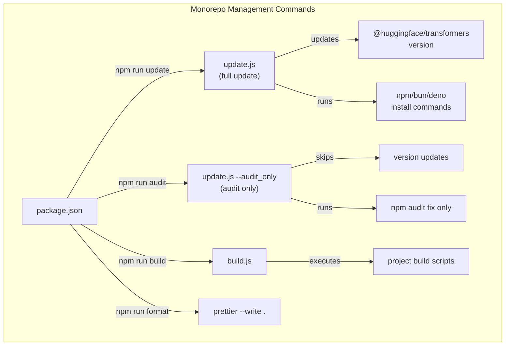

Sources: [package.json:6-10]()

Available commands:

| Command | Script | Purpose |
|---------|--------|---------|
| `npm run update` | `node .scripts/update.js` | Update `@huggingface/transformers` to latest version across all projects and run package manager installs |
| `npm run audit` | `node .scripts/update.js --audit_only` | Run security audits without updating versions |
| `npm run build` | `node .scripts/build.js` | Build all projects that define build scripts |
| `npm run format` | `prettier --write .` | Format all code using Prettier |

Sources: [package.json:6-10]()

## Update Script (update.js)

The update script manages `@huggingface/transformers` dependency versions and runs security audits across all projects.

### Update Script Workflow

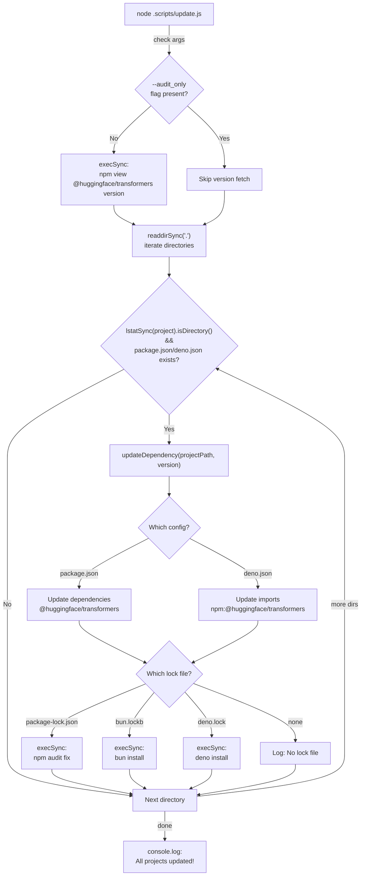

Sources: [.scripts/update.js:1-98]()

### Update Script Logic

The `updateDependency` function in `.scripts/update.js` performs these steps:

1. **Version Update** (skipped if `--audit_only`):
   - Reads `package.json` or `deno.json` from project directory
   - Updates `@huggingface/transformers` to specified version
   - For `package.json`: Updates `dependencies["@huggingface/transformers"]`
   - For `deno.json`: Updates `imports["@huggingface/transformers"]` with `npm:` prefix

2. **Lock File Detection**:
   - Checks for `package-lock.json` → runs `npm audit fix`
   - Checks for `bun.lockb` → runs `bun install`
   - Checks for `deno.lock` → runs `deno install`
   - Logs message if no lock file found

3. **Error Handling**:
   - Catches and logs errors per project
   - Continues processing remaining projects

Sources: [.scripts/update.js:15-71]()

### Package Manager Detection

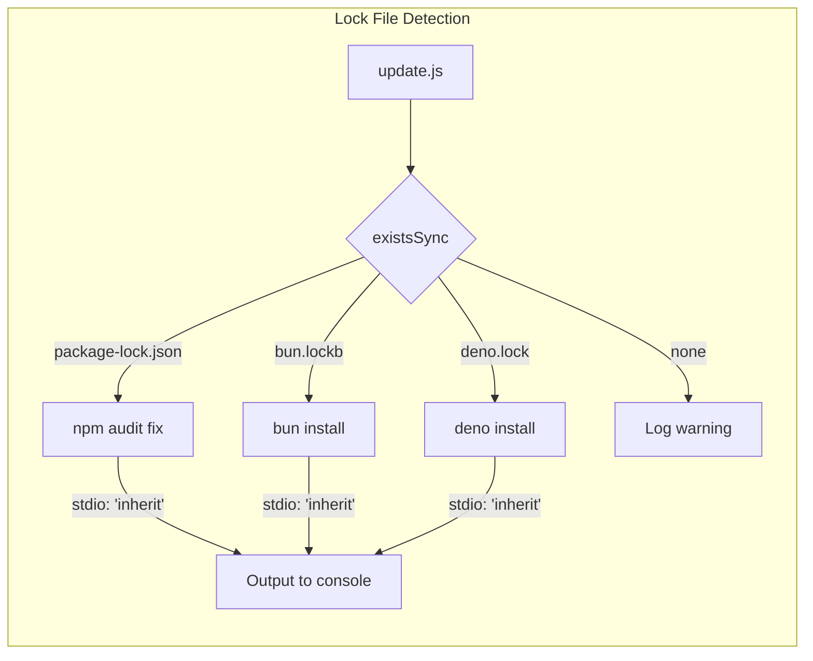

Sources: [.scripts/update.js:56-67]()

The script uses `existsSync` to detect lock files and runs the appropriate package manager:

| Lock File | Package Manager | Command | Purpose |
|-----------|----------------|---------|---------|
| `package-lock.json` | npm | `npm audit fix` | Fix security vulnerabilities |
| `bun.lockb` | Bun | `bun install` | Install/update dependencies |
| `deno.lock` | Deno | `deno install` | Install/update dependencies |

All commands use `{ cwd: projectPath, stdio: 'inherit' }` to run in the project directory and display output.

Sources: [.scripts/update.js:56-67]()

### Audit-Only Mode

The `--audit_only` flag enables security audits without version updates:

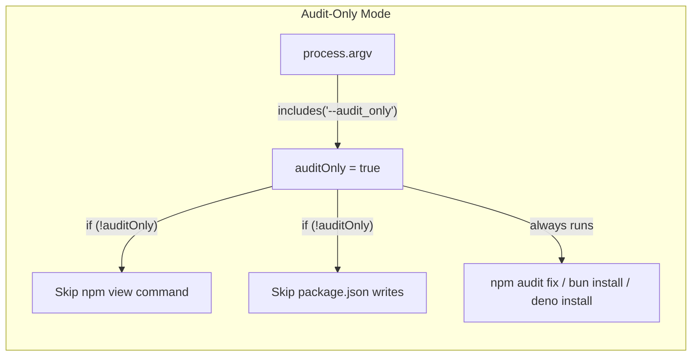

Sources: [.scripts/update.js:12](), [.scripts/update.js:20](), [.scripts/update.js:75-84]()

When `--audit_only` is specified:
- Line 12: `const auditOnly = process.argv.includes("--audit_only")`
- Lines 20-53: All `package.json`/`deno.json` modification code is skipped
- Lines 56-67: Lock file commands still execute to run security audits

This allows running `npm run audit` to fix security issues without changing `@huggingface/transformers` versions.

Sources: [.scripts/update.js:12](), [.scripts/update.js:20-53](), [.scripts/update.js:56-67]()

## Build Script (build.js)

The build script provides a unified way to build all example projects that define build scripts.

### Build Script Workflow

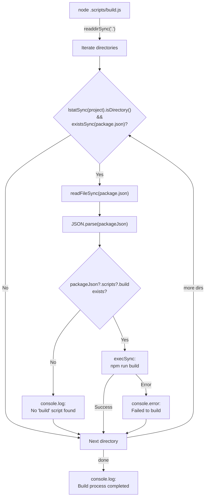

Sources: [.scripts/build.js:1-38]()

### Build Script Logic

The `buildProject` function in `.scripts/build.js`:

1. **Project Discovery**:
   - Lines 28-35: Uses `readdirSync(".")` to find all directories
   - Uses `lstatSync(project).isDirectory()` to verify directories
   - Uses `existsSync(join(project, "package.json"))` to find Node.js projects

2. **Build Detection**:
   - Lines 9-10: Reads and parses `package.json`
   - Line 12: Checks `packageJson?.scripts?.build` for build script

3. **Build Execution**:
   - Line 17: Executes `execSync("npm run build", { cwd: projectPath, stdio: "inherit" })`
   - Output streams directly to console via `stdio: "inherit"`

4. **Error Handling**:
   - Lines 18-20: Catches build errors per project
   - Logs error but continues to next project

Sources: [.scripts/build.js:6-25](), [.scripts/build.js:28-37]()

### Build Output by Project Type

Different project types produce different build outputs:

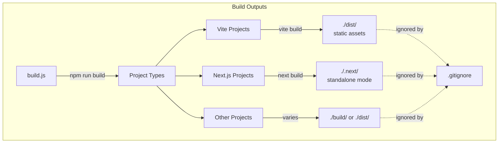

Sources: [.scripts/build.js:17](), [.gitignore:1-5]()

| Project Type | Build Command | Output Directory | Notes |
|--------------|--------------|------------------|-------|
| Vite-based WebGPU apps | `vite build` | `./dist/` | Static assets for deployment |
| Next.js apps | `next build` | `./.next/` | Server-side rendering bundles |
| Other projects | Varies | `./build/` or `./dist/` | Project-specific |

All build outputs are ignored by `.gitignore`:

Sources: [.gitignore:1-5]()

## Example Project Build Configurations

Each example project in the repository contains its own build configuration tailored to its specific requirements. Let's look at how different types of projects are built:

### WebGPU Applications (Vite + React)

Many WebGPU examples use Vite as their build tool:

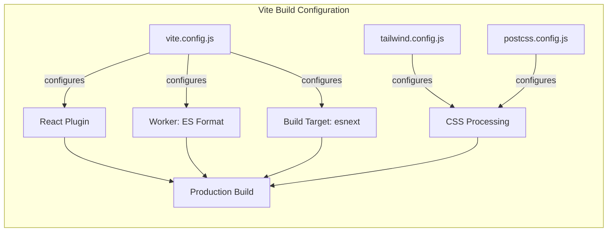

Sources: [text-to-speech-webgpu/vite.config.js:1-11](), [text-to-speech-webgpu/postcss.config.js:1-6](), [text-to-speech-webgpu/tailwind.config.js:1-8]()

The Vite configuration includes:

- React plugin for JSX compilation
- Worker configuration for proper Web Worker bundling
- ESNext target for modern JavaScript features needed by WebGPU
- TailwindCSS and PostCSS for styling

## Worker Pattern in Build System

A key aspect of the build system is its support for Web Workers, which are used in many examples to offload ML processing from the main thread:

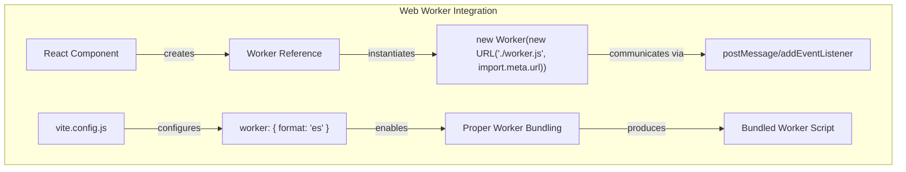

Sources: [text-to-speech-webgpu/src/App.jsx:21-26](), [text-to-speech-webgpu/vite.config.js:7](), [text-to-speech-webgpu/src/worker.js:1-65]()

The worker pattern is central to the architecture of many examples:

1. The main React component creates a worker reference
2. The worker is instantiated with `new Worker(new URL('./worker.js', import.meta.url), { type: 'module' })`
3. The Vite configuration's `worker: { format: 'es' }` setting ensures proper bundling
4. Communication between the main thread and worker happens via the message API

## Build Process Across Environments

The build system supports various JavaScript environments:

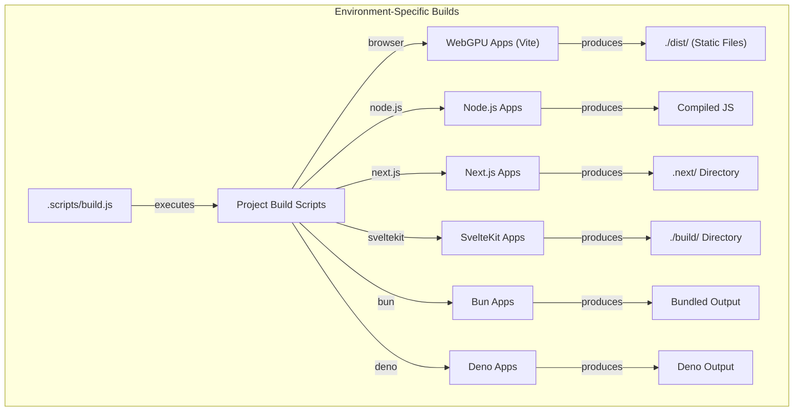

Sources: [.scripts/build.js:28-35](), [text-to-speech-webgpu/vite.config.js:1-11](), [.gitignore:1-3]()

The system handles different build outputs:

| Environment | Build Tool | Output Directory | Configuration File |
|-------------|------------|------------------|-------------------|
| Browser/WebGPU | Vite | ./dist/ | vite.config.js |
| Next.js | Next CLI | ./.next/ | next.config.js |
| Node.js | Various | ./dist/ or ./build/ | Package-specific |
| SvelteKit | SvelteKit CLI | ./build/ | svelte.config.js |
| Bun | Bun Runtime | Package-specific | bun config |
| Deno | Deno Runtime | Package-specific | deno.json |

## Update System Integration

While the main focus of this document is the build system, it's worth noting how the update system works alongside it:

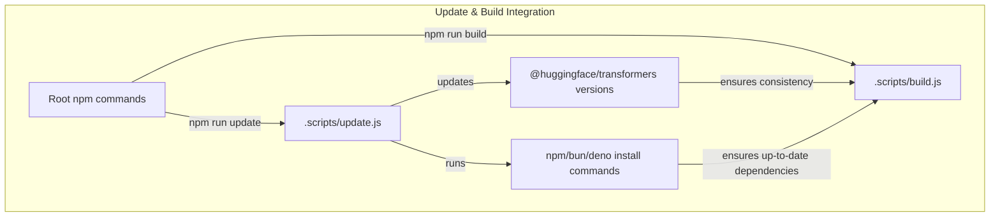

Sources: [package.json:6-9](), [.scripts/update.js:15-71](), [.scripts/build.js:6-25]()

## Typical Build Process Example

To illustrate how a build works in practice, here's an example of building the text-to-speech-webgpu project:

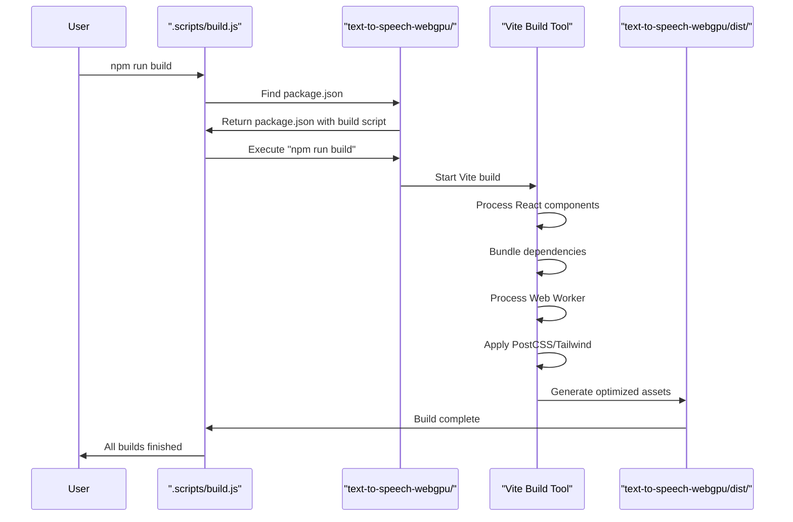

Sources: [.scripts/build.js:6-25](), [text-to-speech-webgpu/vite.config.js:1-11](), [text-to-speech-webgpu/package.json]()

## Conclusion

The build system in transformers.js-examples provides a flexible framework that supports diverse examples with different technologies and target environments. By standardizing the build command while allowing for project-specific configurations, it makes it easy to manage and maintain the wide array of examples in the repository.

---

