# Page: Overview

# Overview

<details>
<summary>Relevant source files</summary>

The following files were used as context for generating this wiki page:

- [.gitignore](.gitignore)
- [.prettierrc](.prettierrc)
- [bun/bun.lockb](bun/bun.lockb)
- [bun/package.json](bun/package.json)
- [package-lock.json](package-lock.json)
- [package.json](package.json)
- [pglite-semantic-search/package-lock.json](pglite-semantic-search/package-lock.json)
- [pglite-semantic-search/package.json](pglite-semantic-search/package.json)
- [phi-3.5-webgpu/package-lock.json](phi-3.5-webgpu/package-lock.json)
- [phi-3.5-webgpu/package.json](phi-3.5-webgpu/package.json)
- [remove-background-webgpu/package-lock.json](remove-background-webgpu/package-lock.json)
- [remove-background-webgpu/package.json](remove-background-webgpu/package.json)
- [smollm-webgpu/package-lock.json](smollm-webgpu/package-lock.json)
- [smollm-webgpu/package.json](smollm-webgpu/package.json)

</details>


This document introduces the transformers.js-examples repository, which showcases practical implementations of Hugging Face's Transformers.js library across various JavaScript environments and machine learning tasks. For detailed information about specific example categories, see [WebGPU Applications](#2) or [Environment Integration](#3).

## Purpose and Scope

The transformers.js-examples repository is a monorepo containing 20+ reference implementations that demonstrate practical usage of the `@huggingface/transformers` library (v3.7.1-3.8.0) across different JavaScript environments and ML tasks. The repository showcases:

1. **WebGPU-accelerated browser applications** - LLM chat interfaces, image processing, speech recognition, and computer vision
2. **Next.js integration patterns** - Client-side, server-side, and Vercel AI SDK integrations
3. **Node.js applications** - ESM and CommonJS module examples
4. **Alternative runtimes** - Bun compatibility demonstrations
5. **Specialized use cases** - In-browser vector search with PGlite, tokenizer visualization tools

All examples demonstrate client-side or server-side ML inference without requiring Python dependencies or remote API calls. Models are downloaded from Hugging Face Hub and cached locally (IndexedDB for browsers, filesystem for Node.js).

Sources: [package.json:1-27](), [remove-background-webgpu/package-lock.json:10-16](), [smollm-webgpu/package-lock.json:10-16]()

## Repository Structure

The repository follows a flat monorepo structure where each example application resides in its own top-level directory. Monorepo management utilities are provided in the `.scripts/` directory.

**Monorepo Structure and Management**

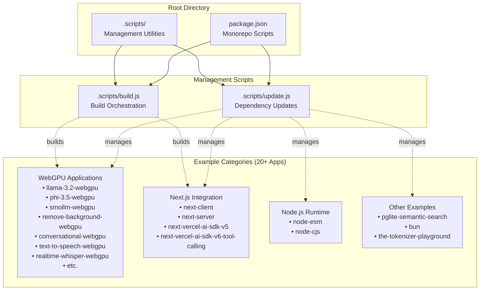

The [.scripts/update.js]() script updates `@huggingface/transformers` across all examples, detecting lock file types (package-lock.json, bun.lockb, deno.lock) and running appropriate package manager commands. The [.scripts/build.js]() script orchestrates builds for projects defining build scripts.

Sources: [package.json:1-27](), [.scripts/update.js:1-98](), [.scripts/build.js:1-38]()

## Shared Dependency Architecture

All examples share a common dependency on `@huggingface/transformers` (v3.7.1-3.8.0), which provides a unified ML API. The library automatically selects the appropriate ONNX Runtime backend based on the execution environment.

**Core Dependencies and Runtime Backends**

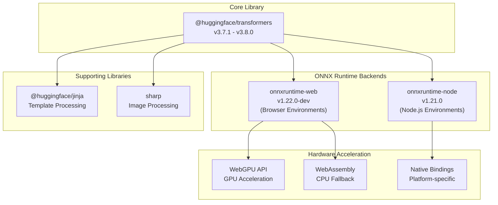

The [.scripts/update.js]() script maintains version consistency across all examples, with support for npm, Bun, and Deno package managers. Run `npm run update` to update dependencies or `npm run audit` for security audits only.

Sources: [package.json:1-27](), [.scripts/update.js:14-71](), [remove-background-webgpu/package-lock.json:844-854]()

## Example Applications by Category

The repository organizes examples by deployment environment and ML task:

| Category | Example Applications | Key Technologies | ML Tasks |
|----------|---------------------|------------------|----------|
| **WebGPU LLMs** | llama-3.2-webgpu<br/>phi-3.5-webgpu<br/>smollm-webgpu<br/>deepseek-r1-webgpu<br/>gemma-2-2b-jpn-webgpu | React, Vite, WebGPU | Text generation, chat interfaces with streaming |
| **WebGPU Computer Vision** | remove-background-webgpu<br/>video-object-detection | React, Vite, Canvas API | Background removal (MODNet), object detection |
| **WebGPU Speech** | conversational-webgpu<br/>text-to-speech-webgpu<br/>realtime-whisper-webgpu | AudioWorklets, Web Workers | Speech-to-text (Whisper), text-to-speech (OuteTTS), voice activity detection |
| **Next.js Client-Side** | next-client | Next.js, onnxruntime-web | Browser-based inference in Next.js |
| **Next.js Server-Side** | next-server | Next.js, onnxruntime-node, API routes | Server-side model inference |
| **Next.js AI SDK** | next-vercel-ai-sdk-v5<br/>next-vercel-ai-sdk-v6-tool-calling | Vercel AI SDK, custom ChatTransport | Streaming chat, tool calling |
| **Vector Search** | pglite-semantic-search | PGlite, pgvector, Web Workers | In-browser semantic search with embeddings |
| **Node.js** | node-esm<br/>node-cjs | Pure Node.js, onnxruntime-node | ESM/CommonJS examples |
| **Alternative Runtimes** | bun | Bun runtime | Compatibility demonstration |
| **Developer Tools** | the-tokenizer-playground | React, Web Workers | Token visualization |

Sources: [package.json:1-27](), [remove-background-webgpu/package.json:1-36](), [smollm-webgpu/package.json:1-35](), [pglite-semantic-search/package.json:1-34]()

## Common Architecture Patterns

Browser-based examples consistently implement a worker-based architecture to maintain UI responsiveness during intensive ML operations.

**Browser Application Worker Architecture**

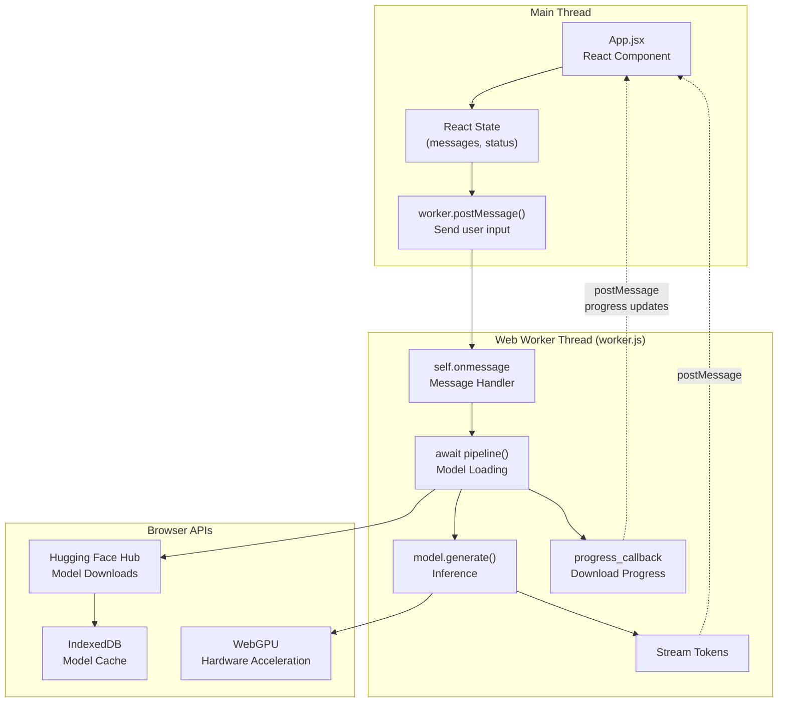

This architecture separates UI rendering (main thread) from ML inference (worker thread), enabling 60fps UI updates even during multi-gigabyte model downloads or intensive inference. Worker communication uses `postMessage()` for bidirectional message passing.

Key files implementing this pattern:
- React component: `src/App.jsx`
- Web Worker: `src/worker.js` or `public/worker.js`
- Build configuration: `vite.config.js`

Sources: [smollm-webgpu/package.json:1-35](), [remove-background-webgpu/package.json:1-36](), [pglite-semantic-search/package.json:1-34]()

## WebGPU Application Architecture

WebGPU examples leverage browser GPU hardware for accelerated ML inference with quantized ONNX models. All WebGPU applications run entirely client-side, ensuring data privacy.

**WebGPU Inference Pipeline**

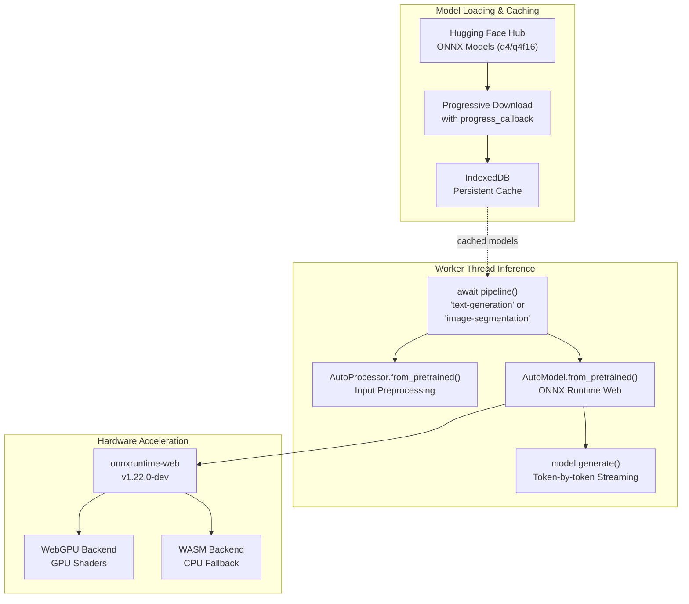

**Key Technical Details:**
- **Model Quantization**: Examples use q4 (4-bit weights), q4f16 (4-bit weights + 16-bit activations), or fp16 quantization to reduce model sizes
- **Progressive Loading**: Models stream download with real-time progress updates via `progress_callback`
- **Caching**: Downloaded models persist in IndexedDB, eliminating repeat downloads
- **Streaming Generation**: LLM examples use token-by-token streaming for immediate user feedback

Sources: [remove-background-webgpu/package-lock.json:844-854](), [smollm-webgpu/package.json:12-18](), [phi-3.5-webgpu/package.json:12-18]()

## Cross-Environment Compatibility

The `@huggingface/transformers` library runs across multiple JavaScript environments with automatic backend selection.

**Runtime Environment Support**

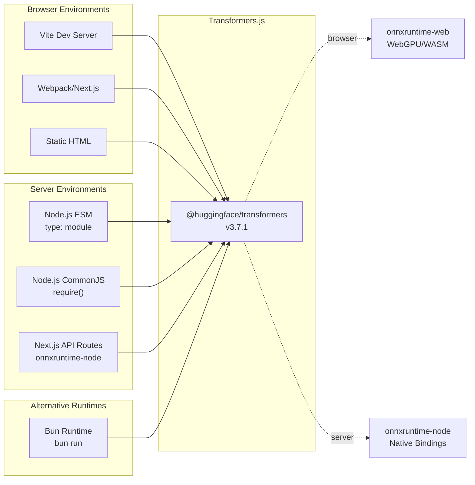

**Environment-Specific Configurations:**

| Environment | Package Manager | Module System | ONNX Backend | Example |
|-------------|----------------|---------------|--------------|---------|
| Browser (Vite) | npm | ESM | onnxruntime-web | smollm-webgpu |
| Next.js Client | npm | ESM | onnxruntime-web | next-client |
| Next.js Server | npm | ESM | onnxruntime-node | next-server |
| Node.js ESM | npm | ESM | onnxruntime-node | node-esm |
| Node.js CJS | npm | CommonJS | onnxruntime-node | node-cjs |
| Bun | Bun | ESM | onnxruntime-node | bun |

The library automatically detects the runtime environment and loads the appropriate ONNX Runtime backend, ensuring optimal performance without code changes.

Sources: [package.json:1-27](), [bun/package.json:1-15](), [remove-background-webgpu/package-lock.json:844-854]()

## Build System and Development Tools

The repository provides unified scripts for building and maintaining all examples.

**Monorepo Build Orchestration**

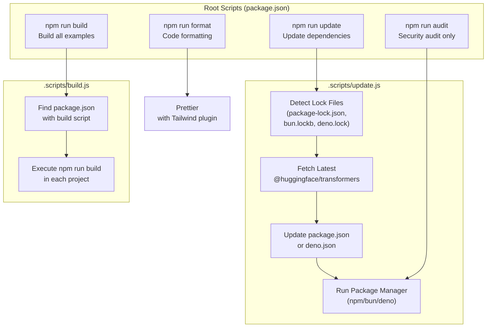

**Per-Project Build Tools:**

Most examples use consistent development tooling:
- **Build Tool**: Vite (WebGPU examples) or Next.js built-in bundler
- **Code Quality**: ESLint with `eslint-config-next` or `@eslint/js`
- **Formatting**: Prettier with Tailwind CSS plugin
- **Styling**: Tailwind CSS with PostCSS and Autoprefixer
- **TypeScript**: Type checking in applicable projects

Run `npm run build` from the repository root to build all examples with defined build scripts.

Sources: [package.json:1-27](), [.scripts/update.js:1-98](), [.scripts/build.js:1-38](), [remove-background-webgpu/package.json:1-36]()

## Key Example Implementations

The repository demonstrates advanced ML capabilities across different domains:

**Large Language Model Applications:**
- **Streaming Chat Interfaces**: llama-3.2-webgpu, phi-3.5-webgpu, smollm-webgpu implement token-by-token streaming with marked/DOMPurify for Markdown rendering
- **Reasoning Models**: deepseek-r1-webgpu showcases reasoning trace extraction from model outputs
- **Multilingual Models**: gemma-2-2b-jpn-webgpu demonstrates Japanese language support

**Computer Vision Applications:**
- **Background Removal**: remove-background-webgpu uses MODNet with Canvas API for alpha channel manipulation and JSZip for batch downloads
- **Video Processing**: video-object-detection implements real-time object detection on video streams

**Audio Processing Applications:**
- **Voice Assistant**: conversational-webgpu combines Whisper (speech-to-text), LLM (reasoning), and OuteTTS (text-to-speech) with AudioWorklets for low-latency audio
- **Speech Recognition**: realtime-whisper-webgpu implements streaming transcription with voice activity detection
- **Speech Synthesis**: text-to-speech-webgpu demonstrates OuteTTS integration

**Advanced Integrations:**
- **In-Browser Vector Search**: pglite-semantic-search runs PostgreSQL with pgvector extension entirely in-browser using PGlite and HNSW indexing
- **Vercel AI SDK**: next-vercel-ai-sdk-v5 and v6 examples implement custom ChatTransport for seamless Transformers.js integration with AI SDK patterns
- **Tool Calling**: next-vercel-ai-sdk-v6-tool-calling demonstrates function calling within browser-based LLMs

All examples include dependency information in their respective `package.json` files and detailed README documentation.

Sources: [remove-background-webgpu/package.json:12-18](), [smollm-webgpu/package.json:12-18](), [pglite-semantic-search/package.json:12-16]()

## Getting Started

To use these examples, developers can:

1. Clone the repository
2. Navigate to a specific example directory
3. Install dependencies using npm/bun/deno
4. Run the example using the provided scripts

Most examples include detailed README files explaining their functionality and usage.

The repository is maintained by Hugging Face and is licensed under the Apache-2.0 license.

Sources: [package.json:1-27](), [README.md:21-22]()

---

# Page: Getting Started

# Getting Started

<details>
<summary>Relevant source files</summary>

The following files were used as context for generating this wiki page:

- [.gitignore](.gitignore)
- [.prettierrc](.prettierrc)
- [.scripts/build.js](.scripts/build.js)
- [.scripts/update.js](.scripts/update.js)
- [deepseek-r1-webgpu/src/App.jsx](deepseek-r1-webgpu/src/App.jsx)
- [package-lock.json](package-lock.json)
- [package.json](package.json)

</details>


This page provides practical instructions for setting up the transformers.js-examples monorepo, installing dependencies, and running example applications. It covers the monorepo structure, available management scripts, and development workflows.

For detailed information about specific application categories, see [WebGPU Applications](#3), [Next.js Integration](#4), and [Runtime Integration](#5). For architectural patterns used across examples, see [Architecture Patterns](#6).

---

## Monorepo Structure

The repository is organized as a monorepo containing 20+ independent example applications. Each example is a self-contained project with its own `package.json`, dependencies, and build configuration.

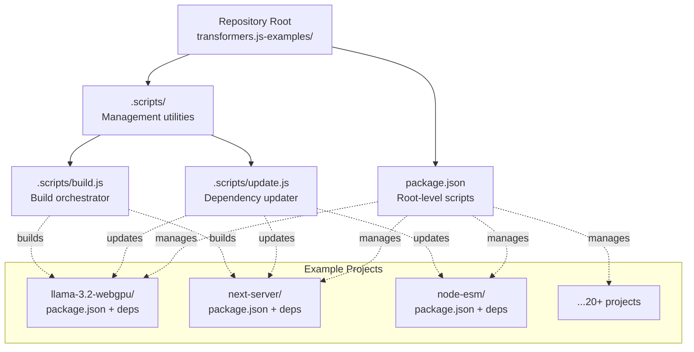

**Sources:** [package.json:1-27](), [.scripts/update.js:1-98](), [.scripts/build.js:1-38]()

### Directory Layout

| Path | Purpose |
|------|---------|
| Root `package.json` | Defines monorepo-wide scripts: `update`, `audit`, `build`, `format` |
| `.scripts/update.js` | Updates `@huggingface/transformers` across all projects |
| `.scripts/build.js` | Runs build commands for projects that define them |
| `.prettierrc` | Code formatting configuration (empty, uses defaults) |
| `.gitignore` | Excludes `node_modules`, `dist`, `.next`, `.DS_Store` |
| Individual project directories | Self-contained examples with their own dependencies |

**Sources:** [package.json:1-27](), [.prettierrc:1-2](), [.gitignore:1-5]()

---

## Prerequisites

Before setting up the repository, ensure you have one of the following package managers installed:

- **Node.js** v14+ with npm (most examples)
- **Bun** (for `bun/` example)
- **Deno** (for Deno-based examples)

WebGPU examples require a browser with WebGPU support (Chrome 113+, Edge 113+, or compatible browsers).

---

## Initial Setup

### 1. Clone the Repository

```bash
git clone https://github.com/huggingface/transformers.js-examples.git
cd transformers.js-examples
```

### 2. Install Root Dependencies (Optional)

The root `package.json` contains only development tools for formatting:

```bash
npm install
```

This installs `prettier`, `prettier-plugin-svelte`, and `prettier-plugin-tailwindcss` as defined in [package.json:22-26]().

### 3. Install Example Dependencies

Each example must be installed individually:

```bash
cd llama-3.2-webgpu
npm install
```

Or use the monorepo update script (see [Updating Dependencies](#updating-dependencies)):

```bash
npm run update
```

**Sources:** [package.json:1-27]()

---

## Running Examples

Each example is independent and must be run from its own directory. Most examples use Vite for development or Next.js for full-stack applications.

### Running a WebGPU Example

```bash
cd deepseek-r1-webgpu
npm install
npm run dev
```

The application will start on `http://localhost:5173` (default Vite port).

### Running a Next.js Example

```bash
cd next-server
npm install
npm run dev
```

The application will start on `http://localhost:3000` (default Next.js port).

### Running a Node.js Example

```bash
cd node-esm
npm install
node index.js
```

**Sources:** [deepseek-r1-webgpu/src/App.jsx:1-400]()

---

## Monorepo Management Scripts

The root `package.json` defines four scripts that operate across the entire monorepo:

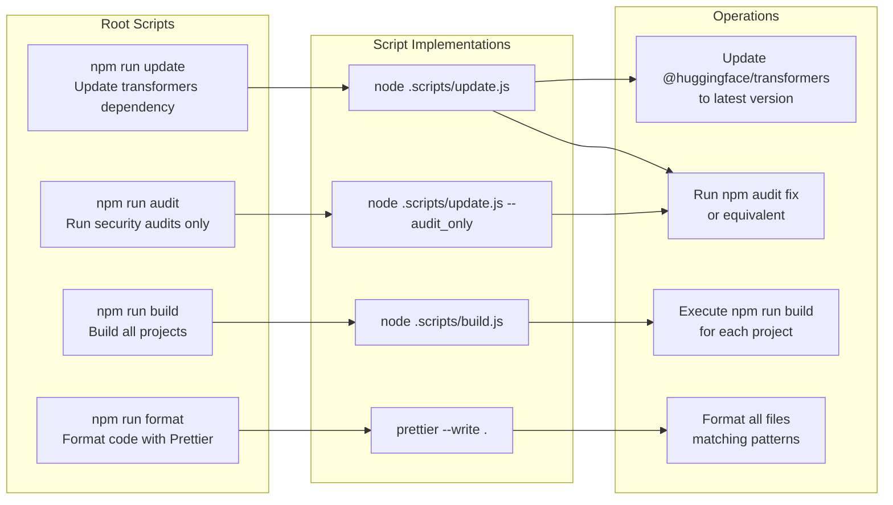

**Sources:** [package.json:6-11]()

---

## Updating Dependencies

The `update.js` script automates dependency updates across all projects in the monorepo.

### Update Script Workflow

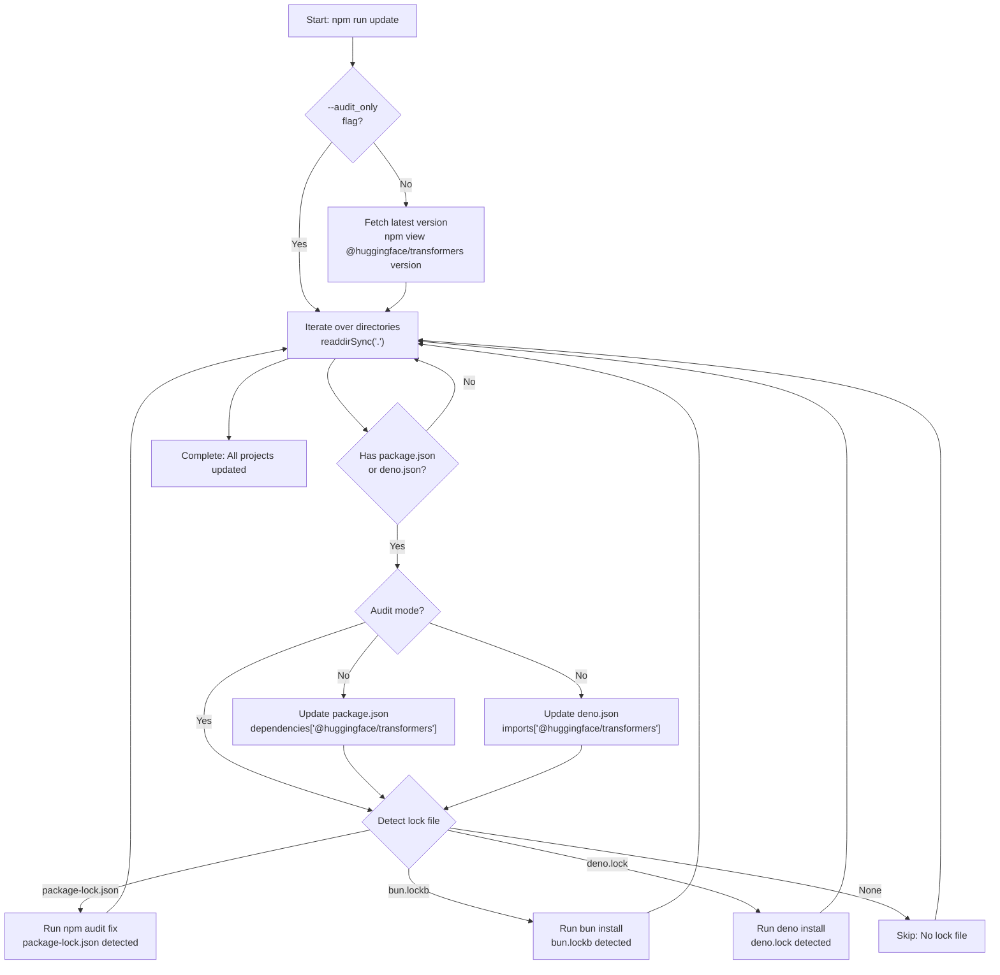

**Sources:** [.scripts/update.js:1-98]()

### Usage

**Update all projects to the latest `@huggingface/transformers` version:**

```bash
npm run update
```

This command:
1. Fetches the latest version from npm registry ([.scripts/update.js:76-83]())
2. Updates each `package.json` to use that version ([.scripts/update.js:26-36]())
3. Detects lock file type (npm, Bun, or Deno) ([.scripts/update.js:56-67]())
4. Runs the appropriate package manager command

**Run security audits without updating versions:**

```bash
npm run audit
```

This uses the `--audit_only` flag ([.scripts/update.js:12]()) to skip version updates and only run `npm audit fix` or equivalent commands.

### Lock File Detection

The script automatically detects which package manager is used:

| Lock File | Command Executed | Reference |
|-----------|------------------|-----------|
| `package-lock.json` | `npm audit fix` | [.scripts/update.js:56-58]() |
| `bun.lockb` | `bun install` | [.scripts/update.js:59-61]() |
| `deno.lock` | `deno install` | [.scripts/update.js:62-64]() |
| None | Skip with message | [.scripts/update.js:65-66]() |

### Key Functions

The `updateDependency` function ([.scripts/update.js:15-71]()) handles both `package.json` and `deno.json` manifests:

- **For package.json**: Updates the `dependencies` field ([.scripts/update.js:26-36]())
- **For deno.json**: Updates the `imports` field with `npm:` prefix ([.scripts/update.js:40-49]())

**Sources:** [.scripts/update.js:1-98]()

---

## Building Projects

The `build.js` script orchestrates builds across all projects that define a `build` script in their `package.json`.

### Build Script Workflow

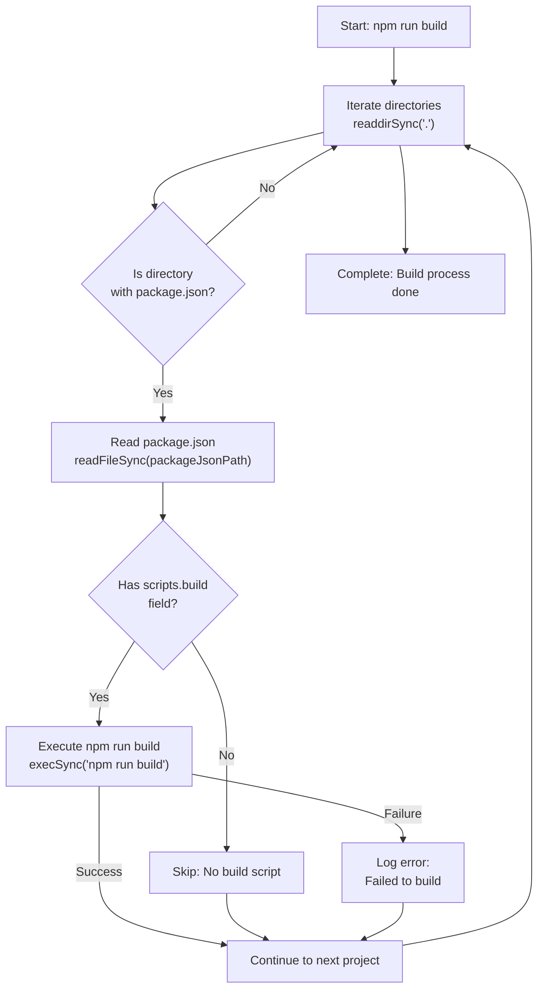

**Sources:** [.scripts/build.js:1-38]()

### Usage

```bash
npm run build
```

This command:
1. Scans all directories in the repository ([.scripts/build.js:28-35]())
2. Checks each for a `package.json` with a `build` script ([.scripts/build.js:12]())
3. Executes `npm run build` in each matching directory ([.scripts/build.js:17]())
4. Continues on errors, logging failures ([.scripts/build.js:19]())

### Build Script Detection

The `buildProject` function ([.scripts/build.js:6-25]()) reads each project's `package.json` and checks for `packageJson?.scripts?.build` ([.scripts/build.js:12]()). Projects without this field are skipped.

**Sources:** [.scripts/build.js:1-38]()

---

## Code Formatting

The repository uses Prettier with plugins for consistent code formatting across all examples.

### Installed Plugins

From [package.json:22-26]():

- `prettier` - Core formatter
- `prettier-plugin-svelte` - Svelte component formatting
- `prettier-plugin-tailwindcss` - Tailwind class sorting

### Usage

Format all files in the repository:

```bash
npm run format
```

This executes `prettier --write .` ([package.json:10]()), which formats all supported file types according to `.prettierrc` (currently empty, using Prettier defaults).

**Sources:** [package.json:22-26](), [.prettierrc:1-2]()

---

## Package Manager Support

The monorepo management scripts support three package managers:

### Lock File and Command Mapping

| Package Manager | Lock File | Update Command | Install Command |
|-----------------|-----------|----------------|-----------------|
| npm | `package-lock.json` | `npm audit fix` | `npm install` |
| Bun | `bun.lockb` | `bun install` | `bun install` |
| Deno | `deno.lock` | `deno install` | `deno install` |

The update script automatically detects which system to use by checking for lock files ([.scripts/update.js:56-67]()).

### Adding New Examples

When adding a new example to the repository:

1. Create a new directory with a descriptive name
2. Add a `package.json` with `@huggingface/transformers` dependency
3. Run `npm run update` from the root to synchronize versions
4. (Optional) Add a `build` script if the example requires building

**Sources:** [.scripts/update.js:56-67](), [.scripts/build.js:12]()

---

## Development Workflow Summary

A typical development workflow:

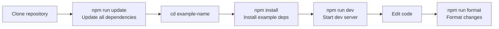

**Sources:** [package.json:6-11](), [.scripts/update.js:1-98]()

---

## Troubleshooting

### Common Issues

| Issue | Cause | Solution |
|-------|-------|----------|
| `WebGPU is not supported` | Browser lacks WebGPU support | Use Chrome 113+ or Edge 113+ |
| `Module not found` errors | Dependencies not installed | Run `npm install` in project directory |
| Lock file conflicts | Mixed package managers | Use consistent package manager per project |
| Build failures during `npm run build` | Project-specific errors | Check individual project logs |

### WebGPU Availability Check

Most WebGPU examples check for `navigator.gpu` ([deepseek-r1-webgpu/src/App.jsx:8]()):

```javascript
const IS_WEBGPU_AVAILABLE = !!navigator.gpu;
```

If unavailable, they display an error message ([deepseek-r1-webgpu/src/App.jsx:391-396]()).

**Sources:** [deepseek-r1-webgpu/src/App.jsx:8](), [deepseek-r1-webgpu/src/App.jsx:391-396]()

---

## Next Steps

After setting up the monorepo:

- Explore [WebGPU Applications](#3) for browser-based AI examples
- Learn about [Next.js Integration](#4) patterns for full-stack applications
- Review [Architecture Patterns](#6) to understand shared design patterns
- Check [Monorepo Management](#7.1) for detailed script documentation

**Sources:** [package.json:1-27](), [.scripts/update.js:1-98](), [.scripts/build.js:1-38]()

---

# Page: WebGPU Applications

# WebGPU Applications

<details>
<summary>Relevant source files</summary>

The following files were used as context for generating this wiki page:

- [bun/bun.lockb](bun/bun.lockb)
- [bun/package.json](bun/package.json)
- [gemma-2-2b-jpn-webgpu/package-lock.json](gemma-2-2b-jpn-webgpu/package-lock.json)
- [gemma-2-2b-jpn-webgpu/package.json](gemma-2-2b-jpn-webgpu/package.json)
- [llama-3.2-webgpu/package-lock.json](llama-3.2-webgpu/package-lock.json)
- [llama-3.2-webgpu/package.json](llama-3.2-webgpu/package.json)
- [llama-3.2-webgpu/src/App.jsx](llama-3.2-webgpu/src/App.jsx)
- [llama-3.2-webgpu/src/worker.js](llama-3.2-webgpu/src/worker.js)
- [pglite-semantic-search/package-lock.json](pglite-semantic-search/package-lock.json)
- [pglite-semantic-search/package.json](pglite-semantic-search/package.json)
- [phi-3.5-webgpu/package-lock.json](phi-3.5-webgpu/package-lock.json)
- [phi-3.5-webgpu/package.json](phi-3.5-webgpu/package.json)
- [realtime-whisper-webgpu/package-lock.json](realtime-whisper-webgpu/package-lock.json)
- [remove-background-webgpu/package-lock.json](remove-background-webgpu/package-lock.json)
- [remove-background-webgpu/package.json](remove-background-webgpu/package.json)
- [smollm-webgpu/package-lock.json](smollm-webgpu/package-lock.json)
- [smollm-webgpu/package.json](smollm-webgpu/package.json)
- [video-object-detection/package-lock.json](video-object-detection/package-lock.json)

</details>


This page documents the WebGPU-accelerated machine learning applications in the transformers.js-examples repository. These examples showcase client-side ML inference using the WebGPU API for hardware acceleration, enabling high-performance machine learning directly in the browser without server-side processing.

For information about integrating these applications with specific JavaScript environments like Next.js or Node.js, see [Environment Integration](#3).

## Overview of WebGPU in Transformers.js

WebGPU is a modern graphics and compute API that provides access to GPU hardware acceleration from the browser. In the context of Transformers.js, WebGPU enables significant performance improvements for machine learning inference by offloading tensor operations to the GPU.

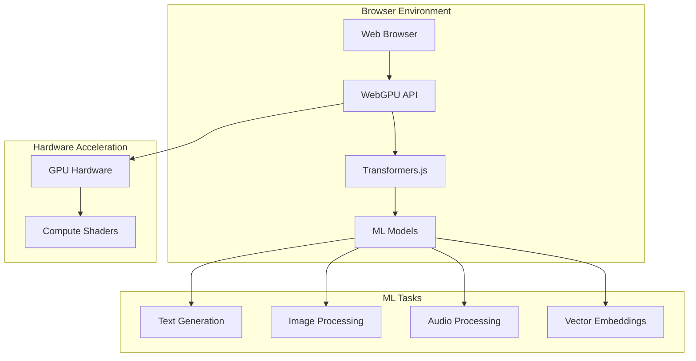

Sources: [smollm-webgpu/package.json](), [phi-3.5-webgpu/package.json](), [remove-background-webgpu/package.json]()

## Common Architecture

The WebGPU examples share a common architectural pattern to optimize performance and responsiveness in the browser environment.

### Web Worker Pattern

To prevent blocking the main thread during intensive ML computations, these applications implement a web worker pattern that offloads model loading and inference to a separate thread.

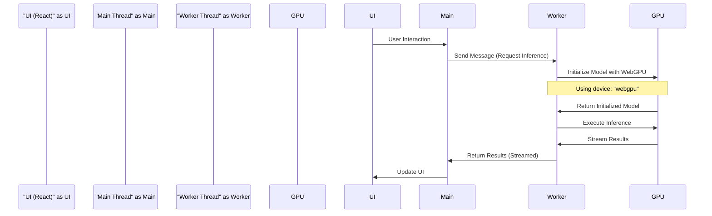

Sources: [remove-background-webgpu/src/App.jsx:24-41]()

### Core Implementation Pattern

Most WebGPU applications in this repository follow this implementation pattern:

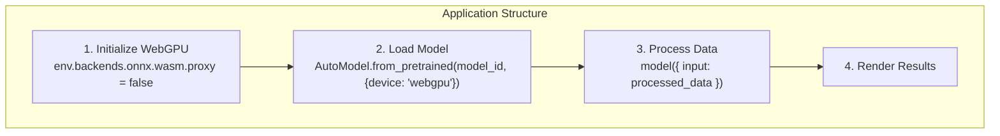

Sources: [remove-background-webgpu/src/App.jsx:24-41](), [remove-background-webgpu/src/App.jsx:70-117]()

## Example WebGPU Applications

The repository contains several WebGPU-accelerated applications across different ML domains:

| Category | Examples | Description |
|----------|----------|-------------|
| Text Generation | smollm-webgpu<br>phi-3.5-webgpu<br>deepseek-r1-webgpu<br>llama-3.2-webgpu | Language models that generate text responses |
| Image Processing | remove-background-webgpu<br>depth-estimation-video<br>depth-anything | Image segmentation, background removal, and depth estimation |
| Vector Search | pglite-semantic-search | Semantic search using vector embeddings with PGLite |
| Audio | text-to-speech-webgpu | Text-to-speech synthesis using WebGPU |
| Visualization | attention-visualization | Visual representation of transformer attention patterns |

Sources: [smollm-webgpu/package-lock.json](), [remove-background-webgpu/package-lock.json](), [phi-3.5-webgpu/package-lock.json](), [pglite-semantic-search/package-lock.json]()

### Model Initialization Pattern

All WebGPU examples initialize their models using a similar pattern that enables WebGPU acceleration:

```javascript
// Enable WebGPU acceleration
env.backends.onnx.wasm.proxy = false;

// Load model with WebGPU device
const model = await AutoModel.from_pretrained(model_id, {
  device: "webgpu",
});
```

Sources: [remove-background-webgpu/src/App.jsx:28-36]()

## Image Processing with WebGPU

The image processing examples demonstrate how to use WebGPU for computer vision tasks. The `remove-background-webgpu` example showcases image background removal:

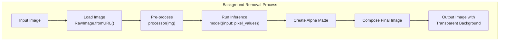

Sources: [remove-background-webgpu/src/App.jsx:70-117]()

The implementation performs the following steps:
1. Loads the image using `RawImage.fromURL`
2. Pre-processes the image with the model's processor
3. Runs inference using the WebGPU-accelerated model
4. Applies the resulting alpha matte to create transparency
5. Returns the processed image with the background removed

## Text Generation with WebGPU

Text generation models like `phi-3.5-webgpu`, `smollm-webgpu`, and `llama-3.2-webgpu` demonstrate how to run large language models in the browser using WebGPU acceleration.

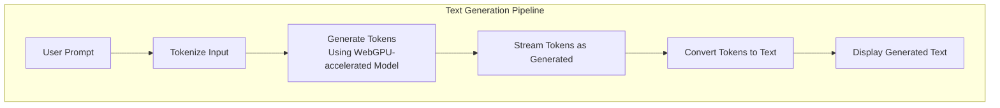

Sources: [phi-3.5-webgpu/package-lock.json](), [smollm-webgpu/package.json]()

## Vector Search with WebGPU

The `pglite-semantic-search` example demonstrates how to combine WebGPU-accelerated embeddings with PGLite for vector search directly in the browser.

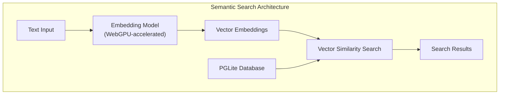

Sources: [pglite-semantic-search/package.json](), [pglite-semantic-search/package-lock.json]()

This example uses:
- WebGPU acceleration for generating embeddings
- `@electric-sql/pglite` for in-browser PostgreSQL vector operations
- Transformers.js for the embedding model

## Dependencies and Build System

All WebGPU examples share common dependencies and build configuration:

| Dependency | Purpose |
|------------|---------|
| @huggingface/transformers | The core ML library providing model loading and inference |
| react & react-dom | Frontend UI framework |
| vite | Build system optimized for modern web applications |
| tailwindcss | Utility-first CSS framework for styling |

Sources: [smollm-webgpu/package.json](), [remove-background-webgpu/package.json](), [phi-3.5-webgpu/package.json]()

## WebGPU Browser Support

WebGPU is supported in modern browsers:

- Chrome/Edge 113+ (Stable)
- Firefox 121+ (Stable)
- Safari 17.4+ (Stable)

A common pattern in these applications is to check for WebGPU support before initialization:

```javascript
if (!navigator.gpu) {
  throw new Error("WebGPU is not supported in this browser.");
}
```

Sources: [remove-background-webgpu/src/App.jsx:27-29]()

## Performance Considerations

When using WebGPU for ML inference, consider the following:

1. **Initial Load Time**: The first load includes downloading ONNX models and WebGPU pipeline compilation
2. **Memory Management**: Larger models require more GPU memory
3. **Device Compatibility**: Performance varies significantly based on GPU hardware
4. **Batching**: Processing multiple inputs in batches can improve throughput

Sources: [remove-background-webgpu/src/App.jsx](), [smollm-webgpu/package-lock.json]()

## Conclusion

The WebGPU applications in the transformers.js-examples repository demonstrate how to leverage modern browser capabilities for high-performance ML inference. By using WebGPU acceleration, these examples achieve near-native performance for various ML tasks directly in the browser.

For more detailed information about specific categories of WebGPU applications, refer to the dedicated pages:
- [Text Generation Models](#2.1)
- [Image Processing Applications](#2.2)
- [Semantic Search and Embeddings](#2.3)
- [Speech and Audio Applications](#2.4)

---

# Page: Large Language Models

# Large Language Models

<details>
<summary>Relevant source files</summary>

The following files were used as context for generating this wiki page:

- [.scripts/build.js](.scripts/build.js)
- [.scripts/update.js](.scripts/update.js)
- [bun/bun.lockb](bun/bun.lockb)
- [bun/package.json](bun/package.json)
- [deepseek-r1-webgpu/src/App.jsx](deepseek-r1-webgpu/src/App.jsx)
- [gemma-2-2b-jpn-webgpu/package-lock.json](gemma-2-2b-jpn-webgpu/package-lock.json)
- [gemma-2-2b-jpn-webgpu/package.json](gemma-2-2b-jpn-webgpu/package.json)
- [llama-3.2-webgpu/package-lock.json](llama-3.2-webgpu/package-lock.json)
- [llama-3.2-webgpu/package.json](llama-3.2-webgpu/package.json)
- [llama-3.2-webgpu/src/App.jsx](llama-3.2-webgpu/src/App.jsx)
- [llama-3.2-webgpu/src/worker.js](llama-3.2-webgpu/src/worker.js)
- [pglite-semantic-search/package-lock.json](pglite-semantic-search/package-lock.json)
- [pglite-semantic-search/package.json](pglite-semantic-search/package.json)
- [phi-3.5-webgpu/package-lock.json](phi-3.5-webgpu/package-lock.json)
- [phi-3.5-webgpu/package.json](phi-3.5-webgpu/package.json)
- [realtime-whisper-webgpu/package-lock.json](realtime-whisper-webgpu/package-lock.json)
- [remove-background-webgpu/package-lock.json](remove-background-webgpu/package-lock.json)
- [remove-background-webgpu/package.json](remove-background-webgpu/package.json)
- [smollm-webgpu/package-lock.json](smollm-webgpu/package-lock.json)
- [smollm-webgpu/package.json](smollm-webgpu/package.json)
- [video-object-detection/package-lock.json](video-object-detection/package-lock.json)

</details>


This page documents the browser-based Large Language Model (LLM) examples that demonstrate text generation using WebGPU acceleration. These examples include chat interfaces powered by models such as Llama-3.2, SmolLM, Phi-3.5, DeepSeek-R1, and Gemma-2-2b-jpn. All implementations follow a shared worker-based architecture pattern for offloading inference from the main UI thread.

For speech and audio processing with LLMs, see [Speech and Audio Applications](#3.4). For Next.js-based LLM integrations, see [Vercel AI SDK Integration](#4.3).

## Architecture Overview

All LLM examples implement a consistent worker-based architecture that separates UI rendering from computationally intensive model inference operations.

### High-Level Component Architecture

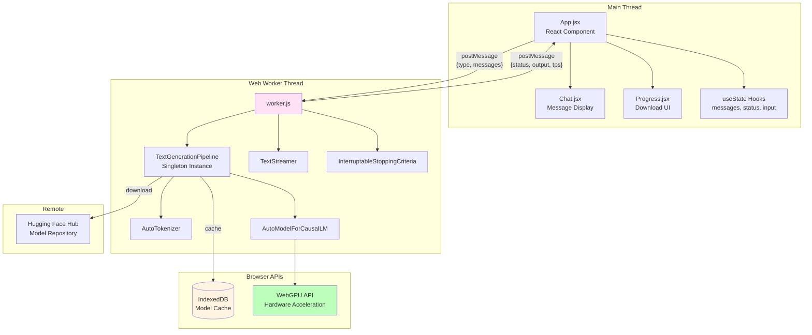

**Sources:** [llama-3.2-webgpu/src/App.jsx:1-250](), [llama-3.2-webgpu/src/worker.js:1-150]()

### Message Flow Protocol

The main thread and worker communicate through a well-defined message protocol:

| Message Type | Direction | Purpose | Payload |
|--------------|-----------|---------|---------|
| `check` | Main → Worker | Feature detection | None |
| `webgpu` | Worker → Main | WebGPU availability | `{supported: boolean}` |
| `loading` | Worker → Main | Model load start | `{data: string}` |
| `initiate` | Worker → Main | File download start | `{file: string}` |
| `progress` | Worker → Main | Download progress | `{file, loaded, total, progress}` |
| `done` | Worker → Main | File complete | `{file}` |
| `ready` | Worker → Main | Model ready | None |
| `generate` | Main → Worker | Start generation | `{messages: array}` |
| `start` | Worker → Main | Generation started | None |
| `update` | Worker → Main | Token generated | `{output, tps, numTokens}` |
| `complete` | Worker → Main | Generation done | `{output}` |
| `interrupt` | Main → Worker | Stop generation | None |

**Sources:** [llama-3.2-webgpu/src/App.jsx:72-150](), [llama-3.2-webgpu/src/worker.js:90-140]()

## Model Loading and Initialization

### Singleton Pattern Implementation

The `TextGenerationPipeline` class uses the Singleton pattern to ensure models are loaded only once and reused across multiple generation requests:

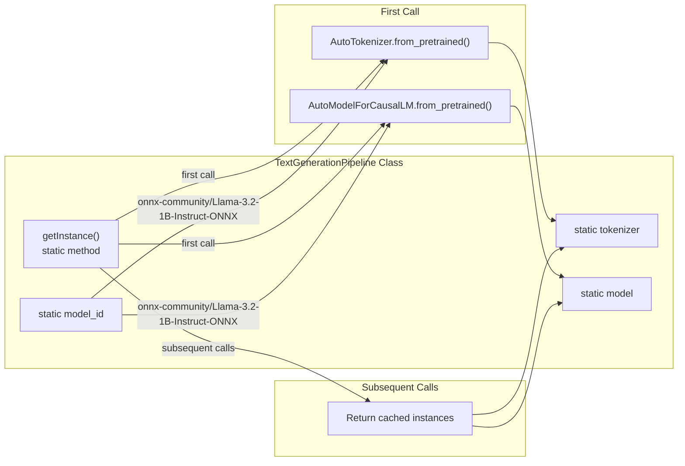

**Sources:** [llama-3.2-webgpu/src/worker.js:11-27]()

### Supported Model Configurations

| Example | Model ID | Quantization | Special Features |
|---------|----------|--------------|------------------|
| llama-3.2-webgpu | `onnx-community/Llama-3.2-1B-Instruct-ONNX` | q4f16 | Chat template, instruction tuned |
| smollm-webgpu | `HuggingFaceTB/SmolLM2-135M-Instruct-ONNX` | q4f16 | Small size, fast inference |
| phi-3.5-webgpu | `Xenova/Phi-3.5-mini-instruct` | q4 | Extended context (128K) |
| gemma-2-2b-jpn-webgpu | `onnx-community/gemma-2-2b-jpn-it-onnx` | q4f16 | Japanese language support |
| deepseek-r1-webgpu | Various DeepSeek models | q4/q4f16 | Reasoning capabilities |

**Sources:** [llama-3.2-webgpu/src/worker.js:12](), [smollm-webgpu/package-lock.json:1-50](), [phi-3.5-webgpu/package-lock.json:1-50]()

### Model Download Progress Tracking

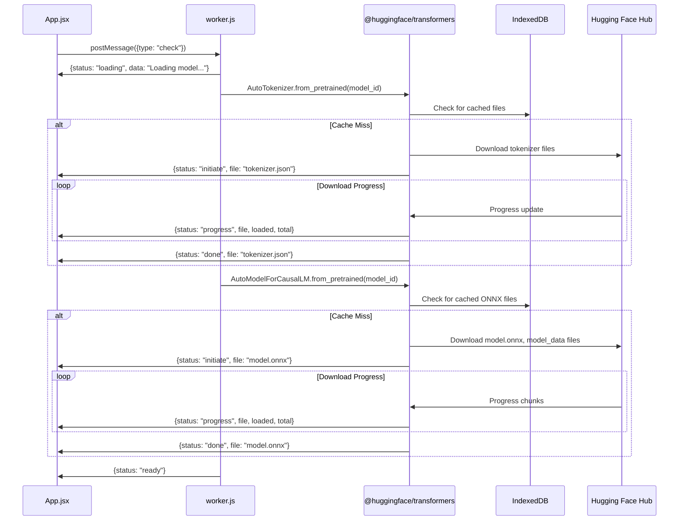

**Sources:** [llama-3.2-webgpu/src/App.jsx:74-110](), [llama-3.2-webgpu/src/worker.js:14-25]()

## Text Generation Pipeline

### Chat Template Application

Chat messages are formatted using model-specific templates via `apply_chat_template`:

```mermaid
graph TB
    messages["messages: Array<br/>[{role: 'user', content: '...'},<br/>{role: 'assistant', content: '...'}]"]
    
    apply["tokenizer.apply_chat_template()"]
    
    formatted["Formatted prompt with<br/>special tokens:<br/>&lt;|begin_of_text|&gt;&lt;|start_header_id|&gt;user&lt;|end_header_id|&gt;<br/>message&lt;|eot_id|&gt;..."]
    
    inputs["inputs: {input_ids, attention_mask}"]
    
    messages --> apply
    apply -->|add_generation_prompt: true| formatted
    apply -->|return_dict: true| inputs
    
    inputs --> generate["model.generate()"]
```

The `add_generation_prompt` parameter adds the assistant's turn prefix, preparing the model to continue generation.

**Sources:** [llama-3.2-webgpu/src/worker.js:36-39]()

### Token Generation with Streaming

The generation process produces tokens incrementally using `TextStreamer`:

```mermaid
graph TB
    subgraph "Generation Configuration"
        inputs["inputs: {input_ids,<br/>attention_mask}"]
        pkv["past_key_values:<br/>cached context"]
        params["max_new_tokens: 1024<br/>do_sample: false<br/>stopping_criteria"]
    end
    
    subgraph "Streaming Components"
        streamer["TextStreamer"]
        token_cb["token_callback_function()<br/>Count tokens, compute TPS"]
        callback["callback_function(output)<br/>postMessage to main thread"]
    end
    
    subgraph "Generation Loop"
        gen_start["model.generate()"]
        decode["Decode token"]
        stream["streamer.put()"]
        update["Send update to UI"]
        check["Check stopping criteria"]
    end
    
    inputs --> gen_start
    pkv --> gen_start
    params --> gen_start
    streamer --> gen_start
    
    gen_start --> decode
    decode --> token_cb
    token_cb --> stream
    stream --> callback
    callback --> update
    update --> check
    check -->|continue| decode
    check -->|stop| done["return {past_key_values,<br/>sequences}"]
```

**Sources:** [llama-3.2-webgpu/src/worker.js:32-90]()

### KV Cache Management

The `past_key_values_cache` stores attention context between generation calls for multi-turn conversations:

```mermaid
graph LR
    subgraph "First Message"
        turn1["User: 'Hello'"]
        gen1["generate(messages)"]
        kv1["past_key_values_cache = null"]
        output1["Assistant: 'Hi there!'"]
        cache1["Cache new KV pairs"]
    end
    
    subgraph "Second Message"
        turn2["User: 'How are you?'"]
        gen2["generate(messages)"]
        kv2["past_key_values_cache<br/>contains context from turn 1"]
        output2["Assistant: 'I'm doing well!'"]
        cache2["Append new KV pairs"]
    end
    
    turn1 --> gen1
    kv1 --> gen1
    gen1 --> output1
    gen1 --> cache1
    
    cache1 --> kv2
    turn2 --> gen2
    kv2 --> gen2
    gen2 --> output2
    gen2 --> cache2
```

The cache is stored in `past_key_values_cache` at [llama-3.2-webgpu/src/worker.js:31]() and updated after each generation at [llama-3.2-webgpu/src/worker.js:82]().

**Sources:** [llama-3.2-webgpu/src/worker.js:31-82]()

### Generation Parameters

Generation behavior is controlled through parameters passed to `model.generate()`:

| Parameter | Type | Purpose | Common Values |
|-----------|------|---------|---------------|
| `max_new_tokens` | number | Maximum tokens to generate | 512-2048 |
| `do_sample` | boolean | Use sampling vs greedy | false (greedy) |
| `temperature` | number | Sampling randomness | 0.6-1.0 |
| `top_p` | number | Nucleus sampling threshold | 0.9 |
| `top_k` | number | Top-k sampling | 50 |
| `repetition_penalty` | number | Penalize repeated tokens | 1.0-1.2 |
| `stopping_criteria` | object | Early stopping conditions | `InterruptableStoppingCriteria` |
| `return_dict_in_generate` | boolean | Return full output dict | true |

**Sources:** [llama-3.2-webgpu/src/worker.js:70-81]()

## User Interface Components

### State Management

The main application component manages several state variables:

```mermaid
graph TB
    subgraph "Model State"
        status["status<br/>(null, loading, ready)"]
        error["error"]
        loadingMessage["loadingMessage"]
        progressItems["progressItems[]<br/>{file, loaded, total}"]
    end
    
    subgraph "Generation State"
        isRunning["isRunning<br/>(boolean)"]
        tps["tps<br/>(tokens per second)"]
        numTokens["numTokens<br/>(count)"]
    end
    
    subgraph "Chat State"
        input["input<br/>(current user input)"]
        messages["messages[]<br/>{role, content}"]
    end
    
    subgraph "UI Updates"
        Progress["Progress Component"]
        Chat["Chat Component"]
        Textarea["Input Textarea"]
    end
    
    status --> Progress
    loadingMessage --> Progress
    progressItems --> Progress
    
    messages --> Chat
    tps --> Chat
    isRunning --> Chat
    
    input --> Textarea
```

**Sources:** [llama-3.2-webgpu/src/App.jsx:24-34]()

### Message Display Flow

```mermaid
sequenceDiagram
    participant User
    participant Textarea as Input Textarea
    participant App as App.jsx
    participant Worker as worker.js
    participant Chat as Chat.jsx
    
    User->>Textarea: Type message
    Textarea->>App: setInput(value)
    User->>Textarea: Press Enter
    Textarea->>App: onEnter(message)
    
    App->>App: setMessages([...prev, {role: 'user', content}])
    App->>App: setIsRunning(true)
    App->>Chat: Render user message
    
    App->>Worker: postMessage({type: 'generate', messages})
    Worker->>App: {status: 'start'}
    
    loop Token Generation
        Worker->>App: {status: 'update', output, tps, numTokens}
        App->>App: Update last message content
        App->>Chat: Render partial assistant response
        Chat->>User: Display streaming text
    end
    
    Worker->>App: {status: 'complete', output}
    App->>App: setIsRunning(false)
    App->>Chat: Render complete message
```

**Sources:** [llama-3.2-webgpu/src/App.jsx:36-200]()

### Progress Display During Model Loading

The progress bars show granular download progress for each model file:

```mermaid
graph TB
    progressItems["progressItems: [<br/>{file: 'tokenizer.json', loaded: 50KB, total: 100KB, progress: 50},<br/>{file: 'model.onnx', loaded: 200MB, total: 500MB, progress: 40}<br/>]"]
    
    map["progressItems.map()"]
    
    subgraph "Progress Component"
        item1["File: tokenizer.json<br/>Progress: 50KB/100KB (50%)"]
        item2["File: model.onnx<br/>Progress: 200MB/500MB (40%)"]
        bar1["Progress Bar (50%)"]
        bar2["Progress Bar (40%)"]
    end
    
    progressItems --> map
    map --> item1
    map --> item2
    item1 --> bar1
    item2 --> bar2
```

**Sources:** [llama-3.2-webgpu/src/App.jsx:82-95](), [llama-3.2-webgpu/src/components/Progress.jsx:1-50]()

## Performance Optimization

### WebGPU Acceleration

All LLM examples require WebGPU support and configure models with `device: "webgpu"`:

```mermaid
graph TB
    check["navigator.gpu<br/>feature detection"]
    
    available{WebGPU<br/>Available?}
    
    config["AutoModelForCausalLM.from_pretrained(<br/>model_id,<br/>{device: 'webgpu', dtype: 'q4f16'}<br/>)"]
    
    error["Display error:<br/>'WebGPU not supported'"]
    
    gpu["GPU Execution<br/>- Matrix operations on GPU<br/>- Parallel computation<br/>- Low latency"]
    
    check --> available
    available -->|Yes| config
    available -->|No| error
    config --> gpu
```

The availability check occurs at [llama-3.2-webgpu/src/App.jsx:8]() with `IS_WEBGPU_AVAILABLE = !!navigator.gpu`.

**Sources:** [llama-3.2-webgpu/src/App.jsx:8](), [llama-3.2-webgpu/src/worker.js:19-23]()

### Quantization Strategies

Models use quantization to reduce memory footprint while maintaining quality:

| Quantization | Weight Bits | Activation Bits | Size Reduction | Use Case |
|--------------|-------------|-----------------|----------------|----------|
| `q4` | 4-bit | INT8 | ~75% | Maximum compression |
| `q4f16` | 4-bit | FP16 | ~70% | Balance quality/size |
| `fp16` | 16-bit | FP16 | ~50% | Higher quality |

The quantization is specified in the `dtype` parameter: `AutoModelForCausalLM.from_pretrained(model_id, {dtype: "q4f16"})`.

**Sources:** [llama-3.2-webgpu/src/worker.js:20]()

### Interrupt Mechanism

Users can stop generation mid-stream using `InterruptableStoppingCriteria`:

```mermaid
sequenceDiagram
    participant User
    participant App as App.jsx
    participant Worker as worker.js
    participant Criteria as InterruptableStoppingCriteria
    participant Generate as model.generate()
    
    Worker->>Generate: Start generation with stopping_criteria
    Generate->>Criteria: Check after each token
    
    User->>App: Click Stop button
    App->>Worker: postMessage({type: 'interrupt'})
    Worker->>Criteria: stopping_criteria.interrupt()
    
    Generate->>Criteria: Check stopping condition
    Criteria->>Generate: Return true (stop)
    Generate->>Worker: Exit generation loop
    Worker->>App: {status: 'complete'}
```

The `InterruptableStoppingCriteria` instance is created at [llama-3.2-webgpu/src/worker.js:29]() and interrupted at [llama-3.2-webgpu/src/worker.js:100]().

**Sources:** [llama-3.2-webgpu/src/worker.js:29-106](), [llama-3.2-webgpu/src/App.jsx:43-47]()

## Example Applications

### Llama-3.2 Chat Interface

The primary example demonstrating instruction-tuned chat:

- **Model:** `onnx-community/Llama-3.2-1B-Instruct-ONNX`
- **Features:** Multi-turn conversation, streaming responses, example prompts
- **UI:** Full chat interface with markdown rendering via `marked` and sanitization via `dompurify`

**Sources:** [llama-3.2-webgpu/src/App.jsx:1-300](), [llama-3.2-webgpu/src/worker.js:1-150](), [llama-3.2-webgpu/package.json:1-35]()

### SmolLM Compact Model

Optimized for speed with a small 135M parameter model:

- **Model:** `HuggingFaceTB/SmolLM2-135M-Instruct-ONNX`
- **Features:** Fast inference, low memory usage
- **Use Case:** Lightweight applications, resource-constrained environments

**Sources:** [smollm-webgpu/package.json:12-17]()

### Phi-3.5 Extended Context

Supports very long context windows:

- **Model:** `Xenova/Phi-3.5-mini-instruct`
- **Features:** 128K token context, efficient attention
- **Use Case:** Long document processing, extended conversations

**Sources:** [phi-3.5-webgpu/package.json:12-17]()

### Gemma Japanese Model

Specialized for Japanese language tasks:

- **Model:** `onnx-community/gemma-2-2b-jpn-it-onnx`
- **Features:** Japanese instruction tuning, cultural context
- **Use Case:** Japanese chatbots, multilingual applications

**Sources:** [gemma-2-2b-jpn-webgpu/package.json:12-17]()

---

# Page: Image Processing Applications

# Image Processing Applications

<details>
<summary>Relevant source files</summary>

The following files were used as context for generating this wiki page:

- [bun/bun.lockb](bun/bun.lockb)
- [bun/package.json](bun/package.json)
- [pglite-semantic-search/package-lock.json](pglite-semantic-search/package-lock.json)
- [pglite-semantic-search/package.json](pglite-semantic-search/package.json)
- [phi-3.5-webgpu/package-lock.json](phi-3.5-webgpu/package-lock.json)
- [phi-3.5-webgpu/package.json](phi-3.5-webgpu/package.json)
- [remove-background-webgpu/README.md](remove-background-webgpu/README.md)
- [remove-background-webgpu/eslint.config.js](remove-background-webgpu/eslint.config.js)
- [remove-background-webgpu/index.html](remove-background-webgpu/index.html)
- [remove-background-webgpu/package-lock.json](remove-background-webgpu/package-lock.json)
- [remove-background-webgpu/package.json](remove-background-webgpu/package.json)
- [remove-background-webgpu/src/App.jsx](remove-background-webgpu/src/App.jsx)
- [remove-background-webgpu/src/main.jsx](remove-background-webgpu/src/main.jsx)
- [smollm-webgpu/package-lock.json](smollm-webgpu/package-lock.json)
- [smollm-webgpu/package.json](smollm-webgpu/package.json)

</details>


This document covers image processing applications in the repository, specifically the background removal example using computer vision models. These applications demonstrate client-side image processing with WebGPU acceleration. For text generation applications, see [Large Language Models](#3.1). For vector search with embeddings, see [Semantic Search and Embeddings](#3.3).

## Overview

The image processing category currently contains the **remove-background-webgpu** application, which performs portrait background removal using the MODNet model. This application runs entirely in the browser with WebGPU acceleration, supporting batch processing and ZIP export without requiring a backend server.

**Sources:** [remove-background-webgpu/README.md:1-56](), [remove-background-webgpu/package.json:1-36]()

## Application Architecture

The remove-background-webgpu application uses a direct model execution pattern, loading the model in the main thread rather than using a Web Worker architecture. This differs from the LLM examples because image processing operations are typically faster and the model size is smaller (~10MB for MODNet).

```mermaid
graph TB
    subgraph "Main Thread"
        UI["React UI Components"]
        State["React State Management"]
        Dropzone["react-dropzone<br/>File Upload"]
        ModelRef["modelRef.current<br/>AutoModel instance"]
        ProcessorRef["processorRef.current<br/>AutoProcessor instance"]
    end
    
    subgraph "Processing Pipeline"
        RawImage["RawImage.fromURL()<br/>Image Loading"]
        Preprocess["processor(img)<br/>Preprocessing"]
        Inference["model({input: pixel_values})<br/>ONNX Inference"]
        AlphaMatte["output tensor<br/>Alpha Matte Generation"]
        Canvas["Canvas API<br/>Alpha Channel Update"]
    end
    
    subgraph "Export"
        DataURL["canvas.toDataURL()<br/>PNG Generation"]
        JSZip["JSZip<br/>Archive Creation"]
        FileSaver["file-saver<br/>Download Trigger"]
    end
    
    subgraph "External Resources"
        HFHub["Hugging Face Hub<br/>Xenova/modnet"]
        WebGPU["WebGPU API<br/>Hardware Acceleration"]
        IndexedDB["IndexedDB<br/>Model Cache"]
    end
    
    UI --> Dropzone
    Dropzone --> State
    State --> RawImage
    
    HFHub --> ModelRef
    HFHub --> ProcessorRef
    ModelRef --> IndexedDB
    ProcessorRef --> IndexedDB
    
    RawImage --> Preprocess
    ProcessorRef --> Preprocess
    Preprocess --> Inference
    ModelRef --> Inference
    Inference --> WebGPU
    Inference --> AlphaMatte
    AlphaMatte --> Canvas
    Canvas --> DataURL
    DataURL --> State
    DataURL --> JSZip
    JSZip --> FileSaver
```

**Sources:** [remove-background-webgpu/src/App.jsx:1-326](), [remove-background-webgpu/package.json:12-19]()

## Model Loading and Initialization

The application loads the MODNet model and its processor during component initialization using React's `useEffect` hook. Model references are stored in `useRef` to persist across re-renders without triggering updates.

```mermaid
graph LR
    subgraph "Initialization Flow"
        Mount["Component Mount<br/>useEffect"]
        GPUCheck["navigator.gpu check<br/>WebGPU Support"]
        ModelLoad["AutoModel.from_pretrained()<br/>model_id: Xenova/modnet<br/>device: webgpu"]
        ProcessorLoad["AutoProcessor.from_pretrained()<br/>model_id: Xenova/modnet"]
        SetRefs["Store in Refs<br/>modelRef.current<br/>processorRef.current"]
        SetLoading["setIsLoading(false)"]
        SetError["setError(err)"]
    end
    
    Mount --> GPUCheck
    GPUCheck -->|Success| ModelLoad
    GPUCheck -->|Fail| SetError
    ModelLoad --> ProcessorLoad
    ProcessorLoad --> SetRefs
    SetRefs --> SetLoading
    ModelLoad -->|Error| SetError
```

The initialization code sets `env.backends.onnx.wasm.proxy = false` to disable worker-based WASM execution, as the model runs on WebGPU in the main thread.

| Configuration | Value | Purpose |
|--------------|-------|---------|
| Model ID | `Xenova/modnet` | Portrait matting model |
| Device | `webgpu` | Hardware acceleration |
| WASM Proxy | `false` | Disable worker delegation |
| Cache Location | IndexedDB | Browser storage |

**Sources:** [remove-background-webgpu/src/App.jsx:24-41]()

## Image Processing Pipeline

The core processing pipeline converts uploaded images into transparent PNG files by predicting alpha mattes. The process executes synchronously in a loop for batch processing.

```mermaid
graph TB
    subgraph "Input"
        ImageURL["images[i]<br/>Blob URL"]
    end
    
    subgraph "Step 1: Load Image"
        LoadRaw["RawImage.fromURL(images[i])"]
        ImgObj["img: RawImage<br/>width, height, data"]
    end
    
    subgraph "Step 2: Preprocessing"
        Process["processor(img)"]
        PixelValues["pixel_values<br/>Tensor [1, 3, H, W]"]
    end
    
    subgraph "Step 3: Model Inference"
        ModelInfer["model({input: pixel_values})"]
        Output["output<br/>Tensor [1, 1, H, W]"]
    end
    
    subgraph "Step 4: Post-processing"
        Scale["output[0].mul(255).to('uint8')"]
        Resize["RawImage.fromTensor().resize(img.width, img.height)"]
        MaskData["maskData: Uint8Array<br/>Alpha values 0-255"]
    end
    
    subgraph "Step 5: Canvas Manipulation"
        CreateCanvas["document.createElement('canvas')"]
        DrawOriginal["ctx.drawImage(img.toCanvas())"]
        GetImageData["ctx.getImageData()"]
        UpdateAlpha["pixelData.data[4*i+3] = maskData[i]"]
        PutImageData["ctx.putImageData()"]
        ToDataURL["canvas.toDataURL('image/png')"]
    end
    
    ImageURL --> LoadRaw
    LoadRaw --> ImgObj
    ImgObj --> Process
    Process --> PixelValues
    PixelValues --> ModelInfer
    ModelInfer --> Output
    Output --> Scale
    Scale --> Resize
    Resize --> MaskData
    MaskData --> CreateCanvas
    CreateCanvas --> DrawOriginal
    DrawOriginal --> GetImageData
    GetImageData --> UpdateAlpha
    UpdateAlpha --> PutImageData
    PutImageData --> ToDataURL
```

**Sources:** [remove-background-webgpu/src/App.jsx:70-117]()

## Component State Management

The application uses React's `useState` hooks to manage application state, avoiding external state management libraries for simplicity.

| State Variable | Type | Purpose |
|---------------|------|---------|
| `images` | `string[]` | Array of blob URLs for uploaded images |
| `processedImages` | `string[]` | Array of data URLs for processed images |
| `isProcessing` | `boolean` | Processing operation in progress flag |
| `isDownloadReady` | `boolean` | Enable ZIP download button |
| `isLoading` | `boolean` | Initial model loading state |
| `error` | `Error | null` | Error state for WebGPU unsupported |

**Sources:** [remove-background-webgpu/src/App.jsx:13-19]()

## File Upload and Dropzone Integration

The application uses `react-dropzone` for drag-and-drop file upload with visual feedback states.

```mermaid
graph TB
    subgraph "Dropzone Hook"
        GetRootProps["getRootProps()<br/>Container props"]
        GetInputProps["getInputProps()<br/>Hidden input"]
        OnDrop["onDrop callback"]
    end
    
    subgraph "Drag States"
        IsDragActive["isDragActive<br/>File over dropzone"]
        IsDragAccept["isDragAccept<br/>Valid file types"]
        IsDragReject["isDragReject<br/>Invalid file types"]
    end
    
    subgraph "File Processing"
        AcceptedFiles["acceptedFiles array"]
        CreateURL["URL.createObjectURL(file)"]
        UpdateImages["setImages(prev => [...prev, ...urls])"]
    end
    
    subgraph "Accept Configuration"
        ImageTypes["image/*<br/>.jpeg, .jpg, .png"]
    end
    
    GetRootProps --> IsDragActive
    GetInputProps --> AcceptedFiles
    OnDrop --> AcceptedFiles
    AcceptedFiles --> CreateURL
    CreateURL --> UpdateImages
    ImageTypes --> IsDragAccept
    ImageTypes --> IsDragReject
```

The dropzone configuration restricts uploads to JPEG and PNG image formats. Visual feedback changes border and background colors based on drag state.

**Sources:** [remove-background-webgpu/src/App.jsx:43-61](), [remove-background-webgpu/src/App.jsx:244-259]()

## Alpha Channel Manipulation

The core image processing technique involves manipulating the alpha channel of a canvas element using the predicted alpha matte.

```mermaid
graph LR
    subgraph "Original Image"
        RGB["RGB Channels<br/>img.toCanvas()"]
        OpaqueAlpha["Alpha = 255<br/>Fully opaque"]
    end
    
    subgraph "Predicted Matte"
        MaskTensor["output[0]<br/>Shape [1, H, W]<br/>Values 0.0-1.0"]
        ScaledMask["maskData<br/>Uint8Array<br/>Values 0-255"]
    end
    
    subgraph "Canvas Processing"
        GetPixels["ctx.getImageData()<br/>pixelData.data<br/>RGBA interleaved"]
        AlphaUpdate["Loop: i = 0 to maskData.length<br/>pixelData.data[4*i+3] = maskData[i]"]
        PutPixels["ctx.putImageData(pixelData)"]
    end
    
    subgraph "Output"
        TransparentPNG["PNG with transparency<br/>Background removed"]
    end
    
    RGB --> GetPixels
    OpaqueAlpha --> GetPixels
    MaskTensor --> ScaledMask
    GetPixels --> AlphaUpdate
    ScaledMask --> AlphaUpdate
    AlphaUpdate --> PutPixels
    PutPixels --> TransparentPNG
```

The algorithm iterates through each pixel, replacing the alpha channel value (at index `4*i+3` in the RGBA array) with the corresponding value from the predicted matte.

**Sources:** [remove-background-webgpu/src/App.jsx:94-112]()

## Batch Processing and ZIP Export

The application supports batch processing multiple images and exporting them as a single ZIP archive using `jszip` and `file-saver`.

```mermaid
graph TB
    subgraph "Batch Processing"
        ClickProcess["User clicks Process button"]
        SetProcessing["setIsProcessing(true)"]
        Loop["for i = 0 to images.length"]
        ProcessImage["processImages() pipeline"]
        AppendResult["setProcessedImages(prev => [...prev, dataURL])"]
        Complete["setIsProcessing(false)<br/>setIsDownloadReady(true)"]
    end
    
    subgraph "ZIP Generation"
        ClickDownload["User clicks Download as ZIP"]
        CreateZip["new JSZip()"]
        CreatePromises["images.map() => Promise array"]
        LoadCanvas["Load image to canvas"]
        ToBlob["canvas.toBlob()"]
        AddToZip["zip.file('image-N.png', blob)"]
        AwaitAll["Promise.all(promises)"]
        Generate["zip.generateAsync({type: 'blob'})"]
        Save["saveAs(content, 'images.zip')"]
    end
    
    ClickProcess --> SetProcessing
    SetProcessing --> Loop
    Loop --> ProcessImage
    ProcessImage --> AppendResult
    Loop --> Complete
    
    ClickDownload --> CreateZip
    CreateZip --> CreatePromises
    CreatePromises --> LoadCanvas
    LoadCanvas --> ToBlob
    ToBlob --> AddToZip
    CreatePromises --> AwaitAll
    AwaitAll --> Generate
    Generate --> Save
```

Each image is named sequentially as `image-1.png`, `image-2.png`, etc. The ZIP generation uses promises to handle asynchronous blob creation.

**Sources:** [remove-background-webgpu/src/App.jsx:70-117](), [remove-background-webgpu/src/App.jsx:119-148]()

## Additional Features

### Individual Image Actions

Processed images display hover overlays with action buttons:

| Action | Function | Implementation |
|--------|----------|---------------|
| Copy | `copyToClipboard(url)` | Uses Clipboard API to copy image blob |
| Download | `downloadImage(url)` | Creates temporary `<a>` element with download attribute |
| Remove | `removeImage(index)` | Filters image from both `images` and `processedImages` arrays |

**Sources:** [remove-background-webgpu/src/App.jsx:156-181](), [remove-background-webgpu/src/App.jsx:284-320]()

### Clipboard Integration

The copy functionality converts data URLs to blobs and writes them to the clipboard using the modern Clipboard API:

```javascript
const response = await fetch(url);
const blob = await response.blob();
const clipboardItem = new ClipboardItem({ [blob.type]: blob });
await navigator.clipboard.write([clipboardItem]);
```

**Sources:** [remove-background-webgpu/src/App.jsx:156-172]()

## Error Handling and Loading States

The application handles three distinct UI states:

```mermaid
graph TB
    Initial["Initial State"]
    CheckWebGPU{"navigator.gpu?"}
    LoadModel["Loading State<br/>Spinner + Message"]
    ErrorState["Error State<br/>Display error.message"]
    ReadyState["Ready State<br/>Main UI"]
    
    Initial --> CheckWebGPU
    CheckWebGPU -->|No| ErrorState
    CheckWebGPU -->|Yes| LoadModel
    LoadModel -->|Success| ReadyState
    LoadModel -->|Fail| ErrorState
```

| State | Condition | UI Display |
|-------|-----------|------------|
| Loading | `isLoading === true` | Spinner animation with "Loading background removal model..." |
| Error | `error !== null` | Error message with "WebGPU is not supported" or other error text |
| Ready | `!isLoading && !error` | Full application UI with dropzone and controls |

**Sources:** [remove-background-webgpu/src/App.jsx:183-203]()

## Dependencies and Build Configuration

The application uses Vite for development and builds, with Tailwind CSS for styling and ESLint for code quality.

| Dependency | Version | Purpose |
|-----------|---------|---------|
| `@huggingface/transformers` | 3.7.1 | ML model execution |
| `react` | ^18.3.1 | UI framework |
| `react-dropzone` | ^14.2.3 | File upload |
| `jszip` | ^3.10.1 | ZIP archive creation |
| `file-saver` | ^2.0.5 | Browser file download |
| `tailwindcss` | ^3.4.10 | Utility-first CSS |
| `vite` | ^6.2.0 | Build tool and dev server |

Build commands:
- `npm run dev` - Start development server on port 5173
- `npm run build` - Production build to `dist/` directory
- `npm run preview` - Preview production build locally

**Sources:** [remove-background-webgpu/package.json:1-36](), [remove-background-webgpu/package-lock.json:1-50]()

## Model Details

### MODNet Architecture

MODNet (Matting Objective Decomposition Network) is a trimap-free portrait matting model optimized for real-time performance. The model used is `Xenova/modnet`, which is the ONNX-converted version hosted on Hugging Face.

| Model Property | Value |
|---------------|-------|
| Model ID | `Xenova/modnet` |
| Task | Image matting / Background removal |
| Input Shape | `[1, 3, H, W]` (RGB image) |
| Output Shape | `[1, 1, H, W]` (Alpha matte) |
| Model Size | ~10 MB |
| Quantization | Not quantized (FP32) |

**Sources:** [remove-background-webgpu/README.md:17-17](), [remove-background-webgpu/src/App.jsx:30-35]()

## Performance Characteristics

The application benefits from WebGPU acceleration for model inference:

- **Model Loading**: First-time download from Hugging Face Hub, subsequent loads from IndexedDB cache
- **Preprocessing**: CPU-based tensor operations using `AutoProcessor`
- **Inference**: WebGPU-accelerated ONNX runtime execution
- **Post-processing**: CPU-based canvas manipulation

The main thread architecture is suitable for MODNet because:
1. Model is small (~10 MB) compared to LLMs (GBs)
2. Inference time is fast (typically <500ms per image on modern GPUs)
3. Processing is batch-oriented rather than interactive

**Sources:** [remove-background-webgpu/src/App.jsx:24-41](), [remove-background-webgpu/src/App.jsx:70-117]()

---

# Page: Semantic Search and Embeddings

# Semantic Search and Embeddings

<details>
<summary>Relevant source files</summary>

The following files were used as context for generating this wiki page:

- [README.md](README.md)
- [pglite-semantic-search/README.md](pglite-semantic-search/README.md)
- [pglite-semantic-search/eslint.config.js](pglite-semantic-search/eslint.config.js)
- [pglite-semantic-search/index.html](pglite-semantic-search/index.html)
- [pglite-semantic-search/postcss.config.js](pglite-semantic-search/postcss.config.js)
- [pglite-semantic-search/src/main.jsx](pglite-semantic-search/src/main.jsx)
- [pglite-semantic-search/src/utils/db.js](pglite-semantic-search/src/utils/db.js)
- [pglite-semantic-search/src/worker.js](pglite-semantic-search/src/worker.js)
- [pglite-semantic-search/tailwind.config.js](pglite-semantic-search/tailwind.config.js)
- [pglite-semantic-search/vite.config.js](pglite-semantic-search/vite.config.js)

</details>


## Purpose and Scope

This document covers the **pglite-semantic-search** example, which demonstrates in-browser semantic search capabilities without requiring a backend server. The application combines embedding generation via Transformers.js with vector similarity search using PGlite and the pgvector extension. All computation and data storage occurs entirely within the browser using IndexedDB for persistence.

For information about other machine learning tasks, see [Image Processing Applications](#3.2) and [Speech and Audio Applications](#3.4). For server-side alternatives to in-browser vector search, see [Next.js Integration](#4).

**Sources:** [pglite-semantic-search/README.md:1-18](), [README.md:12]()

---

## Architecture Overview

The semantic search system uses a three-tier architecture: a React-based UI, a Web Worker for embedding generation, and an in-browser PostgreSQL database with vector search capabilities. This design keeps the UI responsive while performing computationally intensive embedding operations.

```mermaid
graph TB
    subgraph "Browser Environment"
        UI["React UI<br/>User Input & Results"]
        Worker["Web Worker<br/>worker.js"]
        DB["PGlite Database<br/>idb://supa-semantic-search"]
    end
    
    subgraph "Worker Components"
        Pipeline["PipelineSingleton<br/>feature-extraction"]
        Transformers["@huggingface/transformers<br/>Supabase/gte-small"]
        Backend["WebGPU/WASM<br/>Runtime"]
    end
    
    subgraph "Database Components"
        VectorExt["pgvector Extension<br/>vector(384)"]
        HNSWIdx["HNSW Index<br/>vector_ip_ops"]
        IDB["IndexedDB<br/>Persistence"]
    end
    
    UI -->|"postMessage(text)"| Worker
    Worker -->|"postMessage(embedding)"| UI
    UI -->|"SQL queries"| DB
    
    Worker --> Pipeline
    Pipeline --> Transformers
    Transformers --> Backend
    
    DB --> VectorExt
    DB --> HNSWIdx
    DB --> IDB
    
    VectorExt -.->|"similarity search"| HNSWIdx
```

**Sources:** [pglite-semantic-search/src/worker.js:1-46](), [pglite-semantic-search/src/utils/db.js:1-18]()

---

## Embedding Generation

### PipelineSingleton Pattern

The worker implements a Singleton pattern to ensure the embedding model is loaded only once and reused across requests. The `PipelineSingleton` class manages the lifecycle of the feature extraction pipeline.

```mermaid
graph LR
    subgraph "Singleton Lifecycle"
        Check{"instance === null?"}
        Load["pipeline()<br/>task: feature-extraction<br/>model: Supabase/gte-small"]
        Store["this.instance = pipeline"]
        Return["Return instance"]
    end
    
    Request["Message Event"] --> Check
    Check -->|"Yes"| Load
    Load --> Store
    Store --> Return
    Check -->|"No"| Return
    Return --> Process["classifier(text)<br/>pooling: mean<br/>normalize: true"]
    Process --> Output["Array.from(output.data)"]
    Output --> Response["postMessage(embedding)"]
```

**Key Configuration:**
- **Model:** `Supabase/gte-small` - A 384-dimensional embedding model optimized for semantic similarity
- **dtype:** `fp32` - 32-bit floating point precision
- **device:** Automatically selects `webgpu` if available, falls back to `wasm`
- **Pooling:** `mean` - Averages token embeddings to produce sentence embedding
- **Normalize:** `true` - Normalizes embeddings to unit length for cosine similarity

**Sources:** [pglite-semantic-search/src/worker.js:4-19](), [pglite-semantic-search/src/worker.js:22-45]()

### Worker Message Protocol

The worker implements a bidirectional message protocol for embedding generation with progress tracking:

| Direction | Message Type | Content | Purpose |
|-----------|-------------|---------|---------|
| Main → Worker | Request | `{text: string}` | Initiate embedding generation |
| Worker → Main | Progress | `{status, file, progress, loaded, total}` | Model download progress |
| Worker → Main | Complete | `{status: "complete", embedding: number[]}` | Return 384-dimensional embedding array |

**Sources:** [pglite-semantic-search/src/worker.js:22-45]()

---

## Database Schema and Vector Storage

### PGlite Initialization

The database is initialized with PGlite, an in-browser implementation of PostgreSQL that stores data in IndexedDB. The database instance is created as a singleton accessible via `getDB()`.

```mermaid
graph TB
    subgraph "Database Initialization"
        GetDB["getDB()"]
        Check{"dbInstance exists?"}
        Create["new PGlite()<br/>idb://supa-semantic-search"]
        VectorExt["extensions: {vector}"]
        WaitReady["await waitReady"]
        Store["dbInstance = metaDb"]
    end
    
    GetDB --> Check
    Check -->|"No"| Create
    Create --> VectorExt
    VectorExt --> WaitReady
    WaitReady --> Store
    Check -->|"Yes"| Return["Return dbInstance"]
    Store --> Return
```

**Sources:** [pglite-semantic-search/src/utils/db.js:4-18]()

### Embeddings Table Schema

The `initSchema()` function creates the core table structure for storing text content with their vector embeddings:

```sql
create extension if not exists vector;

create table if not exists embeddings (
  id bigint primary key generated always as identity,
  content text not null,
  embedding vector (384)
);

create index on embeddings using hnsw (embedding vector_ip_ops);
```

**Schema Components:**
- **id:** Auto-incrementing primary key
- **content:** Original text content
- **embedding:** 384-dimensional vector matching the output of `Supabase/gte-small`
- **HNSW Index:** Hierarchical Navigable Small World graph index optimized for inner product operations

**Sources:** [pglite-semantic-search/src/utils/db.js:20-32]()

---

## Vector Similarity Search

### Search Function

The `search()` function performs approximate nearest neighbor search using the pgvector extension. It uses inner product as the distance metric, which is mathematically equivalent to cosine similarity for normalized vectors.

```mermaid
graph TB
    subgraph "Search Process"
        Input["search(db, embedding, threshold, limit)"]
        Query["SELECT * FROM embeddings<br/>WHERE embedding <#> $1 < $2<br/>ORDER BY embedding <#> $1<br/>LIMIT $3"]
        Operator["Inner Product Operator<br/><#>"]
        Filter["Filter by threshold<br/>(negated for inner product)"]
        Sort["Order by similarity<br/>(ascending distance)"]
        Results["rows array<br/>{id, content, embedding}"]
    end
    
    Input --> Query
    Query --> Operator
    Operator --> Filter
    Filter --> Sort
    Sort --> Results
```

**Distance Function Details:**

| Operator | Name | Use Case | Formula |
|----------|------|----------|---------|
| `<#>` | Negative inner product | Normalized vectors (cosine similarity) | `-sum(a[i] * b[i])` |
| `<->` | L2 distance | Euclidean distance | `sqrt(sum((a[i] - b[i])^2))` |
| `<=>` | Cosine distance | Non-normalized vectors | `1 - (a·b)/(‖a‖‖b‖)` |

The implementation uses inner product because:
1. Embeddings are normalized to unit length (`normalize: true`)
2. Inner product is faster to compute than cosine distance
3. For normalized vectors: `cosine_similarity(a,b) = a·b = -(-a·b) = -(a <#> b)`

**Query Parameters:**
- `$1`: Query embedding as JSON string (e.g., `"[0.1, -0.2, ...]"`)
- `$2`: Negative threshold (e.g., `-0.8` for 0.8 similarity)
- `$3`: Maximum number of results

**Sources:** [pglite-semantic-search/src/utils/db.js:39-64]()

### HNSW Index Configuration

The HNSW (Hierarchical Navigable Small World) index provides approximate nearest neighbor search with sub-linear query time:

```mermaid
graph TB
    subgraph "HNSW Index Structure"
        Create["CREATE INDEX USING hnsw"]
        Column["ON embeddings(embedding)"]
        Ops["vector_ip_ops<br/>(inner product)"]
        
        L0["Layer 0: All vectors"]
        L1["Layer 1: Subset (skip connections)"]
        L2["Layer 2: Smaller subset"]
        Entry["Entry Point (top layer)"]
    end
    
    Create --> Column
    Column --> Ops
    
    Entry -.-> L2
    L2 -.-> L1
    L1 -.-> L0
    
    L0 -->|"neighbors"| L0
    L1 -->|"long-range"| L1
    L2 -->|"longer-range"| L2
```

**Index Characteristics:**
- **Algorithm:** Multi-layer navigable small world graph
- **Complexity:** O(log n) query time on average
- **Operator Class:** `vector_ip_ops` - optimized for inner product distance
- **Trade-off:** Approximate results for fast queries on large datasets

**Sources:** [pglite-semantic-search/src/utils/db.js:30]()

---

## Utility Functions

### Row Counting

The `countRows()` function provides statistics on stored embeddings:

```javascript
const res = await db.query(`SELECT COUNT(*) FROM ${table};`);
return res.rows[0].count;
```

**Sources:** [pglite-semantic-search/src/utils/db.js:34-37]()

### Database Seeding

The `seedDb()` function populates the database with pre-computed embeddings for common objects. Sample data includes embeddings for: Bed, Car, Train, Cat, Dog, Apple, Boat, Mouse, and Chair.

**Seed Data Format:**
```sql
INSERT INTO embeddings (content, embedding) VALUES
  ('Bed', '[embedding_vector_384_dimensions]'),
  ('Car', '[embedding_vector_384_dimensions]'),
  ...
```

This seed data enables immediate testing of semantic search without requiring the user to generate embeddings first.

**Sources:** [pglite-semantic-search/src/utils/db.js:66-78]()

---

## Integration with React UI

### Component Flow

The main application coordinates between the UI, worker, and database:

```mermaid
graph TB
    subgraph "User Interaction Flow"
        UserInput["User enters search query"]
        SendWorker["postMessage to worker"]
        WaitEmbedding["Wait for embedding"]
        CallSearch["search(db, embedding, threshold, limit)"]
        DisplayResults["Render results in UI"]
    end
    
    subgraph "Initialization Flow"
        Mount["Component mount"]
        InitDB["getDB()"]
        InitSchema["initSchema(db)"]
        SeedCheck["Check if empty"]
        SeedData["seedDb(db)"]
        InitWorker["new Worker(worker.js)"]
        ListenMessages["worker.onmessage handler"]
    end
    
    Mount --> InitDB
    InitDB --> InitSchema
    InitSchema --> SeedCheck
    SeedCheck --> SeedData
    SeedCheck --> InitWorker
    SeedData --> InitWorker
    InitWorker --> ListenMessages
    
    UserInput --> SendWorker
    SendWorker --> WaitEmbedding
    WaitEmbedding --> CallSearch
    CallSearch --> DisplayResults
```

**Sources:** [pglite-semantic-search/src/main.jsx:1-11](), [pglite-semantic-search/src/utils/db.js:1-78]()

---

## Build Configuration

### Vite Setup

The project uses Vite for development and building, with a special optimization for PGlite:

```javascript
optimizeDeps: {
  exclude: ["@electric-sql/pglite"],
}
```

This exclusion prevents Vite from pre-bundling PGlite, which must be loaded dynamically to function correctly in the browser.

**Sources:** [pglite-semantic-search/vite.config.js:1-11]()

### Styling Configuration

The application uses Tailwind CSS for styling with PostCSS processing:

| Tool | Purpose | Configuration File |
|------|---------|-------------------|
| Tailwind CSS | Utility-first CSS framework | [pglite-semantic-search/tailwind.config.js:1-9]() |
| PostCSS | CSS transformation | [pglite-semantic-search/postcss.config.js:1-6]() |
| Autoprefixer | Vendor prefix addition | Included in PostCSS plugins |

**Sources:** [pglite-semantic-search/tailwind.config.js:1-9](), [pglite-semantic-search/postcss.config.js:1-6]()

---

## Technical Advantages

### Browser-Only Architecture

The application demonstrates several key advantages of client-side semantic search:

| Advantage | Implementation | Benefit |
|-----------|----------------|---------|
| **Privacy** | All data stays in browser | No server sees user queries or documents |
| **Offline Capability** | IndexedDB persistence | Works without internet after initial load |
| **Zero Backend Cost** | Static hosting only | No database or compute infrastructure needed |
| **Instant Response** | Local computation | No network latency for search operations |
| **Scalability** | Client resources | Each user provides their own compute |

**Sources:** [pglite-semantic-search/README.md:14-18]()

### Performance Characteristics

The system provides fast semantic search through several optimizations:

1. **WebGPU Acceleration:** When available, embedding generation uses GPU compute shaders
2. **HNSW Index:** Approximate nearest neighbor search in O(log n) time
3. **Normalized Embeddings:** Inner product reduces to simple dot product
4. **Worker Thread:** Embedding generation doesn't block UI thread
5. **IndexedDB Caching:** PGlite database persists between sessions

**Sources:** [pglite-semantic-search/src/worker.js:11-15](), [pglite-semantic-search/src/utils/db.js:10-17](), [pglite-semantic-search/src/utils/db.js:30]()

---

# Page: Speech and Audio Applications

# Speech and Audio Applications

<details>
<summary>Relevant source files</summary>

The following files were used as context for generating this wiki page:

- [conversational-webgpu/.gitignore](conversational-webgpu/.gitignore)
- [conversational-webgpu/eslint.config.js](conversational-webgpu/eslint.config.js)
- [conversational-webgpu/index.html](conversational-webgpu/index.html)
- [conversational-webgpu/package-lock.json](conversational-webgpu/package-lock.json)
- [conversational-webgpu/package.json](conversational-webgpu/package.json)
- [conversational-webgpu/public/logo.png](conversational-webgpu/public/logo.png)
- [conversational-webgpu/src/App.jsx](conversational-webgpu/src/App.jsx)
- [conversational-webgpu/src/constants.js](conversational-webgpu/src/constants.js)
- [conversational-webgpu/src/index.css](conversational-webgpu/src/index.css)
- [conversational-webgpu/src/main.jsx](conversational-webgpu/src/main.jsx)
- [conversational-webgpu/src/play-worklet.js](conversational-webgpu/src/play-worklet.js)
- [realtime-whisper-webgpu/src/components/AudioVisualizer.jsx](realtime-whisper-webgpu/src/components/AudioVisualizer.jsx)
- [text-to-speech-webgpu/README.md](text-to-speech-webgpu/README.md)
- [text-to-speech-webgpu/eslint.config.js](text-to-speech-webgpu/eslint.config.js)
- [text-to-speech-webgpu/postcss.config.js](text-to-speech-webgpu/postcss.config.js)
- [text-to-speech-webgpu/src/App.jsx](text-to-speech-webgpu/src/App.jsx)
- [text-to-speech-webgpu/src/index.css](text-to-speech-webgpu/src/index.css)
- [text-to-speech-webgpu/src/main.jsx](text-to-speech-webgpu/src/main.jsx)
- [text-to-speech-webgpu/src/worker.js](text-to-speech-webgpu/src/worker.js)
- [text-to-speech-webgpu/tailwind.config.js](text-to-speech-webgpu/tailwind.config.js)
- [text-to-speech-webgpu/vite.config.js](text-to-speech-webgpu/vite.config.js)
- [the-tokenizer-playground/src/worker.js](the-tokenizer-playground/src/worker.js)

</details>


This page documents the speech and audio processing applications in the transformers.js-examples repository. These examples demonstrate real-time voice processing pipelines, including conversational AI, text-to-speech (TTS), and automatic speech recognition (ASR), all running in the browser with WebGPU acceleration.

## Overview

The repository includes three speech and audio applications demonstrating progressively complex voice processing capabilities:

| Application | Purpose | Models Used | Key Features |
|-------------|---------|-------------|--------------|
| **text-to-speech-webgpu** | Text-to-speech generation | OuteTTS-0.2-500M | Multiple voice profiles, WebGPU acceleration |
| **realtime-whisper-webgpu** | Real-time speech transcription | Whisper variants | Live audio visualization, streaming transcription |
| **conversational-webgpu** | Full voice assistant pipeline | Whisper + LLM + Kokoro | VAD, speech-to-text, LLM inference, text-to-speech |

**Application Architecture Overview**

```mermaid
flowchart TB
    subgraph conversational["conversational-webgpu (Full Pipeline)"]
        direction LR
        Mic1["Microphone"] --> VAD["vad-processor.js"]
        VAD --> STT1["Speech-to-Text"]
        STT1 --> LLM["LLM Inference"]
        LLM --> TTS1["Text-to-Speech"]
        TTS1 --> Speaker1["Speaker"]
    end
    
    subgraph tts["text-to-speech-webgpu"]
        TextInput["Text Input"] --> OuteTTS["OuteTTS Model"]
        OuteTTS --> AudioOut["WAV Output"]
    end
    
    subgraph whisper["realtime-whisper-webgpu"]
        Mic2["Microphone"] --> STT2["Whisper Model"]
        STT2 --> Transcript["Live Transcript"]
    end
    
    subgraph infrastructure["Shared Infrastructure"]
        Worker["Web Workers"]
        AudioWorklet["AudioWorklets"]
        WebGPU["WebGPU Runtime"]
    end
    
    conversational --> Worker
    conversational --> AudioWorklet
    tts --> Worker
    whisper --> Worker
    
    Worker --> WebGPU
```

Sources:
- [conversational-webgpu/src/App.jsx:1-386]()
- [text-to-speech-webgpu/src/App.jsx:1-195]()
- [conversational-webgpu/src/constants.js:1-54]()

## Conversational Voice Assistant (conversational-webgpu)

The conversational-webgpu application implements a complete voice assistant pipeline combining speech recognition, language model inference, and speech synthesis. This demonstrates the most complex audio processing architecture in the repository.

### System Architecture

The application orchestrates three distinct audio processing stages using a Web Worker for model inference and AudioWorklets for low-latency audio handling.

**Complete Voice Assistant Pipeline**

```mermaid
flowchart TB
    subgraph InputCapture["Audio Input Capture"]
        getUserMedia["navigator.mediaDevices.getUserMedia()"]
        InputContext["AudioContext (16kHz)"]
        InputAnalyser["AnalyserNode (RMS calculation)"]
        VADWorklet["AudioWorkletNode: vad-processor"]
    end
    
    subgraph WorkerThread["Web Worker Thread (worker.js)"]
        VADLogic["Voice Activity Detection"]
        ASRModel["Speech Recognition Model"]
        LLMModel["Language Model"]
        TTSModel["Text-to-Speech (Kokoro)"]
    end
    
    subgraph OutputPlayback["Audio Output Playback"]
        OutputContext["AudioContext (24kHz)"]
        PlayWorklet["AudioWorkletNode: buffered-audio-worklet-processor"]
        OutputAnalyser["AnalyserNode (visualization)"]
        Destination["audioContext.destination"]
    end
    
    subgraph UIState["React UI State"]
        States["isListening, isSpeaking, callStarted"]
        Visualizer["Visual feedback (scales, ripples)"]
    end
    
    getUserMedia --> InputContext
    InputContext --> InputAnalyser
    InputContext --> VADWorklet
    
    VADWorklet -->|"Audio buffers"| VADLogic
    VADLogic -->|"Speech detected"| ASRModel
    ASRModel -->|"Transcript"| LLMModel
    LLMModel -->|"Response text"| TTSModel
    TTSModel -->|"Audio (Float32Array)"| PlayWorklet
    
    PlayWorklet --> OutputAnalyser
    OutputAnalyser --> Destination
    
    InputAnalyser -.->|"RMS data"| Visualizer
    OutputAnalyser -.->|"RMS data"| Visualizer
    WorkerThread -.->|"Status updates"| States
```

Sources:
- [conversational-webgpu/src/App.jsx:102-221]()
- [conversational-webgpu/src/constants.js:1-54]()
- [conversational-webgpu/package.json:12-19]()

### Voice Activity Detection (VAD)

The application uses a custom AudioWorklet processor for continuous voice activity detection. This runs on a separate audio processing thread to minimize latency.

**VAD Configuration Parameters**

| Parameter | Value | Purpose |
|-----------|-------|---------|
| `INPUT_SAMPLE_RATE` | 16000 Hz | Audio sampling rate for input |
| `SPEECH_THRESHOLD` | 0.3 | Probability threshold for detecting speech |
| `EXIT_THRESHOLD` | 0.1 | Probability threshold for ending speech segment |
| `MIN_SILENCE_DURATION_MS` | 400 ms | Minimum silence before new speech chunk |
| `SPEECH_PAD_MS` | 80 ms | Padding on each side of speech chunk |
| `MIN_SPEECH_DURATION_SAMPLES` | 4000 samples | Minimum speech duration to process (250ms) |
| `MAX_BUFFER_DURATION` | 30 seconds | Maximum audio buffer size for processing |
| `NEW_BUFFER_SIZE` | 512 samples | Size of incoming audio buffers |

Sources:
- [conversational-webgpu/src/constants.js:1-54]()
- [conversational-webgpu/src/App.jsx:140-155]()

### Audio Worklet Processors

The application uses two custom AudioWorklet processors for efficient audio handling.

**VAD Processor Registration**

```mermaid
sequenceDiagram
    participant App as "App.jsx"
    participant InputAC as "Input AudioContext"
    participant VADWorklet as "vad-processor.js"
    participant Worker as "Web Worker"
    
    App->>InputAC: audioWorklet.addModule('vad-processor.js')
    App->>InputAC: new AudioWorkletNode('vad-processor')
    InputAC->>VADWorklet: Create processor instance
    
    loop Continuous Processing
        VADWorklet->>VADWorklet: Receive audio samples
        VADWorklet->>VADWorklet: Apply VAD logic
        VADWorklet->>Worker: postMessage({ buffer })
        Worker->>Worker: Accumulate audio for ASR
    end
```

**Buffered Playback Processor**

The playback worklet implements a queue-based buffering system for smooth audio output:

```mermaid
stateDiagram-v2
    [*] --> Idle: No audio in queue
    Idle --> Buffering: Receive audio chunk
    Buffering --> Playing: Queue has data
    Playing --> Buffering: Current chunk consumed
    Playing --> Idle: Queue empty
    Idle --> [*]: playback_ended event
    
    note right of Playing
        BufferedAudioWorkletProcessor
        - Manages bufferQueue
        - Fills output channel each frame
        - Tracks currentChunkOffset
    end note
```

Sources:
- [conversational-webgpu/src/App.jsx:140-155]()
- [conversational-webgpu/src/play-worklet.js:1-74]()

### Dual Audio Context Architecture

The application maintains two separate AudioContext instances with different sample rates optimized for their respective tasks.

**Audio Context Configuration**

```mermaid
flowchart LR
    subgraph Input["Input Audio Context"]
        InRate["sampleRate: 16000 Hz"]
        InSource["MediaStreamSource"]
        InAnalyser["AnalyserNode (FFT size: 256)"]
        InWorklet["vad-processor worklet"]
    end
    
    subgraph Output["Output Audio Context"]
        OutRate["sampleRate: 24000 Hz"]
        OutWorklet["buffered-audio-worklet-processor"]
        OutAnalyser["AnalyserNode (FFT size: 256)"]
        OutDest["destination (speakers)"]
    end
    
    InSource --> InAnalyser
    InSource --> InWorklet
    OutWorklet --> OutAnalyser
    OutAnalyser --> OutDest
```

Sources:
- [conversational-webgpu/src/App.jsx:117-160]()
- [conversational-webgpu/src/App.jsx:162-187]()

### Real-time Audio Visualization

The application provides visual feedback through RMS (Root Mean Square) calculations on both input and output audio streams.

**RMS Calculation and Scale Animation**

The visualization system uses requestAnimationFrame to continuously update visual indicators:

1. Calculate RMS from time domain data: `rms = sqrt(sum(normalized^2) / length)`
2. Convert to target scale: `targetScale = 1 + min(1.25 * rms, 0.25)`
3. Apply smoothing: `scale += (targetScale - scale) * 0.25`
4. Update UI with transformed scale values

Sources:
- [conversational-webgpu/src/App.jsx:130-204]()
- [conversational-webgpu/src/App.jsx:192-204]()

### Worker Communication Protocol

The Web Worker uses a message-based protocol for coordination with the main thread.

**Worker Message Types**

| Message Type | Direction | Purpose | Data Fields |
|--------------|-----------|---------|-------------|
| `start_call` | Main → Worker | Initialize conversation session | - |
| `end_call` | Main → Worker | Cleanup conversation state | - |
| `set_voice` | Main → Worker | Change TTS voice | `voice` (speaker ID) |
| `audio` | Main → Worker | Send audio buffer for processing | `buffer` (Float32Array) |
| `playback_ended` | Main → Worker | Signal audio playback complete | - |
| `status` | Worker → Main | Report state changes | `status` ("ready", "recording_start", etc.) |
| `output` | Worker → Main | Return generated audio | `result.audio` (Float32Array) |
| `error` | Worker → Main | Report errors | `error` (error message) |

Sources:
- [conversational-webgpu/src/App.jsx:29-43]()
- [conversational-webgpu/src/App.jsx:64-99]()
- [conversational-webgpu/src/App.jsx:152-155]()
- [conversational-webgpu/src/App.jsx:174-180]()

### State Management

The application manages complex state for coordinating audio input, model processing, and output playback.

**React State Variables**

```mermaid
stateDiagram-v2
    [*] --> NotReady: Application loads
    NotReady --> Ready: Worker signals ready
    Ready --> CallStarted: User clicks "Start call"
    CallStarted --> Listening: VAD detects speech
    Listening --> Processing: Speech segment complete
    Processing --> Speaking: TTS audio ready
    Speaking --> Listening: Playback complete
    CallStarted --> Ready: User clicks "End call"
    
    note right of Listening
        State: isListening=true
        Visual: listeningScale animated
    end note
    
    note right of Speaking
        State: isSpeaking=true
        Visual: speakingScale animated
        playing=true
    end note
```

Sources:
- [conversational-webgpu/src/App.jsx:8-28]()
- [conversational-webgpu/src/App.jsx:64-89]()

## Text-to-Speech (text-to-speech-webgpu)

The text-to-speech-webgpu application demonstrates standalone TTS using OuteTTS, an experimental text-to-speech model based on language modeling.

### Architecture

**OuteTTS Worker-Based Architecture**

```mermaid
sequenceDiagram
    participant UI as "App.jsx"
    participant Worker as "worker.js"
    participant GPU as "WebGPU Adapter"
    participant Model as "InterfaceHF (OuteTTS)"
    
    UI->>Worker: new Worker('worker.js')
    Worker->>GPU: navigator.gpu.requestAdapter()
    GPU-->>Worker: adapter (check shader-f16)
    Worker->>Model: InterfaceHF({ cfg: HFModelConfig_v1 })
    Model-->>Worker: tts_interface
    Worker-->>UI: { status: 'ready' }
    
    UI->>Worker: { text, speaker_id }
    Worker->>Model: tts_interface.load_default_speaker(speaker_id)
    Worker->>Model: tts_interface.generate({ text, speaker, ... })
    Model-->>Worker: output
    Worker->>Worker: output.to_wav('output.wav')
    Worker-->>UI: { status: 'complete', audio: blobURL, text }
    UI->>UI: Display audio player
```

Sources:
- [text-to-speech-webgpu/src/worker.js:1-66]()
- [text-to-speech-webgpu/src/App.jsx:22-67]()

### Model Configuration

The OuteTTS model uses the `HFModelConfig_v1` configuration class from the outetts library.

**Model Configuration Parameters**

| Parameter | Value | Options | Purpose |
|-----------|-------|---------|---------|
| `model_path` | "onnx-community/OuteTTS-0.2-500M" | - | HuggingFace model identifier |
| `language` | "en" | "en", "zh", "ja", "ko" | Output language |
| `dtype` | "q4f16" or "q4" | "fp32", "fp16", "q8", "q4", "q4f16" | Quantization level (based on shader-f16 support) |
| `device` | "webgpu" | "webgpu", "wasm" | Inference backend |

The worker performs WebGPU feature detection to select the optimal quantization:
```
fp16_supported = adapter.features.has("shader-f16")
dtype = fp16_supported ? "q4f16" : "q4"
```

Sources:
- [text-to-speech-webgpu/src/worker.js:3-26]()

### Generation Parameters

When generating speech, the following parameters control output quality:

| Parameter | Value | Effect |
|-----------|-------|--------|
| `temperature` | 0.1 | Lower values produce more stable tone |
| `repetition_penalty` | 1.1 | Reduces repetitive patterns |
| `max_length` | 4096 | Maximum sequence length |
| `speaker` | Profile object or null | Consistent voice characteristics (null = random) |

Sources:
- [text-to-speech-webgpu/src/worker.js:36-56]()

### Speaker Profiles

The application provides seven pre-configured speaker profiles accessible via dropdown:

- male_1, male_2, male_3, male_4
- female_1, female_2
- random (generates with random characteristics)

Sources:
- [text-to-speech-webgpu/src/App.jsx:140-152]()
- [text-to-speech-webgpu/src/worker.js:39-43]()

### User Interface Flow

**Generation Workflow**

```mermaid
flowchart TD
    Start["User Interface"] --> Input["Textarea (text input)"]
    Input --> Select["Speaker selection dropdown"]
    Select --> Validate{"Input not empty?"}
    Validate -->|No| Disabled["Generate button disabled"]
    Validate -->|Yes| Enabled["Generate button enabled"]
    
    Enabled --> Click["User clicks Generate"]
    Click --> SetStatus["status = 'running'"]
    SetStatus --> SendMsg["worker.postMessage({ text, speaker_id })"]
    
    SendMsg --> Wait["Wait for worker response"]
    Wait --> Receive["Worker sends { status: 'complete', audio, text }"]
    Receive --> Display["Add to results array"]
    Display --> ShowAudio["Render audio element with controls"]
    
    ShowAudio --> Ready["status = 'ready'"]
    Ready --> Start
```

Sources:
- [text-to-speech-webgpu/src/App.jsx:69-78]()
- [text-to-speech-webgpu/src/App.jsx:131-162]()
- [text-to-speech-webgpu/src/App.jsx:164-185]()

## Real-time Speech Recognition (realtime-whisper-webgpu)

The realtime-whisper-webgpu application demonstrates continuous speech recognition using Whisper models with live audio visualization.

### Audio Visualization

The application provides real-time visual feedback of the microphone input using the Web Audio API's AnalyserNode.

**AudioVisualizer Component Architecture**

```mermaid
flowchart LR
    subgraph Visualization["AudioVisualizer.jsx"]
        Stream["MediaStream prop"] --> CreateContext["new AudioContext()"]
        CreateContext --> SourceNode["createMediaStreamSource(stream)"]
        SourceNode --> AnalyserNode["createAnalyser()"]
        AnalyserNode --> Config["fftSize = 2048"]
        Config --> DataArray["new Uint8Array(frequencyBinCount)"]
        DataArray --> Draw["requestAnimationFrame loop"]
    end
    
    subgraph Canvas["Canvas Rendering"]
        Draw --> Clear["fillRect (white background)"]
        Clear --> GetData["getByteTimeDomainData(dataArray)"]
        GetData --> DrawWave["Draw waveform line"]
        DrawWave --> Loop["Loop via requestAnimationFrame"]
        Loop --> Draw
    end
```

**Waveform Drawing Logic:**
1. Get time domain data: `analyser.getByteTimeDomainData(dataArray)`
2. For each sample point:
   - Normalize: `v = dataArray[i] / 128.0`
   - Calculate y position: `y = v * height / 2`
   - Draw line segment to next point
3. Refresh at 60 FPS using `requestAnimationFrame`

Sources:
- [realtime-whisper-webgpu/src/components/AudioVisualizer.jsx:1-59]()

### Web Worker Integration

Similar to other audio applications, realtime-whisper-webgpu uses a Web Worker for ASR model inference to keep the UI responsive during transcription.

**Worker-Based ASR Architecture**

```mermaid
sequenceDiagram
    participant App as "React App"
    participant MediaStream as "getUserMedia()"
    participant Visualizer as "AudioVisualizer"
    participant Worker as "Web Worker"
    participant Whisper as "Whisper Model"
    
    App->>MediaStream: Request microphone access
    MediaStream-->>App: MediaStream
    App->>Visualizer: Pass stream for visualization
    App->>Worker: new Worker('worker.js')
    
    loop Real-time Processing
        App->>Worker: Send audio chunk
        Worker->>Whisper: Process audio
        Whisper-->>Worker: Transcription
        Worker-->>App: Update transcript
        App->>App: Display in UI
    end
    
    Note over Visualizer: Continuous waveform<br/>rendering independent<br/>of transcription
```

Sources:
- [realtime-whisper-webgpu/src/components/AudioVisualizer.jsx:1-59]()

## Common Implementation Patterns

Across these speech and audio applications, several common implementation patterns emerge:

### Web Worker Architecture

Both browser-based examples (Text-to-Speech WebGPU and Moonshine Web) utilize Web Workers to offload intensive processing from the main UI thread. This pattern is crucial for maintaining responsive user interfaces during model loading and inference.

```mermaid
flowchart LR
    subgraph "Main Thread"
        UI["User Interface"]
        AudioCapture["Audio Capture\n(if applicable)"]
        Results["Result Display"]
    end
    
    subgraph "Worker Thread"
        ModelInit["Model Initialization"]
        Inference["Model Inference"]
        Processing["Audio Processing"]
    end
    
    UI --> |"Text or Commands"| Worker["Message Interface"]
    AudioCapture --> |"Audio Data"| Worker
    Worker --> ModelInit
    ModelInit --> Inference
    Processing --> Inference
    Worker --> |"Results"| Results
```

Sources:
- [text-to-speech-webgpu/src/worker.js:1-65]()
- [text-to-speech-webgpu/src/App.jsx:21-78]()
- [moonshine-web/src/App.jsx:18-48]()

### Model Acceleration Strategies

The examples showcase different acceleration strategies:

1. **WebGPU Acceleration**: Used in the browser examples to leverage GPU hardware for faster inference
   - Detects WebGPU support and features (like fp16)
   - Falls back to alternative methods when not available

2. **Quantization**: All examples use model quantization to reduce size and improve performance
   - Different precision levels (fp32, fp16, q4) for different parts of the model
   - Balances accuracy and performance constraints

Sources:
- [text-to-speech-webgpu/src/worker.js:3-18]()
- [whisper-node/index.js:4-9]()

### Audio Processing Techniques

Both ASR examples implement specific audio processing techniques:

1. **Audio Format Normalization**:
   - Converting to appropriate sample rates (16kHz for Whisper)
   - Handling bit depth conversion (32-bit float)
   - Channel processing (mono conversion for speech)

2. **Voice Activity Detection**: For real-time applications, detecting when speech is occurring helps optimize processing and improve transcription quality.

Sources:
- [whisper-node/utils.js:3-25]()
- [moonshine-web/src/App.jsx:50-137]()

## Conclusion

The speech and audio applications in the transformers.js-examples repository demonstrate how to implement both text-to-speech and speech recognition capabilities using Transformers.js. These examples showcase different deployment options (browser vs. Node.js), acceleration techniques, and integration patterns that can be adapted for various use cases.

By leveraging WebGPU acceleration, Web Workers, and efficient models, these examples achieve good performance directly in the browser or in server-side JavaScript environments, making advanced speech AI capabilities more accessible to web developers.

---

# Page: Next.js Integration

# Next.js Integration

<details>
<summary>Relevant source files</summary>

The following files were used as context for generating this wiki page:

- [next-client/package-lock.json](next-client/package-lock.json)
- [next-client/package.json](next-client/package.json)
- [next-server/package-lock.json](next-server/package-lock.json)
- [next-server/package.json](next-server/package.json)
- [next-vercel-ai-sdk-v5/README.md](next-vercel-ai-sdk-v5/README.md)
- [next-vercel-ai-sdk-v5/package-lock.json](next-vercel-ai-sdk-v5/package-lock.json)
- [next-vercel-ai-sdk-v5/package.json](next-vercel-ai-sdk-v5/package.json)
- [next-vercel-ai-sdk-v5/src/app/chat-transport.ts](next-vercel-ai-sdk-v5/src/app/chat-transport.ts)
- [next-vercel-ai-sdk-v5/src/app/models.ts](next-vercel-ai-sdk-v5/src/app/models.ts)
- [next-vercel-ai-sdk-v5/src/app/page.tsx](next-vercel-ai-sdk-v5/src/app/page.tsx)
- [next-vercel-ai-sdk-v5/src/app/simple-chat-transport.ts](next-vercel-ai-sdk-v5/src/app/simple-chat-transport.ts)
- [next-vercel-ai-sdk-v5/src/app/worker.ts](next-vercel-ai-sdk-v5/src/app/worker.ts)
- [next-vercel-ai-sdk-v5/src/store/store.ts](next-vercel-ai-sdk-v5/src/store/store.ts)

</details>


## Purpose and Scope

This document provides an overview of the Next.js integration patterns available in the transformers.js-examples repository. It covers the architectural approaches for integrating `@huggingface/transformers` with Next.js applications, including server-side inference, client-side inference, and Vercel AI SDK integration patterns.

For detailed implementation of server-side inference using API routes, see [Server-Side Inference](#4.1). For browser-based model execution within Next.js, see [Client-Side Inference](#4.2). For comprehensive integration with Vercel AI SDK including chat interfaces and streaming, see [Vercel AI SDK Integration](#4.3).

---

## Integration Patterns Overview

The repository demonstrates three distinct approaches to integrating Transformers.js with Next.js applications, each optimized for different use cases and deployment scenarios.

### Pattern Comparison

| Pattern | Runtime | ONNX Backend | Use Case | Model Storage |
|---------|---------|--------------|----------|---------------|
| Server-Side | Node.js server | onnxruntime-node | API endpoints, batch processing | Server filesystem (~/.cache/huggingface) |
| Client-Side | Browser | onnxruntime-web | Privacy-focused, offline-capable | Browser IndexedDB |
| AI SDK Hybrid | Both | Both (configurable) | Rich chat UIs, streaming responses | Configurable per model |

**Integration Pattern Architecture**

```mermaid
graph TB
    subgraph NextServer["next-server"]
        NS_Route["app/api/classify/route.ts"]
        NS_Pipeline["pipeline()"]
        NS_ONNX["onnxruntime-node"]
        
        NS_Route --> NS_Pipeline
        NS_Pipeline --> NS_ONNX
    end
    
    subgraph NextClient["next-client"]
        NC_Component["Client Component"]
        NC_Pipeline["pipeline()"]
        NC_ONNX["onnxruntime-web"]
        
        NC_Component --> NC_Pipeline
        NC_Pipeline --> NC_ONNX
    end
    
    subgraph NextAISDK["next-vercel-ai-sdk-v5"]
        AI_Page["app/page.tsx"]
        AI_useChat["useChat hook"]
        AI_Transport["TransformersChatTransport"]
        AI_Store["useModelStore"]
        AI_Model["TransformersJSLanguageModel"]
        AI_Worker["worker.ts"]
        
        AI_Page --> AI_useChat
        AI_useChat --> AI_Transport
        AI_Transport --> AI_Store
        AI_Store --> AI_Model
        AI_Model --> AI_Worker
    end
    
    Browser["Browser Client"] --> NC_Component
    Browser --> AI_Page
    Browser -.HTTP API.-> NS_Route
    
    style NextServer fill:#f5f5f5,stroke:#333,stroke-width:2px
    style NextClient fill:#f5f5f5,stroke:#333,stroke-width:2px
    style NextAISDK fill:#f5f5f5,stroke:#333,stroke-width:2px
```

Sources: [next-server/package.json:1-25](), [next-client/package.json:1-25](), [next-vercel-ai-sdk-v5/package.json:1-59]()

---

## Shared Dependencies

All Next.js examples share the core `@huggingface/transformers` library but differ in their runtime backends and additional dependencies:

### Core Dependencies

- **@huggingface/transformers**: Version 3.7.1-3.8.1 across examples
- **next**: Version ^15.2.4 to 15.4.6
- **react**: Version ^19.0.0 to 19.1.0
- **react-dom**: Matches React version

### Runtime-Specific Backend Selection

The `@huggingface/transformers` library automatically selects the appropriate ONNX Runtime backend based on the execution environment:

```mermaid
graph LR
    Transformers["@huggingface/transformers"]
    
    subgraph ServerEnv["Server Environment"]
        ONNXNode["onnxruntime-node<br/>v1.21.0"]
        Native["Native Bindings<br/>Platform-specific"]
    end
    
    subgraph BrowserEnv["Browser Environment"]
        ONNXWeb["onnxruntime-web<br/>v1.22.0-dev"]
        WebGPU["WebGPU API"]
        WASM["WebAssembly"]
    end
    
    Transformers --> ONNXNode
    Transformers --> ONNXWeb
    
    ONNXNode --> Native
    ONNXWeb --> WebGPU
    ONNXWeb --> WASM
    
    style Transformers fill:#f9f9f9,stroke:#333,stroke-width:3px
```

Sources: [next-server/package-lock.json:179-190](), [next-vercel-ai-sdk-v5/package-lock.json:358-370]()

---

## Vercel AI SDK Integration Architecture

The `next-vercel-ai-sdk-v5` example demonstrates the most sophisticated integration pattern, bridging Transformers.js with the Vercel AI SDK through a custom transport layer.

### Custom ChatTransport Implementation

The `TransformersChatTransport` class implements the `ChatTransport` interface to enable Vercel AI SDK's `useChat` hook to work with Transformers.js models running in the browser.

**ChatTransport Data Flow**

```mermaid
sequenceDiagram
    participant Page as "page.tsx"
    participant useChat as "useChat hook"
    participant Transport as "TransformersChatTransport"
    participant Store as "useModelStore"
    participant Model as "TransformersJSLanguageModel"
    participant Worker as "Web Worker"
    
    Page->>useChat: sendMessage(text, files)
    useChat->>Transport: sendMessages(options)
    Transport->>Store: getModelInstance()
    
    alt Model not cached
        Store->>Model: transformersJS(modelId, config)
        Model->>Worker: initialize worker
        Worker-->>Model: worker ready
        Store-->>Transport: model instance
        Transport->>Model: createSessionWithProgress(callback)
        loop Download progress
            Model-->>Transport: progress updates
            Transport-->>useChat: UIMessageChunk (progress)
            useChat-->>Page: render progress
        end
    else Model cached
        Store-->>Transport: cached instance
    end
    
    Transport->>Model: streamText(messages)
    loop Token generation
        Model-->>Transport: text chunks
        Transport-->>useChat: UIMessageChunk (text-delta)
        useChat-->>Page: render streaming text
    end
```

Sources: [next-vercel-ai-sdk-v5/src/app/chat-transport.ts:1-162](), [next-vercel-ai-sdk-v5/src/app/page.tsx:54-58]()

### Key Components and Their Roles

**TransformersChatTransport Class Structure**

```mermaid
classDiagram
    class ChatTransport {
        <<interface>>
        +sendMessages(options)
        +reconnectToStream(options)
    }
    
    class TransformersChatTransport {
        -getModel() Promise~TransformersJSLanguageModel~
        +sendMessages(options) Promise~ReadableStream~
        +reconnectToStream(options) Promise~ReadableStream|null~
    }
    
    class useModelStore {
        +selectedModel: string
        +modelInstance: TransformersJSLanguageModel | null
        +setSelectedModel(modelId)
        +getModelInstance() Promise~TransformersJSLanguageModel~
        +clearModelInstance()
    }
    
    class TransformersJSLanguageModel {
        +availability() Promise~string~
        +createSessionWithProgress(callback)
        +streamText(messages)
    }
    
    class TransformersJSWorkerHandler {
        +onmessage(msg)
    }
    
    ChatTransport <|-- TransformersChatTransport
    TransformersChatTransport --> useModelStore : uses
    useModelStore --> TransformersJSLanguageModel : manages
    TransformersJSLanguageModel --> TransformersJSWorkerHandler : delegates to
```

Sources: [next-vercel-ai-sdk-v5/src/app/chat-transport.ts:17-161](), [next-vercel-ai-sdk-v5/src/store/store.ts:1-74](), [next-vercel-ai-sdk-v5/src/app/worker.ts:1-7]()

### Model State Management with Zustand

The `useModelStore` provides centralized model instance management to avoid redundant downloads and initialization:

**State Management Flow**

```mermaid
stateDiagram-v2
    [*] --> NoModel: Initial State
    
    NoModel --> SelectingModel: setSelectedModel(modelId)
    SelectingModel --> Downloading: getModelInstance() called
    
    Downloading --> CheckAvailability: Check availability()
    
    CheckAvailability --> CachedModel: "available"
    CheckAvailability --> InitializeModel: "not-available"
    
    InitializeModel --> ConfigureWorker: supportsWorker=true
    InitializeModel --> DirectInit: supportsWorker=false
    
    ConfigureWorker --> CreateWorker: new Worker(worker.ts)
    CreateWorker --> InstantiateModel: transformersJS(modelId, config)
    DirectInit --> InstantiateModel
    
    InstantiateModel --> CachedModel: Store instance
    
    CachedModel --> [*]: Model ready for inference
    
    CachedModel --> NoModel: clearModelInstance() or<br/>setSelectedModel(different model)
```

Sources: [next-vercel-ai-sdk-v5/src/store/store.ts:8-73](), [next-vercel-ai-sdk-v5/src/app/models.ts:1-51]()

### Progress Tracking During Model Downloads

The `TransformersChatTransport.sendMessages()` method implements granular progress tracking for model downloads, providing real-time feedback to the user:

**Progress Tracking Implementation**

```mermaid
graph TB
    SendMessages["sendMessages()"]
    CheckAvail["availability() check"]
    
    subgraph ProgressTracking["Progress Tracking Path"]
        CreateStream["createUIMessageStream()"]
        ProgressCallback["createSessionWithProgress(callback)"]
        FirstUpdate["Write initial progress<br/>data-modelDownloadProgress"]
        Updates["Write progress updates<br/>with percentage"]
        Complete["Write completion message"]
    end
    
    subgraph DirectPath["Direct Inference Path"]
        StreamText["streamText()"]
        UIStream["toUIMessageStream()"]
    end
    
    SendMessages --> CheckAvail
    CheckAvail -->|"available"| StreamText
    CheckAvail -->|"not-available"| CreateStream
    
    CreateStream --> ProgressCallback
    ProgressCallback --> FirstUpdate
    FirstUpdate --> Updates
    Updates --> Complete
    Complete --> StreamText
    
    StreamText --> UIStream
    
    style ProgressTracking fill:#f5f5f5,stroke:#333,stroke-width:2px
    style DirectPath fill:#f5f5f5,stroke:#333,stroke-width:2px
```

Sources: [next-vercel-ai-sdk-v5/src/app/chat-transport.ts:38-52](), [next-vercel-ai-sdk-v5/src/app/chat-transport.ts:54-151]()

The progress callback writes custom `data-modelDownloadProgress` message parts with the following structure:

```typescript
{
  type: "data-modelDownloadProgress",
  id: string,
  data: {
    status: "downloading" | "complete",
    progress: number,  // 0-100
    message: string
  }
}
```

Sources: [next-vercel-ai-sdk-v5/src/app/chat-transport.ts:72-96]()

### Message Part Types and Rendering

The AI SDK integration handles multiple message part types, rendered conditionally in the UI:

| Part Type | Purpose | Rendering Location |
|-----------|---------|-------------------|
| `text` | Standard text content | `<Response>` component |
| `reasoning` | Model reasoning (e.g., DeepSeek) | `<Reasoning>` collapsible |
| `file` | Uploaded images | Image preview |
| `data-modelDownloadProgress` | Download progress | Progress bar |

Sources: [next-vercel-ai-sdk-v5/src/app/page.tsx:157-214]()

### Web Worker Configuration

Models can optionally use Web Workers for inference, configured per model in the `MODELS` array:

```typescript
// From models.ts
{
  id: "HuggingFaceTB/SmolLM2-360M-Instruct",
  name: "SmolLM2 360M",
  device: "webgpu",
  dtype: "q4",
  supportsWorker: true,  // Enable worker for this model
}
```

The store conditionally creates the worker based on `supportsWorker`:

```typescript
const workerConfig = modelConfig.supportsWorker
  ? {
      worker: new Worker(new URL("../app/worker.ts", import.meta.url), {
        type: "module",
      }),
    }
  : {};
```

Sources: [next-vercel-ai-sdk-v5/src/app/models.ts:9-51](), [next-vercel-ai-sdk-v5/src/store/store.ts:47-54]()

---

## Simplified ChatTransport Alternative

The repository includes a simplified version of the ChatTransport without progress tracking in `simple-chat-transport.ts`. This version is useful for understanding the minimal requirements:

**Comparison: Full vs Simplified Transport**

```mermaid
graph LR
    subgraph SimpleChatTransport["SimpleChatTransport"]
        S1["sendMessages()"]
        S2["getModel()"]
        S3["streamText()"]
        S4["toUIMessageStream()"]
        
        S1 --> S2
        S2 --> S3
        S3 --> S4
    end
    
    subgraph FullChatTransport["TransformersChatTransport"]
        F1["sendMessages()"]
        F2["availability() check"]
        F3A["Direct path"]
        F3B["Progress path"]
        F4["createSessionWithProgress()"]
        F5["progress callbacks"]
        F6["streamText()"]
        F7["toUIMessageStream()"]
        
        F1 --> F2
        F2 -->|cached| F3A
        F2 -->|not cached| F3B
        F3A --> F6
        F3B --> F4
        F4 --> F5
        F5 --> F6
        F6 --> F7
    end
    
    style SimpleChatTransport fill:#f5f5f5,stroke:#333,stroke-width:2px
    style FullChatTransport fill:#f5f5f5,stroke:#333,stroke-width:2px
```

Sources: [next-vercel-ai-sdk-v5/src/app/simple-chat-transport.ts:1-61](), [next-vercel-ai-sdk-v5/src/app/chat-transport.ts:1-162]()

---

## Reasoning Extraction Middleware

The AI SDK integration uses `extractReasoningMiddleware` to parse and separate reasoning content from model output:

```typescript
wrapLanguageModel({
  model,
  middleware: extractReasoningMiddleware({
    tagName: "think",
  }),
})
```

This middleware extracts content within `<think>` tags from models like DeepSeek-R1, creating separate `reasoning` message parts that are rendered in a collapsible UI component.

Sources: [next-vercel-ai-sdk-v5/src/app/chat-transport.ts:42-46](), [next-vercel-ai-sdk-v5/src/app/page.tsx:199-211]()

---

## Model Configuration System

The `MODELS` array in `models.ts` defines available models and their configurations:

**Model Configuration Structure**

```mermaid
graph TB
    MODELS["MODELS array"]
    
    subgraph ModelConfig["ModelConfig Interface"]
        id["id: string<br/>(Hugging Face model ID)"]
        name["name: string<br/>(Display name)"]
        device["device?: 'webgpu' | 'wasm'"]
        dtype["dtype?: 'q4' | 'q4f16' | 'fp32'"]
        isVision["isVisionModel?: boolean"]
        supportsWorker["supportsWorker?: boolean"]
    end
    
    subgraph ExampleConfigs["Example Configurations"]
        SmolLM["SmolLM2-360M-Instruct<br/>device: webgpu<br/>dtype: q4<br/>supportsWorker: true"]
        Gemma["gemma-3-270m-it-ONNX<br/>dtype: fp32<br/>supportsWorker: false"]
        SmolVLM["SmolVLM-256M-Instruct<br/>device: webgpu<br/>dtype: fp32<br/>isVisionModel: true"]
    end
    
    MODELS --> ModelConfig
    ModelConfig --> ExampleConfigs
    
    style ModelConfig fill:#f5f5f5,stroke:#333,stroke-width:2px
    style ExampleConfigs fill:#f5f5f5,stroke:#333,stroke-width:2px
```

Sources: [next-vercel-ai-sdk-v5/src/app/models.ts:3-51]()

The configuration controls:
- **device**: Hardware acceleration preference (WebGPU vs WebAssembly)
- **dtype**: Model quantization level affecting size and performance
- **isVisionModel**: Enables image input processing
- **supportsWorker**: Determines whether to offload to Web Worker

---

## UI Component Integration

The main page component demonstrates comprehensive integration with the AI SDK:

**Component Hierarchy and Data Flow**

```mermaid
graph TB
    Page["page.tsx<br/>ChatBotDemo component"]
    
    subgraph Hooks["React Hooks"]
        UseChat["useChat()<br/>messages, sendMessage, status"]
        UseModelStore["useModelStore()<br/>selectedModel, setSelectedModel"]
    end
    
    subgraph UIComponents["UI Component Tree"]
        Conversation["<Conversation>"]
        Message["<Message>"]
        MessageContent["<MessageContent>"]
        Response["<Response>"]
        Reasoning["<Reasoning>"]
        PromptInput["<PromptInput>"]
        ModelSelect["<PromptInputModelSelect>"]
        Progress["<Progress>"]
    end
    
    Page --> UseChat
    Page --> UseModelStore
    
    UseChat --> Conversation
    Conversation --> Message
    Message --> MessageContent
    MessageContent --> Response
    MessageContent --> Reasoning
    MessageContent --> Progress
    
    Page --> PromptInput
    PromptInput --> ModelSelect
    
    UseModelStore --> ModelSelect
    
    style Hooks fill:#f5f5f5,stroke:#333,stroke-width:2px
    style UIComponents fill:#f5f5f5,stroke:#333,stroke-width:2px
```

Sources: [next-vercel-ai-sdk-v5/src/app/page.tsx:48-360]()

### Key Event Handlers

| Handler | Purpose | Implementation |
|---------|---------|----------------|
| `handleSubmit` | Send message with text/files | [page.tsx:60-74]() |
| `handleFileChange` | Process image uploads | [page.tsx:76-80]() |
| `removeImage` | Remove uploaded image | [page.tsx:82-96]() |
| `handleSuggestionClick` | Click suggestion chip | [page.tsx:98-100]() |
| `copyMessageToClipboard` | Copy assistant response | [page.tsx:102-109]() |

---

## Build Configuration and Deployment

### Standalone Build Mode

Next.js 15 standalone mode creates self-contained builds suitable for containerized deployments:

```json
// next.config.js configuration (inferred from build output)
{
  "output": "standalone"
}
```

The standalone build includes:
- All dependencies bundled
- Node.js server files
- Static assets
- Optimized for Docker/container deployment

Sources: [next-server/package-lock.json:1-25]() (implied by Next.js 15.2.4 capabilities)

### Development vs Production

| Mode | Command | Features |
|------|---------|----------|
| Development | `npm run dev --turbopack` | Fast refresh, Turbopack bundler, source maps |
| Production | `npm run build && npm run start` | Optimized bundles, tree shaking, minification |

Sources: [next-server/package.json:5-9](), [next-vercel-ai-sdk-v5/package.json:5-9]()

---

## Cross-Cutting Concerns

### Error Handling in ChatTransport

The transport implements try-catch error handling with custom notification message parts:

```typescript
catch (error) {
  writer.write({
    type: "data-notification",
    data: {
      message: `Error: ${error instanceof Error ? error.message : "Unknown error"}`,
      level: "error",
    },
    transient: true,
  });
  throw error;
}
```

Sources: [next-vercel-ai-sdk-v5/src/app/chat-transport.ts:138-148]()

### Abort Signal Support

All transport implementations support request cancellation through AbortSignal:

```typescript
const result = streamText({
  model: wrapLanguageModel({ model, middleware }),
  messages: prompt,
  abortSignal: abortSignal,  // Passed from useChat hook
});
```

Sources: [next-vercel-ai-sdk-v5/src/app/chat-transport.ts:39-50]()

### Model Caching Strategy

Models are cached at two levels:
1. **Store level**: In-memory `modelInstance` in Zustand store
2. **Browser level**: ONNX model files cached in IndexedDB by onnxruntime-web

The `availability()` check determines if a model needs downloading:

```typescript
const availability = await model.availability();
if (availability === "available") {
  // Skip progress tracking, model is ready
}
```

Sources: [next-vercel-ai-sdk-v5/src/app/chat-transport.ts:38-52]()

---

## TypeScript Type Integration

### TransformersUIMessage Type

The AI SDK integration uses custom message types from `@browser-ai/transformers-js`:

```typescript
import { TransformersUIMessage } from "@browser-ai/transformers-js";

const { messages, sendMessage, status, stop, regenerate } =
  useChat<TransformersUIMessage>({
    transport: new TransformersChatTransport(),
    experimental_throttle: 75,
  });
```

This provides type safety for message parts including custom data types like `data-modelDownloadProgress`.

Sources: [next-vercel-ai-sdk-v5/src/app/page.tsx:32-58]()

### ChatRequestOptions Extension

The transport's `sendMessages` method signature extends `ChatRequestOptions` to support additional metadata:

```typescript
async sendMessages(
  options: {
    chatId: string;
    messages: TransformersUIMessage[];
    abortSignal: AbortSignal | undefined;
  } & {
    trigger: "submit-message" | "submit-tool-result" | "regenerate-message";
    messageId: string | undefined;
  } & ChatRequestOptions,
): Promise<ReadableStream<UIMessageChunk>>
```

Sources: [next-vercel-ai-sdk-v5/src/app/chat-transport.ts:22-31]()

---

## Performance Considerations

### Throttling Configuration

The `useChat` hook is configured with throttling to reduce render frequency during streaming:

```typescript
useChat<TransformersUIMessage>({
  transport: new TransformersChatTransport(),
  experimental_throttle: 75,  // 75ms between updates
});
```

This prevents excessive re-renders while maintaining responsive UI updates.

Sources: [next-vercel-ai-sdk-v5/src/app/page.tsx:54-58]()

### Worker vs Main Thread Execution

The decision to use Web Workers is model-specific:

- **Worker execution**: Better for larger models (>500MB), prevents UI blocking
- **Main thread**: Simpler for small models (<100MB), avoids worker overhead

The `supportsWorker` flag in model configuration controls this behavior.

Sources: [next-vercel-ai-sdk-v5/src/app/models.ts:9-51](), [next-vercel-ai-sdk-v5/src/store/store.ts:47-59]()

---

# Page: Server-Side Inference

# Server-Side Inference

<details>
<summary>Relevant source files</summary>

The following files were used as context for generating this wiki page:

- [next-client/next.config.mjs](next-client/next.config.mjs)
- [next-client/package-lock.json](next-client/package-lock.json)
- [next-client/package.json](next-client/package.json)
- [next-server/app/api/classify/route.js](next-server/app/api/classify/route.js)
- [next-server/app/classifier.js](next-server/app/classifier.js)
- [next-server/app/favicon.ico](next-server/app/favicon.ico)
- [next-server/app/page.js](next-server/app/page.js)
- [next-server/next.config.mjs](next-server/next.config.mjs)
- [next-server/package-lock.json](next-server/package-lock.json)
- [next-server/package.json](next-server/package.json)
- [next-server/public/github.svg](next-server/public/github.svg)
- [next-server/public/hf-logo.svg](next-server/public/hf-logo.svg)

</details>


## Purpose and Scope

This document covers the `next-server` example, which demonstrates how to run Transformers.js models in Next.js API routes for server-side inference. Models execute on the Node.js runtime using `onnxruntime-node` with native bindings, providing better performance and resource control compared to browser-based execution.

For client-side inference in Next.js, see [Client-Side Inference](#4.2). For integration with Vercel AI SDK, see [Vercel AI SDK Integration](#4.3). For general Node.js usage patterns, see [Node.js Applications](#5.1).

**Sources:** [next-server/package.json:1-25](), [next-server/next.config.mjs:1-10](), [next-server/app/api/classify/route.js:1-21]()

---

## Architecture Overview

The server-side inference pattern executes models in Next.js API Routes, keeping computation on the server and exposing results via HTTP endpoints. This architecture is optimal for resource-intensive models, privacy-sensitive applications, or scenarios requiring centralized model management.

```mermaid
graph TB
    Client["Browser Client<br/>(classifier.js)"]
    Route["API Route Handler<br/>(/api/classify/route.js)"]
    Pipeline["@huggingface/transformers<br/>pipeline()"]
    ONNX["onnxruntime-node<br/>Native Bindings"]
    Cache["Model Cache<br/>~/.cache/huggingface"]
    GlobalCache["globalThis.classifier<br/>In-Memory Cache"]
    
    Client -->|"GET /api/classify?text=..."| Route
    Route -->|"classifier(text)"| Pipeline
    Route -.->|"Reuse if exists"| GlobalCache
    Pipeline -->|"First load only"| ONNX
    ONNX -->|"Download models"| Cache
    Pipeline -->|"Store reference"| GlobalCache
    Route -->|"JSON response"| Client
    
    style Route fill:#f9f9f9
    style Pipeline fill:#f9f9f9
    style GlobalCache fill:#f9f9f9
```

**Diagram: Request Flow and Model Caching Architecture**

The architecture implements two layers of caching: persistent filesystem cache for ONNX models and in-memory cache for the pipeline instance. This dual-layer approach eliminates model reloading overhead across requests.

**Sources:** [next-server/app/api/classify/route.js:1-21](), [next-server/app/classifier.js:1-33](), [next-server/package-lock.json:184-203]()

---

## Configuration

### Next.js Configuration

The `next.config.mjs` file requires two critical settings for server-side inference:

| Configuration Key | Value | Purpose |
|-------------------|-------|---------|
| `output` | `"standalone"` | Generates self-contained build with all dependencies, suitable for Docker deployment |
| `serverExternalPackages` | `["@huggingface/transformers"]` | Excludes Transformers.js from webpack bundling, allowing native module resolution |

```mermaid
graph LR
    Config["next.config.mjs"]
    Webpack["Webpack Bundler"]
    Standalone["Standalone Build<br/>.next/standalone/"]
    Native["Native Modules<br/>onnxruntime-node"]
    
    Config -->|"output: standalone"| Standalone
    Config -->|"serverExternalPackages"| Webpack
    Webpack -.->|"Skip bundling"| Native
    Standalone -->|"Include in output"| Native
    
    style Config fill:#f9f9f9
    style Native fill:#f9f9f9
```

**Diagram: Next.js Build Configuration**

The `serverExternalPackages` configuration is essential because `onnxruntime-node` contains platform-specific native binaries that cannot be webpack-bundled. The `standalone` output mode ensures these dependencies are correctly included in deployment artifacts.

**Sources:** [next-server/next.config.mjs:1-10](), [next-server/package-lock.json:179-203]()

### Dependency Configuration

The project requires these core dependencies:

| Package | Version | Runtime |
|---------|---------|---------|
| `@huggingface/transformers` | 3.7.1 | Both |
| `onnxruntime-node` | 1.21.0 | Server |
| `next` | ^15.2.4 | Both |

The `onnxruntime-node` package is automatically included as a dependency of `@huggingface/transformers` and provides native bindings for ONNX Runtime, enabling optimized inference on server hardware.

**Sources:** [next-server/package.json:11-15](), [next-server/package-lock.json:179-203]()

---

## API Route Implementation

### Route Handler Structure

The API route at [next-server/app/api/classify/route.js:1-21]() demonstrates the standard pattern for server-side inference:

```mermaid
graph TB
    Import["import { pipeline }"]
    Init["Global Pipeline Initialization<br/>globalThis.classifier"]
    Handler["GET Request Handler"]
    Extract["Extract Query Parameters<br/>request.nextUrl.searchParams"]
    Validate["Validate Input"]
    Infer["Run Inference<br/>await classifier(text)"]
    Response["Return JSON Response"]
    
    Import --> Init
    Init -.->|"Initialized once"| Handler
    Handler --> Extract
    Extract --> Validate
    Validate -->|"Valid"| Infer
    Validate -->|"Invalid"| Response
    Infer --> Response
    
    style Init fill:#f9f9f9
    style Infer fill:#f9f9f9
```

**Diagram: API Route Handler Flow**

The route handler implements these key patterns:

1. **Module-level initialization**: Pipeline creation occurs at module load time ([next-server/app/api/classify/route.js:6-9]()), not per-request
2. **Global caching**: Uses `globalThis.classifier` to persist the pipeline instance across requests
3. **Request validation**: Checks for required parameters before inference ([next-server/app/api/classify/route.js:14-16]())
4. **Async/await pattern**: Handles model inference with proper async flow

**Sources:** [next-server/app/api/classify/route.js:1-21]()

### Model Loading and Caching

```mermaid
graph TB
    First["First Request"]
    Check{"globalThis.classifier<br/>exists?"}
    Load["Load Model<br/>from ~/.cache/huggingface"]
    Init["Initialize Pipeline<br/>with onnxruntime-node"]
    Store["Store in globalThis"]
    Subsequent["Subsequent Requests"]
    Reuse["Reuse Cached Pipeline"]
    
    First --> Check
    Check -->|"No"| Load
    Load --> Init
    Init --> Store
    Check -->|"Yes"| Reuse
    Subsequent --> Check
    
    style Store fill:#f9f9f9
    style Reuse fill:#f9f9f9
```

**Diagram: Model Caching Strategy**

The caching implementation uses the nullish coalescing assignment operator:

```javascript
const classifier = (globalThis.classifier ??= await pipeline(
  "text-classification",
  "Xenova/distilbert-base-uncased-finetuned-sst-2-english",
));
```

This pattern ensures the pipeline initializes only once per Node.js process, avoiding expensive model reloading on each request. During development with hot reloading, models persist across file changes but reload when the process restarts.

**Sources:** [next-server/app/api/classify/route.js:6-9]()

---

## Client-Server Communication

### Client Component Pattern

The client component at [next-server/app/classifier.js:1-33]() demonstrates the standard fetch pattern:

```mermaid
sequenceDiagram
    participant User
    participant Classifier as "classifier.js<br/>(Client Component)"
    participant Route as "/api/classify<br/>(API Route)"
    participant Model as "Cached Pipeline"
    
    User->>Classifier: Type text
    Classifier->>Classifier: useEffect triggers
    Classifier->>Route: GET /api/classify?text=...
    Route->>Model: classifier(text)
    Model-->>Route: Classification result
    Route-->>Classifier: JSON response
    Classifier->>Classifier: setResult(o)
    Classifier->>User: Display result
```

**Diagram: Client-Server Interaction Sequence**

The client component implements React's `useEffect` hook to trigger API calls on text changes ([next-server/app/classifier.js:9-17]()), creating a reactive interface that updates results as the user types.

**Sources:** [next-server/app/classifier.js:1-33]()

### Request/Response Format

| Direction | Format | Example |
|-----------|--------|---------|
| Request | Query string | `GET /api/classify?text=I%20love%20Transformers.js!` |
| Response | JSON | `{"label": "POSITIVE", "score": 0.9998}` |
| Error | JSON | `{"message": "No text provided"}` with 400 status |

The API route uses Next.js's `Response.json()` method for serialization ([next-server/app/api/classify/route.js:15,19]()), ensuring consistent JSON formatting and proper content-type headers.

**Sources:** [next-server/app/api/classify/route.js:11-20](), [next-server/app/classifier.js:10-16]()

---

## Runtime Architecture

### Backend Selection

```mermaid
graph TB
    Transformers["@huggingface/transformers<br/>v3.7.1"]
    Node["Node.js Environment"]
    Web["Browser Environment"]
    ONNXNode["onnxruntime-node<br/>v1.21.0<br/>Native Bindings"]
    ONNXWeb["onnxruntime-web<br/>WASM/WebGPU"]
    
    Transformers -->|"Detects runtime"| Node
    Transformers -->|"Detects runtime"| Web
    Node --> ONNXNode
    Web --> ONNXWeb
    
    style Node fill:#f9f9f9
    style ONNXNode fill:#f9f9f9
```

**Diagram: ONNX Runtime Backend Selection**

Transformers.js automatically selects `onnxruntime-node` when executing in Node.js environments. This backend provides:

- **Native performance**: Direct CPU/GPU access through compiled bindings
- **Multi-threading**: Parallel execution across available cores
- **Memory efficiency**: Lower overhead than WASM-based execution
- **Platform-specific optimization**: Tailored binaries for each OS/architecture

**Sources:** [next-server/package-lock.json:179-203]()

### Model Storage

Models are cached in the filesystem at `~/.cache/huggingface` on first load. This cache is shared across all Node.js applications using Transformers.js on the same system, reducing redundant downloads.

**Sources:** [next-server/package-lock.json:179-203]()

---

## Deployment Considerations

### Standalone Build

The `output: "standalone"` configuration generates a complete deployment artifact at `.next/standalone/`:

```mermaid
graph TB
    Build["npm run build"]
    Standalone[".next/standalone/<br/>Self-contained app"]
    Static[".next/static/<br/>Static assets"]
    Public["public/<br/>Public files"]
    
    Server["node server.js"]
    Runtime["Production Server"]
    
    Build --> Standalone
    Build --> Static
    Build --> Public
    
    Standalone --> Server
    Static --> Server
    Public --> Server
    Server --> Runtime
    
    style Standalone fill:#f9f9f9
    style Runtime fill:#f9f9f9
```

**Diagram: Standalone Build Output Structure**

The standalone build includes all dependencies (including `onnxruntime-node` native binaries) in a single directory, enabling straightforward containerization:

```dockerfile
COPY .next/standalone ./
COPY .next/static ./.next/static
COPY public ./public
CMD ["node", "server.js"]
```

**Sources:** [next-server/next.config.mjs:3-4]()

### Environment Requirements

| Requirement | Details |
|-------------|---------|
| Node.js | Version 18.17.0 or higher |
| Architecture | Match native binaries (x64, arm64, etc.) |
| Storage | Sufficient space for model cache (~100MB-2GB per model) |
| Memory | Minimum 512MB, recommended 2GB+ for larger models |

**Sources:** [next-server/package-lock.json:179-203]()

### Container Deployment

When deploying in containers, ensure the base image architecture matches the target deployment platform. The `onnxruntime-node` package includes platform-specific binaries that must match the runtime environment:

- **Linux x64**: `@img/sharp-linux-x64`, native ONNX Runtime bindings
- **Linux ARM64**: `@img/sharp-linux-arm64`, native ONNX Runtime bindings
- **macOS x64**: `@img/sharp-darwin-x64`, native ONNX Runtime bindings
- **macOS ARM64**: `@img/sharp-darwin-arm64`, native ONNX Runtime bindings

**Sources:** [next-server/package-lock.json:429-450]()

---

## Performance Characteristics

### Cold Start vs. Warm Requests

| Metric | Cold Start | Warm Request |
|--------|-----------|--------------|
| Model loading | ~2-5 seconds | 0ms (cached) |
| Inference time | + inference | ~50-200ms (model-dependent) |
| Memory overhead | Full model size | Minimal |

The global caching strategy eliminates model loading overhead for all requests after the first, making the pattern suitable for production APIs with sustained traffic.

**Sources:** [next-server/app/api/classify/route.js:6-9]()

### Comparison with Client-Side Inference

```mermaid
graph TB
    subgraph "Server-Side (next-server)"
        SS1["Single Model Instance"]
        SS2["onnxruntime-node<br/>Native Performance"]
        SS3["Centralized Updates"]
        SS4["Server Resources"]
    end
    
    subgraph "Client-Side (next-client)"
        CS1["Per-Client Download"]
        CS2["onnxruntime-web<br/>WASM/WebGPU"]
        CS3["Browser Caching"]
        CS4["Client Resources"]
    end
    
    style SS2 fill:#f9f9f9
    style CS2 fill:#f9f9f9
```

**Diagram: Server-Side vs. Client-Side Trade-offs**

| Aspect | Server-Side | Client-Side |
|--------|-------------|-------------|
| Model download | Once per server | Once per client |
| Processing power | Server hardware | Client device |
| Latency | Network + inference | Inference only (after load) |
| Privacy | Data sent to server | Data stays local |
| Scalability | Vertical (server resources) | Horizontal (client devices) |
| Update control | Immediate, centralized | Requires cache invalidation |

**Sources:** [next-server/app/api/classify/route.js:1-21](), [next-client/package.json:1-25]()

---

## Example Use Cases

### Text Classification Endpoint

The reference implementation demonstrates sentiment analysis:

- **Model**: `Xenova/distilbert-base-uncased-finetuned-sst-2-english`
- **Task**: Binary sentiment classification (POSITIVE/NEGATIVE)
- **Input**: URL query parameter `text`
- **Output**: JSON object with `label` and `score` fields

**Sources:** [next-server/app/api/classify/route.js:8-9]()

### Extending to Other Tasks

The same pattern applies to any pipeline-supported task:

| Task | Pipeline Type | Typical Model |
|------|---------------|---------------|
| Translation | `translation` | `Xenova/nllb-200-distilled-600M` |
| Summarization | `summarization` | `Xenova/distilbart-cnn-6-6` |
| Question Answering | `question-answering` | `Xenova/distilbert-base-cased-distilled-squad` |
| Feature Extraction | `feature-extraction` | `Xenova/all-MiniLM-L6-v2` |
| Image Classification | `image-classification` | `Xenova/vit-base-patch16-224` |

Each task requires only changing the pipeline type and model identifier in the route handler initialization.

**Sources:** [next-server/app/api/classify/route.js:6-9]()

---

## Development Workflow

### Local Development

The development server (`npm run dev`) supports hot module reloading while preserving the cached pipeline instance via `globalThis`. Changes to the route handler code reload the module, but the model remains in memory if the process continues running.

**Sources:** [next-server/package.json:6]()

### Build Process

```mermaid
graph LR
    Dev["npm run dev"]
    Build["npm run build"]
    Start["npm run start"]
    
    Dev -->|"Development<br/>with HMR"| Server1["Next.js Dev Server"]
    Build -->|"Production<br/>optimization"| Standalone["Standalone Build"]
    Standalone --> Start
    Start -->|"Production<br/>server"| Server2["Production Server"]
    
    style Build fill:#f9f9f9
    style Standalone fill:#f9f9f9
```

**Diagram: Development to Production Pipeline**

The build process compiles the application, generates the standalone output, and prepares static assets for production deployment.

**Sources:** [next-server/package.json:6-9]()

---

## Error Handling and Validation

### Input Validation

The route handler implements basic validation to ensure the `text` parameter exists before attempting inference:

```javascript
if (!text) {
  return Response.json({ message: "No text provided" }, { status: 400 });
}
```

This pattern returns a 400 Bad Request status with a descriptive error message when validation fails.

**Sources:** [next-server/app/api/classify/route.js:14-16]()

### Common Error Scenarios

| Error Type | Cause | Resolution |
|------------|-------|------------|
| Module loading errors | Missing `serverExternalPackages` config | Add to `next.config.mjs` |
| Model download failures | Network issues, invalid model ID | Check connectivity, verify model name |
| Memory errors | Insufficient RAM for model | Increase server memory allocation |
| Native binding errors | Architecture mismatch | Rebuild dependencies for target platform |

**Sources:** [next-server/next.config.mjs:6](), [next-server/app/api/classify/route.js:1-21]()

---

## Security Considerations

### Input Sanitization

While the example performs basic validation, production implementations should include:

- Rate limiting to prevent abuse
- Input length restrictions to prevent memory exhaustion
- Content filtering for inappropriate inputs
- Request authentication/authorization

**Sources:** [next-server/app/api/classify/route.js:14-16]()

### Model Security

Server-side execution provides control over model selection and updates, preventing client-side model tampering. However, ensure models are downloaded from trusted sources and verify checksums when possible.

**Sources:** [next-server/app/api/classify/route.js:6-9]()

---

# Page: Client-Side Inference

# Client-Side Inference

<details>
<summary>Relevant source files</summary>

The following files were used as context for generating this wiki page:

- [next-client/package-lock.json](next-client/package-lock.json)
- [next-client/package.json](next-client/package.json)
- [next-server/package-lock.json](next-server/package-lock.json)
- [next-server/package.json](next-server/package.json)

</details>


## Purpose and Scope

This document describes the `next-client` example, which demonstrates how to run ML inference entirely in the browser within a Next.js application using `@huggingface/transformers`. This pattern executes models on the client side using `onnxruntime-web` with WebGPU acceleration or WebAssembly fallback, keeping all data processing within the user's browser.

For server-side inference patterns using `onnxruntime-node`, see [Server-Side Inference](#4.1). For integrating Transformers.js with Vercel AI SDK's chat interfaces, see [Vercel AI SDK Integration](#4.3).

**Sources:** High-level architecture Diagram 4, next-client/package.json

---

## Architecture Overview

The `next-client` example implements a pure client-side inference pattern where all model operations occur in the browser without backend API calls. This architecture prioritizes user privacy, eliminates server infrastructure costs, and leverages modern browser capabilities for hardware acceleration.

```mermaid
graph TB
    subgraph "Browser Environment"
        NextApp["Next.js Client Application"]
        RTWeb["onnxruntime-web"]
        
        subgraph "Execution Backends"
            WebGPU["WebGPU<br/>(Hardware Accelerated)"]
            WASM["WebAssembly<br/>(CPU Fallback)"]
        end
        
        subgraph "Storage Layer"
            IDB["IndexedDB<br/>(Model Cache)"]
            Memory["Browser Memory<br/>(Loaded Models)"]
        end
    end
    
    subgraph "External Resources"
        HFHub["Hugging Face Hub<br/>(Model Repository)"]
    end
    
    NextApp --> RTWeb
    RTWeb --> WebGPU
    RTWeb --> WASM
    
    RTWeb --> Memory
    HFHub -.first load.-> IDB
    IDB --> Memory
    
    style NextApp fill:#f9f9f9
    style RTWeb fill:#e0e0e0
    style WebGPU fill:#d0d0d0
```

**Diagram: Client-Side Inference Architecture in Next.js**

The architecture consists of three main layers:

1. **Application Layer**: Next.js client components handle UI rendering and user interactions
2. **Runtime Layer**: `onnxruntime-web` manages model execution with automatic backend selection (WebGPU or WASM)
3. **Storage Layer**: IndexedDB caches downloaded models for subsequent page loads, while browser memory holds active model instances

**Sources:** next-client/package.json:11-12, High-level architecture Diagram 4

---

## Dependencies and Runtime Selection

The `next-client` example uses the same `@huggingface/transformers` library (version 3.7.1) as other examples, but the runtime backend differs fundamentally from server-side implementations.

### Core Dependencies

| Package | Version | Role |
|---------|---------|------|
| `@huggingface/transformers` | 3.7.1 | Unified ML API for browser and Node.js |
| `onnxruntime-web` | 1.22.0-dev | Browser-specific ONNX Runtime with WebGPU support |
| `next` | ^15.2.4 | React framework with app router support |

**Sources:** next-client/package.json:11-15

### Runtime Backend Selection

The `@huggingface/transformers` library automatically detects the execution environment and selects the appropriate ONNX Runtime backend:

```mermaid
graph LR
    TF["@huggingface/transformers"]
    Detect["Environment Detection"]
    
    subgraph "Browser Environment"
        Web["onnxruntime-web"]
        GPU["WebGPU Backend"]
        WASM["WASM Backend"]
    end
    
    subgraph "Node.js Environment"
        Node["onnxruntime-node"]
        Native["Native Bindings"]
    end
    
    TF --> Detect
    Detect --> Web
    Detect --> Node
    
    Web --> GPU
    Web --> WASM
    Node --> Native
    
    style Detect fill:#f0f0f0
    style Web fill:#e0e0e0
```

**Diagram: Automatic Runtime Backend Selection**

In the browser environment (Next.js client components):
- **Detection**: The library checks for `window` object to identify browser context
- **Backend**: Loads `onnxruntime-web` instead of `onnxruntime-node`
- **Acceleration**: Attempts WebGPU first, falls back to WebAssembly if unavailable
- **No Configuration**: Selection happens automatically without code changes

**Sources:** next-server/package-lock.json:179-189, High-level architecture Diagram 2

---

## Next.js Configuration Considerations

Running Transformers.js in Next.js client components requires specific configuration to handle the browser-only runtime and WebAssembly modules.

### Client Component Directive

All components that use `@huggingface/transformers` must include the `'use client'` directive to ensure they execute only in the browser:

```typescript
'use client'

import { pipeline } from '@huggingface/transformers'
```

This directive instructs Next.js to:
- Exclude the component from server-side rendering
- Bundle the component for client-side execution
- Make browser-only APIs (IndexedDB, WebGPU) available

### WebAssembly Module Support

Next.js 15+ provides built-in support for WebAssembly modules required by `onnxruntime-web`. The framework automatically:
- Bundles `.wasm` files correctly
- Handles async module initialization
- Configures webpack for WASM loading

No additional `next.config.js` configuration is required for basic usage.

**Sources:** next-client/package.json:6-8, next-server/package-lock.json:1119-1122

---

## Model Loading and Caching

Client-side inference requires downloading models to the browser, where they are cached in IndexedDB for subsequent sessions.

```mermaid
sequenceDiagram
    participant App as "Next.js App"
    participant TF as "@huggingface/transformers"
    participant Cache as "IndexedDB Cache"
    participant Hub as "Hugging Face Hub"
    participant RT as "onnxruntime-web"
    
    App->>TF: pipeline(task, model)
    TF->>Cache: Check cache for model
    
    alt Model cached
        Cache->>TF: Return cached model
    else Model not cached
        TF->>Hub: Download model files
        Hub-->>TF: ONNX model + tokenizer
        TF->>Cache: Store in IndexedDB
    end
    
    TF->>RT: Load model into memory
    RT-->>TF: Model ready
    TF-->>App: Pipeline instance
    
    App->>TF: Run inference
    TF->>RT: Execute on WebGPU/WASM
    RT-->>TF: Results
    TF-->>App: Return output
```

**Diagram: Model Loading and Inference Flow**

### Caching Behavior

1. **First Load**: Models download from Hugging Face Hub (may take several seconds for large models)
2. **Subsequent Loads**: Models load from IndexedDB cache (near-instantaneous)
3. **Cache Persistence**: Models remain cached until browser storage is cleared
4. **Storage Location**: IndexedDB database named based on model identifier

### Model Selection

Client-side deployments typically use quantized models to reduce download size and memory usage:

| Quantization | File Size Reduction | Quality Impact |
|--------------|---------------------|----------------|
| `q4` | ~75% smaller | Minimal for most tasks |
| `q4f16` | ~50% smaller | Near-identical to fp16 |
| `fp16` | ~50% of fp32 | Negligible quality loss |

**Sources:** High-level architecture Diagram 7, next-client/package.json:11-12

---

## Web Worker Pattern (Optional)

While the basic `next-client` example may run inference on the main thread, production applications typically offload model operations to a Web Worker to maintain UI responsiveness.

```mermaid
graph TB
    subgraph "Main Thread"
        UI["React Components"]
        State["Application State"]
        Events["User Events"]
    end
    
    subgraph "Web Worker Thread"
        TF["@huggingface/transformers"]
        RT["onnxruntime-web"]
        Model["Loaded Model"]
    end
    
    subgraph "Shared Resources"
        IDB["IndexedDB<br/>(Shared Access)"]
        GPU["WebGPU Device<br/>(Thread-safe)"]
    end
    
    UI --> State
    Events -.postMessage.-> TF
    TF -.inference results.-> State
    
    TF --> RT
    RT --> Model
    RT --> GPU
    TF --> IDB
    
    style UI fill:#f0f0f0
    style TF fill:#e0e0e0
```

**Diagram: Web Worker Architecture (Optional Enhancement)**

### Worker Implementation Pattern

The worker pattern separates concerns:
- **Main Thread**: Handles React rendering, DOM updates, user interactions
- **Worker Thread**: Executes model loading, tokenization, inference
- **Communication**: Uses `postMessage` API for bidirectional data transfer

This pattern is demonstrated extensively in WebGPU examples like `llama-3.2-webgpu`, `conversational-webgpu`, and others. See [Web Worker Pattern](#6.1) for detailed implementation guidance.

**Sources:** High-level architecture Diagram 3, next-client/package.json

---

## Deployment Configuration

Client-side inference applications can be deployed as static sites or serverless functions, with specific considerations for each approach.

### Static Export

Next.js can generate a fully static site suitable for CDN deployment:

```json
{
  "scripts": {
    "build": "next build",
    "export": "next export"
  }
}
```

Static exports:
- Generate pure HTML/CSS/JS without server runtime
- Deploy to any static hosting (Vercel, Netlify, S3, etc.)
- Require `'use client'` for all Transformers.js usage
- Cannot use API routes (server functions)

### Hybrid Deployment

The `next-client` example uses Next.js 15's app router, which supports:
- **Client components** with `'use client'` directive for inference
- **Server components** for static content and layouts
- **API routes** for non-ML backend functionality
- **Standalone output** for containerized deployments

**Sources:** next-client/package.json:6-8

---

## Performance Characteristics

Client-side inference exhibits distinct performance characteristics compared to server-side approaches.

| Aspect | Client-Side | Server-Side |
|--------|-------------|-------------|
| **Cold Start** | Model download (first visit) | Model preloaded in memory |
| **Warm Start** | Cached, near-instant | Consistent response time |
| **Throughput** | Limited by device hardware | Scalable with infrastructure |
| **Latency** | No network round-trip | Network + inference time |
| **Concurrent Users** | Unlimited (distributed load) | Limited by server capacity |
| **Privacy** | Complete (data never leaves device) | Requires trust in server |

### WebGPU Acceleration

When available, WebGPU provides significant speedup over CPU execution:
- **Availability**: Chrome 113+, Edge 113+, Firefox behind flag
- **Performance**: 10-100x faster than WASM for large models
- **Fallback**: Automatic degradation to WebAssembly on unsupported browsers

**Sources:** High-level architecture Diagrams 2, 4

---

## Comparison with Server-Side Inference

The choice between client-side and server-side inference involves several trade-offs:

```mermaid
graph LR
    subgraph "Client-Side (next-client)"
        C1["Browser Execution"]
        C2["onnxruntime-web"]
        C3["WebGPU/WASM"]
        C4["IndexedDB Cache"]
        
        C1 --> C2
        C2 --> C3
        C3 -.models cached.-> C4
    end
    
    subgraph "Server-Side (next-server)"
        S1["API Routes"]
        S2["onnxruntime-node"]
        S3["Native Bindings"]
        S4["Server Memory"]
        
        S1 --> S2
        S2 --> S3
        S3 -.models in.-> S4
    end
    
    Browser["User Browser"] --> C1
    Browser -.HTTP request.-> S1
```

**Diagram: Client-Side vs. Server-Side Architecture Comparison**

### When to Choose Client-Side

**Advantages:**
- **Privacy**: Sensitive data never leaves the user's device
- **Cost**: No server infrastructure or API costs
- **Scalability**: Load distributed across client devices
- **Offline**: Works without internet after initial model download

**Disadvantages:**
- **Device Limitations**: Performance varies by user hardware
- **Model Size**: Large models impractical for browser download
- **Browser Support**: Requires modern browser with WebGPU/WASM
- **Initial Load**: First-time users experience download delay

### When to Choose Server-Side

See [Server-Side Inference](#4.1) for detailed comparison and guidance on server-side patterns.

**Sources:** next-client/package.json, next-server/package.json, High-level architecture Diagram 4

---

## Development Workflow

### Local Development

Start the Next.js development server with Turbopack:

```bash
npm run dev
```

This command:
- Starts Next.js dev server on `http://localhost:3000`
- Enables Turbopack for faster builds (via `--turbopack` flag)
- Provides hot module replacement for rapid iteration
- Automatically handles WASM module loading

**Sources:** next-client/package.json:6

### Production Build

Build and start the production server:

```bash
npm run build
npm start
```

The build process:
- Optimizes client bundles with tree-shaking
- Pre-compiles server and client components
- Generates static assets for CDN deployment
- Creates standalone output for containerization

**Sources:** next-client/package.json:7-8

---

## Code Quality and Linting

The `next-client` example includes ESLint configuration for code quality enforcement.

### ESLint Configuration

Development dependencies include:

| Package | Purpose |
|---------|---------|
| `eslint` | Core linting engine (v9) |
| `eslint-config-next` | Next.js-specific rules (v15.1.6) |
| `@eslint/eslintrc` | Legacy config format support |

Run linting:

```bash
npm run lint
```

The `eslint-config-next` preset provides:
- React Hooks rules
- Next.js best practices
- Accessibility checks (jsx-a11y)
- Import ordering validation

**Sources:** next-client/package.json:17-22

---

## Summary

The `next-client` example demonstrates a complete client-side inference pattern using:

1. **Browser Execution**: All inference occurs in the user's browser using `onnxruntime-web`
2. **Automatic Caching**: Models download once and cache in IndexedDB
3. **Hardware Acceleration**: WebGPU support with WebAssembly fallback
4. **Privacy by Design**: No data transmission to servers
5. **Next.js Integration**: Works seamlessly with app router and client components

This pattern is ideal for privacy-sensitive applications, cost-conscious deployments, and scenarios where offline functionality is valuable. For server-side patterns with more consistent performance across devices, see [Server-Side Inference](#4.1). For rich chat interfaces combining client or server inference with streaming, see [Vercel AI SDK Integration](#4.3).

**Sources:** next-client/package.json, High-level architecture Diagrams 2, 4

---

# Page: Vercel AI SDK Integration

# Vercel AI SDK Integration

<details>
<summary>Relevant source files</summary>

The following files were used as context for generating this wiki page:

- [next-vercel-ai-sdk-v5/README.md](next-vercel-ai-sdk-v5/README.md)
- [next-vercel-ai-sdk-v5/package-lock.json](next-vercel-ai-sdk-v5/package-lock.json)
- [next-vercel-ai-sdk-v5/package.json](next-vercel-ai-sdk-v5/package.json)
- [next-vercel-ai-sdk-v5/src/app/chat-transport.ts](next-vercel-ai-sdk-v5/src/app/chat-transport.ts)
- [next-vercel-ai-sdk-v5/src/app/models.ts](next-vercel-ai-sdk-v5/src/app/models.ts)
- [next-vercel-ai-sdk-v5/src/app/page.tsx](next-vercel-ai-sdk-v5/src/app/page.tsx)
- [next-vercel-ai-sdk-v5/src/app/simple-chat-transport.ts](next-vercel-ai-sdk-v5/src/app/simple-chat-transport.ts)
- [next-vercel-ai-sdk-v5/src/app/worker.ts](next-vercel-ai-sdk-v5/src/app/worker.ts)
- [next-vercel-ai-sdk-v5/src/store/store.ts](next-vercel-ai-sdk-v5/src/store/store.ts)
- [next-vercel-ai-sdk-v6-tool-calling/README.md](next-vercel-ai-sdk-v6-tool-calling/README.md)
- [next-vercel-ai-sdk-v6-tool-calling/package-lock.json](next-vercel-ai-sdk-v6-tool-calling/package-lock.json)
- [next-vercel-ai-sdk-v6-tool-calling/package.json](next-vercel-ai-sdk-v6-tool-calling/package.json)
- [next-vercel-ai-sdk-v6-tool-calling/src/app/chat-transport.ts](next-vercel-ai-sdk-v6-tool-calling/src/app/chat-transport.ts)
- [next-vercel-ai-sdk-v6-tool-calling/src/app/models.ts](next-vercel-ai-sdk-v6-tool-calling/src/app/models.ts)
- [next-vercel-ai-sdk-v6-tool-calling/src/app/page.tsx](next-vercel-ai-sdk-v6-tool-calling/src/app/page.tsx)
- [next-vercel-ai-sdk-v6-tool-calling/src/app/simple-chat-transport.ts](next-vercel-ai-sdk-v6-tool-calling/src/app/simple-chat-transport.ts)
- [next-vercel-ai-sdk-v6-tool-calling/src/app/worker.ts](next-vercel-ai-sdk-v6-tool-calling/src/app/worker.ts)
- [next-vercel-ai-sdk-v6-tool-calling/src/store/store.ts](next-vercel-ai-sdk-v6-tool-calling/src/store/store.ts)

</details>


## Purpose and Scope

This document describes the integration patterns for using Transformers.js with the Vercel AI SDK in Next.js applications. The repository contains two reference implementations: `next-vercel-ai-sdk-v5` (basic chat with reasoning) and `next-vercel-ai-sdk-v6-tool-calling` (chat with tool calling and Human-in-the-Loop approval). Both examples demonstrate browser-based AI inference using the `@browser-ai/transformers-js` adapter package that bridges Transformers.js models with the AI SDK's provider interface.

For server-side inference patterns in Next.js, see [4.1](#4.1). For client-side inference without the AI SDK, see [4.2](#4.2). For general WebGPU application patterns, see [3](#3).

## Integration Architecture

Both examples use a custom `ChatTransport` implementation to connect the AI SDK's chat interface (`useChat` hook) with Transformers.js models running in the browser. The architecture separates model lifecycle management (Zustand store), inference execution (ChatTransport), and UI rendering (AI SDK React components).

```mermaid
graph TB
    subgraph "React Application Layer"
        Page["page.tsx<br/>Chat UI Component"]
        UseChat["useChat Hook<br/>@ai-sdk/react"]
    end
    
    subgraph "Transport Bridge Layer"
        ChatTransport["TransformersChatTransport<br/>Implements ChatTransport"]
        SimpleTransport["simple-chat-transport.ts<br/>Minimal version"]
    end
    
    subgraph "Model Management Layer"
        ModelStore["useModelStore<br/>Zustand Store"]
        ModelConfig["MODELS<br/>Configuration Array"]
    end
    
    subgraph "Browser AI Layer"
        BrowserAI["@browser-ai/transformers-js<br/>TransformersJSLanguageModel"]
        Worker["worker.ts<br/>TransformersJSWorkerHandler"]
    end
    
    subgraph "Transformers.js Layer"
        TFJS["@huggingface/transformers<br/>ONNX Runtime"]
    end
    
    Page --> UseChat
    UseChat --> ChatTransport
    ChatTransport --> ModelStore
    ChatTransport --> BrowserAI
    ModelStore --> ModelConfig
    ModelStore --> BrowserAI
    BrowserAI --> Worker
    BrowserAI --> TFJS
    Worker --> TFJS
```

**Sources:** [next-vercel-ai-sdk-v5/src/app/page.tsx:1-362](), [next-vercel-ai-sdk-v5/src/app/chat-transport.ts:1-162](), [next-vercel-ai-sdk-v5/src/store/store.ts:1-74](), [next-vercel-ai-sdk-v6-tool-calling/src/app/chat-transport.ts:1-131]()

## The ChatTransport Interface

The `ChatTransport` interface is the core abstraction that enables AI SDK chat components to work with custom model providers. Both examples implement this interface to adapt Transformers.js models to the AI SDK's streaming protocol.

### Basic Implementation (Simple Transport)

The minimal implementation demonstrates the essential contract:

```mermaid
graph LR
    subgraph "TransformersChatTransport Methods"
        SendMessages["sendMessages()<br/>Execute inference"]
        Reconnect["reconnectToStream()<br/>Returns null"]
    end
    
    subgraph "AI SDK Flow"
        ConvertMessages["convertToModelMessages()<br/>Format conversion"]
        StreamText["streamText()<br/>Streaming API"]
        ToUIStream["toUIMessageStream()<br/>UI message format"]
    end
    
    subgraph "Model Layer"
        GetModel["getModel()<br/>Retrieve from store"]
        ModelInstance["TransformersJSLanguageModel"]
    end
    
    SendMessages --> GetModel
    SendMessages --> ConvertMessages
    ConvertMessages --> StreamText
    StreamText --> ToUIStream
    GetModel --> ModelInstance
    StreamText --> ModelInstance
```

The simple transport [next-vercel-ai-sdk-v5/src/app/simple-chat-transport.ts:18-60]() provides a reference implementation without progress tracking. Key responsibilities:

1. **Message Conversion**: Uses `convertToModelMessages()` to transform AI SDK message format to the model's expected format [next-vercel-ai-sdk-v5/src/app/simple-chat-transport.ts:36]()
2. **Model Retrieval**: Fetches the model instance from Zustand store [next-vercel-ai-sdk-v5/src/app/simple-chat-transport.ts:19-21]()
3. **Streaming Setup**: Calls `streamText()` with model and messages [next-vercel-ai-sdk-v5/src/app/simple-chat-transport.ts:39-48]()
4. **UI Stream Conversion**: Returns `toUIMessageStream()` for AI SDK consumption [next-vercel-ai-sdk-v5/src/app/simple-chat-transport.ts:49]()
5. **Reconnection Handling**: Returns `null` since client-side AI doesn't support stream reconnection [next-vercel-ai-sdk-v5/src/app/simple-chat-transport.ts:52-59]()

**Sources:** [next-vercel-ai-sdk-v5/src/app/simple-chat-transport.ts:1-61](), [next-vercel-ai-sdk-v6-tool-calling/src/app/simple-chat-transport.ts:1-61]()

### Enhanced Implementation with Progress Tracking

The full transport implementation adds model download progress tracking using `createUIMessageStream()`:

| Feature | Simple Transport | Full Transport |
|---------|-----------------|----------------|
| Progress Tracking | ❌ | ✅ |
| Model Availability Check | ❌ | ✅ |
| Custom Data Messages | ❌ | ✅ (`data-modelDownloadProgress`) |
| Error Handling | Basic | Enhanced with notifications |
| Implementation Complexity | Minimal | Moderate |

The progress tracking implementation [next-vercel-ai-sdk-v5/src/app/chat-transport.ts:38-52]() checks model availability first. If the model is already cached, it uses the simple path. Otherwise, it wraps the entire flow in `createUIMessageStream()` to inject custom progress updates.

Progress updates are written using the `writer` API [next-vercel-ai-sdk-v5/src/app/chat-transport.ts:71-111]():
- Type: `"data-modelDownloadProgress"`
- Data: `{ status: "downloading" | "complete", progress: number, message: string }`
- Transient: `true` for initial message to prevent persistence

The progress ID is cleared when the first text chunk arrives [next-vercel-ai-sdk-v5/src/app/chat-transport.ts:124-134](), removing the progress indicator from the UI.

**Sources:** [next-vercel-ai-sdk-v5/src/app/chat-transport.ts:1-162](), [next-vercel-ai-sdk-v6-tool-calling/src/app/chat-transport.ts:49-119]()

## Model Store Implementation

Model lifecycle management is centralized in a Zustand store that handles model selection, instantiation, and caching.

```mermaid
graph TB
    subgraph "ModelStore State"
        SelectedModel["selectedModel: string<br/>Current model ID"]
        ModelInstance["modelInstance: TransformersJSLanguageModel | null<br/>Cached instance"]
    end
    
    subgraph "ModelStore Actions"
        SetModel["setSelectedModel(modelId)<br/>Clear cache on change"]
        GetInstance["getModelInstance()<br/>Lazy initialization"]
        ClearInstance["clearModelInstance()<br/>Explicit cleanup"]
    end
    
    subgraph "Initialization Flow"
        FindConfig["Find ModelConfig from MODELS"]
        CheckWorker["Check supportsWorker flag"]
        CreateWorker["new Worker(worker.ts)"]
        TransformersJS["transformersJS(id, options)"]
        CacheInstance["Store in modelInstance"]
    end
    
    GetInstance --> FindConfig
    FindConfig --> CheckWorker
    CheckWorker -->|true| CreateWorker
    CheckWorker -->|false| TransformersJS
    CreateWorker --> TransformersJS
    TransformersJS --> CacheInstance
    
    SetModel -.->|clears| ModelInstance
```

**Sources:** [next-vercel-ai-sdk-v5/src/store/store.ts:1-74](), [next-vercel-ai-sdk-v6-tool-calling/src/store/store.ts:1-74]()

### Store Structure

The store interface [next-vercel-ai-sdk-v5/src/store/store.ts:8-14]():

```typescript
interface ModelStore {
  selectedModel: string;           // ID from MODELS config
  modelInstance: TransformersJSLanguageModel | null;
  setSelectedModel: (modelId: string) => void;
  getModelInstance: () => Promise<TransformersJSLanguageModel>;
  clearModelInstance: () => void;
}
```

### Model Configuration

Models are defined in a configuration array [next-vercel-ai-sdk-v5/src/app/models.ts:9-50]():

| Property | Type | Purpose |
|----------|------|---------|
| `id` | string | Hugging Face model identifier |
| `name` | string | Display name for UI |
| `device` | "webgpu" \| "wasm" | Execution backend |
| `dtype` | "q4" \| "q4f16" \| "fp16" \| "fp32" | Quantization level |
| `supportsWorker` | boolean | Whether model can run in Web Worker |
| `isVisionModel` | boolean | Vision model flag (v5 only) |

### Lazy Initialization Pattern

The `getModelInstance()` method [next-vercel-ai-sdk-v5/src/store/store.ts:27-65]() implements lazy initialization:

1. Returns cached instance if available
2. Finds model configuration by ID
3. Creates Web Worker if `supportsWorker` is true
4. Instantiates `transformersJS()` with config + optional worker
5. Caches instance in store state

This pattern ensures models are only loaded when needed and reused across multiple chat interactions.

**Sources:** [next-vercel-ai-sdk-v5/src/store/store.ts:1-74](), [next-vercel-ai-sdk-v5/src/app/models.ts:1-51](), [next-vercel-ai-sdk-v6-tool-calling/src/app/models.ts:1-39]()

## Web Worker Architecture

Models that support it can offload inference to a Web Worker to keep the main thread responsive. The worker setup is minimal but essential.

```mermaid
graph LR
    subgraph "Main Thread"
        Store["useModelStore"]
        WorkerInstance["new Worker(worker.ts)"]
        ModelOptions["transformersJS(id, {worker})"]
    end
    
    subgraph "Worker Thread (worker.ts)"
        Handler["TransformersJSWorkerHandler"]
        OnMessage["self.onmessage handler"]
        TFJS["@huggingface/transformers"]
    end
    
    Store --> WorkerInstance
    WorkerInstance --> ModelOptions
    ModelOptions -.postMessage.-> OnMessage
    OnMessage --> Handler
    Handler --> TFJS
    TFJS -.result.-> Handler
    Handler -.postMessage.-> Store
```

**Sources:** [next-vercel-ai-sdk-v5/src/app/worker.ts:1-7](), [next-vercel-ai-sdk-v5/src/store/store.ts:47-54]()

### Worker Implementation

The worker file [next-vercel-ai-sdk-v5/src/app/worker.ts:1-7]() is identical in both examples:

```typescript
import { TransformersJSWorkerHandler } from "@browser-ai/transformers-js";

const handler = new TransformersJSWorkerHandler();
self.onmessage = (msg: MessageEvent) => {
  handler.onmessage(msg);
};
```

The `TransformersJSWorkerHandler` from `@browser-ai/transformers-js` handles all message protocol details, model loading, and inference execution. The main thread communicates via `postMessage()` automatically when the worker is passed to `transformersJS()`.

### Worker Conditional Loading

Not all models support worker execution. The store conditionally creates workers [next-vercel-ai-sdk-v5/src/store/store.ts:47-54]():

```typescript
const workerConfig = modelConfig.supportsWorker
  ? {
      worker: new Worker(new URL("../app/worker.ts", import.meta.url), {
        type: "module",
      }),
    }
  : {};
```

The `new URL()` syntax with `import.meta.url` ensures proper module resolution in the Next.js build system. Models marked with `supportsWorker: false` run inference on the main thread.

**Sources:** [next-vercel-ai-sdk-v5/src/app/worker.ts:1-7](), [next-vercel-ai-sdk-v6-tool-calling/src/app/worker.ts:1-7](), [next-vercel-ai-sdk-v5/src/store/store.ts:47-54]()

## Reasoning Extraction Middleware

Both examples support reasoning models (like Qwen3 and DeepSeek-R1) that output internal thoughts in `answer'"]
    end
    
    subgraph "Middleware Processing"
        WrapModel["wrapLanguageModel({<br/>  model,<br/>  middleware: extractReasoningMiddleware<br/>})"]
        ExtractTags["Extract content from ` tags in the model's output.

### UI Rendering

The UI handles reasoning parts separately [next-vercel-ai-sdk-v5/src/app/page.tsx:198-210]():

```typescript
case "reasoning":
  return (
    <Reasoning
      key={`${message.id}-${i}`}
      className="w-full"
      isStreaming={
        status === "streaming" &&
        messageIndex === messages.length - 1
      }
    >
      <ReasoningTrigger />
      <ReasoningContent>{part.text}</ReasoningContent>
    </Reasoning>
  );
```

The `Reasoning` component provides an expandable/collapsible interface for viewing the model's internal reasoning process. The `isStreaming` prop animates the reasoning indicator while content is being generated.

**Sources:** [next-vercel-ai-sdk-v5/src/app/chat-transport.ts:40-47](), [next-vercel-ai-sdk-v5/src/app/page.tsx:198-210]()

## Tool Calling Support (AI SDK v6)

The v6 example extends the basic chat functionality with tool calling, enabling the LLM to invoke external functions. This includes Human-in-the-Loop (HITL) approval for tool executions.

```mermaid
graph TB
    subgraph "Tool Definition Layer"
        ToolsFile["tools/tools.ts<br/>createTools()"]
        ToolDefs["calculator, getTime,<br/>getLocation, randomNumber"]
    end
    
    subgraph "Chat Transport Layer"
        ChatTransportInit["constructor()<br/>this.tools = createTools()"]
        SendMessages["sendMessages()<br/>Pass tools to streamText"]
        StopWhen["stopWhen: stepCountIs(5)<br/>Max 5 agentic steps"]
    end
    
    subgraph "AI SDK Execution"
        StreamText["streamText({<br/>  model,<br/>  tools,<br/>  stopWhen<br/>})"]
        ToolExecution["Execute approved tools"]
        ToolParts["Generate tool-* message parts"]
    end
    
    subgraph "UI Layer"
        UseChat["useChat({<br/>  sendAutomaticallyWhen:<br/>  lastAssistantMessageIsComplete...<br/>})"]
        ToolConfirmation["Tool approval UI"]
        AddApproval["addToolApprovalResponse()"]
    end
    
    ToolsFile --> ChatTransportInit
    ChatTransportInit --> SendMessages
    SendMessages --> StreamText
    StreamText --> ToolExecution
    ToolExecution --> ToolParts
    ToolParts --> ToolConfirmation
    ToolConfirmation --> AddApproval
    AddApproval --> StreamText
```

**Sources:** [next-vercel-ai-sdk-v6-tool-calling/src/app/chat-transport.ts:1-131](), [next-vercel-ai-sdk-v6-tool-calling/src/app/page.tsx:77-81]()

### Tool Definition Structure

Tools are defined in [next-vercel-ai-sdk-v6-tool-calling/src/app/tools/tools.ts]() using the AI SDK's tool definition format:

| Tool | Description | Parameters | Requires Approval |
|------|-------------|-----------|-------------------|
| `calculator` | Evaluate math expressions | `expression: string` | Yes |
| `getTime` | Get current time | None | No |
| `getLocation` | Get browser geolocation | None | Yes |
| `randomNumber` | Generate random number | `min: number, max: number` | No |

Each tool definition includes:
- Schema using Zod for parameter validation
- Approval requirement flag (`requireApproval: true/false`)
- Execute function that performs the actual operation

### Transport Integration

The transport initializes tools in the constructor [next-vercel-ai-sdk-v6-tool-calling/src/app/chat-transport.ts:27-29]() and passes them to `streamText()` [next-vercel-ai-sdk-v6-tool-calling/src/app/chat-transport.ts:94-104]():

```typescript
const result = streamText({
  model: wrapLanguageModel({
    model,
    middleware: extractReasoningMiddleware({
      tagName: "think",
    }),
  }),
  tools: this.tools,
  stopWhen: stepCountIs(5),
  messages: prompt,
  abortSignal,
  // ...
});
```

The `stopWhen: stepCountIs(5)` parameter limits agentic iterations to prevent infinite loops.

### HITL Approval Flow

The approval mechanism requires explicit user consent before executing sensitive tools:

1. Model requests tool execution → generates `tool-*` part with `state: "approval-requested"`
2. UI renders approval dialog [next-vercel-ai-sdk-v6-tool-calling/src/app/page.tsx:218-278]()
3. User clicks Accept/Reject
4. `addToolApprovalResponse()` is called [next-vercel-ai-sdk-v6-tool-calling/src/app/page.tsx:252-268]()
5. `sendAutomaticallyWhen` predicate detects approval response
6. Message is automatically re-sent to trigger tool execution
7. Tool executes and result appears as `state: "output-complete"`

The `lastAssistantMessageIsCompleteWithApprovalResponses` predicate [next-vercel-ai-sdk-v6-tool-calling/src/app/page.tsx:80]() ensures the chat automatically continues after tool approval without requiring manual submission.

**Sources:** [next-vercel-ai-sdk-v6-tool-calling/src/app/chat-transport.ts:1-131](), [next-vercel-ai-sdk-v6-tool-calling/src/app/page.tsx:66-96](), [next-vercel-ai-sdk-v6-tool-calling/src/app/page.tsx:218-278]()

## UI Integration Patterns

Both examples use the AI SDK's React hooks and components to render chat interfaces. The main differences lie in handling tool-related message parts.

### Basic Chat Flow (v5)

The v5 example [next-vercel-ai-sdk-v5/src/app/page.tsx:54-58]() uses `useChat` with basic configuration:

```typescript
const { messages, sendMessage, status, stop, regenerate } =
  useChat<TransformersUIMessage>({
    transport: new TransformersChatTransport(),
    experimental_throttle: 75,
  });
```

The `experimental_throttle: 75` parameter batches UI updates every 75ms to prevent excessive re-renders during streaming.

### Message Part Rendering

Messages contain an array of `parts` that must be individually rendered [next-vercel-ai-sdk-v5/src/app/page.tsx:157-214]():

| Part Type | Rendering Strategy |
|-----------|-------------------|
| `"text"` | Markdown rendering via `Response` component |
| `"reasoning"` | Expandable reasoning display |
| `"file"` | Image preview for uploaded files |
| `"data-modelDownloadProgress"` | Progress bar with status message |

The v6 example adds tool-related parts [next-vercel-ai-sdk-v6-tool-calling/src/app/page.tsx:208-326]():

| Part Type | Component | Shows |
|-----------|-----------|-------|
| `"tool-*"` with `state: "approval-requested"` | `Confirmation` | Approval buttons |
| `"tool-*"` with `state: "input-streaming"` | `Tool` + `ToolInput` | Tool parameters |
| `"tool-*"` with `state: "output-complete"` | `Tool` + `ToolOutput` | Execution result |
| `"tool-*"` with `state: "output-denied"` | `Confirmation` | Rejection notice |

### Progress Tracking UI

Download progress parts are conditionally rendered [next-vercel-ai-sdk-v5/src/app/page.tsx:154-177]():

```typescript
case "data-modelDownloadProgress":
  if (!part.data.message) return null;
  if (status === "ready") return null;
  return (
    <div key={i}>
      <div className="flex items-center justify-between mb-2">
        <span className="flex items-center gap-1">
          <Loader />
          {part.data.message}
        </span>
      </div>
      {part.data.status === "downloading" &&
        part.data.progress !== undefined && (
          <Progress value={part.data.progress} />
        )}
    </div>
  );
```

The progress indicator is hidden when `status === "ready"` or when the message is empty (cleared by the transport after first text chunk).

**Sources:** [next-vercel-ai-sdk-v5/src/app/page.tsx:1-362](), [next-vercel-ai-sdk-v6-tool-calling/src/app/page.tsx:1-450]()

## Dependency Configuration

Both examples share similar dependency structures with key differences in AI SDK versions.

### Core Dependencies Comparison

| Package | v5 Example | v6 Example | Purpose |
|---------|-----------|-----------|---------|
| `ai` | ^5.0.15 | ^6.0.39 | AI SDK core |
| `@ai-sdk/react` | ^2.0.15 | ^3.0.41 | React hooks |
| `@browser-ai/transformers-js` | 1.0.0 | ^2.0.0 | Transformers.js adapter |
| `@huggingface/transformers` | ^3.8.1 | ^3.8.1 | ML library |
| `next` | 15.4.6 | 15.4.6 | Framework |
| `react` | 19.1.0 | 19.1.2 | UI library |
| `zustand` | ^5.0.7 | ^5.0.7 | State management |

### AI SDK Version Differences

**v5 Features:**
- Basic chat interface with streaming
- Reasoning extraction
- File attachments for vision models
- Simpler API surface

**v6 Features:**
- All v5 features
- Built-in tool calling support
- Human-in-the-Loop approval workflow
- `sendAutomaticallyWhen` predicate
- Enhanced streaming protocol with approval states

The v6 tool calling implementation requires `@browser-ai/transformers-js` v2.0.0+ which includes the necessary type definitions for tool-related message parts.

**Sources:** [next-vercel-ai-sdk-v5/package.json:1-59](), [next-vercel-ai-sdk-v6-tool-calling/package.json:1-66]()

## Development and Deployment

Both examples use identical Next.js configuration and build processes.

### Development Commands

```bash
npm install          # Install dependencies
npm run dev          # Start dev server with Turbopack
npm run build        # Production build
npm start            # Start production server
npm run lint         # ESLint validation
```

The dev server [next-vercel-ai-sdk-v5/package.json:6]() uses `--turbopack` flag for faster HMR.

### Build Output Characteristics

| Characteristic | Details |
|---------------|---------|
| Build System | Next.js 15 App Router |
| Bundler | Webpack (production), Turbopack (dev) |
| Model Loading | Runtime in browser via fetch |
| Static Assets | React components, styles |
| Dynamic Imports | Web Worker modules |
| Deployment Target | Vercel, any static host |

Models are **not** bundled with the application. They are downloaded from Hugging Face Hub on first use and cached in IndexedDB. This keeps deployment sizes small (typically < 1MB) while supporting multi-GB models.

### Deployment Considerations

1. **CORS Requirements**: Models load from `cdn-lfs.huggingface.co`, no CORS configuration needed
2. **SharedArrayBuffer**: Required for WebGPU, needs `Cross-Origin-Opener-Policy` and `Cross-Origin-Embedder-Policy` headers (automatically handled by Next.js)
3. **Storage Quota**: Browser needs sufficient quota for model caching (check via Storage API)
4. **WebGPU Support**: Required for `device: "webgpu"` models, falls back to WASM if unavailable

**Sources:** [next-vercel-ai-sdk-v5/package.json:1-59](), [next-vercel-ai-sdk-v5/README.md:1-50](), [next-vercel-ai-sdk-v6-tool-calling/README.md:1-50]()

---

# Page: Runtime Integration

# Runtime Integration

<details>
<summary>Relevant source files</summary>

The following files were used as context for generating this wiki page:

- [bun/bun.lockb](bun/bun.lockb)
- [bun/package.json](bun/package.json)
- [node-cjs/package-lock.json](node-cjs/package-lock.json)
- [node-cjs/package.json](node-cjs/package.json)
- [node-esm/package-lock.json](node-esm/package-lock.json)
- [node-esm/package.json](node-esm/package.json)
- [pglite-semantic-search/package-lock.json](pglite-semantic-search/package-lock.json)
- [pglite-semantic-search/package.json](pglite-semantic-search/package.json)
- [phi-3.5-webgpu/package-lock.json](phi-3.5-webgpu/package-lock.json)
- [phi-3.5-webgpu/package.json](phi-3.5-webgpu/package.json)
- [remove-background-webgpu/package-lock.json](remove-background-webgpu/package-lock.json)
- [remove-background-webgpu/package.json](remove-background-webgpu/package.json)
- [smollm-webgpu/package-lock.json](smollm-webgpu/package-lock.json)
- [smollm-webgpu/package.json](smollm-webgpu/package.json)

</details>


## Purpose and Scope

This document covers how `@huggingface/transformers` integrates with different JavaScript runtimes outside the browser environment. It explains the dual-backend architecture that enables the library to run efficiently on Node.js, Bun, and other server-side JavaScript runtimes, focusing on the automatic runtime detection, ONNX backend selection, and platform-specific optimizations.

For browser-specific integration patterns, see [WebGPU Applications](#3). For Next.js server-side integration, see [Next.js Integration](#4). For detailed Node.js usage patterns, see [Node.js Applications](#5.1). For Bun-specific details, see [Bun Runtime](#5.2).

## Dual Backend Architecture

The `@huggingface/transformers` library employs a sophisticated dual-backend system that automatically selects the appropriate ONNX Runtime implementation based on the execution environment:

```mermaid
graph TB
    subgraph "Core Package"
        TF["@huggingface/transformers<br/>v3.7.1"]
    end
    
    subgraph "Bundled Dependencies"
        ONNXW["onnxruntime-web<br/>v1.22.0-dev"]
        ONNXN["onnxruntime-node<br/>v1.21.0"]
        Jinja["@huggingface/jinja<br/>v0.5.1"]
        Sharp["sharp<br/>v0.34.1"]
    end
    
    subgraph "Runtime Detection"
        Detect["Environment Detection<br/>Process"]
        NodeEnv["Node.js Environment"]
        BrowserEnv["Browser/Other Environment"]
    end
    
    subgraph "Backend Selection"
        NativePath["Native Binary Path"]
        WasmPath["WASM Path"]
    end
    
    subgraph "Platform Binaries"
        MacArm["@img/sharp-darwin-arm64"]
        MacX64["@img/sharp-darwin-x64"]
        LinuxX64["@img/sharp-linux-x64"]
        LinuxArm64["@img/sharp-linux-arm64"]
        WinX64["@img/sharp-win32-x64"]
    end
    
    TF --> ONNXW
    TF --> ONNXN
    TF --> Jinja
    TF --> Sharp
    
    TF --> Detect
    Detect --> NodeEnv
    Detect --> BrowserEnv
    
    NodeEnv --> NativePath
    BrowserEnv --> WasmPath
    
    NativePath --> ONNXN
    WasmPath --> ONNXW
    
    ONNXN --> MacArm
    ONNXN --> MacX64
    ONNXN --> LinuxX64
    ONNXN --> LinuxArm64
    ONNXN --> WinX64
    
    Sharp --> MacArm
    Sharp --> MacX64
    Sharp --> LinuxX64
    Sharp --> LinuxArm64
```

**Sources:** [remove-background-webgpu/package-lock.json:844-854](), [node-cjs/package-lock.json:34-44](), [bun/package.json:11-13]()

## ONNX Runtime Backend Selection

### onnxruntime-node Backend

When `@huggingface/transformers` detects a Node.js environment, it automatically utilizes `onnxruntime-node` which provides native performance through platform-specific binaries:

| Platform | Architecture | Binary Package | Size Optimization |
|----------|-------------|----------------|-------------------|
| macOS | arm64 | `@img/sharp-darwin-arm64` | Native M-series optimization |
| macOS | x64 | `@img/sharp-darwin-x64` | Intel optimization |
| Linux | x64 | `@img/sharp-linux-x64` | Standard glibc |
| Linux | arm64 | `@img/sharp-linux-arm64` | ARM64 server optimization |
| Linux | arm | `@img/sharp-linux-arm` | 32-bit ARM |
| Linux | s390x | `@img/sharp-linux-s390x` | IBM Z architecture |
| Linux (musl) | x64 | `@img/sharp-linuxmusl-x64` | Alpine Linux compatible |
| Linux (musl) | arm64 | `@img/sharp-linuxmusl-arm64` | Alpine ARM compatible |
| Windows | x64 | `@img/sharp-win32-x64` | MSVC runtime |
| Windows | ia32 | `@img/sharp-win32-ia32` | 32-bit Windows |
| Windows | arm64 | `@img/sharp-win32-arm64` | ARM64 Windows |

The native backend provides significant performance advantages:
- Direct access to CPU SIMD instructions
- No WebAssembly overhead
- Native threading support
- Optimized memory management

**Sources:** [node-cjs/package-lock.json:46-320](), [remove-background-webgpu/package-lock.json:882-1037]()

### onnxruntime-web Backend

For environments without native binary support (including Bun in some configurations), the library falls back to `onnxruntime-web`:

```mermaid
graph LR
    subgraph "onnxruntime-web Architecture"
        Entry["Entry Point"]
        WasmLoader["WASM Loader"]
        WasmRT["WASM Runtime"]
        Fallback["CPU Execution"]
    end
    
    subgraph "Capabilities"
        ThreadSupport["SharedArrayBuffer<br/>Threading"]
        SIMDSupport["WASM SIMD<br/>Instructions"]
    end
    
    Entry --> WasmLoader
    WasmLoader --> WasmRT
    WasmRT --> ThreadSupport
    WasmRT --> SIMDSupport
    WasmRT --> Fallback
```

The web backend provides:
- **WASM-based execution**: Cross-platform compatibility without native binaries
- **SIMD support**: Hardware-accelerated vector operations where available
- **Multi-threading**: Via SharedArrayBuffer in supported environments
- **Fallback compatibility**: Works in restricted environments

**Sources:** [remove-background-webgpu/package-lock.json:844-854]()

## Dependency Resolution Strategy

```mermaid
graph TB
    subgraph "Package Installation"
        Install["npm install<br/>@huggingface/transformers"]
    end
    
    subgraph "Dependency Tree"
        Core["@huggingface/transformers"]
        Both["Includes Both Backends"]
    end
    
    subgraph "Runtime Loading"
        NodeCheck{"Running in<br/>Node.js?"}
        LoadNode["Load onnxruntime-node"]
        LoadWeb["Load onnxruntime-web"]
    end
    
    subgraph "Binary Resolution"
        PlatformDetect["Detect Platform"]
        SelectBinary["Select Matching Binary"]
        OptionalDeps["Install Optional<br/>Platform Dependency"]
    end
    
    Install --> Core
    Core --> Both
    Both --> NodeCheck
    
    NodeCheck -->|Yes| LoadNode
    NodeCheck -->|No| LoadWeb
    
    LoadNode --> PlatformDetect
    PlatformDetect --> SelectBinary
    SelectBinary --> OptionalDeps
```

The `@huggingface/transformers` package bundles both backends as dependencies, allowing the runtime to select the appropriate one. Platform-specific binaries are marked as `optional` dependencies, so only the matching binary for the current platform is downloaded during installation.

**Sources:** [node-cjs/package-lock.json:1-13](), [bun/package.json:1-14]()

## Supporting Libraries

### @huggingface/jinja

Template processing engine used for chat templates and prompt formatting:

```javascript
// Automatically imported and used by transformers
// Supports Jinja2-style template syntax
```

Version: `^0.5.1`  
Purpose: Model-specific prompt template rendering  
Runtime: Works identically across all runtimes

**Sources:** [node-cjs/package-lock.json:25-33]()

### sharp

Cross-platform image processing library with native bindings:

```javascript
// Used internally for image preprocessing
// Automatically selects platform-specific binary
```

Version: `^0.34.1`  
Purpose: High-performance image resizing, format conversion  
Backend: Native bindings via platform-specific packages

The `sharp` library follows the same optional dependency pattern as ONNX Runtime, with platform-specific packages installed only for the target platform.

**Sources:** [node-cjs/package-lock.json:46-89](), [remove-background-webgpu/package-lock.json:882-1037]()

## Model Caching Behavior

Runtime-specific model caching strategies differ significantly:

| Runtime | Cache Location | API | Persistence |
|---------|---------------|-----|-------------|
| Node.js | `~/.cache/huggingface/hub` | Filesystem | Permanent until manual deletion |
| Browser | IndexedDB | Browser Storage API | Subject to browser quota |
| Bun | `~/.cache/huggingface/hub` | Filesystem (Node.js compatible) | Permanent until manual deletion |

### Node.js Cache Structure

```
~/.cache/huggingface/hub/
├── models--<org>--<model>/
│   ├── snapshots/
│   │   └── <commit-hash>/
│   │       ├── onnx/
│   │       │   ├── model.onnx
│   │       │   └── model_quantized.onnx
│   │       ├── tokenizer.json
│   │       └── config.json
│   └── refs/
│       └── main
```

The filesystem cache persists across application restarts and is shared between all applications using the same model.

**Sources:** High-level architecture Diagram 7

## Module System Support

The library supports both ECMAScript Modules (ESM) and CommonJS (CJS) in Node.js:

### ECMAScript Modules (ESM)

```javascript
// package.json configuration
{
  "type": "module"
}
```

Used when `"type": "module"` is specified in `package.json`. Import syntax:

```javascript
import { pipeline } from '@huggingface/transformers';
```

**Sources:** [node-esm/package.json:1-12](), [bun/package.json:1-14]()

### CommonJS (CJS)

Default module system when `"type"` is not specified:

```javascript
const { pipeline } = require('@huggingface/transformers');
```

The library automatically provides the correct export format based on the module system used by the importing code.

**Sources:** [node-cjs/package.json:1-11]()

## Runtime-Specific Considerations

### Node.js Specifics

- **Native Performance**: Full access to `onnxruntime-node` native binaries
- **Filesystem Access**: Direct model caching to disk
- **Process Management**: Can spawn worker threads for parallel processing
- **Memory Management**: V8 heap with configurable limits

### Bun Specifics

- **Node.js Compatibility Layer**: Bun provides Node.js API compatibility
- **Backend Selection**: May use either `onnxruntime-node` or `onnxruntime-web` depending on configuration
- **Faster Module Resolution**: Bun's optimized module loader
- **Built-in TypeScript**: No separate transpilation needed

**Sources:** [bun/package.json:1-14](), [bun/bun.lockb]()

## Performance Characteristics

```mermaid
graph LR
    subgraph "Performance Factors"
        Backend["ONNX Backend"]
        Platform["Platform Binary"]
        ModelSize["Model Size"]
        Quantization["Quantization Level"]
    end
    
    subgraph "Node.js Native"
        NativeCPU["Native CPU<br/>Instructions"]
        NativeThread["Native Threading"]
        NativePerf["~2-5x faster<br/>than WASM"]
    end
    
    subgraph "WASM Fallback"
        WasmOverhead["WASM Overhead"]
        LimitedThread["Limited Threading"]
        WasmPerf["Portable but<br/>slower"]
    end
    
    Backend --> NativeCPU
    Backend --> WasmOverhead
    Platform --> NativeCPU
    
    NativeCPU --> NativeThread
    NativeThread --> NativePerf
    
    WasmOverhead --> LimitedThread
    LimitedThread --> WasmPerf
```

Native binaries (`onnxruntime-node`) typically provide 2-5x performance improvement over WASM (`onnxruntime-web`) for inference operations, with the exact speedup depending on:

- Model architecture (transformer layer count, attention mechanism)
- Quantization level (fp32, fp16, int8, int4)
- CPU capabilities (AVX2, AVX-512, NEON)
- Memory bandwidth

**Sources:** High-level architecture Diagrams 2, 7

## Environment Detection Logic

The library uses the following detection strategy:

```mermaid
graph TD
    Start["Import @huggingface/transformers"]
    CheckProcess{"typeof process !== 'undefined'"}
    CheckNode{"process.versions?.node"}
    CheckBun{"process.versions?.bun"}
    
    UseNode["Use onnxruntime-node"]
    UseWeb["Use onnxruntime-web"]
    
    Start --> CheckProcess
    CheckProcess -->|true| CheckNode
    CheckProcess -->|false| UseWeb
    
    CheckNode -->|true| UseNode
    CheckNode -->|false| CheckBun
    
    CheckBun -->|true| UseNode
    CheckBun -->|false| UseWeb
```

This ensures the optimal backend is selected automatically without requiring user configuration.

**Sources:** [node-cjs/package-lock.json:34-44](), [bun/package.json:11-13]()

## Supported Runtimes Overview

The following JavaScript runtimes are officially supported:

| Runtime | Status | Backend | Notes |
|---------|--------|---------|-------|
| Node.js 18+ | ✅ Fully Supported | `onnxruntime-node` | Recommended for production |
| Node.js 16 | ⚠️ Limited Support | `onnxruntime-node` | Some features may be unavailable |
| Bun | ✅ Supported | `onnxruntime-node` or `onnxruntime-web` | Growing compatibility |
| Deno | 🔄 Experimental | `onnxruntime-web` | Limited testing |

For detailed Node.js implementation examples and best practices, see [Node.js Applications](#5.1).  
For Bun-specific configuration and usage, see [Bun Runtime](#5.2).

**Sources:** [node-esm/package.json:1-12](), [node-cjs/package.json:1-11](), [bun/package.json:1-14]()

---

# Page: Node.js Applications

# Node.js Applications

<details>
<summary>Relevant source files</summary>

The following files were used as context for generating this wiki page:

- [node-cjs/package-lock.json](node-cjs/package-lock.json)
- [node-cjs/package.json](node-cjs/package.json)
- [node-esm/package-lock.json](node-esm/package-lock.json)
- [node-esm/package.json](node-esm/package.json)

</details>


This document covers the Node.js integration examples in the repository, demonstrating how to use `@huggingface/transformers` in server-side JavaScript environments. Two minimal examples showcase both ECMAScript Modules (ESM) and CommonJS (CJS) module systems, highlighting the configuration differences and runtime behavior with `onnxruntime-node`.

For client-side Next.js patterns with server-side rendering, see [Server-Side Inference](#4.1). For alternative JavaScript runtimes, see [Bun Runtime](#5.2). For runtime architecture details across all environments, see [Shared Dependencies and Runtime Architecture](#6.2).

## Module System Patterns

The repository provides two parallel examples demonstrating the two primary JavaScript module systems. Both examples implement identical functionality but differ in their module configuration.

### ESM Configuration

The `node-esm` example uses ECMAScript Modules by explicitly setting the module type in [node-esm/package.json:5]():

```
"type": "module"
```

This configuration enables top-level `await`, native `import`/`export` syntax, and strict module semantics. Files are treated as ES modules by default, and the `import` statement is used to load `@huggingface/transformers`.

**Sources:** [node-esm/package.json:1-12]()

### CommonJS Configuration

The `node-cjs` example uses the traditional CommonJS module system by omitting the `type` field in [node-cjs/package.json:1-11](). This is the default Node.js module system supporting:

- `require()` function for module loading
- `module.exports` for exporting values
- Synchronous module resolution
- Compatibility with legacy Node.js codebases

**Sources:** [node-cjs/package.json:1-11]()

### Module System Comparison

```mermaid
graph LR
    subgraph "node-esm Example"
        ESM_PKG["package.json<br/>type: module"]
        ESM_CODE["index.js<br/>import syntax"]
        ESM_RUNTIME["Node.js ESM Loader"]
        
        ESM_PKG --> ESM_CODE
        ESM_CODE --> ESM_RUNTIME
    end
    
    subgraph "node-cjs Example"
        CJS_PKG["package.json<br/>no type field"]
        CJS_CODE["index.js<br/>require syntax"]
        CJS_RUNTIME["Node.js CommonJS Loader"]
        
        CJS_PKG --> CJS_CODE
        CJS_CODE --> CJS_RUNTIME
    end
    
    subgraph "Shared Runtime"
        TRANSFORMERS["@huggingface/transformers"]
        ONNX_NODE["onnxruntime-node"]
        NATIVE["Native Binaries<br/>Platform-specific"]
        
        ESM_RUNTIME --> TRANSFORMERS
        CJS_RUNTIME --> TRANSFORMERS
        TRANSFORMERS --> ONNX_NODE
        ONNX_NODE --> NATIVE
    end
```

**Sources:** [node-esm/package.json:1-12](), [node-cjs/package.json:1-11]()

## Runtime Architecture

Both Node.js examples use identical runtime dependencies but load them through different module systems. The `@huggingface/transformers` library automatically detects the Node.js environment and uses the appropriate backend.

### Dependency Structure

| Package | Version | Purpose |
|---------|---------|---------|
| `@huggingface/transformers` | 3.7.1 | Core ML library and unified API |
| `onnxruntime-node` | 1.21.0 | Node.js native ONNX Runtime backend |
| `onnxruntime-web` | 1.22.0-dev | Fallback web backend (unused in Node.js) |
| `sharp` | 0.34.1 | High-performance image processing |
| `@huggingface/jinja` | 0.5.1 | Template engine for prompt formatting |

**Sources:** [node-esm/package-lock.json:34-44](), [node-cjs/package-lock.json:34-44]()

### ONNX Runtime Node Backend

The `onnxruntime-node` package provides native C++ bindings for model inference, delivering significantly better performance than WebAssembly-based alternatives. The package is installed via [node-cjs/package-lock.json:800-816]():

```mermaid
graph TB
    subgraph "Installation Process"
        INSTALL["npm install<br/>onnxruntime-node"]
        POSTINSTALL["Post-install Script"]
        DOWNLOAD["Download Native Binary"]
        TAR["Extract tar Archive"]
        PLATFORM["Platform Detection<br/>win32, darwin, linux"]
        
        INSTALL --> POSTINSTALL
        POSTINSTALL --> PLATFORM
        PLATFORM --> DOWNLOAD
        DOWNLOAD --> TAR
    end
    
    subgraph "Runtime Dependencies"
        GLOBAL_AGENT["global-agent<br/>Proxy support"]
        TAR_LIB["tar<br/>Archive extraction"]
        COMMON["onnxruntime-common<br/>1.21.0"]
        
        POSTINSTALL --> GLOBAL_AGENT
        POSTINSTALL --> TAR_LIB
        POSTINSTALL --> COMMON
    end
    
    subgraph "Binary Artifacts"
        WIN["Windows Binary<br/>onnxruntime.dll"]
        MAC["macOS Binary<br/>libonnxruntime.dylib"]
        LINUX["Linux Binary<br/>libonnxruntime.so"]
        
        TAR --> WIN
        TAR --> MAC
        TAR --> LINUX
    end
```

The package declares `"hasInstallScript": true` in [node-cjs/package-lock.json:804](), which triggers automatic download and extraction of platform-specific binaries during installation. The supported platforms are explicitly declared as `["win32", "darwin", "linux"]` in [node-cjs/package-lock.json:806-810]().

**Sources:** [node-cjs/package-lock.json:800-816](), [node-esm/package-lock.json:800-816]()

### Sharp Image Processing

The `sharp` library provides fast image preprocessing with native bindings to libvips. It includes extensive platform-specific optional dependencies:

```mermaid
graph TB
    SHARP["sharp@0.34.1"]
    
    subgraph "Core Dependencies"
        COLOR["color@4.2.3"]
        DETECT_LIBC["detect-libc@2.0.3"]
        SEMVER["semver@7.7.1"]
    end
    
    subgraph "macOS Binaries"
        DARWIN_ARM["@img/sharp-darwin-arm64"]
        DARWIN_X64["@img/sharp-darwin-x64"]
        LIBVIPS_ARM["@img/sharp-libvips-darwin-arm64"]
        LIBVIPS_X64["@img/sharp-libvips-darwin-x64"]
    end
    
    subgraph "Linux Binaries"
        LINUX_ARM["@img/sharp-linux-arm"]
        LINUX_ARM64["@img/sharp-linux-arm64"]
        LINUX_X64["@img/sharp-linux-x64"]
        MUSL_ARM64["@img/sharp-linuxmusl-arm64"]
        MUSL_X64["@img/sharp-linuxmusl-x64"]
    end
    
    subgraph "Windows Binaries"
        WIN_IA32["@img/sharp-win32-ia32"]
        WIN_X64["@img/sharp-win32-x64"]
    end
    
    subgraph "Other Platforms"
        WASM["@img/sharp-wasm32"]
    end
    
    SHARP --> COLOR
    SHARP --> DETECT_LIBC
    SHARP --> SEMVER
    
    SHARP -.optional.-> DARWIN_ARM
    SHARP -.optional.-> DARWIN_X64
    SHARP -.optional.-> LINUX_ARM
    SHARP -.optional.-> LINUX_ARM64
    SHARP -.optional.-> LINUX_X64
    SHARP -.optional.-> MUSL_ARM64
    SHARP -.optional.-> MUSL_X64
    SHARP -.optional.-> WIN_IA32
    SHARP -.optional.-> WIN_X64
    SHARP -.optional.-> WASM
    
    DARWIN_ARM --> LIBVIPS_ARM
    DARWIN_X64 --> LIBVIPS_X64
```

All platform-specific packages are marked as `"optional": true` in the lock files [node-cjs/package-lock.json:46-422](), meaning installation failures on unsupported platforms will not prevent the overall installation from succeeding. The package manager only downloads binaries matching the host platform based on `"cpu"` and `"os"` constraints.

**Sources:** [node-cjs/package-lock.json:917-956](), [node-cjs/package-lock.json:46-422]()

## Model Caching and Storage

Unlike browser environments that use IndexedDB, Node.js applications cache models in the filesystem at `~/.cache/huggingface` (or `HF_HOME` environment variable if set). This cache is shared across all Node.js applications using transformers.js on the same system.

```mermaid
graph LR
    subgraph "Application Process"
        APP["node-esm or node-cjs<br/>Application Code"]
        TRANSFORMERS["@huggingface/transformers<br/>Library"]
    end
    
    subgraph "Model Loading"
        CHECK["Check Cache<br/>~/.cache/huggingface"]
        DOWNLOAD["Download from Hub<br/>huggingface.co"]
        EXTRACT["Extract ONNX Files"]
        CACHE_WRITE["Write to Cache"]
    end
    
    subgraph "Inference Backend"
        ONNX_NODE["onnxruntime-node"]
        NATIVE_LIB["Native Library<br/>libonnxruntime"]
        CPU_GPU["CPU/GPU Execution"]
    end
    
    APP --> TRANSFORMERS
    TRANSFORMERS --> CHECK
    CHECK -->|cache miss| DOWNLOAD
    CHECK -->|cache hit| ONNX_NODE
    DOWNLOAD --> EXTRACT
    EXTRACT --> CACHE_WRITE
    CACHE_WRITE --> ONNX_NODE
    ONNX_NODE --> NATIVE_LIB
    NATIVE_LIB --> CPU_GPU
```

**Sources:** Referenced from high-level architecture Diagram 7

## Installation and Dependencies

Both examples share identical installation requirements. The dependency tree is extensive due to platform-specific binaries:

| Dependency Category | Package Count | Purpose |
|-------------------|---------------|---------|
| Core libraries | 4 | Transformers.js, ONNX runtimes, Sharp, Jinja |
| ONNX Runtime deps | 8 | Protobuf, flatbuffers, platform detection |
| Sharp platform binaries | 14 | CPU-specific image processing libraries |
| libvips platform deps | 8 | Image processing native dependencies |
| Utility libraries | ~20 | tar, minipass, color utilities, etc. |

The full dependency tree contains 60+ packages in [node-cjs/package-lock.json:1-1025](), with optional dependencies automatically filtered based on the host platform during installation.

### Installation Command

```bash
# ESM example
cd node-esm && npm install

# CommonJS example  
cd node-cjs && npm install
```

The installation process automatically:
1. Downloads platform-appropriate binaries for `onnxruntime-node` [node-cjs/package-lock.json:800-816]()
2. Installs matching `sharp` platform binaries [node-cjs/package-lock.json:917-956]()
3. Skips incompatible optional dependencies
4. Executes post-install scripts for native modules

**Sources:** [node-esm/package-lock.json:1-1025](), [node-cjs/package-lock.json:1-1025]()

## Runtime Behavior Comparison

```mermaid
graph TB
    subgraph "ESM Runtime"
        ESM_IMPORT["import pipeline from<br/>@huggingface/transformers"]
        ESM_ASYNC["Top-level await supported"]
        ESM_STRICT["Strict mode enforced"]
        ESM_STATIC["Static analysis possible"]
        
        ESM_IMPORT --> ESM_ASYNC
        ESM_ASYNC --> ESM_STRICT
        ESM_STRICT --> ESM_STATIC
    end
    
    subgraph "CommonJS Runtime"
        CJS_REQUIRE["require('@huggingface/transformers')"]
        CJS_SYNC["Synchronous loading"]
        CJS_DYNAMIC["Dynamic require possible"]
        CJS_COMPAT["Legacy compatibility"]
        
        CJS_REQUIRE --> CJS_SYNC
        CJS_SYNC --> CJS_DYNAMIC
        CJS_DYNAMIC --> CJS_COMPAT
    end
    
    subgraph "Shared Execution"
        BACKEND["onnxruntime-node<br/>Native Backend"]
        INFERENCE["Model Inference"]
        CACHE["Filesystem Cache<br/>~/.cache/huggingface"]
        
        ESM_STATIC --> BACKEND
        CJS_COMPAT --> BACKEND
        BACKEND --> INFERENCE
        INFERENCE --> CACHE
    end
```

Both module systems provide identical functionality once loaded. The primary differences are syntactic and relate to module loading behavior, not inference performance.

**Sources:** [node-esm/package.json:5](), [node-cjs/package.json:1-11]()

## Dependency Version Pinning

Both examples pin `@huggingface/transformers` to version 3.7.1 in [node-esm/package.json:10]() and [node-cjs/package.json:9](). This ensures:

- Consistent behavior across installations
- Compatibility with `onnxruntime-node` 1.21.0
- Stable API for example code

The monorepo management script at `.scripts/update.js` can update this version across all examples simultaneously. See [Monorepo Management](#7.1) for details on batch dependency updates.

**Sources:** [node-esm/package.json:10](), [node-cjs/package.json:9]()

## Platform Support Matrix

The `onnxruntime-node` package explicitly supports three operating systems as declared in [node-cjs/package-lock.json:806-810]():

| Platform | Status | Binary Format |
|----------|--------|---------------|
| Windows (win32) | ✓ Supported | `.dll` |
| macOS (darwin) | ✓ Supported | `.dylib` |
| Linux | ✓ Supported | `.so` |

The `sharp` library extends this with architecture-specific binaries for:
- ARM and ARM64 on Linux and macOS
- x64 on all platforms
- ia32 on Windows
- musl-based Linux distributions (Alpine)
- WebAssembly fallback

**Sources:** [node-cjs/package-lock.json:806-810](), [node-cjs/package-lock.json:46-422]()

---

# Page: Bun Runtime

# Bun Runtime

<details>
<summary>Relevant source files</summary>

The following files were used as context for generating this wiki page:

- [bun/bun.lockb](bun/bun.lockb)
- [bun/package.json](bun/package.json)
- [pglite-semantic-search/package-lock.json](pglite-semantic-search/package-lock.json)
- [pglite-semantic-search/package.json](pglite-semantic-search/package.json)
- [phi-3.5-webgpu/package-lock.json](phi-3.5-webgpu/package-lock.json)
- [phi-3.5-webgpu/package.json](phi-3.5-webgpu/package.json)
- [remove-background-webgpu/package-lock.json](remove-background-webgpu/package-lock.json)
- [remove-background-webgpu/package.json](remove-background-webgpu/package.json)
- [smollm-webgpu/package-lock.json](smollm-webgpu/package-lock.json)
- [smollm-webgpu/package.json](smollm-webgpu/package.json)

</details>


This page documents the minimal Bun runtime example in the `bun/` directory, demonstrating how to use `@huggingface/transformers` with Bun's fast JavaScript runtime. For Node.js examples, see page 5.1.

## Overview

The `bun/` example demonstrates the simplest possible integration of Transformers.js with the Bun runtime. Bun is a fast JavaScript runtime that includes a bundler, transpiler, and package manager. The example shows that Transformers.js works seamlessly with Bun without requiring special configuration.

```mermaid
graph TB
    subgraph BunExample["bun/ Example Directory"]
        IndexTS["index.ts
        Main application code"]
        PackageJSON["package.json
        Dependencies & config"]
    end
    
    subgraph Dependencies["Dependencies"]
        Transformers["@huggingface/transformers
        v3.7.1"]
        TypesBun["@types/bun
        (dev dependency)"]
    end
    
    subgraph BunRuntime["Bun Runtime"]
        BunCLI["bun CLI
        Execution environment"]
        OnnxNode["onnxruntime-node
        Inference backend"]
    end
    
    PackageJSON --> Transformers
    PackageJSON --> TypesBun
    IndexTS --> Transformers
    BunCLI --> IndexTS
    Transformers --> OnnxNode
```

Sources: [bun/package.json]()

## Project Structure

The Bun example has a minimal structure with just the essential configuration files:

**Directory Structure**
```
bun/
├── package.json       # Dependencies and module configuration
└── index.ts          # Main application code (entry point)
```

### Package Configuration

The [bun/package.json:1-14]() file configures the project for Bun execution:

```mermaid
graph LR
    subgraph PackageJSON["package.json Configuration"]
        Module["module: index.ts
        Entry point"]
        Type["type: module
        ES modules"]
        Deps["dependencies
        @huggingface/transformers: 3.7.1"]
        DevDeps["devDependencies
        @types/bun: latest"]
        PeerDeps["peerDependencies
        typescript: ^5.0.0"]
    end
```

Key configuration elements:
- `"module": "index.ts"` - Specifies the entry point for the application
- `"type": "module"` - Enables ES module syntax
- `@huggingface/transformers` version 3.7.1 as the only runtime dependency
- `@types/bun` for TypeScript type definitions
- TypeScript 5.0+ as a peer dependency

Sources: [bun/package.json:1-14]()

## Running the Example

The example can be executed directly with the Bun CLI without any build step:

```bash
cd bun
bun run index.ts
```

Bun's built-in TypeScript support means `index.ts` can be executed directly without transpilation. The runtime automatically handles module resolution, TypeScript compilation, and execution.

Sources: [bun/package.json:1-14]()

## Runtime Architecture

Bun uses `onnxruntime-node` as the inference backend, which is the same backend used by Node.js. This provides consistent behavior across these server-side JavaScript runtimes.

```mermaid
graph TB
    subgraph Application["Application Layer"]
        IndexTS["index.ts
        User code"]
    end
    
    subgraph TransformersLib["@huggingface/transformers Library"]
        Pipeline["pipeline()
        High-level API"]
        AutoModel["AutoModel
        Model loader"]
        AutoProcessor["AutoProcessor
        Preprocessing"]
    end
    
    subgraph InferenceBackend["Inference Backend"]
        OnnxRuntime["onnxruntime-node
        1.21.0"]
        NativeBindings["Native bindings
        Platform-specific"]
    end
    
    subgraph ModelStorage["Model Storage"]
        HFHub["Hugging Face Hub
        Model downloads"]
        Cache["~/.cache/huggingface
        Local cache"]
    end
    
    IndexTS --> Pipeline
    Pipeline --> AutoModel
    Pipeline --> AutoProcessor
    AutoModel --> OnnxRuntime
    OnnxRuntime --> NativeBindings
    AutoModel --> HFHub
    HFHub --> Cache
```

Sources: [bun/package.json:1-14](), [remove-background-webgpu/package-lock.json:844-854]()

## Dependency Resolution

Bun automatically resolves and installs the transitive dependencies required by `@huggingface/transformers`:

```mermaid
graph TB
    subgraph UserDependencies["User Dependencies"]
        TransformersJS["@huggingface/transformers
        v3.7.1"]
    end
    
    subgraph TransitiveDeps["Transitive Dependencies"]
        Jinja["@huggingface/jinja
        v0.5.1
        Template processing"]
        OnnxNode["onnxruntime-node
        v1.21.0
        Inference engine"]
        Sharp["sharp
        v0.34.1
        Image processing"]
    end
    
    subgraph NativeDeps["Native Platform Binaries"]
        OnnxBinary["onnxruntime binaries
        Platform-specific"]
        SharpBinary["libvips binaries
        Platform-specific"]
    end
    
    TransformersJS --> Jinja
    TransformersJS --> OnnxNode
    TransformersJS --> Sharp
    OnnxNode --> OnnxBinary
    Sharp --> SharpBinary
```

The `@huggingface/transformers` library includes:
- `@huggingface/jinja` for chat template processing
- `onnxruntime-node` for CPU-based model inference
- `sharp` for image preprocessing operations

Bun handles the installation of platform-specific native binaries automatically during dependency installation.

Sources: [bun/package.json:11-12](), [remove-background-webgpu/package-lock.json:844-854]()

## Supported Features

All Transformers.js features that work in Node.js also work in Bun, since both use the same `onnxruntime-node` backend:

| Feature Category | Support | Notes |
|-----------------|---------|-------|
| Text Generation | ✓ | Full support for autoregressive models |
| Feature Extraction | ✓ | Embeddings and encoders |
| Image Processing | ✓ | Via Sharp library |
| Audio Processing | ✓ | Transcription and audio classification |
| Object Detection | ✓ | Computer vision tasks |
| Model Caching | ✓ | Stored in `~/.cache/huggingface/` |
| WebGPU Acceleration | ✗ | Server-side only; uses CPU inference |
| Quantized Models | ✓ | ONNX quantization formats supported |

Sources: [bun/package.json:11-12](), [remove-background-webgpu/package-lock.json:844-854]()

## Execution Flow

When running the Bun example, the following sequence of operations occurs:

```mermaid
sequenceDiagram
    participant CLI as "bun CLI"
    participant IndexTS as "index.ts"
    participant Pipeline as "pipeline()"
    participant AutoModel as "AutoModel"
    participant Cache as "Model Cache"
    participant ONNX as "onnxruntime-node"
    
    CLI->>IndexTS: Execute index.ts
    IndexTS->>Pipeline: Import & call pipeline()
    Pipeline->>AutoModel: Load specified model
    AutoModel->>Cache: Check cache
    alt Model not cached
        AutoModel->>Cache: Download from Hugging Face Hub
    end
    Cache->>AutoModel: Return model files
    AutoModel->>ONNX: Load ONNX model
    ONNX->>AutoModel: Initialize session
    AutoModel->>Pipeline: Return pipeline instance
    IndexTS->>Pipeline: Call with input data
    Pipeline->>ONNX: Run inference
    ONNX->>Pipeline: Return output tensors
    Pipeline->>IndexTS: Return processed results
```

Sources: [bun/package.json:3](), [bun/package.json:11-12]()

## Considerations and Limitations

When using Transformers.js with Bun or Deno, keep the following in mind:

1. **Version Compatibility**: Check that you're using compatible versions of Transformers.js and the runtime.

2. **GPU Acceleration**: While WebGPU acceleration is available in browser environments, it's not currently supported in Bun or Deno.

3. **Permissions**: Deno's security model requires explicitly granting permissions for network, file system, and FFI operations.

4. **Performance Differences**: 
   - Bun typically offers faster startup times and potentially better performance for certain workloads
   - Deno provides stronger security guarantees with its permissions model

5. **Native Dependencies**: Both runtimes handle native dependencies differently from Node.js, which is managed internally by Transformers.js.

Sources: `deno-embed/README.md`, `bun/package.json`

## Conclusion

Transformers.js provides robust support for both Bun and Deno JavaScript runtimes, offering the full capabilities of the library across these modern environments. This gives developers flexibility in choosing their preferred JavaScript runtime while maintaining access to state-of-the-art machine learning models.

By including Transformers.js in your Bun or Deno projects, you can easily integrate machine learning capabilities such as text generation, feature extraction, and image processing without having to switch between different environments.

---

# Page: Architecture Patterns

# Architecture Patterns

<details>
<summary>Relevant source files</summary>

The following files were used as context for generating this wiki page:

- [bun/bun.lockb](bun/bun.lockb)
- [bun/package.json](bun/package.json)
- [gemma-2-2b-jpn-webgpu/package-lock.json](gemma-2-2b-jpn-webgpu/package-lock.json)
- [gemma-2-2b-jpn-webgpu/package.json](gemma-2-2b-jpn-webgpu/package.json)
- [llama-3.2-webgpu/package-lock.json](llama-3.2-webgpu/package-lock.json)
- [llama-3.2-webgpu/package.json](llama-3.2-webgpu/package.json)
- [llama-3.2-webgpu/src/App.jsx](llama-3.2-webgpu/src/App.jsx)
- [llama-3.2-webgpu/src/worker.js](llama-3.2-webgpu/src/worker.js)
- [pglite-semantic-search/package-lock.json](pglite-semantic-search/package-lock.json)
- [pglite-semantic-search/package.json](pglite-semantic-search/package.json)
- [phi-3.5-webgpu/package-lock.json](phi-3.5-webgpu/package-lock.json)
- [phi-3.5-webgpu/package.json](phi-3.5-webgpu/package.json)
- [realtime-whisper-webgpu/package-lock.json](realtime-whisper-webgpu/package-lock.json)
- [remove-background-webgpu/package-lock.json](remove-background-webgpu/package-lock.json)
- [remove-background-webgpu/package.json](remove-background-webgpu/package.json)
- [smollm-webgpu/package-lock.json](smollm-webgpu/package-lock.json)
- [smollm-webgpu/package.json](smollm-webgpu/package.json)
- [video-object-detection/package-lock.json](video-object-detection/package-lock.json)

</details>


This document describes the common architectural patterns used across the transformers.js-examples repository. These patterns provide consistent approaches for integrating machine learning models into JavaScript applications, with a focus on browser-based inference. For environment-specific integration details, see [Environment Integration](#3).

## Overview of Architecture Patterns

The examples in this repository implement several core architecture patterns that enable efficient machine learning inference in JavaScript environments:

1. Web Worker Pattern - Offloading ML tasks to separate threads
2. Singleton Pattern - Efficient model instantiation and caching
3. Message Passing Pattern - Communication between UI and ML threads
4. Progressive Loading Pattern - Handling large model files
5. UI Feedback Patterns - Providing real-time feedback during ML operations

## Web Worker Pattern

The Web Worker pattern is foundational across browser-based examples, enabling non-blocking ML processing by moving computationally intensive tasks to a separate thread.

### Worker Architecture

```mermaid
flowchart TB
    subgraph "Main Thread"
        A["React UI Components"]
        B["State Management (React Hooks)"]
        C["Worker Interface"]
    end
    
    subgraph "Worker Thread"
        D["Message Handler"]
        E["Model Loading"]
        F["ML Processing"]
    end
    
    A -- "user input" --> B
    B -- "state updates" --> A
    B -- "postMessage()" --> C
    C -- "sends commands + data" --> D
    D -- "processes commands" --> E
    E -- "forwards to" --> F
    F -- "processes data" --> D
    D -- "postMessage()" --> C
    C -- "returns results" --> B
```

### Implementation Pattern

The pattern follows a consistent implementation across examples:

1. **Worker Creation**: The main thread creates a web worker as a module
2. **Message Handling**: Setup of event listeners for worker communication
3. **State Management**: React state tracks model status and results
4. **Clean Up**: Proper event listener removal on component unmount

#### Worker Creation (Main Thread)

```javascript
// Create a reference to the worker
const worker = useRef(null);

// Initialize the worker in useEffect
useEffect(() => {
  if (!worker.current) {
    worker.current = new Worker(new URL("./worker.js", import.meta.url), {
      type: "module",
    });
  }
  
  // Set up message handling
  const onMessageReceived = (e) => {
    // Process messages from worker
  };
  
  worker.current.addEventListener("message", onMessageReceived);
  
  // Clean up
  return () => {
    worker.current.removeEventListener("message", onMessageReceived);
  };
}, []);
```

#### Worker Implementation (Worker Thread)

```javascript
// Listen for messages from main thread
self.addEventListener("message", async (event) => {
  const { type, data } = event.data;
  
  switch (type) {
    case "load":
      // Initialize model
      break;
    case "process":
      // Process data with model
      break;
    // Other operations
  }
  
  // Send results back to main thread
  self.postMessage({ status: "complete", result: output });
});
```

Sources: [smollm-webgpu/src/worker.js](), [pglite-semantic-search/src/worker.js](). [the-tokenizer-playground/src/worker.js](), [smollm-webgpu/src/App.jsx]()

## Singleton Pattern for Model Loading

To avoid redundant model loading and efficiently manage resources, examples implement a Singleton pattern for model initialization.

```mermaid
classDiagram
    class PipelineSingleton {
        +static task: string
        +static model: string
        +static instance: null|Pipeline
        +static getInstance(progress_callback)
    }
    
    class TextGenerationPipeline {
        +static model_id: string
        +static tokenizer: Tokenizer
        +static model: Model
        +static getInstance(progress_callback)
    }
    
    class Pipeline {
        +process(data)
    }
    
    PipelineSingleton --> Pipeline: creates once
    TextGenerationPipeline --> Pipeline: creates once
```

### Implementation

```javascript
// Example: Singleton Pattern for Model Loading
class PipelineSingleton {
  static task = "feature-extraction";
  static model = "Supabase/gte-small";
  static instance = null;

  static async getInstance(progress_callback = null) {
    if (this.instance === null) {
      this.instance = pipeline(this.task, this.model, {
        progress_callback,
        dtype: "fp32",
        device: !!navigator.gpu ? "webgpu" : "wasm",
      });
    }
    return this.instance;
  }
}
```

Sources: [pglite-semantic-search/src/worker.js:4-19](), [smollm-webgpu/src/worker.js:30-46]()

## Message Passing Pattern

Communication between the main thread and worker thread follows a consistent message passing pattern:

```mermaid
sequenceDiagram
    participant UI as Main Thread (UI)
    participant Worker as Worker Thread
    participant Model as ML Model
    
    UI->>Worker: { type: "load" }
    Worker->>Model: Load model files
    Model-->>Worker: Loading progress
    Worker-->>UI: { status: "progress", data: {...} }
    Model-->>Worker: Model ready
    Worker-->>UI: { status: "ready" }
    
    UI->>Worker: { type: "process", data: input }
    Worker->>Model: Process input
    Model-->>Worker: Initial result
    Worker-->>UI: { status: "update", output: partial }
    Model-->>Worker: More results
    Worker-->>UI: { status: "update", output: more }
    Model-->>Worker: Final result
    Worker-->>UI: { status: "complete", output: final }
```

### Command Types

Most examples implement a command-based message structure:

| Command Type | Direction | Purpose |
|-------------|-----------|---------|
| `load` | UI → Worker | Load and initialize model |
| `check` | UI → Worker | Check WebGPU compatibility |
| `process`/`generate`/`embed` | UI → Worker | Process data with model |
| `interrupt` | UI → Worker | Stop ongoing processing |
| `reset` | UI → Worker | Reset model state |

### Status Updates

Workers send standardized status updates:

| Status | Purpose |
|--------|---------|
| `loading` | Model is being downloaded/initialized |
| `progress` | Progress update during loading |
| `ready` | Model is ready for use |
| `start` | Processing has started |
| `update` | Partial results are available |
| `complete` | Processing is complete |
| `error` | An error occurred |

Sources: [smollm-webgpu/src/worker.js:141-166](), [pglite-semantic-search/src/worker.js:21-45](), [the-tokenizer-playground/src/worker.js:10-68]()

## Progressive Loading Pattern

To handle large ML models efficiently, examples implement a progressive loading pattern that provides feedback during model initialization.

```mermaid
flowchart TD
    A["Initialize Loading Process"] --> B["Request Model Files"]
    B --> C["Track Individual File Progress"]
    C --> D["Update Progress UI"]
    D --> E{"All Files Loaded?"}
    E -->|No| C
    E -->|Yes| F["Initialize Model"]
    F --> G["Compile/Warmup"]
    G --> H["Ready for Inference"]
```

### Implementation

```javascript
// Worker sends progress updates during loading
self.postMessage({
  status: "progress",
  file: filename,
  progress: bytesLoaded,
  total: totalBytes
});

// UI component displays progress
{progressItems.map(({ file, progress, total }, i) => (
  <Progress
    key={i}
    text={file}
    percentage={progress}
    total={total}
  />
))}
```

Sources: [smollm-webgpu/src/App.jsx:264-277](), [smollm-webgpu/src/worker.js:117-128]()

## UI Feedback Patterns

Examples implement consistent patterns for providing feedback during ML operations:

1. **Loading Indicators**: Progress bars for model loading
2. **Processing Indicators**: Visual feedback during inference
3. **Result Streaming**: Incrementally displaying results as they become available
4. **Performance Metrics**: Displaying metrics like tokens-per-second

### Loading State Management

```javascript
// State variables for tracking loading and processing
const [status, setStatus] = useState(null);
const [error, setError] = useState(null);
const [loadingMessage, setLoadingMessage] = useState("");
const [progressItems, setProgressItems] = useState([]);
const [isRunning, setIsRunning] = useState(false);
```

### Result Streaming

```javascript
// Main thread updates UI as results stream in
case "update":
  {
    // Update with new output
    const { output, tps, numTokens } = e.data;
    setTps(tps);
    setNumTokens(numTokens);
    setMessages((prev) => {
      const cloned = [...prev];
      const last = cloned.at(-1);
      cloned[cloned.length - 1] = {
        ...last,
        content: last.content + output,
      };
      return cloned;
    });
  }
  break;
```

Sources: [smollm-webgpu/src/App.jsx:24-34](), [smollm-webgpu/src/App.jsx:119-135]()

## Architecture Variations by Application Type

Different transformers.js applications implement variations of the core patterns based on requirements:

```mermaid
flowchart TD
    A["Transformers.js Application"] --> B["Text Generation"]
    A --> C["Embeddings/Semantic Search"]
    A --> D["Tokenization"]
    A --> E["Computer Vision"]
    
    B --> F["Stream Results Pattern"]
    C --> G["Vector Database Integration"]
    D --> H["Token Visualization Pattern"]
    E --> I["Image Processing Pipeline"]
    
    F --> J["Web Worker Pattern"]
    G --> J
    H --> J
    I --> J
```

### Text Generation Applications

Text generation applications (e.g., SmolLM, Phi-3.5, Llama-3.2) implement:
- Streaming results pattern
- Message history management
- Interruption handling
- Caching of previous generation results

### Embedding and Semantic Search Applications

Vector embedding applications (e.g., PGlite Semantic Search) implement:
- Vector database integration (PGlite)
- Cosine similarity search
- Synchronization between embeddings and database

### Tokenizer Applications

The Tokenizer Playground implements:
- Visual token representation
- Token boundary detection
- Special token handling

Sources: [smollm-webgpu/src/worker.js:51-115](), [pglite-semantic-search/src/utils/db.js:40-64](), [the-tokenizer-playground/src/components/Token.jsx:11-26]()

## Environment-Specific Variations

While this document focuses on browser-based patterns, the repository includes variations for different JavaScript environments:

| Environment | Key Architectural Differences |
|-------------|------------------------------|
| Browser (WebGPU) | Web Worker + streaming pattern |
| Node.js | Direct model loading (no workers) |
| Next.js | Server components + API routes |
| SvelteKit | Server endpoints + client loading |
| Bun/Deno | Direct imports + platform adaptations |

For more details on environment-specific implementations, see [Environment Integration](#3).

Sources: [README.md:1-21]()

---

# Page: Web Worker Pattern

# Web Worker Pattern

<details>
<summary>Relevant source files</summary>

The following files were used as context for generating this wiki page:

- [conversational-webgpu/.gitignore](conversational-webgpu/.gitignore)
- [conversational-webgpu/eslint.config.js](conversational-webgpu/eslint.config.js)
- [conversational-webgpu/index.html](conversational-webgpu/index.html)
- [conversational-webgpu/package-lock.json](conversational-webgpu/package-lock.json)
- [conversational-webgpu/package.json](conversational-webgpu/package.json)
- [conversational-webgpu/public/logo.png](conversational-webgpu/public/logo.png)
- [conversational-webgpu/src/App.jsx](conversational-webgpu/src/App.jsx)
- [conversational-webgpu/src/constants.js](conversational-webgpu/src/constants.js)
- [conversational-webgpu/src/index.css](conversational-webgpu/src/index.css)
- [conversational-webgpu/src/main.jsx](conversational-webgpu/src/main.jsx)
- [conversational-webgpu/src/play-worklet.js](conversational-webgpu/src/play-worklet.js)
- [gemma-2-2b-jpn-webgpu/package-lock.json](gemma-2-2b-jpn-webgpu/package-lock.json)
- [gemma-2-2b-jpn-webgpu/package.json](gemma-2-2b-jpn-webgpu/package.json)
- [llama-3.2-webgpu/package-lock.json](llama-3.2-webgpu/package-lock.json)
- [llama-3.2-webgpu/package.json](llama-3.2-webgpu/package.json)
- [llama-3.2-webgpu/src/App.jsx](llama-3.2-webgpu/src/App.jsx)
- [llama-3.2-webgpu/src/worker.js](llama-3.2-webgpu/src/worker.js)
- [realtime-whisper-webgpu/package-lock.json](realtime-whisper-webgpu/package-lock.json)
- [realtime-whisper-webgpu/src/components/AudioVisualizer.jsx](realtime-whisper-webgpu/src/components/AudioVisualizer.jsx)
- [text-to-speech-webgpu/README.md](text-to-speech-webgpu/README.md)
- [text-to-speech-webgpu/eslint.config.js](text-to-speech-webgpu/eslint.config.js)
- [text-to-speech-webgpu/postcss.config.js](text-to-speech-webgpu/postcss.config.js)
- [text-to-speech-webgpu/src/App.jsx](text-to-speech-webgpu/src/App.jsx)
- [text-to-speech-webgpu/src/index.css](text-to-speech-webgpu/src/index.css)
- [text-to-speech-webgpu/src/main.jsx](text-to-speech-webgpu/src/main.jsx)
- [text-to-speech-webgpu/src/worker.js](text-to-speech-webgpu/src/worker.js)
- [text-to-speech-webgpu/tailwind.config.js](text-to-speech-webgpu/tailwind.config.js)
- [text-to-speech-webgpu/vite.config.js](text-to-speech-webgpu/vite.config.js)
- [the-tokenizer-playground/src/worker.js](the-tokenizer-playground/src/worker.js)
- [video-object-detection/package-lock.json](video-object-detection/package-lock.json)

</details>


This page explains the web worker pattern used throughout the transformers.js-examples repository to implement non-blocking machine learning processing in browser environments. The pattern enables computationally intensive operations to run in background threads without freezing the user interface.

For information about UI components and visualization techniques, see [UI Components and Visualization](#4.2).

## Overview of Web Workers

Web Workers are a browser API that allows JavaScript to run in background threads. In the context of transformers.js examples, they serve a critical purpose:

1. **UI Responsiveness**: ML tasks like model loading and inference are computationally intensive and would freeze the main thread
2. **Clean Separation**: Separating UI logic from ML processing makes code more maintainable
3. **Parallel Processing**: Allows ML computations to run in parallel with UI rendering

```mermaid
flowchart LR
    subgraph "Main Thread"
        A["React UI Components"]
        B["State Management"]
        C["Message Interface"]
    end
    
    subgraph "Worker Thread"
        D["Message Handler"]
        E["Transformers.js Models"]
        F["ML Processing Logic"]
    end
    
    A <--> B
    B <--> C
    C -->|"postMessage()"| D
    D --> E
    E --> F
    F -->|"self.postMessage()"| C
```

Sources: 
- [the-tokenizer-playground/src/App.jsx:39-62](the-tokenizer-playground/src/App.jsx:39-62)
- [text-to-speech-webgpu/src/App.jsx:21-67](text-to-speech-webgpu/src/App.jsx:21-67)
- [smollm-webgpu/src/App.jsx:62-162](smollm-webgpu/src/App.jsx:62-162)

## Worker Lifecycle

The typical lifecycle of a web worker in transformers.js examples follows this pattern:

```mermaid
sequenceDiagram
    participant R as "React Component"
    participant W as "Web Worker"
    participant M as "ML Model"
    
    Note over R: Component mounts
    R->>R: Create worker ref
    R->>W: new Worker(url, {type: "module"})
    R->>W: Add message event listener
    
    R->>W: postMessage() - initialization
    W->>M: Load model
    W-->>R: Progress updates
    M-->>W: Model loaded
    W-->>R: Ready status
    
    loop User Interaction
        R->>W: postMessage() - task request
        W->>M: Process task (inference/tokenization)
        W-->>R: Results (streaming or complete)
    end
    
    Note over R: Component unmounts
    R->>W: Remove event listeners
```

Sources:
- [smollm-webgpu/src/App.jsx:62-67](smollm-webgpu/src/App.jsx:62-67)
- [the-tokenizer-playground/src/App.jsx:43-47](the-tokenizer-playground/src/App.jsx:43-47)
- [text-to-speech-webgpu/src/App.jsx:24-26](text-to-speech-webgpu/src/App.jsx:24-26)

## Worker Implementation

### Creating Workers in React Components

Web workers are typically created when a component mounts and stored in a React ref:

```mermaid
flowchart TD
    A["Create useRef(null)"] --> B["useEffect hook runs on mount"]
    B --> C{"Does worker \nalready exist?"}
    C -->|"No"| D["Create new Worker instance"]
    C -->|"Yes"| E["Use existing worker"]
    D --> F["Add event listeners"]
    E --> F
    F --> G["Return cleanup function"]
```

Sources:
- [the-tokenizer-playground/src/App.jsx:39-47](the-tokenizer-playground/src/App.jsx:39-47)
- [text-to-speech-webgpu/src/App.jsx:21-26](text-to-speech-webgpu/src/App.jsx:21-26)
- [smollm-webgpu/src/App.jsx:62-67](smollm-webgpu/src/App.jsx:62-67)

### Message Communication

Communication between the main thread and worker thread uses a structured message protocol:

| Direction | Method | Common Pattern |
|-----------|--------|---------------|
| Main → Worker | `worker.postMessage(message)` | `{type: "command", ...data}` |
| Worker → Main | `self.postMessage(message)` | `{status: "state", ...data}` |

Sources:
- [the-tokenizer-playground/src/App.jsx:82](the-tokenizer-playground/src/App.jsx:82)
- [text-to-speech-webgpu/src/App.jsx:73-77](text-to-speech-webgpu/src/App.jsx:73-77)
- [smollm-webgpu/src/App.jsx:175](smollm-webgpu/src/App.jsx:175)
- [the-tokenizer-playground/src/worker.js:64-68](the-tokenizer-playground/src/worker.js:64-68)
- [text-to-speech-webgpu/src/worker.js:60-64](text-to-speech-webgpu/src/worker.js:60-64)

### Event Listening

Message handlers are set up in the main thread component to process worker responses:

```jsx
// Create a callback function for messages from the worker thread
const onMessageReceived = (e) => {
  // Process worker data based on status or message type
  if (e.data.status === "complete") {
    // Handle completion
  } else if (e.data.status === "progress") {
    // Update progress indicators
  }
};

// Attach the callback function as an event listener
worker.current.addEventListener("message", onMessageReceived);

// Define a cleanup function for when the component is unmounted
return () => worker.current.removeEventListener("message", onMessageReceived);
```

Sources:
- [the-tokenizer-playground/src/App.jsx:50-61](the-tokenizer-playground/src/App.jsx:50-61)
- [text-to-speech-webgpu/src/App.jsx:29-51](text-to-speech-webgpu/src/App.jsx:29-51)
- [smollm-webgpu/src/App.jsx:73-146](smollm-webgpu/src/App.jsx:73-146)

## Common ML Worker Patterns

### Model Loading and Initialization

```mermaid
sequenceDiagram
    participant UI as "Main Thread (UI)"
    participant W as "Worker Thread"
    participant M as "Transformers.js"
    
    UI->>W: postMessage({type: "load"})
    activate W
    W->>UI: {status: "loading", data: "Loading model..."}
    W->>M: from_pretrained()
    
    loop For each file
        M-->>W: Progress callback
        W-->>UI: {status: "progress", file, progress, total}
    end
    
    M-->>W: Model loaded
    W->>M: Warm-up inference
    W->>UI: {status: "ready"}
    deactivate W
```

Sources:
- [smollm-webgpu/src/worker.js:117-139](smollm-webgpu/src/worker.js:117-139)
- [text-to-speech-webgpu/src/worker.js:19-33](text-to-speech-webgpu/src/worker.js:19-33)

### Text Generation Processing

```mermaid
flowchart TD
    A["UI sends message with prompt"] --> B["Worker receives message"]
    B --> C["Worker initializes generation parameters"]
    C --> D["Worker starts generation"]
    D --> E["Worker creates streamer with callbacks"]
    E --> F["Worker streams tokens back to UI"]
    F --> G["Worker sends completion message"]
```

Sources:
- [smollm-webgpu/src/worker.js:51-115](smollm-webgpu/src/worker.js:51-115)

### Text-to-Speech Processing

```mermaid
flowchart TD
    A["UI sends text and speaker settings"] --> B["Worker receives message"]
    B --> C["Worker loads speaker profile"]
    C --> D["Worker generates audio"]
    D --> E["Worker converts to WAV format"]
    E --> F["Worker creates Blob URL"]
    F --> G["Worker sends URL back to UI"]
```

Sources:
- [text-to-speech-webgpu/src/worker.js:36-65](text-to-speech-webgpu/src/worker.js:36-65)

### Tokenization Processing

```mermaid
flowchart TD
    A["UI sends text and model ID"] --> B["Worker receives message"]
    B --> C{"Tokenizer\ncached?"}
    C -->|"No"| D["Load tokenizer"]
    C -->|"Yes"| E["Use cached tokenizer"]
    D --> F["Cache tokenizer"]
    F --> G["Tokenize text"]
    E --> G
    G --> H["Decode tokens"]
    H --> I["Post-process for visualization"]
    I --> J["Send results back to UI"]
```

Sources:
- [the-tokenizer-playground/src/worker.js:10-69](the-tokenizer-playground/src/worker.js:10-69)

## Example Implementations

### SmolLM Chat Interface

The SmolLM WebGPU example implements a chat interface with streaming text generation:

```mermaid
flowchart LR
    subgraph "Main Thread (App.jsx)"
        UI["Chat Interface"]
        State["React State"]
        Handler["Message Handler"]
    end
    
    subgraph "Worker Thread (worker.js)"
        Check["WebGPU Check"]
        TextGen["TextGenerationPipeline"]
        Streamer["TextStreamer"]
    end
    
    UI -->|"User input"| State
    State -->|"postMessage()"| Check
    Check --> TextGen
    TextGen --> Streamer
    Streamer -->|"Token updates"| Handler
    Handler -->|"Update state"| State
    State -->|"Render"| UI
```

Sources:
- [smollm-webgpu/src/App.jsx:62-187](smollm-webgpu/src/App.jsx:62-187)
- [smollm-webgpu/src/worker.js:30-45](smollm-webgpu/src/worker.js:30-45)
- [smollm-webgpu/src/worker.js:79-103](smollm-webgpu/src/worker.js:79-103)

### Text-to-Speech Interface

The Text-to-Speech WebGPU example implements a speech generation interface:

```mermaid
flowchart LR
    subgraph "Main Thread (App.jsx)"
        Form["Text Input & Controls"]
        State["React State"]
        AudioOutput["Audio Player"]
        Handler["Message Handler"]
    end
    
    subgraph "Worker Thread (worker.js)"
        GPUCheck["WebGPU Check"]
        TTSModel["OuteTTS Model"]
        AudioGen["Audio Generator"]
    end
    
    Form -->|"Text input"| State
    State -->|"postMessage()"| GPUCheck
    GPUCheck --> TTSModel
    TTSModel --> AudioGen
    AudioGen -->|"Audio URL"| Handler
    Handler -->|"Update state"| State
    State -->|"Audio source"| AudioOutput
```

Sources:
- [text-to-speech-webgpu/src/App.jsx:24-67](text-to-speech-webgpu/src/App.jsx:24-67)
- [text-to-speech-webgpu/src/App.jsx:69-78](text-to-speech-webgpu/src/App.jsx:69-78)
- [text-to-speech-webgpu/src/worker.js:4-65](text-to-speech-webgpu/src/worker.js:4-65)

### Tokenizer Playground

The Tokenizer Playground implements an interactive interface for experimenting with tokenization:

```mermaid
flowchart LR
    subgraph "Main Thread (App.jsx)"
        Input["Text Input"]
        ModelSelect["Model Selection"]
        TokenDisplay["Token Display"]
        Handler["Message Handler"]
    end
    
    subgraph "Worker Thread (worker.js)"
        TokenizerMap["Tokenizer Cache"]
        Tokenizer["AutoTokenizer"]
        ProcessTokens["Token Processor"]
    end
    
    Input -->|"Text changes"| Handler
    ModelSelect -->|"Model changes"| Handler
    Handler -->|"postMessage()"| TokenizerMap
    TokenizerMap -->|"Get or load"| Tokenizer
    Tokenizer -->|"encode/decode"| ProcessTokens
    ProcessTokens -->|"token results"| TokenDisplay
```

Sources:
- [the-tokenizer-playground/src/App.jsx:43-62](the-tokenizer-playground/src/App.jsx:43-62)
- [the-tokenizer-playground/src/App.jsx:71-84](the-tokenizer-playground/src/App.jsx:71-84)
- [the-tokenizer-playground/src/worker.js:10-69](the-tokenizer-playground/src/worker.js:10-69)

## Best Practices

Based on the implementations in the repository, here are key best practices for the web worker pattern:

1. **Single Worker Instance**: Create workers once and store them in refs to persist across renders
2. **Structured Messages**: Use consistent message structures with status/type fields
3. **Progress Reporting**: Provide regular progress updates for long-running operations
4. **Proper Cleanup**: Always remove event listeners when components unmount
5. **Error Handling**: Implement error handling in both worker and main threads
6. **Feature Detection**: Check for required features (like WebGPU) before attempting operations
7. **Caching**: Cache resources like models and tokenizers for efficient reuse

## Limitations and Considerations

When implementing the web worker pattern, consider these limitations:

1. **Memory Isolation**: Workers have separate memory spaces, making data transfer potentially expensive
2. **Browser Support**: Ensure compatibility or fallbacks for browsers without required features
3. **Debugging**: Workers can be harder to debug than main thread code
4. **Startup Overhead**: There's some overhead in creating workers, so they're best for longer-running tasks

By following the patterns demonstrated across the examples, you can effectively implement web workers to create responsive ML applications that provide a smooth user experience while performing complex computations.

---

# Page: Shared Dependencies and Runtime Architecture

# UI Components and Visualization

<details>
<summary>Relevant source files</summary>

The following files were used as context for generating this wiki page:

- [bun/bun.lockb](bun/bun.lockb)
- [bun/package.json](bun/package.json)
- [node-cjs/package-lock.json](node-cjs/package-lock.json)
- [node-cjs/package.json](node-cjs/package.json)
- [node-esm/package-lock.json](node-esm/package-lock.json)
- [node-esm/package.json](node-esm/package.json)
- [pglite-semantic-search/package-lock.json](pglite-semantic-search/package-lock.json)
- [pglite-semantic-search/package.json](pglite-semantic-search/package.json)
- [phi-3.5-webgpu/package-lock.json](phi-3.5-webgpu/package-lock.json)
- [phi-3.5-webgpu/package.json](phi-3.5-webgpu/package.json)
- [remove-background-webgpu/package-lock.json](remove-background-webgpu/package-lock.json)
- [remove-background-webgpu/package.json](remove-background-webgpu/package.json)
- [smollm-webgpu/package-lock.json](smollm-webgpu/package-lock.json)
- [smollm-webgpu/package.json](smollm-webgpu/package.json)

</details>


This page covers the user interface components and visualization techniques used throughout the Transformers.js examples repository. It explains how these components are designed, implemented, and integrated with machine learning models to create interactive and visually engaging experiences. For information about the Web Worker Pattern that supports many of these interfaces, see [Web Worker Pattern](#4.1).

## Common UI Component Patterns

The examples in the repository demonstrate several recurring UI patterns that facilitate interaction with machine learning models. These patterns ensure a consistent user experience while allowing for specialized visualizations tailored to different ML tasks.

### React Component Architecture

Most examples follow a common React architecture pattern that separates concerns and manages the ML processing workflow:

```mermaid
graph TD
    A["App Component"] --> B["State Management"]
    A --> C["Worker Communication"]
    A --> D["UI Components"]
    D --> E["Input Components"]
    D --> F["Visualization Components"]
    D --> G["Result Display"]
    B --> H["Loading States"]
    B --> I["Error States"]
    B --> J["Processing States"]
    C --> K["ML Model Inference"]
```

This architecture allows for effective separation between UI rendering and compute-intensive ML tasks, which typically run in a Web Worker.

Sources:
- remove-background-webgpu/src/App.jsx
- attention-visualization/src/App.jsx
- moonshine-web/src/App.jsx

### Loading and Error States

A consistent pattern across examples is the handling of loading and error states to provide feedback during model initialization and processing:

```mermaid
flowchart TD
    A["Initial State"] --> B["Loading Model"]
    B -->|"Success"| C["Model Ready"]
    B -->|"Error"| D["Error State"]
    C --> E["Processing Input"]
    E -->|"Success"| F["Display Results"]
    E -->|"Error"| D
```

Examples implement dedicated UI components for these states, providing clear visual feedback about the current application status:

Sources:
- [remove-background-webgpu/src/App.jsx:183-203]()
- [attention-visualization/src/App.jsx:501-514]()

### User Input Components

The examples implement various specialized input components depending on the ML task:

```mermaid
graph TD
    subgraph "Input Components"
        A["File Upload Dropzone"] 
        B["Image Selection"]
        C["Audio Recording"]
        D["Text Input"]
    end
    
    subgraph "ML Tasks"
        E["Image Processing"]
        F["Computer Vision"]
        G["Speech Recognition"]
        H["Text Generation"]
    end
    
    A --> E
    B --> F
    C --> G
    D --> H
```

For example, the background removal example uses a customized dropzone component for image uploads:

Sources:
- [remove-background-webgpu/src/App.jsx:43-61]()
- [remove-background-webgpu/src/App.jsx:244-253]()

## Visualization Techniques

### 3D Visualizations with Three.js/React Three Fiber

Several examples use Three.js via React Three Fiber to create interactive 3D visualizations of ML model behaviors:

```mermaid
graph TD
    A["Canvas Component"] --> B["Scene Setup"]
    A --> C["Camera Controls"]
    A --> D["Lighting"]
    A --> E["Post-processing"]
    
    B --> F["3D Meshes"]
    B --> G["Materials/Textures"]
    B --> H["Animation Logic"]
    
    E --> I["Bloom Effect"]
    E --> J["Other Effects"]
    
    F --> K["ML Output Visualization"]
    H --> L["Interactive Elements"]
```

The React Three Fiber library provides React bindings for Three.js, enabling declarative 3D scene creation in a React component structure.

Sources:
- [attention-visualization/src/App.jsx:354-422]()
- [moonshine-web/src/components/AnimatedMesh.jsx]()
- [moonshine-web/src/components/BloomScene.jsx]()

### Attention Visualization

The attention visualization example demonstrates a sophisticated 3D representation of vision transformer attention patterns:

```mermaid
graph TD
    A["AttentionVisualization"] --> B["Three.js Canvas"]
    B --> C["CameraAnimator"]
    B --> D["AttentionHeads"]
    B --> E["EffectComposer"]
    
    D --> F["AttentionHead 1"]
    D --> G["AttentionHead 2"]
    D --> H["AttentionHead N..."]
    
    F --> I["Text Label"]
    F --> J["Attention Mesh"]
    F --> K["Interaction Handlers"]
    
    E --> L["BloomEffect"]
    
    C --> M["Camera Controls"]
    
    N["SceneImage"] --> O["Image Display"]
    N --> P["Image Upload"]
    
    B --> N
```

This visualization allows users to:
- Interact with individual attention heads 
- See how different transformer layers attend to image regions
- Upload custom images for analysis
- Navigate and zoom within the 3D space

Sources:
- [attention-visualization/src/App.jsx:45-146]()
- [attention-visualization/src/App.jsx:284-422]()

### Image Processing UI

The background removal example implements a clean, task-focused UI for image processing:

```mermaid
graph TD
    A["App Component"] --> B["Image State"]
    A --> C["Dropzone"]
    A --> D["Control Buttons"]
    A --> E["Results Grid"]
    
    B --> F["Original Images"]
    B --> G["Processed Images"]
    
    E --> H["Image Card"]
    H --> I["Image Display"]
    H --> J["Action Buttons"]
    
    J --> K["Copy to Clipboard"]
    J --> L["Download"]
    J --> M["Remove"]
    
    D --> N["Process Button"]
    D --> O["Download ZIP"]
    D --> P["Clear All"]
```

The UI is designed for an intuitive workflow: upload images, process them, and then view and export the results.

Sources:
- [remove-background-webgpu/src/App.jsx:13-19]() (state)
- [remove-background-webgpu/src/App.jsx:284-321]() (image grid)
- [remove-background-webgpu/src/App.jsx:261-282]() (control buttons)

### Audio Visualization

The Moonshine Web example visualizes speech recognition with animated 3D representations:

```mermaid
graph TD
    A["App Component"] --> B["Three.js Canvas"]
    A --> C["Audio Processing"]
    A --> D["Recognition Results"]
    
    B --> E["AnimatedMesh"]
    B --> F["BloomScene"]
    
    E --> G["IcosahedronGeometry"]
    E --> H["ShaderMaterial"]
    
    H --> I["Shader Uniforms"]
    I --> J["u_time"]
    I --> K["u_frequency"]
    I --> L["Color States"]
    
    C --> M["Audio Frequency"]
    C --> N["Recording State"]
    
    M --> K
    N --> L
```

This visualization creates a dynamic, responsive 3D mesh that reacts to audio input and changes appearance based on the recognition state.

Sources:
- [moonshine-web/src/components/AnimatedMesh.jsx]()
- [moonshine-web/src/components/BloomScene.jsx]()

## Implementation Examples

### Attention Visualization Implementation

The attention visualization example showcases a sophisticated implementation that bridges ML model outputs with interactive 3D visualization:

```mermaid
sequenceDiagram
    participant User
    participant UI as UI Component
    participant Worker as Web Worker
    participant Model as Vision Transformer
    
    User->>UI: Load Page
    UI->>Worker: Initialize
    Worker->>Model: Load Model
    Model-->>Worker: Ready
    Worker-->>UI: Status Update
    
    UI->>Worker: Process Example Image
    Worker->>Model: Run Inference
    Model-->>Worker: Attention Maps & Prediction
    Worker-->>UI: Visualization Data
    
    UI->>UI: Render 3D Visualization
    
    User->>UI: Click Attention Head
    UI->>UI: Focus Camera on Head
    
    User->>UI: Upload New Image
    UI->>Worker: Process New Image
    Worker->>Model: Run Inference
    Model-->>Worker: New Attention Maps
    Worker-->>UI: Updated Visualization
```

Key components:
- `AttentionHead`: Renders individual attention head visualizations with interactive capabilities
- `CameraAnimator`: Controls camera movement and focus based on user interaction
- `SceneImage`: Displays the input image and handles image uploads
- `EffectComposer`: Applies post-processing effects for visual enhancement

Sources:
- [attention-visualization/src/App.jsx:45-146]() (AttentionHead)
- [attention-visualization/src/App.jsx:206-282]() (CameraAnimator)
- [attention-visualization/src/App.jsx:425-498]() (App implementation)

### Background Removal UI Implementation

The background removal example demonstrates a straightforward yet effective UI for image processing:

Key features:
- Drag-and-drop file upload with responsive visual feedback
- Clear state indicators during model loading and processing 
- Interactive grid display of processed images with hover actions
- Clipboard integration and download functionality
- Batch processing with ZIP export option

The implementation handles the entire pipeline from image selection through WebGPU-accelerated processing to result presentation within a cohesive UI.

Sources:
- [remove-background-webgpu/src/App.jsx:70-117]() (image processing)
- [remove-background-webgpu/src/App.jsx:119-148]() (ZIP download)
- [remove-background-webgpu/src/App.jsx:156-181]() (clipboard functionality)

### Audio Visualization in Moonshine Web

The Moonshine Web example combines speech recognition with real-time 3D visualization:

Key components:
- `AnimatedMesh`: A wireframe 3D icosahedron that responds to audio input
- `BloomScene`: Post-processing effects that enhance the visual experience
- Custom shaders that animate based on audio frequency data
- Color transitions that indicate recognition state (ready, recording, processing)

The visualization uses WebGL shaders to create dynamic, responsive animations that transform based on the audio input and recognition status.

Sources:
- [moonshine-web/src/components/AnimatedMesh.jsx:11-50]()
- [moonshine-web/src/components/BloomScene.jsx:11-58]()

## Integration with Transformers.js

The UI components in these examples integrate with the Transformers.js library through a consistent pattern:

```mermaid
graph TD
    A["UI Component"] --> B["Web Worker"]
    B --> C["Transformers.js"]
    C --> D["ML Model"]
    D --> E["Inference Results"]
    E --> B
    B --> F["Visualization Data"]
    F --> A
```

This architecture ensures that:
1. UI remains responsive during compute-intensive operations
2. Model loading and inference happen in a separate thread
3. Visualization components receive processed data ready for rendering

The UI components are designed to visualize the specific outputs of different model types:
- Attention heads for vision transformers
- Processed images for segmentation models
- Transcription results for speech recognition models

Sources:
- [attention-visualization/src/App.jsx:450-486]()
- [remove-background-webgpu/src/App.jsx:24-41]()
- [moonshine-web/src/App.jsx:17-25]()

---

# Page: State Management

# State Management

<details>
<summary>Relevant source files</summary>

The following files were used as context for generating this wiki page:

- [gemma-2-2b-jpn-webgpu/package-lock.json](gemma-2-2b-jpn-webgpu/package-lock.json)
- [gemma-2-2b-jpn-webgpu/package.json](gemma-2-2b-jpn-webgpu/package.json)
- [llama-3.2-webgpu/package-lock.json](llama-3.2-webgpu/package-lock.json)
- [llama-3.2-webgpu/package.json](llama-3.2-webgpu/package.json)
- [llama-3.2-webgpu/src/App.jsx](llama-3.2-webgpu/src/App.jsx)
- [llama-3.2-webgpu/src/worker.js](llama-3.2-webgpu/src/worker.js)
- [next-vercel-ai-sdk-v5/README.md](next-vercel-ai-sdk-v5/README.md)
- [next-vercel-ai-sdk-v5/package-lock.json](next-vercel-ai-sdk-v5/package-lock.json)
- [next-vercel-ai-sdk-v5/package.json](next-vercel-ai-sdk-v5/package.json)
- [next-vercel-ai-sdk-v5/src/app/chat-transport.ts](next-vercel-ai-sdk-v5/src/app/chat-transport.ts)
- [next-vercel-ai-sdk-v5/src/app/models.ts](next-vercel-ai-sdk-v5/src/app/models.ts)
- [next-vercel-ai-sdk-v5/src/app/page.tsx](next-vercel-ai-sdk-v5/src/app/page.tsx)
- [next-vercel-ai-sdk-v5/src/app/simple-chat-transport.ts](next-vercel-ai-sdk-v5/src/app/simple-chat-transport.ts)
- [next-vercel-ai-sdk-v5/src/app/worker.ts](next-vercel-ai-sdk-v5/src/app/worker.ts)
- [next-vercel-ai-sdk-v5/src/store/store.ts](next-vercel-ai-sdk-v5/src/store/store.ts)
- [realtime-whisper-webgpu/package-lock.json](realtime-whisper-webgpu/package-lock.json)
- [video-object-detection/package-lock.json](video-object-detection/package-lock.json)

</details>


This document describes the state management patterns used across transformers.js examples to coordinate UI state, model lifecycle, and machine learning operations. The examples demonstrate two primary approaches: Zustand-based centralized stores in Next.js applications, and React hooks-based local state in Vite applications. Both patterns handle the complexity of offloading ML inference to Web Workers while maintaining responsive UIs.

For information about the Web Worker architecture patterns, see [Web Worker Pattern](#6.1). For details on shared dependencies and runtime selection, see [Shared Dependencies and Runtime Architecture](#6.2).

## State Architecture Overview

State management in transformers.js examples follows a split architecture pattern where UI state resides on the main thread while model and inference operations execute in Web Workers. This separation ensures responsive interfaces during computationally intensive operations.

```mermaid
graph TB
    subgraph MainThread["Main Thread State"]
        UIState["UI State<br/>useState/Zustand"]
        UserInput["User Input<br/>messages, input text"]
        DisplayState["Display State<br/>status, error, progress"]
        WorkerRef["Worker Reference<br/>useRef(worker)"]
    end
    
    subgraph WorkerThread["Worker Thread State"]
        ModelState["Model Instance<br/>tokenizer, model"]
        GenerationState["Generation State<br/>past_key_values"]
        InferenceState["Inference State<br/>stopping_criteria"]
    end
    
    subgraph Communication["State Synchronization"]
        Messages["postMessage()<br/>bidirectional"]
    end
    
    UIState -->|user actions| Messages
    Messages -->|status updates| DisplayState
    Messages -->|generate request| ModelState
    WorkerRef -.manages.-> WorkerThread
    ModelState --> GenerationState
    GenerationState --> InferenceState
    InferenceState -->|output chunks| Messages
```

**Sources**: [llama-3.2-webgpu/src/App.jsx:1-400](), [next-vercel-ai-sdk-v5/src/store/store.ts:1-74]()

## Zustand Store Pattern

The Next.js Vercel AI SDK examples use Zustand for centralized model state management. The `useModelStore` provides singleton model instances with lazy initialization.

### Model Store Structure

```mermaid
graph LR
    Store["useModelStore"]
    
    subgraph State["Store State"]
        SelectedModel["selectedModel: string"]
        ModelInstance["modelInstance: TransformersJSLanguageModel | null"]
    end
    
    subgraph Actions["Store Actions"]
        SetModel["setSelectedModel(modelId)"]
        GetInstance["getModelInstance()"]
        Clear["clearModelInstance()"]
    end
    
    Store --> State
    Store --> Actions
    
    SetModel -->|updates| SelectedModel
    SetModel -->|resets| ModelInstance
    GetInstance -->|lazy loads| ModelInstance
    Clear -->|nullifies| ModelInstance
```

The store implementation at [next-vercel-ai-sdk-v5/src/store/store.ts:16-73]() demonstrates the core pattern:

| Store Property | Type | Purpose |
|----------------|------|---------|
| `selectedModel` | `string` | Currently selected model ID from MODELS array |
| `modelInstance` | `TransformersJSLanguageModel \| null` | Cached model instance, lazily initialized |
| `setSelectedModel` | `(modelId: string) => void` | Updates selection and clears stale instance |
| `getModelInstance` | `() => Promise<TransformersJSLanguageModel>` | Returns cached or creates new instance |
| `clearModelInstance` | `() => void` | Invalidates cached instance |

The store ensures model instances are reused across chat sessions but cleared when switching models ([next-vercel-ai-sdk-v5/src/store/store.ts:20-25]()).

### Model Lifecycle State Transitions

```mermaid
stateDiagram-v2
    [*] --> NoModel: initial state
    NoModel --> Loading: getModelInstance() called
    Loading --> Available: model loaded
    Available --> Available: reuse instance
    Available --> NoModel: setSelectedModel() with different ID
    Available --> NoModel: clearModelInstance()
    NoModel --> Loading: switch model
```

**Sources**: [next-vercel-ai-sdk-v5/src/store/store.ts:1-74](), [next-vercel-ai-sdk-v5/src/app/models.ts:1-51]()

## React Hooks State Pattern

WebGPU examples use React's built-in state management hooks without external libraries. The pattern centers on `useState` for state variables and `useRef` for worker references.

### Component State Structure

The Llama 3.2 WebGPU example at [llama-3.2-webgpu/src/App.jsx:16-47]() maintains the following state variables:

| State Variable | Type | Purpose |
|----------------|------|---------|
| `status` | `string \| null` | Model loading status: `null`, `"loading"`, `"ready"` |
| `error` | `string \| null` | Error message from worker or initialization |
| `loadingMessage` | `string` | User-facing loading status text |
| `progressItems` | `Array<{file, progress, total}>` | Model file download progress |
| `isRunning` | `boolean` | Whether generation is in progress |
| `input` | `string` | Current user input text |
| `messages` | `Array<{role, content}>` | Chat conversation history |
| `tps` | `number \| null` | Tokens per second performance metric |
| `numTokens` | `number \| null` | Total tokens generated |
| `worker` | `Worker` (ref) | Web Worker instance reference |

### State Update Flow

```mermaid
sequenceDiagram
    participant User
    participant Component as "App Component<br/>(useState)"
    participant Worker as "Web Worker<br/>(worker.js)"
    
    User->>Component: enters message
    Component->>Component: setMessages([...prev, userMsg])
    Component->>Component: setIsRunning(true)
    Component->>Worker: postMessage({type: "generate"})
    
    loop Token Generation
        Worker->>Component: postMessage({status: "update"})
        Component->>Component: setMessages(append token)
        Component->>Component: setTps(new value)
    end
    
    Worker->>Component: postMessage({status: "complete"})
    Component->>Component: setIsRunning(false)
```

The message handler at [llama-3.2-webgpu/src/App.jsx:73-147]() updates state based on worker messages:

- `"loading"` → updates `status` and `loadingMessage`
- `"initiate"` → adds new progress item to `progressItems`
- `"progress"` → updates matching progress item
- `"done"` → removes completed progress item
- `"ready"` → sets `status` to `"ready"`
- `"start"` → appends empty assistant message
- `"update"` → appends tokens to last message, updates `tps` and `numTokens`
- `"complete"` → sets `isRunning` to `false`
- `"error"` → sets `error` state

**Sources**: [llama-3.2-webgpu/src/App.jsx:16-162]()

## Progress Tracking State

Progress tracking state enables real-time feedback during model downloads, which can involve multi-gigabyte files. Two patterns are used across examples.

### Array-Based Progress Tracking

The standalone WebGPU examples use an array of progress items, where each item represents one model file:

```mermaid
graph TD
    InitiateMsg["Worker: initiate message"]
    ProgressArray["progressItems[]"]
    ProgressMsg["Worker: progress message"]
    DoneMsg["Worker: done message"]
    
    InitiateMsg -->|"adds item"| ProgressArray
    ProgressMsg -->|"updates item by file"| ProgressArray
    DoneMsg -->|"removes item by file"| ProgressArray
    
    ProgressArray -->|"maps to"| UI["Progress Components"]
```

Implementation at [llama-3.2-webgpu/src/App.jsx:82-102]():
- `"initiate"` → `setProgressItems(prev => [...prev, e.data])`
- `"progress"` → `setProgressItems(prev => prev.map(item => item.file === e.data.file ? {...item, ...e.data} : item))`
- `"done"` → `setProgressItems(prev => prev.filter(item => item.file !== e.data.file))`

### Message-Based Progress Tracking

The Vercel AI SDK examples use custom message types within the AI SDK's message stream. Progress updates are transient data messages that get cleared once complete.

At [next-vercel-ai-sdk-v5/src/app/chat-transport.ts:63-111](), progress is tracked through the AI SDK's `UIMessageChunk` stream:

```typescript
writer.write({
  type: "data-modelDownloadProgress",
  id: downloadProgressId,
  data: {
    status: "downloading" | "complete",
    progress: percent,
    message: string
  },
  transient: true  // automatically removed when complete
})
```

The component at [next-vercel-ai-sdk-v5/src/app/page.tsx:159-177]() conditionally renders progress based on message parts:

```mermaid
graph LR
    MessagePart["message.parts[]"]
    TypeCheck{"part.type === 'data-modelDownloadProgress'"}
    StatusCheck{"status === 'ready'"}
    MessageCheck{"part.data.message?"}
    
    MessagePart --> TypeCheck
    TypeCheck -->|yes| MessageCheck
    TypeCheck -->|no| Render["Render other parts"]
    MessageCheck -->|no| Hide["Hide progress"]
    MessageCheck -->|yes| StatusCheck
    StatusCheck -->|no| ShowProgress["Show progress UI"]
    StatusCheck -->|yes| Hide
```

**Sources**: [llama-3.2-webgpu/src/App.jsx:82-102](), [next-vercel-ai-sdk-v5/src/app/chat-transport.ts:54-111](), [next-vercel-ai-sdk-v5/src/app/page.tsx:159-177]()

## Chat Message State Management

Chat messages follow a standardized structure across examples, representing the conversation history between user and assistant.

### Message Structure

```mermaid
classDiagram
    class Message {
        +string id
        +string role
        +MessagePart[] parts
    }
    
    class MessagePart {
        <<union>>
    }
    
    class TextPart {
        +string type = "text"
        +string text
    }
    
    class FilePart {
        +string type = "file"
        +string filename
        +string mediaType
        +string url
    }
    
    class DataPart {
        +string type = "data-*"
        +any data
    }
    
    class ReasoningPart {
        +string type = "reasoning"
        +string text
    }
    
    Message --> MessagePart
    MessagePart <|-- TextPart
    MessagePart <|-- FilePart
    MessagePart <|-- DataPart
    MessagePart <|-- ReasoningPart
```

### State Update Patterns

**Appending User Messages**: New user messages are appended to the messages array using spread syntax:

```typescript
setMessages(prev => [...prev, { role: "user", content: message }])
```

**Streaming Assistant Responses**: Assistant responses are built incrementally. The pattern initializes an empty message, then updates it with each token:

```mermaid
sequenceDiagram
    participant State as "messages state"
    participant Worker
    
    Worker->>State: status: "start"
    Note over State: [...prev, {role: "assistant", content: ""}]
    
    loop Each Token
        Worker->>State: status: "update", output: "token"
        Note over State: cloned = [...prev]<br/>cloned[last].content += output
    end
    
    Worker->>State: status: "complete"
```

Implementation at [llama-3.2-webgpu/src/App.jsx:119-136]():

```javascript
// Start: add empty assistant message
setMessages(prev => [...prev, { role: "assistant", content: "" }])

// Update: append to last message
setMessages(prev => {
  const cloned = [...prev];
  const last = cloned.at(-1);
  cloned[cloned.length - 1] = {
    ...last,
    content: last.content + output
  };
  return cloned;
})
```

### AI SDK Message State

The Vercel AI SDK's `useChat` hook at [next-vercel-ai-sdk-v5/src/app/page.tsx:54-58]() manages message state internally:

```typescript
const { messages, sendMessage, status, stop, regenerate } = useChat<TransformersUIMessage>({
  transport: new TransformersChatTransport(),
  experimental_throttle: 75
})
```

The hook provides:
- `messages`: Array of `TransformersUIMessage` objects with multi-part structure
- `sendMessage`: Function to add user message and trigger generation
- `status`: Generation state (`"ready"`, `"submitted"`, `"streaming"`)
- `stop`: Function to interrupt ongoing generation
- `regenerate`: Function to regenerate last assistant message

**Sources**: [llama-3.2-webgpu/src/App.jsx:36-176](), [next-vercel-ai-sdk-v5/src/app/page.tsx:48-101]()

## Worker State Management

Web Workers maintain their own state separate from the main thread, primarily for ML model instances and generation state.

### Worker Singleton Pattern

The worker at [llama-3.2-webgpu/src/worker.js:11-27]() uses a singleton pattern for model instances:

```mermaid
graph TB
    GetInstance["TextGenerationPipeline.getInstance()"]
    
    subgraph Singleton["Static Class Properties"]
        TokenizerPromise["static tokenizer"]
        ModelPromise["static model"]
    end
    
    subgraph Initialization["Lazy Initialization"]
        TokenizerInit["AutoTokenizer.from_pretrained()"]
        ModelInit["AutoModelForCausalLM.from_pretrained()"]
    end
    
    GetInstance -->|checks if null| TokenizerPromise
    GetInstance -->|checks if null| ModelPromise
    TokenizerPromise -->|"??="| TokenizerInit
    ModelPromise -->|"??="| ModelInit
    
    GetInstance -->|returns| Both["Promise.all([tokenizer, model])"]
```

The nullish coalescing assignment operator (`??=`) ensures model instances are created only once:

```javascript
this.tokenizer ??= AutoTokenizer.from_pretrained(this.model_id, { progress_callback });
this.model ??= AutoModelForCausalLM.from_pretrained(this.model_id, { dtype: "q4f16", device: "webgpu", progress_callback });
```

### Generation State: KV Cache

The worker maintains `past_key_values_cache` at [llama-3.2-webgpu/src/worker.js:31-82]() to optimize generation performance:

```mermaid
stateDiagram-v2
    [*] --> NullCache: initial state
    NullCache --> HasCache: first generation
    HasCache --> HasCache: subsequent generations<br/>(reuse cache)
    HasCache --> NullCache: reset message
    
    note right of HasCache: Cached attention keys/values<br/>avoid recomputation of<br/>previous context
```

The cache is populated from generation output and reused in subsequent calls:

```javascript
const { past_key_values, sequences } = await model.generate({
  ...inputs,
  past_key_values: past_key_values_cache,  // reuse from previous generation
  max_new_tokens: 1024,
  // ...
});
past_key_values_cache = past_key_values;  // save for next generation
```

### Interruptable Generation State

The `InterruptableStoppingCriteria` at [llama-3.2-webgpu/src/worker.js:29]() manages interrupt state:

| State Transitions | Triggered By | Effect |
|-------------------|--------------|--------|
| Ready → Generating | `generate` message | Calls `stopping_criteria.reset()` |
| Generating → Interrupted | `interrupt` message | Calls `stopping_criteria.interrupt()` |
| Interrupted → Ready | Generation completes | Worker sends `"complete"` message |

**Sources**: [llama-3.2-webgpu/src/worker.js:1-160](), [next-vercel-ai-sdk-v5/src/app/worker.ts:1-7]()

## State Coordination Between Main Thread and Worker

State consistency across thread boundaries requires careful message-based coordination.

### State Synchronization Protocol

```mermaid
sequenceDiagram
    participant UI as "Main Thread<br/>(UI State)"
    participant Worker as "Worker<br/>(Model State)"
    
    Note over UI,Worker: User Initiates Generation
    UI->>UI: setIsRunning(true)
    UI->>UI: setMessages([...prev, userMsg])
    UI->>Worker: {type: "generate", data: messages}
    
    Note over Worker: Load Model if Needed
    Worker->>UI: {status: "loading"}
    UI->>UI: setStatus("loading")
    
    Worker->>UI: {status: "initiate", file: "model.onnx"}
    UI->>UI: setProgressItems([...prev, item])
    
    Worker->>UI: {status: "progress", file: "model.onnx", progress: 0.5}
    UI->>UI: updateProgressItem(file, progress)
    
    Worker->>UI: {status: "done", file: "model.onnx"}
    UI->>UI: removeProgressItem(file)
    
    Worker->>UI: {status: "ready"}
    UI->>UI: setStatus("ready")
    
    Note over Worker: Start Generation
    Worker->>UI: {status: "start"}
    UI->>UI: setMessages([...prev, assistantMsg])
    
    loop Token-by-Token
        Worker->>UI: {status: "update", output: token, tps, numTokens}
        UI->>UI: appendToLastMessage(token)
        UI->>UI: setTps(tps)
    end
    
    Worker->>UI: {status: "complete"}
    UI->>UI: setIsRunning(false)
```

### Status State Machine

Main thread `status` state coordinates UI rendering with worker lifecycle:

```mermaid
stateDiagram-v2
    [*] --> null: app mount
    null --> loading: user clicks "Load model"
    loading --> ready: worker sends "ready"
    ready --> ready: generation requests
    
    null --> error: worker sends "error"
    loading --> error: worker sends "error"
    
    note right of null: Show landing page<br/>with model info
    note right of loading: Show progress bars<br/>disable input
    note right of ready: Enable chat interface
    note right of error: Show error message<br/>disable "Load" button
```

Implementation at [llama-3.2-webgpu/src/App.jsx:74-107]():
- Worker `"loading"` → UI `setStatus("loading")`
- Worker `"ready"` → UI `setStatus("ready")`
- Worker `"error"` → UI `setError(e.data.data)`

### Preventing Race Conditions

The examples use `isRunning` state to prevent concurrent generation requests:

```javascript
// Guard in message effect
if (messages.at(-1).role === "assistant") {
  return;  // Don't send if last message is already assistant
}
```

Button states also reflect `isRunning` at [llama-3.2-webgpu/src/App.jsx:356-363]():

```javascript
onKeyDown={(e) => {
  if (input.length > 0 && !isRunning && e.key === "Enter" && !e.shiftKey) {
    e.preventDefault();
    onEnter(input);
  }
}}
```

**Sources**: [llama-3.2-webgpu/src/App.jsx:73-188](), [next-vercel-ai-sdk-v5/src/app/chat-transport.ts:22-151]()

## State Persistence and Caching

State persistence differs between the two architectural patterns.

### Zustand Store Persistence

The Zustand store maintains model instance state across component re-renders and chat sessions. Model instances remain cached until explicitly cleared:

```typescript
// Model persists in store
const modelInstance = await getModelInstance();  // cached
// ... user sends multiple messages ...
const modelInstance2 = await getModelInstance();  // same instance
```

Model change triggers cache invalidation at [next-vercel-ai-sdk-v5/src/store/store.ts:20-25]():

```typescript
setSelectedModel: (modelId: string) => {
  const state = get();
  if (state.selectedModel !== modelId) {
    set({ selectedModel: modelId, modelInstance: null });  // clear cache
  }
}
```

### Worker-Level State Persistence

Worker state persists across multiple generation calls until page reload or worker termination:

- **Model instance**: Lives for entire worker lifetime (singleton pattern)
- **KV cache**: Persists across generations within same chat session
- **Stopping criteria**: Reset between generations via `reset()` call

The worker never terminates in these examples, so model state is effectively permanent after first load.

### Browser-Level Caching

Model files downloaded via ONNX Runtime are cached in IndexedDB by the browser automatically. This cache is separate from application state but affects first-load performance:

```mermaid
graph LR
    FirstLoad["First Load"]
    CheckCache["Browser Cache Check"]
    Download["Download from HF Hub"]
    UseCache["Use Cached Files"]
    
    FirstLoad --> CheckCache
    CheckCache -->|miss| Download
    CheckCache -->|hit| UseCache
    Download --> IndexedDB["Store in IndexedDB"]
    UseCache --> Ready["Model Ready"]
    IndexedDB --> Ready
```

**Sources**: [next-vercel-ai-sdk-v5/src/store/store.ts:16-73](), [llama-3.2-webgpu/src/worker.js:11-27]()

## Performance Metrics State

Performance metrics (tokens per second, token count) are tracked in UI state to provide user feedback.

### TPS Calculation in Worker

The worker calculates TPS during generation at [llama-3.2-webgpu/src/worker.js:41-50]():

```javascript
let startTime;
let numTokens = 0;
let tps;
const token_callback_function = () => {
  startTime ??= performance.now();
  if (numTokens++ > 0) {
    tps = (numTokens / (performance.now() - startTime)) * 1000;
  }
};
```

These metrics are sent to the main thread with each token update:

```javascript
self.postMessage({
  status: "update",
  output,
  tps,
  numTokens
});
```

### TPS Display State

The main thread maintains TPS state and displays it in the UI at [llama-3.2-webgpu/src/App.jsx:307-340]():

```javascript
{tps && messages.length > 0 && (
  <>
    {!isRunning && (
      <span>Generated {numTokens} tokens in {(numTokens / tps).toFixed(2)} seconds (</span>
    )}
    <span className="font-medium">{tps.toFixed(2)}</span>
    <span>tokens/second</span>
  </>
)}
```

The state is nullified when starting new generations to show fresh metrics:

```javascript
function onEnter(message) {
  setMessages(prev => [...prev, { role: "user", content: message }]);
  setTps(null);  // clear previous metrics
  setIsRunning(true);
}
```

**Sources**: [llama-3.2-webgpu/src/App.jsx:33-41](), [llama-3.2-webgpu/src/worker.js:41-58]()

## State Management Comparison

| Aspect | Zustand Pattern (AI SDK) | React Hooks Pattern (WebGPU) |
|--------|-------------------------|------------------------------|
| **State Location** | Centralized store + component state | Component-level state only |
| **Model Instance** | Cached in Zustand store | Singleton in worker |
| **Message Management** | `useChat` hook manages internally | Manual `useState` array |
| **Progress Tracking** | AI SDK message parts | `progressItems` state array |
| **Model Switching** | Store method with cache clear | Requires page reload |
| **Type Safety** | Full TypeScript types | JavaScript with JSDoc |
| **Complexity** | Higher (external libs) | Lower (built-in hooks) |
| **Best For** | Multi-model apps with switching | Single-model focused demos |

**Sources**: [next-vercel-ai-sdk-v5/src/store/store.ts:1-74](), [llama-3.2-webgpu/src/App.jsx:1-400]()

---

# Page: Developer Tools

# Developer Tools

<details>
<summary>Relevant source files</summary>

The following files were used as context for generating this wiki page:

- [.gitignore](.gitignore)
- [.prettierrc](.prettierrc)
- [.scripts/build.js](.scripts/build.js)
- [.scripts/update.js](.scripts/update.js)
- [deepseek-r1-webgpu/src/App.jsx](deepseek-r1-webgpu/src/App.jsx)
- [package-lock.json](package-lock.json)
- [package.json](package.json)

</details>


This document provides an overview of the development tools and utilities provided in the repository for maintaining the monorepo and debugging. The repository includes infrastructure scripts for dependency management and building, code formatting tools, and a tokenizer visualization playground.

For detailed information about monorepo management scripts, see page 7.1. For the tokenizer playground, see page 7.2.

## Repository Structure

The repository is organized as a collection of independent examples that share common infrastructure for development, building, and maintenance.

```mermaid
flowchart TD
    subgraph "Root-Level-Infrastructure"
        Package["package.json\nRoot scripts"]
        Scripts[".scripts/\nInfrastructure Scripts"]
        Prettier[".prettierrc\nCode Formatting"]
    end
    
    subgraph "Examples"
        WebGPU["WebGPU Examples"]
        NODE["Node.js Examples"]
        NextJS["Next.js Examples"]
        SvelteKit["SvelteKit Examples"]
        Bun["Bun Examples"]
        Deno["Deno Examples"]
    end
    
    Scripts -->|"updates"| WebGPU
    Scripts -->|"updates"| NODE
    Scripts -->|"updates"| NextJS
    Scripts -->|"updates"| SvelteKit
    Scripts -->|"updates"| Bun
    Scripts -->|"updates"| Deno
    
    Package -->|"defines scripts"| Scripts
    Package -->|"configures"| Prettier
    
    Prettier -->|"formats"| WebGPU
    Prettier -->|"formats"| NODE
    Prettier -->|"formats"| NextJS
    Prettier -->|"formats"| SvelteKit
    Prettier -->|"formats"| Bun
    Prettier -->|"formats"| Deno
```

Sources: [package.json:5-9](), [.scripts/update.js](), [.scripts/build.js]()

## Monorepo Management Scripts

The repository includes infrastructure scripts for maintaining dependencies and building projects across the monorepo. These scripts are located in the `.scripts/` directory and provide commands for:

| Script | Command | Purpose |
|--------|---------|---------|
| `update.js` | `npm run update` | Updates `@huggingface/transformers` across all projects and runs security audits |
| `update.js --audit_only` | `npm run audit` | Runs security audits without updating versions |
| `build.js` | `npm run build` | Builds all projects that define a build script |

**Update Script Overview**

The [.scripts/update.js]() script automatically maintains version consistency across all examples by:
- Fetching the latest version of `@huggingface/transformers`
- Updating each project's `package.json` or `deno.json`
- Running the appropriate package manager (npm, Bun, or Deno) to update lock files
- Executing security audits via `npm audit fix`

**Build Script Overview**

The [.scripts/build.js]() script orchestrates builds across the monorepo by:
- Scanning all project directories
- Detecting projects with a `build` script in their `package.json`
- Running `npm run build` in each applicable project

For detailed documentation of these scripts, including their implementations and workflow diagrams, see page 7.1.

Sources: [.scripts/update.js:1-98](), [.scripts/build.js:1-38](), [package.json:6-11]()

## Code Formatting

The repository uses Prettier for consistent code formatting across all examples, with additional plugins for Svelte and Tailwind CSS.

```mermaid
flowchart LR
    Prettier["Prettier\nCode Formatter"]
    SveltePlugin["prettier-plugin-svelte"]
    TailwindPlugin["prettier-plugin-tailwindcss"]
    
    Format["npm run format"]
    
    Format -->|"invokes"| Prettier
    Prettier -->|"uses"| SveltePlugin
    Prettier -->|"uses"| TailwindPlugin
```

Sources: [package.json:9](), [package.json:21-25](), [.prettierrc]()

The formatting configuration is minimal, using Prettier's default settings through an empty .prettierrc file, which ensures consistency while relying on Prettier's sensible defaults.

## Tokenizer Playground

The repository includes a tokenizer visualization tool at `the-tokenizer-playground/` that helps developers understand how different models tokenize text. This interactive tool allows users to:

- Select from various pre-trained tokenizers
- Input text and see token-by-token breakdowns
- Visualize token IDs and their corresponding text
- Compare tokenization behavior across different models

**Architecture Overview**

The tokenizer playground follows the standard worker-based architecture used throughout the repository:

```mermaid
flowchart TD
    UI["React UI\nthe-tokenizer-playground/src/App.jsx"]
    Worker["Web Worker\nthe-tokenizer-playground/src/worker.js"]
    Transformers["@huggingface/transformers\nAutoTokenizer"]
    
    UI -->|"postMessage(text, model)"| Worker
    Worker -->|"Load tokenizer"| Transformers
    Transformers -->|"Tokenize text"| Worker
    Worker -->|"postMessage(tokens)"| UI
    UI -->|"Display visualization"| User["User"]
```

The playground uses Vite for development and building, with React for the UI layer and Tailwind CSS for styling. Tokenization is performed in a Web Worker to prevent blocking the main thread during model loading.

For detailed implementation documentation, see page 7.2.

Sources: [the-tokenizer-playground/package.json:1-31]()

## Development Workflow

The typical development workflow for the repository involves:

1. **Repository Setup**:
   ```bash
   # Clone the repository
   git clone https://github.com/huggingface/transformers.js-examples
   cd transformers.js-examples
   
   # Install root dependencies
   npm install
   ```

2. **Update Dependencies**:
   ```bash
   npm run update
   ```

3. **Develop an Example**:
   ```bash
   cd example-directory
   npm run dev
   ```

4. **Build All Examples**:
   ```bash
   # From repository root
   npm run build
   ```

5. **Format Code**:
   ```bash
   # From repository root
   npm run format
   ```

## Example-Specific Infrastructure

Different examples may have specific infrastructure needs based on their environment and use case.

### Web Worker Architecture

Many WebGPU examples use a web worker architecture to offload ML processing from the main thread, preventing UI freezing during computation.

```mermaid
sequenceDiagram
    participant UI as "UI Component"
    participant Worker as "Web Worker"
    participant ML as "Transformers.js\nML Pipeline"
    
    UI->>Worker: Initialize Worker
    Worker->>ML: Load Model
    Worker-->>UI: Loading Progress Updates
    Worker-->>UI: "Ready" Status
    
    UI->>Worker: Send Input/Request
    Worker->>ML: Process Input
    ML-->>Worker: Token Streaming
    Worker-->>UI: Streaming Results
    ML-->>Worker: Processing Complete
    Worker-->>UI: "Complete" Status
```

Sources: [deepseek-r1-webgpu/src/App.jsx:62-71](), [deepseek-r1-webgpu/src/App.jsx:72-152]()

This pattern allows for:
1. Non-blocking UI during model loading and inference
2. Progress reporting during long operations
3. Streaming results back to the UI as they're generated
4. Separating ML code from UI code for better maintainability

## Dependency Management

Dependency management in the repository follows these principles:

| Aspect | Implementation | Purpose |
|--------|---------------|---------|
| Version Consistency | Automated updates via `.scripts/update.js` | Ensures all examples use the same version of Transformers.js |
| Runtime Support | Support for npm, Bun, and Deno | Demonstrates Transformers.js in different JavaScript environments |
| Security | Automated audit fixes | Keeps dependencies secure |
| Minimal Dependencies | Only essential dependencies in each example | Keeps examples lightweight and focused |

Sources: [.scripts/update.js:14-71](), [package.json:21-25]()

## Cross-Platform Support

The infrastructure supports multiple JavaScript environments, with appropriate configuration for each:

```mermaid
flowchart TD
    subgraph "Package Management"
        NPM["npm\nNode Package Manager"]
        Bun["Bun\nJavaScript Runtime"]
        Deno["Deno\nSecure Runtime"]
    end
    
    subgraph "Configuration Files"
        PackageJSON["package.json"]
        BunLock["bun.lockb"]
        DenoJSON["deno.json"]
        DenoLock["deno.lock"]
    end
    
    NPM -->|"uses"| PackageJSON
    Bun -->|"uses"| PackageJSON
    Bun -->|"generates"| BunLock
    Deno -->|"uses"| DenoJSON
    Deno -->|"generates"| DenoLock
    
    UpdateScript[".scripts/update.js"] -->|"maintains"| PackageJSON
    UpdateScript -->|"maintains"| DenoJSON
```

Sources: [.scripts/update.js:37-64]()

The infrastructure automatically detects the appropriate environment for each example and uses the correct package manager and configuration files.

---

# Page: Monorepo Management

# Monorepo Management

<details>
<summary>Relevant source files</summary>

The following files were used as context for generating this wiki page:

- [.gitignore](.gitignore)
- [.prettierrc](.prettierrc)
- [.scripts/build.js](.scripts/build.js)
- [.scripts/update.js](.scripts/update.js)
- [deepseek-r1-webgpu/src/App.jsx](deepseek-r1-webgpu/src/App.jsx)
- [package-lock.json](package-lock.json)
- [package.json](package.json)

</details>


This document details the monorepo management utilities in the transformers.js-examples repository. The `.scripts/` directory contains tools for maintaining consistency across 20+ example projects, handling dependency updates, security audits, and builds.

## Purpose and Overview

The transformers.js-examples repository uses custom Node.js scripts to manage the monorepo:

1. **Dependency Management**: Update `@huggingface/transformers` across all projects with a single command
2. **Security Audits**: Run security audits without modifying dependencies using `--audit_only` mode
3. **Automated Builds**: Build all example projects that define build scripts
4. **Package Manager Detection**: Automatically detect and use npm, Bun, or Deno based on lock files
5. **Error Handling**: Continue processing remaining projects if one fails

The monorepo management system consists of two main utilities:
- `.scripts/update.js` - Dependency updates and security audits
- `.scripts/build.js` - Build orchestration across projects
</thinking>

Sources: [.scripts/update.js:1-98](), [.scripts/build.js:1-38](), [package.json:1-27]()

## Root Configuration and Commands

The repository's root `package.json` defines monorepo management commands:

```mermaid
graph TD
    subgraph "Monorepo Management Commands"
        Root["package.json"] -->|"npm run update"| UpdateFull["update.js<br/>(full update)"]
        Root -->|"npm run audit"| UpdateAudit["update.js --audit_only<br/>(audit only)"]
        Root -->|"npm run build"| BuildScript["build.js"]
        Root -->|"npm run format"| Prettier["prettier --write ."]
        
        UpdateFull -->|"updates"| TransformersVersion["@huggingface/transformers<br/>version"]
        UpdateFull -->|"runs"| PackageManagers["npm/bun/deno<br/>install commands"]
        
        UpdateAudit -->|"skips"| VersionUpdate["version updates"]
        UpdateAudit -->|"runs"| SecurityAudit["npm audit fix only"]
        
        BuildScript -->|"executes"| ProjectBuilds["project build scripts"]
    end
```

Sources: [package.json:6-10]()

Available commands:

| Command | Script | Purpose |
|---------|--------|---------|
| `npm run update` | `node .scripts/update.js` | Update `@huggingface/transformers` to latest version across all projects and run package manager installs |
| `npm run audit` | `node .scripts/update.js --audit_only` | Run security audits without updating versions |
| `npm run build` | `node .scripts/build.js` | Build all projects that define build scripts |
| `npm run format` | `prettier --write .` | Format all code using Prettier |

Sources: [package.json:6-10]()

## Update Script (update.js)

The update script manages `@huggingface/transformers` dependency versions and runs security audits across all projects.

### Update Script Workflow

```mermaid
flowchart TD
    Start["node .scripts/update.js"] -->|"check args"| AuditFlag{"--audit_only<br/>flag present?"}
    
    AuditFlag -->|"No"| GetVersion["execSync:<br/>npm view @huggingface/transformers version"]
    AuditFlag -->|"Yes"| SkipVersion["Skip version fetch"]
    
    GetVersion --> Iterate["readdirSync('.')<br/>iterate directories"]
    SkipVersion --> Iterate
    
    Iterate --> DirCheck{"lstatSync(project).isDirectory()<br/>&&<br/>package.json/deno.json exists?"}
    
    DirCheck -->|"No"| NextDir["Next directory"]
    DirCheck -->|"Yes"| UpdateDep["updateDependency(projectPath, version)"]
    
    UpdateDep --> ConfigCheck{"Which config?"}
    
    ConfigCheck -->|"package.json"| UpdatePkgJson["Update dependencies<br/>@huggingface/transformers"]
    ConfigCheck -->|"deno.json"| UpdateDenoJson["Update imports<br/>npm:@huggingface/transformers"]
    
    UpdatePkgJson --> LockCheck{"Which lock file?"}
    UpdateDenoJson --> LockCheck
    
    LockCheck -->|"package-lock.json"| NpmAudit["execSync:<br/>npm audit fix"]
    LockCheck -->|"bun.lockb"| BunInstall["execSync:<br/>bun install"]
    LockCheck -->|"deno.lock"| DenoInstall["execSync:<br/>deno install"]
    LockCheck -->|"none"| LogNoLock["Log: No lock file"]
    
    NpmAudit --> NextDir
    BunInstall --> NextDir
    DenoInstall --> NextDir
    LogNoLock --> NextDir
    
    NextDir -->|"more dirs"| DirCheck
    NextDir -->|"done"| Complete["console.log:<br/>All projects updated!"]
```

Sources: [.scripts/update.js:1-98]()

### Update Script Logic

The `updateDependency` function in `.scripts/update.js` performs these steps:

1. **Version Update** (skipped if `--audit_only`):
   - Reads `package.json` or `deno.json` from project directory
   - Updates `@huggingface/transformers` to specified version
   - For `package.json`: Updates `dependencies["@huggingface/transformers"]`
   - For `deno.json`: Updates `imports["@huggingface/transformers"]` with `npm:` prefix

2. **Lock File Detection**:
   - Checks for `package-lock.json` → runs `npm audit fix`
   - Checks for `bun.lockb` → runs `bun install`
   - Checks for `deno.lock` → runs `deno install`
   - Logs message if no lock file found

3. **Error Handling**:
   - Catches and logs errors per project
   - Continues processing remaining projects

Sources: [.scripts/update.js:15-71]()

### Package Manager Detection

```mermaid
graph LR
    subgraph "Lock File Detection"
        UpdateScript["update.js"] --> CheckLock{"existsSync"}
        
        CheckLock -->|"package-lock.json"| NPM["npm audit fix"]
        CheckLock -->|"bun.lockb"| Bun["bun install"]
        CheckLock -->|"deno.lock"| Deno["deno install"]
        CheckLock -->|"none"| NoLock["Log warning"]
        
        NPM -->|"stdio: 'inherit'"| Console["Output to console"]
        Bun -->|"stdio: 'inherit'"| Console
        Deno -->|"stdio: 'inherit'"| Console
    end
```

Sources: [.scripts/update.js:56-67]()

The script uses `existsSync` to detect lock files and runs the appropriate package manager:

| Lock File | Package Manager | Command | Purpose |
|-----------|----------------|---------|---------|
| `package-lock.json` | npm | `npm audit fix` | Fix security vulnerabilities |
| `bun.lockb` | Bun | `bun install` | Install/update dependencies |
| `deno.lock` | Deno | `deno install` | Install/update dependencies |

All commands use `{ cwd: projectPath, stdio: 'inherit' }` to run in the project directory and display output.

Sources: [.scripts/update.js:56-67]()

### Audit-Only Mode

The `--audit_only` flag enables security audits without version updates:

```mermaid
flowchart LR
    subgraph "Audit-Only Mode"
        CLI["process.argv"] -->|"includes('--audit_only')"| AuditFlag["auditOnly = true"]
        
        AuditFlag -->|"if (!auditOnly)"| SkipFetch["Skip npm view command"]
        AuditFlag -->|"if (!auditOnly)"| SkipWrite["Skip package.json writes"]
        
        AuditFlag -->|"always runs"| AuditCommand["npm audit fix / bun install / deno install"]
    end
```

Sources: [.scripts/update.js:12](), [.scripts/update.js:20](), [.scripts/update.js:75-84]()

When `--audit_only` is specified:
- Line 12: `const auditOnly = process.argv.includes("--audit_only")`
- Lines 20-53: All `package.json`/`deno.json` modification code is skipped
- Lines 56-67: Lock file commands still execute to run security audits

This allows running `npm run audit` to fix security issues without changing `@huggingface/transformers` versions.

Sources: [.scripts/update.js:12](), [.scripts/update.js:20-53](), [.scripts/update.js:56-67]()

## Build Script (build.js)

The build script provides a unified way to build all example projects that define build scripts.

### Build Script Workflow

```mermaid
flowchart TD
    Start["node .scripts/build.js"] -->|"readdirSync('.')"| Iterate["Iterate directories"]
    
    Iterate --> DirCheck{"lstatSync(project).isDirectory()<br/>&&<br/>existsSync(package.json)?"}
    
    DirCheck -->|"No"| NextDir["Next directory"]
    DirCheck -->|"Yes"| ReadPkg["readFileSync(package.json)"]
    
    ReadPkg --> ParsePkg["JSON.parse(packageJson)"]
    ParsePkg --> BuildCheck{"packageJson?.scripts?.build<br/>exists?"}
    
    BuildCheck -->|"No"| LogNoBuild["console.log:<br/>No 'build' script found"]
    BuildCheck -->|"Yes"| ExecBuild["execSync:<br/>npm run build"]
    
    ExecBuild -->|"Success"| NextDir
    ExecBuild -->|"Error"| CatchError["console.error:<br/>Failed to build"]
    
    LogNoBuild --> NextDir
    CatchError --> NextDir
    
    NextDir -->|"more dirs"| DirCheck
    NextDir -->|"done"| Complete["console.log:<br/>Build process completed"]
```

Sources: [.scripts/build.js:1-38]()

### Build Script Logic

The `buildProject` function in `.scripts/build.js`:

1. **Project Discovery**:
   - Lines 28-35: Uses `readdirSync(".")` to find all directories
   - Uses `lstatSync(project).isDirectory()` to verify directories
   - Uses `existsSync(join(project, "package.json"))` to find Node.js projects

2. **Build Detection**:
   - Lines 9-10: Reads and parses `package.json`
   - Line 12: Checks `packageJson?.scripts?.build` for build script

3. **Build Execution**:
   - Line 17: Executes `execSync("npm run build", { cwd: projectPath, stdio: "inherit" })`
   - Output streams directly to console via `stdio: "inherit"`

4. **Error Handling**:
   - Lines 18-20: Catches build errors per project
   - Logs error but continues to next project

Sources: [.scripts/build.js:6-25](), [.scripts/build.js:28-37]()

### Build Output by Project Type

Different project types produce different build outputs:

```mermaid
graph TD
    subgraph "Build Outputs"
        BuildScript["build.js"] -->|"npm run build"| ProjectTypes["Project Types"]
        
        ProjectTypes --> Vite["Vite Projects"]
        ProjectTypes --> Next["Next.js Projects"]
        ProjectTypes --> Other["Other Projects"]
        
        Vite -->|"vite build"| ViteDist["./dist/<br/>static assets"]
        Next -->|"next build"| NextDist["./.next/<br/>standalone mode"]
        Other -->|"varies"| OtherDist["./build/ or ./dist/"]
        
        ViteDist -.ignored by.-> GitIgnore[".gitignore"]
        NextDist -.ignored by.-> GitIgnore
        OtherDist -.ignored by.-> GitIgnore
    end
```

Sources: [.scripts/build.js:17](), [.gitignore:1-5]()

| Project Type | Build Command | Output Directory | Notes |
|--------------|--------------|------------------|-------|
| Vite-based WebGPU apps | `vite build` | `./dist/` | Static assets for deployment |
| Next.js apps | `next build` | `./.next/` | Server-side rendering bundles |
| Other projects | Varies | `./build/` or `./dist/` | Project-specific |

All build outputs are ignored by `.gitignore`:

Sources: [.gitignore:1-5]()

## Example Project Build Configurations

Each example project in the repository contains its own build configuration tailored to its specific requirements. Let's look at how different types of projects are built:

### WebGPU Applications (Vite + React)

Many WebGPU examples use Vite as their build tool:

```mermaid
flowchart LR
    subgraph "Vite Build Configuration"
        ViteConfig["vite.config.js"] -->|configures| ReactPlugin["React Plugin"]
        ViteConfig -->|configures| WorkerFormat["Worker: ES Format"]
        ViteConfig -->|configures| BuildTarget["Build Target: esnext"]
        
        TailwindConfig["tailwind.config.js"] -->|configures| CSSProcessing["CSS Processing"]
        PostCSSConfig["postcss.config.js"] -->|configures| CSSProcessing
        
        ReactPlugin --> FinalBuild["Production Build"]
        WorkerFormat --> FinalBuild
        BuildTarget --> FinalBuild
        CSSProcessing --> FinalBuild
    end
```

Sources: [text-to-speech-webgpu/vite.config.js:1-11](), [text-to-speech-webgpu/postcss.config.js:1-6](), [text-to-speech-webgpu/tailwind.config.js:1-8]()

The Vite configuration includes:

- React plugin for JSX compilation
- Worker configuration for proper Web Worker bundling
- ESNext target for modern JavaScript features needed by WebGPU
- TailwindCSS and PostCSS for styling

## Worker Pattern in Build System

A key aspect of the build system is its support for Web Workers, which are used in many examples to offload ML processing from the main thread:

```mermaid
flowchart TD
    subgraph "Web Worker Integration"
        AppComponent["React Component"] -->|"creates"| WorkerRef["Worker Reference"]
        WorkerRef -->|"instantiates"| WorkerInstance["new Worker(new URL('./worker.js', import.meta.url))"]
        
        ViteConfig["vite.config.js"] -->|"configures"| WorkerOptions["worker: { format: 'es' }"]
        WorkerOptions -->|"enables"| WorkerBundling["Proper Worker Bundling"]
        
        WorkerInstance -->|"communicates via"| MessageSystem["postMessage/addEventListener"]
        
        WorkerBundling -->|"produces"| FinalWorker["Bundled Worker Script"]
    end
```

Sources: [text-to-speech-webgpu/src/App.jsx:21-26](), [text-to-speech-webgpu/vite.config.js:7](), [text-to-speech-webgpu/src/worker.js:1-65]()

The worker pattern is central to the architecture of many examples:

1. The main React component creates a worker reference
2. The worker is instantiated with `new Worker(new URL('./worker.js', import.meta.url), { type: 'module' })`
3. The Vite configuration's `worker: { format: 'es' }` setting ensures proper bundling
4. Communication between the main thread and worker happens via the message API

## Build Process Across Environments

The build system supports various JavaScript environments:

```mermaid
flowchart TD
    subgraph "Environment-Specific Builds"
        BuildScript[".scripts/build.js"] -->|"executes"| ProjectBuilds["Project Build Scripts"]
        
        ProjectBuilds -->|"browser"| WebGPUProjects["WebGPU Apps (Vite)"]
        ProjectBuilds -->|"node.js"| NodeProjects["Node.js Apps"]
        ProjectBuilds -->|"next.js"| NextProjects["Next.js Apps"]
        ProjectBuilds -->|"sveltekit"| SvelteProjects["SvelteKit Apps"]
        ProjectBuilds -->|"bun"| BunProjects["Bun Apps"]
        ProjectBuilds -->|"deno"| DenoProjects["Deno Apps"]
        
        WebGPUProjects -->|"produces"| WebGPUDist["./dist/ (Static Files)"]
        NodeProjects -->|"produces"| NodeOutput["Compiled JS"]
        NextProjects -->|"produces"| NextOutput[".next/ Directory"]
        SvelteProjects -->|"produces"| SvelteOutput["./build/ Directory"]
        BunProjects -->|"produces"| BunOutput["Bundled Output"]
        DenoProjects -->|"produces"| DenoOutput["Deno Output"]
    end
```

Sources: [.scripts/build.js:28-35](), [text-to-speech-webgpu/vite.config.js:1-11](), [.gitignore:1-3]()

The system handles different build outputs:

| Environment | Build Tool | Output Directory | Configuration File |
|-------------|------------|------------------|-------------------|
| Browser/WebGPU | Vite | ./dist/ | vite.config.js |
| Next.js | Next CLI | ./.next/ | next.config.js |
| Node.js | Various | ./dist/ or ./build/ | Package-specific |
| SvelteKit | SvelteKit CLI | ./build/ | svelte.config.js |
| Bun | Bun Runtime | Package-specific | bun config |
| Deno | Deno Runtime | Package-specific | deno.json |

## Update System Integration

While the main focus of this document is the build system, it's worth noting how the update system works alongside it:

```mermaid
flowchart TD
    subgraph "Update & Build Integration"
        RootCommands["Root npm commands"]
        RootCommands -->|"npm run update"| UpdateScript[".scripts/update.js"]
        RootCommands -->|"npm run build"| BuildScript[".scripts/build.js"]
        
        UpdateScript -->|"updates"| DependencyVersions["@huggingface/transformers versions"]
        UpdateScript -->|"runs"| PackageManagerCommands["npm/bun/deno install commands"]
        
        DependencyVersions -->|"ensures consistency"| BuildScript
        PackageManagerCommands -->|"ensures up-to-date dependencies"| BuildScript
    end
```

Sources: [package.json:6-9](), [.scripts/update.js:15-71](), [.scripts/build.js:6-25]()

## Typical Build Process Example

To illustrate how a build works in practice, here's an example of building the text-to-speech-webgpu project:

```mermaid
sequenceDiagram
    participant User
    participant RootScript as ".scripts/build.js"
    participant Project as "text-to-speech-webgpu/"
    participant Vite as "Vite Build Tool"
    participant Output as "text-to-speech-webgpu/dist/"
    
    User->>RootScript: npm run build
    RootScript->>Project: Find package.json
    Project->>RootScript: Return package.json with build script
    RootScript->>Project: Execute "npm run build"
    Project->>Vite: Start Vite build
    Vite->>Vite: Process React components
    Vite->>Vite: Bundle dependencies
    Vite->>Vite: Process Web Worker
    Vite->>Vite: Apply PostCSS/Tailwind
    Vite->>Output: Generate optimized assets
    Output->>RootScript: Build complete
    RootScript->>User: All builds finished
```

Sources: [.scripts/build.js:6-25](), [text-to-speech-webgpu/vite.config.js:1-11](), [text-to-speech-webgpu/package.json]()

## Conclusion

The build system in transformers.js-examples provides a flexible framework that supports diverse examples with different technologies and target environments. By standardizing the build command while allowing for project-specific configurations, it makes it easy to manage and maintain the wide array of examples in the repository.

---

# Page: Tokenizer Playground

# Tokenizer Playground

<details>
<summary>Relevant source files</summary>

The following files were used as context for generating this wiki page:

- [text-to-speech-webgpu/README.md](text-to-speech-webgpu/README.md)
- [text-to-speech-webgpu/eslint.config.js](text-to-speech-webgpu/eslint.config.js)
- [text-to-speech-webgpu/postcss.config.js](text-to-speech-webgpu/postcss.config.js)
- [text-to-speech-webgpu/src/App.jsx](text-to-speech-webgpu/src/App.jsx)
- [text-to-speech-webgpu/src/index.css](text-to-speech-webgpu/src/index.css)
- [text-to-speech-webgpu/src/main.jsx](text-to-speech-webgpu/src/main.jsx)
- [text-to-speech-webgpu/src/worker.js](text-to-speech-webgpu/src/worker.js)
- [text-to-speech-webgpu/tailwind.config.js](text-to-speech-webgpu/tailwind.config.js)
- [text-to-speech-webgpu/vite.config.js](text-to-speech-webgpu/vite.config.js)
- [the-tokenizer-playground/src/App.jsx](the-tokenizer-playground/src/App.jsx)
- [the-tokenizer-playground/src/components/Token.jsx](the-tokenizer-playground/src/components/Token.jsx)
- [the-tokenizer-playground/src/worker.js](the-tokenizer-playground/src/worker.js)

</details>


The Tokenizer Playground is a browser-based developer tool that provides real-time visualization of how different language model tokenizers process text. The application allows users to experiment with tokenizers from various models (GPT-4, Llama, Mistral, BERT, etc.) and observe token boundaries, token IDs, and character-to-token mappings. All processing occurs locally in the browser using the Web Worker pattern.

For information about monorepo management tools, see [Monorepo Management](#7.1). For details on Web Worker patterns used across examples, see [Web Worker Pattern](#6.1).

## Architecture Overview

The application follows a two-thread architecture where the React UI runs on the main thread while tokenization operations execute in a dedicated Web Worker.

```mermaid
graph TB
    subgraph MainThread["Main Thread"]
        App["App.jsx<br/>React Component"]
        TokenComponent["Token.jsx<br/>Visual Token Component"]
        URLParams["URL Query Parameters<br/>?tokenizer=...&text=..."]
    end
    
    subgraph WorkerThread["Web Worker Thread"]
        Worker["worker.js"]
        AutoTokenizer["AutoTokenizer<br/>@huggingface/transformers"]
        TokenizerCache["TOKENIZER_MAPPINGS<br/>Map&lt;model_id, Promise&gt;"]
    end
    
    subgraph State["React State"]
        tokenIds["tokenIds: number[]"]
        decodedTokens["decodedTokens: string[]"]
        margins["margins: number[]"]
        tokenizer["tokenizer: string"]
        outputOption["outputOption: 'text' | 'token_ids' | null"]
    end
    
    URLParams -->|initialize| App
    App -->|postMessage| Worker
    Worker -->|loads from| AutoTokenizer
    Worker -->|caches in| TokenizerCache
    Worker -->|postMessage result| App
    App -->|updates| State
    State -->|renders| TokenComponent
    
    App -.renders.-> TokenComponent
```

**Sources**: [the-tokenizer-playground/src/App.jsx:1-250](), [the-tokenizer-playground/src/worker.js:1-70](), [the-tokenizer-playground/src/components/Token.jsx:1-27]()

## Supported Tokenizers

The application provides pre-configured tokenizer options stored in the `TOKENIZER_OPTIONS` constant, mapping model IDs to human-readable display names.

| Display Name | Model ID | Use Case |
|--------------|----------|----------|
| gpt-4 / gpt-3.5-turbo / text-embedding-ada-002 | `Xenova/gpt-4` | OpenAI GPT-4 family |
| text-davinci-003 / text-davinci-002 | `Xenova/text-davinci-003` | OpenAI Davinci models |
| gpt-3 | `Xenova/gpt-3` | Original GPT-3 |
| Grok-1 | `Xenova/grok-1-tokenizer` | xAI Grok model |
| Claude | `Xenova/claude-tokenizer` | Anthropic Claude |
| Mistral v3 | `Xenova/mistral-tokenizer-v3` | Mistral AI v3 |
| Mistral v1 | `Xenova/mistral-tokenizer-v1` | Mistral AI v1 |
| Gemma | `Xenova/gemma-tokenizer` | Google Gemma |
| Llama 3 | `Xenova/llama-3-tokenizer` | Meta Llama 3 |
| LLaMA / Llama 2 | `Xenova/llama-tokenizer` | Meta LLaMA/Llama 2 |
| Cohere Command-R | `Xenova/c4ai-command-r-v01-tokenizer` | Cohere Command-R |
| T5 | `Xenova/t5-small` | T5 transformer |
| bert-base-cased | `Xenova/bert-base-cased` | BERT models |
| Custom | `` (empty string) | User-specified model ID |

Users can select from the dropdown or provide a custom Hugging Face model ID via the text input that appears when "Custom" is selected.

**Sources**: [the-tokenizer-playground/src/App.jsx:6-21]()

## User Interface Components

### Main Application Component

The `App` component manages the application state and coordinates between user input and worker communication. Key state variables include:

```mermaid
graph LR
    subgraph InputState["Input State"]
        tokenizer["tokenizer<br/>(model ID)"]
        customTokenizer["customTokenizer<br/>(user input)"]
        textareaRef["textareaRef<br/>(input text)"]
    end
    
    subgraph OutputState["Output State"]
        tokenIds["tokenIds[]<br/>(numeric IDs)"]
        decodedTokens["decodedTokens[]<br/>(text strings)"]
        margins["margins[]<br/>(spacing values)"]
    end
    
    subgraph DisplayState["Display State"]
        outputOption["outputOption<br/>('text' | 'token_ids' | null)"]
    end
    
    InputState -->|onInputChange| Worker
    InputState -->|onTokenizerChange| Worker
    Worker -->|postMessage| OutputState
    OutputState --> DisplayState
```

The component implements three key callbacks:

- `onInputChange`: Triggered when textarea content changes, sends `{model_id, text}` to worker [the-tokenizer-playground/src/App.jsx:71-85]()
- `onTokenizerChange`: Triggered when dropdown selection changes, sends updated `model_id` [the-tokenizer-playground/src/App.jsx:93-98]()
- `resetOutput`: Clears all output state when tokenizer changes [the-tokenizer-playground/src/App.jsx:64-69]()

The component handles large text optimization: when input exceeds 10,000 characters, `outputOption` is automatically set to `null` to hide output until the user explicitly selects a display mode [the-tokenizer-playground/src/App.jsx:76-81]().

**Sources**: [the-tokenizer-playground/src/App.jsx:23-98]()

### Token Visualization Component

The `Token` component renders individual tokens with color-coded backgrounds and proper whitespace handling.

```mermaid
graph TB
    Token["Token Component"]
    
    subgraph Props["Props"]
        text["text: string<br/>(decoded token)"]
        position["position: number<br/>(index in array)"]
        margin["margin: number<br/>(left spacing in px)"]
    end
    
    subgraph Rendering["Rendering Logic"]
        LineBreaks["Split by \\n<br/>Insert &lt;br/&gt; tags"]
        ColorSelection["position % 5<br/>Select from COLOURS"]
        Styling["Apply margin<br/>Apply background color"]
    end
    
    Props --> Token
    Token --> LineBreaks
    Token --> ColorSelection
    Token --> Styling
```

The component uses a fixed color palette rotating through 5 Tailwind CSS classes:

- `bg-purple-300`
- `bg-green-300`
- `bg-yellow-300`
- `bg-red-300`
- `bg-blue-300`

Colors are assigned based on token position modulo 5, providing visual distinction between adjacent tokens [the-tokenizer-playground/src/components/Token.jsx:3-9]().

Line breaks within tokens are preserved by splitting on `\n` and inserting React `<Fragment>` elements with `<br />` tags [the-tokenizer-playground/src/components/Token.jsx:12-16]().

**Sources**: [the-tokenizer-playground/src/components/Token.jsx:1-27]()

## Worker-Based Tokenization

The `worker.js` module handles all tokenization operations asynchronously to prevent blocking the main thread.

### Tokenizer Lifecycle

```mermaid
sequenceDiagram
    participant App as App.jsx
    participant Worker as worker.js
    participant Cache as TOKENIZER_MAPPINGS
    participant HF as AutoTokenizer
    
    App->>Worker: postMessage({model_id, text})
    Worker->>Cache: get(model_id)
    
    alt Tokenizer Not Cached
        Worker->>HF: AutoTokenizer.from_pretrained(model_id)
        HF-->>Worker: tokenizer instance
        Worker->>Worker: Apply post-processing modifications
        Worker->>Cache: set(model_id, tokenizerPromise)
    else Tokenizer Cached
        Cache-->>Worker: Return cached promise
    end
    
    Worker->>Worker: tokenizer.encode(text)
    Worker->>Worker: token_ids.map(id => tokenizer.decode([id]))
    Worker->>Worker: Apply tokenizer-specific margins
    Worker->>App: postMessage({token_ids, decoded, margins})
```

**Sources**: [the-tokenizer-playground/src/worker.js:1-70]()

### Tokenizer Caching Strategy

The worker maintains a `Map<string, Promise<Tokenizer>>` called `TOKENIZER_MAPPINGS` to cache loaded tokenizers [the-tokenizer-playground/src/worker.js:6-8](). This prevents redundant downloads when users switch between tokenizers or modify input text.

The caching logic:
1. Check if `model_id` exists in `TOKENIZER_MAPPINGS` [the-tokenizer-playground/src/worker.js:15]()
2. If absent, call `AutoTokenizer.from_pretrained(model_id)` [the-tokenizer-playground/src/worker.js:18]()
3. Store the Promise (not the resolved tokenizer) to handle concurrent requests [the-tokenizer-playground/src/worker.js:38]()
4. Apply tokenizer-specific modifications before caching [the-tokenizer-playground/src/worker.js:19-35]()

**Sources**: [the-tokenizer-playground/src/worker.js:10-39]()

### Tokenizer-Specific Post-Processing

Some tokenizers require modifications for accurate visualization. The worker implements special handling based on `tokenizer_class`:

```mermaid
graph TB
    TokenizerClass["tokenizer._tokenizer_config<br/>.tokenizer_class"]
    
    subgraph LlamaProcessing["LlamaTokenizer / Grok1Tokenizer"]
        RemoveStrip["tokenizer.decoder<br/>.decoders.pop()<br/>(Remove StripDecoder)"]
    end
    
    subgraph T5Processing["T5Tokenizer"]
        DisablePrefix["tokenizer.decoder<br/>.addPrefixSpace = false"]
    end
    
    subgraph BERTProcessing["BertTokenizer (decode phase)"]
        AddMargins["margins = decoded.map(...)<br/>(Add 8px before non-## tokens)"]
        RemoveHash["decoded = decoded.map(...)<br/>(Remove ## prefix)"]
    end
    
    subgraph T5Decode["T5Tokenizer (decode phase)"]
        RemoveLeadingSpace["decoded[0] = decoded[0]<br/>.replace(/^ /, '')"]
    end
    
    TokenizerClass -->|matches| LlamaProcessing
    TokenizerClass -->|matches| T5Processing
    TokenizerClass -->|after decode| BERTProcessing
    TokenizerClass -->|after decode| T5Decode
```

**LlamaTokenizer and Grok1Tokenizer**: The final `StripDecoder` is removed from the decoder chain to preserve exact token representations [the-tokenizer-playground/src/worker.js:25-29]().

**T5Tokenizer**: The `addPrefixSpace` property is disabled during loading [the-tokenizer-playground/src/worker.js:30-32]() and leading spaces are removed from the first token during decoding [the-tokenizer-playground/src/worker.js:56-60]().

**BertTokenizer**: Tokens with `##` prefix (indicating continuation) receive zero margin, while new word boundaries get 8px margin [the-tokenizer-playground/src/worker.js:53](). The `##` prefix is stripped from display [the-tokenizer-playground/src/worker.js:54]().

**Sources**: [the-tokenizer-playground/src/worker.js:20-61]()

### Encoding and Decoding Flow

The tokenization process follows these steps:

1. **Encode**: Convert input text to token IDs using `tokenizer.encode(text)` [the-tokenizer-playground/src/worker.js:44]()
2. **Decode Individual Tokens**: Map each ID to its string representation using `tokenizer.decode([x])` [the-tokenizer-playground/src/worker.js:47]()
3. **Calculate Margins**: Initialize empty array for tokenizer-specific spacing [the-tokenizer-playground/src/worker.js:50]()
4. **Apply Post-Processing**: Modify decoded tokens and margins based on tokenizer type [the-tokenizer-playground/src/worker.js:51-61]()
5. **Send Results**: Post message with `{token_ids, decoded, margins}` [the-tokenizer-playground/src/worker.js:64-68]()

**Sources**: [the-tokenizer-playground/src/worker.js:43-68]()

## Display Modes

The application provides three output display modes controlled by radio buttons:

```mermaid
graph LR
    Radio1["'text' radio<br/>(default)"]
    Radio2["'token_ids' radio"]
    Radio3["null radio<br/>(Hide)"]
    
    OutputDiv["Output Div<br/>outputRef"]
    
    Radio1 -->|renders| TokenComponents["Token components<br/>with colors"]
    Radio2 -->|renders| JSONArray["[token_id, token_id, ...]<br/>as string"]
    Radio3 -->|renders| Nothing["null<br/>(empty)"]
    
    TokenComponents --> OutputDiv
    JSONArray --> OutputDiv
    Nothing --> OutputDiv
```

**Text Mode**: Renders each decoded token as a `<Token>` component with color-coded backgrounds and proper margins [the-tokenizer-playground/src/App.jsx:179-187]().

**Token IDs Mode**: Displays the raw numeric array as a formatted string: `[1234, 5678, ...]` [the-tokenizer-playground/src/App.jsx:188-189]().

**Hide Mode**: Renders `null`, displaying an empty output area [the-tokenizer-playground/src/App.jsx:190]().

**Sources**: [the-tokenizer-playground/src/App.jsx:175-191](), [the-tokenizer-playground/src/App.jsx:193-245]()

## URL Parameter Support

The application supports initialization via URL query parameters:

| Parameter | Purpose | Example |
|-----------|---------|---------|
| `tokenizer` | Pre-select tokenizer model ID | `?tokenizer=Xenova/llama-3-tokenizer` |
| `text` | Pre-populate input textarea | `?text=Hello%20world` |

The parameters are parsed using `URLSearchParams` [the-tokenizer-playground/src/App.jsx:25-27]() and applied during component initialization:

- `tokenizerParam` initializes the `tokenizer` state [the-tokenizer-playground/src/App.jsx:33]()
- `textParam` triggers `onInputChange` via `useEffect` after component mount [the-tokenizer-playground/src/App.jsx:87-91]()

This allows sharing specific tokenizer configurations and test cases via URL.

**Sources**: [the-tokenizer-playground/src/App.jsx:24-27](), [the-tokenizer-playground/src/App.jsx:33](), [the-tokenizer-playground/src/App.jsx:87-91]()

## Statistics Display

The UI displays real-time token and character counts:

```mermaid
graph LR
    Textarea["textareaRef.current.value"]
    TokenIds["tokenIds array"]
    
    CharCount["Character Count<br/>textareaRef.current?.value.length"]
    TokenCount["Token Count<br/>tokenIds.length"]
    
    Textarea -->|.length| CharCount
    TokenIds -->|.length| TokenCount
    
    Display["Statistics Display<br/>toLocaleString() formatting"]
    
    CharCount --> Display
    TokenCount --> Display
```

Both counts are formatted with locale-specific thousand separators using `toLocaleString()` [the-tokenizer-playground/src/App.jsx:164](), [the-tokenizer-playground/src/App.jsx:170]().

**Sources**: [the-tokenizer-playground/src/App.jsx:160-173]()