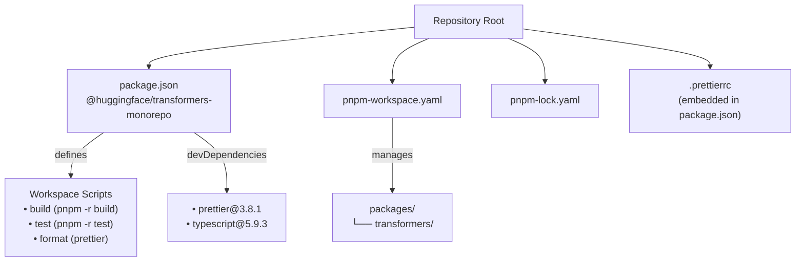
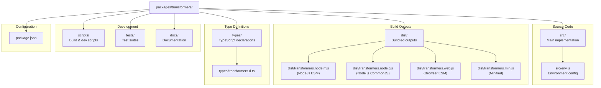
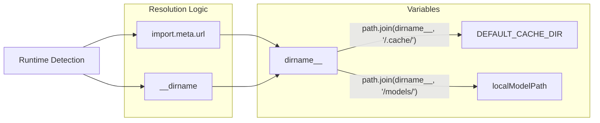
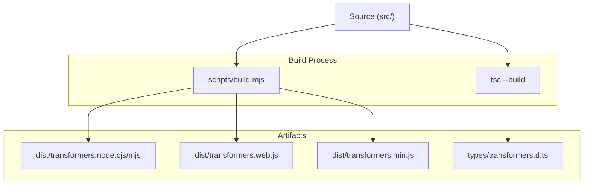

<!-- source: DeepWiki mcp.deepwiki.com · repo huggingface/transformers.js · page 1.1 Repository Structure · fetched 2026-10-26 -->

# Repository Structure

<details>
<summary>Relevant source files</summary>

The following files were used as context for generating this wiki page:

- [.gitignore](.gitignore)
- [README.md](README.md)
- [package.json](package.json)
- [packages/transformers/docs/snippets/2_installation.snippet](packages/transformers/docs/snippets/2_installation.snippet)
- [packages/transformers/docs/snippets/3_custom-usage.snippet](packages/transformers/docs/snippets/3_custom-usage.snippet)
- [packages/transformers/package.json](packages/transformers/package.json)
- [packages/transformers/src/env.js](packages/transformers/src/env.js)
- [pnpm-lock.yaml](pnpm-lock.yaml)
- [pnpm-workspace.yaml](pnpm-workspace.yaml)

</details>


This document explains the physical organization of the transformers.js repository, including its monorepo structure using pnpm workspaces, the layout of the core `@huggingface/transformers` package, and the development infrastructure. For information about the public API surface that users interact with, see [Public API Surface](#1.3). For build and distribution details, see [Build and Distribution](#13).

---

## Monorepo Organization

The repository is structured as a **pnpm monorepo** with a single workspace package. This architecture allows for potential future expansion while maintaining a simple structure for the core library.

### Workspace Root

The root directory contains the workspace configuration and shared development dependencies:

Title: Monorepo Root Structure


**Sources:** [package.json:1-63](), [pnpm-lock.yaml:1-60](), [pnpm-workspace.yaml:1-13]()

The root `package.json` at [package.json:2]() defines the monorepo name as `@huggingface/transformers-monorepo` with version `0.0.1` and is marked as `private: true`. The `packageManager` field at [package.json:7]() specifies `pnpm@10.28.1`. The workspace is configured to include all directories under `packages/` via `pnpm-workspace.yaml` [pnpm-workspace.yaml:1-2]().

### Workspace Scripts

| Script | Command | Purpose |
|--------|---------|---------|
| `build` | `pnpm -r build` | Recursively builds all packages in the workspace |
| `test` | `pnpm -r test` | Recursively runs tests in all packages |
| `format` | `prettier --write .` | Formats all files using Prettier |
| `format:check` | `prettier --check .` | Checks formatting without modifying files |
| `dev` | `node scripts/dev.mjs` | Development server script |

**Sources:** [package.json:8-14]()

### Prettier Configuration

The monorepo uses embedded Prettier configuration with environment-specific overrides:

| File Pattern | Tab Width | Print Width | Options |
|--------------|-----------|-------------|---------|
| `packages/*/src/**/*.{js,ts}` | 4 | 120 | `singleQuote: true` |
| `packages/*/tests/**/*.{js,ts}` | 2 | 10000000 | Long lines allowed |
| `scripts/**/*.{js,ts}` | 2 | 160 | - |

**Sources:** [package.json:29-62]()

---

## Core Package Structure

The `@huggingface/transformers` package located at `packages/transformers/` contains the entire library implementation.

Title: Core Package File Organization


**Sources:** [packages/transformers/package.json:1-87]()

### Package Metadata

The core package is published as `@huggingface/transformers` at version `4.2.0`:

- **Main Entry Point**: `./dist/transformers.node.cjs` ([packages/transformers/package.json:5]())
- **Type Definitions**: `./types/transformers.d.ts` ([packages/transformers/package.json:6]())
- **Module Type**: `"module"` (ESM by default) ([packages/transformers/package.json:7]())

**Sources:** [packages/transformers/package.json:2-7]()

### Conditional Exports

The package uses Node.js conditional exports to provide different bundles for different environments:

```javascript
{
  "exports": {
    "node": {
      "import": "./dist/transformers.node.mjs",  // Node.js ESM
      "require": "./dist/transformers.node.cjs"  // Node.js CommonJS
    },
    "default": "./dist/transformers.web.js"      // Browser/Other
  }
}
```

**Sources:** [packages/transformers/package.json:8-23]()

### CDN Distribution

For vanilla JavaScript usage via CDN, the package specifies minified entry points:

- **jsdelivr**: `./dist/transformers.min.js` ([packages/transformers/package.json:85]())
- **unpkg**: `./dist/transformers.min.js` ([packages/transformers/package.json:86]())

**Sources:** [packages/transformers/package.json:85-86](), [packages/transformers/docs/snippets/2_installation.snippet:7-12]()

---

## Environment Configuration

The `env.js` module defines runtime environment detection and global configuration. This module is critical for determining which APIs (filesystem, cache, WebGPU) are available to the library.

### Runtime Detection Flags

| Constant | Purpose | Detection Logic |
|----------|---------|-----------------|
| `IS_BROWSER_ENV` | Browser detection | `typeof window !== 'undefined' && typeof window.document !== 'undefined'` [packages/transformers/src/env.js:47]() |
| `IS_WEBWORKER_ENV` | Web worker detection | Checks `self.constructor.name` against worker scope names [packages/transformers/src/env.js:48-52]() |
| `IS_NODE_ENV` | Node.js detection | `process?.release?.name === 'node'` [packages/transformers/src/env.js:44]() |
| `IS_FS_AVAILABLE` | File system API | `!isEmpty(fs)` [packages/transformers/src/env.js:33]() |
| `IS_WEB_CACHE_AVAILABLE` | Cache API | `'caches' in self` [packages/transformers/src/env.js:35]() |
| `IS_WEBGPU_AVAILABLE` | WebGPU support | `'gpu' in navigator` [packages/transformers/src/env.js:55]() |

**Sources:** [packages/transformers/src/env.js:31-65]()

### Path Resolution Logic

The library dynamically computes file system paths for caching and local model loading when running in environments with file system access.

Title: Environment Path Resolution


**Sources:** [packages/transformers/src/env.js:146-168]()

---

## Build Output Targets

The build system produces distinct distribution bundles optimized for different runtime environments using `esbuild` [packages/transformers/package.json:68]().

Title: Build and Distribution Mapping


**Sources:** [packages/transformers/package.json:24-35]()

### Build Scripts

| Script | Command | Purpose |
|--------|---------|---------|
| `build` | `node scripts/build.mjs && pnpm typegen` | Full build with type generation [packages/transformers/package.json:29]() |
| `typegen` | `tsc --build` | Generate TypeScript definitions [packages/transformers/package.json:27]() |
| `test` | `node --experimental-vm-modules ... jest.js` | Run tests with ESM support [packages/transformers/package.json:30]() |

---

## Dependency Management

The repository manages dependencies at two levels: workspace-wide and package-specific.

### Package Dependencies

The `@huggingface/transformers` package has several categories of dependencies:

#### Runtime Dependencies

| Package | Version | Purpose |
|---------|---------|---------|
| `@huggingface/jinja` | ^0.5.6 | Chat template rendering [packages/transformers/package.json:58]() |
| `@huggingface/tokenizers` | ^0.1.3 | Fast tokenization (WASM) [packages/transformers/package.json:59]() |
| `onnxruntime-node` | 1.24.3 | ONNX execution for Node.js [packages/transformers/package.json:60]() |
| `onnxruntime-web` | 1.26.0-dev.* | ONNX execution for browsers [packages/transformers/package.json:61]() |
| `sharp` | ^0.34.5 | Image processing (Node.js) [packages/transformers/package.json:62]() |

**Sources:** [packages/transformers/package.json:57-63](), [pnpm-lock.yaml:19-34]()

#### Development Dependencies

| Package | Purpose |
|---------|---------|
| `esbuild` | Bundler for build process [packages/transformers/package.json:68]() |
| `jest` | Test framework [packages/transformers/package.json:69]() |
| `typescript` | Type checking and generation [packages/transformers/package.json:72]() |

**Sources:** [packages/transformers/package.json:64-73](), [pnpm-lock.yaml:35-59]()

---

## Published Package Contents

The `files` field in `package.json` specifies what gets published to npm:

```javascript
{
  "files": [
    "src",           // Source code (for source maps)
    "dist",          // Build outputs
    "types",         // Type definitions
    "README.md",     // Documentation
    "LICENSE",       // Apache-2.0 license
    "!**/*.tsbuildinfo"  // Exclude TypeScript build info
  ]
}
```

**Sources:** [packages/transformers/package.json:74-81]()

This ensures that users can access source maps for debugging while all build targets and type definitions are available for different module systems.

---

