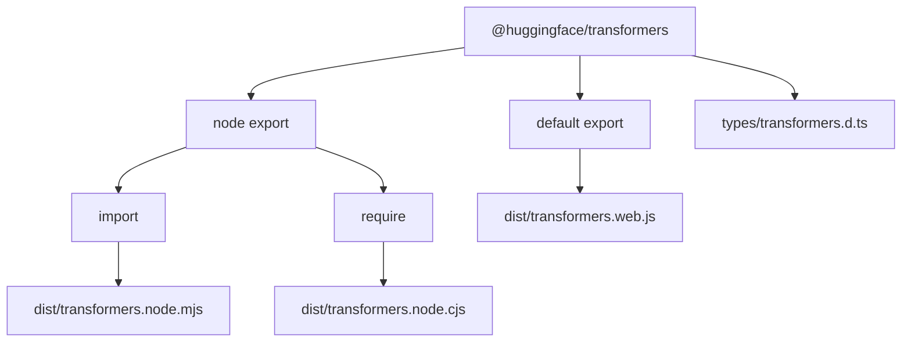
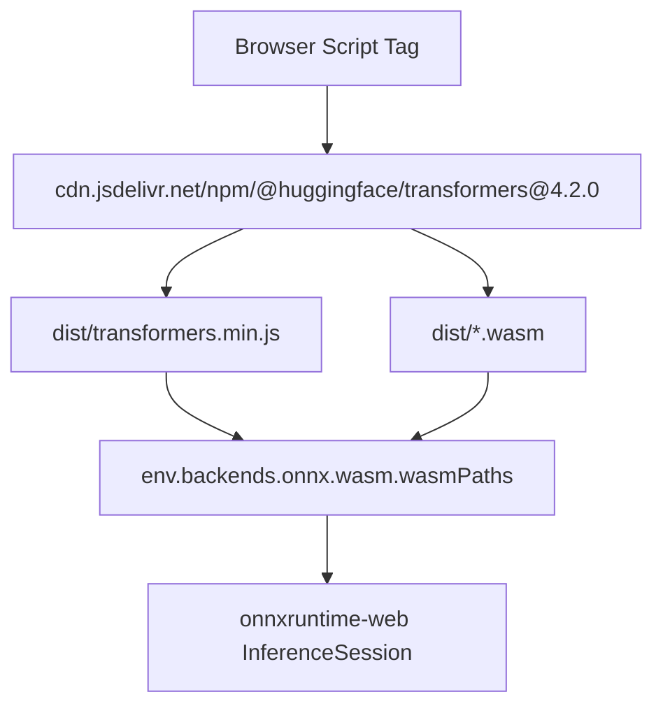
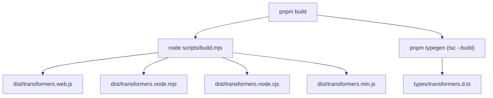
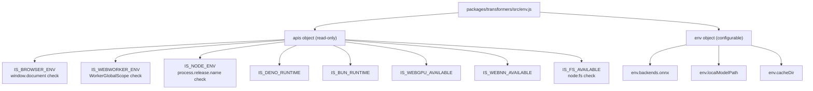
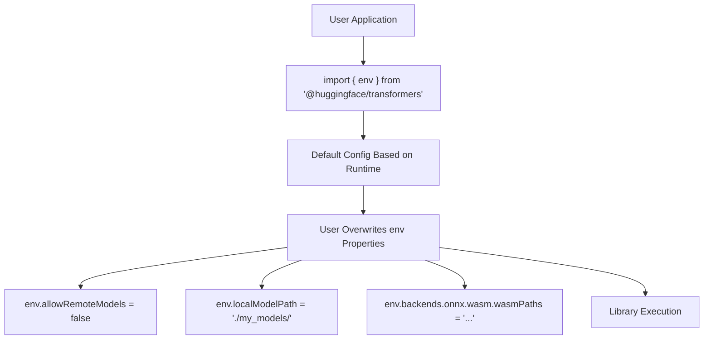

<!-- source: DeepWiki mcp.deepwiki.com · repo huggingface/transformers.js · page 1.2 Installation and Setup · fetched 2026-10-26 -->

# Installation and Setup

<details>
<summary>Relevant source files</summary>

The following files were used as context for generating this wiki page:

- [README.md](README.md)
- [package.json](package.json)
- [packages/transformers/docs/snippets/2_installation.snippet](packages/transformers/docs/snippets/2_installation.snippet)
- [packages/transformers/docs/snippets/3_custom-usage.snippet](packages/transformers/docs/snippets/3_custom-usage.snippet)
- [packages/transformers/package.json](packages/transformers/package.json)
- [packages/transformers/src/env.js](packages/transformers/src/env.js)
- [pnpm-lock.yaml](pnpm-lock.yaml)

</details>


This document covers the installation methods for Transformers.js and basic environment configuration. The library can be installed via npm, loaded from a CDN, or built from source. It automatically detects the JavaScript runtime environment (browser, Node.js, web worker, Deno, Bun) and configures appropriate backends and caching strategies.

For information about the pipeline API usage after installation, see [Pipeline API](#2). For advanced runtime configuration options, see [Environment Configuration](#11).

## Installation Methods

### NPM Installation

The library is published as `@huggingface/transformers` on npm. Install it using:

```bash
npm i @huggingface/transformers
```

The package version 4.2.0 includes the following runtime dependencies:
- `@huggingface/jinja@^0.5.6` - Template engine for chat templates [packages/transformers/package.json:58]()
- `@huggingface/tokenizers@^0.1.3` - Tokenization backend [packages/transformers/package.json:59]()
- `onnxruntime-node@1.24.3` - ONNX Runtime for Node.js environments [packages/transformers/package.json:60]()
- `onnxruntime-web@1.26.0-dev.20260416-b7804b056c` - ONNX Runtime for browser environments [packages/transformers/package.json:61]()
- `sharp@^0.34.5` - High-performance image processing (Node.js only) [packages/transformers/package.json:62]()

The package supports both ES modules and CommonJS, with different entry points for Node.js and browser environments as defined in the `exports` field.

**Package Entry Points**


Sources: [packages/transformers/package.json:1-23](), [packages/transformers/package.json:57-63]()

### CDN Installation

For browser usage without bundlers, import directly from a CDN using ES modules:

```html
<script type="module">
    import { pipeline } from 'https://cdn.jsdelivr.net/npm/@huggingface/transformers@4.2.0';
</script>
```

The package specifies CDN entry points through the `jsdelivr` and `unpkg` fields, both pointing to `./dist/transformers.min.js`.

**CDN Asset Loading**


Sources: [packages/transformers/package.json:85-86](), [packages/transformers/docs/snippets/2_installation.snippet:7-12]()

### Installation from Source

The repository is managed as a monorepo using `pnpm` workspaces [package.json:7](). To build and use the library from source:

```bash
# Clone the repository
git clone https://github.com/huggingface/transformers.js.git
cd transformers.js

# Install dependencies using pnpm
pnpm install

# Build the library
pnpm build
```

The build process uses `esbuild` [packages/transformers/package.json:68]() and generates TypeScript declarations via `tsc` [packages/transformers/package.json:27]().

**Build Output Structure**


Sources: [package.json:7-13](), [packages/transformers/package.json:24-29]()

## Environment Detection and Configuration

The library automatically detects the JavaScript runtime environment and configures itself accordingly. This detection happens through the `env.js` module, which exports the `apis` object containing environment flags and the `env` object for runtime configuration.

**Environment Detection System**


Sources: [packages/transformers/src/env.js:31-65](), [packages/transformers/src/env.js:99-144]()

### The env Configuration Object

The global `env` object provides runtime configuration for model loading, caching strategies, and backend settings.

| Property | Default Value | Description |
|----------|---------------|-------------|
| `allowRemoteModels` | `true` | Allow downloading models from Hugging Face Hub |
| `localModelPath` | `"/models/"` | Local path for model files [packages/transformers/src/env.js:167]() |
| `cacheDir` | `"./.cache/"` | Directory for filesystem cache (Node.js/Deno/Bun) [packages/transformers/src/env.js:163]() |
| `useBrowserCache` | `true` | Use browser Cache API when available [packages/transformers/src/env.js:35]() |
| `logLevel` | `LogLevel.INFO` | Controls output verbosity [packages/transformers/src/env.js:191]() |

**env Configuration Flow**


Sources: [packages/transformers/src/env.js:1-23](), [packages/transformers/src/env.js:146-170](), [packages/transformers/docs/snippets/3_custom-usage.snippet:7-18]()

## Basic Setup Examples

### Browser Environment Setup

```javascript
import { pipeline, env } from '@huggingface/transformers';

// Configure for browser usage
env.allowRemoteModels = true;
env.useBrowserCache = true;

const classifier = await pipeline('sentiment-analysis');
```

### Node.js Environment Setup

```javascript
import { pipeline, env } from '@huggingface/transformers';

// Configure for Node.js usage
env.localModelPath = './models/';
env.cacheDir = './.cache/';

const classifier = await pipeline('sentiment-analysis');
```

### Custom WASM Backend Configuration

The ONNX Runtime WASM backend paths can be customized to point to local assets instead of the default CDN.

```javascript
import { env } from '@huggingface/transformers';

// Set location of .wasm files
env.backends.onnx.wasm.wasmPaths = '/path/to/files/';
```

Sources: [packages/transformers/docs/snippets/3_custom-usage.snippet:10-18](), [packages/transformers/src/env.js:12-20]()

## Build System and Distribution

The library uses a dual-module system to support both modern and legacy JavaScript environments. The `package.json` defines conditional exports to route different environments to their optimized entry points.

| Build Target | File | Usage |
|-------------|------|-------|
| Node.js ESM | `dist/transformers.node.mjs` | Node.js with `import` |
| Node.js CJS | `dist/transformers.node.cjs` | Node.js with `require` |
| Web Bundle | `dist/transformers.web.js` | Browser environments |
| Minified | `dist/transformers.min.js` | CDN distribution (jsdelivr/unpkg) |

Sources: [packages/transformers/package.json:8-23](), [packages/transformers/package.json:85-86]()

---

