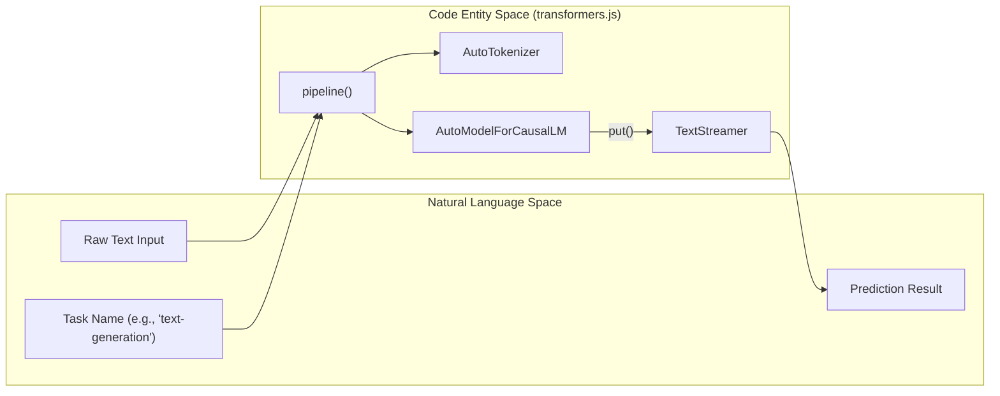
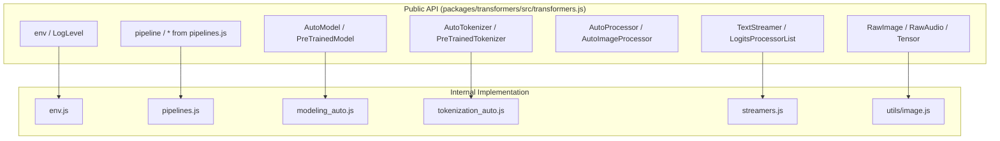

<!-- source: DeepWiki mcp.deepwiki.com · repo huggingface/transformers.js · page 1.3 Public API Surface · fetched 2026-10-26 -->

# Public API Surface

<details>
<summary>Relevant source files</summary>

The following files were used as context for generating this wiki page:

- [README.md](README.md)
- [package.json](package.json)
- [packages/transformers/src/generation/streamers.js](packages/transformers/src/generation/streamers.js)
- [packages/transformers/src/transformers.js](packages/transformers/src/transformers.js)
- [packages/transformers/tests/exports.test.js](packages/transformers/tests/exports.test.js)
- [packages/transformers/tests/utils/generation.test.js](packages/transformers/tests/utils/generation.test.js)

</details>


The Public API Surface defines the complete set of classes, functions, and objects that are exported from the main entry point and available to end users. This document catalogs these exports and explains how they are organized into functional categories.

## Scope and Purpose

The public API is defined by `packages/transformers/src/transformers.js`, which serves as the sole entry point for the library [packages/transformers/src/transformers.js:1-13](). All user-facing functionality must be explicitly exported through this file. The API surface is organized into seven main categories:

1.  **Environment Variables** - Global configuration via the `env` object [packages/transformers/src/transformers.js:16]().
2.  **Pipelines** - High-level task-based inference functions [packages/transformers/src/transformers.js:19]().
3.  **Models** - Model classes and `AutoModel` loaders [packages/transformers/src/transformers.js:22-23]().
4.  **Tokenizers** - Text tokenization classes and `AutoTokenizer` [packages/transformers/src/transformers.js:26-27]().
5.  **Processors** - Multimodal input preprocessing (image, audio, multimodal) [packages/transformers/src/transformers.js:30-39]().
6.  **Configs** - Model and environment configuration classes [packages/transformers/src/transformers.js:42]().
7.  **Cache & File Management** - Utilities for managing downloaded models and caching [packages/transformers/src/transformers.js:56-59]().

**Sources:** [packages/transformers/src/transformers.js:1-71]()

## Key Exports

### Pipelines
The `pipeline` function provides the highest-level API for running inference tasks. It is exported from `packages/transformers/src/pipelines.js` and automatically selects the appropriate model, tokenizer, and processor for a given task [packages/transformers/src/transformers.js:19]().

```javascript
import { pipeline } from '@huggingface/transformers';
const pipe = await pipeline('sentiment-analysis');
```

**Sources:** [packages/transformers/src/transformers.js:19](), [README.md:82-89]()

### Auto Classes
The library uses "Auto" classes to automatically instantiate the correct class based on the model configuration. These are exported from the `auto/` subdirectories [packages/transformers/src/transformers.js:23, 27, 31, 35, 39]().

*   **Modeling:** `AutoModel`, `AutoModelForCausalLM`, `AutoModelForSeq2SeqLM`, etc. [packages/transformers/src/transformers.js:23]().
*   **Tokenization:** `AutoTokenizer` [packages/transformers/src/transformers.js:27]().
*   **Processing:** `AutoProcessor`, `AutoImageProcessor`, `AutoFeatureExtractor` [packages/transformers/src/transformers.js:31-39]().

**Sources:** [packages/transformers/src/transformers.js:21-40](), [packages/transformers/tests/utils/generation.test.js:1-16]()

### ModelRegistry
The `ModelRegistry` class provides methods for managing the local cache, checking available data types (quantizations), and handling model files [packages/transformers/src/transformers.js:59]().

**Sources:** [packages/transformers/src/transformers.js:59]()

### Environment Configuration
The `env` object provides global runtime configuration, such as local model paths and remote loading toggles [packages/transformers/src/transformers.js:16]().

```javascript
import { env } from '@huggingface/transformers';
env.localModelPath = '/path/to/models/';
env.allowRemoteModels = false;
```

**Sources:** [packages/transformers/src/transformers.js:16](), [README.md:142-147]()

## Data Flow and API Structure

The following diagram maps the high-level system names to the specific code entities exported in the API surface.

### Natural Language Space to Code Entity Space: Inference Flow
Title: "Inference Flow: Text to Prediction"

**Sources:** [packages/transformers/src/transformers.js:19, 23, 27, 45](), [packages/transformers/src/generation/streamers.js:40-168](), [README.md:82-89]()

### API Organization and Module Re-exports
Title: "Public API Surface Architecture"

**Sources:** [packages/transformers/src/transformers.js:1-60]()

## Export Mapping Table

| Export Category | Key Symbols | Source File(s) |
| :--- | :--- | :--- |
| **Environment** | `env`, `LogLevel` | [packages/transformers/src/env.js]() |
| **Pipelines** | `pipeline`, `TextClassificationPipeline`, etc. | [packages/transformers/src/pipelines.js]() |
| **Models** | `AutoModel`, `PreTrainedModel`, `AutoModelForCausalLM` | [packages/transformers/src/models/models.js](), [packages/transformers/src/models/auto/modeling_auto.js]() |
| **Tokenizers** | `AutoTokenizer`, `PreTrainedTokenizer` | [packages/transformers/src/models/tokenizers.js](), [packages/transformers/src/models/auto/tokenization_auto.js]() |
| **Processors** | `AutoProcessor`, `AutoImageProcessor`, `AutoFeatureExtractor` | [packages/transformers/src/models/auto/processing_auto.js](), [packages/transformers/src/models/auto/image_processing_auto.js]() |
| **Generation** | `TextStreamer`, `StoppingCriteriaList`, `LogitsProcessorList` | [packages/transformers/src/generation/streamers.js](), [packages/transformers/src/generation/stopping_criteria.js](), [packages/transformers/src/generation/logits_process.js]() |
| **Utilities** | `Tensor`, `RawImage`, `RawAudio`, `RawVideo`, `softmax` | [packages/transformers/src/utils/tensor.js](), [packages/transformers/src/utils/image.js](), [packages/transformers/src/utils/audio.js](), [packages/transformers/src/utils/maths.js]() |
| **Management** | `ModelRegistry`, `DynamicCache` | [packages/transformers/src/utils/model_registry/ModelRegistry.js](), [packages/transformers/src/cache_utils.js]() |

**Sources:** [packages/transformers/src/transformers.js:14-60]()

## Common Type Exports
The entry point also exposes several TypeScript types via JSDoc for developers to access [packages/transformers/src/transformers.js:62-71]():
*   `PretrainedModelOptions`: Options for loading models.
*   `DataType`: Model precision/quantization types (e.g., `'fp32'`, `'q8'`).
*   `DeviceType`: Execution backends (e.g., `'cpu'`, `'webgpu'`).
*   `ProgressCallback`: Function signature for tracking download progress.

**Sources:** [packages/transformers/src/transformers.js:62-71]()

---

